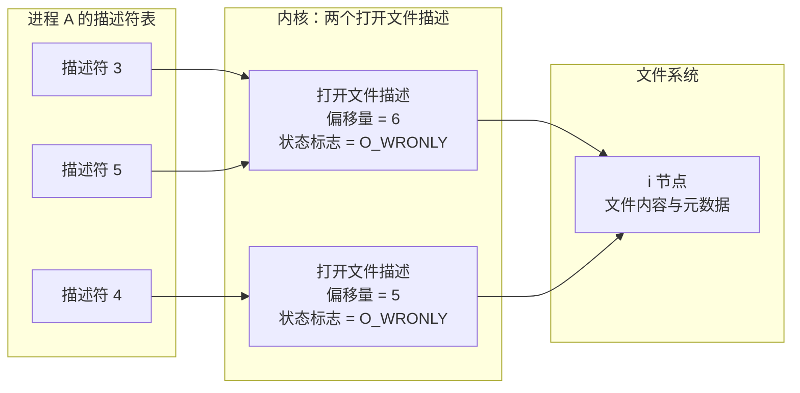

# 2. 文件描述符与非缓冲 I/O

无论是在磁盘上复制一个普通文件、向审计日志追加记录，还是从跨进程的管道或网络套接字中读取字节流，在 ISO C 的抽象世界里往往需要借助 `fopen`、`fread` 或针对特定通信协议的专用接口；而在 POSIX 系统的设计哲学中，这一切都被高度抽象并统一到一组极其精炼的原生系统调用之下：`open`、`read`、`write` 与 `close`。这组接口构成了 UNIX 最具标志性的通用 I/O 模型（Universal I/O）。

本篇以文件描述符这一基础抽象为切入点，层层递进地展开操作系统在 I/O 路径上的精妙设计：深入剖析进程描述符表、内核打开文件描述（Open File Description）以及底层文件系统 i 节点之间的三层解耦体系；厘清文件偏移量在多进程共享与原子追加（`O_APPEND`）中的内核保证；剖析以 `dup2` 为代表的描述符复制机制如何支撑起 Shell 重定向的核心运作；最后追溯用户态 stdio 缓冲与内核页缓存（Page Cache）的分层开销模型，并明确指出数据真正落地持久化（`fsync`）的边界条件。

## 1. 文件描述符

实现一个极简版的 `cat` 工具，在系统级调用层面通常仅需串联起四个核心操作：首先调用 `open` 获取代表目标资源的句柄，内核随后返回一个非负的小整数；接着将该整数传入 `read`，系统便将数据自底层媒介批量搬移至用户态缓冲区；紧接着再调用 `write` 将这批字节压入标准输出；待数据流尽时以 `close` 释放。这个作为索引凭据的小整数，便是经典的文件描述符（File Descriptor，常简写为 fd）。如果 `open` 调用成功返回了数值 3，则后续针对该资源的所有 I/O 读写，其第一个参数便固定传入 3。

在任何 Linux 进程初始化之初，内核与运行环境便已默认为其预设了三个处于打开状态的描述符：0 号对应标准输入（`stdin`）、1 号对应标准输出（`stdout`）、2 号对应标准错误（`stderr`）。这一约定的建立者是启动该程序的上层 Shell——Shell 在真正派生并装载执行新程序之前，便已在进程上下文中妥善布置好了这三个通道。正因如此，应用程序无须显式执行任何 `open`，即可直接面向 0 号发起 `read`，或面向 1 号、2 号发起 `write`。

为了在运行时直观洞察进程当前的文件描述符分布，Linux 提供了强大的伪文件系统支持。通过检视 `/proc/self/fd` 目录，可以清晰枚举出当前进程所持有的全部打开编号。在该虚拟目录下，每一个以数字命名的条目本身都是一个特殊的符号链接，其实际指向即为内核层面关联的底层物理实体或通信管道。

```c
#define _POSIX_C_SOURCE 200809L

#include <fcntl.h>
#include <limits.h>
#include <stdio.h>
#include <stdlib.h>
#include <string.h>
#include <unistd.h>

static void die(const char *what) {
    perror(what);
    exit(EXIT_FAILURE);
}

/* 把链接目标里属于当前目录的前缀换成 .，输出短一些 */
static void print_target(const char *target) {
    char cwd[PATH_MAX];
    if (getcwd(cwd, sizeof cwd) != NULL) {
        size_t len = strlen(cwd);
        if (strncmp(target, cwd, len) == 0 && target[len] == '/') {
            printf(".%s", target + len);
            return;
        }
    }
    printf("%s", target);
}

int main(int argc, char *argv[]) {
    for (int i = 1; i < argc; i++) {
        int fd = open(argv[i], O_RDONLY | O_CLOEXEC);
        if (fd == -1) {
            die(argv[i]);
        }
        printf("open(\"%s\") = %d\n", argv[i], fd);
    }

    for (int fd = 0; fd < 16; fd++) {
        char link[32];
        char target[PATH_MAX];
        snprintf(link, sizeof link, "/proc/self/fd/%d", fd);
        ssize_t n = readlink(link, target, sizeof target - 1);
        if (n == -1) {
            continue; /* 这个编号当前没有打开 */
        }
        target[n] = '\0';
        printf("%d -> ", fd);
        print_target(target);
        putchar('\n');
    }
    return 0;
}
```

完整文件在 `code/系统编程/2_文件描述符与非缓冲IO/fdlist.c`。准备两个文件后运行：

::: terminal title="bash - fdlist"

<span class="prompt">\$</span> printf 'alpha\nbeta\n' > a.txt

<span class="prompt">\$</span> printf 'gamma\n' > b.txt

<span class="prompt">\$</span> ./fdlist a.txt b.txt

open("a.txt") = 3

open("b.txt") = 4

0 -> pipe:[876761627]

1 -> pipe:[876761628]

2 -> pipe:[876761629]

3 -> ./a.txt

4 -> ./b.txt

:::

0、1、2 在某次运行里指向管道，因为程序的输出被 shell 接到了管道上；直接在终端里运行的话，这三个链接会指向 `/dev/pts/2` 这样的终端设备。指向什么由启动它的 shell 决定，程序拿到的只是三个已经打开的编号。`open` 从 3 开始分配，因为 0 到 2 已经被占了。

同一个程序在伪终端下运行，0、1、2 就都指向终端：

::: terminal title="bash - fdlist（在终端里）"

<span class="prompt">\$</span> script -qc './fdlist a.txt b.txt' /dev/null

open("a.txt") = 3

open("b.txt") = 4

0 -> /dev/pts/2

1 -> /dev/pts/2

2 -> /dev/pts/2

3 -> ./a.txt

4 -> ./b.txt

:::

这组诊断清晰呈现了三类在物理机理上截然相异的系统资源：`./a.txt` 属于传统磁盘文件系统所管理的常规数据文件；`pipe:[876761627]` 则是内核在物理内存中动态分配并维护的单向 FIFO 管道缓冲区；而 `/dev/pts/2` 则是字符设备驱动所驱动的交互式虚拟终端。

尽管底层的数据通道实现与驱动逻辑千差万别，但在用户空间视角下，它们均对等映射为一个简单的整型描述符，并且无缝复用完全一致的 `read` 与 `write` 原语。即便后续在第 10 章涉及跨主机的网络通信套接字，通过 `socket` 创建出的句柄同样严格支持标准的文件 I/O 契约。这种统一的设计正是 POSIX 乃至 UNIX 系统最核心的美学原则——通用 I/O（Universal I/O）：文件描述符所代表的本质是一个抽象的“可寻址与可流式传输的对象”。该对象背后的具体物理设备类型与实现协议由创建或打开它的初始化入口全权裁决，而上层的读写、重定向与管道化操作则保持了纯粹而恒定的正交性。

::: concept sys-fd-definition title="文件描述符"

文件描述符是一个非负小整数，进程用它指代一个已经打开的对象。描述符只在进程内有意义：同一个编号在另一个进程里可以指向完全不同的对象。每个进程维护一张描述符表，表项包含指向内核对象的指针和一组只属于该描述符的标志。

:::

::: tip 用 /proc/PID/fd 排查描述符泄漏

服务运行久了报 `Too many open files`，先看它的描述符都停在什么地方：`ls -l /proc/PID/fd` 会列出每个编号指向的路径。同一路径反复出现，或者 `(deleted)` 的文件还在增长，通常就是某个分支上打开了却忘了 `close`。自己的程序可以直接读 `/proc/self/fd`，不必知道 PID。

:::

## 2. 打开和关闭文件

`open` 有两种形式，带 `O_CREAT` 时必须用第二种，多给一个权限参数：

```c
#include <fcntl.h>

int open(const char *path, int flags);
int open(const char *path, int flags, mode_t mode);
```

`flags` 由访问模式和若干可选标志按位或起来。访问模式必须给一个：

| 标志 | 含义 |
| --- | --- |
| `O_RDONLY` | 只读 |
| `O_WRONLY` | 只写 |
| `O_RDWR` | 读写 |

其余常用标志：

| 标志 | 作用 |
| --- | --- |
| `O_CREAT` | 文件不存在时创建，需要 `mode` 参数 |
| `O_EXCL` | 与 `O_CREAT` 同用时，文件已存在则失败，不打开它 |
| `O_TRUNC` | 以写方式打开时把文件截断为 0 字节 |
| `O_APPEND` | 每次写之前把偏移量移到文件末尾，与写操作是一个原子步骤 |
| `O_CLOEXEC` | 新建的描述符带 close-on-exec 标志，`exec` 时自动关闭 |

`O_CREAT | O_EXCL` 的组合用来「只创建新文件，不碰已有的」：文件已存在时 `open` 返回 -1，`errno` 为 `EEXIST`。

::: terminal title="bash - newfile"

<span class="prompt">\$</span> ./newfile created.txt

新建了 created.txt，描述符 3

<span class="prompt">\$</span> ./newfile created.txt

created.txt: File exists

:::

`O_TRUNC` 的效果更直接。把一个 33 字节的文件用 `O_TRUNC` 打开再写 4 个字节，旧内容不会留在后面：

::: terminal title="bash - trunc"

<span class="prompt">\$</span> printf 'old line 1\nold line 2\nold line 3\n' > t.txt

<span class="prompt">\$</span> wc -c t.txt

33 t.txt

<span class="prompt">\$</span> ./trunc

<span class="prompt">\$</span> wc -c t.txt

4 t.txt

:::

`mode` 只在创建文件时起作用，写 `0644` 是最常见的选择。实际权限还要经过 umask 削减，这部分留到第 3 章。

### 2.1 新描述符取最小可用编号

`open` 成功时返回的描述符总是当前最小的空闲编号。这条规则本身不起眼，却是重定向的工作原理：把 0 号关掉，下一个 `open` 就会拿到 0。

```c
#define _POSIX_C_SOURCE 200809L

#include <fcntl.h>
#include <stdio.h>
#include <stdlib.h>
#include <unistd.h>

static void die(const char *what) {
    perror(what);
    exit(EXIT_FAILURE);
}

int main(void) {
    if (close(STDIN_FILENO) == -1) {
        die("close");
    }

    int fd = open("greeting.txt", O_RDONLY | O_CLOEXEC);
    if (fd == -1) {
        die("open");
    }
    printf("open 返回 %d\n", fd);

    char line[64];
    if (fgets(line, sizeof line, stdin) != NULL) {
        printf("从描述符 0 读到：%s", line);
    }
    return 0;
}
```

::: terminal title="bash - lowest_fd"

<span class="prompt">\$</span> printf 'greetings\n' > greeting.txt

<span class="prompt">\$</span> ./lowest_fd < greeting.txt

open 返回 0

从描述符 0 读到：greetings

:::

注意最后一行：`fgets` 读的是 `stdin`，而 `stdin` 这个流背后就是描述符 0。0 号在 `close` 之后被 `open` 分给了 `greeting.txt`，于是「从标准输入读」读到的其实是这个文件。shell 的 `cmd < file` 就是这么实现的：打开文件拿到 0 号，再让程序照常读标准输入。

<Quiz
  type="single"
  :options="[
    { label: '3', value: 'A' },
    { label: '0', value: 'B' },
    { label: '1', value: 'C' },
    { label: '不确定，由内核随机分配', value: 'D' }
  ]"
  answer="B"
>

一个程序先 `close(0)`，然后 `open` 一个文件，返回值是多少？

</Quiz>

### 2.2 关闭文件

`close(fd)` 释放描述符，此后该编号可以被下一次 `open` 重用。关闭失败一般不必特别处理，但写文件时值得检查：某些文件系统上的写入错误会延迟到 `close` 才报告出来。这个程序里所有 `close` 都检查了返回值，就是为了不在最后一步丢掉错误。

`close` 对同一个编号调用两次是错的：第二次会关掉别人刚分配到的描述符，而且在多线程程序里无法预料后果。第 14 章会讲怎么用 `close_range` 在 `exec` 之前批量收拾。

本页所有 `open` 都带了 `O_CLOEXEC`，理由在 6.4 节。

## 3. 读和写

`read` 和 `write` 的签名只差一个 `const`：

```c
#include <unistd.h>

ssize_t read(int fd, void *buf, size_t count);
ssize_t write(int fd, const void *buf, size_t count);
```

`read` 的返回值有三种：

- 大于 0：实际读到的字节数，可能小于 `count`；
- 等于 0：文件结束，对管道和套接字表示对端已关闭写端；
- 等于 -1：出错，原因在 `errno`。

在系统编程中，**单次读取所获取的字节数可能少于请求的 `count`，这不仅不是错误，反而是非阻塞或流式设备上的常态**。例如，交互式终端通常以行为单位向用户程序投递数据，敲下回车时往往仅有几十个字节；匿名管道或套接字则仅能返还其内核接收队列中当前已就绪的实际数据块；网络通信更会受到底层 MTU 及 TCP 拥塞窗口分段的制约。编写健壮的系统代码，首要的思维转换便是绝不可假定一次 `read` 能够自动填满传入的整个缓冲区。

::: terminal title="bash - readonce"

<span class="prompt">\$</span> printf 'abc' | ./readonce

请求 4096 字节，read 返回 3，内容是：abc

<span class="prompt">\$</span> ./readonce < a.txt

请求 4096 字节，read 返回 17，内容是：alpha

beta

gamma

:::

同一个程序，面对完全相同的 4096 字节读取请求，从管道中只能读出当前对端写入的 3 个字节。普通磁盘文件在未达 EOF 时虽然通常能一次性返回请求的字节数，但若将这种特定介质上的偶发特征当作通用逻辑硬编码在程序中，一旦程序的标准输入被 Shell 管道或网络终端重定向，代码就会立刻产生预期外的行为偏差甚至逻辑崩溃。

同理，`write` 系统调用返回的也是内核本次实际接收或写出的字节数，同样存在返回长度小于请求长度的可能（常称为“短写”或 Partial Write）。在对常规的本地磁盘文件进行同步写入时，由于内核页缓存空间充足，短写现象极为罕见；但在面对管道、终端以及网络套接字等通信介质时，短写则极易发生：当管道内部的环形缓冲区接近蓄满时，单次 `write` 只能暂存剩余可容纳的部分字节，随后便会停滞或返回当前已接纳的大小。如果上层程序未经校验便直接认定已全量写出，未被消费的数据就会无声遗失。

下面这个程序一次 `write` 写 1 MiB 到标准输出，输出接到一个读得很慢的管道：

```c
#define _POSIX_C_SOURCE 200809L

#include <signal.h>
#include <stdio.h>
#include <stdlib.h>
#include <string.h>
#include <unistd.h>

#define TOTAL (1024 * 1024)

static void on_alarm(int signo) {
    (void)signo;
}

/* 一次 write 写 1 MiB 到标准输出。输出接到管道、读者又很慢时，
   这一次 write 会在中途阻塞，被 SIGALRM 打断后返回已经写出的字节数 */
int main(void) {
    struct sigaction sa;
    memset(&sa, 0, sizeof sa);
    sa.sa_handler = on_alarm;
    sigemptyset(&sa.sa_mask);
    if (sigaction(SIGALRM, &sa, NULL) == -1) {
        perror("sigaction");
        return EXIT_FAILURE;
    }

    static char big[TOTAL];
    memset(big, 'x', sizeof big);
    alarm(1); /* 1 秒后打断写操作 */

    ssize_t n = write(STDOUT_FILENO, big, sizeof big);
    if (n == -1) {
        perror("write");
        return EXIT_FAILURE;
    }
    fprintf(stderr, "要写 %d 字节，这一次 write 返回 %zd\n", TOTAL, n);
    return 0;
}
```

::: terminal title="bash - shortwrite"

<span class="prompt">\$</span> ./shortwrite | (sleep 2; wc -c)

要写 1048576 字节，这一次 write 返回 65536

65536

:::

管道缓冲区是 64 KiB，`write` 先把这一块填满，再等读者取走。信号在等待期间到达，写操作已经完成了一部分，于是这一次 `write` 只返回 65536，请求的 1048576 字节没有写完。程序如果只调用一次 `write` 就认为写完了，剩下的 983040 字节就丢了。

### 3.1 write_all：把一次写变成「写完为止」

既然一次 `write` 不保证写完，就循环写到写完。这个函数在本教程后面各章反复使用，签名固定为：

```c
/* 把 buf 开始的 len 字节全部写到 fd。成功返回 0；失败返回 -1，errno 指明原因 */
int write_all(int fd, const void *buf, size_t len) {
    const char *p = buf;
    while (len > 0) {
        ssize_t n = write(fd, p, len);
        if (n == -1) {
            if (errno == EINTR) {
                continue; /* 被信号打断，重新写（第 6 章） */
            }
            return -1;
        }
        p += n;
        len -= (size_t)n;
    }
    return 0;
}
```

循环里做三件事：指针前进 `n`，剩余长度减去 `n`，再写一次。`EINTR` 的处理是为信号准备的，含义在第 6 章讲，这里只要知道「被打断的写可以重来」。返回值约定成 0 和 -1，调用方用 `perror` 一类的方式报告错误即可。

### 3.2 一个能用的 mycat

把 `open`、`read`、`write_all` 合起来就是一个 `cat`：

```c
#define _POSIX_C_SOURCE 200809L

#include <errno.h>
#include <fcntl.h>
#include <stdio.h>
#include <stdlib.h>
#include <unistd.h>

#define BUF_SIZE 65536

static void die(const char *what) {
    perror(what);
    exit(EXIT_FAILURE);
}

/* write_all 与 3.1 节相同，完整文件见 code/ 目录 */

static void copy_fd(int in, const char *name) {
    static char buf[BUF_SIZE];
    for (;;) {
        ssize_t n = read(in, buf, sizeof buf);
        if (n == 0) {
            return; /* 文件结束 */
        }
        if (n == -1) {
            if (errno == EINTR) {
                continue;
            }
            die(name);
        }
        if (write_all(STDOUT_FILENO, buf, (size_t)n) == -1) {
            die("write");
        }
    }
}

int main(int argc, char *argv[]) {
    if (argc == 1) {
        copy_fd(STDIN_FILENO, "stdin");
        return 0;
    }
    for (int i = 1; i < argc; i++) {
        int fd = open(argv[i], O_RDONLY | O_CLOEXEC);
        if (fd == -1) {
            die(argv[i]);
        }
        copy_fd(fd, argv[i]);
        if (close(fd) == -1) {
            die("close");
        }
    }
    return 0;
}
```

::: terminal title="bash - mycat"

<span class="prompt">\$</span> ./mycat a.txt

alpha

beta

<span class="prompt">\$</span> seq 3 | ./mycat

1

2

3

<span class="prompt">\$</span> ./mycat a.txt b.txt

alpha

beta

gamma

:::

三个命令走了两条路径：带参数时对每个文件 `open` 一次，不带参数时直接读 0 号。`seq 3 | ./mycat` 能工作，是因为管道写端就是 `seq` 的标准输出，而这个管道的读端被 shell 接到了 `mycat` 的 0 号。同一个 `copy_fd` 既能读文件也能读管道，靠的就是通用 I/O。

### 3.3 把缓冲区当字符串用的后果

一个常见的错误写法是：`read` 之后不按返回值处理，直接把缓冲区当成以空字符结尾的字符串。

::: compare left-title="把 read 的缓冲区当字符串" right-title="按返回值处理"

```c
char buf[4096];
while (read(fd, buf, sizeof buf) > 0) {
    write(STDOUT_FILENO, buf, strlen(buf));
}
```

---

```c
char buf[4096];
for (;;) {
    ssize_t n = read(fd, buf, sizeof buf);
    if (n == 0) {
        break;
    }
    if (n == -1) {
        ...
    }
    if (write_all(STDOUT_FILENO, buf, (size_t)n) == -1) {
        ...
    }
}
```

:::

左边这段代码有三个问题：`read` 不会在缓冲区末尾补空字符，`strlen` 会越过读到的字节继续往后找；文件里本来就有 `\0` 时，从它之后的内容全部被截掉；`write` 只调用一次，短写时丢掉剩余部分。三个问题在文本文件上常常都不显形，所以这段代码能活很久。

用一个含 `\0` 的小文件看第二个问题：

::: terminal title="bash - badcat"

<span class="prompt">\$</span> printf 'one\0two\nthree\n' > nul.dat

<span class="prompt">\$</span> wc -c nul.dat

14 nul.dat

<span class="prompt">\$</span> ./badcat nul.dat | od -An -c

o n e

<span class="prompt">\$</span> ./mycat nul.dat | od -An -c

o n e \0 t w o \n t h r e e \n

:::

14 个字节的文件，`badcat` 只输出了 3 个。`od -An -c` 把字节按字符显示，`\0` 就是文件里那个空字节。`mycat` 按 `read` 的返回值写，一个字节不少。

### 3.4 writev：一次写出多块数据

日志一行通常由几块拼起来：时间戳、正文、换行符。如果这三块分散在三个对象里，用三次 `write` 写，中间可能被别的进程插进来，也可能多两次系统调用。`writev` 接收一个数组，一次把多块数据写出去：

```c
#include <sys/uio.h>

ssize_t writev(int fd, const struct iovec *iov, int iovcnt);

struct iovec {
    void *iov_base; /* 数据起始地址 */
    size_t iov_len; /* 这一块的字节数 */
};
```

```c
#define _POSIX_C_SOURCE 200809L

#include <stdio.h>
#include <stdlib.h>
#include <string.h>
#include <sys/uio.h>
#include <time.h>
#include <unistd.h>

static void die(const char *what) {
    perror(what);
    exit(EXIT_FAILURE);
}

/* 时间戳、消息和换行符分别在三块内存里，一次 writev 写出 */
static void log_line(int fd, const char *msg) {
    char stamp[32];
    time_t now = time(NULL);
    struct tm tm;
    if (localtime_r(&now, &tm) == NULL) {
        die("localtime_r");
    }
    size_t stamp_len = strftime(stamp, sizeof stamp, "%Y-%m-%d %H:%M:%S ", &tm);

    struct iovec iov[3] = {
        {.iov_base = stamp, .iov_len = stamp_len},
        {.iov_base = (char *)msg, .iov_len = strlen(msg)},
        {.iov_base = "\n", .iov_len = 1},
    };
    if (writev(fd, iov, 3) == -1) {
        die("writev");
    }
}
```

完整文件在 `code/系统编程/2_文件描述符与非缓冲IO/logv.c`。运行并用 `strace` 看：

::: terminal title="bash - logv"

<span class="prompt">\$</span> ./logv "server started"

2026-10-20 22:49:14 server started

<span class="prompt">\$</span> strace -e trace=writev,write ./logv "server started" > /dev/null

writev(1, [{iov_base="2026-10-20 22:49:14 ", iov_len=20}, {iov_base="server started", iov_len=14}, {iov_base="\n", iov_len=1}], 3) = 35

+++ exited with 0 +++

:::

三块数据只对应一次系统调用。`writev` 并不保证一定写完全部数据，返回值同样是实际写出的字节数，所以「写到完」的需求仍然要自己循环。第 10 章写网络协议、第 12 章写事件循环时会再用到它。

## 4. 文件偏移量

每个打开的文件都有一个偏移量，`read` 和 `write` 都从它开始，完成后把它推进相应字节数。这个偏移量可以用 `lseek` 读和改：

```c
#include <unistd.h>

off_t lseek(int fd, off_t offset, int whence);
```

`whence` 有三种取值：

| `whence` | 新偏移量 |
| --- | --- |
| `SEEK_SET` | `offset` |
| `SEEK_CUR` | 当前偏移量加 `offset` |
| `SEEK_END` | 文件长度加 `offset` |

成功时返回新的偏移量，失败返回 -1。管道、FIFO 和套接字上不能定位：

::: terminal title="bash - espipe"

<span class="prompt">\$</span> ./espipe

lseek: Illegal seek

:::

`errno` 是 `ESPIPE`。普通文件和块设备可以随意定位，字符设备要看驱动。

### 4.1 空洞文件

`lseek` 允许把偏移量设到文件末尾之后，此时写数据并不会填充中间的间隙。从 1 MiB 处写 4 个字节，文件长度变成 1 MiB 加 4 字节，中间那 1 MiB 在磁盘上并不存在，称为空洞 (hole)。

```c
#define _POSIX_C_SOURCE 200809L

#include <errno.h>
#include <fcntl.h>
#include <stdio.h>
#include <stdlib.h>
#include <unistd.h>

static void die(const char *what) {
    perror(what);
    exit(EXIT_FAILURE);
}

static int write_all(int fd, const void *buf, size_t len) {
    const char *p = buf;
    while (len > 0) {
        ssize_t n = write(fd, p, len);
        if (n == -1) {
            if (errno == EINTR) {
                continue;
            }
            return -1;
        }
        p += n;
        len -= (size_t)n;
    }
    return 0;
}

int main(void) {
    int fd = open("holes.bin", O_WRONLY | O_CREAT | O_TRUNC | O_CLOEXEC, 0644);
    if (fd == -1) {
        die("open");
    }
    if (write_all(fd, "head", 4) == -1) {
        die("write");
    }
    if (lseek(fd, 1024 * 1024, SEEK_SET) == -1) { /* 跳到 1 MiB 处 */
        die("lseek");
    }
    if (write_all(fd, "tail", 4) == -1) {
        die("write");
    }
    if (close(fd) == -1) {
        die("close");
    }
    return 0;
}
```

::: terminal title="bash - holes"

<span class="prompt">\$</span> ./holes

<span class="prompt">\$</span> yes | head -c 1048576 > plain.bin

<span class="prompt">\$</span> stat -c "大小 %s 字节，占用 %b 个 512 字节块" holes.bin plain.bin

大小 1048580 字节，占用 16 个 512 字节块

大小 1048576 字节，占用 2048 个 512 字节块

<span class="prompt">\$</span> du -k holes.bin plain.bin

8 holes.bin

1024 plain.bin

:::

`plain.bin` 是用 `yes | head -c 1048576` 生成的普通文件，1 MiB 内容占 1024 KiB。`holes.bin` 长度差不多，只占 8 KiB：文件系统只给实际写过的两个小块分配了空间，中间的洞读出来全是 `\0`。

把洞填实要靠「读出来再写回去」的复制。GNU 的 `cp` 默认会检测并保留空洞，用 `--sparse=never` 才按普通字节流复制；用重定向做同样的事则一定会填实：

::: terminal title="bash - 空洞被填实"

<span class="prompt">\$</span> cat holes.bin > catcopy.bin

<span class="prompt">\$</span> du -k holes.bin catcopy.bin

8 holes.bin

1028 catcopy.bin

:::

`cat` 读出 1 MiB 的 `\0`，再原样写进 `catcopy.bin`，文件系统没有理由把一段真实的零字节当成洞。这解释了为什么「文件大小」和「磁盘占用」是两个不同的数：`ls -l` 报的 `st_size` 是最后一个字节的位置，`du` 报的是实际分配的块数。

### 4.2 pread 和 pwrite

`pread` 和 `pwrite` 在指定偏移量上读写，不改动文件当前的偏移量：

```c
#include <unistd.h>

ssize_t pread(int fd, void *buf, size_t count, off_t offset);
ssize_t pwrite(int fd, const void *buf, size_t count, off_t offset);
```

用途很实际。多个线程共用一个描述符时，`lseek` 加 `read` 是两步操作，两个线程交错执行会互相踩偏移量；`pread` 一步完成定位和读取。数据库、索引这类按固定大小分页的文件也用它：第 k 条记录的偏移量直接算出来，不需要从头读。

固定长度记录的例子，每条记录 6 字节：

```c
#define _POSIX_C_SOURCE 200809L

#include <errno.h>
#include <fcntl.h>
#include <stdio.h>
#include <stdlib.h>
#include <unistd.h>

static void die(const char *what) {
    perror(what);
    exit(EXIT_FAILURE);
}

#define RECORD_SIZE 6 /* 每条记录形如 "00042\n" */

int main(int argc, char *argv[]) {
    if (argc < 3) {
        fprintf(stderr, "用法：%s 文件 记录号...\n", argv[0]);
        return EXIT_FAILURE;
    }
    int fd = open(argv[1], O_RDONLY | O_CLOEXEC);
    if (fd == -1) {
        die(argv[1]);
    }

    for (int i = 2; i < argc; i++) {
        long index = strtol(argv[i], NULL, 10);
        char rec[RECORD_SIZE];
        ssize_t n = pread(fd, rec, sizeof rec, (off_t)index * RECORD_SIZE);
        if (n == -1) {
            die("pread");
        }
        printf("记录 %ld：%.*s", index, (int)n, rec);
    }

    off_t pos = lseek(fd, 0, SEEK_CUR);
    if (pos == -1) {
        die("lseek");
    }
    printf("当前偏移量：%lld\n", (long long)pos);
    return 0;
}
```

::: terminal title="bash - records"

<span class="prompt">\$</span> seq 0 99 | awk '{printf "%05d\n", \$1}' > rec.dat

<span class="prompt">\$</span> ./records rec.dat 0 42 99

记录 0：00000

记录 42：00042

记录 99：00099

当前偏移量：0

:::

三次 `pread` 读取了三个相距很远的位置，最后偏移量仍然是 0。

## 5. 描述符、打开文件描述与 i 节点

在初学者的直觉模型中，往往容易将“进程里的文件描述符”与“磁盘上的具体文件”直接划等号。然而在操作系统的微观世界里，两者的映射关系绝非简单的一对一绑定，而是由内核精心构筑的一套三层解耦架构：进程级描述符表（Process Descriptor Table）、内核级打开文件描述（Open File Description，简记为 OFD），以及底层文件系统中的 i 节点（i-node）。



在上方拓扑中，3 号与 5 号描述符通过复制（如 `dup` 调用）指向了完全相同的打开文件描述；而 4 号描述符则是通过对同一文件再次发起独立的 `open` 调用所派生出的独立描述。

这三层结构各司其职，拥有明确的生命周期与职责边界：

- **描述符表项（进程私有）**：每一个进程在 PCB（任务控制块）中均独占一张表，表项记录了该整型索引所指向的内核打开文件描述指针，并附带一组仅针对该描述符有效的标志位（目前 POSIX 标准中定义的只有 `FD_CLOEXEC`）；
- **打开文件描述（内核级共享对象）**：代表一次打开动作所创建的会话上下文。它承载着当前的文件读写偏移量、文件状态标志（如 `O_APPEND`、`O_NONBLOCK` 以及读写访问模式等），并通过引用计数跟踪指向自身的描述符总数；
- **i 节点（底层存储实体）**：位于虚拟文件系统（VFS）与具体文件系统驱动层，真实记录了文件的磁盘数据块索引、字节总长度、访问时间戳、权限模式（Mode）与所有者 UID/GID。

这一分层机制直接解释了诸多系统级行为的成因：每次独立的 `open` 调用都会在内核中新开辟一个独立的打开文件描述，因此即便打开的是同一个磁盘路径，两次调用也会各自维护完全解耦的文件偏移量与状态；而通过 `dup`、`dup2` 进行复制或后续通过 `fork` 派生子进程时，内核并不创建新的打开文件描述，只是在新表项中复制了指向旧描述的指针，使得两者在全局层面严密共享同一个读写偏移量。

### 5.1 两次 open 与一次 open 加 dup

```c
#define _POSIX_C_SOURCE 200809L

#include <errno.h>
#include <fcntl.h>
#include <stdio.h>
#include <stdlib.h>
#include <unistd.h>

static void die(const char *what) {
    perror(what);
    exit(EXIT_FAILURE);
}

static int write_all(int fd, const void *buf, size_t len) {
    const char *p = buf;
    while (len > 0) {
        ssize_t n = write(fd, p, len);
        if (n == -1) {
            if (errno == EINTR) {
                continue;
            }
            return -1;
        }
        p += n;
        len -= (size_t)n;
    }
    return 0;
}

static void put(int fd, const char *s, size_t len) {
    if (write_all(fd, s, len) == -1) {
        die("write");
    }
}

static void show(const char *name, int fd) {
    off_t pos = lseek(fd, 0, SEEK_CUR);
    printf("%s：描述符 %d，偏移量 %lld\n", name, fd, (long long)pos);
}

int main(void) {
    /* 情形一：同一个文件打开两次 */
    int a = open("twice.txt", O_WRONLY | O_CREAT | O_TRUNC | O_CLOEXEC, 0644);
    int b = open("twice.txt", O_WRONLY | O_CLOEXEC);
    if (a == -1 || b == -1) {
        die("open");
    }
    put(a, "hello,", 6);
    put(b, "world", 5);
    show("a", a);
    show("b", b);

    /* 情形二：打开一次，再用 dup 复制描述符 */
    int c = open("duped.txt", O_WRONLY | O_CREAT | O_TRUNC | O_CLOEXEC, 0644);
    if (c == -1) {
        die("open");
    }
    int d = dup(c);
    if (d == -1) {
        die("dup");
    }
    put(c, "hello,", 6);
    put(d, "world", 5);
    show("c", c);
    show("d", d);
    return 0;
}
```

::: terminal title="bash - offsets"

<span class="prompt">\$</span> ./offsets

a：描述符 3，偏移量 6

b：描述符 4，偏移量 5

c：描述符 5，偏移量 11

d：描述符 6，偏移量 11

<span class="prompt">\$</span> cat twice.txt

world,

<span class="prompt">\$</span> cat duped.txt

hello,world

:::

情形一里两个偏移量各自推进：`a` 从 0 写到 6，`b` 也从 0 写到 5，后写的 `world` 把前 5 个字节的 `hello` 覆盖掉，文件里只剩 `world,`。情形二里两个描述符共用一个偏移量：`c` 写完后位置在 6，`d` 接着从 6 写，两段内容拼成了 `hello,world`。

这个差别可以只用 `cat` 的输出验证，不需要任何调试器。

<Quiz
  type="single"
  :options="[
    { label: 'hello,worldhello,world', value: 'A' },
    { label: 'hello,world', value: 'B' },
    { label: 'world', value: 'C' },
    { label: 'hello,worldhello,', value: 'D' }
  ]"
  answer="B"
>

打开 `f` 得到描述符 `x`，用 `dup(x)` 得到 `y`，先 `write(x, "hello,", 6)` 再 `write(y, "world", 5)`，文件里是什么？

</Quiz>

::: concept sys-fd-offset-and-flags title="偏移量与状态标志属于打开文件描述"

文件偏移量和文件状态标志存放在打开文件描述里，由所有指向它的描述符共享。每次 `open`（包括 `open` 同一个文件两次）创建一个新的打开文件描述；`dup`、`dup2`、`fcntl` 的 `F_DUPFD` 只复制描述符，指向已有的打开文件描述。close-on-exec 标志属于描述符表项，每个描述符各有一份。

:::

用 `O_APPEND` 验证一下状态标志也共享：

```c
#define _POSIX_C_SOURCE 200809L

#include <fcntl.h>
#include <stdio.h>
#include <stdlib.h>
#include <unistd.h>

static void die(const char *what) {
    perror(what);
    exit(EXIT_FAILURE);
}

static void show(const char *name, int fd) {
    int fl = fcntl(fd, F_GETFL);
    if (fl == -1) {
        die("fcntl");
    }
    printf("%s（描述符 %d）：%s\n", name, fd, (fl & O_APPEND) ? "带 O_APPEND" : "不带 O_APPEND");
}

int main(void) {
    /* 第一个打开文件描述，再用 dup 复制出一个描述符 */
    int a = open("flags.txt", O_WRONLY | O_CREAT | O_TRUNC | O_CLOEXEC, 0644);
    int b = dup(a);
    /* 第二个打开文件描述：同一个文件，另外 open 一次 */
    int c = open("flags.txt", O_WRONLY | O_CLOEXEC);
    if (a == -1 || b == -1 || c == -1) {
        die("open");
    }

    show("a", a);
    show("b（dup 自 a）", b);
    show("c（另外 open 一次）", c);

    int fl = fcntl(b, F_GETFL);
    if (fl == -1 || fcntl(b, F_SETFL, fl | O_APPEND) == -1) {
        die("fcntl");
    }
    printf("通过 b 加上 O_APPEND 之后：\n");
    show("a", a);
    show("b（dup 自 a）", b);
    show("c（另外 open 一次）", c);
    return 0;
}
```

::: terminal title="bash - flags2"

<span class="prompt">\$</span> ./flags2

a（描述符 3）：不带 O_APPEND

b（dup 自 a）（描述符 4）：不带 O_APPEND

c（另外 open 一次）（描述符 5）：不带 O_APPEND

通过 b 加上 O_APPEND 之后：

a（描述符 3）：带 O_APPEND

b（dup 自 a）（描述符 4）：带 O_APPEND

c（另外 open 一次）（描述符 5）：不带 O_APPEND

:::

通过 `b` 设的标志在 `a` 上也出现了，因为它们指向同一个打开文件描述；`c` 是另一次 `open` 的产物，不受影响。第 7 章讲文件锁时会再用到这个事实：`fcntl` 记录锁属于进程，关闭该文件的任意一个描述符就会释放锁。

第 5 章要讲的 `fork` 会让父子进程共享打开文件描述：父进程读了一半的文件，子进程接着读到的是后半部分。这里先记住这个事实，细节留到那一章。

::: generate sys-fd-three-layers kind=explanation concepts=sys-fd-offset-and-flags

面向刚接触系统调用的读者，用「借书证—借阅记录—书」或类似的日常类比解释三层结构：描述符是借书证上的编号，打开文件描述是这次借阅的记录（看到第几页、有什么特殊约定），i 节点是书本身。然后用 5.1 节 offsets.c 的四行输出逐步推演：为什么两次 open 的偏移量分别是 6 和 5，为什么 dup 出来的两个描述符偏移量都是 11，并说明「共享打开文件描述」为什么会让偏移量同步变化。不要复述概念块里的定义原文。

:::

## 6. 复制描述符与重定向

`dup` 复制一个描述符，返回新的编号，两者指向同一个打开文件描述：

```c
#include <unistd.h>

int dup(int oldfd);
int dup2(int oldfd, int newfd);
int dup3(int oldfd, int newfd, int flags); /* Linux，flags 可写 O_CLOEXEC */
```

`dup` 永远取最小空闲编号。`dup2` 指定目标编号，如果目标已经打开，先把它关掉再复用这个编号，关闭和复用是一个原子步骤。`dup2` 因此成为重定向的基本工具：把文件描述符复制到 1 号上，原来接在 1 号上的终端或管道就被替换掉了。

`fcntl` 还有一个复制的形式，可以指定「不小于某个编号」并同时设置 close-on-exec：

```c
int fcntl(int fd, F_DUPFD_CLOEXEC, int min_fd);
```

`F_DUPFD_CLOEXEC` 在写需要保留到子进程、又要临时腾出编号的代码时有用：它保证取到的新编号不会撞上 0、1、2。

### 6.1 把标准输出换到文件

```c
#define _POSIX_C_SOURCE 200809L

#include <fcntl.h>
#include <stdio.h>
#include <stdlib.h>
#include <unistd.h>

static void die(const char *what) {
    perror(what);
    exit(EXIT_FAILURE);
}

int main(void) {
    printf("第 1 行：重定向之前\n");
    if (fflush(stdout) == EOF) {
        die("fflush");
    }

    int saved = fcntl(STDOUT_FILENO, F_DUPFD_CLOEXEC, 0); /* 留一个副本，以便恢复 */
    if (saved == -1) {
        die("fcntl");
    }
    int fd = open("out.log", O_WRONLY | O_CREAT | O_TRUNC | O_CLOEXEC, 0644);
    if (fd == -1) {
        die("open");
    }
    if (dup2(fd, STDOUT_FILENO) == -1) {
        die("dup2");
    }
    if (close(fd) == -1) {
        die("close");
    }

    printf("第 2 行：写进 out.log\n");
    if (fflush(stdout) == EOF) {
        die("fflush");
    }

    if (dup2(saved, STDOUT_FILENO) == -1) { /* 恢复原来的标准输出 */
        die("dup2");
    }
    if (close(saved) == -1) {
        die("close");
    }
    printf("第 3 行：恢复之后\n");
    return 0;
}
```

::: terminal title="bash - redirect"

<span class="prompt">\$</span> ./redirect

第 1 行：重定向之前

第 3 行：恢复之后

<span class="prompt">\$</span> cat out.log

第 2 行：写进 out.log

:::

三步：先用 `F_DUPFD_CLOEXEC` 把当前的标准输出备份到 `saved`，再用 `dup2` 把 `out.log` 换到 1 号上，最后用 `dup2` 把备份换回来。备份这一步很关键，没有它就没有退路。

### 6.2 重定向前忘了 fflush

`printf` 的输出去向由 stdio 决定，而 stdio 自己有一块缓冲区。`dup2` 换掉的是 1 号描述符，缓冲区里还没写出去的字节也跟着换了目的地。

::: compare left-title="dup2 之前没有 fflush" right-title="先 fflush 再 dup2"

```c
printf("第 1 行：重定向之前\n");

int fd = open("out.log", O_WRONLY | O_CREAT | O_TRUNC | O_CLOEXEC, 0644);
dup2(fd, STDOUT_FILENO);
close(fd);

printf("第 2 行：重定向之后\n");
```

---

```c
printf("第 1 行：重定向之前\n");
fflush(stdout);

int fd = open("out.log", O_WRONLY | O_CREAT | O_TRUNC | O_CLOEXEC, 0644);
dup2(fd, STDOUT_FILENO);
close(fd);

printf("第 2 行：重定向之后\n");
```

:::

左边的程序在输出接到管道时，第一行留在了缓冲区里，直到 `dup2` 之后才被刷出去，于是它也进了 `out.log`：

::: terminal title="bash - redirect_bad"

<span class="prompt">\$</span> ./redirect_bad | cat

<span class="prompt">\$</span> cat out.log

第 1 行：重定向之前

第 2 行：重定向之后

:::

程序自己一声不响，第一行本该出现在终端却写进了文件。如果在终端里直接运行，第一行是行缓冲，遇到换行就写出去了，看起来一切正常；只有输出被重定向到管道或文件时才暴露。这就是这类错误难以发现的原因。

### 6.3 重定向就是 open 加 dup2

shell 的 `>` 没有专门的系统调用，它做的是：`open(path, O_WRONLY|O_CREAT|O_TRUNC, 0666)`，然后 `dup2(fd, 1)`，最后 `close(fd)`，再 `exec` 那个命令。`2>&1` 更直接：`dup2(1, 2)`，把 1 号的副本放到 2 号上。

既然是按顺序执行，出现在前面的重定向先生效。`cmd > file 2>&1` 和 `cmd 2>&1 > file` 的结果完全不同：

::: terminal title="bash - redirection order"

<span class="prompt">\$</span> ls a.txt no-such-file 2>&1 > both3.txt

ls: cannot access 'no-such-file': No such file or directory

<span class="prompt">\$</span> cat both3.txt

a.txt

<span class="prompt">\$</span> ls a.txt no-such-file > both4.txt 2>&1

<span class="prompt">\$</span> cat both4.txt

ls: cannot access 'no-such-file': No such file or directory

a.txt

:::

第一种写法先把 2 号接到当前终端（1 号当时还指着终端），再把 1 号换到文件上，所以错误信息留在终端。第二种先把 1 号换到文件，再让 2 号复制 1 号，两者都进了文件。`2>&1` 复制的永远是「此刻」的 1 号。

### 6.4 O_CLOEXEC：让描述符在 exec 时消失

`fork` 之后 `exec` 另一个程序时，没有 close-on-exec 标志的描述符会被新程序继承。新程序压根不认识这些编号，却让它们一直占着不放：文件的数据在最后一个描述符关闭之前不会释放，即使名字已经被删除；管道因此永远等不到「写端全部关闭」；被继承的套接字让端口在程序退出后仍然被占用。

设置 close-on-exec 有两个接口：`open` 时加 `O_CLOEXEC`，或者事后用 `fcntl` 的 `F_SETFD` 补上。查询用 `F_GETFD`：

```c
#define _POSIX_C_SOURCE 200809L

#include <fcntl.h>
#include <stdio.h>
#include <stdlib.h>
#include <unistd.h>

static void die(const char *what) {
    perror(what);
    exit(EXIT_FAILURE);
}

static void show(const char *name, int fd) {
    int fdfl = fcntl(fd, F_GETFD);
    if (fdfl == -1) {
        die("fcntl");
    }
    printf("%s：描述符 %d，FD_CLOEXEC %s\n", name, fd,
           (fdfl & FD_CLOEXEC) ? "已设置" : "未设置");
}

int main(void) {
    int plain = open("plain.txt", O_WRONLY | O_CREAT | O_TRUNC, 0644);
    int clo = open("clo.txt", O_WRONLY | O_CREAT | O_TRUNC | O_CLOEXEC, 0644);
    if (plain == -1 || clo == -1) {
        die("open");
    }
    show("不带 O_CLOEXEC", plain);
    show("带 O_CLOEXEC", clo);

    if (fcntl(plain, F_SETFD, FD_CLOEXEC) == -1) {
        die("fcntl");
    }
    show("给第一个补上之后", plain);
    close(plain);
    close(clo);
    return 0;
}
```

::: terminal title="bash - fdflags"

<span class="prompt">\$</span> ./fdflags

不带 O_CLOEXEC：描述符 3，FD_CLOEXEC 未设置

带 O_CLOEXEC：描述符 4，FD_CLOEXEC 已设置

给第一个补上之后：描述符 3，FD_CLOEXEC 已设置

:::

实际的继承效果可以直接看子进程的 `/proc/self/fd`。下面这个程序打开一个文件，用 `dup` 复制出一个不带标志的副本，然后启动 `fdlist`：

```c
#define _POSIX_C_SOURCE 200809L

#include <fcntl.h>
#include <stdio.h>
#include <stdlib.h>
#include <unistd.h>

static void die(const char *what) {
    perror(what);
    exit(EXIT_FAILURE);
}

/* 打开一个文件，再用 dup 复制一个不带 close-on-exec 的描述符，
   然后启动另一个程序，看它继承了哪些描述符 */
int main(void) {
    int drop = open("drop.txt", O_WRONLY | O_CREAT | O_TRUNC | O_CLOEXEC, 0644);
    if (drop == -1) {
        die("open");
    }
    int keep = dup(drop); /* 副本没有 FD_CLOEXEC */
    if (keep == -1) {
        die("dup");
    }
    printf("drop.txt -> %d（带 close-on-exec），副本 -> %d（不带）\n", drop, keep);
    if (fflush(stdout) == EOF) {
        die("fflush");
    }

    if (system("./fdlist") == -1) {
        die("system");
    }
    return 0;
}
```

::: terminal title="bash - cloexec"

<span class="prompt">\$</span> ./cloexec

drop.txt -> 3（带 close-on-exec），副本 -> 4（不带）

0 -> pipe:[876830661]

1 -> pipe:[876830662]

2 -> pipe:[876830663]

4 -> ./drop.txt

:::

`fdlist` 继承了 0、1、2（它们本来就是标准流）和 4 号，3 号因为带了 `O_CLOEXEC` 在 `exec` 时被关掉。`dup` 出来的副本默认不带这个标志，于是漏了出去。

用 `open` 加 `fcntl(F_SETFD)` 两步设置是有代价的：两步之间如果别的线程 `fork` 并 `exec`，新程序会短暂地拿到这个描述符。`O_CLOEXEC` 在创建描述符的同一步完成设置，不存在这个窗口。这也是本页所有 `open` 都带它的原因。

:::: details 从 /proc/PID/fdinfo 看这个标志

`/proc/PID/fdinfo/N` 的 `flags` 字段写成八进制，`O_CLOEXEC` 对应其中的 `02000000`：

::: terminal title="bash - fdinfo"

<span class="prompt">\$</span> ./fdi

[不带 O_CLOEXEC] fd=3

pos: 0

flags: 0100001

[带 O_CLOEXEC] fd=4

pos: 0

flags: 02100001

:::

两个值都带有 `0100000`（`O_LARGEFILE`）和最低位的 `1`（`O_WRONLY`，访问模式占最低两位）。差别只在 `02000000` 这一位：带 `O_CLOEXEC` 打开的描述符多出这一位。

::::

## 7. 文件状态标志与追加写

打开文件描述里的状态标志可以用 `fcntl` 读和改：

```c
int fl = fcntl(fd, F_GETFL);           /* 读 */
fcntl(fd, F_SETFL, fl | O_APPEND);     /* 改 */
```

`F_GETFL` 返回访问模式和状态标志；`F_SETFL` 只能修改一部分标志，`O_APPEND`、`O_NONBLOCK` 是常用的两个，访问模式改不了。6.4 节改的是描述符标志（`FD_CLOEXEC`），这里改的是打开文件描述里的状态标志，两套不通用：`F_GETFD` 配 `FD_CLOEXEC`，`F_GETFL` 配 `O_APPEND`。

### 7.1 O_APPEND 把定位和写合并成一个原子步骤

「在文件末尾追加一行」最自然的写法是先 `lseek(fd, 0, SEEK_END)` 再 `write`。两个进程同时这么做时，两步之间可能被对方插入：A 定位到末尾 1000，B 定位到 1000，A 写了 20 字节，B 从 1000 开始写，A 写的内容被覆盖。

`O_APPEND` 把定位和写做成一个不可分割的操作：内核在每次 `write` 内部完成「移到末尾并写」，其他进程插不进来。

日志程序可以用两种模式运行，向同一个文件各追加 10 万行：

```c
#define _POSIX_C_SOURCE 200809L

#include <errno.h>
#include <fcntl.h>
#include <stdio.h>
#include <stdlib.h>
#include <string.h>
#include <unistd.h>

#define LINES 100000

static void die(const char *what) {
    perror(what);
    exit(EXIT_FAILURE);
}

static int write_all(int fd, const void *buf, size_t len) {
    const char *p = buf;
    while (len > 0) {
        ssize_t n = write(fd, p, len);
        if (n == -1) {
            if (errno == EINTR) {
                continue;
            }
            return -1;
        }
        p += n;
        len -= (size_t)n;
    }
    return 0;
}

/* 用法：./logger seek|append 标签。向 log.txt 追加 LINES 行 */
int main(int argc, char *argv[]) {
    if (argc != 3) {
        fprintf(stderr, "用法：%s seek|append 标签\n", argv[0]);
        return EXIT_FAILURE;
    }
    int use_append = strcmp(argv[1], "append") == 0;
    int flags = O_WRONLY | O_CREAT | O_CLOEXEC;
    if (use_append) {
        flags |= O_APPEND;
    }
    int fd = open("log.txt", flags, 0644);
    if (fd == -1) {
        die("open");
    }

    char line[64];
    for (int i = 0; i < LINES; i++) {
        int len = snprintf(line, sizeof line, "%s %d\n", argv[2], i);
        if (!use_append && lseek(fd, 0, SEEK_END) == -1) { /* 先定位到末尾…… */
            die("lseek");
        }
        if (write_all(fd, line, (size_t)len) == -1) { /* ……再写 */
            die("write");
        }
    }
    if (close(fd) == -1) {
        die("close");
    }
    return 0;
}
```

两个进程同时启动，各写 10 万行，总共应该是 20 万行：

::: terminal title="bash - logger"

<span class="prompt">\$</span> rm -f log.txt

<span class="prompt">\$</span> (./logger seek A & ./logger seek B & wait)

<span class="prompt">\$</span> wc -l < log.txt

96650

<span class="prompt">\$</span> rm -f log.txt

<span class="prompt">\$</span> (./logger append A & ./logger append B & wait)

<span class="prompt">\$</span> wc -l < log.txt

200000

:::

`seek` 模式丢了将近一半的行。每次运行丢多少都不同，某次实测的三次结果是 100380、103506、100103，都远少于 200000。`append` 模式每次都正好 200000 行。

除了整行丢失，有些行还会被截断。某个进程的偏移量可能停在另一个进程刚写出的行中间，于是这次写把那一行截成两段。某次 `seek` 运行得到的 100464 行里，能匹配 `A 数字` 或 `B 数字` 的只有 100188 行，其余是被覆盖出来的空行和片段：

::: terminal title="bash - 检查残缺行"

```text
$ python3 -c "d=open('log.txt','rb').read().split(b'\n')[:-1]
ok=sum(1 for l in d if l[:1] in (b'A',b'B') and l[2:].isdigit())
print('完整', ok, '残缺', len(d)-ok)"
完整 100188 残缺 276
```

:::

`append` 模式下同样的检查得到残缺 0 行：内核每次都从当时的文件末尾开始写，不会落进别人的行中间。

::: concept sys-fd-append-atomic title="O_APPEND 的原子性"

带 `O_APPEND` 的描述符上，内核在每次 `write` 内部把文件偏移量移到末尾，移动和写入是一个原子步骤。多个进程各自以 `O_APPEND` 打开同一个文件并追加，彼此的写入不会互相覆盖。先 `lseek` 到末尾再 `write` 分成了两步，两步之间可以被其他进程插入，并发追加会丢数据。

:::

<Quiz
  type="single"
  :options="[
    { label: '两次写入都成功，内容互相覆盖，后写的赢', value: 'A' },
    { label: '第二次 write 失败，errno 为 EEXIST', value: 'B' },
    { label: '内核对每次写自动定位到末尾，两次写都追加成功', value: 'C' },
    { label: '只有先打开的那个进程能写，另一个被阻塞', value: 'D' }
  ]"
  answer="C"
>

两个进程都用 `O_APPEND` 打开同一个日志文件，各写一行，结果是什么？

</Quiz>

### 7.2 一个例外

Linux 上对带 `O_APPEND` 的描述符调用 `pwrite` 时，偏移量参数会被忽略，数据仍然写到末尾；POSIX 规定的是 `pwrite` 应当按给定偏移量写。同时用这两个东西（比如日志程序顺手做了随机写）时要留意。

`O_NONBLOCK` 也可以在这里设置，它的含义和用法留到第 11 章。

## 8. 内核缓冲与 stdio 缓冲

在编写高性能或高可靠性系统软件时，必须精准区分数据在各软件栈层次中的真实驻留位置。当应用程序调用 `write` 并收到成功返回时，在绝大多数现代操作系统中，这**仅仅意味着数据已从用户空间的局部内存安全拷贝到了内核的页缓存（Page Cache）中，绝不等于数据已经实质刻录在物理固态盘或机械磁盘的磁道介质上**。

内核之所以引入页缓存机制，是为了让系统调用能在微秒级迅速完成返回，避免用户线程陷入漫长的物理 I/O 阻塞；内核随后会在后台由专用写回线程（如 Linux 中的 `flusher` 线程）择机将脏页（Dirty Pages）批量刷入底层介质。在这种延迟写机制下，进程自身的非预期崩溃（如收到致命信号或调用 `abort`）并不会造成数据丢失，因为驻留于内核态缓存的数据仍会在系统调度下平稳落盘；但若此时服务器遭遇突发断电、物理宕机或内核崩溃（Kernel Panic），未被及时写回的脏页便会彻底泯灭。

要让数据落到存储设备上，用：

```c
#include <unistd.h>

int fsync(int fd);    /* 数据 + 元数据 */
int fdatasync(int fd); /* 数据，以及读回数据所必需的元数据 */
```

两个调用都会阻塞到设备报告完成。

```c
#define _POSIX_C_SOURCE 200809L

#include <fcntl.h>
#include <stdio.h>
#include <stdlib.h>
#include <unistd.h>

static void die(const char *what) {
    perror(what);
    exit(EXIT_FAILURE);
}

/* 以 0600 权限新建 secret.txt，用 stdio 写入，确认数据到达存储设备后再关闭 */
int main(void) {
    int fd = open("secret.txt", O_WRONLY | O_CREAT | O_TRUNC | O_CLOEXEC, 0600);
    if (fd == -1) {
        die("open");
    }
    FILE *fp = fdopen(fd, "w"); /* 在已有的描述符上建立流 */
    if (fp == NULL) {
        die("fdopen");
    }

    fprintf(fp, "token=%d\n", 42);
    if (fflush(fp) == EOF) { /* stdio 缓冲区 → 内核 */
        die("fflush");
    }
    if (fsync(fileno(fp)) == -1) { /* 内核 → 存储设备 */
        die("fsync");
    }
    if (fclose(fp) == EOF) { /* 同时关闭 fd */
        die("fclose");
    }
    return 0;
}
```

::: terminal title="bash - durable"

```text
$ strace -e trace=openat,write,fsync ./durable
openat(AT_FDCWD, "secret.txt", O_WRONLY|O_CREAT|O_TRUNC|O_CLOEXEC, 0600) = 3
write(3, "token=42\n", 9)               = 9
fsync(3)                                = 0
+++ exited with 0 +++
```

:::

`fdopen` 在已有的描述符上包一个 `FILE`，`fileno` 反过来从 `FILE` 取描述符。两个函数是 stdio 和描述符 I/O 之间的桥。

`fsync` 只保证这个文件的内容落了盘，不保证目录项也落了盘。刚创建的文件断电后可能连名字都没有，所以第 3 章做原子替换时还要对目录再 `fsync` 一次。

### 8.1 stdio 缓冲是第二层缓冲

`FILE` 对象自己还有一块缓冲区。`fputc` 先写进这块内存，攒够了再调用一次 `write`。所以一次 `printf` 可能对应 0 次或多次系统调用，取决于缓冲策略和时机。

在 `code/系统编程/2_文件描述符与非缓冲IO/` 下运行，1 MiB 的文件按不同缓冲区大小复制：

::: terminal title="bash - copybuf 的系统调用次数"

```text
$ for sz in 1 64 1024 4096 16384 65536; do
>   strace -c -P in.txt -e trace=read  -o r.txt ./copybuf $sz in.txt out.bin
>   strace -c -P out.bin -e trace=write -o w.txt ./copybuf $sz in.txt out.bin
>   printf '%-6s read %-8s write %s\n' $sz "$(awk '/read/{print $4}' r.txt)" "$(awk '/write/{print $4}' w.txt)"
> done
1      read 1048577  write 1048576
64     read 16385    write 16384
1024   read 1025     write 1024
4096   read 257      write 256
16384  read 65       write 64
65536  read 17       write 16
```

:::

`-P` 限定只统计指定路径上的调用，把动态链接器读 `libc.so.6` 的那几次排除掉。读的次数总比写多一次，因为最后还有一次返回 0 的读。

1 字节缓冲区要 200 万次系统调用，64 KiB 只要 33 次，相差 6 万倍。每次系统调用都是一次用户态到内核态的切换，在 1 字节的情况下这部分开销远大于复制数据本身。

`stdio` 那一组改用逐字节的 `fgetc` / `fputc`，结果如下：

::: terminal title="bash - copystdio"

```text
$ strace -c -P in.txt -e trace=read ./copystdio in.txt out.bin
% time     seconds  usecs/call     calls    errors syscall
------ ----------- ----------- --------- --------- ----------------
  0.00    0.000000           0       257           read
------ ----------- ----------- --------- --------- ----------------
100.00    0.000000           0       257           total

$ strace -c -P out.bin -e trace=write ./copystdio in.txt out.bin
% time     seconds  usecs/call     calls    errors syscall
------ ----------- ----------- --------- --------- ----------------
100.00    0.001264           4       256           write
------ ----------- ----------- --------- --------- ----------------
100.00    0.001264           4       256           total
```

:::

一次一个字节地读写，系统调用次数和 4096 字节缓冲区一模一样：257 次读、256 次写。`fgetc` 的逐字节开销全在用户态，stdio 替程序做了缓冲。

### 8.2 什么时候是全缓冲，什么时候是行缓冲

同一个程序，输出接到管道和接到终端时的行为不同：

```c
#define _POSIX_C_SOURCE 200809L

#include <stdio.h>
#include <stdlib.h>
#include <unistd.h>

/* 三个 printf 和一次 write 混用；观察输出顺序与缓冲 */
int main(void) {
    printf("1. printf\n");
    if (write(STDOUT_FILENO, "2. write\n", 9) == -1) {
        perror("write");
        return EXIT_FAILURE;
    }
    printf("3. printf\n");
    return 0;
}
```

::: terminal title="bash - mix"

```text
$ ./mix | cat
2. write
1. printf
3. printf
$ script -qc './mix' /dev/null
1. printf
2. write
3. printf
```

:::

接到管道时 stdio 是全缓冲，两个 `printf` 留在缓冲区里直到程序退出才写出，而 `write` 直接进了管道，于是顺序变成 2、1、3。接到终端时 stdio 是行缓冲，每个换行都触发一次写出，顺序就正常了。`script -qc` 让程序以为自己在一个终端上运行，用来观察这种差别。

同一个文件同时用 stdio 和描述符 I/O，还会遇到更隐蔽的问题：stdio 缓冲区里的内容不知道描述符的偏移量已经被改过。混用时的规则只有一条：在切换之前 `fflush`。

::: tip 混合使用 stdio 与描述符 I/O

不混用是更简单的选择。确实需要（比如用 `open` 拿到 `O_CLOEXEC` 之后再 `fdopen`）时，每次切换都先 `fflush` 输出流，输入流则用 `fseek` 定位，不要直接对 0 号描述符 `read`。

:::

### 8.3 怎么选缓冲区大小

在应用层自行分配和管理 I/O 缓冲区时，选择 4 KiB 到 64 KiB 的尺寸通常最为均衡。从体系结构的角度看，4096 字节通常是 x86-64 架构的基础物理内存页大小，也是主流文件系统分配块的常见下限；如果缓冲区小于一个物理页，即便是读取一个页内的数据也会被迫切碎为多次系统调用，前文实测中 1 字节缓冲导致 200 万次调用的极端开销便是明证。反之，当缓冲区拓展到几十 KiB 以上时，系统调用的边际平摊效应已趋于饱和，进一步扩大容量对吞吐量的提升微乎其微，反而会无谓挤占 CPU 的 L1/L2 缓存并增大栈内存或堆分配压力。从前文统计可清晰看出，从 4096 字节提升到 65536 字节，总调用次数仅缩减了 200 余次，收益已明显进入平缓区间。

在日常工程选型中，针对面向行的文本流处理，优先沿用标准 stdio 体系（如 `getline`、`fgets`、`fprintf` 等）往往是更加省心且稳妥的途径，运行库已在内部做好了细致的分块缓冲；而针对纯粹的二进制大块吞吐、网络套接字收发或需要严格管控调用边界的高性能场景，采用底层的 `read` 搭配循环 `write_all` 则能赋予开发者最高的确定性与边界掌控力。

::: concept sys-fd-write-is-not-durable title="write 返回不代表已经落盘"

`write` 成功只表示数据从用户空间复制进了内核的页缓存。要保证数据在断电后仍然存在，必须调用 `fsync` 或 `fdatasync`。`close` 也不保证落盘。`fsync` 只覆盖该文件本身，新建文件的目录项需要另外对目录 `fsync`。

:::

## 9. 习题

<Exercise id="40201" :d="2" :w="2">

写一个 `mytee [-a] [文件...]`：把标准输入逐块读到缓冲区，原样写到标准输出，同时写到命令行给出的每个文件。`-a` 表示追加，否则截断。

要求：

1. 一次 `read` 的结果要写到所有输出，不要每个文件单独读一遍输入；
2. 所有写都经过 `write_all`；
3. 输入结束时正常退出，用 `seq 1000000 | ./mytee out1.txt out2.txt | wc -l` 验证标准输出完整，再用 `cmp out1.txt out2.txt` 确认两个文件一致。

</Exercise>

<Exercise id="40202" :d="3" :w="2">

下面这段程序在同一次运行中混合了两次 `open`、一次 `dup` 和 `O_APPEND`：

```c
int a = open("p2.txt", O_WRONLY | O_CREAT | O_TRUNC, 0644);
int b = open("p2.txt", O_WRONLY | O_APPEND);
int c = dup(a);
write(a, "1", 1);
write(b, "2", 1);
write(c, "3", 1);
write(b, "4", 1);
```

(1) 先不要运行，按第 5 节的三层结构写出文件最终内容和每次写之后的偏移量。

(2) 运行验证，用 `cat p2.txt` 和 `od -An -c p2.txt` 对照。

(3) 解释为什么 `b` 的写和 `a`、`c` 的写互不影响，而 `a` 和 `c` 之间会互相影响。

</Exercise>

<Exercise id="40203" :d="4" :w="3">

写一个 `mytail -n N 文件`：输出文件的最后 N 行。

要求：

1. 用 `lseek(fd, 0, SEEK_END)` 得到文件长度，从末尾按块（例如 4096 字节）向前用 `pread` 读取；
2. 数到第 N 个换行就停止，不要读整个文件；
3. 文件小于一块、文件末尾没有换行、N 大于总行数时也要给出正确结果；
4. 与系统 `tail -n N` 的输出逐字节比较：`./mytail -n 5 f > m.txt && tail -n 5 f > t.txt && cmp m.txt t.txt`；
5. 用 `strace -c -P f -e trace=pread64` 统计读取的字节数，与 `wc -c f` 对照，说明只读了必要部分。

</Exercise>

<Exercise id="40204" :d="3" :w="3">

实现 `rev_bytes IN OUT`：把 `IN` 的字节顺序完全颠倒写入 `OUT`。

要求：

1. 从文件末尾按块向前用 `pread` 读取，每一块内部再逆序，写出时保持块的逆序；
2. 块大小用 4096 或 65536，不要一次读入整个文件；
3. 用 `rev_bytes IN TMP && rev_bytes TMP OUT && cmp IN OUT` 验证两次逆序后与原文件一致；
4. 用 `yes | head -c 1000003 > in.bin` 造一个长度不是块大小整数倍的文件再测一遍，说明这个长度为什么能测出块切分是否正确。

</Exercise>

<Exercise id="40205" :d="4" :w="3">

写一个空洞探测器 `sparse FILE`：用 `lseek` 的 `SEEK_DATA` 和 `SEEK_HOLE` 列出文件中的所有数据段和空洞（这两个常量在 Linux 上自 3.1 起可用，POSIX.1-2024 已收录，glibc 中需要 `_GNU_SOURCE`）。

要求：

1. 从偏移量 0 开始，交替调用 `SEEK_DATA` 和 `SEEK_HOLE`，打印每个数据段的 `[起点, 终点)` 和长度；
2. 用第 4 节的 `holes.c` 造一个 1 MiB 空洞文件，确认输出是 `[0, 4096)` 和 `[1048576, 1048580)` 两段；
3. 与 `du -k` 的结果互相印证：数据段的总长度向上取整到块，应当接近 `du` 报出的占用；
4. 再对一个普通文件运行，确认整段都是数据；文件末尾的隐式空洞不需要单独报告。

</Exercise>

<Exercise id="40206" :d="3" :w="2">

写一个 `fdcount`：从 3 号开始循环 `open("/dev/null", O_RDONLY)`，每得到一个描述符就记录下来，直到 `open` 返回 -1；打印成功打开的数量、最大的描述符和 `errno` 的文字说明。

(1) 先预测上限是多少，再运行验证，用 `ulimit -n` 或 `getrlimit(RLIMIT_NOFILE)` 对照。

(2) 改成每打开 100 个就关掉一半（只关偶数编号），观察最终能拿到多少个编号、最大编号是多少，解释为什么会出现编号的「洞」。

(3) 如果把每次 `open` 得到的描述符都记进一个不设上限的数组，程序会在什么情况下先失败？把它改成先检查已经记录的数量再决定是否继续，说明这和 8.3 节选缓冲区大小时「不要无限分配」是同一类判断：都要在某个上限处主动停下来，而不是等系统调用来报错。

</Exercise>

<Exercise id="40207" :d="4" :w="3">

写一个 `redirect_demo`：把标准输出重定向到 `demo.log`，打印三行，再用 `dup2` 恢复标准输出，最后在终端打印一行「已恢复」。

要求：

1. 用 `F_DUPFD_CLOEXEC` 保存原来的 1 号，恢复后关闭备份；
2. 分别验证两种情况：重定向前 `fflush(stdout)` 与不 `fflush`，在 `./redirect_demo | cat` 下观察第一行去了哪里；
3. 用 `strace -e trace=openat,dup2,write` 找出重定向对应的三次调用，贴在答案里；
4. 用一段话说明为什么 shell 的 `>` 不需要「恢复」这一步。

</Exercise>

<Exercise id="40208" :d="5" :w="4">

实现一个小型日志模块 `logsink`：

```c
int logsink_open(const char *path, int durable);
int logsink_write(int fd, const char *level, const char *msg);
int logsink_close(int fd);
```

要求：

1. `logsink_open` 用 `O_WRONLY | O_CREAT | O_APPEND | O_CLOEXEC` 打开文件，`durable` 为真时每次写后 `fdatasync`；
2. `logsink_write` 用一次 `writev` 写出 `时间戳 级别 正文 换行` 四块，时间戳用 `strftime`；
3. 写一个测试程序，用两个进程各写 5 万行到同一个文件，验证总行数正好 10 万；
4. 把 `O_APPEND` 换成「先 `lseek` 到末尾再写」，再跑一次，记录丢了多少行，并解释两次结果的差别；
5. 用 `strace -c -P 日志文件 -e trace=writev,fdatasync` 统计系统调用次数，说明 `durable` 打开与关闭时的差别。

</Exercise>

## 10. 参考资料

- `open(2)`、`read(2)`、`write(2)`、`close(2)`、`lseek(2)`、`pread(2)`、`readv(2)`、`fsync(2)`、`dup(2)`、`fcntl(2)`，man7.org：<https://man7.org/linux/man-pages/man2/open.2.html>、<https://man7.org/linux/man-pages/man2/read.2.html>、<https://man7.org/linux/man-pages/man2/write.2.html>、<https://man7.org/linux/man-pages/man2/close.2.html>、<https://man7.org/linux/man-pages/man2/lseek.2.html>、<https://man7.org/linux/man-pages/man2/pread.2.html>、<https://man7.org/linux/man-pages/man2/readv.2.html>、<https://man7.org/linux/man-pages/man2/fsync.2.html>、<https://man7.org/linux/man-pages/man2/dup.2.html>、<https://man7.org/linux/man-pages/man2/fcntl.2.html>
- `open(2)` 的 `O_APPEND` 与 `O_CLOEXEC` 说明、`fcntl(2)` 的 `F_DUPFD_CLOEXEC`，以及文件状态标志与描述符标志的区别
- `proc(5)` 中 `/proc/PID/fd` 与 `/proc/PID/fdinfo` 两节：<https://man7.org/linux/man-pages/man5/proc.5.html>
- POSIX.1-2024 的 `write()` 页面，关于 `O_APPEND` 原子性的规定：<https://pubs.opengroup.org/onlinepubs/9799919799/functions/write.html>
- POSIX.1-2024 的 `read()`、`lseek()`、`open()` 页面：<https://pubs.opengroup.org/onlinepubs/9799919799/functions/read.html>、<https://pubs.opengroup.org/onlinepubs/9799919799/functions/lseek.html>、<https://pubs.opengroup.org/onlinepubs/9799919799/functions/open.html>
- **_The Linux Programming Interface_**，第 4 章（文件 I/O：通用 I/O 模型）、第 5 章（文件 I/O 深入：原子性、`O_APPEND`、`dup`、`fcntl`）、第 13 章（文件 I/O 缓冲）：<https://man7.org/tlpi/toc-detailed.html>
- W. Richard Stevens、Stephen A. Rago，**_Advanced Programming in the UNIX Environment_**，第 3 版，第 3 章「文件 I/O」，Addison-Wesley，ISBN 978-0-321-63773-4
- `strace(1)` 的 `-c`、`-P`、`-e trace=` 选项：<https://man7.org/linux/man-pages/man1/strace.1.html>
