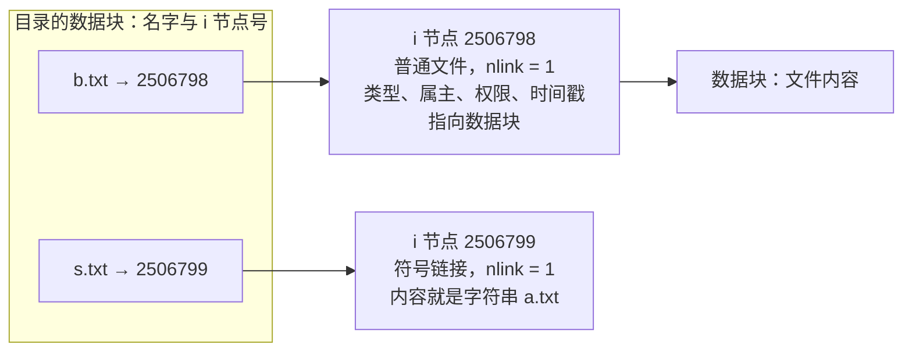
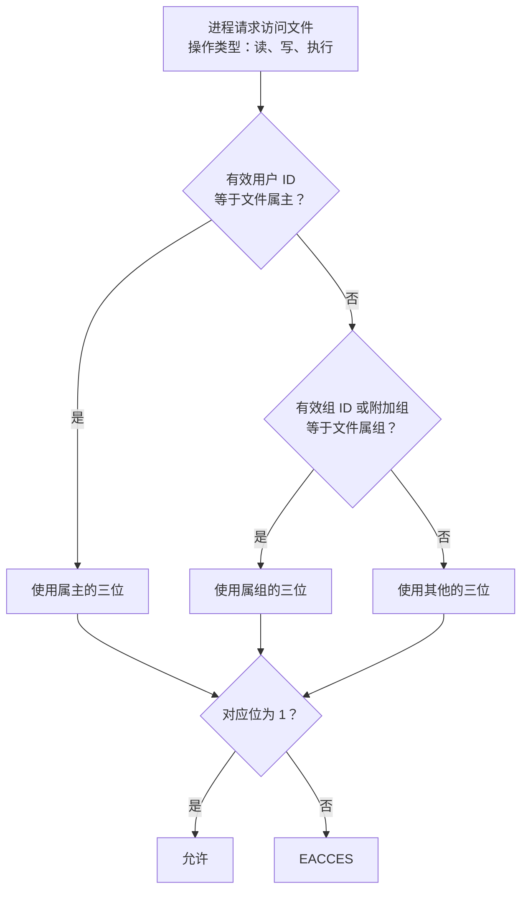

# 3. 文件系统、目录与权限

在[第 2 章](/教程/正文/系统编程/2_文件描述符与非缓冲IO)中，探讨的重点落在文件描述符的流式 I/O 交互上——打开句柄、读写数据流、随后关闭。而在真实的存储体系中，数据字节只是整个文件系统冰山浮出水面的一角。文件究竟属于何种实体类型？在物理扇区上实际占据了多少分配块？在目录树中正被多少个独立的路径名称引用？其元数据与内容在何时被更新？当前进程凭借其有效凭据究竟能否穿越多层目录并访问对应条目？

这些在系统级架构中至关重要的状态查询，均维系在以 `stat` 为核心的元数据接口之上。本篇沿着文件系统从静态描述到动态演化的脉络展开：首先解构内核 i 节点（i-node）与目录项（dentry）的分层组织机制，阐明硬链接与符号链接在存储模型上的根本分野；接着剖析 UNIX 经典权限位在常规文件与目录对象上的语义差异，理清进程有效 ID 匹配与 `umask` 掩码过滤的精确法则；随后探讨时间戳在构建工具（如 `make`）与内核写回策略（`relatime`）中的角色；最后深入落地一个工程实践中极高频出现、却极易滋生严重一致性缺陷的经典模式——依托同目录临时文件、显式 `fsync` 刷盘以及原子 `rename` 机制，完成关键配置文件的高可靠原子替换。

下面每一步都在 Linux 上实测，输出来自普通用户的账户，所有操作在同一个工作目录内完成。完整程序放在 `code/系统编程/3_文件系统_目录与权限/` 下，正文只贴关键部分。

## 1. 文件的元数据：stat

在 UNIX 风格的文件系统实现中，文件的“名称”与文件的“元数据及数据实体”在物理存储层面是截然分离的。除开目录项中记录的字符串名字之外，操作系统内核在底层为每一个文件对象单独维系着一个核心索引节点（Index Node，即 i 节点）。i 节点详尽记载了该文件的类型、权限掩码、属主属组标识、逻辑字节大小、底层实际分配的物理块计数以及多维时间戳等元信息。用户空间程序借助 `stat` 系列系统调用，便能一次性提取出关联到该实体的完整描述结构：

```c
#include <sys/stat.h>

int stat(const char *path, struct stat *buf);
int lstat(const char *path, struct stat *buf);
int fstat(int fd, struct stat *buf);
int fstatat(int dirfd, const char *path, struct stat *buf, int flags);
```

`stat` 沿着路径找到文件，遇到符号链接就跟着走到目标；`lstat` 不跟，得到符号链接本身的信息；`fstat` 用一个已经打开的描述符，省去再解析一次路径；`fstatat` 的路径可以相对于一个目录描述符，`flags` 里加 `AT_SYMLINK_NOFOLLOW` 就是 `lstat` 的效果。

`struct stat` 的字段不少，常用的这些：

| 字段 | 类型 | 含义 |
| --- | --- | --- |
| `st_dev` | `dev_t` | 文件所在的设备（文件系统）编号 |
| `st_ino` | `ino_t` | i 节点号，只在同一个文件系统内唯一 |
| `st_mode` | `mode_t` | 文件类型加上权限位 |
| `st_nlink` | `nlink_t` | 硬链接数 |
| `st_uid`、`st_gid` | `uid_t`、`gid_t` | 属主、属组的用户 ID 和组 ID |
| `st_rdev` | `dev_t` | 设备文件对应的设备号，普通文件无意义 |
| `st_size` | `off_t` | 字节数；符号链接是它指向的路径长度 |
| `st_blksize` | `blksize_t` | 文件系统建议的 I/O 块大小 |
| `st_blocks` | `blkcnt_t` | 实际分配的块数，单位是 512 字节 |
| `st_atim`、`st_mtim`、`st_ctim` | `struct timespec` | 访问时间、修改时间、状态改变时间 |

::: details `struct stat` 在 Linux 上的完整声明

```c
struct stat {
    dev_t     st_dev;      /* 文件所在的设备 */
    ino_t     st_ino;      /* i 节点号 */
    mode_t    st_mode;     /* 类型与权限 */
    nlink_t   st_nlink;    /* 硬链接数 */
    uid_t     st_uid;      /* 属主 */
    gid_t     st_gid;      /* 属组 */
    dev_t     st_rdev;     /* 设备文件对应的设备号 */
    off_t     st_size;     /* 字节数 */
    blksize_t st_blksize;  /* 建议的 I/O 块大小 */
    blkcnt_t  st_blocks;   /* 分配的 512 字节块数 */
    struct timespec st_atim;
    struct timespec st_mtim;
    struct timespec st_ctim;
};
```

字段顺序和类型随平台有细微差别，程序里按字段名访问，不要依赖布局。`st_atime`、`st_mtime`、`st_ctime` 是兼容宏，等价于各自的 `.tv_sec`。

:::

`st_size` 和 `st_blocks` 的区别值得记一下：前者是文件有多少字节，后者是这些字节实际占了磁盘多少空间。一个只写了一个字节的文件，`st_size` 是 1，`st_blocks` 通常是 8（即 4096 字节），因为文件系统按块分配。稀疏文件反过来，`st_blocks` 可以远小于 `st_size / 512`。

文件类型藏在 `st_mode` 的高 4 位里。不直接和掩码比较，用一组宏：

| 宏 | 为真时 |
| --- | --- |
| `S_ISREG(m)` | 普通文件 (regular file) |
| `S_ISDIR(m)` | 目录 (directory) |
| `S_ISLNK(m)` | 符号链接 (symbolic link) |
| `S_ISFIFO(m)` | 命名管道 (FIFO) |
| `S_ISSOCK(m)` | 套接字 (socket) |
| `S_ISCHR(m)` | 字符设备 (character device) |
| `S_ISBLK(m)` | 块设备 (block device) |

这几个宏都由 POSIX 声明，`_POSIX_C_SOURCE 200809L` 下可以直接用。本页后面用到 `nftw` 时才需要换成 `_XOPEN_SOURCE 700`，XSI 是 POSIX 的扩展选项，理由在[第 1 章](/教程/正文/系统编程/1_平台边界_POSIX与系统调用)讲过。

### 1.1 仿写 stat 命令

下面这个小程序按 `stat` 命令的风格打印一个或多个路径的信息，权限串则用 `ls -l` 的写法。它调用 `lstat`，所以符号链接显示的是链接本身。

```c
#define _POSIX_C_SOURCE 200809L

#include <stdio.h>
#include <stdlib.h>
#include <sys/stat.h>
#include <sys/sysmacros.h>
#include <time.h>

static void die(const char *what) {
    perror(what);
    exit(EXIT_FAILURE);
}

static const char *file_type(mode_t mode) {
    if (S_ISREG(mode)) {
        return "regular file";
    }
    if (S_ISDIR(mode)) {
        return "directory";
    }
    if (S_ISLNK(mode)) {
        return "symbolic link";
    }
    if (S_ISFIFO(mode)) {
        return "FIFO";
    }
    if (S_ISSOCK(mode)) {
        return "socket";
    }
    if (S_ISCHR(mode)) {
        return "character device";
    }
    if (S_ISBLK(mode)) {
        return "block device";
    }
    return "unknown";
}

static char type_char(mode_t mode) {
    if (S_ISREG(mode)) {
        return '-';
    }
    if (S_ISDIR(mode)) {
        return 'd';
    }
    if (S_ISLNK(mode)) {
        return 'l';
    }
    if (S_ISFIFO(mode)) {
        return 'p';
    }
    if (S_ISSOCK(mode)) {
        return 's';
    }
    if (S_ISCHR(mode)) {
        return 'c';
    }
    if (S_ISBLK(mode)) {
        return 'b';
    }
    return '?';
}

/* 生成 ls -l 那样的权限串；s、t 占用 x 的位置，大写表示 x 位为 0。 */
static void format_mode(mode_t mode, char out[11]) {
    static const char rwx[] = "rwx";

    out[0] = type_char(mode);
    for (int i = 0; i < 9; i++) {
        out[i + 1] = (mode & (0400u >> i)) ? rwx[i % 3] : '-';
    }
    if (mode & 04000) {
        out[3] = (out[3] == 'x') ? 's' : 'S';
    }
    if (mode & 02000) {
        out[6] = (out[6] == 'x') ? 's' : 'S';
    }
    if (mode & 01000) {
        out[9] = (out[9] == 'x') ? 't' : 'T';
    }
    out[10] = '\0';
}

static void print_time(const char *label, struct timespec ts) {
    char buf[64];
    struct tm tm;

    if (localtime_r(&ts.tv_sec, &tm) == NULL) {
        die("localtime_r");
    }
    if (strftime(buf, sizeof buf, "%Y-%m-%d %H:%M:%S %z", &tm) == 0) {
        fprintf(stderr, "strftime: buffer too small\n");
        exit(EXIT_FAILURE);
    }
    printf("%-7s %s.%09ld\n", label, buf, ts.tv_nsec);
}

int main(int argc, char *argv[]) {
    if (argc < 2) {
        fprintf(stderr, "usage: %s PATH...\n", argv[0]);
        return EXIT_FAILURE;
    }

    for (int i = 1; i < argc; i++) {
        struct stat st;
        char mode[11];

        if (lstat(argv[i], &st) == -1) {
            perror(argv[i]);
            continue;
        }
        format_mode(st.st_mode, mode);
        printf("  File: %s\n", argv[i]);
        printf("  Type: %s\n", file_type(st.st_mode));
        printf("  Mode: %s (%04o)  Links: %llu  Inode: %llu\n", mode,
               (unsigned)(st.st_mode & 07777),
               (unsigned long long)st.st_nlink,
               (unsigned long long)st.st_ino);
        printf("Device: %u,%u  Size: %lld  Blocks: %lld  Blksize: %lld\n",
               major(st.st_dev), minor(st.st_dev), (long long)st.st_size,
               (long long)st.st_blocks, (long long)st.st_blksize);
        print_time("Access:", st.st_atim);
        print_time("Modify:", st.st_mtim);
        print_time("Change:", st.st_ctim);
        if (i + 1 < argc) {
            printf("\n");
        }
    }
    return 0;
}
```

`major` 和 `minor` 来自 `<sys/sysmacros.h>`，把 `st_dev` 拆成主设备号和次设备号。`format_mode` 的循环里，`0400u >> i` 依次取出属主、属组、其他三组的九位，`i % 3` 从 `"rwx"` 里取对应的字母。时间用 `%09ld` 打印纳秒，`stat` 命令的默认格式也会给出这一列。

### 1.2 七种文件类型

在同一台机器的工作目录里就能造出大部分文件类型。准备一个目录：

::: terminal title="bash - 造出各种类型的文件"

```text
$ mkdir types && cd types
$ printf 'hello\n' > regular.txt
$ mkdir directory
$ ln -s regular.txt symlink.txt
$ ln -s missing.txt dangling.txt
$ mkfifo fifo
$ ./mksock sock
bound AF_UNIX socket to sock
```

:::

`mksock` 是一个小程序，`socket` 加 `bind`，绑定一个 Unix 域套接字路径，绑定成功后立刻关闭描述符，但路径留在文件系统里：

```c
int fd = socket(AF_UNIX, SOCK_STREAM | SOCK_CLOEXEC, 0);
if (fd == -1) {
    die("socket");
}

struct sockaddr_un addr = { .sun_family = AF_UNIX };
strcpy(addr.sun_path, argv[1]);
if (bind(fd, (struct sockaddr *)&addr, sizeof addr) == -1) {
    die("bind");
}
```

字符设备和块设备不能由普通用户随意创建，但系统里到处都是，看它们的文件描述符即可。`ftype` 接受一个路径或者 `-`，后者表示对标准输入做 `fstat`：

```c
if (strcmp(argv[i], "-") == 0) {
    if (fstat(STDIN_FILENO, &st) == -1) {
        die("fstat");
    }
} else {
    if (lstat(argv[i], &st) == -1) {
        die("lstat");
    }
}
```

把 `/dev/null` 接到标准输入上，`fstat(0)` 看到的就是字符设备。七种类型一次看全：

::: terminal title="bash - ftype"

```text
$ ./ftype regular.txt directory symlink.txt dangling.txt fifo sock
regular.txt    regular file
directory      directory
symlink.txt    symbolic link
dangling.txt   symbolic link
fifo           FIFO
sock           socket
$ ./ftype - < /dev/null
<stdin>        character device
$ ./ftype /dev/sda4
/dev/sda4      block device
```

:::

两个符号链接打印出来都是 `symbolic link`：`dangling.txt` 指向不存在的 `missing.txt`，`lstat` 只报告链接本身，不去解析目标。这也是 `lstat` 和 `stat` 的差别第一次派上用场的地方。

用 `mystat` 看同一个目录里的几项：

::: terminal title="bash - mystat"

```text
$ ./mystat regular.txt
  File: regular.txt
  Type: regular file
  Mode: -rw-r--r-- (0644)  Links: 1  Inode: 2506791
Device: 8,4  Size: 6  Blocks: 8  Blksize: 4096
Access: 2026-10-21 01:06:19 +0800.711445271
Modify: 2026-10-21 01:06:19 +0800.711445271
Change: 2026-10-21 01:06:19 +0800.711445271
```

:::

`6` 是 `hello\n` 的六个字节，`8` 个 512 字节的块就是 4 KiB，正好一个块。符号链接的 `st_size` 是目标路径的长度，`st_blocks` 是 0：短路径直接存在 i 节点里，不占数据块。

::: terminal title="bash - 符号链接的 stat"

```text
$ ./mystat symlink.txt
  File: symlink.txt
  Type: symbolic link
  Mode: lrwxrwxrwx (0777)  Links: 1  Inode: 2506793
Device: 8,4  Size: 11  Blocks: 0  Blksize: 4096
Access: 2026-10-21 01:06:19 +0800.715445066
Modify: 2026-10-21 01:06:19 +0800.715445066
Change: 2026-10-21 01:06:19 +0800.715445066
```

:::

`regular.txt` 这个目标路径是 11 个字符，`symlink.txt` 的 `st_size` 就是 11。权限位显示为 `rwxrwxrwx`，但符号链接的权限在 Linux 上不起作用，这个值只是占位。

::: tip `stat` 命令的格式化输出

`stat -c` 可以按自己的格式打印上面这些字段，写脚本时比解析 `ls -l` 可靠：`%A` 权限串、`%a` 八进制权限、`%h` 链接数、`%i` i 节点号、`%s` 字节数、`%b` 块数、`%n` 名字、`%F` 类型描述。例如 `stat -c '%A %a %h %i %s %b %F %n' regular.txt` 输出 `-rw-r--r-- 644 1 2506791 6 8 regular file regular.txt`。

:::

<Quiz
  type="single"
  :options="[
    { label: 'st_size 是 11，st_blocks 是 0', value: 'A' },
    { label: 'st_size 是 6，st_blocks 是 8', value: 'B' },
    { label: 'st_size 是 0，st_blocks 是 0', value: 'C' },
    { label: 'st_size 是 11，st_blocks 是 8', value: 'D' }
  ]"
  answer="A"
>

<template #question>

对 `symlink.txt` 调用 `lstat`，`st_size` 和 `st_blocks` 各是多少？

</template>

正确答案是 **A**。`lstat` 报告符号链接本身，`st_size` 是它保存的目标路径 `regular.txt` 的长度，11 个字节；这么短的目标路径被内核直接存进 i 节点，不单独分配数据块，所以 `st_blocks` 为 0。B 是 `stat` 跟随链接后得到的普通文件的大小。

</Quiz>

## 2. 目录、i 节点与链接

在 UNIX 哲学中，“一切皆文件”同样深刻体现在目录自身的实现上：**目录在本质上也是一个普通文件，只是其数据块中存储的是一张经过特殊编码的映射清单——即文件名到对应 i 节点编号的关联表项（目录项）**。当应用程序尝试打开一个形如 `/a/b/c.txt` 的路径时，虚拟文件系统（VFS）从根目录或当前工作目录的 i 节点启程，逐层遍历其数据块，根据每一级的名称查找匹配的条目，取得对应的 i 节点编号并加载至内存，随后再步入下一层目录的条目清单。由于文件名仅作为外部索引挂载在目录的数据块中，而并不隶属于 i 节点本身，因此同一个底层 i 节点完全可以在同一个或不同目录的数据块中登记多次，这便是硬链接（Hard Link）的微观物理基础。



图里的 `b.txt` 指向的 i 节点，在删掉 `a.txt` 之前有两个名字；删掉之后只剩 `b.txt` 一个。`s.txt` 是符号链接，它有自己的 i 节点，内容是目标路径字符串；内核解析到它时，把路径换成字符串再从那里继续。

### 2.1 硬链接与链接计数

`ln` 默认建硬链接，`ln -s` 建符号链接。在工作目录里做一次对照实验：

::: terminal title="bash - 硬链接与符号链接"

```text
$ printf 'shared\n' > a.txt
$ ln a.txt b.txt
$ ln -s a.txt s.txt
$ stat -c 'links=%h ino=%i size=%s %n' a.txt b.txt s.txt
links=2 ino=2506798 size=7 a.txt
links=2 ino=2506798 size=7 b.txt
links=1 ino=2506799 size=5 s.txt
$ rm a.txt
$ stat -c 'links=%h ino=%i size=%s %n' b.txt
links=1 ino=2506798 size=7 b.txt
$ cat s.txt
cat: s.txt: No such file or directory
```

:::

`a.txt` 和 `b.txt` 的 i 节点号和链接数完全相同：它们是同一个文件的两次登记。`s.txt` 的 i 节点号不同、链接数仍是 1、大小是路径字符串的长度 5。删掉 `a.txt` 只是抹掉了目录里的一个名字，i 节点的链接数从 2 减到 1，文件内容还在，`b.txt` 照样能读。删掉 `a.txt` 之后，`s.txt` 这条符号链接就悬空了，读它得到 `ENOENT`。

`rm` 一个符号链接删的是链接本身，不会碰目标。`readlink` 只读出符号链接的内容，不做解析：

::: terminal title="bash - readlink"

```text
$ readlink s.txt
a.txt
$ readlink plain.txt
$ echo $?
1
```

:::

`readlink` 遇到不是符号链接的路径返回 -1，`errno` 是 `EINVAL`（`Invalid argument`）；路径不存在时才是 `ENOENT`。这两者的区别在写工具时有用：前者说明「这个路径是普通文件」，后者说明「这个路径根本不存在」。

::: concept sys-fs-link-count title="硬链接与释放规则"

硬链接是同一个 i 节点在目录中的另一个名字，创建后两者完全等价，没有「原文件」和「副本」之分。`st_nlink` 记录这个 i 节点有多少个名字。只有当链接数降到 0、并且没有任何进程还打开着它时，文件占用的空间才会被释放。

:::

`ln` 不能给目录建硬链接，内核直接拒绝：

::: terminal title="bash - 目录的硬链接"

```text
$ mkdir sub
$ ln sub sub_link
ln: sub: hard link not allowed for directory
```

:::

目录的 `st_nlink` 另有含义。新建的空目录链接数是 2：它自己内部的 `.` 和父目录里的那个名字。每在它里面新建一个子目录，父目录的链接数加 1，因为子目录的 `..` 又指回了它：

::: terminal title="bash - 目录的链接数"

```text
$ stat -c 'links=%h %n' . sub
links=3 .
links=2 sub
$ mkdir sub/deeper
$ stat -c 'links=%h %n' sub
links=3 sub
```

:::

`.` 的链接数是 3：它自己的 `.`、父目录里给它的那个名字，加上 `sub` 里的 `..`，一共三个。规律是目录的链接数等于 2 加子目录个数，`sub` 里建了 `deeper` 之后变成 3。很多程序用 `st_nlink - 2` 估算目录里有多少个子目录，理由就是这条规则。

### 2.2 unlink 只删名字

硬链接的计数规则也适用于「打开文件」这件事。`unlink` 抹掉目录里的名字，但只要还有进程持有这个文件的打开文件描述，i 节点和数据就留在磁盘上。程序仍可以照常读写，关闭最后一个描述符之后，空间才被回收。

```c
int fd = open("victim.txt", O_RDWR | O_CREAT | O_TRUNC | O_CLOEXEC, 0644);
if (fd == -1) {
    die("open");
}
if (write_all(fd, "still here\n", 11) == -1) {
    die("write");
}
if (unlink("victim.txt") == -1) {
    die("unlink");
}

char linkpath[64];
snprintf(linkpath, sizeof linkpath, "/proc/self/fd/%d", fd);
char target[256];
ssize_t n = readlink(linkpath, target, sizeof target - 1);
if (n == -1) {
    die("readlink");
}
target[n] = '\0';
/* 只留文件名，省得输出里出现整条工作目录路径。 */
const char *base = strrchr(target, '/');
printf("%s -> %s\n", linkpath, base ? base + 1 : target);

char buf[64];
ssize_t r = pread(fd, buf, sizeof buf - 1, 0);
if (r == -1) {
    die("pread");
}
buf[r] = '\0';
printf("read back: %s", buf);
```

运行它：

::: terminal title="bash - unlink_open"

```text
$ ./unlink_open
opened victim.txt as fd 3
unlinked victim.txt
stat(victim.txt) failed: No such file or directory
/proc/self/fd/3 -> victim.txt (deleted)
read back: still here
closed fd 3; the data is released now
```

:::

`/proc/self/fd` 里的链接在文件名后面标了 `(deleted)`，因为目录里已经找不到这个名字。`pread` 仍然读到了完整内容。这套行为是许多程序的基础：临时文件建好之后立刻 `unlink`，拿到一个没有名字、别人找不到、进程结束自动消失的描述符；邮件系统和日志轮转也依赖它。

`stat("victim.txt")` 失败属于预期结果。这里用 `printf` 打印失败，没有调用 `die`，因为路径消失正是要展示的事情。

### 2.3 符号链接

符号链接 (symbolic link) 是一个独立的文件，内容是它指向的路径。它有自己的 i 节点、自己的权限位（不起作用）、自己的链接计数。内核在解析路径的最后一段时，遇到符号链接就读出它的内容，从那里接着解析。

```c
int symlink(const char *target, const char *linkpath);
ssize_t readlink(const char *path, char *buf, size_t bufsiz);
```

`target` 可以是绝对路径，也可以是相对路径；相对路径按符号链接所在目录解释，与程序的工作目录无关。用相对路径能做出可整体移动的目录树，用绝对路径则在目录树被移动后会悬空。

`stat` 和 `lstat` 的差别在这里最要紧：**判断一个路径是不是符号链接，只能用 `lstat`**。`stat` 已经跟着链接走过去了。反过来，要判断符号链接指向的文件是否存在、权限如何，就要用 `stat`，或者 `readlink` 之后再 `stat`。

::: compare left-title="用 stat 判断是否为链接（永远为假）" right-title="用 lstat 判断链接"

```c
struct stat st;
if (stat(path, &st) == 0 && S_ISLNK(st.st_mode)) {
    printf("this is a symlink\n");
}
```

---

```c
struct stat st;
if (lstat(path, &st) == 0 && S_ISLNK(st.st_mode)) {
    printf("this is a symlink\n");
}
```

:::

第一段代码在任何符号链接上都得不到 `S_ISLNK`，因为 `stat` 返回的是链接目标的信息。这是个不会报错、只是永远不成立的条件，比崩溃更难查。

符号链接的权限位没有实际意义，`chmod` 一个符号链接只会改到目标文件上。链接本身只有一条实在的规则：读取链接需要一个能搜索到它所在目录的路径，其余都跟着目标走。

::: tip `namei -l` 检查路径上每一级

`namei -l path` 会把路径逐段展开，列出每一级目录的权限、属主属组和最终文件。排查「明明文件可读为什么打不开」时，往往卡在中间某一级目录少了一个 `x`：

```text
$ namei -l proj/data/file.txt
f: proj/data/file.txt
drwxr-xr-x you      you      proj
drwxr-xr-x you      you      data
-rw-r--r-- you      you      file.txt
```

（输出里的用户名和组名换成了 `you`。）

:::

### 2.4 rename 原子地替换

`rename` 把 `oldpath` 改名为 `newpath`。如果 `newpath` 已经存在，它被安静地替换掉，而且这个替换是原子操作：任何时刻去访问 `newpath`，看到的要么是旧文件，要么是新文件，不存在两者都不在的瞬间。

::: concept sys-fs-rename-atomic title="rename 的原子性"

在同一个文件系统内，`rename(oldpath, newpath)` 是一个原子操作。当 `newpath` 已存在时，它被新名字覆盖；站在其他进程的角度，`newpath` 始终指向一个完整的旧文件或完整的新文件。`oldpath` 和 `newpath` 本来就是同一个 i 节点的两个硬链接时，`rename` 什么也不做，直接返回成功（`mv` 命令会先发现这一点，报 `are the same file` 并返回 1，不会调用到 `rename`）。

:::

替换的语义和硬链接的计数正好配合。老文件被 `backup.txt` 引用着，把新文件改名成老名字，`backup.txt` 看到的还是老内容：

::: terminal title="bash - rename 替换"

```text
$ printf 'old\n' > f.txt
$ ln f.txt backup.txt
$ printf 'new\n' > tmp.txt
$ mv tmp.txt f.txt
$ cat f.txt
new
$ cat backup.txt
old
$ stat -c 'ino=%i links=%h %n' f.txt backup.txt
ino=2506806 links=1 f.txt
ino=2506805 links=1 backup.txt
```

:::

`mv` 在同一个文件系统内就是 `rename`。老 i 节点还挂着 `backup.txt` 这个名字，所以链接数从 2 变成 1；新文件拿到老名字，链接数本来就是 1。如果 `backup.txt` 不存在，老 i 节点在 `rename` 之后就没有名字了，空间随之释放。

跨文件系统时 `rename` 会失败。把源文件建在 tmpfs 上、目标放在另一块设备上，调用 `rename` 得到的 `errno` 是 `EXDEV`，`strerror` 打印出来是 `Invalid cross-device link`。

`mv` 命令遇到 `EXDEV` 会改用复制：读到目标位置，再删掉源文件。这个退路不是原子的，中途失败会留下半个文件，而且新文件拿不到原来的 i 节点。库函数 `rename` 本身不会代劳。

<Quiz
  type="single"
  :options="[
    { label: '0，文件被立即删除', value: 'A' },
    { label: '1，因为 b.txt 还在', value: 'B' },
    { label: '2，删名字不影响链接数', value: 'C' },
    { label: '无法确定，取决于文件系统', value: 'D' }
  ]"
  answer="B"
>

<template #question>

`a.txt` 与 `b.txt` 是硬链接，此时 `rm a.txt`，`b.txt` 的 `st_nlink` 是多少？

</template>

正确答案是 **B**。`rm` 调用 `unlink`，删除的是目录里的一个名字，i 节点的链接计数减 1，从 2 变成 1。文件内容仍然完整，`b.txt` 照常可读。C 错在把 `unlink` 当成了不改变元数据。

</Quiz>

::: generate sys-fs-hardlink-vs-symlink kind=explanation concepts=sys-fs-link-count

面向第一次接触硬链接和符号链接的读者，用目录项和 i 节点的两层结构解释两者的差别：硬链接是同一个 i 节点多了一个名字，符号链接是另一个文件、内容是路径字符串。用一个 3 次操作的例子（建硬链接、删原名、再删符号链接目标）逐步推演 st_nlink、st_ino、st_size 和最终能否打开，并说明为什么硬链接不能跨文件系统、不能指向目录。不要涉及引用计数在内存中的表示。

:::

## 3. 读取目录与遍历目录树

目录的内容是二进制格式，不能直接 `read` 了事。POSIX 提供了一组函数把它抽象成「逐个读目录项」：

```c
#include <dirent.h>

DIR *opendir(const char *path);
struct dirent *readdir(DIR *dir);
int closedir(DIR *dir);
```

`opendir` 打开目录返回一个 `DIR *`，`readdir` 每次返回一个 `struct dirent *`，读完返回 `NULL`。`struct dirent` 里至少有 `d_name`（名字）和 `d_ino`（i 节点号）：

```c
struct dirent {
    ino_t          d_ino;
    off_t          d_off;
    unsigned short d_reclen;
    unsigned char  d_type;
    char           d_name[];
};
```

`d_type` 和 `DT_DIR`、`DT_REG` 这些常量是 Linux 的扩展，用 `_POSIX_C_SOURCE` 时 glibc 不声明，要加 `_GNU_SOURCE` 或 `_DEFAULT_SOURCE`。它不一定在所有文件系统上都填好，取值 `DT_UNKNOWN` 就表示这一项没有内容。要可靠地判断类型，还是用 `fstatat`。

`readdir` 有几个约定要记住：结果里包含 `.` 和 `..`；顺序由文件系统决定，不保证任何排列；返回的指针指向 `DIR` 内部，下次调用会覆盖，需要保存时自己复制。

### 3.1 用 readdir 写 myls

```c
int main(int argc, char *argv[]) {
    const char *path = (argc > 1) ? argv[1] : ".";
    DIR *dir = opendir(path);
    if (dir == NULL) {
        die("opendir");
    }

    errno = 0;
    struct dirent *ent;
    while ((ent = readdir(dir)) != NULL) {
        printf("%-10llu %s\n", (unsigned long long)ent->d_ino, ent->d_name);
        errno = 0;
    }
    if (errno != 0) {
        die("readdir");
    }
    if (closedir(dir) == -1) {
        die("closedir");
    }
    return 0;
}
```

`readdir` 用 `NULL` 同时表示「读完了」和「出错了」，区分方法是先清零 `errno`，循环里每次调用前再清零，循环结束后检查 `errno`。这是这类接口的常见设计。

运行：

::: terminal title="bash - myls"

```text
$ ./myls .
2506809    alpha.txt
2506811    bravo.txt
2506810    charlie.txt
2506807    .
2506789    ..
2506808    delta.txt
```

:::

输出顺序取决于该目录在当前文件系统上的实际存储顺序，与字母序、创建顺序都无关。重复运行一般得到相同结果，但换个目录、换台机器、或者目录被反复增删之后，顺序就完全可能不同。需要排序时先收集全部名字，再用 `qsort` 或 `scandir` 排。

`scandir` 把「读目录、过滤、排序」合成一步：

```c
int scandir(const char *dirp, struct dirent ***namelist,
            int (*filter)(const struct dirent *),
            int (*compar)(const struct dirent **, const struct dirent **));
```

传 `alphasort` 作为比较函数就得到按名字排好的数组，用完每个元素和数组本身都要 `free`。习题里会用到。

### 3.2 用 nftw 遍历目录树

递归遍历目录树要处理符号链接、挂载点、打开的描述符数量、循环引用，自己写很容易漏。POSIX 提供了 `ftw` 和 `nftw`，后者可以控制是否跟随符号链接、是否跨文件系统、描述符上限。`ftw` 在 `_POSIX_C_SOURCE` 下就有，`nftw` 和 `FTW_PHYS` 属于 XSI，源文件开头要改成 `_XOPEN_SOURCE 700`。

```c
#define _XOPEN_SOURCE 700
#include <ftw.h>

int nftw(const char *dirpath,
         int (*fn)(const char *fpath, const struct stat *sb,
                   int typeflag, struct FTW *ftwbuf),
         int nopenfd, int flags);
```

回调每访问一个路径调用一次，`sb` 是 `stat` 的结果，`typeflag` 说明类型，`ftwbuf` 给出 `base`（文件名在路径中的偏移）和 `level`（深度）。回调返回非 0 就中止遍历。

::: details `nftw` 回调的 `typeflag` 取值

| 取值 | 含义 |
| --- | --- |
| `FTW_F` | 普通文件 |
| `FTW_D` | 目录 |
| `FTW_DNR` | 不可读的目录 |
| `FTW_NS` | `stat` 失败，`sb` 的内容无定义 |
| `FTW_SL` | 符号链接（加了 `FTW_PHYS` 时） |
| `FTW_SLN` | 悬空的符号链接（没加 `FTW_PHYS` 时） |

:::

`nopenfd` 是同时打开目录描述符的上限，遍历一棵深树时它决定要不要反复打开目录，一般给 16 到 32。`flags` 里最常用的是 `FTW_PHYS`：不跟随符号链接。不加它，`nftw` 会跟进符号链接指向的目录，一个指回上层的链接就能让遍历绕圈。

用 `nftw` 写一个 `mydu`，统计一棵树的磁盘占用：

```c
#define _XOPEN_SOURCE 700

#include <errno.h>
#include <ftw.h>
#include <stdio.h>
#include <stdlib.h>
#include <sys/stat.h>

static unsigned long long total_blocks;

static int on_file(const char *path, const struct stat *st, int type,
                   struct FTW *ftwbuf) {
    (void)path;
    (void)type;
    (void)ftwbuf;

    total_blocks += (unsigned long long)st->st_blocks;
    return 0;
}

int main(int argc, char *argv[]) {
    const char *path = (argc > 1) ? argv[1] : ".";

    /* FTW_PHYS：不跟随符号链接。 */
    if (nftw(path, on_file, 16, FTW_PHYS) == -1) {
        perror("nftw");
        return EXIT_FAILURE;
    }
    /* st_blocks 以 512 字节为单位，du 默认以 1 KiB 为单位。 */
    printf("%llu\t%s\n", total_blocks / 2, path);
    return 0;
}
```

造一棵树试一下，其中 `big.bin` 和 `hard.bin` 是硬链接，`sub/link.bin` 是指向 `../big.bin` 的符号链接：

::: terminal title="bash - mydu 与 du 对照"

```text
$ head -c 65536 /dev/zero > big.bin
$ ln big.bin hard.bin
$ mkdir sub
$ seq 1 2000 > sub/numbers.txt
$ ln -s ../big.bin sub/link.bin
$ ./mydu .
148	.
$ du -sk .
84	.
$ du -sk --count-links .
148	.
```

:::

差了 64 KiB：`mydu` 把两个硬链接各算了一次，`du` 默认对同一 i 节点只算一次，加上 `--count-links` 才和 `mydu` 一样。两组数字的差别来自「磁盘占用」的两种口径，`mydu` 并没有算错：一个 i 节点只占一份空间，但用 `nftw` 简单累加看到的是两份。要写一个和 `du` 一致的版本，需要记住已经统计过的 `(st_dev, st_ino)` 组合，这正好是习题 40306 的内容。

符号链接没有被算进去：`FTW_PHYS` 让 `nftw` 不跟随链接，而且符号链接本身的 `st_blocks` 是 0。换一棵没有硬链接的树验证一下：

::: terminal title="bash - 无硬链接的树"

```text
$ seq 1 2000 > numbers.txt
$ mkdir sub && head -c 100000 /dev/zero > sub/blob.bin
$ ./mydu .
120	.
$ du -sk .
120	.
```

:::

这次两者一致。目录本身的 `st_blocks` 也被计入，所以 120 比两个文件的字节数之和略大。

### 3.3 以目录描述符为基准

每访问一个文件都拼接一次完整路径，在深层目录里既费时又容易出错，路径一长还会触发 `PATH_MAX`。另一种做法是先打开目录，拿到描述符，之后所有操作都用「目录描述符 + 相对名字」：

```c
int openat(int dirfd, const char *path, int flags, ...);
int fstatat(int dirfd, const char *path, struct stat *buf, int flags);
int unlinkat(int dirfd, const char *path, int flags);
int mkdirat(int dirfd, const char *path, mode_t mode);
```

`dirfd` 是一个打开的目录描述符，`path` 是相对于它的名字，也可以是绝对路径（此时 `dirfd` 被忽略）。`openat` 家族省去了路径拼接，用 `fdopendir` 把目录描述符转成 `DIR *` 之后，`readdir` 得到的名字可以直接交给 `fstatat`：

```c
int dfd = open(path, O_RDONLY | O_DIRECTORY | O_CLOEXEC);
if (dfd == -1) {
    die("open");
}
DIR *dir = fdopendir(dfd);
if (dir == NULL) {
    die("fdopendir");
}

struct dirent *ent;
while ((ent = readdir(dir)) != NULL) {
    struct stat st;

    if (fstatat(dfd, ent->d_name, &st, AT_SYMLINK_NOFOLLOW) == -1) {
        perror(ent->d_name);
        continue;
    }
    /* 按 st_mode 判断类型并打印 */
}
```

`fdopendir` 之后，`dfd` 归 `DIR *` 管，`closedir` 会把它一起关掉。对每个名字仍然要 `fstatat` 一次，但路径不用重新解析，也不受路径过长的影响。

::: terminal title="bash - dirstat"

```text
$ ./dirstat .
-        6  regular.txt
d     4096  directory
l       11  symlink.txt
l       11  dangling.txt
d     4096  .
d     4096  ..
p        0  fifo
s        0  sock
```

:::

`openat` 的这一特点还有一个安全上的意义：如果目录描述符是可信的，那么用相对名字访问就不会被中间某一级目录的符号链接带偏。[第 14 章](/教程/正文/系统编程/14_系统程序的健壮性与安全边界)讲目录监狱时会用到这个性质，本页只需要知道它省去了路径拼接。

::: tip 遍历时不要按名字回读

遍历目录读到的每个名字，之后要拿它的信息，用 `fstatat` 或者从 `DIR *` 里现取，不要用 `readdir` 时代码里暂存的指针。`readdir` 返回的 `struct dirent *` 在下次调用时会被覆写，暂存指针得到的是别的文件的名字。

:::

## 4. 权限模型

文件权限在 `st_mode` 的低 12 位里，其中低 9 位是三个三元组：属主 (owner)、属组 (group)、其他 (others) 各自的 r、w、x。再加上三个特殊位：设置用户 ID 位、设置组 ID 位、粘滞位。

| 八进制 | 位 | 含义 |
| --- | --- | --- |
| 0400 | `r` | 属主可读 |
| 0200 | `w` | 属主可写 |
| 0100 | `x` | 属主可执行 |
| 0040 | `r` | 属组可读 |
| 0020 | `w` | 属组可写 |
| 0010 | `x` | 属组可执行 |
| 0004 | `r` | 其他人可读 |
| 0002 | `w` | 其他人可写 |
| 0001 | `x` | 其他人可执行 |
| 04000 | 设置用户 ID 位 | 执行时有效用户 ID 变成文件属主 |
| 02000 | 设置组 ID 位 | 执行时有效组 ID 变成文件属组 |
| 01000 | 粘滞位 | 限制目录里的删除 |

三个特殊位的宏名分别是 `S_ISUID`、`S_ISGID`、`S_ISVTX`。其中 `S_ISVTX` 只在 `_XOPEN_SOURCE` 下声明，程序里要判断粘滞位时把宏换掉。

对于普通数据文件而言，`r`、`w`、`x` 的语义高度契合直觉：分别对应读取文件内容、改写文件数据以及将该二进制文件载入执行。然而，当相同的九位掩码应用到目录对象上时，其语义发生了根本性的质变，这也是系统权限设计中最容易引发困惑与安全疏漏的区域。

| 目录的位 | 含义 | 需要的操作 |
| --- | --- | --- |
| `r` | 能列出目录里的名字 | `ls`、`readdir` |
| `x` | 能穿过目录进入下一级，能按名字访问条目 | `cd`、打开目录里的文件、`stat` 里面的条目 |
| `w` | 能在目录里增删名字 | `touch` 新文件、`rm`、`mv`、`mkdir` |

理解目录权限的黄金法则，在于始终将目录视为**一张记录“文件名与 i 节点编号”的索引表**：
- 目录的 `r`（读）权限：赋予的是读取该索引表本身的权利。拥有该位，进程能够通过 `readdir` 系列调用枚举出目录中究竟包含哪些名称（相当于执行纯粹的 `ls`）；
- 目录的 `x`（执行/搜索）权限：赋予的是**遍历与索引解析**的权利。拥有该位，进程才能够以该目录作为路径中间节点向下穿透，或在已知目标文件名的情况下，请求内核在该目录的索引表中解析出其对应的 i 节点。倘若目录缺少 `x` 位，哪怕已知文件名，内核也会在路径解析阶段直接拦截；
- 目录的 `w`（写）权限：赋予的是在索引表中增加、删除或替换条目的权利。值得注意的是，`w` 位**必须与 `x` 位协同起效**——因为在向索引表增删条目之前，内核必须首先穿透进入该目录并定位冲突项，单纯具备 `w` 而缺失 `x` 将导致所有修改操作因路径寻址受阻而返回 `EACCES`。

### 4.1 判定规则

进程有实际用户 ID、有效用户 ID、实际组 ID、有效组 ID 和一组附加组。判断一次访问是否允许，只看有效 ID：

::: concept sys-fs-perm-check title="权限判定规则"

内核按下面的顺序选择一组权限位，选中后不再往下看：

1. 如果进程的有效用户 ID 等于文件的 `st_uid`，使用属主的三位；
2. 否则，如果进程的有效组 ID 或任一附加组等于文件的 `st_gid`，使用属组的三位；
3. 否则使用其他的三位。

选中一组之后，请求的访问类型（读、写、执行）必须在这一组里有对应的位，否则返回 `EACCES`。三个三元组之间没有「或」的关系，属主组里没有的权限，不会因为「其他」组有而放行。

:::

判定过程画成流程图就是一个三层筛子，从属主往下逐级过滤：



第三条最容易被忽略：一个文件的属主把自己文件的权限改成 `000`，自己也会被拒绝访问，因为内核只检查属主那三位，不看其他组。

::: terminal title="bash - 属主只看属主位"

```text
$ printf 'data\n' > f.txt
$ chmod 004 f.txt; cat f.txt; echo "mode 004: status=$?"
cat: f.txt: Permission denied
mode 004: status=1
$ chmod 040 f.txt; cat f.txt; echo "mode 040: status=$?"
cat: f.txt: Permission denied
mode 040: status=1
$ chmod 400 f.txt; cat f.txt; echo "mode 400: status=$?"
data
mode 400: status=0
```

:::

`004` 给了其他组读权限，`040` 给了属组，两种情况属主都读不了，因为属主那一组是 `0`。只有 `400` 能读。

特权进程（有效用户 ID 为 0）跳过这整套检查，可以直接读写任意文件。这是 root 能做任何事的根源，也是无数程序出错时「用 root 跑一下就好了」的原因。`CAP_DAC_OVERRIDE` 和 `CAP_DAC_READ_SEARCH` 这两个能力也绕开权限检查，容器里常把它们单独授予。权限检查失败时，`open`、`stat` 这些调用返回 -1，`errno` 为 `EACCES` 或 `EPERM`，两者的区别是：前者是权限位不够，后者是操作本身不允许（比如普通用户改文件属主）。

### 4.2 目录权限的实验

下面的实验在一个目录里建五个子目录，权限分别是 `000`、`311`、`622`、`644`、`755`，每个里面放一个 `inside.txt`。然后对每个目录做四种操作，记下退出码：

::: terminal title="bash - 目录权限矩阵"

```text
$ for d in d000 d311 d622 d644 d755; do mkdir $d; echo inside > $d/inside.txt; done
$ chmod 000 d000; chmod 311 d311; chmod 622 d622; chmod 644 d644; chmod 755 d755
$ stat -c '%A %a %n' d000 d311 d622 d644 d755
d--------- 0 d000
d-wx--x--x 311 d311
drw--w--w- 622 d622
drw-r--r-- 644 d644
drwxr-xr-x 755 d755
$ for d in d000 d311 d622 d644 d755; do
>     ls $d >/dev/null 2>&1; a=$?
>     cat $d/inside.txt >/dev/null 2>&1; b=$?
>     touch $d/new.txt 2>/dev/null; c=$?
>     rm -f $d/inside.txt 2>/dev/null; e=$?
>     echo "$d ls=$a cat=$b touch=$c rm=$e"
> done
d000 ls=2 cat=1 touch=1 rm=1
d311 ls=2 cat=0 touch=0 rm=0
d622 ls=0 cat=1 touch=1 rm=1
d644 ls=0 cat=1 touch=1 rm=1
d755 ls=0 cat=0 touch=0 rm=0
```

:::

把 `ls` 理解为「列名字」、`cat` 理解为「按已知名字打开」、`touch`/`rm` 理解为「按已知名字增删」，这张表就完全对得上：

- `d311`（属主 `-wx`）能读 `inside.txt`、能建、能删，但 `ls` 被拒绝。只知道名字就能操作，列不出来。
- `d622`（属主 `rw-`）能列名字，但连 `inside.txt` 都打不开：访问目录里的条目需要目录的 `x` 位，622 没有。`ls -l` 在这种目录里会显示一排问号。
- `d644` 和 `d622` 在四种操作上表现相同：没有 `x`，`w` 用不上，`r` 只够列名字。
- `d755` 全部成功。
- `d000` 全部失败，连自己都进不去。

`touch` 和 `rm` 失败时 `errno` 是 `EACCES`，`ls` 打开目录失败也是 `EACCES`。`d644` 里的 `ls -l` 显示问号，是因为 `ls` 想对每个名字 `stat` 一次，却被目录缺少 `x` 挡住了：

::: terminal title="bash - 缺 x 时 ls -l 的现象"

```text
$ chmod 644 ronly
$ ls -l ronly
total 0
-????????? ? ? ? ?            ? inside.txt
```

:::

注意一个反直觉的结果：文件本身的权限是 `0444` 还是 `0000`，都不影响 `rm`，因为 `rm` 修改的是目录里的名字，与文件自身的权限无关。

::: terminal title="bash - 可写目录里删只读文件"

```text
$ umask 022
$ mkdir rmtest && cd rmtest
$ printf 'x\n' > ro.txt
$ chmod 444 ro.txt
$ rm ro.txt
$ echo $?
0
```

:::

`rm` 在可写目录里删掉只读文件不需要确认（`rm` 交互模式下的 `-i` 是它自己的提示，与内核无关）。反过来说，目录不可写时，即使文件就属于你、权限是 `0777`，也删不掉。这也解释了为什么读到的权限表里经常出现「文件是我的，却动不了」。

::: generate sys-fs-dir-permissions kind=explanation concepts=sys-fs-perm-check

面向把文件权限的 rwx 套到目录上的读者，用「目录是名字的表格」这个模型讲清目录 r、w、x 各自操作表格的哪一部分：r 是读表格、x 是按索引查条目、w 是改表格。用刚才那五组权限（000、311、622、644、755）逐步推演 ls、cat、touch、rm 的结果，并解释为什么删文件看的是目录的 w，不是文件自身的权限。

:::

### 4.3 umask

`open`、`mkdir`、`mkfifo` 这类调用创建文件时，参数里给的权限还要再和进程的文件模式创建掩码 (umask) 按位与一次，得到的才是最终结果。umask 是一个进程属性，shell 里用 `umask` 命令查看和设置，子进程继承它。

```c
mode_t umask(mode_t mask);
```

`umask` 把掩码设为 `mask`，返回旧值。掩码里的位表示「不授予」，实际权限是 `mode & ~mask`。常见的 `022` 让新建文件拿到 `0644`，新建目录 `0755`；`077` 则让两者变成 `0600` 和 `0700`。

```c
mode_t old = umask(022);
printf("umask 022 (was %04o)\n", (unsigned)old);

int fd = open("u_file.txt", O_WRONLY | O_CREAT | O_TRUNC | O_CLOEXEC, 0666);
/* ... */
mkdir("u_dir", 0777);

umask(077);
/* 再建 v_file.txt 和 v_dir */
```

运行结果：

::: terminal title="bash - umask"

```text
$ ./umask_demo
umask 022 (was 0022)
u_file.txt       0644
u_dir            0755
umask 077
v_file.txt       0600
v_dir            0700
after chmod 0640:
u_file.txt       0640
```

:::

`open` 的参数是 `0666`，`mkdir` 是 `0777`；这两个值故意留满了权限位，让 umask 决定剩下的。umask 只影响创建那一刻，文件建好之后再改 umask 不会回头修改已经存在的文件。

用 `umask 022` 写程序时要注意：`open(..., 0666)` 得到的文件属主可读写、其他人只读，这是大多数配置文件想要的；写密钥、口令一类的文件应当用 `0600` 加 `umask 077`，两层保险。

`chmod` 和 `fchmod` 不受 umask 影响，它们直接设置权限：

```c
int chmod(const char *path, mode_t mode);
int fchmod(int fd, mode_t mode);
```

::: tip 查看别的进程的 umask

`umask()` 本身是读一次就改一次，多线程程序里用来读取会造成竞争。Linux 4.7 起可以从 `/proc/PID/status` 的 `Umask` 字段读到，不需要改动它。

:::

### 4.4 修改属主与特殊位

`chown` 改属主和属组，只有特权进程能改属主。普通用户可以把自己的文件改到自己的某个附加组（如果组没变的话），其他改法一律 `EPERM`。这条规则在服务程序里用处不大，但在打包、安装脚本里很常见。

设置用户 ID 位和设置组 ID 位在可执行文件上有特殊效果：执行时，进程的有效用户 ID 变成文件属主的 ID。它让普通用户能够临时获得某个程序属主的权限，`passwd` 一类程序就靠它。这里只看位本身，不运行任何 setuid 程序，安全问题留到[第 14 章](/教程/正文/系统编程/14_系统程序的健壮性与安全边界)。

::: terminal title="bash - 特殊位在 ls 里的显示"

```text
$ cp mystat .
$ cp trunc_demo .
$ chmod u+s mystat
$ chmod g+s trunc_demo
$ mkdir sticky
$ chmod 1777 sticky
$ stat -c '%A %a %n' mystat trunc_demo sticky
-rwsr-xr-x 4755 mystat
-rwxr-sr-x 2755 trunc_demo
drwxrwxrwt 1777 sticky
```

:::

`ls` 把 `s` 放在属主的 `x` 位置上表示设置用户 ID 位，属组的 `x` 位置上表示设置组 ID 位，其他人的 `x` 位置上放 `t` 表示粘滞位。如果对应的 `x` 位本身没开，显示为大写 `S` 或 `T`，表示「有这个特殊位但没有执行权限」。

设置组 ID 位用在目录上还有另一个效果：目录里新建的文件和子目录，属组自动继承目录的属组；新建的子目录连设置组 ID 位也一并继承。多人协作的项目目录常设成 `2775`，新文件自然落在项目组里。

粘滞位 (sticky bit) 用在目录上时，限制的是删除：目录可写的人都能在里面建文件，但只有文件属主、目录属主或特权进程才能删别人的文件。`/tmp` 的权限就是 `1777`，所有人可写，但谁也不能删别人的临时文件。不加粘滞位的公共可写目录，任何能写的人都能删掉别人刚建的文件。

::: concept sys-fs-dir-bits title="目录的 r、w、x 与粘滞位"

目录的 `r` 位允许列出名字，`x` 位允许穿过目录并按名字访问条目，`w` 位允许在目录里增删名字（同时还需要 `x`）。删除一个文件只检查它所在目录的 `w` 和 `x`，与文件自身的权限无关。设置了粘滞位的目录里，删除条目还要求调用者是文件属主、目录属主，或者具有特权。

:::

## 5. 时间戳

`struct stat` 里有三个时间戳，名字和含义都容易混淆：

| 字段 | 名字 | 何时改变 |
| --- | --- | --- |
| `st_atim` | 访问时间 (access time) | 读取文件内容、`execve` 执行它 |
| `st_mtim` | 修改时间 (modification time) | 文件内容被写入、截断 |
| `st_ctim` | 状态改变时间 (status change time) | i 节点信息改变：权限、属主、链接数、内容 |

`st_ctim` 是 i 节点元数据的改变时间，名字里的 c 指 change。Linux 的 `stat` 结构里没有创建时间 (creation time) 这个字段，要看它得用 `statx`，而且不是所有文件系统都支持。修改文件内容会同时更新 `st_mtim` 和 `st_ctim`；只改权限只会更新 `st_ctim`。

下面这个程序在一系列操作之后分别打印三个时间，相邻两步之间休眠一秒：

```c
static void fmt_time(const struct timespec *ts, char out[16]) {
    struct tm tm;

    if (localtime_r(&ts->tv_sec, &tm) == NULL) {
        die("localtime_r");
    }
    if (strftime(out, 16, "%H:%M:%S", &tm) == 0) {
        fprintf(stderr, "strftime: buffer too small\n");
        exit(EXIT_FAILURE);
    }
}

static void show(const char *tag, const char *path) {
    struct stat st;
    char a[16];
    char m[16];
    char c[16];

    if (stat(path, &st) == -1) {
        die("stat");
    }
    fmt_time(&st.st_atim, a);
    fmt_time(&st.st_mtim, m);
    fmt_time(&st.st_ctim, c);
    printf("%-10s atime=%s.%03ld  mtime=%s.%03ld  ctime=%s.%03ld\n", tag, a,
           st.st_atim.tv_nsec / 1000000, m, st.st_mtim.tv_nsec / 1000000, c,
           st.st_ctim.tv_nsec / 1000000);
}
```

运行：

::: terminal title="bash - 三个时间戳"

```text
$ ./stamp
create     atime=01:06:19.867  mtime=01:06:19.867  ctime=01:06:19.867
read       atime=01:06:20.867  mtime=01:06:19.867  ctime=01:06:19.867
read again atime=01:06:20.867  mtime=01:06:19.867  ctime=01:06:19.867
write      atime=01:06:20.867  mtime=01:06:22.867  ctime=01:06:22.867
chmod      atime=01:06:20.867  mtime=01:06:22.867  ctime=01:06:23.867
utimensat  atime=09:46:40.000  mtime=09:46:41.000  ctime=01:06:24.867
```

:::

前两行里，`read` 更新了 `atime`；第三行 `read again` 里 `atime` 没变，这是 `relatime` 的作用，后面解释。`write` 同时更新了 `mtime` 和 `ctime`；`chmod` 只更新了 `ctime`。最后一行 `utimensat` 把 `atime` 显式设成了过去的时间，程序里的 `tv_sec = 1000000000` 换算出来是 `2001-09-09 09:46:40`，`mtime` 被设成 `1000000001` 秒，`ctime` 变成了「现在」，因为改时间戳本身也是一次状态改变。

目录的 `mtime` 在目录里的条目增删时更新，这也是 `make` 判断依赖的方法之一：如果某个目录的 `mtime` 比目标新，说明目录里的东西动了，可能触发了规则。

::: terminal title="bash - 目录的 mtime"

```text
$ stat -c "before: %y" data
before: 2026-10-21 01:08:48.760583270 +0800
$ touch data/new
$ stat -c "after create: %y" data
after create: 2026-10-21 01:08:49.768541821 +0800
$ rm data/new
$ stat -c "after remove: %y" data
after remove: 2026-10-21 01:08:50.772500597 +0800
```

:::

### 5.1 修改时间戳

`utimensat` 是修改时间戳的标准接口，`touch` 命令背后就是它：

```c
#include <fcntl.h>
#include <sys/stat.h>

int utimensat(int dirfd, const char *path, const struct timespec times[2],
              int flags);
```

`times[0]` 是 `atime`，`times[1]` 是 `mtime`。每项可以给具体时间，也可以写 `UTIME_NOW`（现在）或 `UTIME_OMIT`（不改）。`touch -a` 只改访问时间，`touch -m` 只改修改时间，`touch` 不带参数时两者都改成现在。

::: terminal title="bash - touch 与 stat 对照"

```text
$ touch -a -d '2020-01-01 00:00:00' stamp.txt
$ stat -c 'after touch -a: a=%x m=%y' stamp.txt
after touch -a: a=2020-01-01 00:00:00.000000000 +0800 m=2001-09-09 09:46:41.000000000 +0800
$ touch -m -d '2030-06-01 12:00:00' stamp.txt
$ stat -c 'after touch -m: a=%x m=%y' stamp.txt
after touch -m: a=2020-01-01 00:00:00.000000000 +0800 m=2030-06-01 12:00:00.000000000 +0800
```

:::

`touch -a` 只动了 `atime`，`mtime` 保留上一次 `utimensat` 设的 `2001-09-09 09:46:41`；`touch -m` 反过来只动 `mtime`。两次操作都没有打印 `ctime`，但它两次都变了，因为改时间戳属于状态改变。

### 5.2 relatime

`atime` 每次读取都更新会让文件系统多出大量写操作，机械硬盘时代是明显的性能负担。Linux 默认挂载选项是 `relatime`：只有当 `atime` 早于 `mtime` 或 `ctime`，或者距离上次更新已经超过 24 小时时，才更新 `atime`。

`stamp` 的输出里 `read again` 那一行 `atime` 没有变，就是 `relatime` 在起作用：上一次 `read` 已经把 `atime` 更新过，它比 `mtime` 新，所以第二次读不再写。`findmnt` 或 `mount` 的输出里能看到根文件系统的挂载选项中有 `relatime`。`noatime` 关掉所有 `atime` 更新，对只读负载有用；`strictatime` 恢复每次访问都更新。

### 5.3 make 依赖 mtime

`make` 判断目标是否要重建，比较的是目标文件和依赖文件的 `mtime`：依赖比目标新就重新执行规则。这个机制简单有效，也带来几个后果：把系统时钟往回调会让 `make` 认为目标都是新的；从备份恢复文件时如果保留了旧 `mtime`，可能重建得过多或者过少；`touch` 一个文件就能强制触发重新构建。这些在[构建图与 Make](/教程/正文/开发与工程基础/8_构建图与Make)里已经讲过。

::: tip 用时间戳排查「改了没生效」

改了源文件但程序行为没变，先看 `mtime`：编辑器保存了吗？保存的是不是另一个副本？构建缓存是不是按旧时间戳判断的？`stat -c '%y %n'` 比反复重新编译快得多。

:::

## 6. 原子地更新文件

无论是在服务端守护进程中热重载关键配置、在关系型数据库中记录写入检查点，还是在文本编辑器中完成保存操作，系统软件无时无刻不在面对一个经典的存储命题：“如何将磁盘上既有的旧版本文件，安全、无缝地替换为一份完整的新内容”。最直观也最容易被初学者采用的写法，是直接以 `O_WRONLY | O_TRUNC` 标志打开目标路径并顺序写出新数据。然而，这一模式在工程实践中潜藏着灾难性的缺陷：`open` 调用的 `O_TRUNC` 标志会在建立句柄的一瞬间立即将既有文件的逻辑长度清零并释放原有数据块；如果接下来的写操作因磁盘空间耗尽（`ENOSPC`）而受阻、或是进程在此间隙遭遇硬件掉电、突发杀戮（`SIGKILL`），磁盘上残留的将是一个长度为零或仅包含残缺片段的损坏文件。当代程序或用户在下次启动时读入这份破损配置，往往会因无法解析而直接崩溃或发生严重降级。

::: compare left-title="直接 O_TRUNC 覆写" right-title="临时文件 + fsync + rename"

```c
int fd = open(path, O_WRONLY | O_TRUNC | O_CLOEXEC);
if (fd == -1) {
    die("open");
}
if (write_all(fd, data, len) == -1) {
    die("write");
}
if (close(fd) == -1) {
    die("close");
}
```

---

```c
int fd = mkstemp(template);          /* path.XXXXXX */
if (fd == -1) {
    die("mkstemp");
}
if (write_all(fd, data, len) == -1) {
    die("write");
}
if (fsync(fd) == -1) {
    die("fsync");
}
if (close(fd) == -1) {
    die("close");
}
if (rename(template, path) == -1) {
    die("rename");
}
/* 再 fsync 一次目标文件所在的目录 */
```

:::

左边在任意时刻失败都会破坏原有数据，右边在任意时刻失败都保留原有文件，`rename` 完成的那一刻新旧内容直接切换。

先看左边的实际后果。`trunc_demo` 以 `O_TRUNC` 打开目标文件，然后不写任何内容就退出，模拟「刚清空文件就崩溃」：

::: terminal title="bash - O_TRUNC 的后果"

```text
$ printf 'mode = fast\nretries = 3\n' > config.txt
$ chmod 640 config.txt
$ cat config.txt
mode = fast
retries = 3
$ ./trunc_demo config.txt
opened config.txt with O_TRUNC; exiting before write (simulated crash)
$ stat -c 'size=%s mode=%a' config.txt
size=0 mode=640
```

:::

原来的两行配置全部丢失，文件变成 0 字节。用户下次启动程序，读到的是一张空配置，很多程序会因此退回默认值，而用户以为配置还在。

### 6.1 正确顺序

原子替换的完整步骤如下：

1. 在目标文件**所在的目录**里用 `mkstemp` 创建临时文件，得到唯一的名字，权限固定是 `0600`，并以 `O_EXCL` 打开，因此不会覆盖已有文件；
2. 如果目标文件已经存在，把它的权限复制到临时文件上，否则按需要 `fchmod` 成合适的值；
3. 写入全部内容，处理短写；
4. `fsync` 临时文件，把数据写到磁盘；
5. 关闭临时文件；
6. `rename` 临时文件到目标名字，原子替换；
7. 打开目标文件所在的目录，对目录 `fsync` 一次，让改名本身也落盘。

第 7 步经常被漏掉。`fsync` 文件只保证文件内容落盘，目录项的变化（新文件的名字、旧文件消失）要同步目录才算完成。LWN 的《Ensuring data reaches disk》把这套顺序讲得很清楚：先写文件、`fsync`，再 `rename`，最后 `fsync` 目录。

```c
static void atomic_save(const char *path, const char *data, size_t len) {
    size_t tmplen = strlen(path) + 8;
    char *tmp = malloc(tmplen);
    if (tmp == NULL) {
        die("malloc");
    }
    snprintf(tmp, tmplen, "%s.XXXXXX", path);

    int fd = mkstemp(tmp);
    if (fd == -1) {
        die("mkstemp");
    }
    /* mkstemp 建的文件固定是 0600；目标已存在就沿用它的权限。 */
    struct stat st;
    if (stat(path, &st) == 0) {
        if (fchmod(fd, st.st_mode & 07777) == -1) {
            die("fchmod");
        }
    } else if (errno == ENOENT) {
        if (fchmod(fd, 0644) == -1) {
            die("fchmod");
        }
    } else {
        die("stat");
    }
    if (write_all(fd, data, len) == -1) {
        die("write");
    }
    if (fsync(fd) == -1) {
        die("fsync");
    }
    if (close(fd) == -1) {
        die("close");
    }
    if (rename(tmp, path) == -1) {
        die("rename");
    }
    free(tmp);
    /* 完整程序在这里接着打开目录并 fsync，见下面的 strace 输出 */
}
```

`mkstemp` 的模板最后六个字符必须是 `XXXXXX`，它会被替换成随机的六个字符；同一个模板字符串也在原地被改写。临时文件必须和目标文件在同一个目录或至少同一个文件系统里，否则 `rename` 会以 `EXDEV` 失败，前面所有工作白费。这也是实现里用 `strlen(path) + 8` 拼模板、把临时文件建在目标文件同目录下的原因。

::: tip mkstemp 的模板长度

`mkstemp` 会就地改写模板字符串，所以传给它的缓冲区必须可写。`char *t = "a.XXXXXX"` 这种把字符串字面量传进去的写法，在 Linux 上会直接收到 SIGSEGV，因为字面量在只读段里。用 `char t[] = "a.XXXXXX"` 或者 `malloc` 出来的缓冲区。

:::

### 6.2 用 strace 验证调用顺序

`atomic_save` 的实际运行：

::: terminal title="bash - atomic_save"

```text
$ printf 'mode = fast\nretries = 3\n' > config.txt
$ chmod 640 config.txt
$ ./atomic_save config.txt "verbose = 1"
saved config.txt
$ cat config.txt
mode = fast
retries = 3
verbose = 1
$ stat -c 'size=%s mode=%a ino=%i' config.txt
size=36 mode=640 ino=2506854
$ ./atomic_save config.txt "last = 1" >/dev/null
$ stat -c 'size=%s mode=%a ino=%i' config.txt
size=45 mode=640 ino=2506853
```

:::

两次保存之后 i 节点号变了，说明 `rename` 换上了新的 i 节点，没有原地改写。权限 `640` 被保留了下来：`mkstemp` 建的临时文件是 `0600`，`fchmod` 从旧文件复制了 `640`。

用 `strace` 看系统调用序列：

::: terminal title="bash - strace atomic_save"

```text
$ strace -o trace.txt -e trace=openat,write,fsync,rename,fchmod ./atomic_save config.txt "trace = 1"
$ grep -v 'ld.so\|libc.so' trace.txt
openat(AT_FDCWD, "config.txt", O_RDONLY|O_CLOEXEC) = 3
openat(AT_FDCWD, "config.txt.qsJnkz", O_RDWR|O_CREAT|O_EXCL, 0600) = 3
fchmod(3, 0640)                         = 0
write(3, "mode = fast\nretries = 3\nverbose "..., 55) = 55
fsync(3)                                = 0
rename("config.txt.qsJnkz", "config.txt") = 0
openat(AT_FDCWD, ".", O_RDONLY|O_CLOEXEC|O_DIRECTORY) = 3
fsync(3)                                = 0
write(1, "saved config.txt\n", 17)      = 17
```

:::

顺序和上面的七步完全一致：以 `O_EXCL` 建临时文件、复制权限、写入、`fsync`、`rename`、打开目录并 `fsync`。第一条 `openat` 是程序读入旧配置的那次 `open`，最后一条带 `O_DIRECTORY` 的是打开目录准备 `fsync`；glibc 把 `open` 都实现为 `openat`，所以参数里出现 `AT_FDCWD`。

`mkstemp` 的模板必须以六个 `X` 结尾，少了 `XXXXXX` 就返回 `EINVAL`。另一个容易踩的坑是把模板缓冲区算小了：`malloc(strlen(path) + 1)` 再 `snprintf` 进去，后缀被截掉，`mkstemp` 同样返回 `EINVAL`。写这类代码时把模板的长度和内容想清楚，比事后调试一个 `Invalid argument` 省事。

::: warning 跨文件系统的 rename 会失败

`rename` 只在同一个文件系统内工作。把临时文件建在 `/tmp`（很多系统上 `/tmp` 是 tmpfs），而目标文件在用户的主目录，`rename` 返回 `EXDEV`，错误信息是 `Invalid cross-device link`。临时文件必须放在目标文件所在的目录里。

:::

## 7. 文件系统与挂载点

Linux 把所有文件系统组织成一棵以 `/` 为根的单一目录树。新的文件系统通过挂载 (mount) 接在树上的某个目录上，这个目录叫挂载点 (mount point)。挂载之后，从挂载点往下看到的就是新文件系统里的内容，原来那个目录被遮住了。

每个文件系统有一个设备号 `st_dev`。同一个文件系统里的文件 `st_dev` 相同，跨文件系统比较 `st_ino` 没有意义，因为 i 节点号只在各自的文件系统内唯一。这也解释了为什么 `rename` 跨文件系统失败：i 节点号换了命名空间，没法简单地转移。

`statfs` 和 `statvfs` 查询文件系统整体的信息。`statfs` 是 Linux 的接口，`statvfs` 属于 POSIX，字段更规整：

```c
#include <sys/statvfs.h>

int statvfs(const char *path, struct statvfs *buf);
```

`statvfs` 走的是路径，返回包含容量、空闲块、文件系统块大小等字段的结构。`f_blocks` 是总块数，`f_bfree` 是空闲块，`f_bavail` 是普通用户可用的块（root 保留了一部分），`f_frsize` 是块大小。乘起来就是字节数：

```c
unsigned long long block = vfs.f_frsize ? vfs.f_frsize : vfs.f_bsize;
printf("total bytes     %llu\n", block * (unsigned long long)vfs.f_blocks);
printf("free bytes      %llu\n", block * (unsigned long long)vfs.f_bavail);
printf("file name max   %lu\n", (unsigned long)vfs.f_namemax);
```

`fsinfo` 的运行结果：

::: terminal title="bash - fsinfo 与 df"

```text
$ ./fsinfo .
path            .
block size      4096
blocks          107025224
free blocks     28117167
available       22662230
total bytes     438375317504
free bytes      92824494080
file name max   255
$ df -k .
Filesystem     1K-blocks      Used Available Use% Mounted on
/dev/sda4      428100896 315632228  90648920  78% /
```

:::

`df` 的 `1K-blocks` 是 `f_blocks` 乘块大小再除以 1024，`Available` 来自 `f_bavail`，`Used` 是 `f_blocks - f_bfree`，`Use%` 再按 `Used` 与 `Available` 的比例算出。`f_bfree` 比 `f_bavail` 多出来的部分是 root 的保留空间，普通用户用不到。

`/proc`、`/sys`、`/dev/shm` 是几个特殊的文件系统。它们不占用磁盘，内容由内核临时生成：

::: terminal title="bash - 不同文件系统的 st_dev"

```text
$ ./devs . /proc /sys /dev/shm /dev/null
.      dev=8,4 ino=2506789
/proc  dev=0,23 ino=1
/sys   dev=0,22 ino=1
/dev/shm dev=0,26 ino=1
/dev/null dev=0,6 ino=4
$ stat -f -c '%T' . /proc /sys /dev/shm
ext2/ext3
proc
sysfs
tmpfs
```

:::

`/proc` 和 `/sys` 是内核数据结构的窗口，`/proc/self/fd` 那种「目录里是描述符」的结构就是 procfs 生成的。`/dev/shm` 是 tmpfs，内容在内存里，重启就没了。`/dev/null` 所在的 `/dev` 通常是 devtmpfs，是设备和它们的特殊文件。

`stat -f -c '%T'` 打印的文件系统类型来自 `statfs` 的 `f_type` 字段，`statvfs` 不报告这个信息。虚拟文件系统不报告有意义的块数，`fsinfo /proc` 会显示全零。

::: tip df 和 du 对不上是正常的

`du` 统计的是文件实际占用的块数和，`df` 统计的是文件系统元数据里记录的已用块数。两者对不上有三个常见原因：文件被删掉但还有进程打开着（空间还没释放）、`du` 跳过了硬链接的重复计算、root 保留块让 `df` 的 `Used` 和 `Available` 之和不等于总容量。

:::

## 8. 监视目录：inotify

程序想要知道某个目录里的文件什么时候被创建、修改、删除，最简单的做法是定期 `stat` 一遍，比较时间戳。这种做法有延迟、耗 CPU，还会漏掉两次检查之间的快速变化。Linux 提供了 inotify，把文件系统事件变成描述符上的可读事件。

inotify 是 Linux 专有的接口，不在 POSIX 里。

```c
#include <sys/inotify.h>

int inotify_init1(int flags);
int inotify_add_watch(int fd, const char *pathname, uint32_t mask);
int inotify_rm_watch(int fd, int wd);
```

`inotify_init1` 创建一个 inotify 实例，返回描述符。`inotify_add_watch` 给一个路径加上监视，返回监视描述符 `wd`（从 1 开始，同一个路径重复添加会得到同一个 `wd`）。`mask` 指定关心哪些事件，`IN_ALL_EVENTS` 表示全部。事件到达后，`read` 这个描述符会读到一串 `struct inotify_event`：

```c
struct inotify_event {
    int      wd;      /* 哪个 watch */
    uint32_t mask;    /* 事件类型 */
    uint32_t cookie;  /* 关联 rename 的两次事件 */
    uint32_t len;     /* name 字段的长度，含填充 */
    char     name[];  /* 目录内事件的文件名，可能为空 */
};
```

一次 `read` 可能返回多个事件，要按 `sizeof(struct inotify_event) + ev->len` 逐个前进，不能用 `sizeof` 固定步长。`name` 只有 0 到多个字节，以 NUL 结尾，`len` 给的是含填充的长度。

### 8.1 一个监视程序

`watch` 监视一个目录，把每个事件翻译成事件名打印出来。事件名到位的对照表放在一个静态数组里：

```c
static const struct {
    uint32_t mask;
    const char *name;
} event_names[] = {
    { IN_ACCESS, "IN_ACCESS" },
    { IN_ATTRIB, "IN_ATTRIB" },
    { IN_CLOSE_WRITE, "IN_CLOSE_WRITE" },
    { IN_CLOSE_NOWRITE, "IN_CLOSE_NOWRITE" },
    { IN_CREATE, "IN_CREATE" },
    { IN_DELETE, "IN_DELETE" },
    { IN_DELETE_SELF, "IN_DELETE_SELF" },
    { IN_MODIFY, "IN_MODIFY" },
    { IN_MOVE_SELF, "IN_MOVE_SELF" },
    { IN_MOVED_FROM, "IN_MOVED_FROM" },
    { IN_MOVED_TO, "IN_MOVED_TO" },
    { IN_OPEN, "IN_OPEN" },
};
```

主循环打开监视、读取事件、按 `len` 前进：

```c
int fd = inotify_init1(IN_CLOEXEC);
if (fd == -1) {
    die("inotify_init1");
}
int wd = inotify_add_watch(fd, path, IN_ALL_EVENTS);
if (wd == -1) {
    die("inotify_add_watch");
}
printf("watching %s (wd=%d), press Ctrl+C to stop\n", path, wd);
fflush(stdout);

char buf[4096] __attribute__((aligned(__alignof__(struct inotify_event))));
for (;;) {
    ssize_t n = read(fd, buf, sizeof buf);
    if (n == -1) {
        if (errno == EINTR) {
            continue;
        }
        die("read");
    }
    for (char *p = buf; p < buf + n;) {
        const struct inotify_event *ev = (const struct inotify_event *)p;
        const char *sep = "";

        printf("wd=%d cookie=%u ", ev->wd, ev->cookie);
        for (size_t i = 0; i < sizeof event_names / sizeof event_names[0];
             i++) {
            if (ev->mask & event_names[i].mask) {
                printf("%s%s", sep, event_names[i].name);
                sep = "|";
            }
        }
        if (ev->mask & IN_ISDIR) {
            printf("|IN_ISDIR");
        }
        if (ev->len > 0) {
            printf(" %s", ev->name);
        }
        printf("\n");
        fflush(stdout);
        p += sizeof(struct inotify_event) + ev->len;
    }
}
```

缓冲区的对齐很重要：`struct inotify_event` 里有 `int`，读进一个没有对齐的 `char` 数组再强制转换，在某些架构上会崩溃或读错。用 `__alignof__` 声明对齐，或者读进 `struct inotify_event` 数组里。

在后台运行它，前台做一系列文件操作：

::: terminal title="bash - watch 输出的事件序列"

```text
$ (./watch . > ../watch.log 2>&1 &)
$ echo hello > note.txt
$ cat note.txt > /dev/null
$ mv note.txt moved.txt
$ rm moved.txt
$ mkdir sub
$ rmdir sub
$ cat ../watch.log
watching . (wd=1), press Ctrl+C to stop
wd=1 cookie=0 IN_CREATE note.txt
wd=1 cookie=0 IN_OPEN note.txt
wd=1 cookie=0 IN_MODIFY note.txt
wd=1 cookie=0 IN_CLOSE_WRITE note.txt
wd=1 cookie=0 IN_OPEN note.txt
wd=1 cookie=0 IN_ACCESS note.txt
wd=1 cookie=0 IN_CLOSE_NOWRITE note.txt
wd=1 cookie=177435603 IN_MOVED_FROM note.txt
wd=1 cookie=177435603 IN_MOVED_TO moved.txt
wd=1 cookie=0 IN_DELETE moved.txt
wd=1 cookie=0 IN_CREATE|IN_ISDIR sub
wd=1 cookie=0 IN_DELETE|IN_ISDIR sub
```

:::

这一串事件把每一步都拆开了：`echo` 写了文件，看到 `IN_CREATE`、`IN_OPEN`、`IN_MODIFY`、`IN_CLOSE_WRITE`；`cat` 只读，看到 `IN_OPEN`、`IN_ACCESS`、`IN_CLOSE_NOWRITE`；`mv` 在同目录改名，看到成对的 `IN_MOVED_FROM` 和 `IN_MOVED_TO`，两者 `cookie` 相同；`rm` 看到 `IN_DELETE`；`mkdir` 和 `rmdir` 看到 `IN_CREATE` 和 `IN_DELETE` 加上 `IN_ISDIR` 标志。

`(./watch . > ../watch.log 2>&1 &)` 里的重定向必须把日志写到被监视目录之外。写到目录里面，监视器自己的 `printf` 会不断产生 `IN_MODIFY`，日志越滚越大，很快就把事件队列和磁盘一起撑爆。第一次写这个小程序时就踩了这个坑。

常用的事件位：

| 事件 | 含义 |
| --- | --- |
| `IN_ACCESS` | 文件被读取 |
| `IN_MODIFY` | 文件内容被修改 |
| `IN_ATTRIB` | 元数据改变（权限、时间戳） |
| `IN_CLOSE_WRITE` | 以写方式打开的文件被关闭 |
| `IN_CLOSE_NOWRITE` | 以只读方式打开的文件被关闭 |
| `IN_OPEN` | 文件被打开 |
| `IN_CREATE` | 目录里创建了条目 |
| `IN_DELETE` | 目录里删除了条目 |
| `IN_MOVED_FROM` | 条目从监视目录移出 |
| `IN_MOVED_TO` | 条目移入监视目录 |
| `IN_ISDIR` | 事件的对象是目录，附加在 mask 上 |

`watch` 只监视指定目录这一层，子目录不会自动纳入。要递归监视，需要对每个子目录调用 `inotify_add_watch`，并用 `IN_CREATE|IN_ISDIR` 事件发现新目录。`inotify` 的监视数量和事件队列都有系统上限（`/proc/sys/fs/inotify/max_user_watches`、`max_queued_events`），监视一棵大目录树时要留意。

### 8.2 监视「文件被保存」

编辑器、构建工具关心的是「文件已经保存」这个结果，不同的保存方式产生不同的事件：

- 编辑器原地写入：`IN_CLOSE_WRITE`；
- 编辑器写临时文件再 `rename` 覆盖：`IN_MOVED_TO`；
- `cp` 到已有文件：`IN_CLOSE_WRITE`（`cp` 用 `O_TRUNC` 覆写）；
- `echo >>` 追加：也是 `IN_CLOSE_WRITE`。

只监听 `IN_CLOSE_WRITE` 会漏掉用 `rename` 保存的编辑器，只监听 `IN_MODIFY` 会在一保存里触发多次。`watchsave` 同时监听 `IN_CLOSE_WRITE` 和 `IN_MOVED_TO`，并按后缀过滤：

```c
int wd = inotify_add_watch(fd, dir, IN_CLOSE_WRITE | IN_MOVED_TO);
/* ... */
size_t name_len = strlen(ev->name);
size_t suffix_len = strlen(suffix);
if (ev->len > 0 && name_len >= suffix_len &&
    strcmp(ev->name + name_len - suffix_len, suffix) == 0) {
    /* 打印时间、文件名和事件类型 */
}
```

三种修改方式的实际效果：

::: terminal title="bash - watchsave"

```text
$ printf 'int main(void) { return 0; }\n' > prog.c
$ (./watchsave . .c > ../ws.log 2>&1 &)
$ echo "/* echo append */" >> prog.c
$ cp prog.c copy.c
$ printf "int main(void) { return 1; }\n" > prog.c.tmp && mv prog.c.tmp prog.c
$ sed -i "s/return 1/return 2/" prog.c
$ cat ../ws.log
watching . for *.c saves
01:18:59  prog.c  written in place
01:18:59  copy.c  written in place
01:19:00  prog.c  renamed into place
01:19:00  prog.c  renamed into place
```

:::

前两条是 `IN_CLOSE_WRITE`，对应 `echo >>` 和 `cp`；后两条是 `IN_MOVED_TO`，对应手写的 `mv` 和 `sed -i`。`sed -i` 本身就是「写临时文件再改名」，所以它的保存方式也被捕获到了。只监听 `IN_CLOSE_WRITE` 会漏掉后两条记录。

inotify 的用途很多：配置文件热加载（监视配置目录，文件变了重新读取）、构建工具（`make` 之外的增量编译工具用它监视源码）、日志收集与轮转、备份工具的实时同步。它返回的是描述符，可以放进 `poll`、`epoll` 和事件循环，[第 12 章](/教程/正文/系统编程/12_事件循环)的事件循环可以直接接入。

::: warning 事件队列会溢出

inotify 的事件队列是有限的。短时间内产生大量事件而读取不够快，内核会丢弃后续事件，并放入一个 `IN_Q_OVERFLOW` 事件。监视程序收到它时应当放弃增量更新，重新扫描整个目录。

:::

<Quiz
  type="single"
  :options="[
    { label: 'IN_MODIFY', value: 'A' },
    { label: 'IN_CLOSE_WRITE', value: 'B' },
    { label: 'IN_OPEN', value: 'C' },
    { label: 'IN_ATTRIB', value: 'D' }
  ]"
  answer="B"
>

<template #question>

编辑器把文件内容原地写入后关闭，想只处理一次「保存完成」，应当监听哪个事件？

</template>

正确答案是 **B**。`IN_MODIFY` 在每次 `write` 时都触发，一次保存可能触发很多次；`IN_CLOSE_WRITE` 在写方式的文件描述符关闭时触发一次，正好对应保存结束。对于用临时文件加 `rename` 保存的编辑器，还要同时监听 `IN_MOVED_TO`。

</Quiz>

## 9. 习题

### 9.1 巩固

<Exercise id="40301" :d="1" :w="1">

下面是一段程序，`a.txt` 与 `b.txt` 是硬链接，`s.txt` 是指向 `a.txt` 的符号链接：

```c
struct stat st;
if (lstat("s.txt", &st) == 0) {
    printf("%llu %lld %lld\n", (unsigned long long)st.st_nlink,
           (long long)st.st_size, (long long)st.st_blocks);
}
if (stat("s.txt", &st) == 0) {
    printf("%llu %lld %lld\n", (unsigned long long)st.st_nlink,
           (long long)st.st_size, (long long)st.st_blocks);
}
```

先写出两行输出各是什么（`st_size` 用 `s.txt` 五个字符和 `a.txt` 的内容长度表示），再运行验证。然后把 `a.txt` 删掉，重复上面两次调用，说明第二行为什么不见了，以及不检查返回值时 `stat` 失败后 `st` 里剩下的是什么。

</Exercise>

<Exercise id="40302" :d="2" :w="2">

给定一组目录和文件，判断下列操作是否成功，然后在自己的目录里复现验证：

| 路径 | 权限 | 属主 |
| --- | --- | --- |
| `a/` | `drwxr-x---` | 你 |
| `a/b.txt` | `-rw-rw-rw-` | 你 |
| `a/c/` | `drw-r-x---` | 你 |
| `a/c/d.txt` | `-rw-r-----` | 你 |

操作：`cat a/b.txt`、`ls a`、`cd a/c`、`cat a/c/d.txt`、`ls a/c`、`touch a/c/new`、`rm a/b.txt`。

对每一项写出判断依据（用到目录的哪个位、哪一组权限位），再建出同样的结构用命令验证，记录实际结果。最后把 `a/c` 改成 `0311`，重新判断 `cat a/c/d.txt` 和 `ls a/c`。

</Exercise>

### 9.2 编程

<Exercise id="40303" :d="3" :w="3">

`myls -l DIR`：用 `fdopendir` 和 `fstatat` 遍历目录，按 `ls -l` 的格式输出，最后按名字排序。

要求：

1. 用 `open` 加 `O_DIRECTORY` 拿到目录描述符，交给 `fdopendir`，全程不拼接路径；
2. 每个条目用 `fstatat(dfd, name, &st, AT_SYMLINK_NOFOLLOW)`；
3. 输出权限串（含类型字符和 `s`、`t` 及其大写形式）、链接数、属主名、属组名、大小、修改时间和名字；
4. 属主名、属组名用 `getpwuid`、`getgrgid` 查，查不到时打印数字 ID；
5. 跳过 `.` 和 `..`，结果按名字用 `qsort` 排序；
6. 与 `ls -la DIR` 对照，忽略时间格式的细节差异。

在 `code/系统编程/3_文件系统_目录与权限/` 下写一个测试脚本，造出普通文件、目录、符号链接、权限 `4755` 的文件和 FIFO，把两边的输出贴进报告。

</Exercise>

<Exercise id="40304" :d="3" :w="3">

写 `findbig DIR N`：用 `nftw` 找出目录树中最大的 N 个普通文件，按大小降序输出，格式为 `size<TAB>path`。

要求：

1. 加 `FTW_PHYS`，不跟随符号链接；
2. 只统计 `S_ISREG` 的文件，跳过设备、FIFO、套接字；
3. 用一个大小为 N 的小顶堆或者数组维护候选，不要把所有文件都存下来；
4. 与 `find DIR -type f -printf '%s\t%p\n' | sort -rn | head -N` 的结果对照，验证集合一致。

测试树用 `head -c` 生成几个不同大小的文件，放在 `code/系统编程/3_文件系统_目录与权限/` 下。

</Exercise>

<Exercise id="40305" :d="4" :w="3">

`watchsave DIR SUFFIX`：用 inotify 报告 `DIR` 下后缀为 `SUFFIX` 的文件「被保存」的时刻。

要求：

1. 同时监听 `IN_CLOSE_WRITE` 和 `IN_MOVED_TO`，输出里区分两种保存方式；
2. 分别用 `echo >>`、`cp`、`printf > tmp && mv tmp target`、`sed -i` 四种方式修改文件，贴出每一种产生的事件；
3. 只监听 `IN_CLOSE_WRITE` 再跑一遍，指出哪些保存方式被漏掉；
4. 处理 `IN_Q_OVERFLOW`：收到时打印一行提示并重新扫描目录。

</Exercise>

<Exercise id="40306" :d="4" :w="3">

硬链接侦探 `linkdetect DIR`：遍历一棵目录树，把 `(st_dev, st_ino)` 相同的普通文件分到同一组，输出每一组的路径列表和链接数，再算出「如果把它们当成独立文件会多算多少磁盘空间」。

要求：

1. 用 `nftw` 加 `FTW_PHYS`，跳过符号链接；
2. 用一个动态数组或散列表按 `(st_dev, st_ino)` 分组；
3. 对每一组输出 `nlink`、`st_blocks * 512` 字节和全部路径；
4. 造一棵含 3 组硬链接的测试树，贴出输出；
5. 用 `du -sk` 和 `du -sk --count-links` 的差值验证「多算的空间」，差值应当等于每组 `st_blocks * 512 * (nlink - 1)` 之和。

</Exercise>

<Exercise id="40307" :d="4" :w="3">

写 `touchlike SRC DST`：把 `SRC` 的 `atime` 和 `mtime` 原样复制到 `DST` 上，`DST` 的 `ctime` 应当变成当前时间。

要求：

1. 用 `stat` 读 `SRC` 的两个 `timespec`，用 `utimensat` 写到 `DST`；
2. 用 `stat -c '%x %y %z'` 对照，说明 `ctime` 为什么无法复制；
3. 造一个「未来 `mtime`」的文件（`touch -m -d '2030-06-01'`），把它 `cp -p` 到目标目录，再用一个简单的 `Makefile` 观察 `make` 是否认为目标需要重建，解释结果；
4. 把 `DST` 的 `mtime` 改早一年，观察 `make` 的行为，说明构建工具为什么依赖 `mtime`。

</Exercise>

### 9.3 综合与挑战

<Exercise id="40308" :d="5" :w="4">

给第 2 章的 `mycp` 加上原子保存：目标文件已存在时，写同目录临时文件、`fsync`、`rename`，并 `fsync` 目录；失败时保留原目标。

要求：

1. 用 `strace -e trace=openat,write,fsync,rename` 验证调用顺序；
2. 用 `strace -e inject=write:error=ENOSPC:when=1` 给第一次写注入失败，确认原目标文件没有被破坏；
3. 用 `chmod 640` 的目标文件验证权限被保留；
4. 用 `strace -e inject=fsync:error=EIO` 模拟落盘失败，确认程序报告错误并删除临时文件；
5. 完整复制一个 1 MiB 的文件，用 `cmp` 确认内容一致。

程序放在 `code/系统编程/3_文件系统_目录与权限/` 下，第 14 章会以它为同伴。

</Exercise>

<Exercise id="40309" :d="5" :w="4" multi>

写 `sizescan DIR`，把同一块磁盘的三种口径放在一起对照：

(1) _[3.3]_ 用 `statvfs` 打印 `DIR` 所在文件系统的总容量、可用容量和块大小，与 `df -k DIR` 对照。

(2) _[4.3]_ 用 `nftw` 累加 `st_blocks`，按 i 节点去重后与 `du -sk DIR` 对照；再单独统计 `st_size` 之和与 `du -sk --apparent-size` 对照，说明差别。

(3) _[4.3]_ 写一个「已删除但仍被打开」的检测：扫描 `/proc/*/fd`，只保留与当前进程同一用户 ID 的进程，对 `readlink` 结果以 ` (deleted)` 结尾的条目，用 `fstat` 得到它占用的块数并汇总。

(4) _[5.3*]_ 在自己的目录里造一个这样的大文件：打开、`unlink`、保持描述符，然后运行 `df` 与 `du`，解释两个数字为什么对不上；退出程序后再看一次。

只扫描自己用户的进程，不要读取其他用户的 `/proc` 内容；没有第二个用户时只验证自己的进程。

</Exercise>

## 10. 参考资料

- Linux man-pages：[stat(2)](https://man7.org/linux/man-pages/man2/stat.2.html)、[stat(3type)](https://man7.org/linux/man-pages/man3/stat.3type.html)、[inode(7)](https://man7.org/linux/man-pages/man7/inode.7.html)：`struct stat` 的字段、文件类型宏、三个时间戳的含义，`st_blocks` 以 512 字节为单位。
- [link(2)](https://man7.org/linux/man-pages/man2/link.2.html)、[unlink(2)](https://man7.org/linux/man-pages/man2/unlink.2.html)、[symlink(7)](https://man7.org/linux/man-pages/man7/symlink.7.html)、[readlink(2)](https://man7.org/linux/man-pages/man2/readlink.2.html)：硬链接的计数与限制、符号链接的解析、相对路径的解释方式。
- [rename(2)](https://man7.org/linux/man-pages/man2/rename.2.html)：原子替换的语义、`EXDEV`、目录改名的限制。
- [opendir(3)](https://man7.org/linux/man-pages/man3/opendir.3.html)、[readdir(3)](https://man7.org/linux/man-pages/man3/readdir.3.html)、[scandir(3)](https://man7.org/linux/man-pages/man3/scandir.3.html)、[nftw(3)](https://man7.org/linux/man-pages/man3/nftw.3.html)：目录遍历接口与回调参数。
- [openat(2)](https://man7.org/linux/man-pages/man2/openat.2.html)、[path_resolution(7)](https://man7.org/linux/man-pages/man7/path_resolution.7.html)：以目录描述符为基准的路径解析。
- [chmod(2)](https://man7.org/linux/man-pages/man2/chmod.2.html)、[umask(2)](https://man7.org/linux/man-pages/man2/umask.2.html)、[credentials(7)](https://man7.org/linux/man-pages/man7/credentials.7.html)：权限位、umask 的按位与、属主与组的判定。
- [utimensat(2)](https://man7.org/linux/man-pages/man2/utimensat.2.html)、[touch(1)](https://man7.org/linux/man-pages/man1/touch.1.html)：修改时间戳，`UTIME_NOW`、`UTIME_OMIT`。
- [statvfs(3)](https://man7.org/linux/man-pages/man3/statvfs.3.html)：文件系统容量与 `f_bavail`。
- [mkstemp(3)](https://man7.org/linux/man-pages/man3/mkstemp.3.html)、[fsync(2)](https://man7.org/linux/man-pages/man2/fsync.2.html)：临时文件的创建与落盘。
- [inotify(7)](https://man7.org/linux/man-pages/man7/inotify.7.html)、[inotify_init(2)](https://man7.org/linux/man-pages/man2/inotify_init.2.html)、[inotify_add_watch(2)](https://man7.org/linux/man-pages/man2/inotify_add_watch.2.html)：事件结构、事件位、队列溢出。
- LWN，[Ensuring data reaches disk](https://lwn.net/Articles/457667/)：写文件、`fsync`、`rename`、同步目录的顺序和理由。
- Michael Kerrisk，*The Linux Programming Interface*（TLPI），第 14、15、18、19 章：文件与目录、文件属性、目录与链接、inotify。
- W. Richard Stevens、Stephen A. Rago，*Advanced Programming in the UNIX Environment*（APUE），第 3 版，第 4 章：文件与目录。
