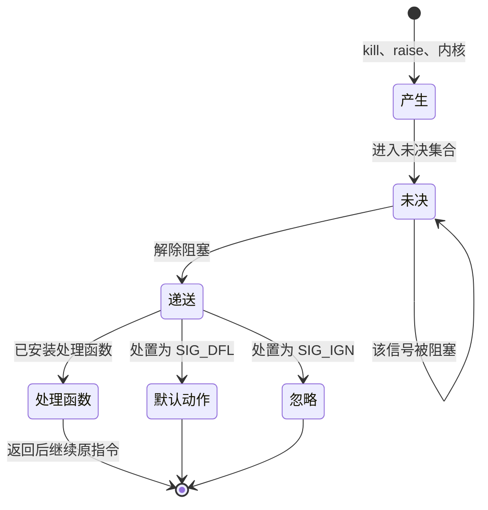
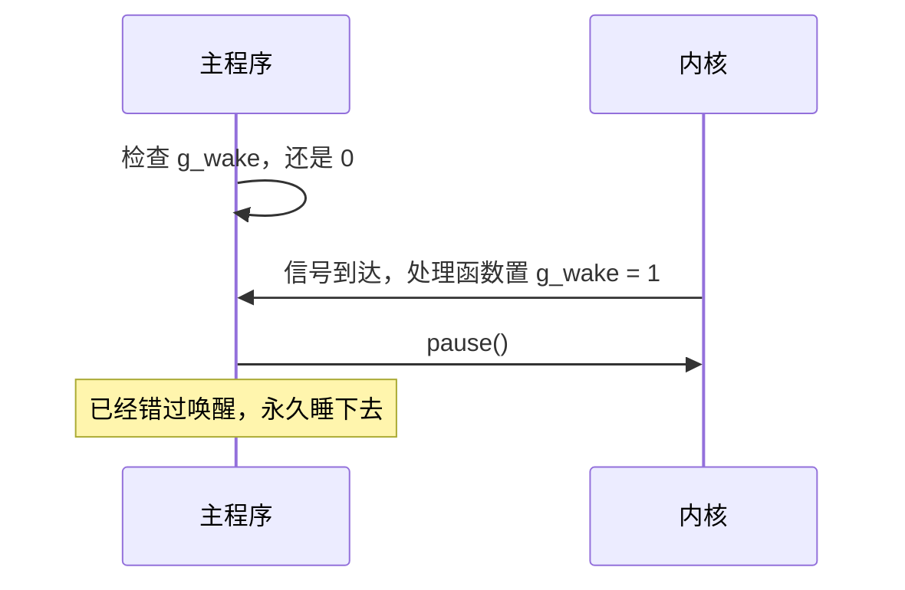

# 6. 信号、时间与定时器

一个正在将业务数据写入临时文件并准备后续原子重命名的服务程序，若在落盘中途遭遇用户敲下 Ctrl+C，磁盘上便会残留无人认领的孤儿文件；一个设计为每隔 100 毫秒刷新一次状态指标的后台循环，如果单纯采取“执行一段逻辑后休眠 100 毫秒”的简单循环，运行数分钟后整体节奏便会因为累积偏差而严重滞后。

这两个看似不相干的工程痛点，恰好映射出系统编程中两个深度交织的核心领域：一是**异步信号的拦截、管控与安全响应**；二是**高精度时钟度量与定时调度的防漂移保证**。

本篇将沿着操作系统的事件通知与计时机制深入展开：首先梳理信号从产生、未决到最终递送的完整生命周期，厘清进程在处理信号时的特权级切换与堆栈动作；接着利用 POSIX 标准的 `sigaction` 接口构建防御性信号处理结构，严格界定异步信号安全（Async-Signal-Safe）函数边界；随后探讨系统调用被打断时的 `EINTR` 错误与 `SA_RESTART` 自动重启语义，并剖析为何像 `epoll_wait` 这样的多路复用原语必须显式处理中断；针对多任务并发中脆弱的时序竞争，深入讲解如何借助 `sigsuspend` 实现绝对无竞争的挂起等待，以及在子进程并发退出的风暴中如何凭借非阻塞循环将僵尸进程回收殆尽；最后，跨越传统时钟的校时陷阱，建立基于单调时钟（`CLOCK_MONOTONIC`）与绝对时间（`TIMER_ABSTIME`）的严谨调度模型，并将 Linux 特有的 `timerfd` 机制无缝融入统一的 I/O 多路复用事件循环中。文中的 PID、毫秒数和僵尸进程号都来自某次运行，读者自己跑出来的数字会不同。

## 1. 信号的一生

信号（signal）是内核投递给进程的一则简短通知。它不携带数据，只说明发生了哪一类事件，进程要么按默认动作处理，要么忽略，要么交给自己的处理函数。管道写端全部关闭后继续写会得到 `SIGPIPE`，访问非法地址会得到 `SIGSEGV`，子进程结束会向父进程发 `SIGCHLD`，这些都是内核发出的。

### 1.1 信号的来源

除了内核，还有三个来源。终端驱动在用户按下 Ctrl+C 时向前台进程组发 `SIGINT`，按 Ctrl+\ 发 `SIGQUIT`，这一过程在第 13 章讲终端时还会展开。另一个进程可以调用 `kill` 指定 PID 发送信号，这是 `kill` 命令名字的由来。进程自己可以调用 `raise` 或 `abort`，前者等同于向自己发信号，后者固定发 `SIGABRT`。

常用的信号及其默认动作：

| 信号 | 默认动作 | 含义 |
| --- | --- | --- |
| `SIGINT` | 终止 | 键盘中断（Ctrl+C） |
| `SIGTERM` | 终止 | 终止请求，`kill` 的默认信号 |
| `SIGQUIT` | 终止并转储 | 键盘退出（Ctrl+\） |
| `SIGKILL` | 终止 | 强制杀死，不可捕获、不可阻塞、不可忽略 |
| `SIGSTOP` | 停止 | 强制暂停，同样不可捕获、不可阻塞、不可忽略 |
| `SIGSEGV` | 终止并转储 | 非法内存访问 |
| `SIGPIPE` | 终止 | 向没有读端的管道或套接字写入 |
| `SIGALRM` | 终止 | `alarm` 到点 |
| `SIGCHLD` | 忽略 | 子进程停止、结束或继续 |
| `SIGUSR1`、`SIGUSR2` | 终止 | 留给应用程序自用 |

「终止并转储」在转储被关闭时与「终止」没有区别。`SIGCHLD` 的默认动作写作忽略，但与显式把处置设成 `SIG_IGN` 不是一回事：默认处置下子进程仍会留下僵尸，显式设成 `SIG_IGN` 或加上 `SA_NOCLDWAIT`，内核才会自动回收，第 5 章提到过的就是这个区别。

`kill -l` 列出本机所有信号编号与名字，加参数可以在两者之间互查：

::: terminal title="bash - kill -l"

<span class="prompt">\$</span> kill -l TERM

15

<span class="prompt">\$</span> kill -l 15

TERM

:::

在参考环境（x86-64 Linux）上，编号 1 到 31 是标准信号（standard signal），34 起是实时信号（real-time signal）。实时信号的范围随实现而变，代码里一律用宏（`SIGRTMIN`、`SIGRTMAX`）而不是写数字。

### 1.2 默认动作与退出状态

不安装处理函数时，信号按默认动作执行。进程被信号终止后没有退出码，shell 用 128 加上信号编号作为它看到的「退出状态」。第 5 章里 `SIGKILL` 对应的 137 就是这么来的，下面的会话换成 `SIGTERM`：

::: terminal title="bash - 被信号终止的退出状态"

<span class="prompt">\$</span> sleep 100 &

[1] 3980853

<span class="prompt">\$</span> kill -TERM \$!

<span class="prompt">\$</span> wait \$!

[1]+  Terminated              sleep 100

<span class="prompt">\$</span> echo \$?

143

:::

143 等于 128 + 15。这个数字在写服务程序时有用：进程管理器拿到 143，知道进程是被 `SIGTERM` 结束的，而不是自己返回了 143。

### 1.3 产生、未决与递送

信号在进程里的流转分三步。信号产生后先进入进程的未决集合（pending set）。如果该信号此刻被阻塞，它就留在未决集合里，直到解除阻塞才被递送；否则立刻递送。递送时按处置办事：默认动作、忽略，或调用处理函数。处理函数返回后，进程从被中断的那条指令继续执行，中间发生的一切对原程序不可见。



「阻塞」在这里是一个主动的操作，与「忽略」不同：被阻塞的信号并没有被丢弃，它只是等着。第 4 节会用到这一点。

## 2. 用 sigaction 安装处理函数

标准 C 的 `signal` 在 22.1 已经讲过，它的语义在不同系统上曾有差异：处理函数执行一次之后，处置是否自动恢复成默认值，各家的做法不一样。POSIX 给出的接口是 `sigaction`，语义明确，还能带附加信息，本页之后一律用它。

### 2.1 struct sigaction

```c
#include <signal.h>

struct sigaction {
    union {
        void (*sa_handler)(int);                        /* 简单处理函数 */
        void (*sa_sigaction)(int, siginfo_t *, void *); /* 要 siginfo_t 时用 */
    };
    sigset_t sa_mask;   /* 处理函数执行期间额外阻塞的信号 */
    int sa_flags;
};
```

结构体的成员分三部分。两个函数指针共用一个联合体，二者只能填一个：`sa_handler` 是普通的 `void f(int)` 函数；要取发送者信息时改用 `sa_sigaction`，并把 `SA_SIGINFO` 放进 `sa_flags`。`sa_mask` 是处理函数执行期间额外要阻塞的信号集合，处理函数执行时当前信号本身也会被自动阻塞（`SA_NODEFER` 可以取消这一条），所以同一个信号不会嵌套自己。`sa_flags` 里最常用的是 `SA_RESTART`，含义在下一节。

安装 `SIGINT` 和 `SIGTERM`、收到后在主循环里退出，骨架如下：

```c
static volatile sig_atomic_t g_stop = 0;

static void on_stop(int signo) {
    (void)signo;
    g_stop = 1;
}

int main(void) {
    struct sigaction sa = {0};
    sa.sa_handler = on_stop;
    sigemptyset(&sa.sa_mask);
    sa.sa_flags = SA_RESTART;
    if (sigaction(SIGINT, &sa, NULL) == -1) {
        die("sigaction SIGINT");
    }
    if (sigaction(SIGTERM, &sa, NULL) == -1) {
        die("sigaction SIGTERM");
    }
    /* 主循环每 200 ms 检查一次标志 */
}
```

标志对象的类型是 `volatile sig_atomic_t`。`volatile` 阻止编译器把循环里的读取优化掉，`sig_atomic_t` 保证一次读写不会被信号打断成两半。这两个限定词缺一不可，写成 `int` 或 `bool` 在优化编译下都可能出问题。

完整程序在 `code/系统编程/6_信号_时间与定时器/graceful.c`，运行后从另一个终端按 PID 发 `SIGTERM`：

::: terminal title="bash - graceful"

<span class="prompt">\$</span> ./graceful &

pid 3925353, running

<span class="prompt">\$</span> kill -TERM 3925353

caught stop signal, cleaning up

:::

真正要做的事（删除临时文件、把日志刷出去）都放在主循环退出之后，处理函数只负责打断主循环。

### 2.2 只做异步信号安全的事

处理函数是在任意一条指令处被插进来执行的。它返回之前，主程序可能正停在任何函数内部，包括正持有一把内部锁的时候。如果处理函数再去取同一把锁，同一线程就会等自己释放，进程从此停住。

可以安全调用的函数称为异步信号安全（async-signal-safe）函数，POSIX 规定了一份清单，`write`、`read`、`open`、`close`、`_exit`、`kill`、`sigaction` 都在其中，`printf`、`malloc`、`free`、`strerror`、`localtime` 都不在。清单之外的函数在别的实现上也许能用，但换一个 libc 或换一个版本就可能出问题。

::: concept sys-signal-async-safe title="处理函数只调用异步信号安全函数"

信号处理函数里只能调用 POSIX 列为异步信号安全的函数。标准 I/O（`printf`、`fprintf`）、动态内存分配（`malloc`、`free`）、`strerror`、`localtime` 等都不在其中。处理函数的常规写法是只给 `volatile sig_atomic_t` 对象赋值，或者在需要输出时用一次 `write` 写一段预先准备好的字符数组。

:::

`code/系统编程/6_信号_时间与定时器/unsafe.c` 让一个周期极短的定时器反复打断主循环，两个版本只有处理函数不同：

::: compare vertical left-title="处理函数里 malloc，进程卡死" right-title="处理函数只设标志"

```c
static void on_tick(int signo) {
    (void)signo;
    void *p = malloc(4096);
    free(p);
}
```

---

```c
static void on_tick(int signo) {
    (void)signo;
    g_ticks++;
}
```

:::

主循环里不停地 `malloc` 和 `free`，信号就总有概率落在 glibc 的分配器正持有 arena 锁的那一小段里。这时处理函数里的 `malloc` 会一直等一把不会释放的锁：

::: terminal title="bash - 处理函数里调用 malloc"

<span class="prompt">\$</span> timeout 5 ./unsafe; echo \$?

124

<span class="prompt">\$</span> timeout 5 ./unsafe flag

main loop finished, ticks=599538

:::

124 是 `timeout` 发现程序没有按时退出而报的。换成 `flag` 参数走正确写法，一秒内处理了近六十万次定时信号，主循环正常结束。

`printf` 的问题稍微隐蔽一点。glibc 的 stdio 锁允许同一线程重复进入，所以在 glibc 上这段代码多半不会立刻卡住；但处理函数插进 `printf` 内部时，缓冲区正处于「一半写满」的状态，输出会交错、错位，换一个 libc 也可能直接死锁。

处理函数里如果要记录信息，用 `write` 写一个固定字符串即可，它不经过 stdio 缓冲区，也不会取那把锁。另一个细节：处理函数返回后，主程序可能正依赖 `errno` 判断前一次调用的结果，而处理函数里的系统调用会覆盖它。习惯做法是在处理函数开头保存、结尾恢复：

```c
static void on_tick(int signo) {
    int saved = errno;
    /* ... */
    errno = saved;
}
```

这段代码本身不修改 `errno`，保存和恢复是为了将来添加内容时不踩坑。

<Quiz
  type="single"
  :options="[
    { label: 'write 与 _exit', value: 'A' },
    { label: 'printf 与 malloc', value: 'B' },
    { label: 'strerror 与 localtime', value: 'C' },
    { label: 'fprintf 与 free', value: 'D' }
  ]"
  answer="A"
>

<template #question>

下面哪一组函数可以在信号处理函数里直接调用？

</template>

正确答案是 **A**。`write` 和 `_exit` 都在 POSIX 的异步信号安全清单里。其余三组都含有不在清单里的函数：`printf`、`fprintf` 属于标准 I/O，`malloc`、`free` 是分配器，`strerror`、`localtime` 都不保证可重入。

</Quiz>

### 2.3 接收发送者的信息

想知道信号是谁发的，把 `sa_flags` 加上 `SA_SIGINFO`，改用三参数的处理函数，第二个参数 `siginfo_t` 里有 `si_pid`、`si_uid`，实时信号还带着随信号传来的值：

```c
static void on_usr1(int signo, siginfo_t *info, void *context) {
    (void)context;
    g_signo = signo;
    g_from_pid = (sig_atomic_t)info->si_pid;
    g_from_uid = (sig_atomic_t)info->si_uid;
    g_got = 1;
}

struct sigaction sa = {0};
sa.sa_sigaction = on_usr1;
sigemptyset(&sa.sa_mask);
sa.sa_flags = SA_SIGINFO | SA_RESTART;
sigaction(SIGUSR1, &sa, NULL);
```

`code/系统编程/6_信号_时间与定时器/siginfo.c` 里子进程在 200 毫秒后向父进程发一个 `SIGUSR1`，父进程打印收到的编号和发送者：

::: terminal title="bash - siginfo"

<span class="prompt">\$</span> ./siginfo

signal 10 from pid 3958983, uid 1003

child pid is 3958983

:::

两行里的 PID 是同一个，说明信号确实来自那个子进程。`si_pid` 在权限检查上有用：服务程序可以把只接受特定用户信号的规则写进处理函数。`SIGCHLD` 的 `siginfo_t` 里也有 `si_status`，但标准信号会合并，这个值不保证对应每一个结束的子进程，回收仍然以 `waitpid` 返回的状态为准（第 5.1 节）。

## 3. 被打断的系统调用

处理函数在主程序执行系统调用期间运行时，系统调用会怎样？这是本节的问题。

### 3.1 EINTR 与 SA_RESTART

一个阻塞在 `read` 上的进程收到信号，内核先让处理函数执行，再回到 `read`。此时有两种选择：继续等（自动重启），或者返回 -1 并把 `errno` 设为 `EINTR`。选哪一种取决于该调用是否在「可重启」名单里，以及 `sigaction` 是否带了 `SA_RESTART`。

`code/系统编程/6_信号_时间与定时器/eintr.c` 在标准输入上阻塞读，同时用 `alarm` 在一秒后发 `SIGALRM`。管道里三秒后才有数据，所以一秒时的信号必然打断 `read`：

::: terminal title="bash - EINTR 与 SA_RESTART"

<span class="prompt">\$</span> gcc -std=c17 -Wall -Wextra -g eintr.c -o eintr

<span class="prompt">\$</span> sleep 3 | ./eintr

read: Interrupted system call (errno=4) after 1000.0 ms

<span class="prompt">\$</span> sleep 3 | ./eintr restart

read returned 0 (end of file) after 3000.1 ms

:::

第一行没有 `SA_RESTART`，`read` 在 1 秒时返回 -1，`errno` 为 4（`EINTR`）。第二行加了 `SA_RESTART`，`read` 被信号打断后自己接着等，直到三秒后写端退出、管道读到文件结束，返回 0。

调用者怎么处理 `EINTR` 取决于上下文。做「读满一整块」这类辅助函数时，重试是标准写法，第 2 章的 `write_all` 里就有：

```c
ssize_t n = read(fd, buf + done, len - done);
if (n == -1) {
    if (errno == EINTR) {
        continue;
    }
    return -1;
}
```

如果这次读的目的就是等信号，重试反而会错失时机，应当直接返回让上层判断。

### 3.2 永远不会自动重启的调用

`SA_RESTART` 只对一部分调用有效。下面这些调用即使设了 `SA_RESTART` 也会失败并返回 `EINTR`：

- 等待信号的 `pause`、`sigsuspend`、`sigtimedwait`、`sigwaitinfo`；
- 睡眠的 `nanosleep`、`clock_nanosleep`、`usleep`；
- I/O 多路复用的 `poll`、`ppoll`、`select`、`pselect`、`epoll_wait`、`epoll_pwait`；
- 设置了接收或发送超时的套接字上的 `accept`、`recv`、`send`、`connect` 等；
- System V IPC 的 `msgrcv`、`msgsnd`、`semop`。

这个名单是第 11 章的多路复用循环和第 12 章的事件循环必须处理 `EINTR` 的原因：循环的核心是 `epoll_wait`，而它恰好属于永不重启的那一类。同一个程序里，`read` 可能被自动重启，`epoll_wait` 不会，两者要有不同的写法。

`nanosleep` 也一样，而且它会给第二个参数回填剩余时间：

::: terminal title="bash - nanosleep 与 EINTR"

<span class="prompt">\$</span> ./eintr - sleep

nanosleep returned -1 (Interrupted system call), 2.000038732 s left, after 1000.0 ms

<span class="prompt">\$</span> ./eintr restart sleep

nanosleep returned -1 (Interrupted system call), 2.000042940 s left, after 1000.0 ms

:::

请求睡三秒，一秒时被 `SIGALRM` 打断，返回 -1 且回填的剩余时间约为两秒，`SA_RESTART` 对结果没有影响。想在信号之后接着睡完，就把回填的剩余时间再传给下一次 `nanosleep`：

```c
struct timespec req = {3, 0};
while (nanosleep(&req, &req) == -1 && errno == EINTR) {
}
```

`nanosleep` 返回 -1 并设置 `errno`，`clock_nanosleep` 不一样，它直接返回错误号，成功时返回 0，失败时返回正值，不设置 `errno`。混合使用这两个接口时容易在这里出错。

`poll` 的情况同理：

::: terminal title="bash - poll 被信号打断"

<span class="prompt">\$</span> ./poll_eintr

poll: Interrupted system call after 1000 ms, flag=1

:::

程序设了 5 秒超时，但一秒时的 `SIGALRM` 让 `poll` 立刻返回 `EINTR`，尽管处理函数已经置好了标志。事件循环里遇到这种情况直接进入下一轮即可，下一轮会看到标志并退出。

在实际工程编写中，一条广为采纳的最佳实践是：仅用于置位全局退出标志的轻量处理函数，推荐统一启用 `SA_RESTART` 标志。这样一来，主流程中不关心该信号的普通阻塞调用（如常规磁盘或套接字的 `read`、`write` 以及父进程的 `waitpid`）便可获得内核的透明自动恢复，省去在代码各处繁琐包裹 `while (ret == -1 && errno == EINTR)` 的防护样板；而对于原本就期望被信号唤醒的等待入口（如 `poll`、`epoll_wait`、`nanosleep` 以及 `sigsuspend`），由于内核规则决定了它们绝不受 `SA_RESTART` 影响，依然会稳定返回 `EINTR`，调用方只需在上层事件循环或等待点显式检视退出标志即可。

### 3.3 信号与 sleep 的返回值

`sleep` 是个例外，它不在「返回 `EINTR`」的名单里：被信号打断时返回剩余的秒数，0 表示睡满了。这个返回值经常被忽略，从而导致睡不够：

::: terminal title="bash - sleep 的返回值"

<span class="prompt">\$</span> ./sleep_left

sleep returned 2

:::

`sleep(3)` 请求三秒，一秒时被闹钟打断，返回 2。如果程序没检查返回值，就只睡了一秒。需要精确睡眠时用 `nanosleep` 或 `clock_nanosleep`，它们的剩余时间说得更清楚。

## 4. 信号掩码与无竞争的等待

### 4.1 掩码与未决

每个进程有一份信号掩码（signal mask），列在里面的信号处于阻塞状态。`sigprocmask` 读写掩码，`sigpending` 查看当前有哪些信号正等着：

```c
sigset_t set;
sigemptyset(&set);
sigaddset(&set, SIGUSR1);
sigprocmask(SIG_BLOCK, &set, &old);    /* 阻塞 SIGUSR1，旧掩码存入 old */
sigprocmask(SIG_SETMASK, &old, NULL);  /* 恢复 */
```

`sigset_t` 是不透明类型，只能用 `sigemptyset`、`sigfillset`、`sigaddset`、`sigdelset`、`sigismember` 操作，不能直接按位运算。

标准信号不排队。一个信号已经在未决集合里时，再来同样的信号不会增加计数，未决集合里仍然只有一份，解除阻塞后只递送一次。三个 `raise` 只换来一次处理函数调用。完整程序是 `code/系统编程/6_信号_时间与定时器/coalesce.c`：

::: terminal title="bash - 标准信号不排队"

<span class="prompt">\$</span> ./coalesce

SIGUSR1 blocked, sending it three times

pending before unblock: 1

delivered after unblock: 1

:::

`sigpending` 报告未决集合里有 `SIGUSR1`，解除阻塞后处理函数只跑了一次。

::: concept sys-signal-no-queue title="标准信号不排队"

标准信号在未决集合里只占一位。同一信号在阻塞期间到达多次，解除阻塞后只递送一次，`siginfo_t` 里保存的是第一次的信息。需要逐次计数或携带数据的场合要用实时信号，它们会排队，并且能用 `sigqueue` 带一个整数或指针。

:::

推论很实际：想统计「收到多少次 SIGUSR1」，用标准信号做不到，中间被阻塞或处理函数正在执行时到达的信号会被合并进一次。要计数就得让处理函数尽快返回，并且接受计数可能偏少的事实；要一次不漏，用实时信号。

<Quiz
  type="multi"
  :options="[
    { label: '阻塞期间连发三次，解除阻塞后递送三次', value: 'A' },
    { label: '阻塞期间连发三次，解除阻塞后只递送一次', value: 'B' },
    { label: '处理函数执行期间同一信号再次到达，会被合并', value: 'C' },
    { label: '改用 SIGRTMIN 后三次都会递送', value: 'D' }
  ]"
  :answer="['B', 'C', 'D']"
>

<template #question>

标准信号 `SIGUSR1` 在阻塞期间被连发三次，解除阻塞后会发生什么？

</template>

正确答案是 **B、C、D**。标准信号在未决集合里只占一位，多次到达合并成一次。处理函数执行期间当前信号默认被阻塞，期间的到达同样合并。实时信号会排队，所以改用 `SIGRTMIN` 后三次都能收到。

</Quiz>

### 4.2 检查与睡眠之间的窗口

「等到某个信号来了再继续」有一个看似自然的写法：检查标志，没来就 `pause()`。它有一个不容易发现的缺陷：



信号恰好落在「检查完标志」和「调用 `pause`」之间，处理函数把标志置好了，可 `pause` 仍然会睡下去，因为没有第二个信号来叫醒它。这个窗口很窄，但在长期运行的服务里迟早会遇到。

`sigsuspend` 解决的正是这件事。它原子地做两件事：把进程掩码换成参数给的集合，然后睡眠，直到有信号被递送；返回前恢复原来的掩码。「检查标志」和「进入睡眠」之间不再有窗口，因为信号在睡眠期间一直处于阻塞状态，只会变成未决，`sigsuspend` 一进入就会看到它并立刻返回。

正确写法分三步：先用 `sigprocmask` 阻塞关心的信号，再在循环里检查标志并 `sigsuspend`，最后恢复原掩码。完整程序在 `code/系统编程/6_信号_时间与定时器/sigsuspend_wait.c`：

```c
sigset_t block, old;
sigemptyset(&block);
sigaddset(&block, SIGUSR1);
sigaddset(&block, SIGTERM);
sigprocmask(SIG_BLOCK, &block, &old);

while (!g_stop) {
    while (!g_stop && !g_usr1) {
        sigsuspend(&old);      /* 等待期间临时放开 old 里的信号 */
    }
    if (g_usr1) {
        g_usr1 = 0;
        /* 处理一次 SIGUSR1 */
    }
}
```

`sigsuspend(&old)` 里的 `old` 是阻塞之前的掩码，也就是「正常情况下该有的掩码」，所以等待期间只有被主动阻塞的那几个信号保持阻塞，其余信号照常递送。

对比程序在 `code/系统编程/6_信号_时间与定时器/lost_wakeup.c`，两个版本自己 fork 一个子进程，150 毫秒后给父进程发 `SIGUSR1`：

::: terminal title="bash - 检查与睡眠之间的窗口"

<span class="prompt">\$</span> timeout 3 ./lost_wakeup; echo \$?

ready

124

<span class="prompt">\$</span> ./lost_wakeup sigsuspend

ready

woke up, flag=1

:::

缺陷版打印 `ready` 之后不再有输出，`timeout` 三秒后把它结束，状态 124。正确版立刻醒来。程序里的 `sleep_ms(300)` 就是在放大那个窗口，真实程序里窗口只有几条指令宽，但调度器可能恰好在那一刻切走。

::: generate sys-signal-pending-model kind=explanation concepts=sys-signal-no-queue

面向不熟悉「未决」与「阻塞」区别的读者，用一个具体的类比讲清两者的关系：未决是「信已经投进信箱」，阻塞是「把信箱锁上」。再结合本节的 coalesce.c 与 lost_wakeup.c 两个程序，说明为什么标准信号合并之后计数会偏少，以及为什么「检查之后再睡」会丢掉一次唤醒，而 sigsuspend 把换掩码和睡眠合成一个不可分割的动作之后窗口就消失了。

:::

::: generate sys-signal-sigsuspend-race kind=explanation concepts=sys-signal-no-queue

面向已经知道 pause 会挂起进程、但不清楚「原子地换掩码并睡眠」是什么意思的读者，按指令逐条推演 sigsuspend 的内部动作：第一步把进程掩码替换成参数给的集合，第二步等待任意一个未被阻塞的信号，第三步在递送前恢复原来的掩码。用 lost_wakeup 缺陷版的时序对照说明：把「换掩码」与「进入等待」合成一个不可分割的动作之后，信号只有两种可能——在调用之前到达（变成未决，调用立刻返回）或在等待期间到达（正常唤醒），不存在第三种。不要总结全文。

:::

### 4.3 实时信号

实时信号（编号 `SIGRTMIN` 起）与标准信号有两处不同：同一信号在未决时可以排队多份，并且 `sigqueue` 能随信号带一个 `union sigval`（整数或指针）。把 4.1 的实验换成实时信号，三个信号会全部送到：

::: terminal title="bash - 实时信号排队"

<span class="prompt">\$</span> ./rtsig

received 3 signals: 100 200 300

:::

程序用 `sigqueue` 依次发出值为 100、200、300 的三个 `SIGRTMIN`，处理函数通过 `info->si_value.sival_int` 把它们全部取到。信号处理的顺序和发送顺序一致。

实时信号的另一个用途是取代「用多个标准信号表示多种事件」的写法：只用一个实时信号，事件类型放在 `si_value` 里。代价是 `sigqueue`、`SA_SIGINFO` 的写法和标准信号不同，而通知线程或事件循环通常有更简单的替代（第 8 章的 `sigwait` 线程、第 12 章的 `signalfd`）。本页只要求认得这套接口。

## 5. SIGCHLD 与子进程回收

### 5.1 一次信号可能对应多个子进程

第 5 章讲过子进程结束后要 `waitpid` 回收，否则留下僵尸。用 `SIGCHLD` 通知父进程时有一个陷阱：信号会合并。五个子进程几乎同时退出，父进程可能只收到一次 `SIGCHLD`，处理函数里只调用一次 `waitpid` 就只能回收一个，另外四个继续挂着。

下面的程序先把 `SIGCHLD` 阻塞，让五个子进程的退出挤进同一次递送，300 毫秒后解除阻塞，然后按两种方式回收：

::: compare left-title="处理函数里只 waitpid 一次" right-title="循环到没有可回收的子进程"

```c
static void on_chld(int signo) {
    (void)signo;
    int saved = errno;
    if (waitpid(-1, NULL, WNOHANG) > 0) {
        g_reaped++;
    }
    errno = saved;
}
```

---

```c
static void on_chld(int signo) {
    (void)signo;
    int saved = errno;
    while (waitpid(-1, NULL, WNOHANG) > 0) {
        g_reaped++;
    }
    errno = saved;
}
```

:::

完整程序是 `code/系统编程/6_信号_时间与定时器/reap.c`。在另一个终端用 `ps` 看父进程的子进程，输出只筛自己这一组 PID：

::: terminal title="bash - 只回收一个，留下四个僵尸"

<span class="prompt">\$</span> ./reap once &

parent pid 4017054, 5 children exited, handler ran 1 time(s), reaped 1

<span class="prompt">\$</span> ps -o pid,stat,comm --ppid 4017054

    PID STAT COMMAND

4017057 Z    reap

4017058 Z    reap

4017059 Z    reap

4017060 Z    reap

:::

四个 `Z` 状态的进程就是僵尸：它们已经结束，只剩退出状态等着被读取。换成循环回收的版本，同一时刻 `ps` 什么也不显示，处理函数报告回收了五个。

`WNOHANG` 让 `waitpid` 在没有可回收子进程时立刻返回 0，所以循环不会卡住。`waitpid(-1, ...)` 表示任意子进程。

处理函数里还可以加 `SA_NOCLDSTOP`，让子进程被 `SIGSTOP` 暂停时不再产生 `SIGCHLD`。默认情况下子进程暂停和继续也会通知父进程，如果父进程的回收逻辑默认「收到 SIGCHLD 就认为有子进程退出」，暂停会让它白跑一趟 `waitpid`。

`SA_RESTART` 在这里也有用：`waitpid` 属于可重启的调用，加上之后父进程的阻塞等待不会因为 `SIGCHLD` 而返回 `EINTR`。

### 5.2 fork 与 exec 对信号的影响

这两条规则在第 12 章会反复用到：

- `fork` 出的子进程继承父进程的信号处置和信号掩码，未决集合是空的。
- `exec` 把被捕获的信号恢复成默认动作，被忽略的信号保持忽略，信号掩码原样保留，未决集合也原样保留。

`code/系统编程/6_信号_时间与定时器/execsig.c` 在 `exec` 前后各读一次 `/proc/self/status` 里的掩码，逐位解码：

::: terminal title="bash - exec 前后信号状态的对照"

<span class="prompt">\$</span> ./execsig

before exec:

  SIGINT   blocked=0 ignored=0 caught=0

  SIGTERM  blocked=1 ignored=0 caught=0

  SIGUSR1  blocked=0 ignored=0 caught=1

  SIGUSR2  blocked=0 ignored=1 caught=0

  SIGCHLD  blocked=0 ignored=0 caught=0

after exec:

  SIGINT   blocked=0 ignored=0 caught=0

  SIGTERM  blocked=1 ignored=0 caught=0

  SIGUSR1  blocked=0 ignored=0 caught=0

  SIGUSR2  blocked=0 ignored=1 caught=0

  SIGCHLD  blocked=0 ignored=0 caught=0

:::

`SIGUSR1` 的 `caught` 从 1 变成 0，捕获的处理函数被恢复成默认动作；`SIGUSR2` 的 `ignored` 保持 1，显式忽略的信号跨 `exec` 继续忽略；`SIGTERM` 的 `blocked` 保持 1，掩码被继承。所以在 `exec` 之前启动子进程时，如果父进程为了别的原因阻塞过某些信号，子进程会带着这份掩码运行，必要时在 `exec` 前恢复。第 12 章讲 `signalfd` 时，这一点直接决定信号要发给谁。

## 6. 时钟

### 6.1 四种时钟

`clock_gettime` 从指定的时钟读取时间，第一个参数是时钟编号：

| 时钟 | 含义 | 用途 |
| --- | --- | --- |
| `CLOCK_REALTIME` | 墙上时间，从 1970 年起算 | 日志、文件时间戳、要与人对表的场合 |
| `CLOCK_MONOTONIC` | 从系统启动起算，只增不减 | 测量间隔、超时、周期任务 |
| `CLOCK_BOOTTIME` | 同单调时钟，但把系统休眠的时间也算进去 | 需要跨休眠计时（Linux 专有） |
| `CLOCK_PROCESS_CPUTIME_ID` | 本进程消耗的 CPU 时间 | 性能分析 |

`CLOCK_REALTIME` 会被校时改变：NTP 同步可能让它跳一下，管理员也可能手工调。用它测量间隔，测出的差值可能为负，也可能凭空多出几秒。`CLOCK_MONOTONIC` 不受这些影响，但它不统计系统休眠的时间——笔记本合盖两小时，单调时钟只走了几分钟。需要把休眠也算上时用 `CLOCK_BOOTTIME`。

分辨率用 `clock_getres` 查询：

::: terminal title="bash - 读取时钟"

<span class="prompt">\$</span> ./elapsed

CLOCK_MONOTONIC resolution: 1 ns

sleep 700 ms measured with CLOCK_REALTIME:  700.078 ms

sleep 700 ms measured with CLOCK_MONOTONIC: 700.101 ms

sleep 700 ms measured with CLOCK_BOOTTIME:  700.103 ms

:::

三种时钟测同一段 700 毫秒的睡眠，差在几十微秒以内，这是 `nanosleep` 唤醒延迟的正常波动。分辨率 1 纳秒是内核报告的精度，不代表真的能分辨纳秒。

`struct timespec` 的两个成员是秒和纳秒，`tv_nsec` 的取值范围是 0 到 999999999。两个时刻相减时要处理借位，直接按字段减会在纳秒部分得到负数。下面的辅助函数把时间差换算成毫秒：

```c
static double now_ms(clockid_t clock) {
    struct timespec ts;
    clock_gettime(clock, &ts);
    return (double)ts.tv_sec * 1000.0 + (double)ts.tv_nsec / 1e6;
}
```

先各自换算成毫秒再相减，就不必处理借位。

`clock_gettime` 在 Linux 上通过 vDSO 实现：内核把一小段代码映射进每个进程的地址空间，读时钟只需一次用户态的函数调用，不必陷入内核。用 `strace -c` 统计程序用到的系统调用，表里找不到 `clock_gettime`：

::: terminal title="bash - strace -c 里没有 clock_gettime"

<span class="prompt">\$</span> strace -c ./elapsed 2>&1 | grep clock_gettime

<span class="prompt">\$</span> echo \$?

1

:::

`grep` 没有匹配到任何行，退出状态 1。这项优化让密集调用时钟的程序不必为每次读数付一次系统调用的代价，也意味着 `strace` 看不到这些调用——调试计时问题时不要因为它「没出现」就以为调用没发生。

### 6.2 测量间隔

::: concept sys-signal-monotonic title="测量时间间隔用单调时钟"

测量一段代码的耗时、两个事件之间的间隔、超时是否到点，都用 `CLOCK_MONOTONIC`。`CLOCK_REALTIME` 会被校时调整，用它算出的差值可能突变、为负或为 0。只有在需要与人对表、与外部系统交换时间（日志、文件时间戳、协议里的时间字段）时才用 `CLOCK_REALTIME`，取到之后再转成日历时间。

:::

第一部分第 20 章讲的 `time`、`localtime_r`、`strftime` 处理的是日历时间，它们建立在 `CLOCK_REALTIME` 之上；测量间隔换成本节的接口。`gettimeofday` 是老接口，精度只到微秒，而且已经从 POSIX.1-2024 删除，新代码不必再写。

CPU 时间另有两条路：`clock()` 只统计本进程，`clock_gettime(CLOCK_PROCESS_CPUTIME_ID)` 精度更高；`getrusage` 还能分开用户态和内核态。它们与墙上时间无关，测量「代码跑了多久」时不要混用。

<Quiz
  type="single"
  :options="[
    { label: 'CLOCK_REALTIME', value: 'A' },
    { label: 'CLOCK_MONOTONIC', value: 'B' },
    { label: 'gettimeofday', value: 'C' },
    { label: 'time(NULL)', value: 'D' }
  ]"
  answer="B"
>

<template #question>

要测量一段代码执行了多久，应当用哪个时钟？

</template>

正确答案是 **B**。`CLOCK_MONOTONIC` 只增不减，不受校时影响。`CLOCK_REALTIME` 和 `gettimeofday` 读的是墙上时间，同步 NTP 时可能倒退；`time(NULL)` 的精度只有一秒。

</Quiz>

## 7. 睡眠与周期任务

### 7.1 相对睡眠的漂移

`nanosleep` 和 `clock_nanosleep` 的参数有两种解释方式。默认是相对时间：睡这么久。加上 `TIMER_ABSTIME` 就变成绝对时刻：睡到时钟走到这个时刻为止。

「每轮忙 7 毫秒，再睡 100 毫秒」的周期任务用相对睡眠时，每一轮的周期是工作时间和睡眠时间之和，误差逐轮累积：

::: terminal title="bash - 相对睡眠的漂移"

<span class="prompt">\$</span> ./drift

round  1:  107.079 ms (ideal  100 ms)

round  2:  214.250 ms (ideal  200 ms)

round  3:  321.324 ms (ideal  300 ms)

...

round 10: 1070.817 ms (ideal 1000 ms)

:::

第十轮晚了约 70 毫秒，正好是十轮工作时间的总和（7 × 10）。每一轮的睡眠都是从「这一轮工作结束时」起算的，那段工作时间就永久地加进了周期里。按这个比例运行一小时，闹钟会慢上好几分钟。

把睡眠换成绝对时刻，每轮的目标时刻在启动时就算好，工作耗时只影响这一轮还剩多少时间可以睡：

```c
struct timespec deadline = start;
deadline.tv_nsec += (long)(i + 1) * PERIOD_MS * 1000000L;
deadline.tv_sec += deadline.tv_nsec / 1000000000L;
deadline.tv_nsec %= 1000000000L;
clock_nanosleep(CLOCK_MONOTONIC, TIMER_ABSTIME, &deadline, NULL);
```

::: terminal title="bash - 绝对时刻的周期"

<span class="prompt">\$</span> ./drift abs

round  1:  100.067 ms (ideal  100 ms)

round  2:  200.066 ms (ideal  200 ms)

round  3:  300.068 ms (ideal  300 ms)

...

round 10: 1000.070 ms (ideal 1000 ms)

:::

第十轮仍在 1000 毫秒附近，偏差只有几十微秒，来自唤醒延迟，不累积。这是周期任务的通用做法：目标是绝对时刻，不是间隔。

::: compare left-title="相对睡眠，误差累积" right-title="绝对时刻，不累积"

```c
for (int i = 0; i < rounds; i++) {
    do_work();
    struct timespec nap = {0, 100 * 1000000L};
    nanosleep(&nap, NULL);
}
```

---

```c
struct timespec start;
clock_gettime(CLOCK_MONOTONIC, &start);
for (int i = 0; i < rounds; i++) {
    do_work();
    struct timespec deadline = start;
    deadline.tv_nsec += (long)(i + 1) * 100 * 1000000L;
    deadline.tv_sec += deadline.tv_nsec / 1000000000L;
    deadline.tv_nsec %= 1000000000L;
    clock_nanosleep(CLOCK_MONOTONIC, TIMER_ABSTIME, &deadline, NULL);
}
```

:::

使用绝对时刻有两个附带问题。如果某一轮的工作时间超过了周期，截止时刻已经过去，`clock_nanosleep` 会立刻返回，不会睡负数的时间——程序会连着补做几轮，看起来像「追帧」。如果这个追赶行为不合适，就在循环里检查当前时刻是否已经超过下一个截止时刻，超了就跳过若干轮或重新起算。

`clock_nanosleep` 被信号打断时返回 `EINTR`（正值，不是 -1），用 `TIMER_ABSTIME` 时不需要剩余时间，重新传同一个绝对时刻再睡一次即可：

```c
while (clock_nanosleep(CLOCK_MONOTONIC, TIMER_ABSTIME, &deadline, NULL) == EINTR) {
}
```

`sleep` 只能以秒为单位，而且返回值容易忽略，写周期任务时不用它。`usleep` 在 POSIX.1-2008 就已从标准中删除，新代码用 `nanosleep`。

### 7.2 睡眠精度的来源

`nanosleep` 请求的时长是下限，不是上限。内核让进程睡够这么久，唤醒之后还要等调度器把 CPU 交给它，在负载重的机器上这段等待可能达到毫秒级。七毫秒的工作加上 100 毫秒睡眠在测试机上稳定在 107 毫秒附近，偏差主要来自被唤醒后的调度延迟，而不是计时器本身。

对精度有要求的场合要接受两点：任何睡眠都会晚于请求；晚多少取决于系统负载和调度策略。周期任务用绝对时刻可以把这些延迟限制在单轮之内，不会累加。真正的硬实时要求不在本页范围，那需要实时调度策略和内核配置，第 8 章会提到一点。

## 8. 定时器

### 8.1 alarm 与 setitimer

`alarm` 最简单：参数是秒数，到点发 `SIGALRM`，只触发一次。再次调用 `alarm` 会取消原来的闹钟，返回值为上一次剩余的秒数；`alarm(0)` 取消。整个进程只有一个闹钟，所以它只适合「给这次操作加个总时限」这类简单用途，不适合同时管理多个定时事件。

`setitimer` 提供微秒精度和周期触发，`ITIMER_REAL` 用的也是 `SIGALRM`。它已经从 POSIX.1-2024 删除，新代码不写，读旧代码时认得即可。`alarm` 保留了下来，但只有秒级精度。

### 8.2 POSIX 定时器

POSIX 定时器（`timer_create`）解决了 `alarm` 只有一路的问题：一个进程可以创建多个定时器，每个有独立的 ID 和通知方式，而且可以选时钟。下面的代码创建一个 100 毫秒周期的定时器（`code/系统编程/6_信号_时间与定时器/ptimer.c` 在它前后各加了一段阻塞与统计）：

```c
timer_t timer;
struct sigevent event = {0};
event.sigev_notify = SIGEV_SIGNAL;
event.sigev_signo = SIGALRM;
timer_create(CLOCK_MONOTONIC, &event, &timer);

struct itimerspec spec = {0};
spec.it_value.tv_nsec = 100 * 1000000L;      /* 第一次在 100 ms 后 */
spec.it_interval.tv_nsec = 100 * 1000000L;   /* 之后每 100 ms 一次 */
timer_settime(timer, 0, &spec, NULL);
```

`it_value` 是首次到期时间，`it_interval` 是之后的间隔，`it_interval` 为零表示只触发一次。传 0 给 `timer_settime` 的第二个参数表示用相对时间，传 `TIMER_ABSTIME` 表示 `it_value` 是绝对时刻。

::: terminal title="bash - POSIX 定时器与 overrun"

<span class="prompt">\$</span> ./ptimer

timer running at 100 ms, SIGALRM blocked for 350 ms

handler ran 1 time(s)

timer_getoverrun after unblock: 2

after another 300 ms: handler ran 4 time(s)

:::

350 毫秒里定时器到期三次，但信号被阻塞，未决集合里只有一份。解除阻塞后处理函数只跑一次，`timer_getoverrun` 报告 2，表示在这一次通知之外还有两次到期被漏掉。这再次说明定时器的到期次数与信号的递送次数不是一回事。

`timer_getoverrun` 的返回值是「最近一次通知递送之前多出来的到期次数」，它只提供信息，不会补发通知。想一次不漏地处理每次到期，就要让处理函数足够快，或者改用 `timerfd`。

`SIGEV_THREAD` 是另一种通知方式，到期时由一个新的线程执行指定的函数，省去处理函数里不能加锁、不能分配内存的麻烦。代价是线程创建的开销和生命周期管理，长期运行的程序里通常不用。

`timer_create` 的第一个参数决定时基。用 `CLOCK_MONOTONIC` 创建的定时器不受校时影响，100 毫秒的周期不会因为 NTP 调整而变成 99 或 101 毫秒；用 `CLOCK_REALTIME` 时，绝对时刻的定时器会跟着系统时间跳。

### 8.3 timerfd

`timerfd` 是 Linux 专有的接口，思路不一样：定时器就是一个文件描述符，到期时该描述符可读，`read` 得到自上次读以来到期的次数。完整程序是 `code/系统编程/6_信号_时间与定时器/tfd.c`。

```c
int tfd = timerfd_create(CLOCK_MONOTONIC, TFD_CLOEXEC);
struct itimerspec spec = {0};
spec.it_value.tv_nsec = 200 * 1000000L;
spec.it_interval.tv_nsec = 200 * 1000000L;
timerfd_settime(tfd, 0, &spec, NULL);
```

读回来的是一个 8 字节的无符号整数。这个值会累积：如果两次读之间到期了三次，第一次读会一次得到 3。

::: terminal title="bash - timerfd"

<span class="prompt">\$</span> ./tfd

first read: 1

second read after 650 ms: 3

139 ms: readable

340 ms: readable

:::

第一次按时读，得到 1；之后故意耽搁 650 毫秒，期间到期三次，一次读回来 3。最后两行用 `poll` 等待描述符，两次可读相隔约 200 毫秒（计时从那一段 `poll` 循环开始时算起），正是设置的周期。

`timerfd` 的描述符可以放进 `poll`、`epoll`，与套接字、管道放在同一个等待里。这正是事件循环需要的形式：所有事件源都是描述符，循环只需在一个地方等待。

在现代高性能网络服务与异步系统的架构演进中，普遍的共识是：凡是具备事件循环的程序，定时机制应优先选用 `timerfd`，或者由事件循环自身维护一个就绪定时器的最小堆/时间轮，直接以最近到期时间作为 `epoll_wait` 的阻塞超时参数（这正是第 12 章将深入展开的标准实践）。

应当极力避免依赖 `SIGALRM` 这类传统异步信号来驱动核心业务逻辑：一方面，信号处理函数内受到极其严苛的异步信号安全限制，绝不能自由访问或修改事件循环中的复杂对象与连接树；另一方面，`epoll_wait` 本身属于永不自动重启的调用，每一次定时信号的派发都会强行打断监听并产生一次 `EINTR` 假唤醒，事件循环必须额外编写代码去识别并区分“这究竟是真正的定时器到期，还是被其他杂散信号意外中断”。一旦将定时器封装为规范的文件描述符（`timerfd`），时间流逝便自然退化为普通的描述符可读事件，所有关于信号重入与假唤醒的复杂顾虑也随之荡然无存。

<Quiz
  type="single"
  :options="[
    { label: '用 alarm 加 SIGALRM，简单可靠', value: 'A' },
    { label: '用 setitimer 的 ITIMER_REAL', value: 'B' },
    { label: '用 timerfd，把定时器变成描述符', value: 'C' },
    { label: '用定时器信号，并在处理函数里直接操作连接结构', value: 'D' }
  ]"
  answer="C"
>

<template #question>

事件循环里要给每个连接加一个超时定时器，哪种做法最合适？

</template>

正确答案是 **C**。`timerfd` 让定时器变成描述符，可以和套接字放进同一个等待，到期次数由 `read` 读出。`alarm` 整个进程只有一个，`setitimer` 已经从 POSIX.1-2024 删除。D 的问题在处理函数里不能安全地操作循环的数据结构。

</Quiz>

:::: details timer_create 的三种通知方式

`struct sigevent.sigev_notify` 取三种值：

- `SIGEV_SIGNAL`：到期发信号，`sigev_signo` 指定编号，本节的 `ptimer.c` 用它。
- `SIGEV_THREAD`：到期创建一个线程执行 `sigev_notify_function`，参数在 `sigev_value` 里。
- `SIGEV_NONE`：不通知，只能靠 `timer_gettime` 查剩余时间，或者用 `timerfd` 的另一种写法。

`SIGEV_THREAD` 看起来最方便，实际上要处理线程创建失败、线程与主程序的并发、以及到期过快时线程越积越多。信号加标志的写法代码多几行，生命周期清楚得多。

::::

## 9. 习题

### 9.1 巩固

<Exercise id="40601" :d="2" :w="2" multi>

(1) _[1.1]_ 不写代码，回答：`kill -TERM` 与 `kill -KILL` 分别能否被处理函数捕获？进程被 `SIGQUIT` 终止后 shell 报告的退出状态是多少？`SIGCHLD` 的默认动作写成「忽略」，为什么子进程仍会变成僵尸？

(2) _[2.2]_ 下面四段代码都想在处理函数里记录信息，判断哪些是异步信号安全的写法，并把不安全的改写成安全的版本（可以借助一个预置的字符数组和 `write`）。

```c
static void a(int s) { printf("signal %d\n", s); }
static void b(int s) { g_last = s; }
static void c(int s) { char *p = malloc(64); free(p); }
static void d(int s) { write(STDERR_FILENO, "stop\n", 5); (void)s; }
```

改写后说明：为什么 `printf` 在 glibc 上可能看不出问题，换到别的实现却可能死锁。

</Exercise>

<Exercise id="40602" :d="2" :w="2">

下面这段代码想统计一段计算耗时，被人指出在系统校时的时候会出错：

```c
struct timeval start, end;
gettimeofday(&start, NULL);
do_work();
gettimeofday(&end, NULL);
printf("%ld us\n", (end.tv_sec - start.tv_sec) * 1000000L +
                   (end.tv_usec - start.tv_usec));
```

把它改成用 `clock_gettime` 和 `CLOCK_MONOTONIC` 的版本，封装成 `double elapsed_ms(struct timespec start)`。另外写一个小程序验证 `CLOCK_BOOTTIME` 与 `CLOCK_MONOTONIC` 读数的差值，并说明什么场合该用前者。

</Exercise>

<Exercise id="40603" :d="2" :w="3">

写一个 `countdown N`：从 N 秒开始，每秒打印一次剩余秒数，打印的时刻要落在整秒上而不是每轮累加（用 `clock_nanosleep` 的 `TIMER_ABSTIME`）。同时处理 `SIGINT`：第一次按下时打印「再按一次退出」，程序继续倒计时；三秒内再按一次才真正退出，超过三秒没再按，提示状态复位。

验收：`./countdown 10` 运行时连按两次 Ctrl+C 立刻退出；只按一次则在三秒后继续倒计时；用秒表核对最后一次打印与启动时刻正好相差 N 秒。

</Exercise>

### 9.2 编程

<Exercise id="40604" :d="3" :w="3">

写一个 `sigcount`：统计收到的 `SIGUSR1` 与 `SIGUSR2` 次数，收到 `SIGTERM` 时打印两个计数并退出。先用标准信号做，用 shell 循环连发 1000 次 `SIGUSR1`：

```bash
for i in $(seq 1000); do kill -USR1 PID; done
```

记录程序报告的计数，解释它为什么小于 1000。然后把信号改成 `SIGRTMIN`，用 `sigqueue` 发送同样的次数（写一个小发送程序），比较两次的计数。

</Exercise>

<Exercise id="40605" :d="3" :w="3">

把 `lost_wakeup.c` 的缺陷版改成用 `sigsuspend` 的无竞争版本，要求：

- 处理函数只设置 `volatile sig_atomic_t` 标志；
- 主循环在 `sigsuspend` 里等待，`SIGUSR1` 到达后打印一行再回到等待；
- 收到 `SIGTERM` 时退出，退出前把 `SIGUSR1` 的累计次数打印出来。

验收：连续发 10 次 `SIGUSR1`，每次都能立刻看到一行输出；把 `lost_wakeup` 缺陷版里 `sleep_ms(300)` 的等待时间改成随机值再跑 20 次，确认缺陷版会挂住而你的版本从不挂住。

</Exercise>

<Exercise id="40606" :d="4" :w="3">

测量唤醒误差。写一个程序，以 1 毫秒为周期唤醒 1000 次，分别用 `nanosleep(1 ms)` 和 `clock_nanosleep(CLOCK_MONOTONIC, TIMER_ABSTIME, ...)` 两种方式，记录每次实际唤醒时刻相对理想时刻的偏差，统计最小值、平均值和最大值。

验收：两种方式各跑三次，把六个结果列成表格。相对睡眠的最大偏差应当随轮次增长（累计漂移），绝对睡眠的偏差应当稳定在几十到几百微秒。解释为什么绝对睡眠在负载重的机器上也会有偏差。

</Exercise>

<Exercise id="40607" :d="5" :w="4">

写一个 `timeout_lite SECS CMD...`：`fork` 加 `execvp` 运行命令，超过 SECS 秒没结束就发 `SIGTERM`，再等 2 秒仍未退出则发 `SIGKILL`。自身用 `sigsuspend` 同时等待 `SIGCHLD` 和 `SIGALRM`，不要忙等。超时结束时返回 124，与 GNU `timeout` 一致；命令正常结束时返回它自己的退出状态。

验收：

```bash
./timeout_lite 2 sleep 10; echo $?         # 124，约 2 秒返回
./timeout_lite 2 true; echo $?             # 0
./timeout_lite 2 sh -c 'exit 7'; echo $?   # 7
```

再用 `time ./timeout_lite 1 sleep 30` 核对总耗时接近 1 秒而不是 3 秒（说明 `SIGKILL` 没有白等）。

</Exercise>

### 9.3 综合与挑战

<Exercise id="40608" :d="5" :w="4" scope="*">

定时器精度对比。用四种方式实现「每 10 毫秒触发一次，共 500 次」：`alarm` 加 `SIGALRM`（只能做到秒级，先说明它为什么不合适，可以改用 `setitimer` 做对照）、`timer_create` 加 `SIGEV_SIGNAL`、`timerfd` 加 `poll`、以及 `clock_nanosleep` 绝对时刻。

记录每种方式实际触发时刻相对理想时刻的偏差，打印偏差的分布（最小、中位数、最大），并解释排序结果。注意：不要用 `pkill` 或按名字结束进程，所有演示程序都用 `timeout` 包裹并记录 PID。

</Exercise>

<Exercise id="40609" :d="6" :w="5">

写一个 `watchdog SECS N CMD...`：同时启动 N 个子进程运行同一个命令，每个子进程有各自的时限 `SECS`。每个子进程超时后先发 `SIGTERM`，2 秒后仍在则 `SIGKILL`；每个子进程结束后回收并记录它属于「正常退出」「被信号终止」还是「超时被杀」。全部结束后打印汇总表。

要求：

- 用 `timerfd` 加 `poll` 或 `epoll` 管理所有时限，不要为每个子进程起一个 `alarm`；
- `SIGCHLD` 用 `SA_RESTART` 安装，处理函数里循环 `waitpid(-1, &status, WNOHANG)`，把状态存进按 PID 索引的表；
- 主循环只用一处等待，既处理定时器可读，也处理 `SIGCHLD` 之后的标志。

验收：先用 `./watchdog 3 3 sleep 1` 确认三个都正常退出；再用三个不同的命令各跑一次（可以让 N=1，分别传 `sleep 1`、`sleep 5`、`sh -c 'exit 9'`），汇总表要正确区分正常退出、被信号终止和超时被杀三种结局，超时那次的总耗时约 3 秒而不是 5 秒。

</Exercise>

## 10. 参考资料

- `signal(7)`：信号概述、默认动作表、标准信号不排队、`exec` 对处置的影响：<https://man7.org/linux/man-pages/man7/signal.7.html>
- `sigaction(2)`、`signal-safety(7)`：结构体成员与异步信号安全函数清单：<https://man7.org/linux/man-pages/man2/sigaction.2.html>、<https://man7.org/linux/man-pages/man7/signal-safety.7.html>
- `sigprocmask(2)`、`sigpending(2)`、`sigsuspend(2)`：掩码、未决与原子等待：<https://man7.org/linux/man-pages/man2/sigprocmask.2.html>、<https://man7.org/linux/man-pages/man2/sigsuspend.2.html>
- `sigqueue(3)`、`rt_sigqueueinfo(2)`：实时信号与随信号传值：<https://man7.org/linux/man-pages/man3/sigqueue.3.html>
- `kill(2)`、`wait(2)`、`waitpid(2)`：发送信号与回收子进程：<https://man7.org/linux/man-pages/man2/wait.2.html>
- `time(7)`：各种时钟与定时器的系统级概述：<https://man7.org/linux/man-pages/man7/time.7.html>
- `clock_gettime(2)`、`clock_getres(2)`、`vdso(7)`：时钟接口与 vDSO：<https://man7.org/linux/man-pages/man2/clock_gettime.2.html>、<https://man7.org/linux/man-pages/man7/vdso.7.html>
- `nanosleep(2)`、`clock_nanosleep(2)`：睡眠与绝对时刻：<https://man7.org/linux/man-pages/man2/clock_nanosleep.2.html>
- `alarm(2)`、`timer_create(2)`、`timer_settime(2)`、`timer_getoverrun(2)`：闹钟与 POSIX 定时器：<https://man7.org/linux/man-pages/man2/timer_create.2.html>、<https://man7.org/linux/man-pages/man2/timer_getoverrun.2.html>
- `timerfd_create(2)`、`timerfd_settime(2)`：把定时器变成描述符：<https://man7.org/linux/man-pages/man2/timerfd_create.2.html>
- POSIX.1-2024 变更说明（`gettimeofday`、`setitimer`、`getitimer` 已删除）：<https://pubs.opengroup.org/onlinepubs/9799919799/xrat/V4_xsh_chap01.html>
- *The Linux Programming Interface*（Kerrisk），第 20～23 章：信号的基本概念、处理函数、信号掩码与等待、定时器与睡眠
- *Advanced Programming in the UNIX Environment*（Stevens、Rago），第 3 版第 10 章：信号
