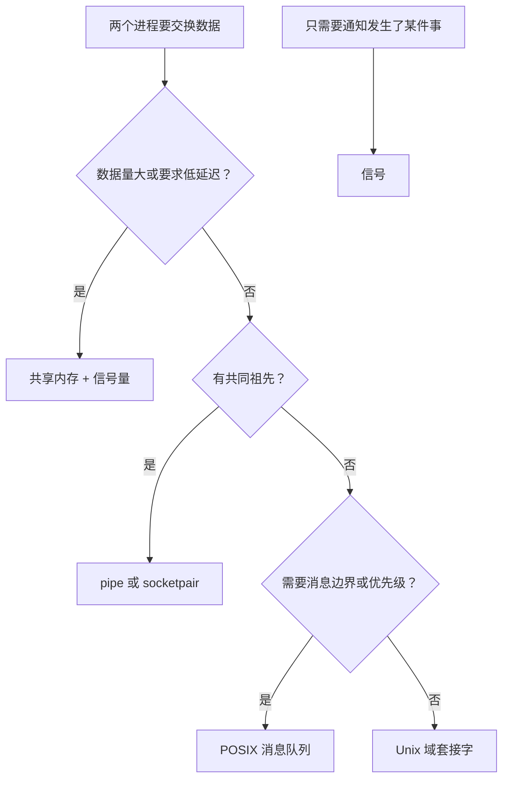
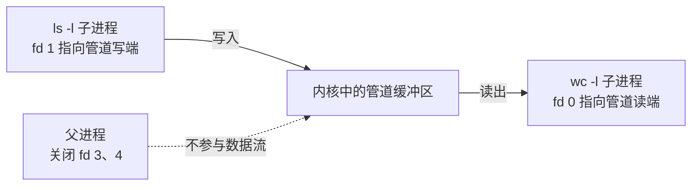

# 7. 进程间通信

一个日志收集进程要从十几个客户端接收日志行，一个 shell 要把 `ls` 的输出交给 `wc`，两个守护进程要共享同一份统计计数。它们的共同点是：数据必须离开创建它的进程，进入另一个进程。进程的地址空间默认是私有的，`fork` 之后父子各有一份，`exec` 之后连原来那份也被替换，所以跨进程交换数据必须借助内核里的对象。

这一页按「先选机制，再学用法」的顺序展开：先给出进程间通信 (interprocess communication, IPC) 的分类和选型判断，再把管道、FIFO、共享内存、信号量和文件锁逐一写出来，每个机制都给出程序，能在本地对象上演示的都附上真实输出，最后认识 POSIX 消息队列与 System V IPC。读完应当能判断一个具体场景该用哪一种，并写出父子进程之间正确的管道线、多个进程共享计数器的同步代码，以及一个用文件锁防止重复启动的程序。

本页所有程序都在 Linux 上编译通过，能用本地对象完成的演示都实际运行过，输出照实贴出；需要创建全局命名对象的几个示例只编译，正文里会逐个说明。编译命令统一为 `gcc -std=c17 -Wall -Wextra -g 源文件.c -o 程序`。完整源码与 `Makefile` 在 `code/系统编程/7_进程间通信/`。

## 1. 进程之间怎样交换数据

先按数据形态把这些机制分一下类。有的机制搬运字节，有的搬运带边界的消息，有的让多个进程直接看到同一批内存页，还有的只负责协调先后顺序，不搬运数据。

| 机制 | 提供什么 | 需要亲缘关系 | 典型用途 |
| --- | --- | --- | --- |
| 管道 (pipe) | 单向字节流 | 需要，靠 `fork` 继承 | shell 管道、父子进程传递数据 |
| 命名管道 (FIFO) | 单向字节流 | 不需要 | 本机上简单的单向通道 |
| Unix 域套接字 | 字节流或数据报 | 不需要 | 本机的请求—应答（第 10 章） |
| POSIX 消息队列 | 带优先级的消息 | 不需要 | 需要消息边界和优先级 |
| 共享内存 | 同一批物理页 | 不需要 | 数据量大、要求低延迟 |
| 信号量 (semaphore) | 一个可增减的计数 | 不需要 | 同步共享资源的访问 |
| 文件锁 | 对文件的访问权 | 不需要 | 防止多个进程同时改同一个文件 |
| 信号 | 一个编号 | 不需要 | 通知事件，不携带数据（第 6 章） |

前三行都建立在文件描述符上：`pipe` 返回两个描述符，打开 FIFO 得到一个描述符，套接字也是描述符。它们共用同一组 `read`、`write`、`close`，区别只在数据从哪里来、有没有消息边界。共享内存走的是另一条路，`mmap` 把同一批物理页映射进多个地址空间（第 4 章），读写不经过内核的缓冲区，所以最快，但内核完全不知道谁在读谁在写，先后顺序得另外安排。

选型可以按几个问题走：



作者的判断：父子进程之间用管道最省事，需要双向就换成 `socketpair`（第 10 章）；没有亲缘关系的两个本机进程，默认用 Unix 域套接字，它既有字节流又有数据报，权限交给文件系统管，还能传递打开的文件描述符；一次要传几十兆字节或者要求微秒级延迟，才值得上共享内存加信号量。新代码不要用 System V IPC，理由在本章后面讲 System V 的几段里说明。

<Quiz
  type="single"
  :options="[
    { label: '两个没有亲缘关系的进程要传递一条 200 MB 的只读数据集', value: 'A' },
    { label: 'Shell 要把 ls 的输出交给 wc', value: 'B' },
    { label: '守护进程要通知另一个进程「配置已重新加载」，不传数据', value: 'C' },
    { label: '两个进程要一问一答，请求和应答都不大', value: 'D' }
  ]"
  answer="A"
>

<template #question>

下面哪个场景最适合用共享内存？

</template>

正确答案是 **A**。200 MB 的数据如果走管道或套接字，要在内核和用户态之间复制两遍；共享内存只映射一次，读的时候直接访问页。B 是管道的经典用法。C 用信号就够，SIGHUP 本来就是干这个的。D 用 Unix 域套接字，一问一答的边界清楚，编程也简单。

</Quiz>

::: tip 先问数据的方向和分帧

选机制之前先回答两个问题：数据是单向还是双向，需不需要保留消息边界。单向且只要字节流，管道和 FIFO 就够；双向或需要「一条请求对应一条应答」，套接字省掉大量自己分帧的代码。

:::

::: generate sys-ipc-selection-walkthrough kind=explanation

面向刚接触进程间通信、面对需求不知道从哪下手的读者，用三个具体场景走一遍上面的选型流程：一个每天把日志交给压缩程序的定时任务；两个没有亲缘关系的服务共享一份只读的配置表；一个命令行工具要向已经运行的守护进程发一条命令并拿到结果。对每个场景说明先从哪个问题开始判断、为什么排除掉别的机制，以及选中的机制还需要配哪些同步手段。

:::

## 2. 管道

`pipe` 创建一根单向管道，参数是一个两个整数的数组，返回时 `fds[0]` 是读端，`fds[1]` 是写端。往写端写进去的字节从读端读出来，先进先出。管道没有名字，只存在于创建它的进程和它的后代之间，进程全部退出后自动消失。

```c
#include <unistd.h>

int pipe(int fds[2]);
```

单独一个进程用管道没有意义，它读自己写的数据。管道的典型用法是 `fork` 之后一端归父、一端归子：

```c
#define _POSIX_C_SOURCE 200809L

#include <stdio.h>
#include <stdlib.h>
#include <string.h>
#include <sys/wait.h>
#include <unistd.h>

static void die(const char *what) {
    perror(what);
    exit(EXIT_FAILURE);
}

int main(void) {
    int fds[2];
    if (pipe(fds) == -1) {
        die("pipe");
    }

    pid_t pid = fork();
    if (pid == -1) {
        die("fork");
    }
    if (pid == 0) {
        close(fds[1]); /* 子进程只读，写端关掉 */
        char buf[256];
        ssize_t n = read(fds[0], buf, sizeof buf - 1);
        if (n > 0) {
            buf[n] = '\0';
            printf("子进程收到：%s", buf);
            fflush(stdout); /* 子进程用 _exit 退出，缓冲区要自己刷 */
        }
        close(fds[0]);
        _exit(EXIT_SUCCESS);
    }

    close(fds[0]); /* 父进程只写，读端关掉 */
    const char *msg = "hello from parent\n";
    if (write(fds[1], msg, strlen(msg)) != (ssize_t)strlen(msg)) {
        die("write");
    }
    close(fds[1]);
    if (waitpid(pid, NULL, 0) == -1) {
        die("waitpid");
    }
    return 0;
}
```

完整文件在 `code/系统编程/7_进程间通信/pipe_basic.c`。运行：

::: terminal title="bash - pipe_basic"

```text
$ gcc -std=c17 -Wall -Wextra -g pipe_basic.c -o pipe_basic
$ ./pipe_basic
子进程收到：hello from parent
```

:::

`fork` 之后子进程拿到的是描述符表的副本，父子两个进程各有一套编号相同、指向同一个管道对象的描述符。管道对象本身在内核里，只有一份，所以父进程往 4 号写，子进程从 3 号读，读到的是同一串字节。

### 2.1 关闭不用的那一端

上面两个进程都关掉了自己不用的一端，这一步不是可有可无的清理。管道的读端判断文件结束的依据是「缓冲区空了，并且所有写端都关了」。写端的描述符每复制一份，内核的引用计数就加一；父进程关掉自己的写端，子进程手里还留着一份，引用计数不为零，读端就继续等。

先看正常情况下的文件结束：

::: terminal title="bash - pipe_eof"

```text
$ ./pipe_eof
子进程第一次 read：3 字节
父进程睡了 1 秒，现在关闭写端
子进程第二次 read：0 字节
```

:::

`pipe_eof.c` 里父进程先写入 3 个字节，然后睡 1 秒再关闭写端。子进程第一次 `read` 拿到这 3 个字节，第二次 `read` 阻塞，直到父进程关闭写端才返回 0。`read` 返回 0 就是文件结束 (end-of-file)，它的含义是「不会再有数据了」，和读到空字符串不是一回事。

::: concept sys-ipc-pipe-eof title="管道的文件结束规则"

管道的读端在缓冲区为空、并且所有指向该管道写端的描述符都已关闭时，`read` 返回 0。只要还有一个进程持有写端描述符，`read` 在缓冲区读空之后就会阻塞，不会返回文件结束。

:::

忘记关掉写端的后果可以直接看。`pipe_hang.c` 是同一段程序的缺陷版：子进程没有关 `fds[1]`，父进程写完就关掉了自己的写端，然后 `waitpid` 等子进程；子进程读完了数据，等不到文件结束，永远阻塞在第二次 `read` 上。两个进程互相等，谁也不动。

::: terminal title="bash - pipe_hang"

```text
$ timeout 3 ./pipe_hang
子进程收到：hello from parent
$ echo $?
124
$ timeout 3 ./pipe_hang fix
子进程收到：hello from parent
父进程：子进程已退出
$ echo $?
0
```

:::

`timeout` 在 3 秒后杀掉程序，退出码 124 表示超时。这个缺陷在实际代码里非常常见，因为「子进程只用读端」这件事在写代码时并不显眼，漏掉 `close` 编译不报错、测试也可能恰好通过，直到某个客户端永远收不到响应。

::: compare left-title="子进程没有关写端" right-title="子进程先关掉写端"

```c
if (pid == 0) {
    char buf[256];
    ssize_t n = read(fds[0], buf, sizeof buf - 1);
    ...
    _exit(EXIT_SUCCESS);
}
```

---

```c
if (pid == 0) {
    close(fds[1]); /* 不写，就别留着写端 */
    char buf[256];
    ssize_t n = read(fds[0], buf, sizeof buf - 1);
    ...
    _exit(EXIT_SUCCESS);
}
```

:::

::: warning 父进程也要关自己那份

`fork` 之后父子各有一套描述符副本。只关子进程的写端不够，父进程也要在写完数据后关掉自己的写端，读端才能看到文件结束。管道线里的父进程同样要把两个端都关掉。

:::

<Quiz
  type="single"
  :options="[
    { label: '因为子进程还在往管道里写数据', value: 'A' },
    { label: '因为父进程和子进程各有一份写端描述符，子进程自己那份没关，引用计数不为零', value: 'B' },
    { label: '因为管道容量太小，数据没有传完', value: 'C' },
    { label: '因为 read 只有在收到换行符时才返回 0', value: 'D' }
  ]"
  answer="B"
>

<template #question>

`pipe_hang.c` 里子进程读完数据后一直等不到文件结束，原因是什么？

</template>

正确答案是 **B**。文件结束的条件是「所有写端都关闭」，而子进程自己没关写端，内核认为随时可能还有数据写进来。A 错在方向：子进程是读的一方。C 与容量无关。D 错在 `read` 返回 0 只表示文件结束，与换行符无关。

</Quiz>

### 2.2 管道线：dup2 加 exec

Shell 里的 `cmd1 | cmd2` 没有专门的系统调用，它由 `pipe`、`fork`、`dup2`、`exec` 四样东西拼出来。`pipe` 建管道，两个 `fork` 各启动一个命令，`dup2` 把管道的一端换到标准输入或标准输出上，`exec` 把进程替换成目标程序。

`pipeline.c` 实现 `ls -l | wc -l`，关键在子进程里：

```c
/* 左半边：ls -l 的标准输出接到管道写端 */
if (dup2(fds[1], STDOUT_FILENO) == -1) {
    die("dup2");
}
close(fds[0]);
close(fds[1]);
execlp("ls", "ls", "-l", (char *)NULL);
die("execlp ls");

/* 右半边：wc -l 的标准输入接在管道读端 */
if (dup2(fds[0], STDIN_FILENO) == -1) {
    die("dup2");
}
close(fds[0]);
close(fds[1]);
execlp("wc", "wc", "-l", (char *)NULL);
die("execlp wc");
```

`dup2(oldfd, newfd)` 让 `newfd` 指向 `oldfd` 所指向的同一个打开文件描述，原来的 `newfd` 先被关掉（[第 2 章](/教程/正文/系统编程/2_文件描述符与非缓冲IO)）。所以 `dup2(fds[1], 1)` 之后，1 号就是管道的写端；再关掉 `fds[0]`、`fds[1]` 这两个多余的名字，进程手里只剩 1 号指向管道。`exec` 之后，`ls` 往标准输出写的每一行都进了管道。

两边的描述符关系可以画成这样：



父进程在两次 `fork` 之后必须把自己手上的读端和写端都关掉。它是第三份写端，留着不关，`wc` 读完了 `ls` 的输出也不会看到文件结束，整个管道线就卡住了，和上一节的缺陷是同一个原因。

在放了三个文件的目录里运行，`ls -l` 的输出是 3 行文件信息加 1 行 `total`，所以计数是 4：

::: terminal title="bash - pipeline"

```text
$ ls -l | wc -l
4
$ ./pipeline
4
```

:::

::: generate sys-ipc-pipeline-fds kind=explanation concepts=sys-ipc-pipe-eof

面向第一次自己写管道线的读者，以 pipeline.c 为例，从 pipe 返回的两个描述符开始，逐步说明两次 fork 之后三个进程各自持有哪些描述符副本、dup2 把哪一号换成了什么、为什么 dup2 之后还要 close 原来的两个编号、父进程为什么必须把自己的两个端都关掉，以及 execlp 成功之后再执行 die 会发生什么。按时间顺序讲，不要求总结。

:::

### 2.3 PIPE_BUF、容量与 SIGPIPE

管道有容量，默认是 64 KiB。写满之后 `write` 阻塞，直到读端读走一些字节腾出空间。写一个非阻塞的写端一直写到失败，可以看到这个值：

::: terminal title="bash - pipe_capacity"

```text
$ ./pipe_capacity
管道写满时容纳了 65536 字节
```

:::

程序把写端设成 `O_NONBLOCK`，每轮写 4 KiB，直到 `write` 返回 -1、`errno` 为 `EAGAIN`，累加写进去的字节数。程序不该依赖这个数字：容量可以由 `fcntl` 调整，也可以因为系统配置变化，能确定的只有「写满会阻塞」这件事。

多个进程同时往同一根管道写，数据会不会互相穿插？POSIX 给出的保证以 `PIPE_BUF` 为界：

::: concept sys-ipc-pipe-atomic title="PIPE_BUF 以内的写是原子的"

一次 `write` 写入的字节数不超过 `PIPE_BUF` 时，这些字节作为一个整体进入管道的缓冲区，不会与其他写者的字节交错。超过 `PIPE_BUF` 的写可能被拆成几段，与其他写者的数据交错。Linux 上 `PIPE_BUF` 的值是 4096 字节，可以用 `getconf PIPE_BUF .` 查询当前目录所在文件系统的值。

:::

`pipe_atomic.c` 用 8 个子进程各写 500 条记录，记录是一整行，用一个字母填满，读端每轮故意睡 1 毫秒，让管道保持接近写满的状态。记录长度对着 `PIPE_BUF` 取两个值：

::: terminal title="bash - pipe_atomic"

```text
$ ./pipe_atomic 4096
记录长度 4096：共 4000 条，完整 4000 条
$ ./pipe_atomic 4097
记录长度 4097：共 4000 条，完整 833 条
$ ./pipe_atomic 4096
记录长度 4096：共 4000 条，完整 4000 条
$ ./pipe_atomic 4097
记录长度 4097：共 4000 条，完整 887 条
```

:::

4096 字节的记录一条不坏，4097 字节的记录大部分被别的写者插了进来。完整条数每次运行不同，和调度有关。这是某次运行的输出。

原子性的单位是一次 `write`，不是一条记录。把一条 8 KiB 的记录拆成两次 4 KiB 的 `write`，两次调用各自是原子的，但别的写者可以插在两次调用之间，整条记录照样会坏。遇到超过 `PIPE_BUF` 的记录，只能保证同一时刻只有一个写者，或者换用消息队列、套接字这类保留消息边界的机制。

读端全部关闭之后还往管道里写，内核会给写进程发 `SIGPIPE`。这个信号的默认动作是终止进程，所以一个正在往管道写数据的程序会「莫名其妙」地退出。shell 里看到的退出码是 141，即 128 加上 `SIGPIPE` 的编号 13：

::: terminal title="bash - sigpipe"

```text
$ ./sigpipe
$ echo $?
141
$ ./sigpipe ignore
write 失败：EPIPE
```

:::

程序先关掉读端再写，第一次运行按默认处置被信号杀死；第二次用 `sigaction` 把 `SIGPIPE` 设为忽略，`write` 返回 -1，`errno` 为 `EPIPE`。服务端程序一律忽略 `SIGPIPE`，否则一个客户端提前断开就能让整个服务退出（第 10 章、第 14 章都会再碰到它）。

<Quiz
  type="multi"
  :options="[
    { label: '一次 write 写入 3000 字节，这些字节不会与其他写者的数据交错', value: 'A' },
    { label: '一次 write 写入 5000 字节，这 5000 字节一定完整地连续存放', value: 'B' },
    { label: '把 5000 字节拆成两次 2500 字节的 write，两次之间可能插入其他写者', value: 'C' },
    { label: '只要记录以换行符结尾，超过 PIPE_BUF 也不会交错', value: 'D' }
  ]"
  :answer="['A', 'C']"
>

<template #question>

关于 `PIPE_BUF` 与管道的写，下列说法正确的是哪些？

</template>

正确答案是 **A、C**。Linux 上 `PIPE_BUF` 为 4096，3000 字节在界限以内，是原子的；拆成两次写之后，每次各自原子，但两次之间可能被插入。B 错在 5000 超过界限。D 错在管道不认识换行符，它只是字节流。

</Quiz>

### 2.4 popen

不想自己写 `fork`、`dup2`、`exec` 时，可以用 `popen` 启动一个命令并接到它的标准输入或标准输出上。`popen` 返回的是 `FILE *`，用完交给 `pclose`，后者等待命令结束并返回它的等待状态。

::: terminal title="bash - popen"

```text
$ ./popen
5
wc 退出状态：0
$ ./popen_shell
popen 实际启动的进程名：sh
```

:::

第一个程序把 5 行文本写给 `wc -l`，`pclose` 的返回值用 `WEXITSTATUS` 取出退出码。第二个程序说明 `popen` 并不是直接执行命令：它先启动 `/bin/sh -c "命令"`，由 shell 去解析。这个中间层带来了管道、重定向、通配符这些便利，也带来了命令注入的风险：命令字符串里拼进来自外部的参数时，一个分号就能让 shell 执行另一条命令（第 14 章有专门的演示）。参数是固定的、或者已经自己做了严格的转义，`popen` 用起来很省事；参数来自用户输入，就用 `posix_spawn` 一族直接传参数数组。

### 2.5 双向通信的两根管道

管道是单向的。父子进程要互相发消息，常见做法是建两根管道，一根父写子读，一根子写父读。这个做法有一个需要注意的地方：双方都可能在写满对方的管道之后才去读，于是两个 `write` 互相等待，谁都读不了。数据量小的时候碰不到，一旦两边都开始大批量发送就会卡死。需要双向通信时，`socketpair`（第 10 章）用一根双向连接解决，或者用 `poll` 同时等两个方向（第 11 章）。

## 3. FIFO

管道没有名字，只能通过 `fork` 把描述符传给后代。要让两个没有亲缘关系的进程连起来，需要一根有名字的管道，也就是 FIFO（命名管道）。`mkfifo` 命令或同名函数在文件系统里建一个特殊文件：

```c
#include <sys/stat.h>

int mkfifo(const char *path, mode_t mode);
```

建出来的文件在 `ls -l` 里显示为类型 `p`，大小是 0，它不存储数据，只是一个名字，读写双方通过这个名字找到内核里的同一根管道。打开 FIFO 和打开管道一样，会阻塞到另一端也打开为止：

::: terminal title="bash - FIFO 的 open 阻塞"

```text
$ mkfifo demo.fifo
$ ls -l demo.fifo
prw-rw-r-- 1 you you 0 Oct 21 01:06 demo.fifo
$ timeout 2 cat demo.fifo
$ echo $?
124
$ timeout 2 sh -c 'echo hi > demo.fifo'
$ echo $?
124
```

:::

`cat` 以只读方式打开 FIFO，没有写者，`open` 停在半路；`echo >` 以只写方式打开，没有读者，也同样停住。先启动读端再启动写端就通了：

::: terminal title="bash - FIFO 两端都打开之后"

```text
$ (cat demo.fifo > got.txt &)
$ printf 'hello fifo\n' > demo.fifo
$ cat got.txt
hello fifo
```

:::

`O_NONBLOCK` 可以打破这个等待：只读打开立刻成功，没有写者时 `read` 返回 0；只写打开在没有读者时返回 -1，`errno` 为 `ENXIO`。这个细节在写「服务器先启动、客户端随时来」的程序时会用到，本页的日志收集服务用的是阻塞打开。

### 3.1 多个客户端写同一个 FIFO

FIFO 和管道共享 `PIPE_BUF` 的原子性保证，这一点让它能直接做简单的日志收集：多个客户端各自把一条记录写进 FIFO，只要每条记录不超过 `PIPE_BUF` 且一次 `write` 写完，记录之间就不会交错。`fifo_server.c` 和 `fifo_client.c` 演示这件事。客户端构造一条定长记录，前两位是客户端编号，接着是四位序号，冒号之后全部填同一个字母，最后是换行：

```c
for (int seq = 0; seq < count; seq++) {
    int head = snprintf(rec, reclen, "%02d:%04d:", id, seq);
    memset(rec + head, 'A' + id, reclen - 1 - (size_t)head);
    rec[reclen - 1] = '\n';
    if (write(fd, rec, reclen) != (ssize_t)reclen) { /* 一次写完整条 */
        die("write");
    }
}
```

服务器以 `O_RDONLY` 打开 FIFO，按固定长度切分读到的字节，再检查每条记录的内部是否一致。8 个客户端各写 100 条 100 字节的记录：

::: terminal title="bash - FIFO 收集日志"

```text
$ mkfifo logfifo
$ ./fifo_server logfifo 100 800 &
$ for i in 0 1 2 3 4 5 6 7; do ./fifo_client logfifo $i 100 100 & done
$ wait
收到 800 条记录：完整 800 条，损坏 0 条
```

:::

把记录长度改成 4097，刚超过 `PIPE_BUF`，同样的程序就撑不住了：

::: terminal title="bash - 记录超过 PIPE_BUF"

```text
$ ./fifo_server logfifo 4097 800 2000 &
$ for i in 0 1 2 3 4 5 6 7; do ./fifo_client logfifo $i 4097 100 & done
$ wait
收到 800 条记录：完整 173 条，损坏 627 条
```

:::

`fifo_server` 的第四个参数是每接收一块之后睡眠的微秒数，这里故意让读端慢一点，让写端经常遇到缓冲区将满的情况。记录被拆开之后，服务器按 4097 字节切出来的「条」就混了多个客户端的字节。这一组输出也是某次运行的，损坏条数会波动。

### 3.2 FIFO 适合什么

FIFO 的优点是简单：`mkfifo` 一个文件，两端用普通的 `open`、`read`、`write`，不需要套接字的地址结构。缺点是它只有一根单向的字节流，没有消息边界，没有「谁在连」的概念，也没法做请求—应答：多个客户端同时写，服务器回给谁是一个无法回答的问题。

作者的判断：本机上单向的、简单的通道可以用 FIFO，比如把日志交给收集器、给调试工具喂数据。需要一问一答、需要知道对端身份、或者需要双向通信，用 Unix 域套接字（第 10 章）。FIFO 留着一份文件，用完记得 `unlink`。

<Quiz
  type="single"
  :options="[
    { label: 'open 只读时没有写者，会一直阻塞到有写者打开', value: 'A' },
    { label: 'FIFO 会把写入的数据存进磁盘，等读者来取', value: 'B' },
    { label: 'FIFO 里超过 PIPE_BUF 的写同样不会交错', value: 'C' },
    { label: 'FIFO 可以像套接字一样接受多个连接并分别回消息', value: 'D' }
  ]"
  answer="A"
>

<template #question>

关于 FIFO，下列说法正确的是哪一项？

</template>

正确答案是 **A**。这是阻塞打开的定义，也是「先启动读端」的原因。B 错：FIFO 不存储数据，数据只在管道缓冲区里。C 错：原子性的界限与普通管道相同。D 错：FIFO 没有连接的概念。

</Quiz>

## 4. 共享内存

共享内存 (shared memory) 指的是同一批物理页被映射进多个进程的地址空间。一个进程写进去的字节，另一个进程通过自己的虚拟地址立刻能看到，中间不经过内核的复制，也没有系统调用。代价是内核不知道双方的操作顺序：一个进程正在写第 100 个字节，另一个进程可能同时在读第 50 个字节，同步完全由程序自己负责。

::: concept sys-ipc-shared-memory title="共享内存需要配合同步"

共享内存只负责让多个进程看到同一批内存页，不提供任何互斥或顺序保证。多个进程同时读写同一区域中的数据时，必须另外用信号量、文件锁或原子操作协调，否则读到的是写了一半的数据，或者更新会互相覆盖。

:::

创建共享映射有四种方式，按进程之间的关系选。

### 4.1 fork 之前的匿名共享映射

父子进程之间最简单：在 `fork` 之前用 `MAP_SHARED | MAP_ANONYMOUS` 做一次映射，子进程继承映射，两边看到同一批页。`shm_anon.c` 比较 `MAP_SHARED` 和 `MAP_PRIVATE` 的区别：

```c
struct shared *sh = mmap(NULL, sizeof *sh, PROT_READ | PROT_WRITE,
                         MAP_SHARED | MAP_ANONYMOUS, -1, 0);
if (sh == MAP_FAILED) {
    die("mmap");
}
sh->counter = 0;
/* fork 之后子进程对这个结构体的修改，父进程能看到 */
```

::: terminal title="bash - shm_anon"

```text
$ ./shm_anon
子进程：counter = 100
父进程：counter = 100，note = 子进程写过
MAP_PRIVATE：父进程看到 counter = 0，note = 父进程初始化
```

:::

`MAP_SHARED` 的页是共享的，子进程把 `counter` 加到 100，父进程看到 100。换成 `MAP_PRIVATE`，`fork` 之后第一次写触发写时复制，子进程改的是自己的副本，父进程看到的还是 0。[第 5 章](/教程/正文/系统编程/5_进程的创建_执行与回收)说「进程之间不共享大部分内存」，共享内存就是那个例外。

`fork` 之后的匿名映射是私有的，`MAP_SHARED` 也救不了：子进程在 `fork` 之后才 `mmap`，父进程并不知道这块映射。要在父子之间共享，映射必须建在 `fork` 之前；要在没有亲缘关系的进程之间共享，就得有一个双方都能找到的对象。

### 4.2 映射普通文件

最直接的对象是文件系统里的一个普通文件。两个互不相识的程序用 `open` 打开同一个文件，各自 `mmap`，就得到同一批页；内核的页缓存保证它们看到同样的内容。`filemap_writer.c` 和 `filemap_reader.c` 是两个独立程序，通过当前目录下的 `share.dat` 传递一行文字：

::: terminal title="bash - 通过文件映射共享"

```text
$ ./filemap_writer
写入：writer 写于某个时刻
$ ./filemap_reader
读到：writer 写于某个时刻
```

:::

写者用 `ftruncate` 把文件设成 4096 字节，映射之后写字符串，`msync` 把脏页刷回文件，再解除映射、关闭文件。读者打开同一个文件，只读映射，直接读出内容。文件本身承担了「双方都能找到的名字」这个角色，也顺带把数据留在磁盘上。

这种方式的缺点是数据要落盘（或者至少在页缓存里走一圈），而且要自己管理文件的生命周期：谁创建、谁删除、文件多大。它适合的场合是数据本来就该持久化，比如一个按偏移寻址的数据文件；单纯为了通信，有更轻的做法。

### 4.3 shm_open

POSIX 共享内存对象是专门为通信设计的：`shm_open` 按名字创建或打开一个对象，`ftruncate` 定大小，`mmap` 映射，用完 `shm_unlink` 删掉名字。名字形如 `/somename`，在 Linux 上对象出现在 `/dev/shm` 目录里，是 tmpfs 上的文件，不落盘。

```c
#define _POSIX_C_SOURCE 200809L

#include <fcntl.h>
#include <stdio.h>
#include <stdlib.h>
#include <sys/mman.h>
#include <unistd.h>

#define SHM_NAME "/p087_demo"
#define SHM_SIZE 4096

static void die(const char *what) {
    perror(what);
    exit(EXIT_FAILURE);
}

int main(void) {
    int fd = shm_open(SHM_NAME, O_CREAT | O_RDWR, 0600);
    if (fd == -1) {
        die("shm_open");
    }
    if (ftruncate(fd, SHM_SIZE) == -1) {
        die("ftruncate");
    }
    char *p = mmap(NULL, SHM_SIZE, PROT_READ | PROT_WRITE, MAP_SHARED, fd, 0);
    if (p == MAP_FAILED) {
        die("mmap");
    }
    snprintf(p, SHM_SIZE, "另一个进程用同样的名字就能看到这一行");

    /* 另一个进程：shm_open(SHM_NAME, O_RDWR, 0) 后 mmap，读到同样的内容 */

    munmap(p, SHM_SIZE);
    close(fd);
    if (shm_unlink(SHM_NAME) == -1) {
        die("shm_unlink");
    }
    return EXIT_SUCCESS;
}
```

完整程序在 `code/系统编程/7_进程间通信/shm_posix.c`。两个进程用同一个名字，一个创建、一个打开，就共享同一批页，谁先谁后用信号量协调。`shm_open` 在 `/dev/shm` 下创建名字，本页的示例环境里这个目录与别的服务共用，所以这个程序和下面的 `sem_open`、`mq_open` 示例只编译、不运行。man7 的 `shm_open(3)` 手册带了一对完整的例子（`pshm_ucase_bounce` 与 `pshm_ucase_send`），在自己的机器上运行，输出类似：

::: terminal title="bash - man7 的 pshm_ucase 例子"

```text
$ ./pshm_ucase_bounce /myshm &
[1] 270171
$ ./pshm_ucase_send /myshm hello
HELLO
```

:::

`shm_open` 返回的描述符和普通文件描述符一样可以 `close`，映射在 `close` 之后依然有效；`shm_unlink` 只删除名字，已经打开的进程还能继续使用，最后一个引用关闭后存储才回收。这个「先 unlink 再继续用」的写法在临时对象上很常用，可以避免程序崩溃后留下垃圾。

### 4.4 memfd_create

`memfd_create` 是 Linux 专有的接口，创建一个没有名字、只在内存里的文件，返回描述符。它比 `shm_open` 轻，不会在 `/dev/shm` 留下名字，适合做临时缓冲，或者把一段数据伪装成文件交给别的接口（比如让动态链接器执行内存里的程序）。共享的方式是继承或传递描述符：`fork` 之后子进程拿着同一个描述符，或者通过 Unix 域套接字把描述符交给另一个进程（第 10 章）。

```c
int fd = memfd_create("p087_counter", MFD_CLOEXEC);
if (fd == -1) {
    die("memfd_create");
}
if (ftruncate(fd, 4096) == -1) {
    die("ftruncate");
}
long *counter = mmap(NULL, 4096, PROT_READ | PROT_WRITE, MAP_SHARED, fd, 0);
```

`memfd_create` 需要 `_GNU_SOURCE`。运行 `memfd.c`：

::: terminal title="bash - memfd"

```text
$ ./memfd
memfd 的链接目标：/memfd:p087_counter (deleted)
子进程加完，计数器 = 1000
扩大后文件大小 = 8192
```

:::

`/proc/self/fd` 里的链接目标是 `/memfd:p087_counter (deleted)`，`(deleted)` 是正常的：这个文件从来没有过目录项，`memfd_create` 给的名字只用于调试。子进程通过 `fork` 继承描述符，往映射里加了 1000 次，父进程看到 1000。`ftruncate` 能扩大文件本身，已有的映射长度不变，要访问新增的部分得重新 `mmap` 一块更大的区域。

### 4.5 竞争实验

共享内存本身不提供任何保护。`shm_counter.c` 让两个进程各对共享区里的同一个 `long` 加 1000000 次：

```c
for (int i = 0; i < INCREMENTS; i++) {
    sh->counter++; /* 读-改-写，没有任何保护 */
}
```

`counter++` 在机器层面是三条指令：把值从内存读进寄存器、加一、写回内存。两个进程的这三条指令可以任意交错：都读到 100，都加一，都写回 101，两次加只增加了一次。运行结果：

::: terminal title="bash - shm_counter 不同步"

```text
$ ./shm_counter
两个进程各加 1000000 次，计数器 = 1023879（应为 2000000）
$ ./shm_counter
两个进程各加 1000000 次，计数器 = 1001323（应为 2000000）
```

:::

结果离 2000000 差了将近一半，每次运行还不一样。这不是「偶尔丢一两个」，在紧密循环里丢更新是常态。修复的办法在下一节。

<Quiz
  type="single"
  :options="[
    { label: '因为两个进程各自有一份虚拟地址空间，counter 其实是两个对象', value: 'A' },
    { label: '因为 counter++ 是读-改-写三步，两个进程的步骤交错会丢失更新', value: 'B' },
    { label: '因为 mmap 的映射在 fork 之后失效了', value: 'C' },
    { label: '因为 long 的加法在 CPU 上不是一条指令就一定不安全', value: 'D' }
  ]"
  answer="B"
>

<template #question>

`shm_counter` 不带同步时，两个进程各加 100 万次，结果远小于 200 万。原因是什么？

</template>

正确答案是 **B**。映射本身是好的，父子看到的是同一批页；问题出在「读出来、加一、写回去」这三步之间可以插入另一个进程的同样三步。A 描述的是 `MAP_PRIVATE` 的行为，这里用的是 `MAP_SHARED`。C 错，映射在 `fork` 之后仍然有效。D 把「编译成几条指令」当成了关键，即使编译器把它合成一条对内存的加法，不加锁前缀时别的核照样能插进来。

</Quiz>

## 5. 进程间同步：信号量

信号量 (semaphore) 是一个非负整数加上两个操作：`sem_wait` 把值减一，值为 0 时阻塞等待；`sem_post` 把值加一，并唤醒一个等待者。这一对操作来自 Dijkstra 的 P、V 原语，POSIX 沿用了「等待」和「发布」的叫法。

信号量分无名和有名两种。无名信号量用 `sem_init` 初始化，对象必须放在共享内存里，`pshared` 参数为 1 表示进程间共享；有名信号量用 `sem_open` 按名字创建，出现在 `/dev/shm` 下，适合没有共享映射的进程。

### 5.1 用无名信号量修好计数器

`shm_counter.c` 在共享区里放了一个二值信号量，初值 1，相当于一把锁：

```c
struct shared {
    long counter;
    sem_t lock;
};

/* 初始化：pshared 为 1，初值为 1 */
if (sem_init(&sh->lock, 1, 1) == -1) {
    die("sem_init");
}

/* 每次加一都夹在 sem_wait 和 sem_post 之间 */
sem_wait(&sh->lock);
sh->counter++;
sem_post(&sh->lock);
```

::: terminal title="bash - shm_counter 用信号量保护"

```text
$ ./shm_counter sem
两个进程各加 1000000 次，计数器 = 2000000（应为 2000000）
$ ./shm_counter sem
两个进程各加 1000000 次，计数器 = 2000000（应为 2000000）
```

:::

连续两次运行都精确等于 2000000。`sem_wait` 和 `sem_post` 之间的区域同一时刻只有一个进程能进入，读-改-写不会再交错。信号量的初值决定它能保护几份资源：1 是互斥，等于 N 就是「最多 N 个进程同时进入」。

::: compare left-title="没有保护" right-title="用二值信号量保护"

```c
for (int i = 0; i < INCREMENTS; i++) {
    sh->counter++;
}
```

---

```c
for (int i = 0; i < INCREMENTS; i++) {
    sem_wait(&sh->lock);
    sh->counter++;
    sem_post(&sh->lock);
}
```

:::

代价是每次加一要进出内核两次。`shm_counter` 的两个进程各做 100 万次，保护版明显比不加保护的版本慢，慢在 `sem_wait` 和 `sem_post` 这两次系统调用上。单个计数的高频更新用 C11 的原子操作便宜得多，后面会提到。

::: concept sys-ipc-semaphore title="信号量的语义"

信号量是一个非负整数。`sem_wait` 在值大于 0 时把值减一并立即返回，值为 0 时阻塞，直到有别的进程或线程调用 `sem_post`。`sem_post` 把值加一并唤醒一个等待者。进程间共享的无名信号量必须位于共享内存中，并用 `sem_init` 的 `pshared` 参数为 1 初始化；`sem_destroy` 在不再使用时调用。

:::

### 5.2 生产者—消费者环形缓冲区

计数器只需要一把锁，真实的数据传递需要「等有空位」和「等有数据」两种等待，这正是计数信号量的用处。`ringbuf.c` 在共享区里放一个 8 个槽的环形缓冲区，父进程生产 100 条消息，子进程消费：

```c
struct ring {
    struct slot slots[SLOTS];
    size_t head;
    size_t tail;
    sem_t empty; /* 空槽个数，初值 SLOTS */
    sem_t full;  /* 已填槽个数，初值 0 */
    sem_t mutex; /* 保护 head、tail 和槽内容，初值 1 */
};
```

生产者每写一条：先 `sem_wait(&empty)` 等到有空槽，再 `sem_wait(&mutex)` 独占缓冲区，写槽、移动 `head`，然后依次 `sem_post(&mutex)`、`sem_post(&full)`。消费者对称地先等 `full`，再拿 `mutex`，读槽、移动 `tail`，释放 `mutex` 并 `sem_post(&empty)`。运行：

::: terminal title="bash - ringbuf"

```text
$ ./ringbuf
消费 第 0 条消息
消费 第 25 条消息
消费 第 50 条消息
消费 第 75 条消息
消费者收到全部 100 条，顺序正确
```

:::

三个信号量的分工值得记下来：`empty` 和 `full` 负责「能不能动」，`mutex` 负责「动的时候别人别动」。`empty` 的初值是槽数，`full` 的初值是 0，两个数加起来始终等于槽数，这是环形缓冲区的不变式。

只有一个生产者、一个消费者时，`head` 只由生产者改，`tail` 只由消费者改，`mutex` 可以省掉；但一旦有第二个生产者或第二个消费者，省掉它就会出现两个写者同时拿到同一个槽的情况。保留 `mutex` 的代价很小，本页的程序都带着它。

### 5.3 有名信号量

没有共享映射的进程之间，用 `sem_open` 按名字打开同一个信号量：

```c
#include <fcntl.h>
#include <semaphore.h>

sem_t *sem = sem_open("/p087_sem", O_CREAT | O_EXCL, 0600, 0);
if (sem == SEM_FAILED) {
    die("sem_open");
}
/* 另一个进程：sem_open("/p087_sem", 0, 0, 0) */
```

名字的规则和 `shm_open` 一样，`/` 开头、后面不能再有斜杠。信号量对象在 `/dev/shm` 下，名为 `sem.p087_sem`。`sem_close` 关闭本进程的句柄，`sem_unlink` 删除名字，两者要分开：前者只影响当前进程，后者让新进程无法再按名字打开。

这个示例和 `shm_open` 一样只编译、不运行，原因同样是 `/dev/shm` 下会留下名字。在普通机器上，一个进程 `sem_open` 创建、另一个 `sem_open` 打开，`sem_post`/`sem_wait` 就能跨进程同步。

如果同步的对象只是单个整数，用 C11 的原子操作也能解决，见[原子操作](/教程/正文/语法和标准库/23_原子操作与并发/23_2_原子操作)。原子操作适合计数器、标志位这类单点更新；涉及多个数据之间的不变式，还是要信号量或互斥量。`shm_counter` 的第三种模式就是这么做的：把 `counter` 用 `atomic_fetch_add_explicit` 加一，两个进程各 100 万次同样得到 2000000，用时只有信号量版的零头。

<Quiz
  type="single"
  :options="[
    { label: 'sem_wait 把值加一，sem_post 把值减一', value: 'A' },
    { label: 'sem_post 在值为 0 时阻塞，sem_wait 唤醒等待者', value: 'B' },
    { label: 'sem_wait 在值为 0 时阻塞，sem_post 把值加一并唤醒等待者', value: 'C' },
    { label: '信号量的值可以为负数，表示等待的进程数', value: 'D' }
  ]"
  answer="C"
>

<template #question>

POSIX 信号量的语义是哪一项？

</template>

正确答案是 **C**。`sem_wait` 消耗一个计数，没有就等；`sem_post` 归还一个计数并唤醒等待者。D 描述的是某些教科书里的实现方式，POSIX 规定信号量的值不能小于 0，等待者在内核里排队，不体现在值上。

</Quiz>

## 6. 文件锁

多个进程要改同一个文件时，需要一把锁来串行化。`flock` 的整文件锁和 `fcntl` 的记录锁都能做这件事，两者都是建议锁 (advisory lock)，意思是内核只负责记录谁锁了什么，不阻止任何读写；只有所有参与者都主动加锁、解锁，协议才成立。一个不守规矩的进程照样可以读写被锁住的文件。

::: concept sys-ipc-advisory-lock title="建议锁的含义"

建议锁不会阻止未加锁的进程读写文件。加锁和解锁是协作协议：所有访问该文件的程序都按同样的规则先加锁，互斥才成立。内核只保证两个加锁请求之间的互斥，不检查实际的 I/O 操作。

:::

### 6.1 flock：整文件锁

`flock` 以整个文件为单位加锁，操作只有三种：`LOCK_SH` 共享锁（多个进程可以同时持有）、`LOCK_EX` 排他锁（只能有一个）、`LOCK_UN` 解锁。加 `LOCK_NB` 时不阻塞，拿不到锁立即返回 -1，`errno` 为 `EWOULDBLOCK`。锁属于打开文件描述，`fork` 和 `dup` 出来的描述符共享同一把锁，各自 `open` 一次则是两把锁，互相冲突。

单实例程序是它最直接的用途：程序启动时打开一个锁文件，尝试非阻塞排他锁，拿不到就说明已经有一个实例在运行。

::: terminal title="bash - single_instance"

```text
$ ./single_instance 2 &
pid 3997785：拿到锁，工作 2 秒
$ ./single_instance 2
pid 3997791：已在运行，退出
$ echo $?
1
$ wait
pid 3997785：结束，锁随 close 释放
```

:::

第二个实例立即失败并返回 1，不需要等第一个实例结束。第一个实例退出（或崩溃）之后锁自动消失，因为锁跟着打开文件描述走，进程结束时内核关掉所有描述符。锁文件本身可以一直留在磁盘上，它是一个固定的会合点，内容无关紧要。这也是 `flock` 比「检查一个 pid 文件是否存在」可靠的地方：后者在进程崩溃后会留下过期的 pid 文件。

### 6.2 fcntl 记录锁

`fcntl` 的记录锁可以只锁文件的一段字节，用 `struct flock` 描述：

```c
struct flock fl = {0};
fl.l_type = F_WRLCK;    /* F_RDLCK、F_WRLCK、F_UNLCK */
fl.l_whence = SEEK_SET; /* 起点相对文件头 */
fl.l_start = 0;         /* 起始偏移 */
fl.l_len = 1;           /* 锁 1 个字节；0 表示锁到文件末尾 */
fcntl(fd, F_SETLK, &fl);   /* 非阻塞：冲突返回 -1，errno 为 EAGAIN */
fcntl(fd, F_SETLKW, &fl);  /* 阻塞：冲突时等待 */
```

记录锁的粒度是字节区间，适合多个进程分别改文件的不同部分，比如一个按偏移寻址的数据库文件。它有两个和直觉不符的性质，第二个尤其容易出错：

- 记录锁属于进程，不属于描述符。同一个进程对同一文件加锁两次，第二次会转换已有的锁，不会冲突；`fork` 出的子进程不继承记录锁。
- 进程关闭该文件的**任何一个**描述符，进程在这个文件上的全部记录锁都会被释放，包括通过另一个描述符加上的锁。

第二条是库代码和应用程序混用时的经典事故：应用程序打开了文件并加了锁，调用了一个库函数，库函数打开同一个文件读了一下就关闭，应用的锁悄悄没了。`fcntl_pitfall.c` 把这件事演示出来：

::: terminal title="bash - fcntl 记录锁因关闭另一个描述符而丢失"

```text
$ ./fcntl_pitfall
用描述符 3 拿到锁
另开描述符 4，现在把它关掉
子进程：拿到了锁
父进程：子进程结束，退出码 0
$ ./fcntl_pitfall ofd
用描述符 3 拿到锁
另开描述符 4，现在把它关掉
子进程：拿不到锁（Resource temporarily unavailable）
父进程：子进程结束，退出码 1
```

:::

程序先对 `lockme.dat` 的第一个字节加写锁，然后另开一个描述符又把它关掉，再让子进程尝试加锁。用传统记录锁时，子进程顺利拿到锁，说明父进程的锁已经被那次 `close` 释放了。换成 OFD 锁，同样的 `close` 不影响锁，子进程拿到 `EAGAIN`。

::: warning 关闭任一描述符就会释放记录锁

`fcntl` 的记录锁属于进程：关闭该文件的任何一个描述符，都会释放这个进程在该文件上的全部记录锁。库函数里顺手 `open`/`close` 同一个文件，就可能把调用者的锁弄丢。

:::

### 6.3 OFD 锁

OFD 锁（open file description lock）是 Linux 3.15 引入的，POSIX.1-2024 已经收录。它用 `F_OFD_SETLK`、`F_OFD_SETLKW`、`F_OFD_GETLK` 三个命令，`struct flock` 的写法与记录锁完全相同，`l_pid` 必须填 0。区别在锁的归属：OFD 锁属于打开文件描述，和 `flock` 一样，关闭一个描述符只减少引用，最后一个描述符关闭时锁才释放；`fork` 出的子进程继承同一把锁。

在 glibc 上用 OFD 锁要定义 `_GNU_SOURCE`，`F_OFD_SETLK` 这个常量才会出现，只定义 `_POSIX_C_SOURCE 202405L` 也拿不到。它在功能上是记录锁的超集：能锁字节区间，又没有「关掉别的描述符就丢锁」的问题。

作者的判断：在 Linux 上做整文件互斥，用 `flock`，代码最短；需要锁字节区间，用 OFD 锁；传统的 `fcntl` 记录锁只用来和已有的老程序互操作，新代码不要用。跨平台时要注意 `flock` 来自 BSD，OFD 锁虽然进了 POSIX，不少系统还没有实现，两者都不如 `fcntl` 记录锁普遍，退回记录锁就要接受它的规则。

### 6.4 锁文件和锁的范围

锁文件一般建在当前目录或专门的运行时目录里，名字固定。它起的作用是一个会合点：所有实例都打开同一个路径，先到的那一个拿到锁。相对路径在 `chdir` 之后会指向另一个文件，这一点在写守护进程时容易踩到。用绝对路径，或者启动时先确定工作目录。

<Quiz
  type="single"
  :options="[
    { label: 'flock 的锁属于进程，fcntl 记录锁属于打开文件描述', value: 'A' },
    { label: 'flock 锁整个文件，属于打开文件描述；fcntl 记录锁可以锁字节区间，属于进程', value: 'B' },
    { label: '两者都是建议锁，但 flock 会阻止其他进程的 write', value: 'C' },
    { label: 'OFD 锁和 fcntl 记录锁完全一样，只是名字不同', value: 'D' }
  ]"
  answer="B"
>

<template #question>

关于 `flock` 与 `fcntl` 记录锁，下列说法正确的是哪一项？

</template>

正确答案是 **B**。A 把归属说反了。C 错：两者都是建议锁，内核不检查实际 I/O。D 错：OFD 锁属于打开文件描述，关闭另一个描述符不会丢锁，这一点与记录锁根本不同。

</Quiz>

## 7. 消息队列与 System V IPC

管道和 FIFO 是字节流，应用层要自己划出消息边界：定长记录、换行分隔、长度前缀，这些方法第 10 章都有。POSIX 消息队列 (message queue) 把边界和优先级做进了内核：每次发送是一条消息，接收时整条取出，队列内部按优先级从高到低排队。

```c
#include <fcntl.h>
#include <mqueue.h>

mqd_t mq = mq_open("/p087_mq", O_CREAT | O_RDWR, 0600, &attr);
mq_send(mq, text, len, 9);          /* 最后一个是优先级，越大越先被取出 */
ssize_t n = mq_receive(mq, buf, sizeof buf, &prio);
mq_close(mq);
mq_unlink("/p087_mq");
```

`mq_open` 的最后一个参数是 `struct mq_attr`，其中 `mq_maxmsg` 是队列能容纳的消息条数，`mq_msgsize` 是单条消息的最大字节数，两个上限在创建时定死。消息超过 `mq_msgsize` 时 `mq_send` 返回 `EMSGSIZE`；队列满时默认阻塞等待，只有队列本身以 `O_NONBLOCK` 打开时才立即返回 `EAGAIN`。队列在 Linux 上是 `/dev/mqueue` 下的一个虚拟文件，可以 `ls`、`rm`，`mq_unlink` 删除名字，已经打开的进程可以继续用完。

`mq_demo.c` 先发一条优先级 1 的「普通消息」，再发一条优先级 9 的「紧急消息」，然后连续接收两次。取出顺序是优先级 9 在前、优先级 1 在后，与发送顺序相反。这个程序只编译不运行，因为 `/dev/mqueue` 也是全局命名空间，会留下别的程序能看见的对象。

消息队列适合需要消息边界又需要优先级的本机通信，比如把告警和普通日志送进同一个队列。它的可移植性不如套接字，跨机器就用不上，所以本机进程之间用 Unix 域套接字（数据报模式）往往更省事。

System V IPC 是更早的一套接口，包含消息队列、信号量集和共享内存段三组：

| 机制 | 创建 | 发送/操作 | 接收/控制 |
| --- | --- | --- | --- |
| 消息队列 | `msgget` | `msgsnd` | `msgrcv`、`msgctl` |
| 信号量集 | `semget` | `semop` | `semctl` |
| 共享内存 | `shmget` | `shmat` | `shmdt`、`shmctl` |

对象用一个 `key_t` 标识，通常由 `ftok` 从「一个已存在的路径加一个字符」算出来。`ipcs` 列出系统里所有的 IPC 对象，`ipcrm` 删除。识读老代码时要认得这几组调用：很多老程序和教材里的例子都用它。

新代码不要用 System V IPC 的原因有三条。对象不是文件描述符，不能 `poll`、不能继承、不能传递，和本部分其它内容接不上；命名空间是全局的，`key` 冲突时两个不相关的程序会撞在一起；对象在程序退出后依然存在，必须手动 `ipcrm`，否则一直占着资源。POSIX 的对应接口（`shm_open`、`sem_open`、`mq_open`）都用文件描述符和名字，落点是可以看见的文件，清理也简单。

<Quiz
  type="single"
  :options="[
    { label: '按发送顺序取出', value: 'A' },
    { label: '优先级高的先取出，同优先级按发送顺序', value: 'B' },
    { label: '按消息长度从短到长', value: 'C' },
    { label: '随机顺序', value: 'D' }
  ]"
  answer="B"
>

<template #question>

POSIX 消息队列里的消息按什么顺序被取出？

</template>

正确答案是 **B**。`mq_send` 的最后一个参数是优先级，`mq_receive` 取当前优先级最高的那条；同级消息保持先进先出。这是它和管道、FIFO 最本质的区别。

</Quiz>

## 8. 习题

### 8.1 巩固

<Exercise id="40701" :d="2" :w="2" multi>

(1) _[2.2]_ 读 `code/系统编程/7_进程间通信/pipe_hang.c`，指出子进程为什么等不到文件结束、父进程为什么也跟着停住。把缺陷版用 `timeout 3` 跑一遍，记下退出码；再按 `pipe_hang fix` 的修正版跑一遍，说明修正的是哪一行。

(2) _[2.2]_ 把 `pipe_eof.c` 子进程里的 `close(fds[1])` 删掉，重新编译，用 `timeout 5` 运行，预测并记录结果（注意程序会挂住，用 `timeout` 才收得回来）。解释第一次 `read` 和第二次 `read` 分别返回什么、为什么。

(3) _[1.1]_ 写出「管道读端返回 0」的两个条件。只满足其中一个时，`read` 会怎样？

(4) _[2.2]_ 按第 1 节的分类表，为下面三个场景各选一种机制并写一句理由：同一个程序 `fork` 出的父子进程之间传一行文本；两个由不同启动脚本拉起、互不相识的本机进程之间传 50 MB 的只读数据；一个备份程序通知另一个已经运行的同名备份程序「这次不用你干了」。

</Exercise>

<Exercise id="40702" :d="3" :w="2" multi>

`pipe_atomic.c` 用 8 个写者各写 500 条记录，记录长度分别取 4096 和 4097 字节。

(1) _[3.2]_ 运行这两组，记录完整条数。说明为什么 4096 字节的记录全部完整，而 4097 字节的大部分损坏。

(2) _[4.3]_ 现场有一个程序必须把 8 KiB 的日志记录写进 FIFO，记录长度不能改。给出两种可行的方案，各用三五行说明为什么能避免交错。提示：让同一时刻只有一个写者，或者换一种保留消息边界的机制。

</Exercise>

### 8.2 编程

<Exercise id="40703" :d="3" :w="2" multi>

(1) _[3.2]_ 写一个 `runonce LOCKFILE CMD...`：用 `flock` 对 `LOCKFILE` 加非阻塞排他锁，拿到锁就 `exec` 执行 `CMD`（或 `fork` 后 `waitpid` 再按子进程的退出码退出）；拿不到锁就打印「已在运行」并返回 1。

验收：一个终端运行 `./runonce run.lock sleep 3`，另一个终端立刻运行 `./runonce run.lock echo hi`，应当打印「已在运行」并返回 1；第一个命令结束之后再运行，`echo hi` 应当正常执行；用 `./runonce run.lock sh -c 'exit 7'; echo $?` 检查退出码是否原样传出。

(2) _[4.3]_ 把 `fcntl_pitfall.c` 改成三个程序：一个加锁后长时间持有，一个只做「打开同一文件、读一下、关闭」，第三个尝试加锁。分别用 `F_SETLK` 和 `F_OFD_SETLK` 各跑一遍，记录第三个程序的结果。再用 `strace -e trace=fcntl,close` 找出锁是在哪一次调用之后消失的。

</Exercise>

<Exercise id="40704" :d="3" :w="3">

实现 `pipe3 'cmd1' 'cmd2' 'cmd3'`：把三个命令串成 `cmd1 | cmd2 | cmd3`，参数按空格切开即可（不要求引号嵌套）。要求自己 `pipe`、`fork`、`dup2`、`execvp`，不用 `system` 或 `popen`；父进程要关掉所有中间管道端，等待全部三个子进程，并返回最后一个命令的退出码。

验收：

- 在放了 `in.txt`（内容为 `b`、`a`、`b` 三行）的目录里运行 `./pipe3 'cat in.txt' 'sort' 'uniq -c'`，输出应当是 `1 a` 和 `2 b` 两行；
- `./pipe3 'cat in.txt' 'sort' 'false'; echo $?` 应当打印 1；
- 用 `./pipe3 'ls -l' 'wc -l' 'cat'` 和 shell 里的 `ls -l | wc -l` 对照，数字相同；
- 用 `strace -f -e trace=pipe,dup2,close` 检查每个子进程都没有留下多余的管道描述符。

</Exercise>

<Exercise id="40705" :d="4" :w="3">

写一对进程玩乒乓：父进程创建共享映射和两个无名信号量，`fork` 出子进程。父进程打印 `ping`，子进程打印 `pong`，严格交替各 5 次，总共 10 行，顺序不能乱。两个信号量分别表示「该父进程了」和「该子进程了」，初值要让父进程先动。

验收：连续运行 5 次，每次输出都是先 `ping` 后 `pong` 交替，最后一行是 `pong`；把其中一次的输出贴出来。再用 `sem_destroy` 和 `munmap` 清理，确认程序退出码为 0。

</Exercise>

<Exercise id="40706" :d="4" :w="3">

写一个 FIFO 日志收集器：`fifo_collect FIFO OUTDIR N` 从 FIFO 读取定长记录，记录格式与 3.1 节相同（`NN:SSSS:` 后接填充字母，定长，以换行结尾），把属于同一客户端的记录追加到 `OUTDIR/client_N.log`，收满 `N` 条记录后退出。

要求：

- 客户端程序 `fifo_send FIFO ID COUNT [RECLEN]`，`RECLEN` 省略时取 256；
- 用 4 个客户端并发写，每个 100 条、每条 256 字节，共 400 条，服务器按客户端分文件后，每个文件应当正好 100 行且记录编号连续；
- 把记录长度改成 5000 字节再跑一次，观察并记录损坏情况，用两三句话解释原因。

验收：第一轮四个文件各 100 行、编号 0 到 99 无缺失；第二轮能复现出交错，并说明为什么超出 `PIPE_BUF` 之后一次 `write` 不再保证完整。

</Exercise>

<Exercise id="40707" :d="5" :w="4">

并行词频统计。父进程把 `input.txt` 按行轮流分给 4 个子进程，每个子进程有一根接收任务的管道和一根回传结果的管道。

要求：

- 父进程创建 4 组管道，`fork` 之后每个子进程只保留自己那一对管道端，其余全部关闭；
- 父进程逐行读文件，第 i 行发给第 `i % 4` 个子进程，发完关闭所有任务的写端；
- 子进程按空白切分每一行，统计每个单词出现的次数，把 `word count` 行写回结果管道，然后退出；
- 父进程读 4 根结果管道，合并成一张表，按次数从多到少输出前 10 个单词。

验收：用一个至少 200 行、20 种单词的文件测试，与 `tr -s '[:space:]' '\n' < input.txt | sort | uniq -c | sort -rn | head` 的结果对照，前 10 行应当一致（顺序和计数都一致）。再回答：如果子进程没有关闭不属于自己的管道端，父进程会在哪一步卡住？

</Exercise>

### 8.3 综合与挑战

<Exercise id="40708" :d="5" :w="4">

共享内存日志环：3 个生产者进程各写 100 条定长记录到一个共享内存环形缓冲区，1 个消费者进程按顺序读出并打印。用无名信号量实现空槽计数、满槽计数和互斥。

要求：

- 记录包含生产者编号、序号和一段填充字符，消费者按生产者分别检查序号是否连续；
- 生产者和消费者都在同一块 `MAP_SHARED | MAP_ANONYMOUS` 映射上工作，拓扑由父进程 `fork` 建立；
- 跑 10 次，每次都应当收到 300 条、3 个生产者的序号各自从 0 到 99 连续；
- 最后回答：如果某个生产者拿到互斥信号量之后崩溃（`_exit` 或被信号杀死），消费者会怎样？为什么这个问题要靠第 8 章的健壮互斥量或超时机制解决？

验收：10 次运行的计数全部正确；对最后一个问题给出两三句分析，指出崩溃时信号量的值停在什么状态。

</Exercise>

<Exercise id="40709" :d="6" :w="5">

用 POSIX 消息队列实现请求—应答，与 FIFO 版对照。

写两个程序：

- `mq_server` 创建队列 `/req`（`mq_maxmsg` 取 10，`mq_msgsize` 取 256），循环接收请求。请求格式为 `客户端编号 优先级 内容`，服务器把内容转成大写，发到名为 `/resp_客户端编号` 的队列；
- `mq_client ID PRIO TEXT` 向 `/req` 发送一条请求，然后从 `/resp_ID` 接收应答并打印。

要求：

- 服务器先创建 `/req`，客户端才启动；客户端自己创建 `/resp_ID`，收到应答后 `mq_unlink`；
- 启动两个客户端，优先级分别取 1 和 9，几乎同时发送，观察服务器先处理哪一条，解释原因；
- 把同样的功能用两根 FIFO 实现一遍（请求 FIFO 与每个客户端一根应答 FIFO），比较两种实现在消息边界、优先级、清理上的差别，列成三行以上的表。

验收：两个客户端都能收到大写的应答；优先级 9 的请求先被处理；比较表至少覆盖「是否需要自己分帧」「能否指定优先级」「退出后是否有残留对象」三项。

</Exercise>

## 9. 参考资料

- `pipe(2)`、`pipe(7)`、`fifo(7)`：<https://man7.org/linux/man-pages/man2/pipe.2.html>、<https://man7.org/linux/man-pages/man7/pipe.7.html>、<https://man7.org/linux/man-pages/man7/fifo.7.html>
- `popen(3)`、`pclose(3)`：<https://man7.org/linux/man-pages/man3/popen.3.html>
- `shm_overview(7)`、`shm_open(3)`、`memfd_create(2)`：<https://man7.org/linux/man-pages/man7/shm_overview.7.html>、<https://man7.org/linux/man-pages/man3/shm_open.3.html>、<https://man7.org/linux/man-pages/man2/memfd_create.2.html>
- `sem_overview(7)`、`sem_init(3)`、`sem_open(3)`：<https://man7.org/linux/man-pages/man7/sem_overview.7.html>、<https://man7.org/linux/man-pages/man3/sem_init.3.html>、<https://man7.org/linux/man-pages/man3/sem_open.3.html>
- `flock(2)`、`fcntl(2)`、`F_SETLK(2const)`：<https://man7.org/linux/man-pages/man2/flock.2.html>、<https://man7.org/linux/man-pages/man2/fcntl.2.html>、<https://man7.org/linux/man-pages/man2/F_SETLK.2const.html>
- `mq_overview(7)`、`mq_open(3)`、`sysvipc(7)`：<https://man7.org/linux/man-pages/man7/mq_overview.7.html>、<https://man7.org/linux/man-pages/man3/mq_open.3.html>、<https://man7.org/linux/man-pages/man7/sysvipc.7.html>
- POSIX.1-2024 的 `pipe`、`shm_open`、`sem_init`、`fcntl` 等接口说明：<https://pubs.opengroup.org/onlinepubs/9799919799/>
- Beej's Guide to Unix IPC：<https://beej.us/guide/bgipc/>
- Michael Kerrisk, *The Linux Programming Interface*（TLPI），第 43、44、48～55 章：<https://man7.org/tlpi/toc-detailed.html>
- W. Richard Stevens, *Advanced Programming in the UNIX Environment*（APUE）第 3 版，第 14 章、第 15 章
