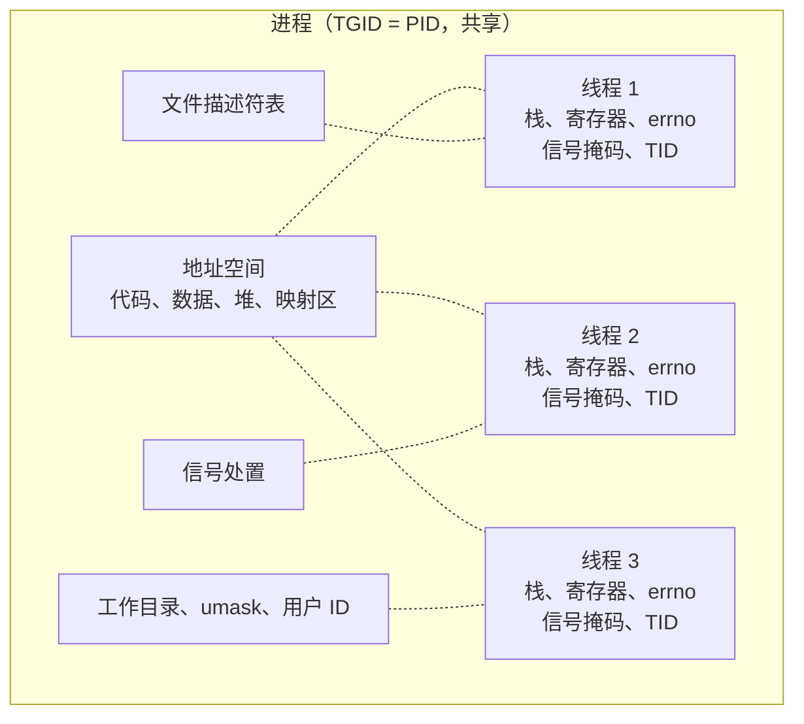

# 8. 操作系统线程与同步

网络服务端在初具雏形时，往往会采用极其直观的模型：每接进一个客户端连接，就顺手创建一个线程来处理。每个请求无非是读取磁盘、解析报文、再做少许业务运算，单线程写起来毫不费力。然而，当外部连接数爬升至数百上千时，整个系统便会迅速陷入泥潭。进程的响应延迟开始剧烈抖动，通过 `ps -L` 观察到的线程数密集得令人心惊，上下文切换的开销把 CPU 啃食殆尽。与此同时，在最简单的数据共享场景下，让两个线程并发递增同一个计数器各十万次，最终汇总的数值却总是比预期的二十万差上一截，反复重跑几次，缺失的差值还各不相同。

这些看似分散的工程现象，根源都落在同一套底层机理上：操作系统怎样创建和回收线程、线程在内核中由什么样的实体表达、调度器如何在它们之间切割 CPU 时间，以及一把同步锁究竟在什么时刻才会把执行流推入等待队列。此前在第一部分[第 23 章](/教程/正文/语法和标准库/23_原子操作与并发)中，我们依循 C11 标准通过 `<threads.h>` 梳理过并发编程的语法轮廓。在真实的 POSIX 系统编程中，生产代码几乎无一例外地扎根在 pthread 之上。本章将由浅入深，先建立对 pthread 原语的操作直觉，进而深入到 Linux 内核层面的任务抽象、调度行为与 futex 机制，剖析这些抽象背后的系统成本，最后一步步拼装出具备生产级关闭协议与背压控制的有界队列和线程池，为后续[第 12 章](/教程/正文/系统编程/12_事件循环)卸载阻塞型任务打下坚实的基础。

## 1. 从 C11 线程到 pthread

同一组多线程逻辑往往可以在不同的 API 规范下写出对应的形式。例如让四个线程各自在互斥量保护下递增同一个全局计数器二十五万次，C11 版本的实现在 [23.3](/教程/正文/语法和标准库/23_原子操作与并发/23_3_互斥) 中已经完整呈现，若将其映射到 POSIX 线程接口，两者的概念有着清晰的对位关系：

| 要做的事 | C11 | pthread |
| --- | --- | --- |
| 线程标识 | `thrd_t` | `pthread_t` |
| 创建 | `thrd_create` | `pthread_create` |
| 等待结束 | `thrd_join` | `pthread_join` |
| 互斥量 | `mtx_t`、`mtx_lock`、`mtx_unlock` | `pthread_mutex_t`、`pthread_mutex_lock`、`pthread_mutex_unlock` |
| 条件同步对象 | `cnd_t`、`cnd_wait`、`cnd_signal` | `pthread_cond_t`、`pthread_cond_wait`、`pthread_cond_signal` |
| 线程局部存储 | `tss_t` | `pthread_key_t` |
| 一次性初始化 | `call_once` | `pthread_once` |

pthread 版的计数程序如下，完整文件在 `code/系统编程/8_操作系统线程与同步/count_pthread.c`：

```c
#define _POSIX_C_SOURCE 200809L

#include <pthread.h>
#include <stdio.h>
#include <stdlib.h>
#include <string.h>

#define THREADS 4
#define PER_THREAD 250000

static pthread_mutex_t lock = PTHREAD_MUTEX_INITIALIZER;
static long counter;

static void die_rc(int rc, const char *what) {
    if (rc == 0) {
        return;
    }
    fprintf(stderr, "%s: %s\n", what, strerror(rc));
    exit(EXIT_FAILURE);
}

static void *worker(void *arg) {
    (void)arg;

    for (int i = 0; i < PER_THREAD; i++) {
        die_rc(pthread_mutex_lock(&lock), "pthread_mutex_lock");
        counter++;
        die_rc(pthread_mutex_unlock(&lock), "pthread_mutex_unlock");
    }
    return NULL;
}

int main(void) {
    pthread_t t[THREADS];

    for (int i = 0; i < THREADS; i++) {
        die_rc(pthread_create(&t[i], NULL, worker, NULL), "pthread_create");
    }
    for (int i = 0; i < THREADS; i++) {
        die_rc(pthread_join(t[i], NULL), "pthread_join");
    }
    printf("counter = %ld\n", counter);
    return 0;
}
```

两个程序输出相同：

::: terminal title="bash - count_pthread"

```text
$ gcc -std=c17 -Wall -Wextra -g count_pthread.c -o count_pthread -pthread
$ ./count_pthread
counter = 1000000
```

:::

C11 的版本（`count_c11.c`）输出同样是 `counter = 1000000`。功能上看不出差别，因为 glibc 的 C11 线程就是 pthread 上的一层薄包装：`thrd_create` 内部调 `pthread_create`，`mtx_t` 里装着一个 `pthread_mutex_t`。既然如此，系统编程里直接用 pthread 就行。属性对象、读写锁、屏障、可选时钟的超时等待、进程共享的互斥量，这些 C11 线程都没有，而它们在这一页后面都会用到。

编译时要加 `-pthread`。它同时做两件事：链接 pthread 库（glibc 2.34 起已经并进 libc，链接这一步实际上不再是问题），以及定义 `_REENTRANT` 宏。漏掉它的程序往往照样能编译、照样能跑，但在旧一些的平台上会出问题，所以统一写上。

::: tip 用 `-pthread`，不要用 `-lpthread`

`gcc ... -lpthread` 放进命令末尾只是链接一个库，不定义 `_REENTRANT`，也不能保证编译选项正确。`-pthread` 加在编译和链接的任意位置都可以，习惯上放在最后。

:::

::: concept sys-thread-pthread-error title="pthread 的错误约定：错误号由返回值给出"

pthread 系列函数不通过 `errno` 报告错误。它们把错误号直接作为返回值返回：成功返回 0，失败返回 `EINVAL`、`EDEADLK`、`ETIMEDOUT` 这样的正值。失败时 `errno` 不被修改，所以拿 `perror` 打印 pthread 的错误，只会打印出上一次其他调用留下的值。

这一类调用用单独的错误处理函数，本教程统一写作 `die_rc(rc, what)`：`rc` 非 0 时用 `strerror(rc)` 打印原因并退出。`pthread_create`、`pthread_join`、`pthread_mutex_lock` 以及本章出现的所有 pthread 函数，都按这个约定处理。

:::

这个约定值得亲手看一眼，因为两种错误惯例混在一起时非常容易写错。程序对一个 ERRORCHECK 互斥量重复加锁，再给线程起一个太长的名字：

```c
#define _GNU_SOURCE

#include <errno.h>
#include <pthread.h>
#include <stdio.h>
#include <string.h>

/* 演示 pthread 的错误约定：错误号由返回值给出，errno 不动。 */
int main(void) {
    pthread_mutex_t m;
    pthread_mutexattr_t a;

    pthread_mutexattr_init(&a);
    pthread_mutexattr_settype(&a, PTHREAD_MUTEX_ERRORCHECK);
    pthread_mutex_init(&m, &a);
    pthread_mutexattr_destroy(&a);
    pthread_mutex_lock(&m);

    errno = 0;
    int rc = pthread_mutex_lock(&m);
    printf("rc = %d (%s), errno = %d\n", rc, strerror(rc), errno);

    rc = pthread_setname_np(pthread_self(), "a-name-that-is-too-long");
    printf("setname rc = %d (%s)\n", rc, strerror(rc));
    return 0;
}
```

输出（`pthread_error.c`）：

::: terminal title="bash - pthread_error"

```text
$ ./pthread_error
rc = 35 (Resource deadlock avoided), errno = 0
setname rc = 34 (Numerical result out of range)
```

:::

`35` 是 `EDEADLK`，`34` 是 `ERANGE`。`errno` 从头到尾是 0，`strerror(rc)` 才是正确的用法。这一条贯穿本章，后面不再重复。

C11 线程与 pthread 之间还有一处容易忽略的差别：`thrd_exit` 与 `pthread_exit` 都只结束调用它的那个线程，`return` 从线程函数返回也一样。但主线程从 `main` 返回相当于调用 `exit`，会把整个进程结束掉，其他线程跟着消失。想让主线程先退出、让工作线程把活干完，主线程必须调用 `pthread_exit`：

::: terminal title="bash - pexit"

```text
$ ./pexit
worker 1
worker 2
worker 3
```

:::

程序在 `main` 里 `pthread_exit(NULL)`，工作线程每秒打印一行、打印三次；如果改成 `return 0`，这些行一行也看不到。

<Quiz
  :options="[
    { label: '线程之间共享地址空间、打开的文件描述符和信号处置', value: 'A' },
    { label: '每个线程有自己的栈、寄存器和 errno', value: 'B' },
    { label: '线程之间共享信号掩码，所以一个线程阻塞的信号对所有线程都阻塞', value: 'C' },
    { label: '线程之间共享工作目录和 umask', value: 'D' }
  ]"
  :answer="['A', 'B', 'D']"
>

<template #question>

关于同一进程里线程之间共享与私有的资源，下列说法正确的是哪些？

</template>

正确答案是 **A、B、D**。

- A、B、D 都是 POSIX 规定：地址空间、描述符、信号处置、工作目录、umask、用户 ID 属于整个进程；栈、寄存器、`errno`、信号掩码属于每个线程。
- C 错：信号掩码是每线程一份。第 8 节讲线程与信号时，正是利用这一点让一个专门的线程接收信号。

</Quiz>

## 2. 创建、结束与回收

`pthread_create` 的四个参数依次是：输出线程标识的指针、线程属性（传 `NULL` 用默认值）、线程函数、传给线程函数的参数。线程函数的类型是 `void *(*)(void *)`：接受一个 `void *`，返回一个 `void *`。`pthread_join` 等待指定线程结束，第二个参数用来取回它的返回值；不需要返回值时传 `NULL`。

`pthread_join` 同时完成回收：线程结束后，它的栈和线程控制块要等有人 join 或者它被 detach 之后才真正释放。不 join 也不 detach 的线程结束后会留下资源，和进程里的僵尸进程是同一类问题。

### 2.1 传参：不要传循环控制对象的地址

线程函数在接口上仅接受一个通用指针 `void *`。若任务需要传入多个参数或特定上下文，系统编程中最常用的模式是传递一个结构体对象的地址。然而初学者极易在这里落入生命周期的盲区：在循环迭代中直接把循环控制对象的地址 `&i` 传给新线程。

::: compare vertical left-title="传循环控制对象的地址" right-title="每个线程一个结构体"

```c
pthread_t t[THREADS];

for (int i = 0; i < THREADS; i++) {
    pthread_create(&t[i], NULL, show, &i);
}
for (int i = 0; i < THREADS; i++) {
    pthread_join(t[i], NULL);
}

/* show 里读的是 *(int *)arg */
```

```c
struct job {
    int id;
};

pthread_t t[THREADS];
struct job jobs[THREADS];

for (int i = 0; i < THREADS; i++) {
    jobs[i].id = i;
    pthread_create(&t[i], NULL, show, &jobs[i]);
}
for (int i = 0; i < THREADS; i++) {
    pthread_join(t[i], NULL);
}

/* show 里读的是 job->id */
```

:::

左侧的代码在实际运行中几乎必然产生令人困惑的输出。根本原因在于并发执行的时序脱节：`pthread_create` 成功返回，仅仅代表操作系统已经完成了内核任务的登记，该线程并不一定会立即获得 CPU 调度执行。等新线程终于被调度器选中、开始执行用户函数时，主线程的 `for` 循环往往早已疾驰而过，对象 `i` 的值早已停留在终值 `THREADS`；若是在嵌套作用域中，该对象所在的栈帧甚至可能早已析构。通过实测程序（`arg_bug.c`）观察，每次运行都会捕获到完全雷同的滞后现象：

::: terminal title="bash - arg_bug"

```text
$ gcc -std=c17 -Wall -Wextra -g arg_bug.c -o arg_bug -pthread
$ ./arg_bug
thread sees id = 4
thread sees id = 4
thread sees id = 4
thread sees id = 4
```

:::

这里的 `4` 是循环结束后的值。程序没有崩溃，只是每个线程都读到了最后一个值——这类错误比崩溃更难发现。改传结构体数组的元素（`arg_ok.c`）就正确了：

::: terminal title="bash - arg_ok"

```text
$ ./arg_ok
thread sees id = 0
thread sees id = 1
thread sees id = 2
thread sees id = 3
```

:::

结构体数组要保证在线程结束之前一直有效。放在 `main` 的栈上、在 `pthread_join` 之后再离开作用域，是安全的写法。

### 2.2 用返回值带出结果

线程函数返回的 `void *` 由 `pthread_join` 取出。返回一个指向堆上对象的指针，是让线程交出计算结果的标准做法：

```c
static void *work(void *arg) {
    struct job *job = arg;
    struct result *res = malloc(sizeof *res);

    if (res == NULL) {
        return NULL;
    }
    long sum = 0;

    for (long i = 1; i <= job->n; i++) {
        sum += i;
    }
    res->id = job->id;
    res->sum = sum;
    return res; /* 返回值由 join 的一方负责释放 */
}
```

主线程这样回收：

```c
for (int i = 0; i < THREADS; i++) {
    struct result *res;

    die_rc(pthread_join(t[i], (void **)&res), "pthread_join");
    printf("join: thread %d returned sum = %ld\n", res->id, res->sum);
    free(res);
}
```

完整程序与输出（`create_join.c`）：

::: terminal title="bash - create_join"

```text
$ ./create_join
thread 0 done
join: thread 0 returned sum = 5000050000
thread 1 done
join: thread 1 returned sum = 20000100000
thread 2 done
join: thread 2 returned sum = 45000150000
thread 3 done
join: thread 3 returned sum = 80000200000
total = 150000500000
```

:::

也可以让线程把结果写进调用者提供的结构体，返回值只表示成败。两种方式都常见；用返回值传递所有权更清楚：谁 join 谁负责 `free`。

### 2.3 分离线程与结束

不关心线程何时结束、也不需要取回结果时，用 `pthread_detach` 把它分离。分离之后的线程结束时资源自动回收，但不能再 join：

::: terminal title="bash - detach_join"

```text
$ ./detach_join
join on detached thread: rc = 22 (Invalid argument)
```

:::

`22` 是 `EINVAL`。反过来，一个线程也可以在创建时就把自己设成可分离状态——通过属性对象设置（下一小节），或者在自己的线程函数开头调用 `pthread_detach(pthread_self())`。

线程函数结束后，它用 `return` 返回的值和调用 `pthread_exit` 的效果相同；`pthread_exit` 允许提前结束线程。注意 `pthread_exit` 与 `exit` 的区别：前者只结束当前线程，后者结束整个进程。

### 2.4 线程属性：栈大小与分离状态

属性对象把「这一次创建线程」的选项集中起来。属性只在创建时被读取，创建完就可以销毁，不影响已经创建的线程：

```c
pthread_attr_t attr;

pthread_attr_init(&attr);
pthread_attr_setstacksize(&attr, 256 * 1024);
pthread_attr_setdetachstate(&attr, PTHREAD_CREATE_DETACHED);
pthread_create(&t, &attr, worker, NULL);
pthread_attr_destroy(&attr);
```

栈大小是实际会用到的属性。默认值等于进程的 `RLIMIT_STACK` 软限制，在 Linux 上通常是 8 MiB；线程一多，光是虚拟地址空间就吃掉不少。实测（`stacksize.c`，一个线程设 256 KiB，一个用默认值）在创建时读取栈信息：

::: terminal title="bash - stacksize"

```text
$ ./stacksize
small  stack: 256 KiB at 0x7fc888276000
default stack: 8192 KiB at 0x7fc887a75000
```

:::

线程的栈是动态分配的，8 MiB 只是地址空间上的上限，物理内存按需占用；把上限调小能让每个线程少占地址空间，也让栈溢出更早暴露。一个装满局部数组的函数很容易在 256 KiB 的栈上溢出，而同样的代码在默认栈上没事。

::: warning 栈上不要放大数组

线程函数里的局部数组算在该线程的栈上。默认 8 MiB 看似宽裕，开几百个线程就不可忽略了。大块数据用 `malloc`，或者显式设置栈大小并把上限写进代码注释。

:::

### 2.5 线程标识：pthread_t 与 TID

`pthread_t` 是 pthread 库内部使用的标识，可以把两个 `pthread_t` 比较是否相等，但不要打印、不要当成整数解析。它的长度和表示随实现而变，在 glibc 上是一个指针值。

内核使用的线程号是 TID（thread ID），与 `pthread_t` 不是一回事。取得 TID 要用 Linux 专有的 `gettid()`（需要 `_GNU_SOURCE`）；也可以用 `syscall(SYS_gettid)`，但那样反而要多引一个宏。一个程序把主线程和三个工作线程的两种标识都打印出来，并用 `/proc/self/task` 列出所有线程：

```c
static void *worker(void *arg) {
    const char *name = arg;

    die_rc(pthread_setname_np(pthread_self(), name), "pthread_setname_np");
    printf("  %-5s pthread_self = %lu, gettid = %ld\n", name,
           (unsigned long)pthread_self(), (long)gettid());
    sleep_ms(2000);
    return NULL;
}
```

输出（`tids.c`）：

::: terminal title="bash - tids"

```text
$ ./tids
main:  pthread_self = 140401345939264, gettid = 4029182, getpid = 4029182
  alpha pthread_self = 140401345935040, gettid = 4029183
  gamma pthread_self = 140401329149632, gettid = 4029185
  beta  pthread_self = 140401337542336, gettid = 4029184
/proc/4029182/task: 4029182 4029183 4029184 4029185
```

:::

主线程的 `gettid` 等于 `getpid`，三个工作线程各有一个依次递增的 TID；`/proc/self/task` 下列出的正是这四个线程。注意 `pthread_self` 打印出来的值与 TID 完全无关，前者是 glibc 分配的线程描述结构地址。

`pthread_setname_np` 也不是标准接口，名字最多 15 个字符，超长返回 `ERANGE`（前面的 `pthread_error.c` 演示过）。名字会出现在 `ps` 和 `/proc/PID/task/TID/comm` 里，调试多线程程序时很有用。

<Quiz
  :options="[
    { label: 'pthread_create 的第四个参数若传递循环控制对象的地址，线程极易读到循环结束后的值', value: 'A' },
    { label: 'pthread_join 的第二个参数用来取回线程函数的返回值', value: 'B' },
    { label: '线程被 detach 之后仍然可以 join', value: 'C' },
    { label: 'pthread_t 的值就是内核里的 TID，可以直接打印出来和 ps 对照', value: 'D' }
  ]"
  :answer="['A', 'B']"
>

<template #question>

下面关于线程创建与回收的说法，正确的是哪些？

</template>

正确答案是 **A、B**。

- C 错：detach 与 join 互斥，detach 之后再 join 返回 `EINVAL`（见 `detach_join.c` 的实测输出）。
- D 错：`pthread_t` 是库内部的标识，与内核 TID 无关；取 TID 用 `gettid()`。前者适合比较，后者适合进 `/proc` 和 `ps -L` 查。

</Quiz>

## 3. Linux 怎样实现线程

### 3.1 1:1 模型与 clone

Linux 内核本身没有单独的「线程」概念，它调度的是任务（task）。线程和进程的区别在于创建时传给 `clone` 的标志：带 `CLONE_VM`、`CLONE_FILES`、`CLONE_SIGHAND`、`CLONE_THREAD` 的任务与创建者共享地址空间、描述符表、信号处理函数和线程组，就是一个线程。每线程对应一个内核调度实体，这种实现叫 1:1 模型。glibc 里的这套实现叫 NPTL（Native POSIX Thread Library）。

用 `strace -f` 看 `pthread_create` 实际发起的系统调用：

::: terminal title="bash - strace -f -e trace=clone3 ./tids"

```text
$ strace -f -e trace=clone3 -o clone3.trace ./tids
$ head -1 clone3.trace
4030536 clone3({flags=CLONE_VM|CLONE_FS|CLONE_FILES|CLONE_SIGHAND|CLONE_THREAD|CLONE_SYSVSEM|CLONE_SETTLS|CLONE_PARENT_SETTID|CLONE_CHILD_CLEARTID, child_tid=0x7f0f51a30990, parent_tid=0x7f0f51a30990, exit_signal=0, stack=0x7f0f51230000, stack_size=0x7fff80, tls=0x7f0f51a306c0} => {parent_tid=[4030537]}, 88) = 4030537
```

:::

这一行信息量很大。`CLONE_VM` 共享地址空间，`CLONE_FILES` 共享描述符表，`CLONE_SIGHAND` 共享信号处理函数，`CLONE_THREAD` 把新任务放进同一个线程组；`CLONE_SETTLS` 给新线程装一套线程局部存储；`stack` 指向 glibc 事先为这个线程 `mmap` 出来的栈区。`CLONE_SYSVSEM` 让 System V 信号量的撤销操作按线程组处理。

没有 `CLONE_VM|CLONE_THREAD` 的 `clone` 得到的就是一个新进程。`fork` 也是 `clone`，区别只在共享哪些资源。所以进程和线程在内核里是同一个抽象，只是共享程度不同。

### 3.2 线程组、TID 与 /proc

`CLONE_THREAD` 的另一个作用是让所有线程共用一个线程组 ID（TGID），这个 TGID 就是 `getpid()` 返回的值。`gettid()` 取到的是每个线程自己的 TID。`/proc/PID` 里 PID 指 TGID，`/proc/PID/task/TID` 才对应到单个线程。

`ps -L` 的 `LWP` 列就是 TID：

::: terminal title="bash - ps -L"

```text
$ ps -L -o pid,lwp,comm -p 4029182
    PID     LWP COMMAND
4029182 4029182 tids
4029182 4029183 alpha
4029182 4029184 beta
4029182 4029185 gamma
```

:::

`PID` 一列全是同一个值（线程组 ID），`LWP` 各不同；`comm` 是前面用 `pthread_setname_np` 设的名字，主线程没有改名，显示的是程序名。调试多线程程序时，`ps -L` 和 `/proc/PID/task` 是最先要看的两样东西：线程是不是都在、有没有卡住、名字对不对。

### 3.3 线程栈是带保护页的映射

每个线程的栈是一块独立的匿名映射，glibc 在线程创建时用 `mmap` 分配。这块映射的末尾（低地址一侧）留了一页不可访问的保护页，栈长过界时访问到它就触发 SIGSEGV，不会悄悄踩进别的线程的栈。在程序运行期间查看 `/proc/PID/maps` 可以看到这种成对的布局：

::: terminal title="bash - 线程栈与保护页"

```text
$ grep -A 1 -- '---p' /proc/4046661/maps
7fa42c318000-7fa42c319000 ---p 00000000 00:00 0
7fa42c319000-7fa42cb19000 rw-p 00000000 00:00 0
7fa42cb19000-7fa42cb1a000 ---p 00000000 00:00 0
7fa42cb1a000-7fa42d31a000 rw-p 00000000 00:00 0
7fa42d31a000-7fa42d31b000 ---p 00000000 00:00 0
7fa42d31b000-7fa42db1b000 rw-p 00000000 00:00 0
```

:::

每一对里，`---p` 的一页是保护页，紧随其后的 8 MiB `rw-p` 区就是线程栈。三对正好对应三个工作线程。这条线索把[第 4 章](/教程/正文/系统编程/4_虚拟内存与内存映射)的地址空间和本章接了起来：线程栈是一块独立的映射，`pthread_attr_setstacksize` 改的就是这块映射的大小。

::: concept sys-thread-kernel-model title="Linux 的线程是共享地址空间的内核任务"

Linux 内核调度的单位是任务（task）。用 `clone` 创建、带上 `CLONE_VM|CLONE_FILES|CLONE_SIGHAND|CLONE_THREAD` 的任务就是一个线程：它与创建者共享地址空间、描述符表和信号处理函数，被放进同一个线程组。

同一线程组里所有线程共用一个 TGID（即 `getpid()` 的返回值），各自有一个 TID（`gettid()` 的返回值，也是 `ps -L` 的 LWP 列）。`/proc/PID/task/TID` 对应到单个线程。

:::

下图把共享与私有的资源画在一起，可以当作这一节的总结：



### 3.4 共享与私有的实测

上面那张图里的每一条，都可以用一个程序当场验证。两个线程先用屏障对齐，然后一个线程打开一个文件并把描述符放进全局对象，接着两个线程都往这个描述符里写；之后各自设置 `errno`、各自修改信号掩码，最后把读到的值打印出来（`shared.c`）：

::: terminal title="bash - shared"

```text
$ ./shared
thread 1: errno = 0
thread 0: errno = 2
thread 0: SIGUSR1 blocked = 0, process id = 4057818
thread 1: SIGUSR1 blocked = 1, process id = 4057818
$ cat thread.txt
thread 0 writes through fd 3
thread 1 writes through fd 3
```

:::

`thread.txt` 里两行内容都通过同一个描述符写出，说明描述符表是共享的。两个线程设置的 `errno` 互不影响：线程 0 设成 `ENOENT`（2），线程 1 设成 0，各自读到的就是各自设的值。信号掩码也一样，线程 1 阻塞了 SIGUSR1，线程 0 没有。`process id` 相同，则是 `getpid()` 返回线程组 ID 的直接证据。

<Quiz
  :options="[
    { label: 'Linux 内核调度的单位是任务，线程是共享地址空间、描述符表和信号处置的一类任务', value: 'A' },
    { label: '同一线程组的所有线程共用一个 TGID，各自有一个 TID', value: 'B' },
    { label: '线程的栈是主线程栈区的一部分，所以栈大小由 RLIMIT_STACK 统一决定', value: 'C' },
    { label: '在 /proc/PID/task 下可以看到该进程的每一个线程', value: 'D' }
  ]"
  :answer="['A', 'B', 'D']"
>

<template #question>

关于 Linux 里线程在内核中的表示，下列说法正确的是哪些？

</template>

正确答案是 **A、B、D**。

- C 错：每个线程的栈是独立的匿名映射，`pthread_attr_setstacksize` 管的是这一块；默认大小取自 `RLIMIT_STACK`，但它和主线程的栈区是两回事（见 3.3 节 `/proc/PID/maps` 里的成对布局）。

</Quiz>

::: generate sys-thread-kernel-model-explain kind=explanation concepts=sys-thread-kernel-model

面向已经学过进程与 fork 的读者，解释「内核没有单独的线程对象」这一点：用 fork/clone 的共享标志说明进程与线程只是共享程度不同的任务，并结合 `ps -L` 的 PID/LWP 两列说明 TGID 与 TID 的关系，最后说明为什么线程栈在 `/proc/PID/maps` 里是独立的映射区，与主线程栈分开。不要展开调度器内部。

:::

## 4. 调度

[第 5 章](/教程/正文/系统编程/5_进程的创建_执行与回收) 2.2 节把调度留到了这一章，因为调度的最小单位是线程。内核在可运行的任务之间分配 CPU 时间，选谁上、上多久，由调度器决定。

### 4.1 状态与时间片

站在操作系统的调度视角，一个线程在任意时刻必然处于以下三种基本状态之一：它可能正占据着某个物理核心的寄存器处于执行态；也可能已经准备就绪但受限于核心数量，只能在调度队列中排队等待分配；亦或是陷入了阻塞状态，挂起等待特定外部或内部事件——例如等待文件描述符就绪、互斥锁释放、条件通知，或者定时器到期。前两种状态在内核统计中通常合称为「可运行」，它们构成了调度器挑选候选任务的整个候选池。

调度器的职责，便是在每个调度周期挑出一个处于就绪队列的任务，交付给 CPU 执行一段相对受限的物理时间，这段额度称为时间片（time slice）。当时间片耗尽或发生高优先级抢占时，内核会执行上下文切换（context switch）：保存当前线程的寄存器状态和栈顶指针，并载入下一个被选中线程的上下文。硬件与内核层面的切换本身具备固定的指令开销，而更隐蔽的代价在于 CPU 缓存的局部性破坏——新切入的线程往往需要经历一系列缓存冷失效才能把工作集重新拉进 L1/L2 缓存。因此，在评估高并发系统的系统开销时，单位时间内的上下文切换频率往往是一项极为关键的健康指标。

自 Linux 6.6 起，主线内核针对普通分时任务正式引入了 EEVDF（Earliest Eligible Virtual Deadline First）调度器，用以取代沿用多年的 CFS（完全公平调度器）。EEVDF 的核心思想依然建立在虚拟运行时间之上，但进一步量化了滞后值（lag）：滞后值为正，意味着该任务在理论份额上被内核「亏欠」了计算时间；滞后值为负，则说明它所占用的 CPU 已经超出了它的公允配额。在调度决策中，唯有滞后值非负的任务才具备被选中的合法资格；而在所有合规的任务中，调度器会挑选虚拟截止时间最早的那个立即投入运行。这种机制既维持了长期宏观上的公平配额，又显著改善了对突发性、对唤醒时延极其敏感的任务响应能力。在日常系统编程中，我们通常无需纠结调度器的微观公式推导，只需把握核心准则：普通线程之间的算力配额由静态权重划分，而这一权重在用户空间最直接的调节杠杆正是 nice 值。

### 4.2 nice 与实时策略

nice 值的取值区间为 -20 到 19。在 Unix 传统语境中，数值越小代表优先级越高，进程对其他任务越「不友好」；数值越大则优先级越低，表现得越谦让。系统的默认 nice 值为 0。自 CFS 确立权重体系以来，相邻两级 nice 值所映射的 CPU 算力份额比例大约维持在 1.25 倍左右。换言之，当一个 nice 为 0 的计算线程与一个 nice 为 1 的计算线程在单核心上全力争抢算力时，前者能瓜分到约 55.6% 的时间，后者分得约 44.4%。由于单级的差距相对平缓，工程上通常需要将 nice 调整数个档位，才能在复杂的综合负载中体现出肉眼可见的倾斜效果。

普通非特权用户通常只能单向调高自身的 nice 值（即主动降低优先级），若想逆向调低以拔高优先级，则必须持有 `CAP_SYS_NICE` 权能。此外，Linux 实现中还存在一处与经典 POSIX 规范微妙背离的细节：POSIX 将 nice 定义为进程层级的属性，而在 Linux 的 NPTL 实现下，nice 属性是下沉到每个线程独立维护的。某个线程调用 `setpriority` 修改自身优先级，同进程内的其余兄弟线程丝毫不会受到连带影响。

在排查现场与自动化脚本中，调节和观察任务调度属性最常用的外部工具是 `nice` 与 `chrt`。我们可以编写一个简单的辅助程序，利用系统调用采集当前线程的调度策略、静态优先级、nice 值以及绑定的 CPU 亲和集：

```c
#define _GNU_SOURCE

#include <errno.h>
#include <sched.h>
#include <stdio.h>
#include <sys/resource.h>
#include <unistd.h>

static const char *policy_name(int policy) {
    switch (policy) {
    case SCHED_OTHER:
        return "SCHED_OTHER";
    case SCHED_FIFO:
        return "SCHED_FIFO";
    case SCHED_RR:
        return "SCHED_RR";
    case SCHED_BATCH:
        return "SCHED_BATCH";
    case SCHED_IDLE:
        return "SCHED_IDLE";
    default:
        return "unknown";
    }
}

int main(void) {
    int policy = sched_getscheduler(0);
    struct sched_param sp;
    cpu_set_t set;

    if (sched_getparam(0, &sp) != 0) {
        perror("sched_getparam");
        return 1;
    }
    errno = 0;
    int nice_value = getpriority(PRIO_PROCESS, 0);
    if (nice_value == -1 && errno != 0) {
        perror("getpriority");
        return 1;
    }
    CPU_ZERO(&set);
    if (sched_getaffinity(0, sizeof set, &set) != 0) {
        perror("sched_getaffinity");
        return 1;
    }
    printf("policy = %s, rt_priority = %d, nice = %d\n", policy_name(policy),
           sp.sched_priority, nice_value);
    printf("allowed CPUs = %d, running on CPU %d\n", CPU_COUNT(&set), sched_getcpu());
    return 0;
}
```

用不同方式启动同一个程序（`schedinfo.c`）：

::: terminal title="bash - schedinfo"

```text
$ ./schedinfo
policy = SCHED_OTHER, rt_priority = 0, nice = 0
allowed CPUs = 96, running on CPU 64
$ nice -n 19 ./schedinfo
policy = SCHED_OTHER, rt_priority = 0, nice = 19
allowed CPUs = 96, running on CPU 65
$ chrt -b 0 ./schedinfo
policy = SCHED_BATCH, rt_priority = 0, nice = 0
allowed CPUs = 96, running on CPU 67
$ chrt -i 0 ./schedinfo
policy = SCHED_IDLE, rt_priority = 0, nice = 0
allowed CPUs = 96, running on CPU 70
```

:::

`SCHED_OTHER` 是默认的分时策略；`SCHED_BATCH` 告诉调度器这个线程是批处理，唤醒时可以稍微延迟；`SCHED_IDLE` 是优先级最低的类别，只在没有别的线程要 CPU 时才运行。这三者都不需要特权。

实时策略 `SCHED_FIFO` 和 `SCHED_RR` 是另一回事：优先级 1 到 99，高于任何普通线程，一旦就绪就抢占正在运行的普通线程。`SCHED_FIFO` 没有时间片，会一直跑下去直到自己阻塞或主动让出；`SCHED_RR` 在每个时间片结束时排到同优先级的队尾。普通用户要在自己身上设置实时策略，需要 `RLIMIT_RTPRIO` 的非零软限制。在实验机上这个限制是 0：

::: terminal title="bash - chrt -f 10 ./schedinfo"

```text
$ ulimit -r
0
$ chrt -f 10 ./schedinfo
chrt: failed to set pid 0's policy: Operation not permitted
```

:::

即便拥有足够的特权，内核依然对实时任务设定了一道坚固的防护水位线：在默认配置下，一个统计周期（由 `/proc/sys/kernel/sched_rt_period_us` 定义，通常设为 1 秒）之内，所有实时线程累计最多只能垄断 95% 的 CPU 运行时间（对应 `sched_rt_runtime_us` 为 950000 微秒），余下的 5% 必须强制保留给普通分时任务。这项机制是为了防止某个失控陷入死循环的实时线程把整个操作系统的控制台、SSH 服务彻底憋死。在超低延迟高频交易或音视频实时流场景中，除了实时调度策略之外，往往还要结合 CPU 核心隔离（isolcpus）、中断亲和性绑定、内存物理锁页（mlockall）等一系列软硬件调优手段。

系统调用 `sched_yield` 会主动放弃当前的物理核心，将执行机会让给同优先级的其他就绪任务。在完备的现代抢占式多任务内核里，这种手动让出在绝大部分业务代码中都是多余甚至有害的：如果一个线程的时间配额耗尽，调度器自会完成抢占；而在工程实践中，频繁出现 `sched_yield` 的代码，十有八九是在掩盖低劣的同步设计——本该在条件未就绪时挂起让出 CPU，却写成了死循环自旋并在每次空转中 yield 一下。

CPU 亲和性（CPU affinity）用于将线程限定在指定的逻辑核心子集上执行，通过 `sched_setaffinity` 施加约束，通过 `sched_getaffinity` 检视掩码。在针对高吞吐系统的深度调优中，将关键工作线程固定在特定核心上，能够有效消除因跨核迁移导致的缓存失效与 NUMA 跨节点远程内存访问损耗。然而绑核并非灵丹妙药，在没有真实测量的前提下盲目绑定，往往容易引发局部的核心过载，把原本由内核自动均衡调度的算力限制死在单核瓶颈上。此处仅演示其状态查询：

::: terminal title="bash - affinity"

```text
$ ./affinity
sysconf(_SC_NPROCESSORS_ONLN) = 96
thread may run on 96 CPU(s), currently CPU 16
```

:::

### 4.3 上下文切换的两种来源

一个线程离开 CPU 有两种原因：自己不要 CPU 了（等待某个事件，或者主动让出），这叫自愿上下文切换（voluntary context switch）；被调度器换下去（时间片用完，或者有更高优先级的线程就绪），叫非自愿上下文切换。

两个计数在 `/proc/PID/status` 和 `/proc/PID/task/TID/status` 里都有，线程自己的那份在后者。下面的程序起两个线程，各做 5 轮 40 毫秒的工作：一个用 `nanosleep` 睡掉这 40 毫秒，另一个用忙等循环把 40 毫秒的 CPU 时间烧掉。结束时从各自的 status 里读出计数和 CPU 时间：

```c
static void *work(void *arg) {
    struct worker *w = arg;
    struct rusage ru;

    for (int i = 0; i < ROUNDS; i++) {
        long long deadline = now_ms() + WORK_MS;

        if (w->busy) {
            while (now_ms() < deadline) {
            }
        } else {
            struct timespec ts = {.tv_sec = 0, .tv_nsec = WORK_MS * 1000000L};

            while (nanosleep(&ts, &ts) == -1) {
            }
        }
    }
    read_switches(w);
    if (getrusage(RUSAGE_THREAD, &ru) != 0) {
        perror("getrusage");
        return NULL;
    }
    w->cpu_ms = ms_of(&ru.ru_utime) + ms_of(&ru.ru_stime);
    return NULL;
}
```

输出（`ctxsw.c`，某次运行）：

::: terminal title="bash - ctxsw"

```text
$ ./ctxsw
5 rounds of 40 ms each:
sleep cpu =    0.25 ms  voluntary = 5  nonvoluntary = 0
busy  cpu =  196.41 ms  voluntary = 0  nonvoluntary = 2
```

:::

结果很干净：睡眠线程每睡一次就是一次自愿切换，5 轮正好 5 次；忙等线程干活时不睡觉，所以自愿切换是 0，偶尔被系统上别的活动挤下去，留下 1～2 次非自愿切换。CPU 时间那一栏更直白：睡着的线程只花了零点几毫秒的 CPU，忙等的线程烧掉了将近 200 毫秒。

这两个计数是判断线程池、事件循环这类程序「卡不卡」的第一手材料。一个应该睡眠等待的后台线程如果自愿切换数居高不下，它多半在反复醒来空转；一个 CPU 密集的线程如果非自愿切换很多，说明它在和别人抢 CPU，该降低线程数了。

::: tip 定时观察上下文切换

`watch -n1 "grep ctxt /proc/PID/status"` 能每秒刷新进程整体的计数；要按线程看，把路径换成 `/proc/PID/task/TID/status`，TID 从 `ps -L` 拿。

:::

<Quiz
  :options="[
    { label: '两个都只做计算、都不阻塞的线程，nice 相差 1，它们抢同一个 CPU 时份额大约是 56% 对 44%', value: 'A' },
    { label: '一个线程调用 nanosleep 让出 CPU，这次离开记为自愿上下文切换', value: 'B' },
    { label: '普通用户可以直接把自己的线程设成 SCHED_FIFO，不需要任何限制', value: 'C' },
    { label: 'sched_yield 会让当前线程在时间片用完之前主动放弃 CPU', value: 'D' }
  ]"
  :answer="['A', 'B', 'D']"
>

<template #question>

关于 Linux 的调度，下列说法正确的是哪些？

</template>

正确答案是 **A、B、D**。

- A：从 CFS 起相邻 nice 的权重比是 1.25，两个线程分一个 CPU 时就是 1.25:1。
- C 错：需要 `RLIMIT_RTPRIO` 非零或 `CAP_SYS_NICE`；实验机上 `ulimit -r` 是 0，`chrt -f` 直接失败。就算有权限，实时线程还有 95% 的限流上限。

</Quiz>

::: generate sys-thread-sched-explainer kind=explanation concepts=sys-thread-kernel-model

面向只学过「时间片轮转」这一层调度概念的读者，解释 EEVDF 的两个量：虚拟运行时间衡量任务已经占用了多少 CPU，滞后值衡量它与应得份额的差距；说明为什么只有滞后非负的任务才「有资格」，以及为什么在其中有资格的里面还要按虚拟截止时间挑。用 nice 的 1.25 倍权重把公平性具体化。点到为止，不推导公式。

:::

## 5. 互斥量与它的代价

### 5.1 静态初始化与三种类型

互斥量可以用 `PTHREAD_MUTEX_INITIALIZER` 静态初始化，也可以用 `pthread_mutex_init` 动态初始化。前者只能用于全局或静态对象，好处是不用写初始化代码；后者可以配合属性对象选择类型和进程共享等选项。

默认类型是 `PTHREAD_MUTEX_NORMAL`：重复加锁是未定义行为，可能死锁，也可能看起来正常；解锁一个没被锁的互斥量同样未定义。类型可以在属性对象里改成：

- `PTHREAD_MUTEX_ERRORCHECK`：错误检查互斥量。同一线程重复加锁返回 `EDEADLK`，解锁一个没锁的互斥量返回 `EPERM`。
- `PTHREAD_MUTEX_RECURSIVE`：递归互斥量。同一线程可以多次加锁，需要相同次数的解锁。

日常代码用默认类型就够了，检查类型主要用于调试——把 `NORMAL` 换成 `ERRORCHECK` 跑一遍，能抓到误用。实测：

::: terminal title="bash - errorcheck"

```text
$ ./errorcheck
first lock:   rc = 0 (Success)
second lock:  rc = 35 (Resource deadlock avoided)
first unlock: rc = 0 (Success)
second unlock: rc = 1 (Operation not permitted)
```

:::

`35` 是 `EDEADLK`，`1` 是 `EPERM`。正常互斥量遇到同样的情况不会返回错误，会死锁或静默通过——这正是调试时值得临时换成检查类型的原因。

### 5.2 无争用时锁不进内核

[第 23 章](/教程/正文/语法和标准库/23_原子操作与并发) 讲过临界区的写法，这一节回答一个更要紧的问题：加锁到底有多贵？答案取决于有没有人和你抢。

glibc 的互斥量建立在 futex（fast userspace mutex）之上。futex 是一个 4 字节对齐的整数，操作它用普通的原子指令，不需要系统调用。加锁的快路径是：用一条原子指令尝试把锁字从「未加锁」改成「已加锁」。成功就进入临界区，整个过程只在用户态完成。只有当锁已被别人持有，才需要调用 `futex(FUTEX_WAIT)` 把当前线程挂起；解锁时如果发现有人在等，调用 `futex(FUTEX_WAKE)` 唤醒一个。

这个差别可以用 `strace` 直接量出来。同一段代码，一个线程跑时不会有人争锁；四个线程同时对同一把锁计数，争用就出现了：

```c
#define ITERS 100000

static pthread_mutex_t lock = PTHREAD_MUTEX_INITIALIZER;
static long counter;

/* 只有一个线程：每次加锁都走快路径，strace 里看不到任何 futex 调用。 */
int main(void) {
    for (int i = 0; i < ITERS; i++) {
        die_rc(pthread_mutex_lock(&lock), "pthread_mutex_lock");
        counter++;
        die_rc(pthread_mutex_unlock(&lock), "pthread_mutex_unlock");
    }
    printf("counter = %ld\n", counter);
    return 0;
}
```

10 万次加解锁，一次 futex 调用都没有：

::: terminal title="bash - strace -f -c -e trace=futex ./lock_only"

```text
$ strace -f -c -e trace=futex ./lock_only
counter = 100000
```

:::

`strace -c` 只打印调用过的系统调用；一行都没有，说明这 10 万次加解锁全部在用户态完成。

换成 `futex_count.c` 的四个线程版本，每个线程各做 10 万次加锁：

::: terminal title="bash - strace -f -c -e trace=futex ./futex_count 4"

```text
$ strace -f -c -e trace=futex ./futex_count 4
counter = 400000
% time     seconds  usecs/call     calls    errors syscall
------ ----------- ----------- --------- --------- ----------------
100.00    0.089560          16      5391      1926 futex
------ ----------- ----------- --------- --------- ----------------
100.00    0.089560          16      5391      1926 total
```

:::

40 万次加解锁里出现了几千次 futex 调用，其中 1926 次返回 `EAGAIN`——futex 的锁字在准备挂起之前已经变了，说明争用很激烈。这个数字每次运行都不同（某次运行是 3585 次，另一次是 4860 次），但和 40 万这个总量比起来总是很小：即使四个线程抢同一把锁，绝大多数加锁操作仍然在用户态完成。

两个版本的总加锁次数分别是 10 万和 40 万，能对比的是**每次加锁**的平均代价：它在无争用时接近零，在有争用时才会把线程送进内核。

::: concept sys-thread-futex-fastpath title="futex 的快路径与慢路径"

互斥量的加锁分两条路径。

快路径：用原子指令把锁字从未加锁改成已加锁。成功就进临界区，全程在用户态，没有系统调用。

慢路径：锁字已经是「已加锁」，或有别的线程在等。当前线程调用 `futex(FUTEX_WAIT)` 让内核把它挂起；持有锁的线程解锁时发现有人在等，调用 `futex(FUTEX_WAKE)` 唤醒一个等待者。

所以「无争用时互斥量很便宜」是有条件的：只要出现争用，每次切换都意味着一次或几次系统调用和一次上下文切换。减少争用的办法是缩短临界区、减少共享、按固定的顺序加锁（23.3 第 5 节）。

:::

### 5.3 锁粒度与加锁顺序

两件事对性能与正确性的影响都比「用哪种锁」更大。

一是锁粒度。临界区里只放必须互斥的访问。计算、字符串处理、写日志都放到锁外。一个临界区里做了 10 微秒的活，另一个线程就要多等 10 微秒；把它缩到 1 微秒，等待时间同比下降。

二是加锁顺序。程序里有两把以上的锁时，所有代码都必须按同一个全局顺序获取，否则就具备死锁的条件：线程甲持有 A 等 B，线程乙持有 B 等 A。文档里写清顺序、代码里遵守，是唯一的办法。按地址排序、按对象编号排序都是常见做法。

### 5.4 用 ThreadSanitizer 抓数据竞争

数据竞争（data race）指两个线程同时访问同一个对象、至少有一个是写、并且没有同步。这种错误在测试中常常不出现，上线之后才在某个时刻爆发。编译器能把检查插进代码，在运行时检测：

```c
#define THREADS 2
#define ITERS 100000

static long counter;

static void *worker(void *arg) {
    (void)arg;

    for (int i = 0; i < ITERS; i++) {
        counter++;
    }
    return NULL;
}
```

不加锁运行，结果每次不同，而且都小于期望的 200000：

::: terminal title="bash - race"

```text
$ ./race
counter = 105624 (expected 200000)
$ ./race
counter = 109247 (expected 200000)
```

:::

用 GCC 的 ThreadSanitizer（TSan）重新编译，再运行：

::: terminal title="bash - race_tsan"

```text
$ make tsan
$ ./race_tsan
==================
WARNING: ThreadSanitizer: data race (pid=4068876)
  Read of size 8 at 0x55f4f66f5070 by thread T2:
    #0 worker race.c:16

  Previous write of size 8 at 0x55f4f66f5070 by thread T1:
    #0 worker race.c:16

  Location is global 'counter' of size 8 at 0x55f4f66f5070

  Thread T2 (tid=4068879, running) created by main thread at:
    #1 main race.c:25

SUMMARY: ThreadSanitizer: data race race.c:16 in worker
==================
```

:::

报告里直接给出了争用的对象（全局 `counter`）、读的一方、写的一方，以及两个线程各自的创建位置（这里省略了每次运行都相同的地址与调用栈细节）。TSan 靠编译器在每次内存访问前后插入检查代码实现，所以运行速度会慢好几倍，内存占用也大；它适合在测试阶段当一次性检查跑，不适合带进生产。

在 Makefile 里加一个单独的目标，让检查变成随时可以重跑的一条命令：

```makefile
tsan: race_tsan

race_tsan: race.c
	$(CC) $(CFLAGS) -fsanitize=thread race.c -o $@ $(LDLIBS)
```

::: tip 用 ThreadSanitizer，不要只靠运行结果

计数器最终少了几万，很多人都能发现；但少几十、或者两个线程恰好错开而没露出问题，就很难发现。TSan 在第一次竞争发生时就报告，与运气无关。并发代码写完先跑一遍 `-fsanitize=thread`。

:::

<Quiz
  :options="[
    { label: '无争用时加锁只在用户态用原子指令改锁字，不进入内核', value: 'A' },
    { label: '有线程在等这把锁时，解锁的一方需要调用 futex 唤醒等待者', value: 'B' },
    { label: 'PTHREAD_MUTEX_NORMAL 类型的互斥量在同一线程重复加锁时会返回 EDEADLK', value: 'C' },
    { label: 'ThreadSanitizer 能在竞争第一次发生时报告它，不必等到结果出错', value: 'D' }
  ]"
  :answer="['A', 'B', 'D']"
>

<template #question>

关于互斥量与 futex，下列说法正确的是哪些？

</template>

正确答案是 **A、B、D**。

- C 错：重复加锁返回 `EDEADLK` 是 `PTHREAD_MUTEX_ERRORCHECK` 的行为；`NORMAL` 类型遇到同样的情况是未定义行为。这正是调试时临时换成检查类型的原因。

</Quiz>

## 6. 条件等待与超时机制

### 6.1 谓词循环

此前在 [23.4](/教程/正文/语法和标准库/23_原子操作与并发/23_4_条件等待) 中探讨过条件同步的基本模式：等待方线程在加锁状态下检查某个由互斥量保护的业务状态，若当前状态不满足执行前提，便调用 `pthread_cond_wait` 挂起自身；状态变更方在修改共享状态后，通过 `pthread_cond_signal` 或 `pthread_cond_broadcast` 发出就绪通知。调用 `pthread_cond_wait` 的精髓在于原子操作：它在将调用线程放入等待队列的同时释放所持有的互斥量，使其他线程能够进入临界区改变状态；而当该线程被唤醒返回之前，内核会确保它重新竞争并持有这把互斥量。

这一处检查必须放在循环语句中，绝不可简写为单次条件分支，这背后由两个根本原因决定：第一是操作系统调度与底层实现中不可避免的虚假唤醒（spurious wakeup），即线程可能在没有任何外部显式发送通知的情况下被意外唤醒；第二是并发环境下的时序竞争——即便通知确实发生，在某个等待线程被唤醒并重新抢占到互斥量的时间窗口内，完全可能有第三个线程抢先一步进入临界区，将刚刚就绪的条件再度消耗或改写。因此，线程醒来后能否继续向下推进，其唯一的仲裁依据必须是重新检验那项受互斥量保护的状态。

`pthread_cond_signal` 负责唤醒至少一个等待者，而 `pthread_cond_broadcast` 会把所有挂在该条件对象上的等待线程全部唤醒。选用的准则取决于状态变更后能够同时承接业务的消费者数量：若向任务队列中推入了一个任务单元，一次只能有一名工作线程取走执行，此时使用 `signal` 是合理的；若队列被标记为永久关闭，所有的等待者都必须立刻退出，此时就必须使用 `broadcast`。在多个线程都具备继续运行条件的场景下误用 `signal`，会导致本该苏醒的工作流被永久遗落在等待队列中，形成难以察觉的信号丢失缺陷。

::: concept sys-thread-cond-predicate title="条件等待必须配谓词循环"

`pthread_cond_wait` 返回不代表条件已经成立。等待方必须写成：

```c
pthread_mutex_lock(&lock);
while (!condition) {
    pthread_cond_wait(&cond, &lock);
}
/* 到这里 condition 为真，且持有锁 */
pthread_mutex_unlock(&lock);
```

`condition` 必须由同一个互斥量保护，通知方也应该在持有该互斥量时修改它，然后再通知。把 `while` 写成 `if` 是并发程序里最常见的缺陷之一。

:::

### 6.2 超时等待用绝对时间与单调时钟

在生产环境中，无期限的阻塞往往是系统脆弱的温床，因此绝大多数等待都需要辅以超时上限。`pthread_cond_timedwait` 接受的第三个参数并非相对的等待时长，而是一个明确的绝对时刻。更为关键的是，这个绝对时刻究竟对应哪一种物理基准，完全取决于条件对象在初始化时登记的时钟源。

在默认情况下，条件对象绑定的时钟源是 `CLOCK_REALTIME`，即系统墙上时间。墙上时间会随着外部网络时间同步（NTP 校时）发生跳跃、会被系统管理员手动修改，也会在某些时区受到夏令时切换的扰动。如果依赖墙上时间计算超时绝对值，一旦机器时钟在等待期间向前跃进，原本设定的几十毫秒等待会瞬间被误判为超时提前结束；若时钟被回调，等待时长甚至可能被凭空拉长数小时。

稳健的系统级做法，是在初始化条件属性时显式调用 `pthread_condattr_setclock`，将其绑定为不受时间校准干扰的单调时钟 `CLOCK_MONOTONIC`，并在计算超时截止点时统一采集该单调时钟：

::: compare vertical left-title="默认时钟 + 单调时钟的截止时刻" right-title="单调时钟的条件对象"

```c
pthread_cond_t cond = PTHREAD_COND_INITIALIZER;
struct timespec abs;

/* 截止时刻按 MONOTONIC 算，但条件对象登记的是
   REALTIME：这个数会被当成墙上时间解释。 */
clock_gettime(CLOCK_MONOTONIC, &abs);
abs.tv_nsec += 300 * 1000000L;
if (abs.tv_nsec >= 1000000000L) {
    abs.tv_sec += 1;
    abs.tv_nsec -= 1000000000L;
}

pthread_mutex_lock(&lock);
int rc = pthread_cond_timedwait(&cond, &lock, &abs);
```

```c
pthread_condattr_t attr;
pthread_cond_t cond;

pthread_condattr_init(&attr);
pthread_condattr_setclock(&attr, CLOCK_MONOTONIC);
pthread_cond_init(&cond, &attr);
pthread_condattr_destroy(&attr);

/* 截止时刻与条件对象使用相同的时钟 */
struct timespec abs;

clock_gettime(CLOCK_MONOTONIC, &abs);
abs.tv_nsec += 300 * 1000000L;
if (abs.tv_nsec >= 1000000000L) {
    abs.tv_sec += 1;
    abs.tv_nsec -= 1000000000L;
}

pthread_mutex_lock(&lock);
int rc = pthread_cond_timedwait(&cond, &lock, &abs);
```

:::

时钟源错位的后果极其直观。运行对照程序（`cond_clock.c`，设定单次超时等待 300 毫秒）：

::: terminal title="bash - cond_clock"

```text
$ ./cond_clock
CLOCK_REALTIME  = 1792518784217 ms
CLOCK_MONOTONIC = 9467264060 ms
ask for 300 ms in each case:
default cond, REALTIME deadline:    300 ms
default cond, MONOTONIC deadline:   0 ms
MONOTONIC cond, MONOTONIC deadline: 300 ms
```

:::

`CLOCK_REALTIME` 的当前绝对毫秒值远超 `CLOCK_MONOTONIC`，因为前者从 1970 年 Unix 纪元开始累积，而后者仅从系统本次冷启动开始单调递增。若将单调时钟算出的数值塞给一个绑定了墙上时间的默认条件对象，该数值在内核看来无异于一个发生在几十年前的历史时刻，`pthread_cond_timedwait` 几乎在进入内核的瞬间就会立刻判定超时返回 `ETIMEDOUT`，实测耗时为 0 毫秒。输出中的第二行正是这种典型翻车现场，而第三行则是时钟基准对齐后的正常表现。

反向错误同样致命：若条件对象登记了单调时钟，代码却用墙上时钟去算截止期，该数值将远落在数十年之后，超时机制实质上彻底失效。两者在时钟源上必须绝对契合。

此外，glibc 在较新版本中补充了非标准的 `pthread_cond_clockwait` 接口，允许在每次调用时动态传入期望的时钟 ID，免去了预先修改条件对象属性的步骤。不过该函数依赖 `_GNU_SOURCE` 宏且移植性受限，在追求跨 POSIX 兼容的工程基建中，使用 `pthread_condattr_setclock` 依然是更为稳健的标准选型。

### 6.3 有界阻塞队列

条件同步在并发设计中最经典的落地形态，是将生产者与消费者之间的数据解耦构建为有界队列。设定固定容量的深意在于构建背压机制：当缓冲区写满时，生产者必须暂停推入进入阻塞；当缓冲区排空时，消费者必须暂停拉取进入等待。这需要一对条件对象配合工作：一个表征「队列非空」，另一个表征「队列不满」。

结构体里包含互斥量、两个条件对象、一个环形缓冲区和读写位置：

```c
#define CAP 4

struct bqueue {
    pthread_mutex_t lock;
    pthread_cond_t not_empty;
    pthread_cond_t not_full;
    int buf[CAP];
    size_t head;
    size_t len;
    int closed;
};

/* 队列满时阻塞，直到有人取走一项或队列被关闭。 */
static int bq_push(struct bqueue *q, int value) {
    die_rc(pthread_mutex_lock(&q->lock), "pthread_mutex_lock");
    while (q->len == CAP && !q->closed) {
        die_rc(pthread_cond_wait(&q->not_full, &q->lock), "pthread_cond_wait");
    }
    if (q->closed) {
        die_rc(pthread_mutex_unlock(&q->lock), "pthread_mutex_unlock");
        return -1;
    }
    q->buf[(q->head + q->len) % CAP] = value;
    q->len++;
    die_rc(pthread_cond_signal(&q->not_empty), "pthread_cond_signal");
    die_rc(pthread_mutex_unlock(&q->lock), "pthread_mutex_unlock");
    return 0;
}

/* 队列空时阻塞；返回 0 表示取到一项，-1 表示队列已关闭且空了。 */
static int bq_pop(struct bqueue *q, int *out) {
    die_rc(pthread_mutex_lock(&q->lock), "pthread_mutex_lock");
    while (q->len == 0 && !q->closed) {
        die_rc(pthread_cond_wait(&q->not_empty, &q->lock), "pthread_cond_wait");
    }
    if (q->len == 0) {
        die_rc(pthread_mutex_unlock(&q->lock), "pthread_mutex_unlock");
        return -1;
    }
    *out = q->buf[q->head];
    q->head = (q->head + 1) % CAP;
    q->len--;
    die_rc(pthread_cond_signal(&q->not_full), "pthread_cond_signal");
    die_rc(pthread_mutex_unlock(&q->lock), "pthread_mutex_unlock");
    return 0;
}
```

关闭队列时广播两个条件对象，让所有等在上面的线程醒来查到 `closed` 并退出：

```c
static void bq_close(struct bqueue *q) {
    die_rc(pthread_mutex_lock(&q->lock), "pthread_mutex_lock");
    q->closed = 1;
    die_rc(pthread_cond_broadcast(&q->not_empty), "pthread_cond_broadcast");
    die_rc(pthread_cond_broadcast(&q->not_full), "pthread_cond_broadcast");
    die_rc(pthread_mutex_unlock(&q->lock), "pthread_mutex_unlock");
}
```

3 个生产者、2 个消费者，容量 4，生产者各推 12 项，取值互不重叠，运行 `bqueue.c`（某次运行）：

::: terminal title="bash - bqueue"

```text
$ ./bqueue
empty queue: timed pop returned -1 after 100 ms
consumer 0: 16 items, sum = 8092
consumer 1: 20 items, sum = 28106
produced 36 items, sum = 36198
```

:::

消费者各自拿到的项数每次都不一样，但总数总是 36，和恒为 36198——这一页所有类似的输出都只是某次运行的结果，分配的均匀与否不在保证之内。最前面一行是 `bq_pop_timed` 在空队列上等 100 毫秒后超时返回，它验证了超时路径。

有两处容易写错的细节。`push` 里检查的是 `q->len == CAP && !q->closed`：队列既满又已关闭时不该继续等，否则生产者永远醒不来。`pop` 在关闭之后仍要把剩余项取完，因此只在 `q->len == 0` 时才返回 -1。这两条构成一个完整的关闭协议：先停止生产，再关闭，消费者把存量处理完自然退出。

::: warning 关闭时要 broadcast

队列关闭时如果只 `signal`，其他等着的线程永远不会被唤醒，`pthread_join` 就会一直卡在那里。凡是「条件对全部等待者同时成立」的场合都用 `broadcast`。

:::

```c
static int bq_pop_timed(struct bqueue *q, int *out, long ms) {
    struct timespec abs;

    clock_gettime(CLOCK_MONOTONIC, &abs);
    abs.tv_sec += ms / 1000;
    abs.tv_nsec += (ms % 1000) * 1000000L;
    if (abs.tv_nsec >= 1000000000L) {
        abs.tv_sec += 1;
        abs.tv_nsec -= 1000000000L;
    }
    die_rc(pthread_mutex_lock(&q->lock), "pthread_mutex_lock");
    while (q->len == 0 && !q->closed) {
        int rc = pthread_cond_timedwait(&q->not_empty, &q->lock, &abs);

        if (rc == ETIMEDOUT) {
            die_rc(pthread_mutex_unlock(&q->lock), "pthread_mutex_unlock");
            return -1;
        }
        die_rc(rc, "pthread_cond_timedwait");
    }
    if (q->len == 0) {
        die_rc(pthread_mutex_unlock(&q->lock), "pthread_mutex_unlock");
        return -1;
    }
    *out = q->buf[q->head];
    q->head = (q->head + 1) % CAP;
    q->len--;
    die_rc(pthread_cond_signal(&q->not_full), "pthread_cond_signal");
    die_rc(pthread_mutex_unlock(&q->lock), "pthread_mutex_unlock");
    return 0;
}
```

截止时刻在循环外部完成初始计算，在内部反复复用。虚假唤醒发生后重新进入 `while` 谓词判定时，同一份绝对截止时刻依然有效，因而等待的总物理耗时绝不会超出 `ms` 指定的上限。如果反过来在每次循环体内部重新获取当前时间并推算截止点，连续的虚假唤醒将把超时时长无休止地向后顺延。此外，`bq_pop_timed` 依赖哪一种时钟基准，前面初始化条件对象时就必须严格对齐——在示例 `bqueue.c` 中，`not_empty` 是显式通过 `pthread_condattr_setclock(CLOCK_MONOTONIC)` 完成配置的。

<Quiz
  :options="[
    { label: 'pthread_cond_timedwait 的第三个参数是相对当前时刻的时长', value: 'A' },
    { label: '条件对象的默认时钟是 CLOCK_REALTIME，系统校时会让超时行为出错', value: 'B' },
    { label: '条件对象的等待必须放在 while 循环里，被唤醒后要重新检查条件', value: 'C' },
    { label: '关闭队列时用 signal 通知就够了', value: 'D' }
  ]"
  :answer="['B', 'C']"
>

<template #question>

关于条件同步与超时机制，下列说法正确的是哪些？

</template>

正确答案是 **B、C**。

- A 错：`pthread_cond_timedwait` 要的是绝对时刻（`struct timespec`），不是时长；把时长直接填进去，得到的是一个早就过去的时刻。
- D 错：关闭对所有等待者同时成立，必须 `broadcast`，只 `signal` 会让其他等待者永远醒不来。

</Quiz>

## 7. 读写锁、屏障与信号量

### 7.1 读写锁

互斥量在一次只允许一个线程进入临界区。但很多共享数据是「读的多、写的少」：一份配置、一张路由表、一个缓存，读者彼此不冲突，只有写者需要独占。读写锁（read-write lock）把「共享读、独占写」这两个语义分开：任意多个持有者可以同时拿读锁，写锁则要求没有其他任何持有者。

```c
pthread_rwlock_t rw = PTHREAD_RWLOCK_INITIALIZER;

pthread_rwlock_rdlock(&rw);   /* 多个读者可以同时进入 */
/* 只读访问 */
pthread_rwlock_unlock(&rw);

pthread_rwlock_wrlock(&rw);   /* 只有一个写者，且没有读者 */
/* 读写均可 */
pthread_rwlock_unlock(&rw);
```

读写锁的作用是保证一次读取看到的数据是自洽的。一个维护 `x + y == 100` 的结构，写者每次把 x 加一、y 减一；读者如果把 x 和 y 分两次读，中间插入一次写，就会看到 x + y 不等于 100。下面的程序比较两种读法（`rwlock.c`，读者 4 个、写 20 万次）：

::: terminal title="bash - rwlock"

```text
$ ./rwlock
read lock: reads = 800000, inconsistent snapshots = 0
final x = 200050, y = -199950
$ ./rwlock --nolock
no lock: reads = 800000, inconsistent snapshots = 10905
final x = 200050, y = -199950
```

:::

读取不加锁时，某次运行有 10905 次读到一半新一半旧的状态（换一次运行可能是 5662 次、18439 次，每次不同）。加读锁之后一次都没有。注意加锁之后读到的两个值来自同一时刻，不会错开——这正是读锁的意义。

代价要实测才知道值不值。读写锁内部比互斥量复杂（要维护读者计数、区分读者与写者的优先级），每次加解锁的开销通常更大；只在读者占绝大多数、临界区里读的活也不少时，它才可能胜过一把普通互斥量。作者的建议是先测量再换：拿同一段临界区分别用互斥量和读写锁跑一遍，如果差不出量级，就用互斥量，它更简单。

另外，读写锁的公平性有讲究。glibc 的默认实现偏向读者：读者持续到来时，写者可能一直拿不到写锁，这叫写者饥饿（writer starvation）。要避免的话，可在属性里设 `PTHREAD_RWLOCK_PREFER_WRITER_NONRECURSIVE_NP`（非标准），或者干脆改用互斥量。写操作并不频繁时，饥饿通常不会成为实际问题，但要知道有这回事。

### 7.2 屏障

屏障（barrier）让一组线程在某个点上会合：每个线程都调用 `pthread_barrier_wait`，最后一个到达的线程唤醒其余所有线程，然后大家继续往下走。它用来实现分阶段的计算，比如每轮并行算出各自的部分，再统一汇总。

`pthread_barrier_init` 的第三个参数是参与线程数，所有参与者都要调用 `pthread_barrier_wait`。其中恰好一个调用会返回 `PTHREAD_BARRIER_SERIAL_THREAD`，其余返回 0；如果需要在汇合之后单独做点什么，可以利用这个返回值，也可以简单地约定编号为 0 的线程负责。下面的程序让 4 个线程分三轮做「各算一部分 → 汇总 → 清空」，每个阶段之间都有屏障：

```c
static void *worker(void *arg) {
    int id = (int)(long)arg;

    for (int r = 0; r < ROUNDS; r++) {
        /* 阶段一：各自算自己那一份，各线程耗时不同。 */
        partial[id] = (long)(id + 1) * 1000;
        busy((long)(id + 1) * 3000000);
        barrier_wait();

        /* 阶段二：汇总，此时所有 partial 都写完了。 */
        if (id == 0) {
            total = 0;
            for (int k = 0; k < THREADS; k++) {
                total += partial[k];
            }
            round_sum[r] = total;
        }
        barrier_wait();

        /* 阶段三：清空，为下一轮准备。 */
        partial[id] = 0;
        barrier_wait();
    }
    return NULL;
}
```

输出（`barrier.c`）：

::: terminal title="bash - barrier"

```text
$ ./barrier
round 0: total = 10000
round 1: total = 10000
round 2: total = 10000
```

:::

三个阶段各用一个屏障，是为了让「汇总」和「清空」互不干扰。如果阶段二和阶段三之间没有屏障，某个线程可能在 0 号线程还没读完 `partial` 时就把自己那格清掉了，汇总结果就缺了一块。屏障不附带任何互斥语义：它只保证「所有线程都到过这里」，共享数据的读写仍然需要另外的同步。

四个线程各算 1000 + 2000 + 3000 + 4000，总和是 10000，三轮都是。`busy` 的时长故意设得不一样，运行时就会看到有的线程先到屏障、在那里等别的线程——这正是屏障的作用。

### 7.3 无名信号量与 pthread_once

无名信号量（unnamed semaphore）在[第 7 章](/教程/正文/系统编程/7_进程间通信)讲进程间同步时已经出现过。在线程之间用时 `sem_init` 的第二个参数传 0（表示只在同一进程的线程间共享）。信号量与条件对象的关键区别在于其内部自带状态计数：`sem_wait` 把计数减一，为零时阻塞；`sem_post` 把计数加一并唤醒一个等待者。用它实现「最多 N 个线程同时做某件事」非常直接：

```c
#define SLOTS 2

static sem_t slots;

/* 每个线程都要先拿到一个名额才能进入 */
sem_wait(&slots);
/* ...受限的操作... */
sem_post(&slots);
```

四个线程抢两个名额，输出（`sem_once.c`）：

::: terminal title="bash - sem_once"

```text
$ ./sem_once
setup ran once
thread 0: enter (setup_done = 1)
thread 1: enter (setup_done = 1)
thread 1: leave
thread 0: leave
thread 2: enter (setup_done = 1)
thread 3: enter (setup_done = 1)
thread 2: leave
thread 3: leave
slots left = 2
```

:::

每次恰好两个线程在里面，一进一出。最后 `sem_getvalue` 得到的仍是 2，所有名额都还回来了。

`pthread_once` 保证一段初始化代码在一个进程里只运行一次，不管有多少线程同时调用：

```c
static pthread_once_t once = PTHREAD_ONCE_INIT;
static int setup_done;

static void shared_setup(void) {
    setup_done = 1;
    printf("setup ran once\n");
}

/* 每个线程开头都调用，但 shared_setup 只执行一次 */
pthread_once(&once, shared_setup);
```

`sem_once.c` 的 4 个线程都调用 `pthread_once`，输出里 `setup ran once` 只出现一次。这比「检查标志再加锁」的手写写法更简洁，也不会漏掉读标志与加锁之间的窗口。链表的惰性初始化、全局配置的读取、OpenSSL 这类库的一次性初始化，都用它。

::: warning `sem_wait` 也会被信号打断

`sem_wait` 可以被信号处理函数打断，返回 -1 并把 `errno` 设为 `EINTR`。隔着 `die` 处理会误退出，正确写法是循环到成功或 `errno` 不为 `EINTR`：

```c
while (sem_wait(&slots) == -1) {
    if (errno != EINTR) {
        break;
    }
}
```

:::

### 7.4 自旋锁与进程共享互斥量

自旋锁（spin lock）在拿不到锁时不睡眠，反复检查锁字。它的用处在临界区极短、睡眠唤醒的开销比自旋等待还大时——那是在内核里、或者在不参与抢占的核上。用户态的线程是被抢占的：一个自旋的线程在等锁时占着 CPU，而锁的持有者可能正需要那个 CPU 才能完成临界区、释放锁。所以在普通的抢占式系统上，用户态自旋锁几乎总是错的，`pthread_spin_lock` 留在这里只是让人认得出它。真需要一个更短的互斥量，正确方向是缩短临界区。

互斥量还可以放在进程之间共享。[第 7 章](/教程/正文/系统编程/7_进程间通信)的共享内存与信号量会碰到这样一个局面：生产者拿着信号量时崩溃，消费者永远等下去。互斥量有一个专门的属性处理这种情况——健壮互斥量（robust mutex）：

```c
pthread_mutexattr_t attr;

pthread_mutexattr_init(&attr);
pthread_mutexattr_setpshared(&attr, PTHREAD_PROCESS_SHARED);
pthread_mutexattr_setrobust(&attr, PTHREAD_MUTEX_ROBUST);
pthread_mutex_init(&lock, &attr);
pthread_mutexattr_destroy(&attr);
```

`PTHREAD_PROCESS_SHARED` 让互斥量可以放进共享内存供多个进程使用；`PTHREAD_MUTEX_ROBUST` 让持有者异常终止时，下一个获取锁的进程得到 `EOWNERDEAD`，不会永远等待。拿到 `EOWNERDEAD` 的一方要先修复共享数据，再调用 `pthread_mutex_consistent` 宣告互斥量恢复可用。程序用一个 `fork` 出来的子进程模拟「拿到锁就死」，父进程随后加锁：

::: terminal title="bash - robust"

```text
$ ./robust
parent lock after child crash: rc = 130 (Owner died)
counter left by child = 99, marked consistent
```

:::

`130` 是 `EOWNERDEAD`。没有这一对属性的话，父进程会永远卡在这一行上——和崩溃的生产者留在信号量上的局面一模一样。修复什么、怎么修复由应用自己决定；`pthread_mutex_consistent` 之后，这把互斥量就能继续正常使用。

健壮互斥量只在进程共享的场合有意义。同一进程里的线程如果加锁后崩溃，整个进程都没了，谈不上谁去接手。

<Quiz
  :options="[
    { label: '读写锁允许多个读者同时持有读锁，写者独占', value: 'A' },
    { label: '如果有线程没有调用 pthread_barrier_wait，其他线程会一直等下去', value: 'B' },
    { label: 'pthread_spin_lock 在普通用户态程序里通常比互斥量快，应该优先使用', value: 'C' },
    { label: '进程共享的互斥量在持有者崩溃后，其他进程可以用 EOWNERDEAD 接过来', value: 'D' }
  ]"
  :answer="['A', 'B', 'D']"
>

<template #question>

关于这一节的同步原语，下列说法正确的是哪些？

</template>

正确答案是 **A、B、D**。

- C 错：用户态线程会被抢占，自旋等待时占着 CPU，而锁持有者可能正等着这个 CPU 才能释放锁；临界区短就该把它缩短，自旋解决不了这个问题。
- B：屏障要求参与数吻合，少一个线程就会卡住；线程数变化时记得同步改 `pthread_barrier_init` 的参数。

</Quiz>

## 8. 线程安全、信号与 fork

### 8.1 线程安全与可重入

一个函数如果可以被多个线程同时调用而不出错，就叫线程安全（thread-safe）。判断一个库函数是否线程安全，不必背表：man 页末尾有一节 ATTRIBUTES，写着它的线程安全性。`MT-Safe` 表示线程安全，`MT-Unsafe` 后面跟着原因（`race` 数据竞争、`:env` 读环境、`:locale` 依赖区域设置等）。

常见的陷阱是一批「返回指向静态缓冲区的指针」的函数：

| 函数 | 问题 | 线程安全的替代 |
| --- | --- | --- |
| `strtok` | 用静态对象记住下一次从哪里开始 | `strtok_r` |
| `localtime` | 返回指向静态 `struct tm` 的指针 | `localtime_r` |
| `asctime`、`ctime` | 同上 | `asctime_r`、`ctime_r` |
| `rand` | 内部状态是全局的，多线程同时调用会打乱序列，也不保证不冲突 | 每个线程自己维护一个随机数状态（例如用 `random_r` 的 `struct random_data`） |
| `strerror` | 早期实现返回指向静态缓冲区的指针 | glibc 2.32 起改为 MT-Safe，可以直接用 |

`errno` 是每线程一份的，所以 `perror`、`strerror(errno)` 在多线程程序里仍然安全。

可重入（reentrant）比线程安全更强：一个可重入函数被同一个线程递归调用也不会出问题（比如信号处理函数在执行中途打断了它自己）。要点是不使用静态或全局的可变状态。可重入的函数一定线程安全，反之不成立：用互斥量保护的函数是线程安全的，但一个线程在持有该锁时被信号打断、处理函数里又调用了同一个函数，就会死锁。信号处理函数只调用异步信号安全的函数，就是这条规则的具体化。

### 8.2 发给进程的信号由哪个线程处理

发给进程的信号（`kill(getpid(), sig)`、终端产生的 `Ctrl+C`）不会指定线程。内核在进程里挑一个没有阻塞该信号的线程来运行处理函数——具体挑哪个，取决于实现和当时的状态。有三件事因此不能假定：处理函数在哪个线程里执行、它会不会与某个正在做关键工作的线程并发、同一个信号连续到达时是否由同一个线程处理。

这个不确定性可以从外部观察到。下面的程序在主线程里装了 SIGUSR1 的处理函数，创建 4 个工作线程，工作线程解除对 SIGUSR1 的阻塞（主线程先阻塞了它，新线程继承了这个掩码），然后主线程连发三次信号（`sig_handler_threads.c`）：

::: terminal title="bash - sig_handler_threads"

```text
$ ./sig_handler_threads
main tid = 4068291, sending SIGUSR1 three times
  SIGUSR1 handled in tid 4068293
  SIGUSR1 handled in tid 4068294
  SIGUSR1 handled in tid 4068293
```

:::

这三次由两个不同的工作线程分担，下一次运行的分法可能又不一样。处理函数的 tid 全是工作线程的，没有主线程——主线程阻塞了 SIGUSR1，内核不会选它。

既然无法预知，正确的做法是不让这种不确定性存在：在创建任何线程之前，把要处理的信号在主线程里阻塞，然后开一个专门的线程用 `sigwait` 接收。`sigwait` 是同步接口，它从被阻塞的信号集合里取走一个，返回信号编号，不运行任何处理函数。这样信号的接收和处理都固定在这一个线程里：

```c
static void *signal_thread(void *arg) {
    sigset_t *set = arg;
    int sig;

    for (;;) {
        int rc = sigwait(set, &sig);
        if (rc != 0) {
            die_rc(rc, "sigwait");
        }
        printf("handled %s in thread %lu\n", strsignal(sig),
               (unsigned long)pthread_self());
        if (sig == SIGTERM) {
            break;
        }
    }
    return NULL;
}
```

主线程依次做三件事：用 `pthread_sigmask(SIG_BLOCK, ...)` 阻塞 SIGINT 和 SIGTERM、创建信号线程、等待它结束（`sigwait_thread.c`）。运行时从外面按 PID 发一个 SIGINT 和一个 SIGTERM：

::: terminal title="bash - sigwait_thread"

```text
$ ./sigwait_thread &
main: pid = 4068263, SIGINT and SIGTERM blocked in all threads
$ kill -INT 4068263
handled Interrupt in thread 139914466113216
$ kill -TERM 4068263
handled Terminated in thread 139914466113216
shutting down
main: joined
```

:::

信号全部由那一个线程接住，主线程和其他线程完全不受打扰。这也是事件循环程序处理信号的常规方式：信号线程设置一个停止标志、向管道写一个字节，或者用 `signalfd` 把信号变成描述符（[第 12 章](/教程/正文/系统编程/12_事件循环)），主循环照常运行。

::: compare vertical left-title="在每个线程里装处理函数" right-title="阻塞信号，用专门线程 sigwait"

```c
/* 处理函数在哪个线程运行不可控，里面的代码必须
   对所有线程都安全 */
void on_signal(int sig) {
    /* 只能调用异步信号安全的函数 */
    stop_flag = 1;
}

int main(void) {
    struct sigaction sa = {0};

    sa.sa_handler = on_signal;
    sigemptyset(&sa.sa_mask);
    sigaction(SIGTERM, &sa, NULL);
    /* 之后创建的工作线程都可能收到 SIGTERM */
    start_workers();
    /* ... */
}
```

```c
static void *signal_thread(void *arg) {
    sigset_t *set = arg;
    int sig;

    while (sigwait(set, &sig) == 0) {
        if (sig == SIGTERM) {
            stop_flag = 1;
            break;
        }
    }
    return NULL;
}

int main(void) {
    sigset_t set;

    sigemptyset(&set);
    sigaddset(&set, SIGTERM);
    pthread_sigmask(SIG_BLOCK, &set, NULL); /* 必须在创建线程之前 */
    pthread_create(&t, NULL, signal_thread, &set);
    /* ... */
}
```

:::

左侧基于异步信号处理函数的写法在逻辑极其简单时（例如仅仅修改一个原子标志）尚可工作。然而一旦业务逻辑稍微延伸——例如需要写入诊断日志、向条件对象发出就绪唤醒、或是关闭特定的套接字，就会立刻撞上「当前究竟处于哪一个线程栈上下文」以及「函数是否具备异步信号安全性」的泥潭。右侧方案通过专属信号线程将异步信号完全转化为确定性的同步控制流，线程内部可以从容调用一切普通的多线程安全函数，也能按部就班地进行互斥加锁。

### 8.3 多线程程序里 fork

[第 5 章](/教程/正文/系统编程/5_进程的创建_执行与回收) 1.2 节讲过：`fork` 只复制调用它的那个线程，子进程里其他线程都不存在，但它们持有的锁（包括 `malloc` 内部的锁）状态被原样复制过去。子进程如果调用 `malloc`，就会等一把永远不会被释放的锁。所以 fork 之后、exec 之前，子进程只能调用异步信号安全的函数。

多线程程序里更省事的做法是用 `posix_spawn`，它一次完成 fork 与 exec，不会回到子进程执行任意代码。需要定制子进程的少量参数（重定向、信号掩码、会话）时，`posix_spawn` 有对应的文件动作和属性接口。

如果确实要在 fork 之后、exec 之前做点事，就守住那条限制：只用 `write`、`_exit` 这类异步信号安全的函数。程序可以从外面观察到 fork 只复制了一个线程（`fork_threads.c`）：

::: terminal title="bash - fork_threads"

```text
$ ./fork_threads
child:  1 thread
parent: 4 threads
```

:::

父进程有主线程加三个工作线程，共 4 个；子进程里只数到 1 个——就是调用 fork 的那个。子进程要打印数字，但它不能调用 `printf`（`printf` 会碰 stdio 的锁，而那个锁可能正是被其他线程持有中的），所以程序在子进程里只用了 `snprintf`（纯内存操作，不涉及锁）和 `write`（异步信号安全），最后 `_exit`。

::: warning fork 之前先让线程池安静下来

需要 fork 的应用（比如要在子进程里 exec 的服务器）最好在 fork 之前把线程池停掉、把锁都放掉，或者干脆不 fork。用 `posix_spawn` 能避开大部分麻烦。

:::

### 8.4 不要用 pthread_cancel

`pthread_cancel` 可以强制结束一个线程，但它的代价很大。取消点散布在 `read`、`sleep`、`pthread_cond_wait` 等一大批函数里；线程可能在持有锁、分配过内存、已经写了一半个消息的地方被取消，留下不一致的状态。要在这样的程序里保证资源被释放，得配合清理处理函数（cleanup handler）和取消状态开关，写出来的代码比正常退出路径复杂得多。

在工程规范中，通常强烈建议彻底放弃使用 `pthread_cancel`。驱动工作线程体面退出的健康方案通常有以下三种，可根据具体的架构拓扑按需选择：

- 显式的停止标志（配合 `atomic` 原子操作或互斥量守护），工作线程在每次事件循环迭代的起始处主动检视；
- 搭配条件对象，当主控方发起 `broadcast` 广播后，所有处于休眠等待的线程集体苏醒并重新评估停止谓词；
- 借助系统级通知描述符（例如 Linux 专有的 `eventfd`，详见[第 12 章](/教程/正文/系统编程/12_事件循环)），将退出信号作为普通的 I/O 事件纳入多路复用统一监听。

这些方案的共同优势在于保障线程能够严格走完既定的资源清理路径：平稳释放自身持有的堆内存与文件描述符、解锁互斥量，并完整移交最后的计算产物。下一节展示的线程池，采用的正是停止标志结合条件对象广播的经典组合。

::: tip 用 `pthread_cancel` 的风险在哪里

被取消的线程如果正在执行 `malloc` 或打印到 `stderr`，内部状态可能停在中间。调试这类问题的代价远高于一开始就写停止标志。

:::

<Quiz
  :options="[
    { label: '发给进程的信号，内核会挑一个没有阻塞它的线程来运行处理函数', value: 'A' },
    { label: '在多线程程序里 fork 出的子进程，只包含调用 fork 的那个线程', value: 'B' },
    { label: 'fork 之后、exec 之前，子进程可以放心调用 malloc', value: 'C' },
    { label: '在创建线程之前阻塞信号，再让一个专门线程 sigwait，信号处理就固定在那个线程里', value: 'D' }
  ]"
  :answer="['A', 'B', 'D']"
>

<template #question>

关于线程与信号、fork 的相互作用，下列说法正确的是哪些？

</template>

正确答案是 **A、B、D**。

- C 错：子进程继承的锁状态可能正被（已经不复存在的）其他线程持有，`malloc` 会卡在那把锁上。fork 之后、exec 之前只能用异步信号安全的函数（[第 5 章](/教程/正文/系统编程/5_进程的创建_执行与回收) 1.2 节）。

</Quiz>

## 9. 线程池

### 9.1 什么时候需要线程池

每个请求开一个线程，在并发不高时很省事，连接一多就撑不住：每个线程有栈（默认 8 MiB 虚拟地址空间）、有自己的内核调度实体、创建时要分配 TLS 和内存，创建与销毁都由系统调用撑着。几百个线程时开销就已经肉眼可见，几千个时调度器自己就会成为瓶颈。

线程池（thread pool）把线程和任务分开：固定几个工作线程，任务放进队列，谁有空谁取。线程数量固定，线程创建的开销只付一次，队列本身吸收突发流量。这种结构在两种场合最合适：

- CPU 密集的工作：线程数取 CPU 核数（`sysconf(_SC_NPROCESSORS_ONLN)`），多了只是互相抢 CPU。
- I/O 密集的工作：线程数可以多一些，因为工作线程大部分时间在等待。

超出这两种情况的就不要再加线程了。成百上千个并发的网络连接，应该用[第 11 章](/教程/正文/系统编程/11_非阻塞IO与IO多路复用)、[第 12 章](/教程/正文/系统编程/12_事件循环)的多路复用和事件循环；需要把阻塞调用从事件循环里挪出去时，才用一个小线程池。线程池只是「少量阻塞工作」的容器。

### 9.2 结构

线程池需要的部件和第 6.3 节的阻塞队列几乎一样：一个互斥量保护队列和停止标志，两个条件对象分别表示「有任务」和「有空位」，一条任务链表（或定长环形数组）保存待执行的任务。区别在于消费者变成了固定的工作线程，而且任务换成了函数指针加参数。

```mermaid
flowchart LR
    C1["提交者 1"] -->|tpool_submit| Q["任务队列<br/>互斥量 + 两个条件对象"]
    C2["提交者 2"] -->|tpool_submit| Q
    Q -->|has_task| W1["工作线程 1"]
    Q -->|has_task| W2["工作线程 2"]
    Q -->|has_task| W3["工作线程 3"]
    W1 -->|执行 fn(arg)| R["任务完成"]
    W2 --> R
    W3 --> R
    S["tpool_shutdown"] -.->|running = 0<br/>broadcast| Q
```

接口只有四个函数：

```c
typedef void (*tpool_fn)(void *arg);

typedef struct tpool tpool;

tpool *tpool_create(int nthreads);
int tpool_submit(tpool *pool, tpool_fn fn, void *arg);
int tpool_shutdown(tpool *pool);
void tpool_destroy(tpool *pool);
```

完整实现放在 `code/系统编程/8_操作系统线程与同步/tpool.c`，头文件是 `tpool.h`。核心是工作线程的循环：

```c
static void *worker(void *arg) {
    tpool *pool = arg;

    check(pthread_mutex_lock(&pool->lock));
    for (;;) {
        while (pool->len == 0 && pool->running) {
            check(pthread_cond_wait(&pool->has_task, &pool->lock));
        }
        if (pool->len == 0) {
            break; /* running 已经为 0，队列也空了 */
        }
        struct task task = pool->queue[pool->head];

        pool->head = (pool->head + 1) % QUEUE_CAP;
        pool->len--;
        check(pthread_cond_signal(&pool->has_slot));
        check(pthread_mutex_unlock(&pool->lock));

        task.fn(task.arg);
        check(pthread_mutex_lock(&pool->lock));
    }
    check(pthread_mutex_unlock(&pool->lock));
    return NULL;
}
```

几点说明：

- 取任务、放锁、执行、再拿锁，任务在锁外执行。这一点必须做到，否则所有工作线程会串行执行任务，线程池就退化成了一个线程。
- 队列满时 `tpool_submit` 在 `has_slot` 上等待，这就是背压：提交快于消费时，提交者被挡住，内存不会无限增长。
- 队列用定长数组，容量 `QUEUE_CAP` 固定为 64。需要更大的队列就改这个常量，或者换成链表；用固定容量能让「队列满」这件事显式地存在，方便决定是等待还是拒绝。

关闭协议分两步：`tpool_shutdown` 把 `running` 置 0 并广播两个条件对象，然后逐个 `pthread_join` 工作线程；工作线程看到 `running` 为 0、队列空了就退出循环。已经在队列里的任务会在退出前被做完——`running` 为 0 时，工作线程只在队列空时才 break，这是优雅关闭。想丢弃剩余任务，就在 shutdown 里清空队列，但那样提交者拿到的引用可能已经失效，要另想办法。

::: warning 任务参数的所有权必须约定清楚

线程池只负责调用 `fn(arg)`，它不知道 `arg` 指向的对象该由谁释放。常见约定是「任务函数负责释放自己的参数」或者「提交者保留所有权、任务函数不能保存它」。两种都行，但必须写进接口文档，否则要么泄漏、要么释放后使用。

:::

### 9.3 运行

`tpool_demo.c` 创建 3 个工作线程，提交 40 个各睡 5 毫秒的任务，然后关闭并再提交一次：

::: terminal title="bash - tpool_demo"

```text
$ ./tpool_demo
submitted 40 tasks, shutting down
task 00 done on thread 139720626636480
task 01 done on thread 139720618243776
task 02 done on thread 139720609851072
task 03 done on thread 139720618243776
task 04 done on thread 139720609851072
task 05 done on thread 139720626636480
task 06 done on thread 139720618243776
task 07 done on thread 139720609851072
...
finished 40 tasks
submitting after shutdown: rejected
```

:::

40 个任务分布在 3 个线程上（线程号只有三个不同的值），顺序与提交顺序不同——这是线程池的正常表现。关闭之后再提交返回 -1，`errno` 为 `ESHUTDOWN`。

任务函数里的崩溃（段错误、除零、死循环）会把整个进程一起带走，线程池不做任何隔离。要防止一个任务弄垮整个池子，只能在任务函数内部自己把错误处理干净；把任务放进独立进程是另一条路，代价高得多。

线程数的选择要实际测。CPU 密集的任务取 `sysconf(_SC_NPROCESSORS_ONLN)`；I/O 密集的任务从「核数 × 2」左右开始试，用响应时间和队列长度调。不要凭直觉写一个大数，尤其不要用「每个请求一个线程」的写法——那是把线程池的队列交给内核去排，代价高得多。

::: tip 这个线程池在第 12 章还会用到

[第 12 章](/教程/正文/系统编程/12_事件循环)的事件循环里，回调函数不能阻塞。像文件读写、DNS 解析这类慢操作，就提交给这里的线程池，完成后通过 `eventfd` 唤醒循环。接口保持不变，所以那一章直接把 `tpool.c`、`tpool.h` 拿来用。

:::

<Quiz
  :options="[
    { label: '线程池的线程数固定，任务在锁外执行，所以多个任务能真正并发', value: 'A' },
    { label: '线程池队列满时，应该让提交者无限制地继续提交，由内存吸收', value: 'B' },
    { label: 'tpool_shutdown 会把队列里已经提交的任务执行完再让工作线程退出', value: 'C' },
    { label: '线程池适合处理几万个并发的长连接', value: 'D' }
  ]"
  :answer="['A', 'C']"
>

<template #question>

关于本节实现的线程池，下列说法正确的是哪些？

</template>

正确答案是 **A、C**。

- B 错：队列有固定容量，满了让提交者等（背压），否则内存会被无限堆积的任务吃光。
- D 错：几万个并发连接应该用事件循环，线程池是给少量阻塞任务准备的。给每个连接一个线程，正是这一节开头批评的做法。

</Quiz>

## 10. 习题

### 10.1 巩固

<Exercise id="40801" :d="1" :w="1">

把 23.3 的计数程序改写成 pthread 版本，让每个线程用自己的名字（`worker-0` 到 `worker-3`），并在程序运行到一半时用 `ps -L -o pid,lwp,comm -p PID` 观察。要求：

- 用 `pthread_setname_np` 设置线程名，名字不超过 15 字节。
- 计数器改为 `long`，四个线程各加 25 万次。
- 运行程序时先让它睡 1 秒再开始计数，留出观察窗口。

验收：`ps -L` 的输出里能看到四个 `worker-N`；程序结束时 `counter` 恰为 1000000。

</Exercise>

<Exercise id="40802" :d="2" :w="3">

用 `pthread_mutex_trylock` 实现一个「最多等一会儿就放弃」的锁获取函数：

```c
int lock_with_timeout(pthread_mutex_t *m, long ms);
```

返回 0 表示拿到锁，-1 表示在 `ms` 毫秒内没拿到。要求用 `nanosleep` 做退避（不要忙等），退避间隔从 1 毫秒开始逐次加倍、上限 16 毫秒。

写一个小程序验证：主线程先锁住互斥量，起一个线程调用你的函数等 200 毫秒，测量实际等待时间并打印结果；主线程在 100 毫秒后解锁，再测一次，此时应当成功。

</Exercise>

### 10.2 编程

<Exercise id="40803" :d="3" :w="3">

写一个 `bqueue` 库（`.h` 与 `.c`），提供：

```c
struct bqueue *bqueue_create(size_t cap);
int bqueue_push(struct bqueue *q, int value);
int bqueue_pop(struct bqueue *q, int *out);
int bqueue_pop_timed(struct bqueue *q, int *out, long ms);
void bqueue_close(struct bqueue *q);
void bqueue_destroy(struct bqueue *q);
```

容量由调用者在创建时给出（不是编译期常量），队列关闭后 `push` 返回 -1，`pop` 把存量取完后返回 -1，`pop_timed` 超时返回 -1（与关闭的返回值区分开，可以用 `errno` 或单独的返回值，但要在头文件里写清楚）。

验收：写一个测试程序，3 个生产者、2 个消费者，传递 1 到 30000 的整数，每个消费者校验自己拿到的不重复，最后所有消费者拿到的个数之和等于 30000、总和等于 $\sum_{i=1}^{30000} i = 450015000$。另写一个测试在空队列上调用 `pop_timed(q, &v, 100)`，确认它恰好在 100 毫秒左右返回。用 `-fsanitize=thread` 编一遍，确认没有报告。

再做一版：用两个无名信号量（一个数空位、一个数数据）加一把互斥量实现同一个队列，接口不变。比较两版在「队列关闭时唤醒所有等待者」这件事上的写法差别，说明信号量版本为什么不需要 `broadcast`，又为什么在关闭时容易漏掉等待者。

</Exercise>

<Exercise id="40804" :d="3" :w="3">

写一个并行 `grep -c`：命令行是 `pgrepcount FILE WORD NTHREADS`，把文件按字节切成 `NTHREADS` 块交给同样多的线程，每个线程统计自己那块里含 `WORD` 的行数。

要处理块之间的接缝：一个块的开头可能落在某行的中间，结尾也可能把一行切断。要求每个线程只统计「完整地落在自己块内」的行：块开头若不是文件开头，就跳过该块的第一个不完整行；块结尾之后如果还有字节，就把最后那截半行留给下一块。用 `mmap`（[第 4 章](/教程/正文/系统编程/4_虚拟内存与内存映射)）或 `pread` 读文件都可以。

验收：用 `seq 200000 | sed 's/$/ some text/' > big.txt` 造一个文件，在里面混入若干行含关键字 `needle` 的行（比如每 1000 行一条）。`./pgrepcount big.txt needle 1`、`4`、`8` 三种线程数的结果都应该等于 `grep -c needle big.txt`。

再做第二部分：把每个线程的局部结果放进一张共享的统计表，主线程每隔 100 毫秒读一次这张表打印进度。统计表用 `pthread_rwlock_t` 保护：工作线程用写锁更新自己那一格，主线程用读锁遍历全表。跑一遍观察进度输出是否单调不减，然后把主线程的读锁去掉再跑一遍，解释为什么进度可能出现「倒退」。

</Exercise>

<Exercise id="40805" :d="3" :w="3">

`code/系统编程/8_操作系统线程与同步/exercises/buggy_pool.c` 是一段有缺陷的多线程程序：两个工作线程从共享队列取任务并累加，主线程提交 20000 个任务后等待它们做完。程序能编译、能运行，但 `done` 每次都不足 20000、数目各不相同，而且几乎每次都在打印结果之后卡住不退出。

要求：

- 先不加任何工具运行 10 次，记录结果与是否卡住。
- 用 `-fsanitize=thread` 重新编译，根据报告定位数据竞争。
- 用 `timeout` 再现卡住的情形，判断卡住发生在哪个条件对象、缺了哪一次通知。
- 修复全部缺陷，用 TSan 复查无报告，再用 `for i in $(seq 20); do timeout 5 ./buggy_pool; done` 跑 20 次确认结果稳定。

程序里至少有三类问题：共享计数上的竞争、打印时机与线程结束的先后、关闭时漏掉的唤醒。在报告里写清每处缺陷属于哪一类、它导致什么现象，以及为什么单次运行可能看不出来。

</Exercise>

### 10.3 综合与挑战

<Exercise id="40806" :d="4" :w="4" multi>

哲学家就餐：5 个线程围一张圆桌，每人左边和右边各有一把叉子（共 5 把 `pthread_mutex_t`），吃饭需要同时拿起两把。

(1) _[2.2]_ 先写会死锁的版本：每个线程先拿左边的叉子，再拿右边的叉子，吃完放下。用 `timeout 5` 运行，观察它卡住，说明死锁形成的条件。

(2) _[4.4]_ 按「先拿编号小的那把、再拿编号大的那把」重写，用同样的 `timeout` 验证它总能跑完。说明这个顺序为什么能避免循环等待。

(3) _[4.4]_ 换一种方法修复：给每人一个 `trylock` 加超时，拿不到第二把就放下第一把、随机等一小会儿重试。与 (2) 比较，说明两种做法各自的优缺点。

(4) _[3.3]_ 用 `pthread_barrier` 让 5 个人同时开始吃（屏障参与数为 5），这样每轮的开始时刻一致。说明为什么这道题里屏障只负责对齐起点、不代替叉子的互斥。

</Exercise>

<Exercise id="40807" :d="5" :w="4">

扩展第 9 节的线程池，加上「等待全部完成」和「收集返回值」：

```c
typedef void *(*tpool_fn)(void *arg);

/* 阻塞到当前已经提交的任务全部执行完毕 */
void tpool_wait_all(tpool *pool);

/* 提交任务并拿到一个句柄，用它取回任务的返回值 */
tpool_future *tpool_submit_future(tpool *pool, tpool_fn fn, void *arg);
void *tpool_future_get(tpool_future *fut, int *rc);
```

要求 `tpool_wait_all` 在队列空了、并且所有工作线程都空闲时才返回（用一个额外的条件对象和「正在执行的任务数」计数实现）；`tpool_future_get` 阻塞到任务结束，返回它的返回值；任务返回 `NULL` 也视为成功。所有 future 在取回结果后要能销毁而不泄漏。

验收：提交 20 个任务，第 i 个（从 0 数起）返回 `i * i`，用 future 逐个取回并求和，结果应当等于 2470。再在任务里加一个会 sleep 的，验证 `tpool_wait_all` 确实等到最后一个结束才返回（打印时间戳）。

</Exercise>

<Exercise id="40808" :d="5" :w="4" multi>

写一个「会自己停下来的线程池」，把第 9 节的线程池、本章的上下文切换和信号处理结合起来。

```c
tpool *tpool_create(int nthreads, int max_idle_ms);
```

(1) _[5.4]_ 如果一个工作线程空闲超过 `max_idle_ms`，它自己退出；线程池里的线程数不能低于 1；有任务提交时，如果线程数不足 `nthreads`，按需补建线程。每个工作线程用带超时的 `pthread_cond_timedwait` 等待任务（截止时刻用单调时钟），超时且当前线程数大于 1 时减一并退出。用 `ps -L -o pid,lwp,comm` 观察：创建 `nthreads=8, max_idle_ms=300` 的池，提交 1 个任务后等 2 秒，线程数应当降到 1；再提交 20 个任务，线程数回到 8 左右。打印 `/proc/self/task` 里的线程数时间线，说明为什么不会掉到 0。

(2) _[3.3]_ 程序收到 SIGTERM 时优雅关闭：创建任何线程之前先在主线程阻塞 SIGTERM，开一个专门的线程用 `sigwait` 等它；收到之后调用关闭接口，等已提交任务做完再返回。按 PID 发 `kill -TERM`，确认退出码为 0。用 `grep ctxt /proc/PID/status` 对比忙等的池（任务里空转）与睡着的池在自愿切换数上的差别。

(3) _[5.3]_ 给程序加一个 `--run CMD` 选项：启动时用 `posix_spawn` 执行一次外部命令并 `waitpid` 等它结束。再写一版用 `fork` + `exec`，并在 fork 之后、exec 之前插入一次 `printf`（故意违反异步信号安全的限制），把输出重定向到文件，跑几十次统计有几次丢失或重复，解释原因。

</Exercise>

<Exercise id="40809" :d="7" :w="5" scope="*">

用本章的同步原语做一个有背压的「流水线」：三个阶段（读取 → 转换 → 写出），每个阶段有自己的线程池和容量为 N 的有界队列，阶段之间用队列传递。

- 读取阶段把输入文件按行读出，转成字符串块；
- 转换阶段把每行转成大写（或者用 `strtoul` 解析后重新格式化）；
- 写出阶段按原始顺序把结果写回文件。

要求：内存占用有上限（队列容量乘每项大小）；任何阶段的处理速度慢下来时，上游会被阻塞而不是堆积；关闭时所有阶段有序退出、所有数据都写出。用 `timeout 10` 跑一个 100 万行的文件，比较单线程版本和流水线版本的处理时间（不要做严谨的 benchmark，只看量级），并解释在什么情况下流水线更快、什么情况下反而更慢。

</Exercise>

## 11. 参考资料

- `pthreads(7)`、`nptl(7)`：<https://man7.org/linux/man-pages/man7/pthreads.7.html>、<https://man7.org/linux/man-pages/man7/nptl.7.html>
- `pthread_create(3)`、`pthread_attr_init(3)`、`pthread_join(3)`、`pthread_detach(3)`、`pthread_exit(3)`：<https://man7.org/linux/man-pages/man3/pthread_create.3.html>
- `pthread_mutexattr_init(3)`、`pthread_mutexattr_settype(3)`、`pthread_mutexattr_setrobust(3)`、`pthread_mutex_consistent(3)`：<https://man7.org/linux/man-pages/man3/pthread_mutexattr_init.3.html>
- `pthread_cond_timedwait(3)`、`pthread_condattr_setclock(3)`：<https://man7.org/linux/man-pages/man3/pthread_cond_timedwait.3.html>
- `pthread_rwlockattr_init(3)`、`pthread_barrier_init(3)`、`pthread_spin_lock(3)`、`pthread_once(3)`：<https://man7.org/linux/man-pages/man3/pthread_barrier_init.3.html>
- `pthread_sigmask(3)`、`sigwait(3)`、`pthread_setname_np(3)`：<https://man7.org/linux/man-pages/man3/pthread_sigmask.3.html>
- `futex(7)`、`futex(2)`：<https://man7.org/linux/man-pages/man7/futex.7.html>
- `clone(2)`、`clone3(2)`：<https://man7.org/linux/man-pages/man2/clone.2.html>
- `sched(7)`、`sched_setaffinity(2)`、`sched_yield(2)`：<https://man7.org/linux/man-pages/man7/sched.7.html>
- `proc_pid_status(5)`、`proc_pid_task(5)`：<https://man7.org/linux/man-pages/man5/proc_pid_status.5.html>
- `attributes(7)`（MT-Safe 标记）：<https://man7.org/linux/man-pages/man7/attributes.7.html>
- POSIX.1-2024 的 `pthread_mutex_lock`、`pthread_cond_timedwait`、`pthread_condattr_setclock`、`pthread_rwlock_rdlock`、`pthread_barrier_wait`：<https://pubs.opengroup.org/onlinepubs/9799919799/>
- 内核文档 EEVDF：<https://docs.kernel.org/scheduler/sched-eevdf.html>
- Ulrich Drepper, *Futexes Are Tricky*：<https://www.akkadia.org/drepper/futex.pdf>
- GCC 的 `-fsanitize=thread`：<https://gcc.gnu.org/onlinedocs/gcc/Instrumentation-Options.html>
- *The Linux Programming Interface*（Kerrisk），第 29～33、35 章
- *Advanced Programming in the UNIX Environment*（Stevens、Rago），第 3 版第 11、12 章
