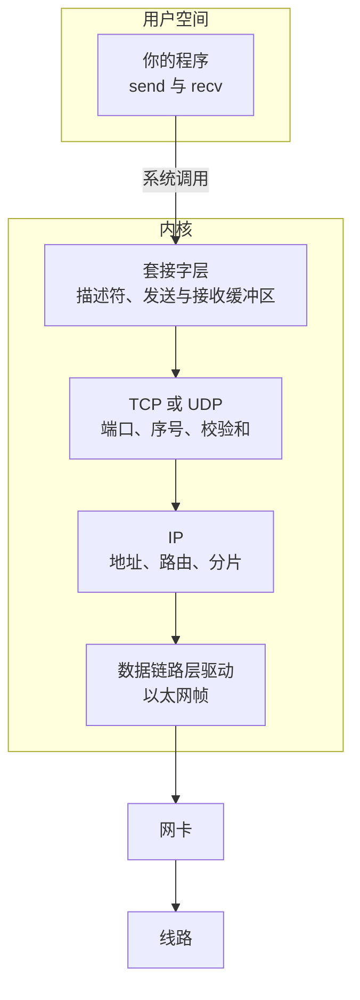

# 9. 网络基础

一个客户端连上服务器，发来 `GET /index.html` 和换行。服务器的 `read` 可能只收到半行；连接关闭后马上重启服务器，`bind` 会报 `Address already in use`；换成 UDP 发 100 字节，接收端只拿到 64 字节，多出来的部分不见了。这些现象都不在程序的控制流里，而在协议的规定里。写网络程序之前，得先知道 TCP 与 UDP 各自保证什么、不保证什么。

本章用三节讲协议本身：9.1 讲分层，9.2 讲 TCP，9.3 讲 UDP。第 10～12 章再回到程序，用套接字、I/O 多路复用和事件循环把它们写出来。这一页先把套接字放进分层图里，再用两个小程序的真实输出说明两件后面会反复碰到的事：每一层在数据前面加了什么，以及校验和算的是什么。

## 1. 本章内容

本章三节按侧栏顺序排列：

1. [9.1 ISO 七层模型](/教程/正文/系统编程/9_网络基础/9_1_ISO七层模型)：网络通信分成哪七层，每层负责什么；以一次网页访问为例，看数据怎样逐层封装、路由器处理到哪一层。
2. [9.2 传输控制协议（TCP）](/教程/正文/系统编程/9_网络基础/9_2_TCP)：面向连接的可靠字节流。三次握手、序号与确认、流量与拥塞控制，以及 TCP 为什么把数据看成连续的字节流。
3. [9.3 用户数据报协议（UDP）](/教程/正文/系统编程/9_网络基础/9_3_UDP)：无连接的数据报。每次发送的数据单独成为一条数据报，不保证送达与顺序；接收缓冲区小于数据报时，多余部分被丢弃。

三节讲的都是协议行为，不出现 C 接口。第 10 章开始写代码：先用阻塞套接字写出 TCP 与 UDP 程序，第 11 章把它们改成非阻塞并引入 `poll` 与 `epoll`，第 12 章把这些调用组织成事件循环。第 13、14 章分别讲终端与服务器加固，与本章关系较远，读不读都不影响第 10 章。

## 2. 协议与套接字

### 2.1 套接字是分层的分界

程序不直接操作网卡。它调用 `send`，把一段字节交给内核；内核按 TCP 或 UDP 的规则处理，加上首部，交给 IP，IP 加上地址后交给数据链路层的驱动，最后由网卡把帧变成电信号或光信号。接收方向相反，每一层拆掉自己的首部，把剩下的部分交给上一层。分层的意思是：每一层只认自己那一层的首部，不关心里面装的是什么。



套接字层是用户空间与内核的分界：`socket`、`bind`、`connect`、`send`、`recv` 在这里进出，往下的 TCP 或 UDP、IP 与网卡驱动都在内核里。第 10 章开头会把套接字概括成一句话：它是文件描述符（[第 2 章](/教程/正文/系统编程/2_文件描述符与非缓冲IO)），`read`、`write`、`close` 都能用，只是多了一组与地址有关的调用。

程序看到的从来不是「一条 TCP 连接」或「一个 IP 数据报」，而是一个描述符，以及从这个描述符读出或写入的字节流、数据报。协议栈在中间做了什么，只能从行为、工具和抓到的字节里观察。

::: concept sys-net-socket-kernel-boundary title="套接字接口以下的协议处理都在内核里"

应用程序通过套接字系统调用把数据交给内核。TCP/UDP、IP、ARP 和网卡驱动由内核实现，程序不能直接填写这些层的首部。原始套接字 (raw socket) 可以让程序自己构造 IP 层以上的首部，需要特权，本教程不涉及。

:::

<Quiz
  type="single"
  :options="[
    { label: '对端程序已经收到这段数据', value: 'A' },
    { label: '内核的套接字发送缓冲区', value: 'B' },
    { label: '网卡已经把它发到了线路上', value: 'C' },
    { label: '对端内核已经把它交给对端程序', value: 'D' }
  ]"
  answer="B"
>

对 TCP 套接字调用 `send` 返回成功，此时数据最远到了哪里？

</Quiz>

`send` 的返回值只说明数据从用户空间复制进了内核的发送缓冲区。它可能还躺在缓冲区里，也可能在网卡队列里，也可能正在线路上，对端是否收到无从得知。需要确认对端收到，只能在应用层让对端回一条应答。

### 2.2 逐层加上首部

为了看清每一层加了什么，下面这个程序不调用套接字，只是在内存里按协议规定的格式拼出一个完整的帧：以太网首部 14 字节，IPv4 首部 20 字节，UDP 首部 8 字节，负载 2 字节。完整源码在 `code/系统编程/9_网络基础/encap.c`，编译运行后打印各层的偏移、长度和最终的字节。

::: terminal title="bash - encap"

```console
$ gcc -std=c17 -Wall -Wextra -g encap.c -o encap
$ ./encap
layer      offset length
Ethernet        0     14
IPv4           14     20
UDP            34      8
payload        42      2
total                 44

02 00 00 00 00 01 02 00 00 00 00 02 08 00 45 00
00 1e 00 00 00 00 40 11 f7 60 c0 a8 01 0a c0 a8
01 14 d6 d8 52 08 00 0a eb 20 68 69

receiver check: 0xffff
```

:::

| 层 | 起始偏移 | 长度 | 首部里能读出的信息 |
| --- | --- | --- | --- |
| 以太网 | 0 | 14 | 目的 MAC、源 MAC、类型 `0x0800`（后面是 IPv4） |
| IPv4 | 14 | 20 | 首字节 `0x45`：版本 4、首部 5 个 32 位字；总长 `0x001e`；协议号 17（UDP）；源地址与目的地址 |
| UDP | 34 | 8 | 源端口 55000、目的端口 21000、长度 `0x000a`、校验和 `0xeb20` |
| 负载 | 42 | 2 | `68 69`，即 `hi` |

三个地方值得记住。第一，IPv4 的「总长」字段 `0x001e` 是 30，等于 IPv4 首部加 UDP 首部加负载，不含以太网首部。第二，以太网的类型字段说明后面是 IPv4，IPv4 的协议号说明后面是 UDP，两个字段各管一段，不能混用。第三，以太网要求数据段至少 46 字节，不足的用 0 补齐；这个帧只有 44 字节，真正上线时会被填充到 60 字节（不含帧尾校验），但 IPv4 的总长字段仍然是 30。

最后一行的 `receiver check` 是把 UDP 校验和字段一起纳入求和的结果，`0xffff` 表示校验通过。接收方正是这样做校验的：它不需要知道发送方算了什么，只要把所有 16 位字加起来，全 1 就说明没有差错。

### 2.3 校验和

每一层都有校验和，覆盖的范围不一样。IPv4 首部的校验和只覆盖首部本身，数据出错交给上层负责；UDP 与 TCP 的校验和覆盖一个伪首部（源地址、目的地址、协议号和长度）再加上各自的首部与数据，这样目的地址被改错时传输层也能发现。

算法叫 16 位反码和：把相邻两个字节按大端拼成一个 16 位数，逐个相加；最高位的进位加回最低位；最后取反，得到的 16 位就是校验和。下面的程序用 RFC 1071 里的例子和习题数据中那个 UDP 帧的 IPv4 首部各算一次，源码在 `code/系统编程/9_网络基础/checksum.c`。

::: terminal title="bash - checksum"

```console
$ gcc -std=c17 -Wall -Wextra -g checksum.c -o checksum
$ ./checksum
RFC 1071 example: checksum = 0x220d
IPv4 header checksum = 0x9b12
sum over the header including the checksum = 0xffff
```

:::

RFC 1071 的例子里，字节序列 `00 01 f2 03 f4 f5 f6 f7` 的反码和是 `0xddf2`，取反得 `0x220d`。第二行算出的 `0x9b12` 正是习题数据 `udp_frame.txt` 里那个帧的 IPv4 首部校验和字段；把校验和字段放回去再求和，结果是全 1，也就是最后一行。

反码和能检出所有单比特错误。两个比特同时翻转时，如果一处在某个 16 位字里由 0 变 1、另一处在另一个 16 位字里由 1 变 0，并且两者位于同一比特位，它们对和的贡献正好抵消，校验和不变，这种错误检不出。所以校验和只保证大概率没坏，不纠错，也不是密码学意义上的摘要。

::: concept sys-net-checksum-scope title="各层校验和覆盖的范围"

IPv4 首部校验和只覆盖 IPv4 首部，不包含数据。UDP 与 TCP 的校验和覆盖一个伪首部（源地址、目的地址、协议号、长度）加上各自的首部与数据。UDP 发送方算出的校验和为 0 时按规定填 `0xffff`；接收方看到的校验和字段为 0 表示发送方没有计算校验和。

:::

## 3. 学习顺序

### 3.1 三节怎么读

按 9.1、9.2、9.3 的顺序读。9.1 建立术语，后面两节会直接使用「网络层」「传输层」「封装」这些词；9.2 最长，也最要紧，其中 3.1 节关于「粘包」的部分要在读第 10 章之前弄明白；9.3 很短，重点在数据报怎样单独交付、接收缓冲区不够时会怎样。

已经熟悉网络的读者可以略读 9.1，但 9.2 的 3.1 节和 9.3 的第 4 节不要跳。这两处讲的行为直接决定第 10 章的程序怎么写：前者决定要不要自己做消息分帧，后者决定 UDP 接收缓冲区开多大。

### 3.2 第 10 章会用到的几点

1. 端口与地址。TCP 与 UDP 都用 16 位端口区分同一台机器上的不同程序，端口和 IPv4 地址在套接字地址结构里按网络字节序存放，第 10 章要用 `htons` 和 `htonl` 转换。
2. 三次握手对应 `connect` 与 `accept`。`connect` 返回成功时握手已经完成；`accept` 不参与握手，它只是从内核的已完成连接队列里取出一条连接。
3. `TIME_WAIT` 对应 `SO_REUSEADDR`。服务器主动关闭连接后会留下 `TIME_WAIT` 状态的残留，通常持续一分钟左右；这段时间里重启服务器，不带 `SO_REUSEADDR` 的 `bind` 会被拒绝。9.2 节的 2.3 小节讲了主动关闭的一方为什么要等两个 MSL。
4. 字节流对应消息分帧。TCP 只提供连续字节，不记录每次 `send` 到哪里结束：一次 `send` 的数据可能分几次 `recv` 到达，几次 `send` 的数据也可能并进一次 `recv`。9.2 节 3.1 小节把它叫「粘包」，第 10 章给出按行和按长度前缀两种分帧写法。
5. UDP 的接收缓冲区太小会截断。`recvfrom` 的缓冲区装不下整个数据报时，多余部分直接丢弃，返回值是缓冲区大小，不带任何提示。缓冲区要按协议允许的最大数据报来开。

选 TCP 还是 UDP，看丢了数据要不要补。文件传输、远程登录、数据库查询这类一个字节都不能少的场景用 TCP；语音、视频、游戏状态这类晚到的数据等于没用的场景用 UDP，需要可靠性时在应用层补确认和重传。DNS 用 UDP，是因为一次查询一问一答，重发一次比建立连接便宜。

## 4. 自测

<Quiz
  type="single"
  :options="[
    { label: '恰好 300 字节', value: 'A' },
    { label: '1 到 300 字节之间的某个长度，也可能更少', value: 'B' },
    { label: '每次恰好 100 字节，分三次返回', value: 'C' },
    { label: '只能是 100、200 或 300 字节', value: 'D' }
  ]"
  answer="B"
>

TCP 连接上连续调用三次 `send`，每次 100 字节。接收方调一次 `recv`，可能得到多少字节？

</Quiz>

TCP 是字节流，不记录每次 `send` 到哪里结束。一次 `recv` 可能只拿到第一个 100 字节中的一部分，也可能把三个 100 字节一次读完；具体切分取决于发送缓冲区、MSS、接收缓冲区大小和到达时机，程序不能依赖任何一种。

<Quiz
  type="single"
  :options="[
    { label: '视频通话用 TCP，文件下载用 UDP', value: 'A' },
    { label: '视频通话用 UDP，文件下载用 TCP', value: 'B' },
    { label: '两者都用 TCP，UDP 只用于广播', value: 'C' },
    { label: '两者都用 UDP，由应用层重传', value: 'D' }
  ]"
  answer="B"
>

视频通话和文件下载，各应选哪种传输层协议？

</Quiz>

视频通话晚到的帧没有播放价值，丢了就丢，重传反而增加延迟，所以用 UDP；文件下载少一个字节文件就坏了，必须靠 TCP 的确认与重传保证完整。C 错在 UDP 的用途远不止广播，D 错在文件下载自己实现可靠传输没有必要。

## 5. 习题

习题的数据文件在 `code/系统编程/9_网络基础/exercises/data/`，由同目录的 `make_data.c` 生成，`make data` 可以重建。帧文件每行 16 个十六进制字节，帧与帧之间空一行；地址和 MAC 都是编造的。

::: details 数据文件是怎么生成的

`exercises/make_data.c` 只用到标准 C：按 2.2 节的格式拼帧、算校验和，再把结果写成十六进制。`frames_many.txt` 里的 100 个帧由循环生成：第 4、21、38、55、72、89 帧（从 1 数起）的负载被改坏，第 8、31、54、77 帧的源地址被改坏，两批帧互不重叠，所以验收值都是固定的。数据不依赖任何真实网络，也不含真实主机信息。

:::

### 5.1 巩固

<Exercise id="40901" :d="1" :w="1">

`checksum.c` 只算了两组数据。再补三组，打印每组的 16 位反码和与校验和：

1. `01 02 03 04`，期望和 `0x0406`，校验和 `0xfbf9`；
2. `01 02 03`，奇数长度，末字节补一个 0 再算，期望和 `0x0402`，校验和 `0xfbfd`；
3. `ff ff ff ff`，期望和 `0xffff`，校验和 `0x0000`。

第三组说明校验和为 0 时接收方求和仍然得 `0xffff`。再解释：为什么接收方把校验和字段一起纳入求和，结果为 `0xffff` 就认为数据没错。

</Exercise>

<Exercise id="40902" :d="2" :w="2">

运行正文的 `encap.c`，然后改两处：负载由 `hi` 改成 `ping`，目的端口由 21000 改成 21001。重新编译运行，写出新的 `payload`、`total` 两行和字节转储，并回答：

1. IPv4 首部的总长字段变成了多少？它包含哪些部分？
2. 哪些字节变了，哪些没变？为什么源端口 `d6 d8` 没有变？
3. `receiver check` 是否仍然是 `0xffff`？

参考：总长应为 `0x0020`，字节转储的最后一行为 `01 14 d6 d8 52 09 00 0c 74 b4 70 69 6e 67`。

</Exercise>

### 5.2 编程

<Exercise id="40903" :d="3" :w="3">

写一个 `showframe FILE`，读入一个十六进制帧文件，按层打印起始偏移、长度和关键字段，格式如下：

```text
frame: 52 bytes
   0..13  Ethernet  type 0x0800, 02:00:00:00:00:02 -> 02:00:00:00:00:01
  14..33  IPv4      192.168.1.10 -> 192.168.1.20, protocol 17, total length 38, header 20 bytes
  34..41  UDP       40000 -> 21000, length 18, checksum 0x64b1
  42..51  payload   10 bytes "hello udp\n"
```

对 `data/tcp_frame.txt` 要能打印出 TCP 的源端口、目的端口、序号、确认号、标志和数据偏移，以及负载 `GET / HTTP/1.0\r\n\r\n`；对 `data/frames_mixed.txt` 只解析第一个帧即可。验收：`udp_frame.txt` 的输出与上面的格式逐行对照，偏移 0、14、34、42 和长度 14、20、8、10 一项不差；TCP 帧的确认号是 889901，数据偏移是 20 字节。

</Exercise>

<Exercise id="40904" :d="3" :w="3">

写一个 `cksum FILE`，对每个帧验证 IPv4 首部校验和，以及 UDP 或 TCP 的校验和。对每个帧输出两行：

```text
frame 1: IPv4 checksum 0x9b12 ok
        UDP checksum 0x64b1 ok
```

用 `data/frames_mixed.txt` 验收，四个帧的结果依次是：

1. UDP 帧，IPv4 `0x9b12` 与 UDP `0x64b1` 都正确；
2. TCP 帧，IPv4 `0x9b08` 与 TCP `0x4a7b` 都正确；
3. UDP 负载里的 `hello` 被改成 `hellO`，IPv4 正确、UDP 错误；
4. TCP 帧的源地址由 `192.168.1.10` 改成 `192.168.1.11`，IPv4 与 TCP 都错误。

第四帧最能说明伪首部的作用：IP 地址变了，IPv4 首部校验和失败，传输层校验和也因为伪首部跟着变而失败。

</Exercise>

<Exercise id="40905" :d="3" :w="3">

`data/segments.txt` 是一条 TCP 连接上按到达顺序记录的 9 段字节，每行一段的十六进制。写一个 `lines FILE`：把各段按顺序拼成字节流，按换行切出完整行，每行打印 `line N: 内容`；末尾不完整的部分单独打印。

验收：共 5 条完整行，依次是 `GET /index.html`、`GET /style.css`、`GET /app.js`、`HELLO world`、`QUIT`，最后一行是 `partial: PARTIAL LINE (12 bytes)`。注意段的分界与行的分界没有关系，某一行可能跨两段。

</Exercise>

<Exercise id="40906" :d="4" :w="4">

`data/payload.txt` 是 512 行文本，每行以换行结尾。写一个 `udpsize FILE`，按行统计每一行作为一个 UDP 数据报发送时的长度（含换行），输出：

- 行数、总字节数；
- 最短与最长的数据报长度；
- 长度超过 64 字节的行数。

验收：512 行、18624 字节，最短 9 字节，最长 69 字节，超过 64 字节的有 64 行。

再写一对 UDP 程序验证截断：服务器绑定 `127.0.0.1` 的 23456 端口，用 64 字节缓冲区 `recvfrom`；客户端依次发送 10、100、1000 字节。服务器的接收循环交替使用 `flags` 为 0 与 `MSG_TRUNC`。某次运行的服务器输出是：

```text
flags=0         recvfrom returned 10
flags=MSG_TRUNC recvfrom returned 100
flags=0         recvfrom returned 64
flags=MSG_TRUNC recvfrom returned 10
flags=0         recvfrom returned 64
flags=MSG_TRUNC recvfrom returned 1000
```

解释第三、六行：返回值为什么分别是 64 和 1000，多出来的字节去了哪里。`flags` 为 0 时程序能不能知道发生了截断？`MSG_TRUNC` 是从哪个调用传进去的，它改变了返回值还是只改变数据？

</Exercise>

<Exercise id="40907" :d="4" :w="4">

`data/frames_many.txt` 有 100 个帧，混合了 ARP、UDP 和 TCP。写一个 `capture FILE`，输出：

- 总帧数、ARP 帧数、IPv4 帧数；
- IPv4 首部校验和错误的帧数；
- 在 IPv4 正确的帧中，UDP 与 TCP 各多少，传输层校验和错误的有几个；
- UDP 负载的字节总数；
- 目的端口的分布，按出现次数从多到少列出。

验收：100 帧、10 个 ARP、90 个 IPv4；IPv4 校验和错误 4 帧；剩下 86 帧里 UDP 51 帧、TCP 35 帧，其中传输层校验和错误共 6 帧（UDP 3、TCP 3）；这 86 帧的 UDP 负载合计 1712 字节；目的端口按全部 IPv4 帧统计，21000 出现 54 次、21001 出现 36 次。

统计传输层校验和之前要先确认 IPv4 首部正确，源地址被改过的帧两个校验和都会失败，混在一起会把错误重复计数。端口的统计不依赖校验和，因为端口字段就在首部的前四个字节里。

</Exercise>

### 5.3 综合与挑战

<Exercise id="40908" :d="5" :w="4">

`data/tcp_log.txt` 记录了一条连接上客户端发送与服务器确认的事件。写一个 `tcplog FILE`，按顺序读入事件，输出：

- `SEND` 记录总数、不同段的个数、重传次数；
- 最终确认号、已确认的字节数、发送过但尚未确认的字节数；
- 每次 `ACK` 相对上一次推进了多少字节。

验收：7 条 `SEND`，6 个不同的段，1 次重传；最终确认号 2600，从初始序号 1000 算起共确认 1600 字节，没有未确认的数据；`ACK` 序列是 1500、2000、2300、2500、2600。

再回答两个问题：程序靠什么判断一条 `SEND` 是重传？确认号 2300 表示 2300 之前的字节都到了，序号 2300、长度 200 的那个段为什么在此之后又出现了一次，接收方收到这份重复数据会怎么处理？

</Exercise>

<Exercise id="40909" :d="6" :w="5" scope="*">

`data/tcp_stream.txt` 记录了一条连接上 9 条到达记录，每行给出序列号、长度和数据，其中一条是重复段。写一个 `reassemble FILE`，按序列号把段放进缓冲区，输出：

- 从第一个段开始连续、没有缺口的前缀长度，以及第一个缺口的序列号；
- 重复段的条数；
- 前缀的文本内容。

验收：前缀 72 字节，第一个缺口序列号 5072，重复段 1 条；前缀内容是 `GET /alpha HTTP/1.0`、`GET /bravo HTTP/1.0`、`GET /charlie HTTP/1.0` 和 `GET /de`，最后一行不完整。

然后把缺失的那条段补进输入，序列号 5072、长度 12、数据 `6c746120485454502f312e30`，重新运行。新的前缀应是 108 字节，下一个缺口序列号 5108。最后说明：这段程序里的缓冲区、缺口和重复，分别对应 TCP 协议里的哪些机制；真实的内核收到乱序段时，会不会像这样把数据先存起来。

</Exercise>

## 6. 参考资料

- RFC 791，**_Internet Protocol_**：<https://www.rfc-editor.org/rfc/rfc791>
- RFC 894，**_A Standard for the Transmission of IP Datagrams over Ethernet Networks_**：<https://www.rfc-editor.org/rfc/rfc894>
- RFC 768，**_User Datagram Protocol_**：<https://www.rfc-editor.org/rfc/rfc768>
- RFC 9293，**_Transmission Control Protocol (TCP)_**：<https://www.rfc-editor.org/rfc/rfc9293>
- RFC 1122，**_Requirements for Internet Hosts -- Communication Layers_**：<https://www.rfc-editor.org/rfc/rfc1122>
- RFC 1071，**_Computing the Internet Checksum_**：<https://www.rfc-editor.org/rfc/rfc1071>
- Beej Jorgensen，**_Beej's Guide to Network Programming_**，第 2 章：<https://beej.us/guide/bgnet/>
- Michael Kerrisk，**_The Linux Programming Interface_**，第 58 章「SOCKETS: FUNDAMENTALS OF TCP/IP NETWORKS」：<https://man7.org/tlpi/toc-detailed.html>
- W. Richard Stevens、Bill Fenner、Andrew M. Rudoff，**_UNIX Network Programming, Volume 1: The Sockets Networking API_**，第 3 版，Addison-Wesley，ISBN 978-0-13-141155-5。
