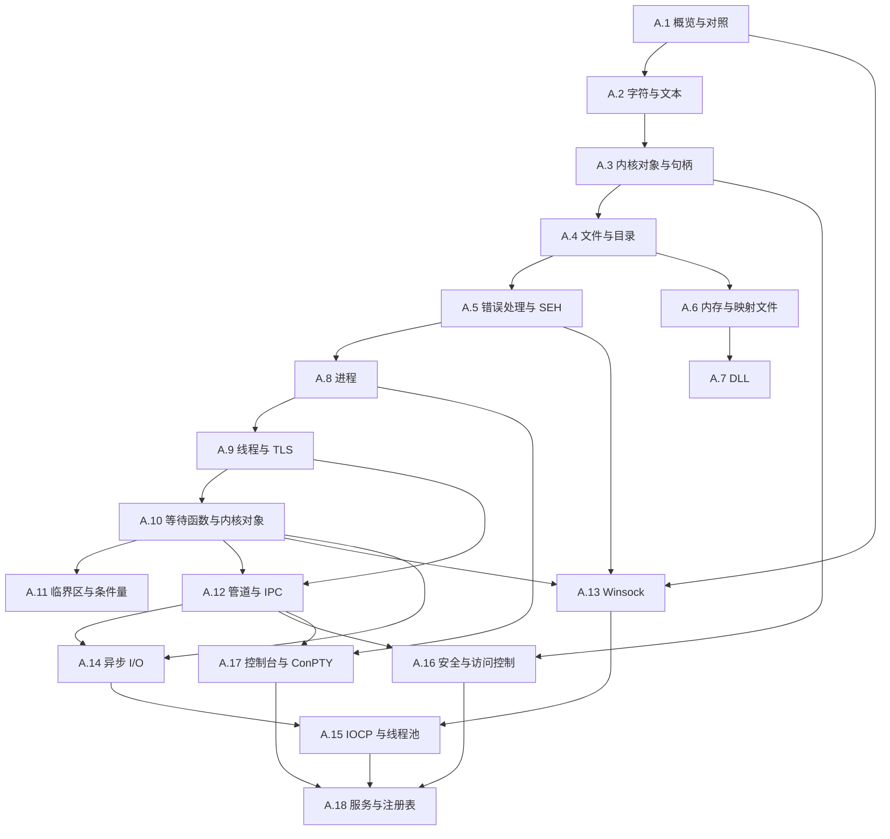

# 拓展A：Windows 系统编程

在主线课程中，我们只需几十行标准的 POSIX C 代码，就能搭建起一个清晰简洁的回声服务器：依次调用 `socket`、`bind`、`listen`、`accept`，再配合 `poll` 或 `epoll` 便能妥善处理并发连接。然而，当把这一整套在 Linux 环境下顺理成章的逻辑搬迁到 Windows 平台时，差异从写下的第一行代码便扑面而来：网络套接字库必须显式通过 `WSAStartup` 初始化，套接字句柄的关闭需要调用 `closesocket`，错误码体系也转由一组以 `WSA` 开头的常数接管；若是希望服务在操作系统启动后无人值守运行，更需要将其完整接入 Windows 服务控制管理器的生命周期。

不仅是网络协议栈，Windows 在文件系统、进程与线程模型、同步原语以及控制台终端等各个系统领域，都演化出了属于自己的一套 API。我们在主线第四部分深入讨论过的 POSIX 接口，在这里绝大多数找不到直接的同名函数；即便少数在概念上互有映射，其内部语义与设计哲学也存在鲜明的差异：`CreateFileW` 不仅用于打开文件，还引入了细致的共享访问模式（Share Mode）与安全属性控制；`CreateProcessW` 一步到位地完成了新进程的创建与映像载入，而没有采用 UNIX 经典的 `fork`-`exec` 分离范式；进程间通信则各自独立为管道、邮件槽与共享内存映射，而非统一收束在单一的文件描述符抽象之下。

本拓展紧扣主线所关切的核心系统问题，按层级循序展开。每一小节均挑选主线中对应的一到两章作为对照基准：先从 Windows 独特的底层内核模型与对象体系谈起，继而剖析 API 接口的使用细节与陷阱，最后辅以经过验证、可直接编译运行的真实工程范例。全书示例代码统一采用 MinGW-w64 GCC 13.2（UCRT 运行时库）进行编译构建；其中 A.5 所涉及的 `__try`、`__except`、`__finally` 等关键字因属于微软扩展语法，仅由 MSVC（Microsoft Visual C++）编译器原生支持。运行环境基线设定为 Windows 10 1809 及更高版本的 x64 系统；在更早的旧版本系统上，全新的虚拟终端 ConPTY 机制尚未完备，A.17 的相关示例将无法直接运行，个别进阶特性所需的系统最低版本号亦在各章节开头处清晰注明。

## 1. 本章内容

本拓展的 18 个独立篇目严格按照右侧目录结构依次排布。前五篇构成了深入 Windows 系统编程不可或缺的通用基石，自第六篇起则依据系统职能划分为若干进阶专题：

1. [A.1 Win32 API 概览与 POSIX 对照](/教程/正文/系统编程/拓展A_Win32系统编程/A_1_Win32API概览与POSIX对照)：Windows API 的多层体系架构与演进脉络，系统头文件组织、专用类型命名法及函数返回值约定的内在规律，主线 POSIX 概念与 Windows 机制的横向映射，并附有详尽的系统调用对照全表。
2. [A.2 字符与文本：ANSI、Unicode 与 UTF-16](/教程/正文/系统编程/拓展A_Win32系统编程/A_2_字符与文本_ANSI_Unicode与UTF16)：探究 `CreateFileA` 为何容易将「数据.txt」错写为乱码文件名，全面剖析 A 后缀与 W 后缀双套 API 的历史成因、代码页机制、UTF-16 与 UTF-8 编码的双向转换，以及命令行与控制台环境下的文本编码适配方案。
3. [A.3 内核对象与句柄](/教程/正文/系统编程/拓展A_Win32系统编程/A_3_内核对象与句柄)：深入内核对象生命周期与进程句柄表的映射关系，解析 `CreateFileW` 与 `OpenEventW` 在操作失败时返回不同哨兵值的深层原因，掌握利用命名对象实现应用程序单实例运行的技巧，以及诊断并排查句柄泄漏的实操方法。
4. [A.4 文件与目录操作](/教程/正文/系统编程/拓展A_Win32系统编程/A_4_文件与目录操作)：详解 `CreateFileW` 七大核心参数的组合逻辑、共享冲突规避、文件元数据属性与时间戳的获取与修正、目录递归枚举遍历与路径规范化，以及基于临时文件替换的原子写操作和文件字节范围锁机制。
5. [A.5 错误处理与结构化异常处理（SEH）](/教程/正文/系统编程/拓展A_Win32系统编程/A_5_错误处理与结构化异常处理)：从 `GetLastError` 提取错误状态并利用 `FormatMessageW` 格式化本地化可读信息，理清 Win32 错误码、HRESULT 与 NTSTATUS 的差异，深入探讨 MSVC 专属的结构化异常处理机制，并在 MinGW 环境下借助向量化异常处理（VEH）与未处理异常筛选器捕获崩溃现场生成转储文件。
6. [A.6 内存管理与内存映射文件](/教程/正文/系统编程/拓展A_Win32系统编程/A_6_内存管理与内存映射文件)：解析进程虚拟地址空间的空闲、保留与提交三态流转，界定 `VirtualAlloc` 细粒度控制与系统堆管理器之间的职责边界，掌握文件映射对象与内存映射视图的生命周期，并构建基于命名共享内存的高效跨进程通信通道。
7. [A.7 动态链接库（DLL）](/教程/正文/系统编程/拓展A_Win32系统编程/A_7_动态链接库_DLL)：剖析 PE 文件格式中的导出表与导入表结构，对比静态隐式链接与利用 `LoadLibraryW`、`GetProcAddress` 实现的运行时显式加载，理解 `DllMain` 的触发机制及其在加载器锁约束下的行为禁忌，警惕 DLL 搜索路径劫持带来的安全隐患。
8. [A.8 进程的创建、执行与等待](/教程/正文/系统编程/拓展A_Win32系统编程/A_8_进程的创建_执行与等待)：阐释 Windows 架构未采纳 `fork` 语义的底层考量，逐项拆解 `CreateProcessW` 参数矩阵与复杂的命令行转义规则，实现子进程终止等待与退出码获取，以及环境块构造、系统进程快照枚举、作业对象（Job Object）资源配额管控与并行进程池调度。
9. [A.9 线程与线程本地存储](/教程/正文/系统编程/拓展A_Win32系统编程/A_9_线程与线程本地存储)：厘清操作系统级 `CreateThread` 与运行时封装 `_beginthreadex` 之间的深层协同与资源清理差异，掌握线程标识、独立栈空间分配、调度优先级调整及调试线程命名的技巧，并系统梳理 `_Thread_local`、TLS API 以及 FLS 三套隔离存储机制的适用场景。
10. [A.10 同步原语（一）：等待函数与内核对象](/教程/正文/系统编程/拓展A_Win32系统编程/A_10_同步原语_等待函数与内核对象)：剖析内核对象在激发态与未激发态之间的跃迁规律，精通单个及多对象等待函数的调度行为，熟练运用事件（Event）、互斥体（Mutex）、信号量（Semaphore）与可等待计时器（Waitable Timer）构建跨进程协作通道，并掌握可警报等待状态下的异步例程派发。
11. [A.11 同步原语（二）：临界区、SRWLock 与条件量](/教程/正文/系统编程/拓展A_Win32系统编程/A_11_同步原语_临界区_SRWLock与条件变量)：剖析用户态极速互锁指令（Interlocked）、临界区对象（Critical Section）、读写锁（SRWLock）与条件同步原语的高性能协作模型，明确从用户态轻量锁回退至内核级同步对象的边界考量。
12. [A.12 管道与进程间通信](/教程/正文/系统编程/拓展A_Win32系统编程/A_12_管道与进程间通信)：运用匿名管道重定向子进程的标准输入输出流，构建服务端与客户端架构的命名管道双向应答会话，利用消息读取模式保全单次写入的原子消息边界，并配置默认的安全访问描述符以防范未授权接入。
13. [A.13 Winsock 特有主题](/教程/正文/系统编程/拓展A_Win32系统编程/A_13_Winsock特有主题)：梳理 Windows Sockets 架构从初始化到清理的全流程，揭示 `SOCKET` 句柄与普通文件描述符在内核映射上的根本差异与错误代码查询规则，构建兼顾多平台的健壮网络服务，并深入探索 `WSAPoll`、`WSAEventSelect`、微软专属的零拷贝接入优化 `AcceptEx` 以及本机的 `AF_UNIX` 套接字扩展。
14. [A.14 异步 I/O 与重叠结构](/教程/正文/系统编程/拓展A_Win32系统编程/A_14_异步IO与重叠结构)：对比状态就绪通知与操作完成通知两类异步哲学的本质分野，剖析核心数据结构 `OVERLAPPED` 的内存生命周期要求，深入实现基于完成事件、`GetOverlappedResult` 主动轮询以及扩展完成例程（APC 回调）的三种异步收割范式，并妥善处理 I/O 取消与超时机制。
15. [A.15 I/O 完成端口与线程池](/教程/正文/系统编程/拓展A_Win32系统编程/A_15_IO完成端口与线程池)：探究 I/O 完成端口（IOCP）如何将海量并发连接与固定规模的工作线程池解耦，解析内核完成队列与完成键的工作机制，基于 IOCP 构建高吞吐量的回声服务器，并探讨 Windows 现代化线程池体系的四类工作对象。
16. [A.16 安全与访问控制（ACL 与令牌）](/教程/正文/系统编程/拓展A_Win32系统编程/A_16_安全与访问控制_ACL与令牌)：还原 Windows 核心安全检查算法的参与要素，解析安全标识符（SID）、进程访问令牌、用户账户控制（UAC）机制与完整性级别的判定逻辑，拆解安全描述符与自主访问控制列表（DACL）的二进制布局，为受保护对象精细配置访问权限，并规范系统特权的启用与撤销流程。
17. [A.17 控制台与 ConPTY](/教程/正文/系统编程/拓展A_Win32系统编程/A_17_控制台与ConPTY)：解析 Windows 控制台架构中输入缓冲区与屏幕双缓冲区的运作规律，配置控制台处理模式与原生虚拟终端序列（VT100 兼容），利用底层函数 `ReadConsoleInputW` 处理复杂键盘事件与窗口尺寸变动，捕获 Ctrl+C 控制事件，并基于伪控制台（ConPTY）架构编写现代终端托管程序。
18. [A.18 Windows 服务、注册表与系统设施](/教程/正文/系统编程/拓展A_Win32系统编程/A_18_Windows服务_注册表与系统设施)：拆解 Windows 服务的骨架逻辑，搭建支持在交互式控制台直接调试的自宿主服务骨架，掌握服务的注册安装与状态监控，安全高效地读写与维护系统注册表配置树，并联动已知文件夹（Known Folders）与 Windows 事件日志等底层系统基础设施。

## 2. 学习顺序建议

A.1～A.5 是共同基础，按顺序读完再选方向。A.1 给出分层与对照表，A.2 讲字符，A.3 讲句柄，A.4 讲文件，A.5 讲错误与异常；后面每一页都会用到这五页里的结论。

- 文件与内存：A.4 → A.6 → A.7。先会打开文件、遍历目录，再学地址空间、堆与映射文件，最后把代码装进 DLL。
- 进程与线程：A.8 → A.9 → A.10 → A.11。进程创建、线程创建、等待与同步，顺序不要换：A.10 的等待函数作用在 A.8、A.9 引入的进程与线程对象上。
- 通信与 I/O：A.12 → A.13 → A.14 → A.15。管道、套接字、重叠 I/O、完成端口，正好是从阻塞读到完成通知的一条线。
- 安全与系统服务：A.16 → A.17 → A.18。访问控制、控制台与服务，最后把回声服务器包装成服务 `MdrEcho`。

只写网络服务器的读者可以只走 A.1～A.3、A.5、A.9～A.11、A.13～A.15、A.18；需要本机通信时再补 A.12。做命令行工具或插件宿主的读者，A.4、A.6、A.7 与 A.17 不能跳。

### 2.1 阅读依赖

箭头从先读的页指向后读的页。图里只画主要的依赖，同一组内部的顺序与上面列的一致。



### 2.2 与主线各章的对应

下表按主线的章序排，列出每一章在本拓展里接续的页面，第三列是两边写法上最要紧的一处差别。只有第 9 章没有对照页：TCP 与 UDP 的行为与平台无关，那一章的内容换成 Winsock 之后一条都不变。

| 主线章 | 对照页 | 主要差别 |
| --- | --- | --- |
| [1. 平台边界、POSIX 与系统调用](/教程/正文/系统编程/1_平台边界_POSIX与系统调用) | A.1 | 应用代码调用的是 DLL 导出的函数，`syscall` 指令藏在 `ntdll.dll` 里，程序不直接发系统调用 |
| [2. 文件描述符与非缓冲 I/O](/教程/正文/系统编程/2_文件描述符与非缓冲IO) | A.3、A.4 | 句柄是不透明值，不能像描述符那样做算术；文件句柄带共享模式 |
| [3. 文件系统、目录与权限](/教程/正文/系统编程/3_文件系统_目录与权限) | A.4、A.16 | 目录遍历用 `FindFirstFileExW` 一组函数，权限写在安全描述符里 |
| [4. 虚拟内存与内存映射](/教程/正文/系统编程/4_虚拟内存与内存映射) | A.6 | 保留与提交分开，分配粒度 64 KiB，映射文件要先建对象再取视图 |
| [5. 进程的创建、执行与回收](/教程/正文/系统编程/5_进程的创建_执行与回收) | A.8 | 没有 `fork`，`CreateProcessW` 一步完成创建与加载 |
| [6. 信号、时间与定时器](/教程/正文/系统编程/6_信号_时间与定时器) | A.5、A.10、A.17 | 没有与 POSIX 信号对应的通用机制，控制事件、结构化异常、可等待计时器与 APC 分担了它的角色 |
| [7. 进程间通信](/教程/正文/系统编程/7_进程间通信) | A.12 | 匿名管道、命名管道与共享内存各自独立，没有统一的描述符 |
| [8. 操作系统线程与同步](/教程/正文/系统编程/8_操作系统线程与同步) | A.9、A.10、A.11 | 内核对象与用户态原语两套并存，等待函数能同时处理多种对象 |
| [9. 网络基础](/教程/正文/系统编程/9_网络基础) | 无 | 协议本身与平台无关，这一章不必对照；套接字接口见 A.13 |
| [10. 套接字编程](/教程/正文/系统编程/10_套接字编程) | A.13 | 要先 `WSAStartup`，`SOCKET` 不是文件描述符，关闭用 `closesocket` |
| [11. 非阻塞 I/O 与 I/O 多路复用](/教程/正文/系统编程/11_非阻塞IO与IO多路复用) | A.13、A.14 | `select` 与 `WSAPoll` 仍在，重叠 I/O 提供了另一条完成通知的路 |
| [12. 事件循环](/教程/正文/系统编程/12_事件循环) | A.14、A.15 | 完成端口把等待队列交给内核，线程数不再随连接数增长 |
| [13. 终端、伪终端与作业控制](/教程/正文/系统编程/13_终端_伪终端与作业控制) | A.17 | 控制台模式取代 termios，颜色与光标用虚拟终端序列，ConPTY 对应 pty |
| [14. 系统程序的健壮性与安全边界](/教程/正文/系统编程/14_系统程序的健壮性与安全边界) | A.5、A.16 | 崩溃处理靠结构化异常与未处理异常筛选器，访问控制按令牌与 ACL 判定 |

各页开头都会说明它对应主线的哪一章、先读哪几页；正文遇到与 POSIX 写法不同的地方，会直接给出两边的片段对照。

### 2.3 编译环境与常用库

示例统一在 Windows 10 1809 及以后的 x64 系统上，用 MinGW-w64 GCC 13.2（UCRT 运行库）以 `gcc -std=c17 -Wall -Wextra` 编译；A.5 的 `__try`、`__except`、`__finally` 只有 MSVC 认，那几个程序用 Visual Studio 的 `cl` 编译。各页的输出都是在本机运行得到的，系统错误消息随系统界面语言变化。

动手之前先编译一个自检程序，确认编译器装好、系统参数与书中一致。后面各页反复用到这几个数字：页面大小决定一次读写多少字节合适，分配粒度决定映射文件时偏移怎么对齐，代码页决定 A 版本函数怎样解释窄字符串，`wchar_t` 的宽度决定 UTF-16 的每个码元占几个字节。

```c
/* envcheck.c：打印与后续各页有关的系统参数。 */
#include <stdio.h>
#include <windows.h>

int main(void) {
    SYSTEM_INFO si;

    GetSystemInfo(&si);
    printf("page size:            %lu\n", (unsigned long)si.dwPageSize);
    printf("allocation granularity: %lu\n", (unsigned long)si.dwAllocationGranularity);
    printf("logical processors:   %lu\n", (unsigned long)si.dwNumberOfProcessors);
    printf("ANSI code page:       %lu\n", (unsigned long)GetACP());
    printf("OEM code page:        %lu\n", (unsigned long)GetOEMCP());
    printf("console output CP:    %lu\n", (unsigned long)GetConsoleOutputCP());
    printf("sizeof(wchar_t):      %llu\n", (unsigned long long)sizeof(wchar_t));
    printf("sizeof(HANDLE):       %llu\n", (unsigned long long)sizeof(HANDLE));
    return 0;
}
```

::: terminal title="PowerShell - envcheck"

<span class="prompt">PS&gt;</span> gcc -std=c17 -Wall -Wextra envcheck.c -o envcheck.exe

<span class="prompt">PS&gt;</span> ./envcheck.exe

```text
page size:            4096
allocation granularity: 65536
logical processors:   16
ANSI code page:       936
OEM code page:        936
console output CP:    936
sizeof(wchar_t):      2
sizeof(HANDLE):       8
```

:::

从自检输出中可以直观地确认这台基准开发机的核心参数：系统采用 4 KiB 的虚拟内存分页、64 KiB 的虚拟地址空间分配粒度、拥有 16 个逻辑处理器核，且默认的 ANSI/OEM 代码页均设定为 936（即 GBK/CP936 简体中文）。在类型宽度层面，`wchar_t` 在 Windows 平台上恒定为 2 字节（对应 UTF-16 编码），内核句柄 `HANDLE` 作为指针宽度在 64 位环境下占用 8 字节。其中，4 KiB 分页与 64 KiB 分配粒度是现代 x64 架构 Windows 操作系统的既定规范，而处理器的核心数量则取决于具体的物理硬件配置。若读者的系统语言处于非中文环境（例如 ANSI 代码页为 1252 或开启了 Beta 版全局 UTF-8 选项 65001），在后续运行 A.2 的文本处理示例时终端所呈现的字节序列会有所不同，届时我们将在 A.2 深入讨论代码页映射对底层 API 的深远影响。

::: tip 编译命令与要加的库

通用的编译命令是：

```text
gcc -std=c17 -Wall -Wextra -o 程序.exe 程序.c
```

用 `wmain` 接收命令行参数的示例再加 `-municode`。按需在命令行末尾追加库：Winsock 加 `-lws2_32`，直接调用 `AcceptEx` 加 `-lmswsock`，`WaitOnAddress` 加 `-lsynchronization`，`SHGetKnownFolderPath` 加 `-lole32 -luuid`，`MiniDumpWriteDump` 加 `-ldbghelp`。kernel32、user32、advapi32、shell32 是 MinGW 默认链接的，注册表、安全与服务的调用不必另外加库。A.17 的 ConPTY 示例要加 `-D_WIN32_WINNT=0x0A00 -DNTDDI_VERSION=0x0A000006`，否则 `HPCON` 类型没有定义。库只写在命令行上，不写 `#pragma comment(lib, ...)`：GCC 会忽略它并给出警告，程序照样链接不上。

:::

各页较长的程序放在 `code/系统编程/拓展A_Win32系统编程/` 下与页面同名的子目录里，正文只摘关键片段并给出路径；A.7 的 DLL 示例和 A.8 的多文件示例附 `Makefile`，用 `mingw32-make` 构建。

## 3. 习题

四道题按顺序做，最后一道要求把主线的一页搬过来。前两题只用本页与各页开头的环境说明，第三题开始需要装好 MinGW-w64。

<Exercise id="43001" :d="1" :w="1">

把本页的 `envcheck.c` 抄下来编译运行（源码就在第 2.3 节），然后回答：

1. 输出里的 `page size` 与 `allocation granularity` 分别由哪一页用到、用来做什么？各写一句。
2. `ANSI code page` 是 936 时，A 版本函数把「数据」解释成什么编码？换成 65001 又是什么？
3. `sizeof(wchar_t)` 是 2，由此推出 `L"中文"` 占几个字节、几个代码单元；`L"\U0001F600"` 呢？
4. 把程序里的 `GetACP()` 换成 `GetConsoleOutputCP()`，在 PowerShell 里先执行 `chcp 65001` 再运行，两个数字是否相同？这说明两个函数各代表什么。

</Exercise>

<Exercise id="43002" :d="3" :w="2">

写一个 `sysprobe.exe`，一次打印六个数字或字符串，每个都对应本拓展的一页：

1. 系统版本，用 `ntdll.dll` 里的 `RtlGetVersion`（`GetProcAddress` 取地址，`winternl.h` 给出 `RTL_OSVERSIONINFOW`，A.18）；
2. 页面大小与分配粒度（`GetNativeSystemInfo`，A.6）；
3. 当前进程的会话 ID（`ProcessIdToSessionId`，A.12）；
4. 令牌是否提权（`TokenElevation`）与完整性级别 RID（`TokenIntegrityLevel`，A.16）；
5. 当前进程的句柄数（`GetProcessHandleCount`，A.3）。

输出固定成六行 `键=值`，最后一行是这六项分别出自哪一页。要求用 `gcc -std=c17 -Wall -Wextra` 编译无警告。

验收（本机一次运行，数值随机器和登录方式变化）：`version=10.0.26300`、页面 4096、粒度 65536、会话 ID 1、普通未提权 PowerShell 下 `elevated=no`、完整性 RID `0x2000`（中）、句柄数是几十到几百之间的一个数。回答：为什么 `GetVersionExW` 在这台机器上会给出 `6.2 build 9200`，而 `RtlGetVersion` 给出真实版本？

</Exercise>

<Exercise id="43003" :d="3" :w="2">

本页 2.3 节的 tip 列了六个「按需追加的命令行选项」。逐条验证，每条记下不加时的错误原文：

1. `WaitOnAddress`（A.11）不加 `-lsynchronization`；
2. 直接调用 `AcceptEx`（A.13）不加 `-lmswsock`，`-lws2_32` 照加；
3. `SHGetKnownFolderPath`（A.18）不加 `-lole32 -luuid`；
4. `MiniDumpWriteDump`（A.5）不加 `-ldbghelp`；
5. `wmain`（A.2）不加 `-municode`；
6. `CreatePseudoConsole`（A.17）不加 `-D_WIN32_WINNT=0x0A00 -DNTDDI_VERSION=0x0A000006`。

每个程序三五行为够。然后回答：

- 第 5 条报的是 `undefined reference to 'WinMain'`，为什么这个错误与 `wmain` 看起来毫无关系？
- 第 6 条报的是编译错误还是链接错误，错误文本里出现的是哪个类型？
- 把 `#pragma comment(lib, "ws2_32")` 写进源码代替命令行，GCC 给出什么警告，程序能不能链接成功？
- 库参数写在源文件之前会怎样？用 `gcc -lws2_32 ws.c -o ws` 与 `gcc ws.c -o ws -lws2_32` 各试一次。

</Exercise>

<Exercise id="43004" :d="5" :w="3">

把主线[第 2 章](/教程/正文/系统编程/2_文件描述符与非缓冲IO)的 `code/系统编程/2_文件描述符与非缓冲IO/copybuf.c` 搬到 Windows。第一遍什么也不改，直接 `gcc -std=c17 -Wall -Wextra copybuf.c -o copybuf.exe`，记下报错；把两处 `O_CLOEXEC` 删掉再编译，这次能链接，但结果不对。

要求：

1. 生成一个约 10 KiB 的二进制文件，内容是 0 到 255 各 40 次再跟 `\r\n\x1a` 三个字节；用它做源文件。
2. 先用改过 `O_CLOEXEC` 的版本复制一遍，用 `cmp` 与源文件比，记录第一处不同的偏移，并用 `od -An -tx1` 把源文件与结果在那一带的字节各打印 16 个。
3. 用 `ReadFile`/`WriteFile` 重写一版 `copyw.exe`，用 `CreateFileW` 打开，复制结果必须与源文件逐字节相同。
4. 不重写，只给 CRT 版本加两行 `_setmode(in, _O_BINARY)` 与 `_setmode(out, _O_BINARY)`（在 `open` 之后各调一次），也能修好；说明修的是哪一层。
5. 用一句半的话说明：为什么文本模式的差异在纯文本文件上看不出来，一遇到 `0x0A`、`0x1A` 就暴露。

验收（本机实测）：原版报 `'O_CLOEXEC' undeclared`；删掉后复制出的文件在偏移 10 处开始不同，源文件该处是 `0a`，结果是 `0d 0a`；输出文件只剩 27 字节（`0x1A` 之前的 26 个源字节，加上那个 `0x0D`），源文件是 10243 字节；`copyw.exe` 的结果 `cmp` 无差异。

</Exercise>

## 4. 参考资料

- Microsoft Learn，Windows API index：<https://learn.microsoft.com/en-us/windows/win32/apiindex/windows-api-list>
- Johnson M. Hart，**_Windows System Programming_**，第 4 版，Addison-Wesley，2010，ISBN 978-0-321-65774-9（章序与 Windows/UNIX 对照见附录 B）
- Jeffrey Richter、Christophe Nasarre，**_Windows via C/C++_**，第 5 版，Microsoft Press，ISBN 978-0-7356-6377-0
- Pavel Yosifovich，**_Windows 10 System Programming, Part 1_**：<https://leanpub.com/windows10systemprogramming>
- Pavel Yosifovich 等，**_Windows Internals_**，第 7 版 Part 1，Microsoft Press，ISBN 978-0-7356-8378-8（进程、线程、内存管理与对象管理器）
- MinGW-w64 项目主页：<https://www.mingw-w64.org/>
