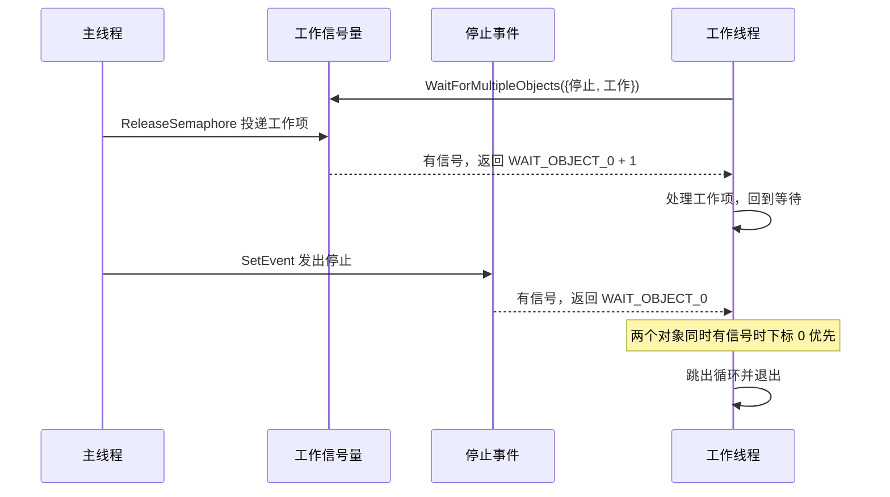

# A.10 同步原语（一）：等待函数与内核对象

在一组真实的并发任务中，协调逻辑往往同时包含多种形态：工作线程需要等待主线程下达初始化完毕的「启动」信号；执行循环中必须随时响应可能到来的「退出」请求；外部受控资源的并发访问上限需要严格限制在有限槽位；后台状态需要每隔 200 毫秒被周期性地轮询唤醒；同时，系统中的另一个辅助进程如果完成了数据准备，也需要有一套低延迟的机制通知本进程继续推进。

在类 UNIX 环境下，这五种诉求往往需要分散交付给不同的子系统：基于 `pthread_cond_t` 的条件等待、跨越事件通信的 `eventfd`、负责并发配额的信号量、挂载于时间轮的 `timerfd`，最后再借助 `poll` 或 `epoll` 事件循环将这些不同的描述符收口在同一处（参考[第 11 章](/教程/正文/系统编程/11_非阻塞IO与IO多路复用)）。Windows 的系统设计则从一开始就走向了另一条高度收拢的道路：所有供线程等待的同步实体均被抽象为内核对象，且在抽象层对外统一暴露出「有信号」（signaled）与「无信号」（nonsignaled）两种离散状态。无论是进程终结、线程同步、互斥访问还是定时器到期，全部收归于通用的等待函数族。理解这一体系的切入点，在于把握各类内核对象由无信号变为有信号的触发时机、等待被满足那一刻对内核对象状态产生的附带修改，以及可警报等待（alertable wait）与异步过程调用（APC）如何为后续 A.14 的重叠 I/O 奠定调度基础。

## 1. 有信号与无信号

等待函数的核心逻辑在于接收一个内核对象句柄，并在句柄所指向的内部状态未满足要求时，主动放弃 CPU 并将调用线程置于休眠挂起状态；直到该对象转入有信号（signaled）状态，或者调用指定的超时时限耗尽，线程才会被重新调度。对象的具体类型决定了「有信号」这一状态背后的物理含义，但在等待函数的抽象模型中，原则始终保持统一：只要对象处于有信号状态，等待即视作就绪。

::: concept sync-waitable-states title="可等待对象的状态"

每个可等待的内核对象对外都表现为一个有信号或无信号的状态：等待函数在对象有信号时返回，在无信号时把线程挂起。哪些对象可以被等待、各自何时有信号，由对象类型决定；等待成功后对状态的改动也随类型而异。信号量内部另有一个计数，计数大于 0 时就表现为有信号。

:::

| 对象 | 何时有信号 | 等待成功后 |
| --- | --- | --- |
| 进程、线程 | 进程或线程已经结束 | 状态不变，可以反复等待 |
| 手动重置事件 | 调用 `SetEvent` 之后，直到 `ResetEvent` | 状态不变，所有等待者都被释放 |
| 自动重置事件 | 调用 `SetEvent` 之后 | 变回无信号，只释放一个等待者 |
| 互斥量 | 没有任何线程拥有它 | 归等待的线程所有，变成无信号 |
| 信号量 | 计数大于 0 | 计数减一 |
| 可等待计时器 | 到期 | 自动重置计时器变回无信号 |
| 文件变化通知 | 目录里发生了指定的变化 | 变回无信号 |
| 控制台输入 | 输入缓冲区里有未读的记录 | 状态不变 |

这张状态映射表构成了 Win32 内核级同步机制的骨架。各类内核对象在触发机制与状态重置行为上的差异，决定了它们在架构设计中适合充当何种角色。深入掌握这些对象，关键在于厘清两件事：信号由谁触发、在何种时机出现；以及等待调用成功返回后，对象自身的内部状态是否会发生隐式迁移动作。

与 POSIX 体系相对照，两者的分水岭主要集中在等待接口的抽象基石上。`poll` 与 `epoll` 的等待轴心是文件描述符（file descriptor），而在经典 UNIX 内核中，能够直接映射为描述符的抽象相对克制；后来的 `eventfd`、`timerfd` 以及更为近期的 `pidfd` 等接口，实际上是在漫长的演化中不断打补丁，旨在将通知、定时以及进程生命周期事件塞入这套以文件表为核心的轮询管道中。相比之下，Windows NT 在最初的设计中便将等待操作确立为对一切内核对象（Kernel Objects）的普适能力。这种通用性换来的是优雅统一步调的等待调用，不过由于每个同步对象都具备标准内核头结构与引用计数管理，其创建与跨上下文调度的系统开销相对偏重，与 Linux 下单纯由轻量匿名 inode 支撑的管道或 `eventfd` 相比存在一定的空间与抽象权衡。

::: generate sync-waitable-model kind=comparison

面向熟悉 `poll`/`epoll` 的读者，对照「一切皆描述符」与「一切内核对象皆可等待」两种设计：说明各自的等待入口、能等的对象范围、跨进程共享的方式，以及一个对象同时被多个线程等待时的语义差别。不要展开具体的 API 参数。

:::

## 2. 等待函数

最常用的是 `WaitForSingleObject`：

```c
DWORD WaitForSingleObject(HANDLE hObject, DWORD dwMilliseconds);
```

第二个参数是超时毫秒数，`INFINITE`（`0xFFFFFFFF`）表示一直等下去。传 0 表示只查一次状态、立刻返回，相当于 `poll` 的超时为零。返回值有四种：

| 返回值 | 值 | 含义 |
| --- | --- | --- |
| `WAIT_OBJECT_0` | 0 | 对象有信号 |
| `WAIT_ABANDONED` | 128 | 等待的是互斥量，且拥有者没释放就结束了（第 4 节） |
| `WAIT_TIMEOUT` | 258 | 超时 |
| `WAIT_FAILED` | `0xFFFFFFFF` | 出错，用 `GetLastError` 取原因 |

前三个返回值均表明等待逻辑顺利完成了既定判定，唯有 `WAIT_FAILED` 代表调用过程本身遭遇了异常阻碍。在进行状态分支处理时，如果观察到 `0xFFFFFFFF`，应当立刻调用 `GetLastError` 获取底层失败原因，切忌将其混淆为无限制等待常量——`INFINITE` 恰好也具有相同的无符号十六进制数值，但二者在语义与所处的上下文位置上有着明确的界限。

当调用方需要同时监测多个对象的状态变迁时，可以采用功能更为强大的 `WaitForMultipleObjects`：

```c
DWORD WaitForMultipleObjects(DWORD nCount, const HANDLE *lpHandles,
                             BOOL bWaitAll, DWORD dwMilliseconds);
```

参数 `bWaitAll` 的布尔值决定了多目标等待的仲裁策略。当其设为 `FALSE` 时，系统采取“任一就绪即返回”模式：只要数组中存在任意一个对象变为有信号状态，等待便宣告结束。此时函数的返回值减去基准常数 `WAIT_OBJECT_0`，即可精确算出触发该次返回的对象在句柄数组中所处的索引下标。若在检查的瞬间恰好有多个对象同时处于有信号状态，系统将严格遵循低索引优先的原则，返回下标最小的那一个。反之，当 `bWaitAll` 指定为 `TRUE` 时，调用线程必须等到传入数组中的每一个对象全部跨入有信号状态后才会返回，此时的返回值固定为 `WAIT_OBJECT_0`。

这里存在一处容易引发竞态隐患的底层机制细节：在所有目标全部就绪之前，内核不会擅自修改任何中间对象的现有状态。设想数组中包含一个早已无主、处于有信号状态的互斥量，但由于其他关联对象尚未齐备，当前线程尚无法从等待中脱身，因而并未真正确立对该互斥量的所有权。在此期间，完全可能有其他并发线程介入并迅速抢占该互斥量。等到其余关联对象终于陆续就绪时，当前线程可能发现最初那个互斥量早已被其他竞争者夺去，导致满足全部条件的时刻被迫进一步推迟。而一旦所有条件最终同时满足并解除等待，状态消耗逻辑便会依次兑现：自动重置事件重新跌落回无信号，关联信号量的内部计数亦会逐个递减。

Win32 API 对单次传入句柄数组的容量设定了硬性限制，最大不得超过 `MAXIMUM_WAIT_OBJECTS`（定义为 64）。在实际调试中，若尝试传入 65 个句柄，调用会立即以 `WAIT_FAILED` 告终，随后的 `GetLastError` 返回错误码 87（`ERROR_INVALID_PARAMETER`）；传入 0 个句柄同样会触发该错误。如果在高并发或复杂网关架构中确实存在监听超过 64 个对象的需要，工程上通常需要采用分层聚合的设计：由专职的子线程各自负责监听一批 64 规模的对象集合，主线程再集中等待这批工作线程自身的终结或就绪信号。此外，API 规范明确禁止在传入的句柄数组中放置重复的同一个句柄引用，以避免不可预期的计数扣减与死锁行为。

下面这个程序只演示返回值，三个对象都是自动重置事件：

```c
#define N 3

static HANDLE g_events[N];

static void show(const char *what, DWORD r) {
    if (r < WAIT_OBJECT_0 + N) {
        printf("%-30s -> WAIT_OBJECT_0 + %lu\n", what,
               (unsigned long)(r - WAIT_OBJECT_0));
    } else if (r == WAIT_TIMEOUT) {
        printf("%-30s -> WAIT_TIMEOUT\n", what);
    } else {
        printf("%-30s -> %lu\n", what, (unsigned long)r);
    }
}

int main(void) {
    int i;

    for (i = 0; i < N; i++) {
        g_events[i] = CreateEventW(NULL, FALSE, FALSE, NULL);
    }

    SetEvent(g_events[2]);
    show("only [2] set", WaitForMultipleObjects(N, g_events, FALSE, 1000));

    SetEvent(g_events[0]);
    SetEvent(g_events[2]);
    show("[0] and [2] set", WaitForMultipleObjects(N, g_events, FALSE, 1000));
    show("again, nothing new", WaitForMultipleObjects(N, g_events, FALSE, 1000));

    show("nothing set", WaitForMultipleObjects(N, g_events, FALSE, 200));

    SetEvent(g_events[1]);
    SetEvent(g_events[2]);
    show("wait-all, only [1] and [2]",
         WaitForMultipleObjects(N, g_events, TRUE, 200));

    SetEvent(g_events[0]);
    show("wait-all, all three", WaitForMultipleObjects(N, g_events, TRUE, 200));
    show("states after wait-all",
         WaitForMultipleObjects(N, g_events, FALSE, 0));

    for (i = 0; i < N; i++) {
        CloseHandle(g_events[i]);
    }
    return 0;
}
```

完整文件在 `code/系统编程/拓展A_Win32系统编程/A_10_同步原语_等待函数与内核对象/wait_multi.c`，同目录下的 `Makefile` 能一次编译本页全部程序。

::: terminal title="PowerShell - wait_multi"

<span class="prompt">PS&gt;</span> gcc -std=c17 -Wall -Wextra -o wait_multi.exe wait_multi.c

<span class="prompt">PS&gt;</span> ./wait_multi.exe

```text
only [2] set                   -> WAIT_OBJECT_0 + 2
[0] and [2] set                -> WAIT_OBJECT_0 + 0
again, nothing new             -> WAIT_OBJECT_0 + 2
nothing set                    -> WAIT_TIMEOUT
wait-all, only [1] and [2]     -> WAIT_TIMEOUT
wait-all, all three            -> WAIT_OBJECT_0 + 0
states after wait-all          -> WAIT_TIMEOUT
```

:::

前两次等待直观印证了多目标等待中「低索引优先」的仲裁策略：在 `[0]` 与 `[2]` 两个事件同时处于置位状态时，调用率先返回对应索引 0；而由于 `[2]` 的事件信号未被当前返回所触及，其信号依然驻留于内核中，因此紧随其后的第三次单次查询等待得以毫无阻碍地立刻捕获到索引 2。至于程序最后一次等待之所以遭遇超时，正是因为前一步配置为 `bWaitAll = TRUE` 的等待操作在全量就绪的瞬间，将数组中这三个自动重置事件所蕴含的有效信号一次性彻底消耗殆尽。

等待函数在满足条件返回的同时，伴随着对对象内部状态的隐式修改（side effect），这一特性往往是多线程并发逻辑中最需要警惕的源头。

::: concept sync-wait-side-effects title="等待成功对对象做了什么"

等待成功时，系统只改动那个导致等待返回的对象：自动重置事件变回无信号，信号量计数减一，互斥量归调用线程所有并变成无信号。手动重置事件、进程、线程、控制台输入的状态不受影响。`bWaitAll = TRUE` 的等待要等到所有对象都有信号才返回，返回后同样按各自的规则消耗。

:::

在工程实践中，句柄访问权限的配置同样是极易疏漏的一环：参与等待的内核对象句柄必须显式或隐式包含 `SYNCHRONIZE` 访问掩码，否则调用将直接遭到内核安全子系统的拦截。如果在打开现存事件时仅向 `OpenEventW` 申请了诸如 `EVENT_MODIFY_STATE` 的状态修改权限，后续将其传入 `WaitForSingleObject` 时便会立刻得到 `WAIT_FAILED`，经由 `GetLastError` 诊断可确认错误码为 5（`ERROR_ACCESS_DENIED`，拒绝访问）。由当前线程直接调用 `Create*` 接口新建的对象通常默认附带全部标准访问权，因此这类权限缺位通常出现在跨越安全边界、按名称打开外部共享对象的协作场景中。

此外，等待函数所接受的超时参数虽然以毫秒为计量单位，但实际调度的精确度却受制于底层系统时钟中断的物理节拍（tick）。在未进行高精度调整的标准 Windows 环境下，时钟节拍通常维持在约 15.6 毫秒（每秒 64 次中断）。配套的 `timeout_granularity.c` 演示了在一个永久无信号的对象上请求不同毫秒级超时时的实际阻滞时间：

::: terminal title="PowerShell - timeout_granularity"

```text
PS> gcc -std=c17 -Wall -Wextra -o timeout_granularity.exe timeout_granularity.c
PS> ./timeout_granularity.exe
timeout   0 ms -> WAIT_TIMEOUT actual   0.00 ms
timeout   1 ms -> WAIT_TIMEOUT actual   7.30 ms
timeout   5 ms -> WAIT_TIMEOUT actual  15.65 ms
timeout  10 ms -> WAIT_TIMEOUT actual  15.68 ms
timeout  16 ms -> WAIT_TIMEOUT actual  31.27 ms
timeout 100 ms -> WAIT_TIMEOUT actual 107.96 ms
```

:::

从实测数据可以清晰观察到时钟离散化的台阶特征：无论请求 5 毫秒还是 10 毫秒，实际挂起时长均被底层时钟中断拉长至约 15.6 毫秒左右；请求 16 毫秒则跨过了单个节拍窗口，顺延跌入第二个节拍，导致实际阻塞超过 31 毫秒；请求 100 毫秒同样产生了约 8 毫秒的向上对齐延迟。在多任务调度的动态扰动下，具体读数会有些许毫秒级的微小抖动，但其核心规律十分明确：等待超时永远不会早于开发者指定的下限，且必然按照硬件时钟节拍向上取整。因此，在需要构建毫秒级严格周期循环的业务场景中，绝不应依赖等待超时的返回值进行时间补偿，而应采用第 6 节介绍的可等待计时器。

<Quiz
  :options="[
    { label: '3 个线程都被唤醒', value: 'A' },
    { label: '只有 1 个线程被唤醒，其余两个继续等', value: 'B' },
    { label: '一个也不唤醒，要先 ResetEvent', value: 'C' },
    { label: '唤醒几个不确定', value: 'D' }
  ]"
  answer="B"
>

<template #question>

三个线程都在等待同一个自动重置事件，`SetEvent` 调用一次之后会怎样？

</template>

正确答案是 **B**。自动重置事件只释放一个等待者，然后自动变回无信号；其余两个线程继续等，直到下一次 `SetEvent` 或超时。要让三个线程同时开始，得用手动重置事件，或者让每个线程等一个自己的事件。

</Quiz>

## 3. 事件

事件（event）是这一页里使用最频繁的对象：它没有额外的语义负担，就是一个可以手动置位、可以等待的开关。`CreateEventW` 的四个参数依次是安全属性、是否手动重置、初始状态、名字：

```c
HANDLE CreateEventW(LPSECURITY_ATTRIBUTES lpEventAttributes,
                    BOOL bManualReset, BOOL bInitialState, LPCWSTR lpName);
```

手动重置与自动重置的区别，用一个短程序看得最清楚：

```c
int main(void) {
    HANDLE ev;
    HANDLE man;
    DWORD r;

    /* 自动重置事件：连 SetEvent 两次也只算一次 */
    ev = CreateEventW(NULL, FALSE, FALSE, NULL);
    SetEvent(ev);
    SetEvent(ev);
    r = WaitForSingleObject(ev, 0);
    printf("auto-reset, wait #1: %s\n",
           r == WAIT_OBJECT_0 ? "signaled" : "timeout");
    r = WaitForSingleObject(ev, 0);
    printf("auto-reset, wait #2: %s\n",
           r == WAIT_OBJECT_0 ? "signaled" : "timeout");

    /* 手动重置事件：一直保持有信号，直到 ResetEvent */
    man = CreateEventW(NULL, TRUE, FALSE, NULL);
    SetEvent(man);
    r = WaitForSingleObject(man, 0);
    printf("manual-reset, wait #1: %s\n",
           r == WAIT_OBJECT_0 ? "signaled" : "timeout");
    r = WaitForSingleObject(man, 0);
    printf("manual-reset, wait #2: %s\n",
           r == WAIT_OBJECT_0 ? "signaled" : "timeout");
    ResetEvent(man);
    r = WaitForSingleObject(man, 0);
    printf("manual-reset after ResetEvent: %s\n",
           r == WAIT_OBJECT_0 ? "signaled" : "timeout");

    CloseHandle(ev);
    CloseHandle(man);
    return 0;
}
```

::: terminal title="PowerShell - auto_reset"

<span class="prompt">PS&gt;</span> gcc -std=c17 -Wall -Wextra -o auto_reset.exe auto_reset.c

<span class="prompt">PS&gt;</span> ./auto_reset.exe

auto-reset, wait #1: signaled

auto-reset, wait #2: timeout

manual-reset, wait #1: signaled

manual-reset, wait #2: signaled

manual-reset after ResetEvent: timeout

:::

自动重置事件的运行机制，犹如一扇仅容单人通行的单向闸门：`SetEvent` 相当于将闸门推开，而第一个穿过闸门的线程在解除等待的瞬间，内核会自动将闸门重新闭锁。即使调用方连续多次执行 `SetEvent`，内核也不会累加通行许可，最终依然只能放行一个等待者。与之相对，手动重置事件更接近一盏信号灯：一旦置位，信号灯将持续处于常亮状态，所有正在观察或后续到达的线程均能顺利放行，直到显式调用 `ResetEvent` 将其熄灭。

### 3.1 手动重置与自动重置的选型权衡

在系统设计中权衡这两种事件模式，核心依据在于信号所传递的语义形态：当前信号究竟是广播性质的「某一宏观状态已经发生」（理应同步通告所有挂起的工作线程），还是分发性质的「一份独立资源就绪待取」（仅允许单一争用者获取并消费）。

以一个经典的线程池启动场景为例：三个后台工作线程同时监听一个全局「开始」事件，主线程在完成 100 毫秒的前置初始化后执行一次置位操作，每个工作线程设定的超时上限均为 500 毫秒。

```c
static DWORD WINAPI worker(void *param) {
    struct worker_arg *arg = param;
    LARGE_INTEGER begin;
    DWORD r;

    QueryPerformanceCounter(&begin);
    r = WaitForSingleObject(g_start, 500);
    g_elapsed[arg->id] = ms_since(begin);
    g_started[arg->id] = (r == WAIT_OBJECT_0);
    return 0;
}

static void run_round(const char *label, BOOL manual_reset) {
    /* 创建事件、创建三个线程、Sleep(100)、SetEvent，然后等三个线程结束 */
}
```

::: terminal title="PowerShell - event_demo"

```text
PS> gcc -std=c17 -Wall -Wextra -o event_demo.exe event_demo.c
PS> ./event_demo.exe
manual-reset event, one SetEvent:
  worker 0: started   after 107.1 ms
  worker 1: started   after 107.1 ms
  worker 2: started   after 107.1 ms
auto-reset event, one SetEvent:
  worker 0: timed out after 510.9 ms
  worker 1: timed out after 510.8 ms
  worker 2: started   after 108.0 ms
```

:::

手动重置那一轮三个线程都从等待里出来了，时间都是 107 毫秒左右，也就是主线程 `Sleep(100)` 加上调度误差。自动重置那一轮只有一个线程开始，另外两个在 500 毫秒后超时返回。手动重置唤醒全部、自动重置只唤醒一个，这个结论稳定；被唤醒的是哪一个线程不固定，这次是最后创建的那个，换个时间跑可能是别的。

### 3.2 停止事件

「停止」请求正好相反：一个事件要通知所有工作线程。它必须是手动重置事件，否则只有一个线程能看到停止信号，其余的继续跑。

工作线程通常还要等别的东西，比如一个表示「有新任务」的信号量。两个对象放进同一个数组，停止事件固定放在下标 0：

```c
static DWORD WINAPI worker(void *param) {
    struct worker_arg *arg = param;
    HANDLE waits[2];

    waits[0] = g_stop; /* 停止事件放在下标 0，两个都有信号时它优先 */
    waits[1] = g_work;
    for (;;) {
        DWORD r = WaitForMultipleObjects(2, waits, FALSE, INFINITE);

        if (r == WAIT_OBJECT_0) {
            break;
        }
        if (r == WAIT_OBJECT_0 + 1) {
            arg->served++;
            printf("worker %d: item %d\n", arg->id, arg->served);
        }
    }
    printf("worker %d: stop, served %d item(s)\n", arg->id, arg->served);
    return 0;
}
```

把停止事件放在下标 0 是一个有意的安排。停止信号发出时，队列里往往还排着未处理的工作项；如果工作信号量排在下标 0，线程会先取走一个工作项，停止请求就被推迟了。反过来放，两个对象同时有信号时返回 0，停止立即生效，信号量的计数原样保留。

程序开头先验证了这条规则：一个手动重置事件和一个计数为 1 的信号量同时有信号，等待返回下标 0；事后检查信号量，计数仍然是 1，没有被消耗。

::: terminal title="PowerShell - stop_event"

<span class="prompt">PS&gt;</span> gcc -std=c17 -Wall -Wextra -o stop_event.exe stop_event.c

<span class="prompt">PS&gt;</span> ./stop_event.exe

both signaled: returned index 0

the semaphore still had its count

worker 0: item 1

worker 0: item 2

worker 2: item 1

worker 1: item 1

worker 0: item 3

worker 2: item 2

main: posted 6 item(s), request stop

worker 0: stop, served 3 item(s)

worker 2: stop, served 2 item(s)

worker 1: stop, served 1 item(s)

main: 6 of 6 item(s) served

:::

三个线程的分工和输出顺序每次运行都不同，六项工作全部被处理是确定的。停止事件置位后，三个线程各自从等待里返回下标 0 并退出。

用 mermaid 画出这段交互：



::: warning 停止事件必须是手动重置事件

自动重置的停止事件只会唤醒一个线程，其余线程永远收不到停止信号，程序结束时它们还挂在等待里。这个问题在小程序里表现为退出变慢，在服务里就是无法停止的线程。

:::

`PulseEvent` 历史上曾被设计用来实现「唤醒当前全部处于挂起等待状态的线程」，但在工程实践中该接口极其脆弱不可靠：当目标线程刚好被内核态执行的异步过程调用（APC）临时移出等待队列时，便会彻底遗漏该次脉冲事件，从而引发难以复现的永久死锁。微软官方技术文档已明确警示切勿在新架构中调用该接口；若需实现可靠的组播唤醒，应当选用手动重置事件，或在进程内部使用用户态条件同步原语（参见 [A.11](/教程/正文/系统编程/拓展A_Win32系统编程/A_11_同步原语_临界区_SRWLock与条件变量)）。

<Quiz
  :options="[
    { label: '手动重置事件', value: 'A' },
    { label: '自动重置事件', value: 'B' },
    { label: '计数为 1 的信号量', value: 'C' },
    { label: '互斥量对象', value: 'D' }
  ]"
  answer="A"
>

<template #question>

要让 5 个工作线程同时收到「开始」信号并各自开始工作，应当用哪种对象？

</template>

正确答案是 **A**。手动重置事件置位后保持有信号，所有等待者都能通过，直到显式调用 `ResetEvent`。自动重置事件只放行一个；信号量放行与计数相同数量的线程；互斥量一次只允许一个线程持有。

</Quiz>

## 4. 互斥量对象

互斥量（mutex）对象表示「所有权」：某个线程拥有它时它无信号，别的线程等待；拥有者调用 `ReleaseMutex` 之后它恢复有信号，等待者中的一个获得所有权。

```c
HANDLE CreateMutexW(LPSECURITY_ATTRIBUTES lpMutexAttributes,
                    BOOL bInitialOwner, LPCWSTR lpName);
BOOL ReleaseMutex(HANDLE hMutex);
```

`CreateMutexW` 的第二个参数若传入 `TRUE`，调用线程在创建该对象的瞬间便会立即确立所有权。互斥量支持跨进程共享：在创建时赋予其全局或会话级名称，其他协作进程便可直接通过 `OpenMutexW` 按名称解析并打开同一个内核对象。能够跨越进程边界，是它与 [A.11](/教程/正文/系统编程/拓展A_Win32系统编程/A_11_同步原语_临界区_SRWLock与条件变量) 中介绍的进程内临界区对象及 SRW 锁之间最关键的选型分水岭。

此外，互斥量天然具备递归可重入属性（recursive ownership）。当持有该互斥量的线程再次执行等待调用时，调用不会被阻塞，而是直接穿透返回，同时内核将对象内部的递归计数加一；在归还所有权时，调用方也必须成对调用相同次数的 `ReleaseMutex`。在随后的测试输出中可以看到，主线程在初始创建时即持有互斥量（递归计数 1），随后又主动执行了一次等待（计数累加至 2），因此必须连续成功调用两次 `ReleaseMutex` 才能彻底将互斥量释放回无主状态；若无主之后再次尝试释放，调用将返回失败，通过错误码 288（`ERROR_NOT_OWNER`）指出当前线程并未持有该锁。

### 4.1 被遗弃的互斥量状态

在实际系统运行中，线程可能会因为未捕获的结构化异常（SEH）、硬件故障或者被外部调用强制终止，在未能正常执行到 `ReleaseMutex` 的情况下意外退出。此时该互斥量便落入“被遗弃”（abandoned）的特殊异常状态。为了防止整个系统陷入不可逆的永久死锁，Windows 内核会主动接管干预：它将互斥量的所有权直接转移给下一个等待队列中的候选线程，同时使该线程的等待调用返回特定的状态码 `WAIT_ABANDONED`——明确告警该互斥量的前任持有者在退场前未完成规范的清理工作。

```c
static DWORD WINAPI owner(void *param) {
    int release_first = *(int *)param;

    WaitForSingleObject(g_mutex, INFINITE);
    printf("owner: acquired the mutex, writes g_shared\n");
    g_shared = 42;
    if (release_first) {
        ReleaseMutex(g_mutex);
        printf("owner: released before exiting\n");
    }
    return 0; /* 未释放就结束，互斥量被遗弃 */
}

static DWORD WINAPI second(void *param) {
    DWORD r;

    (void)param;
    WaitForSingleObject(g_go, INFINITE);
    r = WaitForSingleObject(g_mutex, INFINITE);
    if (r == WAIT_ABANDONED) {
        printf("second: WAIT_ABANDONED, g_shared = %d\n", g_shared);
    } else {
        printf("second: WAIT_OBJECT_0, g_shared = %d\n", g_shared);
    }
    ReleaseMutex(g_mutex);
    return 0;
}
```

::: terminal title="PowerShell - abandoned"

```text
PS> gcc -std=c17 -Wall -Wextra -o abandoned.exe abandoned.c
PS> ./abandoned.exe
owner exits without releasing:
owner: acquired the mutex, writes g_shared
second: WAIT_ABANDONED, g_shared = 42
owner releases normally:
owner: acquired the mutex, writes g_shared
owner: released before exiting
second: WAIT_OBJECT_0, g_shared = 42
recursive acquisition from the main thread:
  probe thread waits 300 ms: still owned
  ReleaseMutex #1: 1
  probe thread waits 300 ms: still owned
  ReleaseMutex #2: 1
  probe thread waits 300 ms: acquired
  one more ReleaseMutex fails, error 288
```

:::

第一轮里 `WAIT_ABANDONED` 之后的线程同样获得了所有权，所以它必须自己 `ReleaseMutex`，否则这个互斥量会被继续遗弃下去。第二轮的 `WAIT_OBJECT_0` 是正常释放后的结果。

::: concept sync-abandoned-mutex title="WAIT_ABANDONED 的含义"

拿到 `WAIT_ABANDONED` 的等待是成功的，调用线程获得了互斥量。它表示前一个拥有者没有执行到 `ReleaseMutex` 就结束了，受这个互斥量保护的数据可能停在写到一半的状态。这时要么重新初始化被保护的数据，要么拒绝继续使用它。

:::

识别出被遗弃只是第一步。程序要知道共享数据该恢复到什么状态，这只能按数据的含义来定：一个计数器可以重新清零，一段只写了一半的记录就必须丢弃。如果无法判断，让程序带着错误退出比继续运行安全。

`WaitForMultipleObjects` 里也会遇到被遗弃的互斥量，返回值是 `WAIT_ABANDONED_0` 加下标。本机实测，互斥量放在数组下标 1 时返回 129，即 `WAIT_ABANDONED_0`（128）+ 1。

POSIX 的 pthread 互斥量默认不报告这种事：拥有者线程退出后，互斥量留在锁定状态，下一个 `pthread_mutex_lock` 永远等下去。要得到类似的能力，得用健壮互斥量（robust mutex），等待者拿到 `EOWNERDEAD` 并调用 `pthread_mutex_consistent` 声明数据已经修好。两边的接口不同，思路一致：把「上一个使用者没善终」这件事明确交给下一个使用者。

::: compare left-title="Windows：等待返回 WAIT_ABANDONED" right-title="POSIX：健壮互斥量的 EOWNERDEAD"

```c
/* 拥有者线程异常结束，互斥量被遗弃 */
DWORD r = WaitForSingleObject(mtx, INFINITE);
if (r == WAIT_ABANDONED) {
    /* 已经获得所有权，但数据可能不一致 */
    reset_shared_state();
}
/* 无论哪种结果，用完都要释放 */
ReleaseMutex(mtx);
```

---

```c
/* 需要 pthread_mutexattr_setrobust 创建 */
int rc = pthread_mutex_lock(mtx);
if (rc == EOWNERDEAD) {
    /* 已经获得锁，数据可能不一致 */
    reset_shared_state();
    pthread_mutex_consistent(mtx);
}
pthread_mutex_unlock(mtx);
```

:::

这两段都不是完整程序，只对照返回值和处理思路。

### 4.2 互斥量对象的选型场景与开销权衡

如果互斥保护仅仅局限在单一进程内的不同线程之间，Win32 提供了执行路径更为轻快的替代品。例如 [A.11](/教程/正文/系统编程/拓展A_Win32系统编程/A_11_同步原语_临界区_SRWLock与条件变量) 中所探讨的 SRW 锁，在不存在线程争用的理想路径下几乎完全在用户态内通过几条原子指令便可闭环，而每次调用内核互斥量对象都必须付出陷入内核态的上下文切换代价。在基准测试中，两者呈现出显著的量级差异：在无争用场景下，执行 100 万次 SRW 锁的加锁与解锁仅耗时 17.45 毫秒；而执行 10 万次互斥量对象的获取与释放则耗时 27.53 毫秒，折算到单次操作大约存在一个数量级以上的吞吐悬殊。

::: details 测量程序

```c
#define ROUNDS 1000000

SRWLOCK srw = SRWLOCK_INIT;
HANDLE mtx = CreateMutexW(NULL, FALSE, NULL);

QueryPerformanceCounter(&t0);
for (i = 0; i < ROUNDS; i++) {
    AcquireSRWLockExclusive(&srw);
    ReleaseSRWLockExclusive(&srw);
}
QueryPerformanceCounter(&t1);

QueryPerformanceCounter(&t0);
for (i = 0; i < ROUNDS / 10; i++) {
    WaitForSingleObject(mtx, INFINITE);
    ReleaseMutex(mtx);
}
QueryPerformanceCounter(&t1);
```

在单线程、无争用的条件下测量，结果只用来比较数量级。

:::

然而，互斥量对象的真正价值并不体现在极端的纳秒级吞吐上，而在于其作为全功能内核对象所拥有的跨域协同能力：它可以通过会话命名空间跨越进程安全边界共享，天然具备所有者死锁遗弃检测机制，并且能够无缝放入 `WaitForMultipleObjects` 的句柄数组中，与事件、信号量、可等待计时器等异构对象进行组合等待。

在实际系统架构中，同步原语的选择通常遵循清晰的场景边界：对于纯粹处于单个进程内部、追求微秒与纳秒级吞吐的共享临界区，SRW 锁通常是首选；当同步逻辑需要跨越独立进程、或者必须与其它内核对象在多等待函数中完成原子聚合等待时，互斥量对象则是无可替代的基石。临界区对象则介于两者之间，兼顾递归所有权与用户态自旋优化，这部分细节将在 [A.11](/教程/正文/系统编程/拓展A_Win32系统编程/A_11_同步原语_临界区_SRWLock与条件变量) 展开。

## 5. 信号量

信号量（semaphore）维护一个计数：计数大于 0 时有信号，等待成功把计数减一；`ReleaseSemaphore` 把计数加上指定的量。

```c
HANDLE CreateSemaphoreW(LPSECURITY_ATTRIBUTES lpSemaphoreAttributes,
                        LONG lInitialCount, LONG lMaximumCount, LPCWSTR lpName);
BOOL ReleaseSemaphore(HANDLE hSemaphore, LONG lReleaseCount, LPLONG lpPreviousCount);
```

信号量最常见的用途是限制并发数。下面这个程序模拟 5 个下载任务，同时最多 2 个在跑：`g_slots` 的初始计数是 2，每个任务开始时等待它，结束时释放。

```c
#define DOWNLOADS 5
#define SLOTS 2

static DWORD WINAPI download(void *param) {
    struct job *job = param;
    DWORD r = WaitForSingleObject(g_slots, INFINITE);

    if (r != WAIT_OBJECT_0) {
        /* ... */
    }
    printf("%7.1f ms  job %d  start  (%ld running)\n", ms_since_start(),
           job->id, (long)InterlockedIncrement(&g_running));

    Sleep(200 + (DWORD)job->id * 100);

    printf("%7.1f ms  job %d  done   (%ld running)\n", ms_since_start(),
           job->id, (long)InterlockedDecrement(&g_running));
    ReleaseSemaphore(g_slots, 1, NULL);

    if (InterlockedDecrement(&g_left) == 0) {
        SetEvent(g_finished);
    }
    return 0;
}
```

::: terminal title="PowerShell - semaphore_limit"

```text
PS> gcc -std=c17 -Wall -Wextra -o semaphore_limit.exe semaphore_limit.c
PS> ./semaphore_limit.exe
    0.2 ms  job 3  start  (1 running)
    0.3 ms  job 1  start  (2 running)
  308.2 ms  job 1  done   (1 running)
  308.3 ms  job 4  start  (2 running)
  509.8 ms  job 3  done   (1 running)
  510.1 ms  job 2  start  (2 running)
  913.0 ms  job 2  done   (1 running)
  913.1 ms  job 4  done   (0 running)
  913.1 ms  job 5  start  (1 running)
 1625.7 ms  job 5  done   (0 running)
 1625.8 ms  main: all done (event signaled)
```

:::

任何时刻 `running` 都不超过 2，这是信号量保证的。913.0 与 913.1 两行几乎同时，是因为 job 2 和 job 4 的 `Sleep` 恰好都在这一刻结束，两个槽位先后空了出来。哪个任务先开始、先结束取决于调度，每次运行都不一样；「最多两个」这一点不变。

`ReleaseSemaphore` 的第三个参数可以取回释放之前的计数，用于诊断。计数已经等于最大值时再释放会失败，本机实测返回 `FALSE`、错误码 298（`ERROR_TOO_MANY_POSTS`）。这条错误值得留意：它往往说明某个任务释放了两次，而信号量的计数已经悄悄超过设计值，并发上限随之失效。

和 POSIX 的 `sem_wait`/`sem_post` 相比，用法几乎一一对应；差别在于 Windows 的信号量对象可以命名、可以跨进程，也可以被 `WaitForMultipleObjects` 和其他对象一起等。主线第 8 章讲过 `sem_t` 的用法，这边的规则可以直接搬过来。

## 6. 可等待计时器

可等待计时器（waitable timer）把「时间到了」变成一个可等待对象。它不需要额外的线程来计时，计时到期由内核把对象置为有信号。

```c
HANDLE CreateWaitableTimerExW(LPSECURITY_ATTRIBUTES lpTimerAttributes,
                              LPCWSTR lpTimerName, DWORD dwFlags,
                              DWORD dwDesiredAccess);
BOOL SetWaitableTimer(HANDLE hTimer, const LARGE_INTEGER *lpDueTime,
                      LONG lPeriod, PTIMERAPCROUTINE pfnCompletionRoutine,
                      LPVOID lpArgToCompletionRoutine, BOOL fResume);
```

`CreateWaitableTimerExW` 的 `dwFlags` 里有一个有用的取值 `CREATE_WAITABLE_TIMER_HIGH_RESOLUTION`，它让计时器不受默认 15.6 毫秒时钟节拍的限制，适合要求几毫秒精度的场合。它需要 Windows 10 1803 及以后的版本。

`SetWaitableTimer` 的到期时间单位是 100 纳秒，负值表示「从现在起的相对时间」，正值是按 UTC 计算的绝对时间（从 1601 年 1 月 1 日算起）。第三个参数是周期，单位毫秒，为 0 表示只到期一次。下面的程序让计时器 200 毫秒后首次到期、之后每 200 毫秒到期一次，共取 5 次，用 `QueryPerformanceCounter` 记录实际时刻：

```c
timer = CreateWaitableTimerExW(NULL, NULL,
                               CREATE_WAITABLE_TIMER_HIGH_RESOLUTION,
                               TIMER_ALL_ACCESS);
/* ... */
/* 负值表示相对时间，单位 100 ns：-2 000 000 即 200 毫秒后首次到期 */
due.QuadPart = -2000000LL;
SetWaitableTimer(timer, &due, 200, NULL, NULL, FALSE);

for (i = 0; i < TICKS; i++) {
    DWORD r = WaitForSingleObject(timer, INFINITE);
    /* 打印时刻与间隔 */
}
```

::: terminal title="PowerShell - timer_tick"

<span class="prompt">PS&gt;</span> gcc -std=c17 -Wall -Wextra -o timer_tick.exe timer_tick.c

<span class="prompt">PS&gt;</span> ./timer_tick.exe

tick 1 at   200.2 ms, interval  200.2 ms

tick 2 at   400.4 ms, interval  200.2 ms

tick 3 at   600.8 ms, interval  200.4 ms

tick 4 at   801.0 ms, interval  200.2 ms

tick 5 at  1001.4 ms, interval  200.4 ms

:::

高精度标志的用处要看更短的周期。把首次到期改成 500 毫秒、周期改成 5 毫秒，两种标志各跑一轮，下面是 `timer_resolution.c` 的一次运行：

```c
due.QuadPart = -(LONGLONG)period * 10000LL; /* 相对时间，单位 100 ns */
SetWaitableTimer(timer, &due, period, NULL, NULL, FALSE);
/* ... */
for (i = 0; i < TICKS; i++) {
    WaitForSingleObject(timer, INFINITE);
    QueryPerformanceCounter(&now);
    printf("  tick %d: interval %6.2f ms\n", i + 1, ms_since(last));
    last = now;
}
```

::: terminal title="PowerShell - timer_resolution"

```text
PS> gcc -std=c17 -Wall -Wextra -o timer_resolution.exe timer_resolution.c
PS> ./timer_resolution.exe
no flag, period 5 ms:
  tick 1: interval   5.96 ms
  tick 2: interval  15.21 ms
  tick 3: interval  15.27 ms
  tick 4: interval  15.23 ms
  tick 5: interval  15.95 ms
  tick 6: interval  15.23 ms
HIGH_RESOLUTION, period 5 ms:
  tick 1: interval   5.46 ms
  tick 2: interval   5.32 ms
  tick 3: interval   5.16 ms
  tick 4: interval   5.52 ms
  tick 5: interval   5.06 ms
  tick 6: interval   5.27 ms
```

:::

不带标志时，第一次到期还算准，之后每次间隔都在 15 毫秒以上——5 毫秒的周期被默认时钟节拍（每秒约 64 次，约 15.6 毫秒）拉长了。带上 `CREATE_WAITABLE_TIMER_HIGH_RESOLUTION` 之后，间隔稳定在 5 毫秒附近。要几毫秒精度的周期，这个标志省不掉。

可等待计时器也可以当工作线程的第三个等待对象：把「每 200 毫秒检查一次」做成一个计时器，和停止事件一起等，就不需要另外开一个计时线程。

```c
HANDLE waits[3];
waits[0] = g_stop;
waits[1] = g_work;
waits[2] = g_timer;
```

对应 POSIX 的 `timerfd_create`：两者都把定时器的到期变成一次可等待的事件，可以和多路复用器放进同一个循环。差别是 `timerfd` 到期时可以从描述符里读出过期次数，可等待计时器没有这个计数，进程被挂起很久之后醒来只会看到「至少到期过一次」。

::: warning 周期计时器不会补齐错过的次数

周期计时器每次到期只把对象置为有信号，信号本身不计数。如果一个线程在两次到期之间都没有来等待，中间那几次就丢失了，等待者只看到一次信号。需要知道错过了多少次，得自己用时间戳算。

:::

<Quiz
  :options="[
    { label: '1 秒后', value: 'A' },
    { label: '10 秒后', value: 'B' },
    { label: '1601 年的某个时刻', value: 'C' },
    { label: '立即到期', value: 'D' }
  ]"
  answer="A"
>

<template #question>

`SetWaitableTimer` 的到期时间写成 `-10000000` 表示什么？

</template>

正确答案是 **A**。单位是 100 纳秒，负号表示相对时间，$10^7 \times 100\ \text{ns} = 1\ \text{s}$。写成正数 10000000 才是绝对时间，那是 1601 年之后不久的一个时刻，计时器会立刻到期。

</Quiz>

## 7. 跨进程通知

事件、互斥量、信号量、计时器都可以取名字，名字在整个会话的命名空间里唯一，另一个进程按名字打开就得到同一个对象。[A.3](/教程/正文/系统编程/拓展A_Win32系统编程/A_3_内核对象与句柄) 讲过命名对象的规则与单实例的用法，这里把命名事件用在进程间通知上。

[A.6](/教程/正文/系统编程/拓展A_Win32系统编程/A_6_内存管理与内存映射文件) 用命名文件映射做共享内存，同步靠 `Sleep` 凑。那当然不可靠：写进程睡得太短，读进程会读到旧数据；睡得太长，程序白白变慢。正确做法是配一个命名事件。

等待方先创建事件，然后等它：

```c
#define EVENT_NAME L"Local\\MdrTutorial.Ready"
/* ... */
ready = CreateEventW(NULL, TRUE, FALSE, EVENT_NAME);
printf("waiting for %ls ...\n", EVENT_NAME);
r = WaitForSingleObject(ready, 10000);
```

通知方按名字打开，置位，关闭：

```c
ready = OpenEventW(EVENT_MODIFY_STATE, FALSE, EVENT_NAME);
if (ready == NULL) {
    printf("OpenEventW failed: %lu\n", GetLastError());
    return 1;
}
if (!SetEvent(ready)) {
    /* ... */
}
```

两个程序在同一个 PowerShell 会话里运行，先启动等待方，再运行通知方：

::: terminal title="PowerShell - ready_wait 与 ready_set"

<span class="prompt">PS&gt;</span> gcc -std=c17 -Wall -Wextra -o ready_wait.exe ready_wait.c

<span class="prompt">PS&gt;</span> gcc -std=c17 -Wall -Wextra -o ready_set.exe ready_set.c

<span class="prompt">PS&gt;</span> Start-Process -FilePath .\ready_wait.exe -NoNewWindow -RedirectStandardOutput wait.txt

<span class="prompt">PS&gt;</span> ./ready_set.exe

event Local\MdrTutorial.Ready set

<span class="prompt">PS&gt;</span> Get-Content wait.txt

waiting for Local\MdrTutorial.Ready ...

signaled, working

:::

如果通知方先运行，`OpenEventW` 会失败、错误码 2（`ERROR_FILE_NOT_FOUND`），因为对象还不存在。这也是命名对象常见的启动顺序问题：谁先启动谁创建，另一方要么重试，要么用 `CreateEventW` 也就顺手创建了。两个进程都用 `CreateEventW`、以同一个名字调用，得到的是同一个对象，后创建的一方会得到 `ERROR_ALREADY_EXISTS`（183），可以据此判断自己是第一个还是第二个——[A.3](/教程/正文/系统编程/拓展A_Win32系统编程/A_3_内核对象与句柄) 的单实例用的就是这一点。

`Local\` 前缀把这个对象限制在当前登录会话，不同用户的会话各有各的一份。服务与用户程序之间通信用 `Global\`，权限问题在 [A.16](/教程/正文/系统编程/拓展A_Win32系统编程/A_16_安全与访问控制_ACL与令牌) 讨论。

### 7.1 SignalObjectAndWait 的原子化步调

在共享内存或双向管道的握手协议中，常常存在「先通知对端开始读取、紧接着挂起自身等待对端确认读毕」的典型乒乓交互模式。如果将这一过程粗暴地拆分为 `SetEvent` 与 `WaitForSingleObject` 两个连续的 API 调用，二者之间将不可避免地留出一段微小的调度间隙：倘若对端进程在高优先级调度下瞬时完成了全部读取并回发了确认事件，甚至迅速发起下一轮置位，发起通知的一方可能尚未真正进入等待队列，从而造成信号遗失或不必要的挂起阻塞。

Win32 提供的 `SignalObjectAndWait` 专门用于消除这一时间窗口，将两步动作在内核层收拢为一次原子事务：

```c
DWORD SignalObjectAndWait(HANDLE hObjectToSignal, HANDLE hObjectToWaitOn,
                          DWORD dwMilliseconds, BOOL bAlertable);
```

该调用会在将第一个对象置为有信号状态的瞬间，严密地将当前线程挂入第二个对象的等待链表中，中途绝不允许任何其他线程插入并扰乱步调。实测表明：当目标等待对象本就处于有信号状态时，调用将立刻返回 `WAIT_OBJECT_0`；若目标对象在指定时限内未被触发，则按期返回 `WAIT_TIMEOUT`（258）。尽管在常规单向通知中该函数登场频率有限，但在构建严密的多进程状态机与无死锁乒乓缓冲区时，它提供了最坚固的原子保障。

## 8. 可警报等待与 APC 调度

Win32 等待函数体系中还存在一组以 `Ex` 为后缀的拓展版本，其参数列表末尾均追加了一个名为 `bAlertable` 的布尔开关：

```c
DWORD WaitForSingleObjectEx(HANDLE hObject, DWORD dwMilliseconds, BOOL bAlertable);
DWORD SleepEx(DWORD dwMilliseconds, BOOL bAlertable);
DWORD WaitForMultipleObjectsEx(DWORD nCount, const HANDLE *lpHandles,
                               BOOL bWaitAll, DWORD dwMilliseconds,
                               BOOL bAlertable);
```

当 `bAlertable` 被置为 `TRUE` 时，当前线程所执行的等待操作便转变为所谓的可警报等待（alertable wait）。处于可警报状态的线程，除了等待对象满足条件以及超时窗口关闭这两种常规返回途径之外，还会向内核开放第三种唤醒通道：响应挂载到该线程自身的异步过程调用（Asynchronous Procedure Call，简称 APC）。

用户态 APC 本质上是由一个函数指针及其关联的用户参数构成的回调请求，外部代码可以通过 `QueueUserAPC` 将其投递至指定目标线程的专用内核 APC 队列中：

```c
DWORD QueueUserAPC(PAPCFUNC pfnAPC, HANDLE hThread, ULONG_PTR dwData);
```

排入队列的回调例程并不会像硬件中断那样强行中断线程当前正在执行的代码流水线。相反，目标线程必须主动进入可警报等待状态，内核才会借由上下文切换的时机，以先进先出（FIFO）的顺序逐个调度并执行完队列中的所有排队 APC，随后让该次等待调用返回特殊状态码 `WAIT_IO_COMPLETION`（数值为 192）。只要线程依然在普通等待或普通计算循环中运行，无论队列中堆积了多少 APC，它们都会被严格冻结在内核队列中静默待命。

```c
static void CALLBACK apc_func(ULONG_PTR param) {
    LONG n = InterlockedIncrement(&g_apc_runs);

    printf("  APC #%ld ran in thread %lu, param = %llu\n", (long)n,
           (unsigned long)GetCurrentThreadId(), (unsigned long long)param);
}

static DWORD WINAPI worker(void *param) {
    DWORD r;

    printf("worker: entering a non-alertable wait\n");
    r = WaitForSingleObject(g_never, 300);   /* 普通等待，APC 不会运行 */
    printf("worker: non-alertable wait returned %s\n",
           r == WAIT_TIMEOUT ? "WAIT_TIMEOUT" : "something else");

    printf("worker: entering an alertable wait\n");
    r = WaitForSingleObjectEx(g_never, 2000, TRUE);
    printf("worker: alertable wait returned %s, APCs run: %ld\n",
           r == WAIT_IO_COMPLETION ? "WAIT_IO_COMPLETION" : "...",
           (long)g_apc_runs);
    /* ... */
}
```

`g_never` 是一个永远不会被置位的事件，用它当等待目标，等待只能因为超时或 APC 而返回。

::: terminal title="PowerShell - apc_demo"

```text
PS> gcc -std=c17 -Wall -Wextra -o apc_demo.exe apc_demo.c
PS> ./apc_demo.exe
main: worker thread id 23288
worker: entering a non-alertable wait
main: queueing an APC while the worker is not alertable
worker: non-alertable wait returned WAIT_TIMEOUT
worker: entering an alertable wait
  APC #1 ran in thread 23288, param = 111
worker: alertable wait returned WAIT_IO_COMPLETION, APCs run: 1
main: APCs run so far: 1
main: queueing two more APCs
  APC #2 ran in thread 23288, param = 222
  APC #3 ran in thread 23288, param = 333
worker: second alertable wait returned WAIT_IO_COMPLETION, APCs run: 3
main: worker exited, APCs run: 3
```

:::

这段输出说明三件事。第一，APC 在哪个线程执行是确定的：它执行在排队的目标线程里，从输出可以看出线程 ID 与工作线程一致。第二，普通的 `WaitForSingleObject` 期间排队的 APC 没有执行，一直等到线程进入可警报等待才运行。第三，一次可警报等待可能执行多个 APC：第二次等待时队列里有两个，两个都跑完才返回一次 `WAIT_IO_COMPLETION`。

::: concept sync-apc-alertable title="APC 只在线程自己的可警报等待里执行"

APC 的执行线程是排队时指定的那个线程，执行时机是它下一次进入可警报等待。等待的返回值为 `WAIT_IO_COMPLETION` 时，等待的目标对象没有发生变化，也没有超时，只是执行了 APC。`SleepEx`、`WaitForSingleObjectEx`、`WaitForMultipleObjectsEx`、`SignalObjectAndWait` 和 `MsgWaitForMultipleObjectsEx` 都可以进入可警报等待。

:::

这一机制乍看之下较为特殊，但在 NT 架构的异步体系中占据着基石般的地位。[A.14](/教程/正文/系统编程/拓展A_Win32系统编程/A_14_异步IO与重叠结构) 中的扩展 I/O 函数（如 `ReadFileEx`、`WriteFileEx`）以及绑定了完成例程的可等待计时器，在底层均是将「操作已完成」封装为用户态 APC 投递回发起调用的原始线程；因此，发起线程必须保持规律性地调用可警报等待，挂起的回调才能获得 CPU 时间完成履约。而到了 [A.15](/教程/正文/系统编程/拓展A_Win32系统编程/A_15_IO完成端口与线程池) 所探讨的 I/O 完成端口（IOCP），系统则开辟了由工作线程池主动出队完成包的更高吞吐模型，彻底摆脱了对单一线程可警报状态的紧密耦合。

值得特别注意的是，托管线程池中的工作线程并不适宜用来接收 APC：由于系统线程池会根据负荷动态缩减并销毁空闲线程，目标线程很可能在排队的 APC 获得执行前便被池管理器回收。因而在使用线程池时，应当优先采用线程池专用的等待对象与完成端口机制，避免依赖针对个别线程的 APC 队列。

## 9. 习题

### 9.1 巩固

<Exercise id="44001" :d="1" :w="1">

下面这段程序运行后打印什么？逐个说明每次等待返回的下标，以及信号量的计数怎么变化。

```c
HANDLE h[2];
h[0] = CreateSemaphoreW(NULL, 1, 1, NULL);
h[1] = CreateEventW(NULL, FALSE, FALSE, NULL);
SetEvent(h[1]);
printf("%lu\n", (unsigned long)WaitForMultipleObjects(2, h, FALSE, 0));
printf("%lu\n", (unsigned long)WaitForMultipleObjects(2, h, FALSE, 0));
printf("%lu\n", (unsigned long)WaitForMultipleObjects(2, h, FALSE, 0));
```

写出三次 `printf` 的输出，并说明第三个输出为什么和第二个不同。

</Exercise>

<Exercise id="44002" :d="2" :w="1" multi>

A.10 第 3.1 节的 `event_demo.c` 用手动重置事件让三个线程同时开始。

(1) _[1.1]_ 如果把「开始」事件换成自动重置事件，并把超时从 500 毫秒延长到 5 秒，三个线程里有几个会开始？为什么？

(2) _[2.2]_ 不改事件类型，要让三个线程都开始，除了改用手动重置事件还有哪些办法？写出其中一种的关键代码（提示：每个线程一个事件，或者信号量）。

</Exercise>

### 9.2 编程

<Exercise id="44003" :d="3" :w="2">

写一个 `countdown.c`：主线程创建 3 个自动重置事件，再创建 3 个工作线程，每个线程等 100×i 毫秒（i 为线程编号 0、1、2）之后调用 `SetEvent` 置位自己的事件，然后退出。主线程用 `WaitForMultipleObjects` 循环等待，每返回一次就打印「线程 i 完成」和累计完成数，直到三个都完成。

验收标准：

- 输出顺序应当是 0、1、2，每次运行都一样；
- 循环不能用「已知顺序」直接写死下标，必须从返回值减去 `WAIT_OBJECT_0` 得到下标；
- 编译时 `-Wall -Wextra` 无警告。

提示：自动重置事件被等待一次就变回无信号，所以循环里反复用同一个数组不会重复返回同一个下标。主线程另外要把三个线程句柄也等一遍再关闭，否则可能在 `CloseHandle` 之后线程还在往已经释放的对象里写。

</Exercise>

<Exercise id="44004" :d="3" :w="3">

写一个 `mutex_guard.c`：一个全局的 `struct account { long balance; }`，两个线程各做 10000 次「读出余额、加 1、写回」，用互斥量对象保护。要求：

1. 正常运行结束时余额是 20000；
2. 程序支持命令行参数 `--abandon`：带上它时，第一个线程做完 5000 次之后不调用 `ReleaseMutex` 就直接返回，主线程等待时应当得到 `WAIT_ABANDONED`；
3. 得到 `WAIT_ABANDONED` 之后把余额重新初始化成 0，并打印一行说明；
4. 另一个线程无论如何都要在结束时 `ReleaseMutex`。

验收：不带参数运行输出 `balance = 20000`；带 `--abandon` 运行输出包含 `WAIT_ABANDONED` 且最终余额为 0 或某个已重新初始化的值，不能停在中间数。

</Exercise>

<Exercise id="44005" :d="3" :w="3">

写一个 `limit.c`：用信号量把「同时打开的文件数」限制在 3。程序启动 10 个线程，每个线程打开 `C:\Windows\win.ini`（只读）、`Sleep` 100 毫秒、关闭文件，并在打开和关闭时各打印一次时间戳和当前打开数。

要求：

- 用一个 `volatile LONG` 加 `InterlockedIncrement`/`InterlockedDecrement` 统计当前打开数；
- 打印的时间戳用 `QueryPerformanceCounter`，保留一位小数，单位毫秒；
- 运行后肉眼检查，任何时刻打印的打开数都不超过 3；
- 增加一个 `ReleaseSemaphore` 调用（多释放一次），观察错误码是不是 298，然后去掉。

</Exercise>

<Exercise id="44006" :d="3" :w="2">

写一个 `ticker.c`：主线程创建一个高精度可等待计时器，100 毫秒后首次到期、周期 50 毫秒；同时创建一个手动重置的停止事件。用 `WaitForMultipleObjects` 等待这两个对象，计时器到期时打印计数，停止事件置位时退出。程序运行 1 秒后由一个辅助线程 `SetEvent` 停止。

验收：

- 停止之前应当打印约 18 到 19 次（100 毫秒后首次到期，之后每 50 毫秒一次，到 1000 毫秒停止）；
- 打印每次到期的实际时刻，相邻两次的差应当在 50 毫秒上下；
- 停止事件置位后程序立即退出，不再多打印一次计时器。

思考：如果把计时器对象放在数组下标 0、停止事件放在下标 1，程序行为会有什么变化？

</Exercise>

### 9.3 综合与挑战

<Exercise id="44007" :d="5" :w="4">

用命名对象实现 [A.6](/教程/正文/系统编程/拓展A_Win32系统编程/A_6_内存管理与内存映射文件) 共享内存示例的正确同步。写两个程序：

- `shm_reader.c`：创建命名事件 `Local\MdrTutorial.ShmReady`（手动重置、初始无信号），打开共享内存 `Local\MdrTutorial.Shm`，等待事件，读到数据后打印，退出前关闭句柄；
- `shm_writer.c`：打开同一个命名映射，写入一行文本（例如当前进程 ID 与时间），调用 `SetEvent` 通知，等 1 秒后退出。

验收：

1. 先启动读方，再启动写方，读方能打印出写方写入的完整内容；
2. 把读方的等待换成 `Sleep(100)`，多运行几次，至少有一次读到全零或旧内容，说明为什么；
3. 用 `Measure-Command { .\shm_reader.exe }` 与固定 `Sleep` 版本对比，说明事件通知为什么既更快也更可靠。

提示：写方要在 `SetEvent` 之后才退出，否则读方可能打开不到对象；共享内存的创建与打开方式见 [A.6](/教程/正文/系统编程/拓展A_Win32系统编程/A_6_内存管理与内存映射文件)。

</Exercise>

<Exercise id="44008" :d="5" :w="3">

用 APC 给一个正在等待的工作线程加一个「取消当前任务」的通道。写 `apc_cancel.c`：

- 工作线程循环：进入可警报等待（等待一个永远不会置位的事件或一个 5 秒超时的计时器），每次从等待返回后打印计数；
- 主线程在 300 毫秒后调用 `QueueUserAPC`，排入一个把全局 `g_cancel` 置 1 的函数；再过 300 毫秒排入第二个，把 `g_cancel` 清 0；
- 工作线程看到 `WAIT_IO_COMPLETION` 时打印当前 `g_cancel` 的值。

验收：输出应当显示第一次返回是 `WAIT_IO_COMPLETION`、`g_cancel = 1`，第二次也是 `WAIT_IO_COMPLETION`、`g_cancel = 0`。

再回答：如果把工作线程里的 `WaitForSingleObjectEx(..., TRUE)` 换成 `WaitForSingleObject(...)`，会发生什么？改一下代码验证这个判断。

</Exercise>

<Exercise id="44009" :d="6" :w="5" scope="*">

把这一页的零件组装成一个可停止的工作池。写 `worker_pool.c`：

- 3 个工作线程，每个等待 `{停止事件, 任务信号量}`，接到任务后打印线程 ID 与任务编号，`Sleep(100)` 模拟工作；
- 一个「并发闸门」信号量把同时工作的线程限制在 2 个；
- 一个高精度可等待计时器每 200 毫秒投递一个任务，共 8 个任务；主线程等待 `{停止事件, 完成事件}`；
- 所有任务完成后主线程置位停止事件，等待三个线程结束，打印每个线程处理的任务数。

验收：

- 任何时刻「正在工作」的线程不超过 2；
- 8 个任务全部完成，三个线程的计数之和为 8；
- 程序正常退出，退出码为 0；
- 把停止事件改成自动重置事件后重跑，观察退出时间并解释现象，然后改回来。

加分项：主线程在等待时用 1 秒超时，超时后打印一行「still waiting」再继续等，用来观察工作池是否卡住。

</Exercise>

## 10. 参考资料

- Microsoft Learn：Synchronization Objects，https://learn.microsoft.com/en-us/windows/win32/sync/synchronization-objects
- Microsoft Learn：Wait Functions，https://learn.microsoft.com/en-us/windows/win32/sync/wait-functions
- Microsoft Learn：WaitForMultipleObjects function，https://learn.microsoft.com/en-us/windows/win32/api/synchapi/nf-synchapi-waitformultipleobjects
- Microsoft Learn：Event Objects，https://learn.microsoft.com/en-us/windows/win32/sync/event-objects
- Microsoft Learn：Using Event Objects，https://learn.microsoft.com/en-us/windows/win32/sync/using-event-objects
- Microsoft Learn：Mutex Objects，https://learn.microsoft.com/en-us/windows/win32/sync/mutex-objects
- Microsoft Learn：Using Mutex Objects，https://learn.microsoft.com/en-us/windows/win32/sync/using-mutex-objects
- Microsoft Learn：CreateSemaphoreW function，https://learn.microsoft.com/en-us/windows/win32/api/synchapi/nf-synchapi-createsemaphorew
- Microsoft Learn：Using Waitable Timer Objects，https://learn.microsoft.com/en-us/windows/win32/sync/using-waitable-timer-objects
- Microsoft Learn：SetWaitableTimer function，https://learn.microsoft.com/en-us/windows/win32/api/synchapi/nf-synchapi-setwaitabletimer
- Microsoft Learn：CreateWaitableTimerExW function，https://learn.microsoft.com/en-us/windows/win32/api/synchapi/nf-synchapi-createwaitabletimerexw
- Microsoft Learn：SignalObjectAndWait function，https://learn.microsoft.com/en-us/windows/win32/api/synchapi/nf-synchapi-signalobjectandwait
- Microsoft Learn：Asynchronous Procedure Calls，https://learn.microsoft.com/en-us/windows/win32/sync/asynchronous-procedure-calls
- Microsoft Learn：QueueUserAPC function，https://learn.microsoft.com/en-us/windows/win32/api/processthreadsapi/nf-processthreadsapi-queueuserapc
- Microsoft Learn：PulseEvent function，https://learn.microsoft.com/en-us/windows/win32/api/winbase/nf-winbase-pulseevent
- Johnson M. Hart, *Windows System Programming*, 4th ed., Addison-Wesley, 2010，第 8、10 章。
- Jeffrey Richter, Christophe Nasarre, *Windows via C/C++*, 5th ed., Microsoft Press, 2007，第 9 章。
- Pavel Yosifovich, *Windows 10 System Programming, Part 1*，第 8 章，https://leanpub.com/windows10systemprogramming
