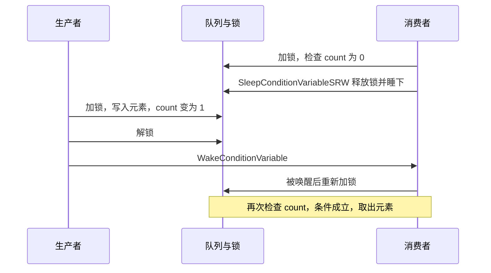

# A.11 同步原语（二）：临界区、SRWLock 与条件变量

[A.10](/教程/正文/系统编程/拓展A_Win32系统编程/A_10_同步原语_等待函数与内核对象) 的内核对象什么都能等，代价也一直在那里：一次 `WaitForSingleObject` 就是一次系统调用，即使没有别的线程来争，也要从用户态切进内核再回来。进程内的计数器、配置表、任务队列被访问得极其频繁，这笔开销会占去大部分处理时间。

Windows 另有一套只在一个进程内使用的原语：互锁函数（interlocked function）、临界区对象（critical section object）、SRW 锁（slim reader/writer lock）与条件变量（condition variable）。没有争用时，它们全部在用户态完成，加锁只是几条指令。这一页用它们修好数据竞争，用条件变量写出一个有界队列，并在最后说明什么情况下仍然该回到 A.10 的内核对象。

## 1. 数据竞争

两个线程各自把同一个 `int` 加一百万次，中间不加任何同步：

```c
/* race.c：两个线程各把同一个普通 int 加 1000000 次。 */
#include <stdio.h>
#include <windows.h>

#define ITERS 1000000

static int counter = 0;
static volatile LONG g_start = 0;

static DWORD WINAPI worker(LPVOID arg) {
    (void)arg;
    /* 等主线程放行，保证两个线程真正同时开跑 */
    while (InterlockedCompareExchange(&g_start, 0, 0) == 0) {
        Sleep(0);
    }
    for (int i = 0; i < ITERS; i++) {
        counter++;
    }
    return 0;
}

int main(void) {
    HANDLE threads[2];

    for (int i = 0; i < 2; i++) {
        threads[i] = CreateThread(NULL, 0, worker, NULL, 0, NULL);
        if (threads[i] == NULL) {
            printf("CreateThread failed: %lu\n", GetLastError());
            return 1;
        }
    }
    InterlockedExchange(&g_start, 1);
    WaitForMultipleObjects(2, threads, TRUE, INFINITE);
    for (int i = 0; i < 2; i++) {
        CloseHandle(threads[i]);
    }

    printf("counter = %d, expected %d\n", counter, 2 * ITERS);
    return 0;
}
```

`g_start` 只是一个发令枪，让两个线程尽可能同时进入循环，线程的创建与等待见 [A.9](/教程/正文/系统编程/拓展A_Win32系统编程/A_9_线程与线程本地存储)。编译时不加优化选项，运行三次：

::: terminal title="PowerShell - race"

```text
PS> gcc -std=c17 -Wall -Wextra -O0 race.c -o race.exe
PS> ./race.exe
counter = 1038126, expected 2000000
PS> ./race.exe
counter = 1011566, expected 2000000
PS> ./race.exe
counter = 1039657, expected 2000000
```

:::

结果每一次都不同，而且总小于 2000000，三次都只加了一百零几万次，仿佛有将近一百万个增量凭空消失。原因在 `counter++` 这句话上：它在机器码里是三步，读 `counter` 到寄存器、寄存器加一、写回内存。两个线程完全可能同时读到 100，各自加一，再各自写回 101，两次自增只留下一次的结果。这就是数据竞争（data race），C11 把它规定为未定义行为，第一部分 [23.2](/教程/正文/语法和标准库/23_原子操作与并发/23_2_原子操作) 已经讲过这条规则。

同一个程序加 `-O2` 编译，实测六次都是 2000000。看反汇编就明白：优化器把整个一百万的循环合成了一条 `addl $0xf4240, counter`，两个线程各执行一条指令，撞车的机会小到几乎为零。程序并没有变正确，只是把出错的时间窗口从一整个循环压到了一两条指令之间。这个错误在不加优化的版本里每次都出现，在 `-O2` 版本里六次都没出现，只按发行配置测试就会把它整条漏过去。

## 2. 互锁函数

最省事的修法是换一个能一次完成「读、加、写」的加法。Windows 在 `<windows.h>` 里提供了一组互锁函数，最常用的是这三个：

```c
LONG InterlockedIncrement(LONG volatile *value);            /* 加一，返回新值 */
LONG InterlockedExchangeAdd(LONG volatile *value, LONG n);  /* 加 n，返回旧值 */
LONG InterlockedCompareExchange(LONG volatile *dest, LONG exchange, LONG comparand);
```

`InterlockedCompareExchange` 做的是：如果 `*dest` 等于 `comparand`，就把 `exchange` 写进去；无论是否写入，都返回 `*dest` 原来的值。它是这三个里最通用的一个，另外两个都能用它写出来。

返回值容易记混，直接跑一遍：

```c
/* interlocked_ret.c：x 从 5 开始，逐个看返回值与 x 的变化。 */
LONG x = 5;
ret = InterlockedIncrement(&x);                 /* -> 6, x = 6 */
ret = InterlockedExchangeAdd(&x, 3);            /* -> 6, x = 9 */
ret = InterlockedCompareExchange(&x, 100, 99);  /* -> 9, x = 9，不相等不写 */
ret = InterlockedCompareExchange(&x, 100, 9);   /* -> 9, x = 100，相等才写 */
```

::: terminal title="PowerShell - interlocked_ret"

```text
PS> gcc -std=c17 -Wall -Wextra interlocked_ret.c -o interlocked_ret.exe
PS> ./interlocked_ret.exe
x = 5
InterlockedIncrement(&x)        -> 6, x = 6
InterlockedExchangeAdd(&x, 3)   -> 6, x = 9
InterlockedCompareExchange(99)  -> 9, x = 9
InterlockedCompareExchange(9)   -> 9, x = 100
```

:::

`InterlockedIncrement` 返回新值，另外两个返回旧值。写循环时这个区别常常用得上：`InterlockedIncrement` 的返回值正好可以当作业编号，`InterlockedExchangeAdd` 的旧值正好是插入前的长度。

把 `race.c` 里的 `counter++` 换成 `InterlockedIncrement(&counter)`，计数对象声明为 `volatile LONG`，其余不动（完整程序在 `code/系统编程/拓展A_Win32系统编程/A_11_同步原语_临界区_SRWLock与条件变量/interlocked.c`），再跑三次：

::: terminal title="PowerShell - interlocked"

```text
PS> gcc -std=c17 -Wall -Wextra interlocked.c -o interlocked.exe
PS> ./interlocked.exe
counter = 2000000, expected 2000000
PS> ./interlocked.exe
counter = 2000000, expected 2000000
PS> ./interlocked.exe
counter = 2000000, expected 2000000
```

:::

多数互锁函数带完整的内存屏障，既保证别的线程看不到写了一半的值，也保证这条指令前后的内存访问不会被编译器或处理器调到它另一边。这两点在 x86 上不显眼，到了 ARM 上就是另一回事。

作者判断：代码只跑在 Windows 上，互锁函数与 C11 的 `<stdatomic.h>` 随便挑一个，两者都用底层同一类指令。要跨平台就用 C11：`atomic_fetch_add` 在 MinGW 上能编译也能跑（同一个计数器程序实测得到 2000000）。不要用 `volatile int` 加手写循环来凑原子性，`volatile` 只保证每次都真正读写内存，不保证三步合成一步。

<Quiz
  type="single"
  :options="[
    { label: '5', value: 'A' },
    { label: '6', value: 'B' },
    { label: '0', value: 'C' },
    { label: '1', value: 'D' }
  ]"
  answer="B"
>

<template #question>

`x` 是 `LONG` 类型的对象，值为 5。执行 `InterlockedIncrement(&x)` 之后，这个调用的返回值是？

</template>

正确答案是 **B**。`InterlockedIncrement` 返回加一之后的新值，也就是 6；`x` 自身同样变成 6。返回旧值的是 `InterlockedExchangeAdd` 与 `InterlockedCompareExchange`，记混了会让「取号」一类的代码从 0 开始。

</Quiz>

## 3. 临界区对象

互锁函数只解决了单个对象的加法。如果一段代码要同时修改好几个对象，并且这些对象之间有必须保持的关系，比如往链表里插入一个节点同时把长度加一，那么需要的是把整段代码圈起来，同一时刻只让一个线程进去。这段代码称为临界区（critical section），承担这个职责的对象叫临界区对象。第一部分 [23.3](/教程/正文/语法和标准库/23_原子操作与并发/23_3_互斥) 用标准 C 的互斥量讲过同一件事，这里的对象形状不同，要守的规矩一样。

```c
CRITICAL_SECTION cs;

InitializeCriticalSection(&cs);        /* 或者 InitializeCriticalSectionAndSpinCount(&cs, 4000) */

EnterCriticalSection(&cs);
counter++;                             /* 受保护的代码 */
LeaveCriticalSection(&cs);

DeleteCriticalSection(&cs);
```

`InitializeCriticalSectionAndSpinCount` 多一个自旋次数：锁被别人占着时，线程先原地空转这么多次再决定去睡，适合临界区很短、争用又多的场合。堆管理器自己给每个堆的临界区用的就是大约 4000。

`EnterCriticalSection` 在没有别的线程占用时，只做一条处理器提供的原子测试置位指令，不进内核；被占用时才自旋一阵，仍然拿不到才挂起等待。`TryEnterCriticalSection` 是不阻塞的版本，拿到返回非零，拿不到立即返回 0。

同一个线程重复进入是允许的，这一条与后面的 SRW 锁相反。用 `cs_recursive.c` 验证：

```c
/* cs_recursive.c 的主线程部分：连续进入两次，再分别观察别的线程能否进入。 */
EnterCriticalSection(&g_lock);
EnterCriticalSection(&g_lock);          /* 同一线程，不会阻塞 */
printf("entered twice without blocking\n");

LeaveCriticalSection(&g_lock);          /* 只离开一次，所有权还在本线程手里 */
/* 此时另一个线程的 TryEnterCriticalSection 返回 0 */

LeaveCriticalSection(&g_lock);          /* 再离开一次，锁才真正释放 */
/* 此时另一个线程的 TryEnterCriticalSection 返回 1 */
```

::: terminal title="PowerShell - cs_recursive"

```text
PS> gcc -std=c17 -Wall -Wextra cs_recursive.c -o cs_recursive.exe
PS> ./cs_recursive.exe
entered twice without blocking
other thread's TryEnter after one leave -> 0
other thread's TryEnter after two leaves -> 1
```

:::

进入几次就要离开几次，这是临界区对象最容易埋下的错误：某个提前返回的分支少写一句 `LeaveCriticalSection`，锁就永远留在自己手里，别的线程全部卡在 `EnterCriticalSection` 上，而程序本身还在跑。

::: concept win-sync-cs-user-mode title="临界区对象不是内核对象"

临界区对象由进程自己分配内存（一个 `CRITICAL_SECTION` 结构，本机 x64 上 40 字节），不需要 `CloseHandle`，没有句柄，也不能被 `WaitForSingleObject` 等待，只能被同一个进程内的线程使用。它可以用 `InitializeCriticalSection` 或 `InitializeCriticalSectionAndSpinCount` 初始化，用完后用 `DeleteCriticalSection` 释放；在初始化之前使用、把已经初始化的对象再初始化一次，都是错的。同一线程可以重复进入，释放的次数必须与进入的次数相同。跨进程互斥要用 A.10 的互斥量对象。

:::

用它修复 `race.c`，把自增夹在进入与离开之间即可（`cs_counter.c`）：

```c
/* cs_counter.c：worker 函数体。 */
for (int i = 0; i < ITERS; i++) {
    EnterCriticalSection(&lock);
    counter++;
    LeaveCriticalSection(&lock);
}
```

::: terminal title="PowerShell - cs_counter"

```text
PS> gcc -std=c17 -Wall -Wextra cs_counter.c -o cs_counter.exe
PS> ./cs_counter.exe
counter = 2000000, expected 2000000
```

:::

### 3.1 三种锁的开销

没有争用时，临界区对象与 SRW 锁都只在用户态转一圈，互斥量对象却每次都要进内核。`lock_cost.c` 让三者各做一百万次「加锁、改一个数、解锁」，用 `QueryPerformanceCounter` 计时：

::: terminal title="PowerShell - lock_cost"

```text
PS> gcc -std=c17 -Wall -Wextra lock_cost.c -o lock_cost.exe
PS> ./lock_cost.exe
critical section:     17.8 ms
SRW lock:             16.6 ms
mutex object:        258.7 ms
```

:::

本机十六个逻辑处理器上，临界区对象与 SRW 锁都在 16～18 毫秒，互斥量对象要 258 毫秒，差了一个数量级以上。具体数字随机器和负载变化，看数量级就够了：一百万次无争用加锁，用户态原语花几十毫秒，内核对象花几百毫秒。跨进程的互斥仍然得用内核对象，代价就是这一档。

## 4. SRW 锁

SRW 锁把「独占」与「共享」两种模式放进同一个对象，大小只有一个指针（本机 x64 上是 8 字节），不需要删除：

```c
SRWLOCK lock = SRWLOCK_INIT;      /* 静态初始化；动态初始化用 InitializeSRWLock */

AcquireSRWLockExclusive(&lock);   /* 写者：独占 */
/* 修改共享对象 */
ReleaseSRWLockExclusive(&lock);

AcquireSRWLockShared(&lock);      /* 读者：共享，可以多个线程同时持有 */
/* 读取共享对象 */
ReleaseSRWLockShared(&lock);
```

`TryAcquireSRWLockExclusive` 与 `TryAcquireSRWLockShared` 是不阻塞的版本。被持有时它们的结果：

::: terminal title="PowerShell - srw_try"

```text
PS> gcc -std=c17 -Wall -Wextra srw_try.c -o srw_try.exe
PS> ./srw_try.exe
exclusive held: TryAcquireExclusive -> 0
exclusive held: TryAcquireShared    -> 0
shared held:    TryAcquireExclusive -> 0
free:           TryAcquireExclusive -> 1
```

:::

独占锁被拿着时，两种获取都失败；只持有共享锁时再取独占也会失败，这就是「有读者在读时写者进不来」。读者与读者之间不互斥，这是 SRW 锁相对临界区对象的全部意义：读操作远多于写操作时，多个读者可以真正并行。

::: concept win-sync-srw-no-recursion title="SRW 锁不可递归"

同一线程第二次调用 `AcquireSRWLockExclusive` 获取自己已经持有的独占锁，会一直等下去，程序停在这一行，不会报错也不会返回。共享模式下重复获取本身能成功，但如果这期间有别的线程在等独占锁，两边就会互相等死。SRW 锁也不支持把共享所有权升级成独占所有权。共享模式下的重复获取不会被检测出来，释放次数却要相应增加（实测两次共享获取后释放一次，独占获取仍然失败；释放两次才成功），所以不要这样写。SRW 锁不能跨进程使用，没有删除函数，未使用且无人等待时可以直接丢弃。

:::

演示它要小心，死锁的程序不会自己退出。`srw_deadlock.c` 故意在同一个线程里获取两次独占锁，用 PowerShell 的进程对象加超时来收场：

::: terminal title="PowerShell - srw_deadlock"

```text
PS> gcc -std=c17 -Wall -Wextra srw_deadlock.c -o srw_deadlock.exe
PS> $p = Start-Process -FilePath .\srw_deadlock.exe -PassThru -NoNewWindow
PS> if (-not $p.WaitForExit(2000)) { $p.Kill(); "still running after 2 s, killed (PID $($p.Id))" }
first acquire done
still running after 2 s, killed (PID 10276)
```

:::

程序打印了第一句就再没有下文，两秒后被结束。实际工程里遇到这种现象，先查锁的获取路径上有没有嵌套调用：外层函数加了锁，它调用的内层函数又加了一次，同一把锁就被自己要了两次。条件变量那一节还会看到，把等待写进 `while` 循环时这个问题更隐蔽。

### 4.1 读多写少：配置表

`config_cache.c` 里的配置表有两个字段：`version` 和 `timeout_ms`，两者满足 `timeout_ms == 100 * (version + 1)`。四个读线程反复把它复制出来用，一个写线程每隔一会儿更新一次。读线程拿共享锁，写线程拿独占锁：

```c
/* config_cache.c：读线程与写线程。 */
LONG active;

AcquireSRWLockShared(&g_cfg.lock);
active = InterlockedIncrement(&g_active_readers);
/* 在锁内把要用的字段复制出来，锁外慢慢用 */
int version = g_cfg.version;
int timeout = g_cfg.timeout_ms;
if (timeout != 100 * (version + 1)) {
    InterlockedIncrement(&g_inconsistent);
}
Sleep(2);
InterlockedDecrement(&g_active_readers);
ReleaseSRWLockShared(&g_cfg.lock);

/* 写线程 */
AcquireSRWLockExclusive(&g_cfg.lock);
Sleep(5);                       /* 模拟重新装载配置 */
g_cfg.version = v;
g_cfg.timeout_ms = 100 * (v + 1);
ReleaseSRWLockExclusive(&g_cfg.lock);
```

::: terminal title="PowerShell - config_cache"

```text
PS> gcc -std=c17 -Wall -Wextra config_cache.c -o config_cache.exe
PS> ./config_cache.exe
writer:  version=1 timeout=200
writer:  version=2 timeout=300
writer:  version=3 timeout=400
reads by version: v0=16 v1=16 v2=16 v3=432
max concurrent readers = 4, inconsistent reads = 0
```

:::

同时持有共享锁的读线程最多达到 4 个，也就是全部读线程都在一起读；而在四百八十次读里，`timeout_ms` 与 `version` 一次也没有对不上。写线程更新时，读者要么看到旧的一对值，要么看到新的一对值，不会夹在中间。

读线程把需要的字段在锁内复制到局部对象，随后在锁外慢慢使用，这是配置表的标准写法：临界区里只留复制，耗时的处理放到锁外，写线程等待的时间就从毫秒级降到微秒级。`config_cache.c` 里那把 `Sleep(2)` 放在共享锁内，只是为了把「多个读者同时持有共享锁」这一点放大到肉眼可见；实际代码不应该在锁内睡。

作者判断：进程内互斥的默认选择是 SRW 锁的独占模式，它比临界区对象还小、还快，用起来也更简单。只有确实需要同一线程重复进入时才选临界区对象；更好的做法是回头改设计，把重复加锁的那条调用链拆开。真需要递归的场合，多半是回调或虚函数风格的接口，一半的功能在调用者看不见的地方执行。

## 5. 条件变量

互斥锁能保护共享对象，却解决不了「队列空了怎么办」。消费者拿到锁，发现队列是空的，只能放锁、睡一会儿、再拿锁来看，如此循环。睡多久都不合适：睡短了空耗 CPU，睡长了响应变慢。

条件变量（condition variable）就是为这一步准备的。它让线程在释放锁的同时睡下，另一个线程改变状态后把它叫醒，两步都是原子的，中间不会漏掉通知。

```c
CONDITION_VARIABLE cv = CONDITION_VARIABLE_INIT;   /* 静态初始化 */

/* 等：锁必须已经由本线程持有，标志告诉 API 它是以哪种模式持有的 */
SleepConditionVariableSRW(&cv, &lock, INFINITE, 0);

/* 叫醒一个 / 全部 */
WakeConditionVariable(&cv);
WakeAllConditionVariable(&cv);
```

`SleepConditionVariableSRW` 的第三个参数是超时（毫秒），第四个参数写 `CONDITION_VARIABLE_LOCKMODE_SHARED` 表示这把 SRW 锁是以共享模式持有的，写 0 表示独占模式。函数返回时，锁已经按原来的模式重新拿到手。临界区对象也有配套的 `SleepConditionVariableCS`。

### 5.1 有界队列

`bounded_queue.c` 用 SRW 锁加两个条件变量实现一个容量为 4 的环形队列，两个生产者各放 8 个元素，两个消费者取走，队列满时生产者等，空时消费者等，最后用「关闭」标志结束：

```c
/* bounded_queue.c：放入与取出。 */
static void put(struct queue *q, int value) {
    AcquireSRWLockExclusive(&q->lock);
    while (q->count == CAPACITY) {
        SleepConditionVariableSRW(&q->not_full, &q->lock, INFINITE, 0);
    }
    q->slot[q->tail] = value;
    q->tail = (q->tail + 1) % CAPACITY;
    q->count++;
    q->produced++;
    ReleaseSRWLockExclusive(&q->lock);
    WakeConditionVariable(&q->not_empty);
}

static int get(struct queue *q, int id) {
    int value;

    AcquireSRWLockExclusive(&q->lock);
    while (q->count == 0 && !q->closed) {
        SleepConditionVariableSRW(&q->not_empty, &q->lock, INFINITE, 0);
    }
    if (q->count == 0) {                     /* 关闭了，且确实没有剩余元素 */
        ReleaseSRWLockExclusive(&q->lock);
        return -1;
    }
    value = q->slot[q->head];
    q->head = (q->head + 1) % CAPACITY;
    q->count--;
    q->consumed++;
    q->sum += value;
    q->per_consumer[id]++;
    ReleaseSRWLockExclusive(&q->lock);
    WakeConditionVariable(&q->not_full);
    return value;
}
```

生产者和消费者之间的一轮交互：



::: terminal title="PowerShell - bounded_queue"

```text
PS> gcc -std=c17 -Wall -Wextra bounded_queue.c -o bounded_queue.exe
PS> ./bounded_queue.exe
produced 16, consumed 16, sum 856, left in queue 0
consumer 0 took 8, consumer 1 took 8
PS> ./bounded_queue.exe
produced 16, consumed 16, sum 856, left in queue 0
consumer 0 took 11, consumer 1 took 5
```

:::

十六个元素全部取走，`sum` 是 0 到 7 与 100 到 107 的总和 856，队列最后为空。两个消费者各取多少每次都不同，取决于谁先抢到锁，这是正常的。

注意 `put` 与 `get` 都是先改状态、再释放锁、最后才唤醒。在锁外调用唤醒可以少一次上下文切换：被叫醒的线程立刻就能拿到锁，不必先等唤醒者离开。Microsoft Learn 的文档也建议这样做。

::: concept win-sync-cv-loop title="等待条件变量必须写在循环里"

`SleepConditionVariableSRW` 返回不代表条件已经成立。它可能被虚假唤醒（spurious wakeup，没有任何人调用唤醒函数），可能被别的线程抢在前面把元素拿走了（stolen wakeup），也可能因为超时返回。所以判断条件必须写成 `while (条件不成立) { 等待 }`，醒来后重新检查，而不是一次 `if`。条件本身必须由同一把锁保护，判断也在持锁时进行，这样「检查」与「睡下」之间不会插进别的线程。

:::

写错了会怎样，看 `if_vs_while.c`。两个消费者都在等同一个空队列，生产者只放一个元素然后 `WakeAllConditionVariable` 叫醒两个：

::: compare vertical left-title="等待写成 if" right-title="等待写成 while"

```c
/* consumer_if_body：醒来后不再检查 */
struct ctx *c = arg;
struct queue *q = c->q;

AcquireSRWLockExclusive(&q->lock);
q->arrived++;
if (q->count == 0) {
    SleepConditionVariableSRW(&q->cv, &q->lock, INFINITE, 0);
}
int value = q->item;
q->count--;
printf("if   consumer %d: value=%d, count after take = %d\n", c->id, value, q->count);
ReleaseSRWLockExclusive(&q->lock);
```

---

```c
/* consumer_while_body：醒来后重新检查 */
struct ctx *c = arg;
struct queue *q = c->q;

AcquireSRWLockExclusive(&q->lock);
q->arrived++;
while (q->count == 0 && !q->closed) {
    SleepConditionVariableSRW(&q->cv, &q->lock, INFINITE, 0);
}
if (q->count == 0) {            /* 关闭了，确实没有元素 */
    printf("while consumer %d: closed, no item\n", c->id);
    ReleaseSRWLockExclusive(&q->lock);
    return 0;
}
int value = q->item;
q->count--;
printf("while consumer %d: value=%d, count after take = %d\n", c->id, value, q->count);
ReleaseSRWLockExclusive(&q->lock);
```

:::

::: terminal title="PowerShell - if_vs_while"

```text
PS> gcc -std=c17 -Wall -Wextra if_vs_while.c -o if_vs_while.exe
PS> ./if_vs_while.exe
if   consumer 0: value=42, count after take = 0
if   consumer 1: value=42, count after take = -1
---
while consumer 1: value=42, count after take = 0
while consumer 0: closed, no item
```

:::

`if` 版本里两个消费者取到了同一个元素，队列计数变成 -1，同一个元素被处理了两遍（哪一行先打印每次可能不同）。真实业务里这对应着两张订单被同一个订单号处理、一笔金额被扣两次。`while` 版本里后醒来的消费者发现队列还是空的，重新睡下，等到关闭标志生效才退出。

`WakeConditionVariable` 与 `WakeAllConditionVariable` 的选择也有讲究：只放了一个元素就用 `WakeConditionVariable` 叫醒一个，只在关闭队列、改变状态影响所有等待者时才用 `WakeAll`。全部叫醒会让它们抢同一把锁、再依次睡回去，白白浪费几次调度。

同样的机制在标准 C 与 POSIX 里也有，接口不同、语义一致：C11 的 `cnd_wait`/`cnd_signal`/`cnd_broadcast`（第一部分 [23.4](/教程/正文/语法和标准库/23_原子操作与并发/23_4_条件等待)），POSIX 的 `pthread_cond_wait`/`pthread_cond_signal`/`pthread_cond_broadcast`。三者都要求等待写在循环里、条件由互斥量保护、先改状态再通知。

<Quiz
  type="single"
  :options="[
    { label: '提高唤醒速度', value: 'A' },
    { label: '被唤醒时条件不一定成立', value: 'B' },
    { label: 'API 要求成对调用', value: 'C' },
    { label: '防止等待超时', value: 'D' }
  ]"
  answer="B"
>

<template #question>

为什么 `SleepConditionVariableSRW` 要放在 `while (条件不成立)` 循环里，而不是一个 `if` 里？

</template>

正确答案是 **B**。虚假唤醒、被其他线程抢先改变状态、超时返回，都会让函数返回时条件仍不成立。循环让它重新检查，条件不满足就继续睡。

</Quiz>

## 6. 一次性初始化与其他

### 6.1 一次性初始化

配置、单例、函数表这类东西往往希望「第一次用到时才初始化，而且只初始化一次」。用锁加一个标志位当然能做到，但每次取用都要加锁。`InitOnceExecuteOnce` 把这件事做进了 API：

```c
INIT_ONCE g_once = INIT_ONCE_STATIC_INIT;
PVOID context = NULL;

BOOL ok = InitOnceExecuteOnce(&g_once, init_config, NULL, &context);
```

`init_config` 的类型是 `BOOL (CALLBACK *)(PINIT_ONCE, PVOID, PVOID *)`，返回值表示初始化成功与否，第三个参数用来把初始化结果交出去；交出去的是一个指针或 `DWORD` 对齐的数据结构，它的低几位被系统占用，不能拿它传任意整数。四个线程同时调用的实测：

::: terminal title="PowerShell - once"

```text
PS> gcc -std=c17 -Wall -Wextra once.c -o once.exe
PS> ./once.exe
init_config runs on thread 1672
worker 2: port=23456 timeout=500
worker 0: port=23456 timeout=500
worker 1: port=23456 timeout=500
worker 3: port=23456 timeout=500
callback ran 1 time(s)
```

:::

回调只执行了一次，其余线程在它执行期间被挡住，等它返回之后直接拿到同一个结果。初始化成功后，函数内部只是读一个已经置位的指针，比任何锁都快。回调返回 `FALSE` 表示这次初始化失败，下一个调用者会重新尝试：单独写一个第一次返回 `FALSE` 的回调放进同样的四线程程序，回调被执行了两次，第一个线程拿到 `FALSE`、context 为空，后面三个线程拿到 `TRUE` 与结果。失败路径上已经分配的资源要自己清理。

它对应 C11 的 `call_once` 与 POSIX 的 `pthread_once`，`once_flag`/`pthread_once_t` 就是同一角色的对象。

### 6.2 WaitOnAddress

`WaitOnAddress` 更接近 Linux 的 futex：盯住一块 1、2、4 或 8 字节的内存，值没变就睡，值变了就醒。它不需要锁，也不需要事件对象：

```c
LONG observed = InterlockedCompareExchange(&g_state, 0, 0);

while (observed == 0) {
    WaitOnAddress((volatile VOID *)&g_state, &observed, sizeof observed, INFINITE);
    observed = g_state;
}
```

第二个参数是「我上次看到的值」，函数在内部比较：地址上的值已经变了就立即返回，没变才睡。另一个线程修改之后调用 `WakeByAddressSingle`（叫醒一个）或 `WakeByAddressAll`：

::: terminal title="PowerShell - wait_on_address"

```text
PS> gcc -std=c17 -Wall -Wextra wait_on_address.c -o wait_on_address.exe -lsynchronization
PS> ./wait_on_address.exe
waiter: state = 0, going to sleep
setter: state = 1, waking one
waiter: woke up, state = 1
```

:::

链接时别忘了 `-lsynchronization`，MinGW 默认链接的库里没有这两个函数。把 `WaitOnAddress` 的最后一个参数从 `INFINITE` 换成 250，等一个始终不变的值，函数在超时后返回 `FALSE`、`GetLastError()` 为 1460（`ERROR_TIMEOUT`），两次实测耗时 251.2 毫秒和 258.3 毫秒。

`WaitOnAddress` 同样允许提前返回（内存紧张、上一次唤醒被放弃等），所以醒来之后必须重新比较值，跟条件变量的循环是一个道理。它适合实现引用计数降到零时唤醒清理者这类单一条件的等待；要等的是复合状态，条件变量写起来更清楚。

### 6.3 同步屏障

`InitializeSynchronizationBarrier(&barrier, 线程数, 自旋次数)` 加 `EnterSynchronizationBarrier(&barrier, 0)` 可以让一组线程在每个阶段末尾互相等齐，全部到齐后一起进入下一阶段。每轮恰好有一个线程的 `EnterSynchronizationBarrier` 返回 `TRUE`，其余返回 `FALSE`（四个线程跑两轮，三次运行六轮里每一轮都是如此），拿这个返回值可以让最后一个到达的线程做阶段收尾。用完调用 `DeleteSynchronizationBarrier`。它适合把计算分成若干阶段、每阶段都要全体同步的场合，普通的生产者消费者用不到。

## 7. 怎样选

| 需求 | 选择 | 理由 |
| --- | --- | --- |
| 进程内的互斥 | SRW 锁，独占模式 | 一个指针大小，无争用时只有一条互锁指令 |
| 同一线程需要重复进入同一把锁 | 临界区对象 | SRW 锁会自锁死；但更该考虑改设计 |
| 读远多于写 | SRW 锁，共享模式加独占模式 | 多个读者可以同时进入 |
| 等某个条件成立才继续 | 条件变量加 SRW 锁 | 释放锁与睡下是原子的，不会漏通知 |
| 跨进程互斥 | 命名互斥量对象 | 临界区对象与 SRW 锁都出不了进程，见 A.10 |
| 要与其他内核对象一起等、要超时 | 内核对象与等待函数 | 条件变量不能进 `WaitForMultipleObjects` |
| 单个计数器或标志 | 互锁函数或 C11 原子操作 | 不必为一次加法建一把锁 |
| 只初始化一次 | `InitOnceExecuteOnce` | 成功之后只剩一次指针读取 |

作者判断：新写的进程内代码默认用 SRW 锁加条件变量，把临界区对象留给需要递归的旧接口，把内核对象留给跨进程和需要组合等待的地方。选型时先问「同一时刻谁需要被挡住」，再问「等的是不是一个条件」，两个答案基本就决定了用哪一组。

<Quiz
  type="single"
  :options="[
    { label: '临界区对象', value: 'A' },
    { label: 'SRW 锁', value: 'B' },
    { label: '命名互斥量对象', value: 'C' },
    { label: '条件变量', value: 'D' }
  ]"
  answer="C"
>

<template #question>

两个进程要互斥地访问同一块共享内存，应该用下面哪一个？

</template>

正确答案是 **C**。临界区对象、SRW 锁与条件变量都只能在创建它们的进程内使用，别的进程拿不到它们。命名互斥量对象由内核管理、按名字打开，是跨进程互斥的标准做法（A.10）。

</Quiz>

::: generate win-sync-primitive-map kind=comparison concepts=win-sync-cs-user-mode,win-sync-srw-no-recursion,win-sync-cv-loop

面向熟悉 POSIX 线程的读者，把本页的 Win32 原语与 pthread、C11 的对应物排成一张对照表：互斥量对象对 `pthread_mutex_t`，临界区对象对非递归的 `pthread_mutex_t` 但只在本进程内有效，SRW 锁对 `pthread_rwlock_t`，条件变量对 `pthread_cond_t`，可等待的内核对象对 `eventfd`、`sem_t` 与 `poll` 的组合。逐项说明语义差别：Win32 的互斥量对象可跨进程且可递归、SRW 锁不可递归且不能升级、条件变量必须配 SRW 锁或临界区对象而不是单独使用。最后用一句话点出 MinGW 的 winpthreads 把 pthread 互斥量建在临界区对象之上，这一点从 `objdump -p libwinpthread-1.dll` 的导入表里能看到 `InitializeCriticalSection`、`EnterCriticalSection` 与 `LeaveCriticalSection`。

:::

## 8. 习题

### 8.1 巩固

<Exercise id="46101" :d="1" :w="2" multi>

(1) _[1.1]_ `race.c` 里把 `counter++` 换成 `InterlockedIncrement(&counter)` 之后结果正确；如果改写成 `InterlockedExchangeAdd(&counter, 2)` 也正确，而写成 `counter = counter + 2` 仍然会出错，为什么？

(2) _[1.1]_ `lock_cost.c` 输出的三行里，互斥量对象那一行大约是另外两行的十五倍。这个差距来自哪一步操作？

(3) _[1.1]_ `srw_try.c` 里，共享锁被本线程持有时 `TryAcquireSRWLockExclusive` 返回 0。如果把前半段的 `AcquireSRWLockExclusive` 换成 `AcquireSRWLockShared`，那么紧随其后的 `TryAcquireSRWLockShared` 会返回什么？

(4) _[2.2]_ 下面四个需求分别该用本页或 A.10 的哪一种原语，各写一句理由：一个只有本进程访问的任务队列要互斥；两个进程共用一块共享内存要互斥；一个函数被多处调用、只允许初始化一次；一个工作线程要等到队列非空。如果最后一个还要求 500 毫秒超时，选择会不会变？

</Exercise>

<Exercise id="46102" :d="2" :w="3">

写一个 `lock_probe` 程序：主线程创建一把临界区对象和一把 SRW 锁，先各拿在手里，再创建两个线程分别对两把锁调用 `TryEnterCriticalSection` 与 `TryAcquireSRWLockExclusive`，打印返回值；主线程释放之后重复一次。

要求：

- 两个线程各自把结果写进自己的结构体，不要共享写入。
- 输出必须能看出「持有中 → 0、释放后 → 1」的变化，两次结果顺序固定。
- 再补一个对照：把 SRW 锁那一半改成同一线程连续两次 `AcquireSRWLockExclusive`，用 PowerShell 的 `Start-Process` 加 2 秒超时运行，记录它是被结束的还是自己退出的。

</Exercise>

### 8.2 编程

<Exercise id="46103" :d="3" :w="3">

把 `race.c` 扩展成三种修复方式的对比程序 `race3.c`：同一份工作（两个线程各加 1,000,000 次）分别用互锁函数、临界区对象、SRW 独占锁各做一遍，每次都把结果与耗时打印出来。

要求：

- 三种方式各自清零后重跑，结果都必须是 2000000。
- 用 `QueryPerformanceCounter` 计时，按互锁、临界区、SRW 的顺序打印毫秒数。
- 把临界区那一版再加一个变体：`InitializeCriticalSectionAndSpinCount(&cs, 4000)`，比较自旋次数对结果的影响（结果应当不变，耗时可能变化）。

验收：连续运行五次，五次结果全部正确；把耗时整理成一行，说明哪一种最快、差距有多大。

</Exercise>

<Exercise id="46104" :d="3" :w="3">

写一个读多写少的缓存表 `table.c`：一个 `SRWLOCK` 保护的 `struct entry { int key; int value; }` 数组，容量 64，写线程每秒插入或更新一条，四个读线程按 key 查找并统计命中次数。

要求：

- 读线程只用 `AcquireSRWLockShared`，写线程只用 `AcquireSRWLockExclusive`。
- 记录并打印「同时持有共享锁的读线程数」的最大值，以及读线程看到的「key 存在但 value 与 key 不匹配」的次数（不变式：`value == key * 10`）。
- 运行 2 秒后用一个 `volatile LONG` 停止标志让所有线程退出，最后打印命中总数与不变式被破坏的次数。

验收：最大值至少为 2，不变式破坏次数为 0。再用 `QueryPerformanceCounter` 测量写线程从调用 `AcquireSRWLockExclusive` 到真正拿到锁的等待时间，说明它与读线程在共享锁内停留的时长有什么关系，然后把读线程里的 `Sleep(2)` 去掉重测一次，比较两组数字。

</Exercise>

<Exercise id="46105" :d="4" :w="3" multi>

改写 `bounded_queue.c`，做三件事：

(1) _[3.2]_ 把容量改成命令行参数，例如 `bounded_queue.exe 1`、`bounded_queue.exe 16`，容量为 1 时也必须正确工作。

(2) _[3.2]_ 每个消费者记录自己取到的元素个数与总和，最后校验「生产总数 = 消费总数」且「总和相等」。

(3) _[4.3]_ 加一个 `put_batch(q, const int *values, int n)` 接口，一次放入多个元素，内部仍然逐个等待空位；再加一个 `get_batch(q, int *out, int max)`，一次取走至多 `max` 个。

验收：容量取 1、4、16 各跑三次，每次 32 个元素，校验全部通过；把 `get_batch` 实现成「不满足 `max` 个就继续等」，说明它在什么情况下会永远等下去。

</Exercise>

<Exercise id="46106" :d="4" :w="4">

`bounded_queue.c` 的关闭方式有两种写法，请都实现并比较：

- 写法 A（本页用的）：生产者全部结束后，主线程持锁把 `closed` 置 1，再 `WakeAllConditionVariable`，消费者取完剩余元素后退出。
- 写法 B：主线程直接 `WakeAllConditionVariable` 而不置 `closed`，让消费者自行判断「队列空就退出」。

要求：

- 两个版本都写，各自运行三次，每次 2 个生产者、2 个消费者、每个生产者 8 个元素。
- 打印每次实际消费的总数与预期 16 的差值。
- 解释写法 B 为什么不可靠，并给出一个能让它稳定丢元素的运行结果（可以调整 `Sleep` 的位置来放大窗口）。

</Exercise>

### 8.3 综合与挑战

<Exercise id="46107" :d="5" :w="4" multi>

下面这个程序读多写少，不变式是 `sum == count * 100`，但它有一个缺陷：

```c
struct cfg {
    SRWLOCK lock;
    long long sum;
    long long count;
    volatile LONG violations;
};

static DWORD WINAPI writer(LPVOID arg) {
    while (InterlockedCompareExchange(&g_stop, 0, 0) == 0) {
        AcquireSRWLockShared(&cfg.lock);   /* 这一行有问题 */
        cfg.sum += 100;
        cfg.count += 1;
        ReleaseSRWLockShared(&cfg.lock);
    }
    return 0;
}
```

(1) _[4.2]_ 不改代码，先运行一遍，记录 `violations` 与 `count` 的数量级。

(2) _[4.2]_ 找出缺陷并说明它为什么不会被 `-Wall -Wextra` 或任何运行时检查发现。

(3) _[3.2]_ 修复它，再运行同样的时长，确认 `violations` 为 0。

(4) _[5.4*]_ 修好之后，读线程要读到的是「一对」值：`sum` 与 `count` 必须来自同一次写。请说明修复第 (3) 问之后这一点为什么已经成立，再试一个替代方案：不用锁，把 `sum` 和 `count` 都改成 `volatile LONG64`，各自用 `InterlockedExchangeAdd64` 更新，写一个能观察到两个值不成对的程序。

验收：修复前后各贴一次输出，并写出缺陷属于「锁的模式用错」还是「锁的范围用错」。

</Exercise>

<Exercise id="46108" :d="6" :w="4">

实现一个线程安全的对象池 `pool.c`：容量 8，`acquire` 取一个对象，`release` 还回去，取不到时用条件变量等待。

要求：

- 池本身用 `InitOnceExecuteOnce` 延迟初始化：第一次调用 `acquire` 时才建立对象数组与锁，多个线程同时首次调用也只能初始化一次，回调把池的指针作为 context 交出去。
- 池满时 `release` 不得阻塞（归还总是立即成功），取空时 `acquire` 等待。
- 支持关闭：关闭后 `acquire` 立即返回 `NULL`，已经借出的对象仍然可以归还。
- 用 6 个工作者线程各借还 200 次，统计最大同时借出数、总借出次数、等待唤醒次数。
- 用 `TryAcquireSRWLockExclusive` 做一次「不等待的自检」，在池的空闲块上加一个快速路径：空闲块大于 0 时先用 `TryAcquire` 拿一次锁，拿不到再走普通路径，比较加与不加这条快速路径的耗时。

验收：总借出次数为 1200，最大同时借出数不超过 8，初始化回调只执行一次，关闭后所有工作者在 1 秒内退出。

</Exercise>

<Exercise id="46109" :d="7" :w="5" scope="*">

同一个等待队列，用三种方式各实现一遍：

(1) SRW 锁加条件变量，`get(q, timeout_ms)` 支持超时，超时时必须区分「真的超时」与「被唤醒但条件不成立」，并把 `SleepConditionVariableSRW` 的返回值与 `GetLastError()` 都检查一遍。

(2) `WaitOnAddress`/`WakeByAddressSingle` 版：把队列长度放进一个 `LONG`，消费者等在它上面，生产者修改后调用 `WakeByAddressSingle`（注意 `-lsynchronization`）。这个版本要自己处理「等待前重新检查」的循环。

(3) 纯 `Sleep(1)` 轮询版，作为性能下限的参照。

要求：

- 三个版本提供相同的 `put`/`get` 接口，用同一份测试驱动：2 个生产者、2 个消费者、每组 10 万个元素，记录总耗时与超时次数。
- 专门测试超时语义：一个空队列上调用 `get(q, 50)`，三个版本分别记录实际等待时间与返回值。第 (3) 版允许误差较大，但要说明误差从哪来。
- 用数据说明三者在中低争用下的差距，并给出你的选择。

本题需要先读完 A.10 的等待函数与内核对象，选做。

</Exercise>

## 9. 参考资料

- Microsoft Learn，Interlocked Variable Access：<https://learn.microsoft.com/en-us/windows/win32/sync/interlocked-variable-access>
- Microsoft Learn，Critical Section Objects：<https://learn.microsoft.com/en-us/windows/win32/sync/critical-section-objects>
- Microsoft Learn，Slim Reader/Writer (SRW) Locks：<https://learn.microsoft.com/en-us/windows/win32/sync/slim-reader-writer--srw--locks>
- Microsoft Learn，Condition Variables 与 Using Condition Variables：<https://learn.microsoft.com/en-us/windows/win32/sync/condition-variables>、<https://learn.microsoft.com/en-us/windows/win32/sync/using-condition-variables>
- Microsoft Learn，SleepConditionVariableSRW：<https://learn.microsoft.com/en-us/windows/win32/api/synchapi/nf-synchapi-sleepconditionvariablesrw>
- Microsoft Learn，InitializeCriticalSectionAndSpinCount：<https://learn.microsoft.com/en-us/windows/win32/api/synchapi/nf-synchapi-initializecriticalsectionandspincount>
- Microsoft Learn，One-Time Initialization：<https://learn.microsoft.com/en-us/windows/win32/sync/one-time-initialization>
- Microsoft Learn，WaitOnAddress：<https://learn.microsoft.com/en-us/windows/win32/api/synchapi/nf-synchapi-waitonaddress>
- Microsoft Learn，Synchronization Barriers：<https://learn.microsoft.com/en-us/windows/win32/sync/synchronization-barriers>
- Kenny Kerr，*Concurrency: Synchronization Primitives New to Windows Vista*，MSDN Magazine，2007 年 6 月：<https://learn.microsoft.com/en-us/archive/msdn-magazine/2007/june/concurrency-synchronization-primitives-new-to-windows-vista>
- Johnson M. Hart，*Windows System Programming*，第 4 版，第 8–10 章。
- Pavel Yosifovich，*Windows 10 System Programming, Part 1*，第 7 章。
- Jeffrey Richter、Christophe Nasarre，*Windows via C/C++*，第 5 版，第 8 章。
