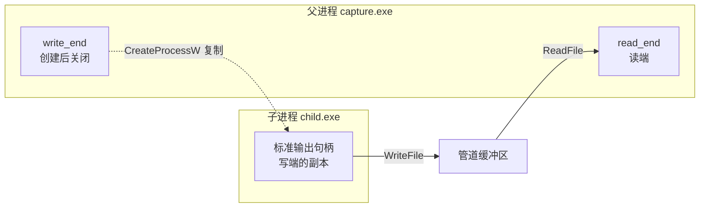

# A.12 管道与进程间通信

构建工具运行编译器，把编译器的每一条诊断信息收进自己的日志，再根据退出码决定下一步；后台程序守在一个本机名字上，等别的进程把请求送进来。两件事都不是文件读写，也不是网络通信，它们靠的是进程间通信（interprocess communication，IPC）。POSIX 一侧的 `pipe`、FIFO 和共享内存在[第 7 章](/教程/正文/系统编程/7_进程间通信)里讲，这一页讲 Windows 上的对应物。

这一页先给出 Windows 上可用的几种 IPC 机制和它们与 POSIX 的对应，再把管道讲透：用匿名管道接管子进程的标准输出并可靠地读到结束，用命名管道在任意两个本机进程之间做请求与应答，用消息模式让每次 `WriteFile` 的内容仍是一条独立的消息，最后看管道的默认安全设置和怎样确认对面是谁。

## 1. Windows 上的进程间通信

Windows 没有统一的「一切皆文件描述符」，进程间通信由几种彼此独立的机制组成。下表是常用的几种，以及它们在 POSIX 主线里的对应物。

| 场景 | Windows 机制 | 在本教程的位置 | POSIX 对应 |
| --- | --- | --- | --- |
| 父子进程之间传一段字节流 | 匿名管道（anonymous pipe） | 本页第 2 节 | `pipe` |
| 本机任意进程之间的请求与应答 | 命名管道（named pipe） | 本页第 3、4 节 | FIFO、Unix 域套接字 |
| 大块数据共享，读写像访问内存 | 文件映射对象加同步对象 | [A.6](/教程/正文/系统编程/拓展A_Win32系统编程/A_6_内存管理与内存映射文件)、[A.10](/教程/正文/系统编程/拓展A_Win32系统编程/A_10_同步原语_等待函数与内核对象) | `shm_open` 加信号量 |
| 跨机器，或需要套接字接口 | Winsock，含 AF_UNIX | [A.13](/教程/正文/系统编程/拓展A_Win32系统编程/A_13_Winsock特有主题) | 套接字 |
| 单向的小消息广播 | 邮槽（mailslot） | 本页不展开 | — |

邮槽是单向的，数据报式，不能确认对方收到，新代码基本不用。COM、RPC、DDE、`WM_COPYDATA` 也能在进程之间搬数据，但它们各自绑一套运行时或窗口消息，不属于系统编程的基础设施，本拓展不讨论。

选型上的判断很简单：父子进程之间传数据用匿名管道，它最便宜，也不需要名字；本机服务用命名管道，因为可以给它设访问控制，还能查出连上来的是哪个进程；代码要和 Linux 共用时用 TCP 回环或 AF_UNIX 套接字，那是两边都有的一套接口。共享内存留给数据量大、读写频繁的场合，它本身不提供任何同步，通知和互斥要另外用事件或互斥量，那是 A.6 与 A.10 的内容。

## 2. 匿名管道与子进程重定向

匿名管道是两个句柄之间的一条单向字节流：一个句柄只能读，另一个只能写。它没有名字，别的进程无法凭名字打开它，只能从创建它的进程那里继承句柄，或者用 `DuplicateHandle` 复制一份送过去（[A.3](/教程/正文/系统编程/拓展A_Win32系统编程/A_3_内核对象与句柄)）。这个限制正好适合父子进程：父进程建好管道，把一端塞进子进程的标准句柄，另一端自己留着。

### 2.1 CreatePipe 与句柄继承

创建匿名管道只需要一次调用：

```c
SECURITY_ATTRIBUTES sa = {.nLength = sizeof sa, .bInheritHandle = TRUE};
HANDLE read_end = NULL;
HANDLE write_end = NULL;

if (!CreatePipe(&read_end, &write_end, &sa, 0)) {
    /* 处理错误 */
}
SetHandleInformation(read_end, HANDLE_FLAG_INHERIT, 0);
```

`CreatePipe` 的两个输出参数分别是读端和写端。第三个参数决定这两个句柄能否被子进程继承，传 `NULL` 时不可继承，要重定向就必须给一个 `bInheritHandle` 为 `TRUE` 的 `SECURITY_ATTRIBUTES`。最后一个参数是建议的缓冲区大小，传 0 用系统默认值。

`SetHandleInformation(read_end, HANDLE_FLAG_INHERIT, 0)` 把读端的继承标志去掉。父进程自己要用读端，子进程不需要它；留着继承标志，每启动一个子进程就会多出一份没人用的读端句柄。写端不能这样处理，它必须可继承，子进程要靠它拿到自己的标准输出。

漏掉可继承这一步，现象很容易看错。`no_inherit.c` 把 `&sa` 换成 `NULL`，两个句柄都不可继承：子进程的 `hStdOutput` 因此拿不到写端，它照常启动、照常返回 0，但一个字节也没写出来；父进程这边的 `ReadFile` 立刻返回 `ERROR_BROKEN_PIPE`，因为管道里根本没有别的写者。输出是 `first ReadFile: ok=0, 0 bytes, error=109` 和 `child exit code 0`，看起来像「子进程什么都没输出」，实际上问题出在父进程创建管道的那一行。

匿名管道的两端各只能单向使用，这一点和 POSIX 的 `pipe` 一样。不同的地方在继承的默认值：POSIX 的描述符默认跨 `fork` 继承，Windows 的句柄默认不继承，必须在创建时就声明可继承，再在 `CreateProcessW` 里传 `bInheritHandles = TRUE`，两个条件都满足才真的传过去。

### 2.2 捕获子进程的输出

下面这个程序把子进程的标准输出和标准错误都接到同一根管道的写端，自己从读端把字节收下来，最后报告字节数、行数和子进程的退出码。完整的源文件在 `code/系统编程/拓展A_Win32系统编程/A_12_管道与进程间通信/capture.c`，这里只列关键部分。

```c
STARTUPINFOW si = {.cb = sizeof si};
PROCESS_INFORMATION pi;
si.dwFlags = STARTF_USESTDHANDLES;
si.hStdInput = GetStdHandle(STD_INPUT_HANDLE);
si.hStdOutput = write_end;
si.hStdError = write_end;

if (!CreateProcessW(NULL, cmd, NULL, NULL, TRUE, 0, NULL, NULL, &si, &pi)) {
    /* 处理错误 */
}

/* 子进程已经拿到写端的副本，父进程立刻关掉自己这一份。 */
CloseHandle(write_end);
write_end = NULL;

char buf[BUF_SIZE];
for (;;) {
    DWORD got = 0;
    if (!ReadFile(read_end, buf, sizeof buf, &got, NULL)) {
        if (GetLastError() == ERROR_BROKEN_PIPE) {
            break; /* 所有写端都已关闭，正常的结束 */
        }
        break; /* 其他错误，后面按失败处理 */
    }
    DWORD written = 0;
    WriteFile(GetStdHandle(STD_OUTPUT_HANDLE), buf, got, &written, NULL);
    /* 统计字节数与行数 */
}
```

`STARTF_USESTDHANDLES` 让 `CreateProcessW` 改用 `STARTUPINFOW` 里给出的三个句柄，而不是继承父进程的标准句柄。把 `hStdError` 也指向写端，子进程的错误输出就和正常输出混在一条流里，顺序与它实际写出的顺序一致。要让两者分开，就再建一根管道，`hStdError` 指向第二根的写端。

`ReadFile` 在管道上返回 `FALSE` 且 `GetLastError()` 为 `ERROR_BROKEN_PIPE`（109）时表示所有写端都已经关闭，这是读循环的正常结束条件，不是错误。每次读到的字节数在 1 到缓冲区长度之间，具体多少取决于当时缓冲区里有多少：管道是字节流，`ReadFile` 一次返回多少不等于子进程写一次的量，不能假设一次读就是一行或一条消息。

::: tip 把管道里的字节原样转给标准输出

`capture.c` 用 `WriteFile(GetStdHandle(STD_OUTPUT_HANDLE), ...)` 而不是 `fwrite(..., stdout)` 转发。CRT 的 `stdout` 默认是文本模式，写到文件或管道时会把每个 `\n` 变成 `\r\n`；管道里本来就有 `\r\n` 的地方会变成 `\r\r\n`，字节数也跟着涨。要保留原始字节，用 `WriteFile`，或者先 `_setmode(_fileno(stdout), _O_BINARY)`。

:::

`child.c` 是配套的子进程（首次出现在 [A.8](/教程/正文/系统编程/拓展A_Win32系统编程/A_8_进程的创建_执行与等待)），逐行打印参数，并把第一个参数当作退出码。两个程序都用 `wmain`，MinGW 编译时加 `-municode`：

::: terminal title="PowerShell - 编译 capture 与 child"

```text
PS> gcc -std=c17 -Wall -Wextra -municode -o capture.exe capture.c
PS> gcc -std=c17 -Wall -Wextra -municode -o child.exe child.c
PS> .\capture.exe .\child.exe 0 一 二 三
argv[1] = 0
argv[2] = 一
argv[3] = 二
argv[4] = 三
-- captured 58 bytes, 4 lines, exit code 0
PS> .\capture.exe .\child.exe 3 hello
argv[1] = 3
argv[2] = hello
-- captured 30 bytes, 2 lines, exit code 3
```

:::

两次运行末尾那句 `-- captured` 里的字节数，数的是字节而不是字符：`argv[1] = 0` 是一行 11 个 ASCII 字符加 `\r\n`，共 13 字节；带汉字的行多出的汉字在 UTF-8 下占 3 字节，一行 15 字节。13 加三个 15 正好是 58。子进程的退出码由 `GetExitCodeProcess` 取出后打印，`capture.exe` 自己仍然返回 0。

输出多的程序也一样。用一个打印 5000 行、同时往标准错误写进度的程序试一下：

::: terminal title="PowerShell - capture（大量输出）"

```text
PS> .\capture.exe .\spew.exe | Select-Object -Last 2
line 5000
-- captured 53968 bytes, 5005 lines, exit code 0
```

:::

行数比 5000 多 5，是因为 `spew.exe` 每 1000 行往标准错误写一行进度，两路输出都进了同一根管道。

### 2.3 关闭写端：读到结束的前提

`ReadFile` 返回 `ERROR_BROKEN_PIPE` 的条件是所有写端句柄都已关闭，包括父进程在创建子进程之前持有的那一份。子进程结束时，系统替它关掉它那一份写端，但父进程手里还有一份，管道因此仍然是「有人能写」的状态，读端就一直等下去。

::: concept win32-pipe-eof-requires-all-writers-closed title="管道读到结束的条件"

管道的读端只在所有写端句柄都已关闭时才报告结束（`ReadFile` 返回 `FALSE`，错误为 `ERROR_BROKEN_PIPE`）。句柄是按进程计数的，父进程创建子进程时把自己的一份写端复制给了子进程，自己也还留着一份；两份都关闭，管道才算没有写者。

:::

`hang_demo.c` 故意漏掉这一步，其余流程和 `capture.c` 一样：

::: terminal title="PowerShell - hang_demo"

```text
PS> $p = Start-Process -FilePath '.\hang_demo.exe' -ArgumentList '.\child.exe','0','一','二','三' -PassThru -NoNewWindow -RedirectStandardOutput hang.out
PS> $p.WaitForExit(5000)
False
PS> Get-Content hang.out
argv[1] = 0
argv[2] = 一
argv[3] = 二
argv[4] = 三
PS> (Get-Process child -ErrorAction SilentlyContinue | Measure-Object).Count
0
PS> $p.Kill(); $p.WaitForExit()
```

:::

子进程已经把四行参数写完并退出（`Get-Process child` 一个也查不到），`hang_demo.exe` 却还卡在 `ReadFile` 里。`WaitForExit(5000)` 等满 5 秒返回 `False`，只能用 `$p.Kill()` 结束这一个进程。这类挂起如果发生在构建工具里，表现就是「编译已经完成，界面一直转圈」。

::: compare left-title="不关闭写端" right-title="创建后立即关闭写端"

```c
CreateProcessW(NULL, cmd, NULL, NULL, TRUE, 0, NULL, NULL, &si, &pi);

/* 写端还开着，读端永远等不到结束 */
while (ReadFile(read_end, buf, sizeof buf, &got, NULL) && got > 0) {
    ...
}
```

---

```c
CreateProcessW(NULL, cmd, NULL, NULL, TRUE, 0, NULL, NULL, &si, &pi);

CloseHandle(write_end); /* 子进程已经持有副本 */
write_end = NULL;

while (ReadFile(read_end, buf, sizeof buf, &got, NULL) && got > 0) {
    ...
}
```

:::

关闭的时机在 `CreateProcessW` 成功之后、进入读循环之前。关早了，子进程还没来得及继承，它的标准输出就没有着落；关晚了，中间那段时间里读端仍然不会结束，虽然影响不大，但清理路径上容易漏。

### 2.4 先读后等

还有一个对称的坑：子进程还在写，父进程先去等它结束。管道的缓冲区有限，子进程写到缓冲区满了就会阻塞在 `WriteFile` 上；父进程在等子进程退出，子进程在等父进程读走数据，两边都不动。

`capacity.exe` 把这件事量出来：它建一根默认大小的匿名管道给子进程当标准输出，自己等 2 秒不读，用 `PeekNamedPipe` 看管道里积了多少字节、子进程是什么状态。

::: terminal title="PowerShell - capacity"

```text
PS> .\capacity.exe .\capacity_child.exe
after 2 s: 4097 bytes buffered, child blocked in WriteFile
drained 1048576 bytes
```

:::

子进程每写 1 字节就下一次 `WriteFile`，本想写满 1 MiB，两秒后只写进去 4097 字节就停住了，再读走，它才把余下的写完。`CreatePipe` 的最后参数只是建议值，0 表示用系统默认值；本机上这个默认值只能积压 4 KiB 出头。

`waitfirst.c` 把等待放在读之前：

::: terminal title="PowerShell - waitfirst"

```text
PS> .\waitfirst.exe .\spew.exe
waiting for the child before reading...
WaitForSingleObject = 258 (WAIT_TIMEOUT)
read 4096 bytes
```

:::

258 是 `WAIT_TIMEOUT`。子进程要写五万多字节，管道放不下，它停在 `WriteFile` 里没有退出，父进程等满 3 秒超时。等到父进程开始读，缓冲区腾出空间，子进程才继续跑完。

正确的顺序只有一种：创建子进程、关掉自己那一份写端、立刻开始读，读循环结束之后再取退出码。读和等不能对调。如果同时有标准输入和标准输出两根管道，父进程边写边读还可能互相卡住，那时要把两个方向放到不同线程（[A.9](/教程/正文/系统编程/拓展A_Win32系统编程/A_9_线程与线程本地存储)）。



::: details 并发启动多个子进程时，可继承句柄会漏进别的子进程

`bInheritHandles = TRUE` 让子进程继承父进程手里**所有**带继承标志的句柄。两个线程同时启动子进程 A 和 B，A 的写端可能在 B 创建的那一刻已经设成可继承，于是 B 也拿到了 A 的写端。A 那边看起来就是「子进程退出了，读端却读不到结束」，直到 B 也退出。Raymond Chen 在 2013 年的一篇文章里描述过这个问题。

解决办法是 `STARTUPINFOEXW` 加 `PROC_THREAD_ATTRIBUTE_HANDLE_LIST`：调用 `InitializeProcThreadAttributeList` 建一个属性列表，用 `UpdateProcThreadAttribute` 把这次要继承的句柄显式列出来，创建时传 `EXTENDED_STARTUPINFO_PRESENT`。这样只有列表里的句柄会过去。另一种做法是把创建子进程的代码串行化，用一把锁保证一次只有一个 `CreateProcessW` 在进行。

:::

<Quiz
  type="single"
  :options="[
    { label: '子进程无法写入管道', value: 'A' },
    { label: '父进程读完子进程已有的输出后，ReadFile 一直阻塞', value: 'B' },
    { label: '管道立即关闭，子进程崩溃', value: 'C' },
    { label: '没有影响，退出码照常返回', value: 'D' }
  ]"
  answer="B"
>

<template #question>

父进程创建子进程后没有关闭自己持有的管道写端，会发生什么？

</template>

正确答案是 **B**。读端只有在所有写端句柄都关闭后才报告结束，父进程手里那一份就是最后一个写者。

- 子进程那一份写端是继承来的副本，它照常能写。
- 管道不会因为子进程退出而失效，父进程的句柄仍然有效。
- 这正是 2.3 节 `hang_demo.exe` 演示的现象。

</Quiz>

<Quiz
  type="single"
  :options="[
    { label: '返回 TRUE，读到 0 字节', value: 'A' },
    { label: '返回 FALSE，错误为 ERROR_BROKEN_PIPE', value: 'B' },
    { label: '返回 FALSE，错误为 ERROR_HANDLE_EOF', value: 'C' },
    { label: '一直阻塞', value: 'D' }
  ]"
  answer="B"
>

<template #question>

管道的写端全部关闭之后，读端的 `ReadFile` 返回什么？

</template>

正确答案是 **B**。已经在缓冲区里的数据还能读走，读空之后下一次 `ReadFile` 返回 `FALSE`，`GetLastError()` 为 109（`ERROR_BROKEN_PIPE`）。

- 文件读到末尾返回 `TRUE` 且 0 字节，这是文件与管道的一个区别，[A.4](/教程/正文/系统编程/拓展A_Win32系统编程/A_4_文件与目录操作) 有实测。
- `ERROR_HANDLE_EOF`（38）属于重叠读文件，见 [A.14](/教程/正文/系统编程/拓展A_Win32系统编程/A_14_异步IO与重叠结构)。
- 读端不会永远阻塞，除非还有写端没关。

</Quiz>

## 3. 命名管道

命名管道有名字，任何进程都能凭名字打开它。名字的写法固定为 `\\.\pipe\` 加上自己起的名字，后半段不能含反斜杠。它和匿名管道共用一套读写接口：`ReadFile`、`WriteFile`、`CloseHandle`。

角色分服务器和客户端。服务器用 `CreateNamedPipeW` 创建实例，用 `ConnectNamedPipe` 等客户端连上来；客户端用 `CreateFileW` 打开这个名字，打开成功就算连上。一个名字下可以有多个实例，每个实例服务一个客户端，实例数量在创建时指定。

### 3.1 服务器

完整的服务器在 `code/系统编程/拓展A_Win32系统编程/A_12_管道与进程间通信/pipe_echo_server.c`。它的主循环每轮创建一个实例、等一个客户端、把一个线程交给这个客户端，然后继续下一轮：

```c
HANDLE pipe = CreateNamedPipeW(
    L"\\\\.\\pipe\\mdr_echo", PIPE_ACCESS_DUPLEX,
    PIPE_TYPE_MESSAGE | PIPE_READMODE_MESSAGE | PIPE_WAIT | PIPE_REJECT_REMOTE_CLIENTS,
    PIPE_UNLIMITED_INSTANCES, 4096, 4096, 0, NULL);
if (pipe == INVALID_HANDLE_VALUE) {
    /* 处理错误 */
}

if (!ConnectNamedPipe(pipe, NULL) && GetLastError() != ERROR_PIPE_CONNECTED) {
    /* 处理错误 */
}

HANDLE thread = CreateThread(NULL, 0, serve_client, pipe, 0, NULL);
CloseHandle(thread); /* 线程自己会结束，句柄不需要留 */
```

参数逐个看。`PIPE_ACCESS_DUPLEX` 表示双向，服务器两端都能读写；单向的还有 `PIPE_ACCESS_INBOUND` 与 `PIPE_ACCESS_OUTBOUND`。`PIPE_TYPE_MESSAGE | PIPE_READMODE_MESSAGE` 让管道按消息处理，第 4 节专门讲。`PIPE_WAIT` 是阻塞模式；`PIPE_NOWAIT` 是给 LAN Manager 兼容留的，不要用它做异步。`PIPE_REJECT_REMOTE_CLIENTS` 拒绝来自其他机器的连接，本机服务应当带上。`PIPE_UNLIMITED_INSTANCES` 表示实例数量只受系统资源限制。

`ConnectNamedPipe` 正常返回非零；如果客户端在 `CreateNamedPipeW` 与 `ConnectNamedPipe` 之间就连上了，它返回 `FALSE`，`GetLastError()` 为 `ERROR_PIPE_CONNECTED`（535），这同样是连接成功。这个分支不是错误处理，是这套 API 的正常路径之一。

每个客户端一个线程是 Microsoft Learn 多线程管道服务器的做法，代码短、容易看懂。客户端多了以后线程数量会上去，[A.14](/教程/正文/系统编程/拓展A_Win32系统编程/A_14_异步IO与重叠结构) 会把这个服务器改成重叠 I/O 的单线程版本，[A.15](/教程/正文/系统编程/拓展A_Win32系统编程/A_15_IO完成端口与线程池) 再改成完成端口。

服务完一个客户端，线程依次调用 `FlushFileBuffers`、`DisconnectNamedPipe`、`CloseHandle`。`FlushFileBuffers` 在管道上等客户端把已经写入的数据读走，`DisconnectNamedPipe` 断开这个实例，实例随后可以复用（这里直接关掉，下一轮重新创建）。

### 3.2 客户端

客户端用 `CreateFileW` 打开管道，路径就是服务器创建时用的名字：

```c
HANDLE pipe;
for (;;) {
    pipe = CreateFileW(L"\\\\.\\pipe\\mdr_echo", GENERIC_READ | GENERIC_WRITE, 0, NULL,
                       OPEN_EXISTING, 0, NULL);
    if (pipe != INVALID_HANDLE_VALUE) {
        break;
    }
    if (GetLastError() != ERROR_PIPE_BUSY) {
        /* 管道不存在或没有权限，可以放弃了 */
        return 1;
    }
    if (!WaitNamedPipeW(L"\\\\.\\pipe\\mdr_echo", 5000)) {
        /* 5 秒内没有实例空出来 */
        return 1;
    }
}

DWORD mode = PIPE_READMODE_MESSAGE;
SetNamedPipeHandleState(pipe, &mode, NULL, NULL);
```

`CreateFileW` 打开已存在的管道用 `OPEN_EXISTING`，访问权限按服务器的方向给：双向管道给 `GENERIC_READ | GENERIC_WRITE`。所有实例都忙时它返回 `INVALID_HANDLE_VALUE`，错误为 `ERROR_PIPE_BUSY`（231，系统消息是「所有的管道范例都在使用中。」），这时用 `WaitNamedPipeW` 等一个实例空出来再重试。

`SetNamedPipeHandleState` 这一句容易被忘掉。客户端打开管道时默认是字节读模式，即使服务器创建的是消息管道；不切换，服务器写出的每条消息在客户端看来只是一串连续的字节。第 4.2 节有对比。

### 3.3 一次完整的会话

服务器带一个参数表示要服务几个客户端，服务完就退出，这样演示脚本不用手动结束它。两个程序都用 `gcc -std=c17 -Wall -Wextra` 编译，客户端因为用 `wmain` 再加 `-municode`。先启动服务器，再依次运行两个客户端：

::: terminal title="PowerShell - pipe_echo_server 与两个客户端"

```text
PS> $s = Start-Process -FilePath .\pipe_echo_server.exe -ArgumentList 2 -PassThru -NoNewWindow -RedirectStandardOutput server.out
PS> .\pipe_echo_client.exe alpha beta
client pid 3468 connected
sent "alpha", got "alpha"
sent "beta", got "beta"
PS> .\pipe_echo_client.exe gamma delta
client pid 25604 connected
sent "gamma", got "gamma"
sent "delta", got "delta"
PS> Get-Content server.out
[server] instance 1 waiting for a client
[server] instance 2 waiting for a client
[server] client connected, pid 3468
[server] got 5 bytes: "alpha"
[server] got 4 bytes: "beta"
[server] client disconnected
[server] client connected, pid 25604
[server] got 5 bytes: "gamma"
[server] got 5 bytes: "delta"
[server] client disconnected
[server] served 2 client(s), exiting
```

:::

服务器在等第二个客户端时已经建好了第二个实例，所以第二个客户端一来就能连上，不需要等。两个客户端同时启动也可以：每个实例一个线程，输出会交错，顺序每次可能不同。

客户端里的 `sent ..., got ...` 是它自己打印的，说明回声真的绕了一圈回来。服务端的 `[server] got 5 bytes` 是 `serve_client` 里读到的字节数，一条消息一次读完，长度与客户端写的完全一致。

### 3.4 实例、连接与错误码

命名管道的几处返回值与直觉不同，`pipe_errors.c` 把四个最常见的错误码放在一次运行里：

::: terminal title="PowerShell - pipe_errors"

```text
PS> .\pipe_errors.exe
read after all writers closed:
  ERROR_BROKEN_PIPE      = 109: 管道已结束。
ConnectNamedPipe with a client already connected:
  ERROR_PIPE_CONNECTED   = 535: 管道的另一端有一进程。
CreateFileW while the only instance is busy:
  ERROR_PIPE_BUSY        = 231: 所有的管道范例都在使用中。
WaitNamedPipeW for a pipe that does not exist:
  ERROR_FILE_NOT_FOUND   = 2: 系统找不到指定的文件。
```

:::

`ConnectNamedPipe` 在客户端抢先连上时返回 `FALSE`，错误 535。把 535 当成失败处理，这个连接就被丢掉了，客户端会在下一次读时得到管道已断开。

实例数量在创建时确定。第一个实例的 `nMaxInstances` 就是上限，之后同名实例建到上限时，`CreateNamedPipeW` 失败、错误为 `ERROR_PIPE_BUSY`（231），和客户端遇到实例全忙时是同一个码。`busy_client.exe` 遇到 231 后用 `WaitNamedPipeW` 等 5 秒，另一个程序占用的实例一空出来就能连上：

::: terminal title="PowerShell - busy_server 与 busy_client"

```text
PS> $s = Start-Process -FilePath .\busy_server.exe -PassThru -NoNewWindow -RedirectStandardOutput bsrv.out
PS> $c = Start-Process -FilePath .\busy_client.exe -ArgumentList 5000,3000 -PassThru -NoNewWindow -RedirectStandardOutput bc.out
PS> .\busy_client.exe 5000
CreateFileW failed: error 231
ERROR_PIPE_BUSY, waiting up to 5000 ms
connected after waiting
PS> Get-Content bsrv.out
server ready, one instance only
client 1 connected, holding the instance for 2 s
client 2 connected after the instance became free
server done
```

:::

第一个客户端在服务器就绪后立刻连上，服务器占住唯一的实例 2 秒；第二个客户端先撞上 `ERROR_PIPE_BUSY`，在 `WaitNamedPipeW` 里等到服务器调用 `DisconnectNamedPipe`，实例空出来后才连上。`WaitNamedPipeW` 等的是「有空闲实例」，不是「名字存在」：名字根本不存在时它立即返回 `FALSE`，错误是 `ERROR_FILE_NOT_FOUND`（2），而不是超时。

打开一个不存在的命名管道与打开一个不存在的文件，错误码相同，都是 2。服务器还没启动时，客户端看到的就是这个错误，可以直接退出或提示用户，不必重试。

管道的两种实现在 POSIX 里的对应物是 FIFO 和 Unix 域套接字。FIFO 有名字，用 `mkfifo` 创建，`open` 之后就是普通的读写，但它只有一根单向字节流，没有实例的概念，也没有消息模式；多个进程同时读写时，字节会混在一起。Unix 域套接字有连接的概念，一个监听套接字可以接受多个连接，这一点与命名管道最接近，但它的接口是套接字那一套（`socket`、`bind`、`listen`、`accept`）。

## 4. 消息模式

### 4.1 消息边界

字节模式的管道是一根水管：写进去的字节连成一片，读的人按自己的节奏舀，舀到多少算多少，一次写对应不上一次读。消息模式让系统记住相邻两次 `WriteFile` 的分界，读端一次 `ReadFile` 只返回一条消息。

只要读缓冲区装得下整条消息，一次 `ReadFile` 就返回一条，`lpNumberOfBytesRead` 是这条消息的长度。装不下时 `ReadFile` 返回 `FALSE`，`GetLastError()` 为 `ERROR_MORE_DATA`（234），已经读到的部分放在缓冲区里，余下的部分要继续读。

`msgmode.c` 在同一个进程里建服务器线程和客户端，先写三条消息，再用两种大小的缓冲区读：

::: terminal title="PowerShell - msgmode"

```text
PS> .\msgmode.exe
server: wrote message 1, 5 bytes
server: wrote message 2, 5 bytes
server: wrote message 3, 36 bytes
read with 256-byte buffer: ok=1, 5 bytes, "alpha"
read with 256-byte buffer: ok=1, 5 bytes, "bravo"
read with 16-byte buffer: ok=0, 16 bytes, error=234
read with 16-byte buffer: ok=0, 16 bytes, error=234
read with 16-byte buffer: ok=1, 4 bytes, error=0
```

:::

前两条各 5 字节，用 256 字节的缓冲区一次读完，返回值是 `TRUE`，两次读不会粘成一条。第三条 36 字节，用 16 字节的缓冲区分成三段：前两次各拿到 16 字节并附带 `ERROR_MORE_DATA`，最后一次拿到剩下的 4 字节，返回 `TRUE`。服务器线程和主线程并发运行，两种输出的先后顺序每次可能不同，内容不变。

注意最后一段的返回值是 `TRUE`、错误不再设置。循环的写法因此是「只要返回 `FALSE` 且错误是 234，就继续读」；把 234 当致命错误处理，长消息就被截断了。

没读完的消息不会跳到下一条。`partial.c` 用 16 字节的缓冲区读一条 36 字节的消息，然后换 256 字节的缓冲区接着读：

::: terminal title="PowerShell - partial"

```text
PS> .\partial.exe
read with a 16-byte buffer: ok=0, 16 bytes, error=234
next read with a 256-byte buffer: ok=1, 20 bytes, error=0, "ghijklmnopqrstuvwxyz"
```

:::

第二次读到的是这条消息剩下的 20 字节，不是紧跟在后面的那条 `second-message`。一条消息在读完之前一直占着读端当前的位置。

消息模式只保证 `WriteFile` 与 `ReadFile` 的对应关系，不保证送达。管道是流式的字节通道，服务器写的时候客户端没在读，数据留在缓冲区里，不会丢，但也没有确认机制；要确认，就在协议里自己加应答。

### 4.2 字节模式与消息模式的差别

同一个消息管道，客户端不调用 `SetNamedPipeHandleState`，读到的就是连成一片的字节：

::: terminal title="PowerShell - bytemode"

```text
PS> .\bytemode.exe
client reads in byte mode
  read 1: ok=1, 3 bytes, "one"
  read 2: ok=1, 8 bytes, "twothree"
  read 3: ok=0, 0 bytes, ""
PS> .\bytemode.exe m
client reads in message mode
  read 1: ok=1, 3 bytes, "one"
  read 2: ok=1, 3 bytes, "two"
  read 3: ok=1, 5 bytes, "three"
```

:::

字节模式下前两条消息被合成一次 8 字节的读，第三条读返回 `FALSE`、0 字节，因为此时服务器已经断开。消息模式下三次读正好对应三条消息。

服务器创建时的 `PIPE_READMODE_MESSAGE` 只决定服务器这一端，客户端的读模式要自己设。两端的读模式一致，消息分界才对客户端有意义。

### 4.3 一次往返：TransactNamedPipe 与 CallNamedPipeW

请求与应答这种一问一答的模式很常见，Win32 为此提供了两个封装。

`TransactNamedPipe` 在已经打开的管道句柄上写一条消息、再读一条消息，两个动作合成一次调用。它要求管道是消息类型且句柄处于消息读模式，否则直接失败。应答比缓冲区大时同样返回 `FALSE`、`ERROR_MORE_DATA`，余下的部分用 `ReadFile` 继续读。

`CallNamedPipeW` 更进一步，把连接、发送、接收、断开都包进去，客户端连管道名字都不用自己打开：

```c
char reply[BUF_SIZE];
DWORD got = 0;
BOOL ok = CallNamedPipeW(L"\\\\.\\pipe\\mdr_transact", "ping", 4, reply, sizeof reply, &got, 2000);
if (ok) {
    reply[got] = '\0';
    wprintf(L"one call, %lu bytes back: \"%hs\"\n", got, reply);
}
```

`transact.c` 跑出来的结果是：

::: terminal title="PowerShell - transact"

```text
PS> .\transact.exe
one call, 19 bytes back: "server echoes: ping"
```

:::

最后一个参数是超时毫秒数。`CallNamedPipeW` 适合一次性的短请求；如果客户端要连着发很多条，自己 `CreateFileW` 打开一次、反复 `WriteFile` 和 `ReadFile` 更省，因为每次调用都要重新连一次。

<Quiz
  type="single"
  :options="[
    { label: '出错，这条消息已经丢失', value: 'A' },
    { label: '缓冲区装不下整条消息，剩余部分要继续读', value: 'B' },
    { label: '对方还没有写完', value: 'C' },
    { label: '管道已经断开', value: 'D' }
  ]"
  answer="B"
>

<template #question>

消息模式管道上 `ReadFile` 返回 `FALSE`、错误为 `ERROR_MORE_DATA`，表示什么？

</template>

正确答案是 **B**。已经读到的部分在缓冲区里，剩下的部分接着读，直到某次返回 `TRUE`。

- 消息没有丢，它还在管道里等着被读完。
- 对方没写完与读缓冲区不够是两件事，前者会让 `ReadFile` 阻塞。
- 管道断开时错误是 `ERROR_BROKEN_PIPE`。

</Quiz>

## 5. 管道的安全与客户端身份

### 5.1 默认安全描述符

`CreateNamedPipeW` 的最后一个参数传 `NULL` 时，管道拿到一个默认的安全描述符。`pipe_sddl.c` 用 `GetSecurityInfo` 从管道句柄取回它，再用 `ConvertSecurityDescriptorToStringSecurityDescriptorW` 转成文字（已替换本机名称）：

::: terminal title="PowerShell - pipe_sddl"

```text
PS> .\pipe_sddl.exe
O:S-1-5-21-…-1001G:S-1-5-21-…-1001D:(A;;FA;;;SY)(A;;FA;;;BA)(A;;FA;;;S-1-5-21-…-1001)(A;;FR;;;WD)(A;;FR;;;AN)
```

:::

这一段是 SDDL（安全描述符定义语言）记法，[A.16](/教程/正文/系统编程/拓展A_Win32系统编程/A_16_安全与访问控制_ACL与令牌) 会逐段讲。现在只需要看 `D:` 后面括号里的五项，每一项是一条访问控制项（access control entry，ACE），格式是「允许、权限、主体」：

- `SY` 是 LocalSystem，`BA` 是内置管理员组，第三项是创建者本人，三者都是 `FA`（完全访问）。
- `WD` 是 Everyone，`AN` 是匿名账户，两者只有 `FR`（读）。

也就是说，默认设置下任何本机用户都能连上这个管道，Everyone 至少能把数据读走。对回声服务这类不涉及秘密的程序问题不大，但一个处理用户数据的本机服务不能这样。给管道指定只允许当前用户访问的 DACL 在 [A.16](/教程/正文/系统编程/拓展A_Win32系统编程/A_16_安全与访问控制_ACL与令牌) 里实现，那时会把这条默认设置换掉。

### 5.2 拒绝远程客户端

命名管道可以通过网络被别的机器连上，`\\.\pipe\` 只是本机的写法，远程用 `\\机器名\pipe\名字`。只服务本机程序时，创建时加 `PIPE_REJECT_REMOTE_CLIENTS`，远程连接会被系统直接拒绝，不用等访问检查。

这是本页服务器采用的写法。它不影响本机客户端，也不改变本机客户端需要的权限。

<Quiz
  type="single"
  :options="[
    { label: 'PIPE_NOWAIT', value: 'A' },
    { label: 'PIPE_REJECT_REMOTE_CLIENTS', value: 'B' },
    { label: 'FILE_FLAG_WRITE_THROUGH', value: 'C' },
    { label: 'PIPE_TYPE_BYTE', value: 'D' }
  ]"
  answer="B"
>

<template #question>

本机服务只接受本机客户端，`CreateNamedPipeW` 应当加上哪个标志？

</template>

正确答案是 **B**。`PIPE_REJECT_REMOTE_CLIENTS` 让系统在连接建立时拒绝远程客户端。

- `PIPE_NOWAIT` 只是把读写改成非阻塞，与来源无关。
- `FILE_FLAG_WRITE_THROUGH` 影响写操作的缓冲方式。
- `PIPE_TYPE_BYTE` 是字节模式，与连接来源无关。

</Quiz>

### 5.3 取得客户端身份

服务器经常需要知道连上来的是谁。`GetNamedPipeClientProcessId` 取出客户端进程的 ID，`GetNamedPipeClientSessionId` 取会话 ID，两者都只需要管道句柄：

```c
ULONG pid = 0;
if (GetNamedPipeClientProcessId(pipe, &pid)) {
    wprintf(L"[server] client connected, pid %lu\n", pid);
}
```

前面 3.3 节服务器输出里的 `pid 3468` 就是它打印的。拿到 PID 之后可以 `OpenProcess` 查进程名、`QueryFullProcessImageNameW` 取完整路径（[A.8](/教程/正文/系统编程/拓展A_Win32系统编程/A_8_进程的创建_执行与等待)）。本机客户端还好判断，远程连过来时 PID 属于对面机器，本机没有意义，这也是本机服务加上 `PIPE_REJECT_REMOTE_CLIENTS` 的又一个理由。

真正需要「以客户端的身份做事」时，服务器在读完请求之后调用 `ImpersonateNamedPipeClient`，线程的访问令牌临时换成客户端的，此后打开文件、注册表都按客户端的权限检查，做完再 `RevertToSelf`。这是 [A.16](/教程/正文/系统编程/拓展A_Win32系统编程/A_16_安全与访问控制_ACL与令牌) 的话题，这里只点出它的入口。

`FILE_FLAG_FIRST_PIPE_INSTANCE` 解决的是另一个问题：抢先创建。管道名字是全局的，谁先创建谁就是服务器。一个低权限进程可以在真正的服务启动之前用同名管道占住位置，等客户端连上来骗走数据。加上这个标志，如果同名管道已经存在，`CreateNamedPipeW` 直接失败、错误为 `ERROR_ACCESS_DENIED`（5）：

::: terminal title="PowerShell - first_instance"

```text
PS> .\first_instance.exe
first instance created
second CreateNamedPipeW with FIRST_PIPE_INSTANCE: error 5: 拒绝访问。
second instance without the flag: ok
```

:::

只有第一个实例加这个标志，后续实例不加，否则自己的第二个实例也创建不出来。

## 6. 习题

### 6.1 巩固

<Exercise id="46201" :d="1" :w="1">

不加任何修改，编译运行本页的 `broken_pipe.c`，在运行之前写下你对两次 `ReadFile` 的预测（返回值、字节数、错误码），运行后对照。

然后删掉 `CloseHandle(write_end)` 这一行，重新运行。加上超时（`Start-Process` 后 `WaitForExit(3000)`，返回 `False` 就 `Kill`）避免程序一直挂着，解释第二次 `ReadFile` 为什么不再返回。

</Exercise>

<Exercise id="46202" :d="2" :w="2">

改造 `capture.c`，把子进程的标准输出和标准错误分到两根管道，分别统计字节数，最后打印成 `stdout: N bytes, stderr: M bytes`。

用本页的 `spew.exe` 验证：标准输出 5000 行，标准错误 5 行，两边的字节数应当与 `.\spew.exe > out.txt 2> err.txt` 后用 `(Get-Item out.txt).Length` 量出的结果一致。

</Exercise>

<Exercise id="46203" :d="2" :w="2">

下面这段摘录（`si.cb` 等字段已在别处设好）有三处问题：一处让子进程拿不到管道的写端，一处让读循环永远不结束，一处转发的字节数比管道里的实际内容多。逐一指出、改正，编译运行验证。

```c
CreatePipe(&read_end, &write_end, NULL, 0);
si.dwFlags = STARTF_USESTDHANDLES;
si.hStdOutput = write_end;
CreateProcessW(NULL, cmd, NULL, NULL, TRUE, 0, NULL, NULL, &si, &pi);
while (ReadFile(read_end, buf, sizeof buf, &got, NULL) && got > 0) {
    fwrite(buf, 1, got, stdout);
}
```

说明每一处对应本页哪一小节的现象。

</Exercise>

### 6.2 编程

<Exercise id="46204" :d="3" :w="3">

实现一个读消息的函数，处理 `ERROR_MORE_DATA`：

```c
/* 从管道读一条完整消息，返回 malloc 的缓冲区和长度；失败返回 NULL。 */
char *read_message(HANDLE pipe, DWORD *len);
```

要求：

1. 缓冲区从小到大增长：第一次用 1024 字节，装不下时按 2 倍扩容，直到某次 `ReadFile` 返回 `TRUE`；
2. 每次 `ReadFile` 之前要记住已经收了多少字节，下一次从缓冲区剩下的位置继续读，不要覆盖前面的内容；
3. 写一个测试程序，用消息模式管道发 10 条长度分别为 1、2、4、…、512、1024、4096 字节的消息，逐条用 `read_message` 读回并比较内容与长度；
4. 再加一条 100000 字节的消息，说明为什么单条消息不能无限大（提示：`CreateNamedPipeW` 的缓冲区大小只是建议值，系统会按需扩展，但扩展时写操作会阻塞）。

</Exercise>

<Exercise id="46205" :d="3" :w="3">

写一个 `runlog.exe command [args...]`：运行给定的命令，把它的标准输出和标准错误分别写入 `stdout.log` 和 `stderr.log`，每一行前面加上从启动开始计算的毫秒数，最后打印退出码和两路各自的字节数。

要求：

1. 用两根匿名管道，`hStdOutput`、`hStdError` 各接一根的写端；
2. 两路输出的读取不能用同一个线程串行做，否则一路写满时另一路会阻塞；用两个线程，或者用一个线程加 `PeekNamedPipe` 轮询；
3. 时间戳用 `GetTickCount64`，格式为 `[1234] 原来的行`，行被管道切断时（一次 `ReadFile` 只拿到半行）要缓存到下一行补齐；
4. 用 `.\runlog.exe .\spew.exe` 验收：`stdout.log` 恰好 5000 行（本机实测 53893 字节）、`stderr.log` 恰好 5 行（75 字节），每行开头都有时间戳，退出码 0。

</Exercise>

<Exercise id="46206" :d="4" :w="4">

写一对程序 `putfile` 与 `getfile`，用命名管道 `\\.\pipe\mdr_file` 传文件。

要求：

1. 服务器 `getfile 保存路径` 创建消息模式管道，先收一条消息作为文件名，再循环收数据块（每块 4096 字节）写入文件，收到一条长度为 0 的消息表示结束；每收一块打印累计字节数；
2. 客户端 `putfile 文件` 先发文件名，再分块发内容，最后发一条 0 字节的消息；
3. 服务器要能连续服务多个客户端，每来一个客户端起一个线程，用 `GetNamedPipeClientProcessId` 打印客户端 PID；
4. 用 `.\putfile` 传一个 1 MiB 的文件，用 `certutil -hashfile 文件 MD5` 比较源文件与收到的文件；
5. 传输结束后用 `.\getfile` 的退出码表示成功与否：全部文件校验通过返回 0，否则返回 1。

</Exercise>

### 6.3 综合与挑战

<Exercise id="46207" :d="5" :w="4">

给本页的 `pipe_echo_server.c` 加三项保护，并用 PowerShell 验证每一项。

(1) 只允许当前用户连接：用 `ConvertStringSecurityDescriptorToSecurityDescriptorW` 构造 `D:P(A;;FA;;;SY)(A;;FA;;;<当前用户 SID>)`，传给 `CreateNamedPipeW` 的 `SECURITY_ATTRIBUTES`；然后用另一个用户（或管理员身份的 PowerShell）尝试连接，确认被拒绝。构造 DACL 的方法见 [A.16](/教程/正文/系统编程/拓展A_Win32系统编程/A_16_安全与访问控制_ACL与令牌)。

(2) 记录并打印每个客户端的 PID、会话 ID 和进程映像名，连接时打印一行。

(3) 拒绝来自其他会话的客户端：`GetNamedPipeClientSessionId` 与 `ProcessIdToSessionId(GetCurrentProcessId(), ...)` 比较，不一致就断开并打印原因。

</Exercise>

<Exercise id="46208" :d="5" :w="4">

实现 `mypipe a | b` 的效果：写一个程序 `twostage.exe A B`，启动两个子进程 A 和 B，用一根匿名管道把 A 的标准输出接到 B 的标准输入，自己只负责建立连接和等待。

要求：

1. 建一根管道，写端给 A 的 `hStdOutput`，读端给 B 的 `hStdInput`，两个子进程创建完成后父进程关闭所有管道句柄；
2. A 和 B 的 `hStdError` 都接到父进程的标准错误，便于看到错误；
3. 用 `.\twostage.exe cmd /c "echo hello" findstr hello` 验证输出 `hello`；
4. 用 `.\twostage.exe .\spew.exe findstr /c:"line 4999"` 验证大输出不会死锁，并说明为什么这里的死锁风险比 `capture.c` 小；
5. 把 A 换成 `cmd /c "exit 3"`，检查 `twostage.exe` 报告的退出码是不是 3，A 的退出码与 B 的退出码分别怎么取。

</Exercise>

<Exercise id="46209" :d="6" :w="5" scope="*">

比较本机三种 IPC 的往返延迟：匿名管道、命名管道、共享内存加命名事件（[A.6](/教程/正文/系统编程/拓展A_Win32系统编程/A_6_内存管理与内存映射文件)、[A.10](/教程/正文/系统编程/拓展A_Win32系统编程/A_10_同步原语_等待函数与内核对象)）。

要求：

1. 三种方式都做「客户端发一个 8 字节的序号，服务器原样回送」的往返，共 10000 次，用 `QueryPerformanceCounter` 计时，报告平均每次微秒数；
2. 匿名管道与命名管道版本用消息模式，共享内存版本用两个命名事件做交替握手（一个表示「请求就绪」，一个表示「应答就绪」）；
3. 每种方式跑三次，取中位数，说明数据为什么会有波动；
4. 给出结论：哪种方式适合小消息高频往返，哪种适合大块数据；并把测量结果与 [A.13](/教程/正文/系统编程/拓展A_Win32系统编程/A_13_Winsock特有主题) 的 TCP 回环数据对比（如果已经读过 A.13）。

</Exercise>

## 7. 参考资料

- Microsoft Learn，Interprocess Communications：<https://learn.microsoft.com/en-us/windows/win32/ipc/interprocess-communications>
- Microsoft Learn，Pipes：<https://learn.microsoft.com/en-us/windows/win32/ipc/pipes>
- Microsoft Learn，Anonymous Pipe Operations：<https://learn.microsoft.com/en-us/windows/win32/ipc/anonymous-pipe-operations>
- Microsoft Learn，Creating a Child Process with Redirected Input and Output：<https://learn.microsoft.com/en-us/windows/win32/procthread/creating-a-child-process-with-redirected-input-and-output>
- Microsoft Learn，CreatePipe：<https://learn.microsoft.com/en-us/windows/win32/api/namedpipeapi/nf-namedpipeapi-createpipe>
- Microsoft Learn，CreateNamedPipeW：<https://learn.microsoft.com/en-us/windows/win32/api/namedpipeapi/nf-namedpipeapi-createnamedpipew>
- Microsoft Learn，CreateFileW：<https://learn.microsoft.com/en-us/windows/win32/api/fileapi/nf-fileapi-createfilew>
- Microsoft Learn，WaitNamedPipeW：<https://learn.microsoft.com/en-us/windows/win32/api/winbase/nf-winbase-waitnamedpipew>
- Microsoft Learn，SetNamedPipeHandleState：<https://learn.microsoft.com/en-us/windows/win32/api/namedpipeapi/nf-namedpipeapi-setnamedpipehandlestatew>
- Microsoft Learn，Multithreaded Pipe Server：<https://learn.microsoft.com/en-us/windows/win32/ipc/multithreaded-pipe-server>
- Microsoft Learn，Named Pipe Client：<https://learn.microsoft.com/en-us/windows/win32/ipc/named-pipe-client>
- Microsoft Learn，Named Pipe Security and Access Rights：<https://learn.microsoft.com/en-us/windows/win32/ipc/named-pipe-security-and-access-rights>
- Microsoft Learn，TransactNamedPipe：<https://learn.microsoft.com/en-us/windows/win32/api/namedpipeapi/nf-namedpipeapi-transactnamedpipe>
- Microsoft Learn，CallNamedPipeW：<https://learn.microsoft.com/en-us/windows/win32/api/namedpipeapi/nf-namedpipeapi-callnamedpipew>
- Microsoft Learn，GetNamedPipeClientProcessId：<https://learn.microsoft.com/en-us/windows/win32/api/winbase/nf-winbase-getnamedpipeclientprocessid>
- Microsoft Learn，GetNamedPipeClientSessionId：<https://learn.microsoft.com/en-us/windows/win32/api/winbase/nf-winbase-getnamedpipeclientsessionid>
- Microsoft Learn，ImpersonateNamedPipeClient：<https://learn.microsoft.com/en-us/windows/win32/api/namedpipeapi/nf-namedpipeapi-impersonatenamedpipeclient>
- Microsoft Learn，UpdateProcThreadAttribute（`PROC_THREAD_ATTRIBUTE_HANDLE_LIST`）：<https://learn.microsoft.com/en-us/windows/win32/api/processthreadsapi/nf-processthreadsapi-updateprocthreadattribute>
- Raymond Chen，The Old New Thing，2013-10-18，关于重定向的标准句柄被子进程意外继承：<https://devblogs.microsoft.com/oldnewthing/20131018-00/?p=2893>
- Johnson M. Hart，**_Windows System Programming_**，第 4 版，第 11 章「Pipes」，Addison-Wesley，ISBN 978-0-321-65774-9
- Pavel Yosifovich，**_Windows 10 System Programming_**，Part 2「Pipes and Mailslots」：<https://leanpub.com/windows10systemprogramming>
