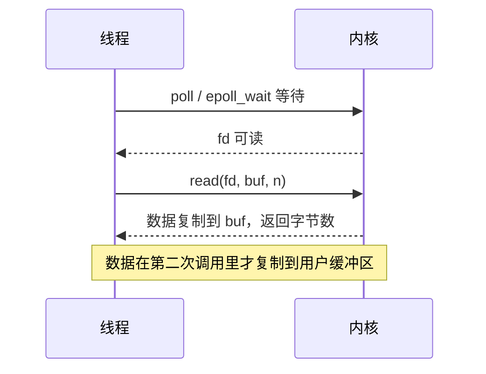
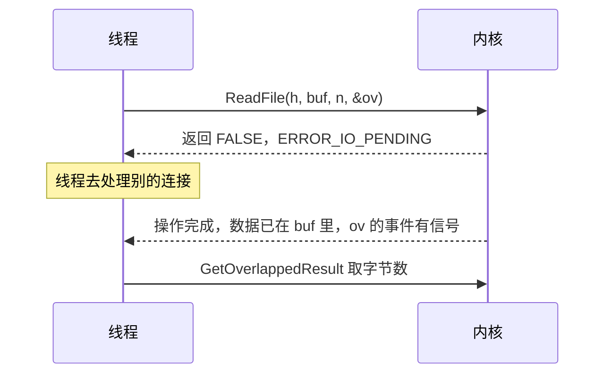
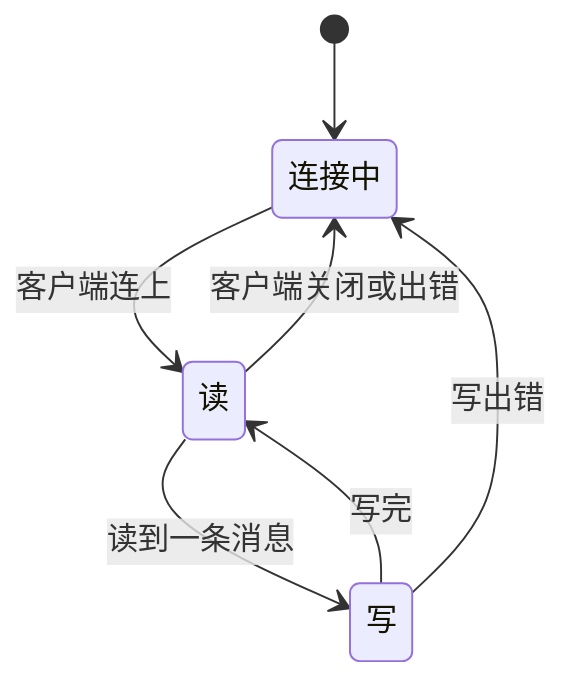

# A.14 异步 I/O 与重叠结构

[A.12](/教程/正文/系统编程/拓展A_Win32系统编程/A_12_管道与进程间通信) 的管道服务器为每个客户端开一个线程，线程阻塞在 `ReadFile` 上，直到这个客户端发来消息。客户端一多，线程数跟着涨，绝大多数线程在睡觉。另一类需求出现在文件上：一个编辑器打开 200 MB 的日志，读取和查找全部放在界面线程里，窗口就会卡住几秒。

这两件事在 Windows 上共用一套接口：重叠 I/O（overlapped I/O）。程序先把读或写交给内核，然后立刻拿回控制权，等操作完成时再回来取结果。这一页讲清楚它与 `select`/`epoll` 这套接口的根本差别，讲清 `OVERLAPPED` 结构里哪些成员归系统、哪些归程序，并用事件、`GetOverlappedResult` 和完成例程三种方式收取结果，最后写出一个单线程同时服务两个客户端的管道服务器。

## 1. 完成模型与就绪模型

主线[第 11 章](/教程/正文/系统编程/11_非阻塞IO与IO多路复用)的 `poll` 和 `epoll` 属于就绪通知：内核只告诉你某个描述符「现在读不会阻塞」，真正的 `read` 仍由你发起。重叠 I/O 属于完成通知：你把「从偏移 x 读 n 字节到 buf」整个交给内核，内核做完之后告诉你读了多少字节。

两张时序图放在一起看，差别在第二步。





就绪模型下一次 I/O 要两次系统调用，完成模型下只有一次；就绪模型里「可读」还是可能被别的线程抢先读走，完成模型不存在这个问题，因为数据已经落在你的缓冲区里了。代价是每个未完成的操作都要有一份 `OVERLAPPED` 和一块缓冲区，并且它们要活到操作结束。

::: concept sys-ov-completion-model title="就绪通知与完成通知"

`select`、`poll`、`epoll` 报告的是描述符此刻的状态，读写仍由程序发起，数据在发起读写时才复制。重叠 I/O 把操作本身交给内核，函数返回时操作可能已经开始，完成时数据已经在调用者提供的缓冲区里，程序只需取回结果。Linux 的 `io_uring` 也属于完成通知，主线第 11 章第 8 节介绍过它。

:::

两种模型不是互斥的。[A.13](/教程/正文/系统编程/拓展A_Win32系统编程/A_13_Winsock特有主题) 的 `WSAEventSelect` 把套接字变成可等待对象，仍然是就绪通知；本页的重叠套接字则走完成通知，[A.15](/教程/正文/系统编程/拓展A_Win32系统编程/A_15_IO完成端口与线程池) 的完成端口在它上面再搭一层。

## 2. 重叠句柄与 OVERLAPPED

句柄支不支持重叠 I/O，在打开时决定。`CreateFileW` 的 `dwFlagsAndAttributes` 加上 `FILE_FLAG_OVERLAPPED`，这个句柄上的读写就走异步路径：

```c
HANDLE h = CreateFileW(path, GENERIC_READ, FILE_SHARE_READ, NULL,
                       OPEN_EXISTING, FILE_FLAG_OVERLAPPED, NULL);
```

管道在 `CreateNamedPipeW` 的 `dwOpenMode` 里加同一个标志，见第 5 节。`socket` 创建的套接字默认就支持重叠 I/O，不需要额外设置。

有了重叠句柄，每次读写都要传一个 `OVERLAPPED` 结构：

```c
typedef struct _OVERLAPPED {
    ULONG_PTR Internal;
    ULONG_PTR InternalHigh;
    union {
        struct {
            DWORD Offset;
            DWORD OffsetHigh;
        };
        PVOID Pointer;
    };
    HANDLE hEvent;
} OVERLAPPED;
```

| 成员 | 谁写 | 含义 |
| --- | --- | --- |
| `Internal` | 系统 | 请求的状态码，发起时是 `STATUS_PENDING` |
| `InternalHigh` | 系统 | 成功完成时传输的字节数 |
| `Offset`、`OffsetHigh` | 程序 | 从文件的哪个字节开始，合成 64 位偏移 |
| `Pointer` | 系统 | 保留，初始化时清零即可 |
| `hEvent` | 程序 | 完成时被置为有信号的手动重置事件；不需要时可以留空 |

结构在传给函数之前要清零；`hEvent` 要么是 0，要么是一个有效的事件句柄。`ReadFile` 和 `WriteFile` 在开始一次操作时会把 `hEvent` 置为无信号，程序不必自己 `ResetEvent`；但手动重置事件在被等待之后一直保持有信号，同一个事件交给下一次操作之前先 `ResetEvent` 更清楚。

`Offset` 是重叠 I/O 与同步 I/O 最大的不同。重叠句柄不维护文件位置，`SetFilePointerEx` 移动的游标对它没有影响，读写的起点完全由 `OVERLAPPED` 决定。这一点用一个短程序验证：

```c
pos.QuadPart = 10;
SetFilePointerEx(h, pos, NULL, FILE_BEGIN);
printf("SetFilePointerEx moved the file pointer to 10\n");

ov.hEvent = CreateEventW(NULL, TRUE, FALSE, NULL);
ov.Offset = 0;
if (!ReadFile(h, buf, 4, &n, &ov) && GetLastError() == ERROR_IO_PENDING) {
    WaitForSingleObject(ov.hEvent, INFINITE);
    GetOverlappedResult(h, &ov, &n, FALSE);
}
printf("overlapped read with Offset = 0 returned %lu bytes: %c%c%c%c\n", n,
       buf[0], buf[1], buf[2], buf[3]);
```

文件内容是 `ABCDEFGHIJKLMNOPQRSTUVWXYZ` 开头，运行结果：

::: terminal title="PowerShell - offset_demo"

<span class="prompt">PS&gt;</span> gcc -std=c17 -Wall -Wextra -municode -o offset_demo.exe offset_demo.c

<span class="prompt">PS&gt;</span> ./offset_demo.exe alphabet.txt

SetFilePointerEx moved the file pointer to 10

overlapped read with Offset = 0 returned 4 bytes: ABCD

:::

读回来的是文件开头，不是第 10 个字节。两处操作互不干扰，也说明同一个句柄上可以同时有多个读，各自带自己的偏移。

::: concept sys-ov-lifetime title="每个未完成的操作各自一份 OVERLAPPED 和缓冲区"

一个未完成的重叠操作在完成之前，系统会一直使用传给它的 `OVERLAPPED` 结构和数据缓冲区。这两块内存必须保持有效、不能被复用，直到操作完成。因此每个同时进行的操作都要有自己的结构，不能在栈上定义一个反复使用，也不能在发起之后提前释放。结构里的 `Internal`、`InternalHigh` 由系统改写，程序不要碰；`Offset`、`OffsetHigh` 由程序填写，系统不会更新它们。

:::

事件只需要在同一个句柄上有多个操作同时进行时使用。不需要事件时，操作完成会把文件句柄本身置为有信号；第 7 节会看到，这种做法在多个操作同时进行时分不清是谁完成了。

## 3. 发起与完成

### 3.1 ReadFile 的三种结果

在一个重叠句柄上调用 `ReadFile`，返回值和错误码组合起来有三种情况：

| 返回 | `GetLastError()` | 含义 | 接下来做什么 |
| --- | --- | --- | --- |
| `TRUE` | 无意义 | 操作在函数返回之前就完成了，数据已在缓冲区 | 直接使用缓冲区 |
| `FALSE` | `ERROR_IO_PENDING`（997） | 操作已发起，尚未完成 | 等事件或 `GetOverlappedResult` |
| `FALSE` | 其他 | 调用失败，错误码说明原因 | 按错误码处理 |

第二种不是失败，这一点最容易看错。第三种才是真失败，典型例子是读的起点落在文件末尾之后，错误码为 `ERROR_HANDLE_EOF`（38）。不过下面会看到，在重叠句柄上这个失败也可能先以 997 返回，等取结果时才报出来；判断成败要以 `GetOverlappedResult` 为准。

第一种情况不能省。即使文件只有几十字节，读也可能在 `ReadFile` 内部就完成，此时事件已经被系统置为有信号，而操作并没有「挂起」过。下面这个程序把一个命名管道上的读安排成必定同步完成：客户端在服务器发起读之前就把数据写进了管道。

```c
ov.hEvent = CreateEventW(NULL, TRUE, FALSE, NULL);
ok = ReadFile(srv, buf, BUF_SIZE, &n, &ov);
printf("ReadFile returned %s, n = %lu, data = %.*s\n",
       ok ? "TRUE" : "FALSE", n, (int)n, buf);
```

::: terminal title="PowerShell - sync_complete"

<span class="prompt">PS&gt;</span> gcc -std=c17 -Wall -Wextra -o sync_complete.exe sync_complete.c

<span class="prompt">PS&gt;</span> ./sync_complete.exe

client connected

client wrote 12 bytes, the server has not asked for them yet

ReadFile returned TRUE, n = 12, data = already here

:::

一个只处理 `ERROR_IO_PENDING` 分支的程序，在这里会直接跳过读到的数据。

与之相对，起点在文件末尾或更后面的读不会成功，最终的错误码是 38。下面这个程序先读文件开头，再从文件末尾处发起一次读：

```c
ok = ReadFile(h, buf, sizeof buf, &n, &ov);
err = ok ? 0 : GetLastError();
printf("read at offset 0: ");
if (ok) {
    printf("TRUE, %lu bytes already in the buffer\n", n);
} else if (err == ERROR_IO_PENDING) {
    printf("FALSE, error %lu (ERROR_IO_PENDING)\n", err);
    WaitForSingleObject(ev, INFINITE);
    ok = GetOverlappedResult(h, &ov, &n, FALSE);
    ...
}

ov.Offset = size.LowPart;
ov.OffsetHigh = size.HighPart;
n = 0;
ok = ReadFile(h, buf, sizeof buf, &n, &ov);
```

::: terminal title="PowerShell - ov_basic"

<span class="prompt">PS&gt;</span> gcc -std=c17 -Wall -Wextra -municode -o ov_basic.exe ov_basic.c

<span class="prompt">PS&gt;</span> ./ov_basic.exe small.txt

file size: 26 bytes

read at offset 0: FALSE, error 997 (ERROR_IO_PENDING)

after the event: 26 bytes

read starting at offset 26 (the end of the file): FALSE, error 997

after the event: error 38 (ERROR_HANDLE_EOF)

:::

26 字节的文件，第一次读也返回 997。文件已经完整地躺在系统缓存里，读仍然要经过异步路径：重叠句柄上的操作几乎总是先返回 `ERROR_IO_PENDING`，同步完成是少数。第二行说明：起点在文件末尾或之后，`ReadFile` 仍可能先返回 997，真正的 38 要等 `GetOverlappedResult` 才报出来。起点在末尾之前、请求越过末尾时不算错误，读到多少算多少。

### 3.2 用 GetOverlappedResult 取结果

`GetOverlappedResult` 有两种用法：

```c
BOOL GetOverlappedResult(HANDLE hFile, LPOVERLAPPED lpOverlapped,
                         LPDWORD lpNumberOfBytesTransferred, BOOL bWait);
```

`bWait` 为 `TRUE` 时，函数在操作完成之前不返回，等效于先等 `hEvent` 再取结果。改用事件等待的写法是 `WaitForSingleObject(ov.hEvent, INFINITE)` 之后调用 `GetOverlappedResult(..., FALSE)`，区别在于等待可以带超时，也可以和别的对象一起用 `WaitForMultipleObjects` 等。

`bWait` 为 `FALSE` 且操作没完成时，函数返回 `FALSE`，错误码是 `ERROR_IO_INCOMPLETE`（996）。这个码可以用来轮询，也可以用来区分「已经完成」和「还在进行」。

事件只说明操作结束了，成功与否要看 `GetOverlappedResult` 的返回值和错误码。本节开头的程序正是靠它拿到 38。

### 3.3 同时进行多块读

重叠 I/O 真正省事的地方在这里：同一个文件分四块同时读，一个线程用一次等待就能收全部结果。`ov_chunks.c` 把文件按四等分切开，按 2、0、3、1 的顺序发起读，每块自带一个事件：

```c
static const int issue_order[CHUNKS] = {2, 0, 3, 1};
...
for (i = 0; i < CHUNKS; i++) {
    int k = issue_order[i];
    LONGLONG off = chunk * k;
    ...
    ov[k].Offset = (DWORD)off;
    ov[k].OffsetHigh = (DWORD)(off >> 32);
    ov[k].hEvent = events[k];
    if (ReadFile(h, buf[k], want, &n, &ov[k])) {
        printf("chunk %d completed inside ReadFile, %lu bytes\n", k, n);
        SetEvent(events[k]);
    } else if (GetLastError() != ERROR_IO_PENDING) {
        ...
    }
    pending++;
}

while (pending > 0) {
    wait_rc = WaitForMultipleObjects(CHUNKS, events, FALSE, INFINITE);
    i = (int)(wait_rc - WAIT_OBJECT_0);
    ok = GetOverlappedResult(h, &ov[i], &n, FALSE);
    ...
    ResetEvent(events[i]);
    pending--;
}
```

::: terminal title="PowerShell - ov_chunks"

<span class="prompt">PS&gt;</span> gcc -std=c17 -Wall -Wextra -municode -o ov_chunks.exe ov_chunks.c

<span class="prompt">PS&gt;</span> ./ov_chunks.exe chunks.dat

file size: 16777216 bytes, 4194304 bytes per chunk

issue  chunk 2: offset 8388608, 4194304 bytes

issue  chunk 0: offset 0, 4194304 bytes

issue  chunk 3: offset 12582912, 4194304 bytes

issue  chunk 1: offset 4194304, 4194304 bytes

done #1: chunk 0 (offset 0) 4194304 bytes, starts with 'A'

done #2: chunk 1 (offset 4194304) 4194304 bytes, starts with 'A'

done #3: chunk 2 (offset 8388608) 4194304 bytes, starts with 'A'

done #4: chunk 3 (offset 12582912) 4194304 bytes, starts with 'A'

:::

发起顺序是 2、0、3、1，完成顺序却是 0、1、2、3。`WaitForMultipleObjects` 返回的是「哪个事件有信号」，和发起顺序无关；这台机器上四个块都命中缓存，完成顺序由内核对请求的排队决定，多次运行可能不同，程序不应该依赖它。整个 16 MiB 文件分四块同时读完，四块缓冲区合计 16 MiB，块数再多就要把内存预算算进去。

`WaitForMultipleObjects` 单次最多等 64 个对象。要同时跟踪的操作超过这个数，靠数组加事件就撑不住了，这正是 [A.15](/教程/正文/系统编程/拓展A_Win32系统编程/A_15_IO完成端口与线程池) 的完成端口要解决的问题。

<Quiz
  :options="[
    { label: '读失败了，文件可能损坏', value: 'A' },
    { label: '读已经发起，只是还没有完成', value: 'B' },
    { label: '已经到了文件末尾', value: 'C' },
    { label: '这个句柄不支持重叠 I/O', value: 'D' }
  ]"
  answer="B"
>

<template #question>

重叠句柄上 `ReadFile` 返回 `FALSE`，`GetLastError()` 为 `ERROR_IO_PENDING`，说明什么？

</template>

正确答案是 **B**。997 表示操作已经被内核接受、正在处理，函数提前返回了。文件末尾是 38（`ERROR_HANDLE_EOF`），句柄不支持重叠会有别的错误码，而真正的失败既不是 997 也不是 38。

</Quiz>

## 4. 完成例程与可警报等待

事件加等待的方式要程序自己盯着事件。另一条路是把「完成后做什么」直接交给系统：`ReadFileEx` 和 `WriteFileEx` 接收一个完成例程（completion routine），操作完成时系统调用它。

```c
BOOL ReadFileEx(HANDLE hFile, LPVOID lpBuffer, DWORD nNumberOfBytesToRead,
                LPOVERLAPPED lpOverlapped,
                LPOVERLAPPED_COMPLETION_ROUTINE lpCompletionRoutine);

typedef VOID (CALLBACK *LPOVERLAPPED_COMPLETION_ROUTINE)(
    DWORD dwErrorCode, DWORD dwNumberOfBytesTransfered, LPOVERLAPPED lpOverlapped);
```

这三个参数正好够用：错误码、传输字节数、以及发起时传进去的那个 `OVERLAPPED` 指针。第三个参数是关键，完成例程靠它找回自己的上下文：把 `OVERLAPPED` 放在一个更大的结构体第一个成员的位置，用指针转换就能拿到整个结构体，A.15 讲完成端口时会反复用这个手法。

`ReadFileEx` 完全忽略 `hEvent`，这个成员可以留给程序放自己的数据。这带来一个便利：不需要为每个操作创建事件对象，完成例程的参数里已经带着 `lpOverlapped`。

完成例程不是中断，也不会在任意线程里跑。它是一次异步过程调用（APC），排队在发起 I/O 的那个线程上，只有该线程进入可警报等待（alertable wait）时才执行。可警报等待在 [A.10](/教程/正文/系统编程/拓展A_Win32系统编程/A_10_同步原语_等待函数与内核对象) 第 8 节讲过：`SleepEx`、`WaitForSingleObjectEx`、`WaitForMultipleObjectsEx`、`SignalObjectAndWait`、`MsgWaitForMultipleObjectsEx` 的最后一个参数为 `TRUE` 时进入。等待因为执行了完成例程而返回时，返回值是 `WAIT_IO_COMPLETION`（192）。

这个差别用 `Sleep` 和 `SleepEx` 一对比就出来了：

```c
if (!ReadFileEx(h, g_buf1, BUF_SIZE, &ov1, on_read)) { ... }
printf("first read issued, now Sleep(500), a non-alertable wait\n");
Sleep(500);
printf("after Sleep: completion routines run = %d\n", g_runs);

if (!ReadFileEx(h, g_buf2, BUF_SIZE, &ov2, on_read)) { ... }
printf("second read issued, now SleepEx(500, TRUE)\n");
rc = SleepEx(500, TRUE);
```

::: terminal title="PowerShell - no_alert"

<span class="prompt">PS&gt;</span> gcc -std=c17 -Wall -Wextra -municode -o no_alert.exe no_alert.c

<span class="prompt">PS&gt;</span> ./no_alert.exe chunks.dat

first read issued, now Sleep(500), a non-alertable wait

after Sleep: completion routines run = 0

second read issued, now SleepEx(500, TRUE)

  completion routine ran: 65536 bytes, error 0

  completion routine ran: 65536 bytes, error 0

SleepEx returned 192 (WAIT_IO_COMPLETION)

after SleepEx: completion routines run = 2

:::

第一次读早就在 `Sleep` 期间完成了，完成例程却一次也没跑。线程进入可警报等待后，队列里积压的两个完成例程一起执行，等待只返回一次 `WAIT_IO_COMPLETION`。这解释了为什么用完成例程的程序主循环总是一个 `SleepEx(INFINITE, TRUE)` 或 `WaitForSingleObjectEx(..., TRUE)`。

::: warning 完成例程只跑在发起 I/O 的线程里

`ReadFileEx` 的完成例程排队在调用 `ReadFileEx` 的那个线程上。线程不进入可警报等待，完成例程就一直不执行；别的线程进入可警报等待也没用。需要跨线程交付结果时用完成端口。

:::

把读写串起来，完成例程可以组成一条流水线。`readex_copy.c` 是一个用完成例程写的文件复制程序：读完成例程发起写，写完成例程发起下一次读，主线程只负责 `SleepEx`。

```c
static void CALLBACK read_done(DWORD err, DWORD bytes, LPOVERLAPPED ov) {
    copy_state *st = &g_state;
    LONGLONG at = ((LONGLONG)ov->OffsetHigh << 32) | ov->Offset;

    st->reads++;
    if (err != 0) { ... }
    printf("read  #%d: %lu bytes at offset %lld\n", st->reads, bytes,
           (long long)at);
    if (bytes == 0) {
        st->finished = 1;
        return;
    }
    st->write_ov.Offset = ov->Offset;
    st->write_ov.OffsetHigh = ov->OffsetHigh;
    if (!WriteFileEx(st->dst, st->buf, bytes, &st->write_ov, write_done)) { ... }
}

static void CALLBACK write_done(DWORD err, DWORD bytes, LPOVERLAPPED ov) {
    copy_state *st = &g_state;
    LONGLONG at = ((LONGLONG)ov->OffsetHigh << 32) | ov->Offset;

    st->writes++;
    ...
    st->offset = at + bytes;
    issue_read(st);
}
```

::: terminal title="PowerShell - readex_copy"

<span class="prompt">PS&gt;</span> gcc -std=c17 -Wall -Wextra -municode -o readex_copy.exe readex_copy.c

<span class="prompt">PS&gt;</span> ./readex_copy.exe four.dat four_copy.dat

copying 262144 bytes

read  #1: 65536 bytes at offset 0

write #1: 65536 bytes at offset 0

read  #2: 65536 bytes at offset 65536

write #2: 65536 bytes at offset 65536

read  #3: 65536 bytes at offset 131072

write #3: 65536 bytes at offset 131072

read  #4: 65536 bytes at offset 196608

write #4: 65536 bytes at offset 196608

done: 4 reads, 4 writes

:::

::: terminal title="PowerShell - fc"

<span class="prompt">PS&gt;</span> fc.exe /b four.dat four_copy.dat

Comparing files four.dat and FOUR_COPY.DAT

FC: no differences encountered

:::

这个版本一次只有一个读和一个写在进行，吞吐和 A.1 的 `cpw` 没有区别，收益在于主线程从头到尾没有阻塞在读写上。读完成例程里再发起下一次读之前，缓冲区的数据已经由写操作取走，因此这里一个缓冲区就够；要做双缓冲流水，准备两个读缓冲、两个写缓冲，在读完成例程里交替使用即可。

<Quiz
  :options="[
    { label: 'I/O 完成时，系统立刻在任意线程里调用它', value: 'A' },
    { label: '发起 I/O 的线程进入可警报等待时', value: 'B' },
    { label: '调用 GetOverlappedResult 时', value: 'C' },
    { label: '进程退出时', value: 'D' }
  ]"
  answer="B"
>

<template #question>

`ReadFileEx` 的完成例程什么时候运行？

</template>

正确答案是 **B**。完成例程是排队在发起线程上的 APC，只有该线程调用 `SleepEx`、`WaitForSingleObjectEx` 这类函数并传入 `TRUE` 时才执行。`GetOverlappedResult` 不会触发它。

</Quiz>

## 5. 管道上的重叠 I/O

把重叠 I/O 用到命名管道上，单线程就能同时服务多个客户端。每个实例有自己的管道句柄、自己的事件、自己的状态，主线程用 `WaitForMultipleObjects` 等所有实例的事件，谁有信号就处理谁。

[A.12](/教程/正文/系统编程/拓展A_Win32系统编程/A_12_管道与进程间通信) 的服务器为每个客户端开一个线程。本节写出的 `ov_pipe_server.c` 与它不同：一个实例一个状态机，全部在一个线程里。



每个状态对应一次重叠操作。状态机推进的规则是固定的：发起操作后如果返回 `ERROR_IO_PENDING`，就把控制权交回主循环；如果操作同步完成，就当场处理、继续发起下一个，直到某个操作真的挂起为止。`run()` 负责后者，`resume()` 在事件有信号之后取结果、推进状态，再调用 `run()`。

```c
static void run(pipe_inst *p) {
    for (;;) {
        DWORD n = 0;
        DWORD err;
        BOOL ok;

        if (p->state == ST_DEAD) {
            return;
        }
        ResetEvent(p->ev);
        switch (p->state) {
        case ST_CONNECTING:
            ok = ConnectNamedPipe(p->h, &p->ov);
            if (ok) {
                /* 客户端在调用时已经连上：直接进入读状态 */
                p->state = ST_READING;
                continue;
            }
            err = GetLastError();
            if (err == ERROR_PIPE_CONNECTED) {
                p->state = ST_READING;
                continue;
            }
            if (err == ERROR_IO_PENDING) {
                p->pending = 1;
                return;
            }
            p->state = ST_DEAD;
            return;
        case ST_READING:
            ok = ReadFile(p->h, p->buf, BUF_SIZE, &n, &p->ov);
            if (!ok && GetLastError() == ERROR_IO_PENDING) {
                p->pending = 1;
                return;
            }
            /* 其余情况：读到数据就转去写，出错就掉线 */
            ...
        }
    }
}
```

`ConnectNamedPipe` 有一个专门的重叠语义：客户端可能在调用之前就连上了，此时函数返回 `FALSE`，错误码是 `ERROR_PIPE_CONNECTED`（535），这不是失败，按成功处理即可。

服务器启动后，两个客户端分别连上，各发三条消息，中间各有停顿：

::: terminal title="PowerShell - 服务器与两个客户端"

<span class="prompt">PS&gt;</span> Start-Process -FilePath .\ov_pipe_server.exe -ArgumentList 10 -NoNewWindow -RedirectStandardOutput server.log

<span class="prompt">PS&gt;</span> .\pipe_client.exe -d 500 alpha beta gamma

sent "alpha", got "alpha"

sent "beta", got "beta"

sent "gamma", got "gamma"

<span class="prompt">PS&gt;</span> .\pipe_client.exe -d 500 one two three

sent "one", got "one"

sent "two", got "two"

sent "three", got "three"

:::

服务器日志（`server.log`）：

::: terminal title="PowerShell - Get-Content server.log"

```text
serving 2 instances of the mdr_echo pipe for 10 seconds
instance 0: client connected
instance 0: read 5 bytes
instance 0: wrote 5 bytes back
instance 1: client connected
instance 1: read 3 bytes
instance 1: wrote 3 bytes back
instance 0: read 4 bytes
instance 0: wrote 4 bytes back
instance 1: read 3 bytes
instance 1: wrote 3 bytes back
instance 0: read 5 bytes
instance 0: wrote 5 bytes back
instance 0: client went away (error 109)
instance 1: read 5 bytes
instance 1: wrote 5 bytes back
instance 1: client went away (error 109)
timer expired, shutting down
instance 0: cancelled operation ended with error 995
instance 1: cancelled operation ended with error 995
server stopped
```

:::

两个实例的读写交替出现在日志里，说明一个线程确实在交替推进两个客户端。客户端关闭后读失败、错误 109（`ERROR_BROKEN_PIPE`），这是 A.12 讲过的管道结束条件。最后两行来自第 6 节的取消逻辑，服务器退出前要先把还挂着的读取消掉。

上面用的 `pipe_client.c` 是为了演示交错而写的；A.12 的 `pipe_echo_client.c` 不用改动也能连上这个服务器，同样收发正常。

每个实例只有一个事件，因为同一时刻每个实例只允许有一个操作在进行。这是有意的：同一个实例上如果同时有连接、读、写三个操作，它们共用一个事件，事件有信号时无法判断是哪一个完成了。Microsoft 的示例程序也是这么做的，注释里写得很直白。要是确实想让一个实例并行做多个操作，就把事件数量加到与并发操作数相同，让每个 `OVERLAPPED` 用自己的事件。

实例数一多，这种写法就到了尽头：`WaitForMultipleObjects` 最多等 64 个对象，事件到 63 个以后再加实例就得换批次等待；每完成一个操作还要遍历一次数组判断是谁。A.15 的 I/O 完成端口用一个队列替代整组事件，这条上限就不存在了。

<Quiz
  :options="[
    { label: '调用失败，客户端没有连上', value: 'A' },
    { label: '客户端在调用之前已经连上，按成功处理', value: 'B' },
    { label: '管道已经断开，需要重新创建', value: 'C' },
    { label: '需要先调用 DisconnectNamedPipe', value: 'D' }
  ]"
  answer="B"
>

<template #question>

重叠的 `ConnectNamedPipe` 返回 `FALSE`，错误码为 `ERROR_PIPE_CONNECTED`（535），应该怎么处理？

</template>

正确答案是 **B**。这个错误码表示客户端在 `ConnectNamedPipe` 被调用之前就已经连上了，操作其实已经完成，直接把状态推进到读即可。把它当成失败丢掉，客户端会一直等不到回应。

</Quiz>

## 6. 取消与超时

重叠 I/O 没有超时参数。要给自己一个「最多等多久」的边界，得靠取消：先等事件一段时间，超时了就调用 `CancelIoEx`。

```c
BOOL CancelIoEx(HANDLE hFile, LPOVERLAPPED lpOverlapped);
```

`lpOverlapped` 为 `NULL` 时取消这个句柄上属于本进程的所有未完成操作；传入某个 `OVERLAPPED` 时只取消用这个结构发起的操作。和旧的 `CancelIo` 相比，`CancelIoEx` 可以取消别的线程发起的操作，新代码用后者。

取消是异步的：函数返回只表示「已经标记为取消」，操作真正结束还要等它完成，结束时 `GetOverlappedResult` 返回 `FALSE`、错误码 `ERROR_OPERATION_ABORTED`（995）。在拿到这个结果之前，`OVERLAPPED` 和缓冲区仍然不能释放。

`cancel_demo.c` 在一个没有客户端连接的管道上发起重叠的 `ConnectNamedPipe`，等 300 毫秒后取消：

```c
if (ConnectNamedPipe(h, &ov)) {
    printf("ConnectNamedPipe returned TRUE\n");
} else {
    printf("ConnectNamedPipe returned FALSE, error %lu\n", GetLastError());
}

rc = WaitForSingleObject(ev, 300);
if (rc != WAIT_TIMEOUT) { ... }
printf("waited 300 ms: WAIT_TIMEOUT, no client\n");

if (!CancelIoEx(h, &ov)) {
    printf("CancelIoEx failed: %lu\n", GetLastError());
} else {
    printf("CancelIoEx succeeded\n");
}
if (GetOverlappedResult(h, &ov, &n, TRUE)) {
    printf("GetOverlappedResult returned TRUE, %lu bytes\n", n);
} else {
    printf("GetOverlappedResult returned FALSE, error %lu "
           "(ERROR_OPERATION_ABORTED)\n",
           GetLastError());
}
```

::: terminal title="PowerShell - cancel_demo"

<span class="prompt">PS&gt;</span> gcc -std=c17 -Wall -Wextra -o cancel_demo.exe cancel_demo.c

<span class="prompt">PS&gt;</span> ./cancel_demo.exe

ConnectNamedPipe returned FALSE, error 997

waited 300 ms: WAIT_TIMEOUT, no client

CancelIoEx succeeded

GetOverlappedResult returned FALSE, error 995 (ERROR_OPERATION_ABORTED)

:::

`GetOverlappedResult` 的 `bWait` 传 `TRUE`，是因为取消请求发出之后操作可能还没结束，这里需要等它真正收尾。超时和取消合起来就是一个「带超时的重叠操作」：等待超时之后调用取消，再等操作结束。第 8 节的习题会把这个过程包成一个函数。

如果操作在取消之前就完成了，`CancelIoEx` 找不到要取消的请求，返回 `FALSE`、错误码 `ERROR_NOT_FOUND`（1168）。这不是错误，按「已经完成」处理即可，随后的 `GetOverlappedResult` 会报告真实结果。

同步 I/O 也能取消，用的是 `CancelSynchronousIo(线程句柄)`，它作用于另一个线程里阻塞在同步读写上的操作。这个接口在关闭服务器时把卡在 `ReadFile` 上的工作线程叫醒时有用，A.12 的线程版服务器就可以这样收尾。

## 7. 写错了会怎样

重叠 I/O 的错误几乎都围绕生存期。前两条最典型。

::: compare left-title="在函数里用局部 OVERLAPPED 和缓冲区" right-title="放进生存期足够长的结构体"

```c
static void issue_read_bad(void) {
    char buf[256];
    OVERLAPPED ov = {0};

    ReadFile(g_pipe, buf, sizeof buf, NULL, &ov);
    /* 函数返回，buf 和 ov 都失效，
       但读还在进行 */
}
```

---

```c
struct conn {
    OVERLAPPED ov;
    char buf[256];
    int state;
};

static void issue_read(struct conn *c) {
    ReadFile(g_pipe, c->buf, sizeof c->buf, NULL, &c->ov);
    /* c 在操作完成前一直有效 */
}
```

:::

左边这种写法编译器不会报错，运行时也不一定立刻出问题。`stale_buffer.c` 把两次调用安排成相同的栈帧形状：第一次发起读后返回，第二次调用在同一个位置分配同样大小的缓冲区并填满 `'L'`，然后等读完成。

::: terminal title="PowerShell - stale_buffer"

<span class="prompt">PS&gt;</span> gcc -std=c17 -Wall -Wextra -O0 -o stale_buffer.exe stale_buffer.c

<span class="prompt">PS&gt;</span> ./stale_buffer.exe

main: waiting for the client to connect

main: client connected

issue_read_bad: read issued into buf at 0000008329BFFC70, function returns

live_frame: buf at 0000008329BFFC60, filled with 'L'

client: wrote 17 bytes

live_frame: after the read completed, buf is: LLLLLLLLLLLLLLLLclient s

:::

两次打印的地址每次运行都不同，这里贴的是其中一次。

`live_frame` 的缓冲区被写进了 `client s`：读完成时系统把数据写进了一块属于别人的栈内存。真实程序里这块内存可能已经被另一个函数、另一个线程使用，后果从数据错乱到崩溃都有可能，而错误现场离真正的错误代码很远。用 `/GS` 或栈保护编译只能提高撞见的概率，根治办法是让 `OVERLAPPED` 和缓冲区跟着连接对象走。

注意地址只差 16 字节：`issue_read_bad` 返回之后，`live_frame` 的帧几乎正好覆盖了它。这正是这类错误难以复现的原因：换个编译器、换个优化级别，覆盖关系就变了。

第二条错误是把同一个 `OVERLAPPED` 同时用于两个操作。`reuse_ov.c` 在偏移 0 和 81920 处连续发起两个读，两次都用同一个 `ov`：

::: terminal title="PowerShell - reuse_ov"

<span class="prompt">PS&gt;</span> gcc -std=c17 -Wall -Wextra -municode -o reuse_ov.exe reuse_ov.c

<span class="prompt">PS&gt;</span> ./reuse_ov.exe chunks.dat

first  read at offset 0: FALSE, error 997

second read at offset 81920, same OVERLAPPED: FALSE, error 997

GetOverlappedResult: TRUE, 65536 bytes at offset 81920

:::

两个读都挂起了，可结构只有一个。事件有信号时，`GetOverlappedResult` 报告的是后一次操作的结果：偏移 81920、65536 字节。第一次读的完成信息被第二次覆盖，程序完全不知道第一部分读完没有，就把它当成完成了。要同时读两块，就必须用两个 `OVERLAPPED`，这是第 3 节 `ov_chunks.c` 每个块各自一个结构的原因。

第三条错误在等待的对象上。不用事件时，操作完成会把文件句柄置为有信号，于是「等文件句柄」看起来可行。`wait_handle.c` 在一个管道上同时发起两个读，都不带事件，然后等句柄本身：

::: terminal title="PowerShell - wait_handle"

<span class="prompt">PS&gt;</span> gcc -std=c17 -Wall -Wextra -o wait_handle.exe wait_handle.c

<span class="prompt">PS&gt;</span> ./wait_handle.exe

server: client connected

server: two reads in flight, neither OVERLAPPED has an event

writer: wrote "first", keeps the pipe open

server: waiting on the pipe handle returned 0

server: ov1 done

server: ov2 not done (error 996)

writer: wrote "second"

writer: closed the pipe

server: client thread finished

server: ov2 completed with 6 bytes: second

server: done

:::

第一次等待返回时只知道「某个读完成了」，不知道是哪个；`ov1` 完成了，`ov2` 仍然返回 996（`ERROR_IO_INCOMPLETE`）。等第二次数据到达，`ov2` 才完成。如果程序在第一次等待之后就去处理 `ov2` 的数据，读到的就是尚未填入的缓冲区。文件和管道句柄在有信号和无信号之间来回切换，两个操作共用一个信号源，信息量不足以区分它们。多个操作同时进行时，等各自的事件，或者用完成端口。

前两条错误都不会被编译器和运行时拦住。能让它早点暴露的办法只有两个：把 `OVERLAPPED` 和缓冲区放进随连接一起分配的结构体（第 5 节的做法），以及用 AddressSanitizer 之类的工具在调试构建里检查堆上的越界与释放后使用（见[编译器诊断与程序检查](/教程/正文/开发与工程基础/13_编译器诊断与程序检查)）。

<Quiz
  :options="[
    { label: '没有影响，栈帧不会被复用', value: 'A' },
    { label: '操作在完成时写入已经失效的栈内存，造成数据错乱或崩溃', value: 'B' },
    { label: '系统会自动取消这个操作', value: 'C' },
    { label: '编译时报错', value: 'D' }
  ]"
  answer="B"
>

<template #question>

在一个函数里用局部 `OVERLAPPED` 发起重叠读，函数在操作完成前返回，会怎样？

</template>

正确答案是 **B**。系统在操作完成时要往 `OVERLAPPED` 里写状态，往缓冲区里写数据；栈帧早已被后来的调用覆盖，写进去的是别人的内存。编译器不会为这种情况报错。

</Quiz>

## 8. 习题

### 8.1 巩固

<Exercise id="46401" :d="2" :w="2" multi>

`ov_basic.c` 里有两处对 `ERROR_IO_PENDING` 的处理，`sync_complete.c` 里则完全没有走到这个分支。

(1) _[1.1]_ 把 `sync_complete.c` 改成服务器先发起读、客户端后写，重新运行，写出现在会打印哪些行，并解释 `ReadFile` 的返回值为什么变了。

(2) _[2.2]_ `ov_basic.c` 第二次读从文件末尾开始，`ReadFile` 先返回 997，之后才报 38。把 `ov.Offset` 改成文件大小减 1，重新运行，预测并验证输出，说明「起点在末尾之前、请求越过末尾」与「起点在末尾之后」的差别。

(3) _[2.1]_ 用两三句话说明：主线第 11 章的 `epoll` 循环里，「判断哪个连接可读」和「把数据读进缓冲区」分别发生在什么时候；换成重叠 I/O 之后，哪一步不再由程序做。不需要写代码。

</Exercise>

<Exercise id="46402" :d="2" :w="1">

不看正文，写出 `OVERLAPPED` 里哪些成员由程序填写、哪些由系统改写，并说明 `Offset` 与 `SetFilePointerEx` 的关系。然后用 `offset_demo.c` 验证你的说法：把 `SetFilePointerEx` 的偏移改成 10，把 `ov.Offset` 改成 5，预测读回来的是哪四个字节。

</Exercise>

<Exercise id="46403" :d="3" :w="3">

写一个 `ov_grep.exe <file> <pattern>`：把文件分成 8 块，每块用一次重叠读同时发起，等全部完成后在各块内查找 `pattern`（按字节匹配，不要求处理跨块的情况），最后打印每块的匹配次数与总数。

验收：

- 自己造一个至少 8 MiB 的文件，在其中写入已知次数的目标串（用程序写，不要用现成的日志文件碰运气）；
- 输出形如 `chunk 3: 2 matches`，最后一行 `total: 17 matches`；
- 程序用一次 `WaitForMultipleObjects` 收全部完成，不能一个块一个块地等；
- `-Wall -Wextra` 无警告。

</Exercise>

### 8.2 编程

<Exercise id="46404" :d="3" :w="3">

把 `readex_copy.c` 改成双缓冲：两个读缓冲区、两个写缓冲区，读完成例程把数据交给空闲的写缓冲，写完成例程把缓冲标记为空闲并立刻发起下一次读。要求任意时刻最多有一个读和一个写在途，但读与写可以重叠进行。

验收：复制一个 64 MiB 的文件，`fc /b` 与原文件一致；在输出里能看到 `read #n` 与 `write #n-1` 交错出现，说明写还没有完成时下一次读已经发出。把缓冲区改回一个，重跑并比较读写的交错情况。

</Exercise>

<Exercise id="46405" :d="3" :w="3">

把 `ov_pipe_server.c` 扩展到 4 个实例，并加一条规则：客户端发来的消息若以 `quit` 开头，服务器回一条 `bye` 后主动断开这个客户端，重新进入连接状态。

验收：

- 同时启动 3 个 `pipe_client.exe`，每个发若干条消息，互不阻塞；
- 其中一个客户端发 `quit`，收到 `bye` 后连接结束；
- 服务器日志里能看到 4 个实例的编号和状态变化；
- 实例数组、事件数组、`WaitForMultipleObjects` 的对象数都由同一个常量派生出，改动实例数只改这一处。

</Exercise>

<Exercise id="46406" :d="4" :w="3">

写一个函数 `int ov_wait(HANDLE h, OVERLAPPED *ov, DWORD ms)`：等待 `ov->hEvent` 最多 `ms` 毫秒，超时则用 `CancelIoEx` 取消并等操作结束。返回值约定：1 表示操作完成（再用 `GetOverlappedResult` 判成败），0 表示超时并已取消，-1 表示等待本身出错。

用它改写 `cancel_demo.c`，然后构造三种情况逐一验证：

- 没有客户端连接，超时后取消，得到 995；
- 客户端在第 100 毫秒连上，函数返回 1，连接成功；
- 客户端在调用之前就连上，`ConnectNamedPipe` 当场返回 535，函数应当识别出这种情况并返回 1。

提示：第三种情况下 `hEvent` 没有被系统置位，直接等 300 毫秒会白等一场。

</Exercise>

<Exercise id="46407" :d="5" :w="4">

下面这个函数试图在主线程里读一个文件的两块，然后分别处理。它有三处与重叠 I/O 有关的缺陷：

```c
static HANDLE g_h;
static OVERLAPPED g_ov[2];

void read_two(void) {
    char *buf0 = malloc(65536);
    char *buf1 = malloc(65536);
    DWORD n;
    int i;

    for (i = 0; i < 2; i++) {
        g_ov[i].Offset = (DWORD)(i * 65536);
        g_ov[i].hEvent = NULL;
        ReadFile(g_h, i == 0 ? buf0 : buf1, 65536, &n, &g_ov[0]);
    }
    WaitForSingleObject(g_h, INFINITE);
    printf("%lu %lu\n", n, n);
    free(buf0);
    free(buf1);
}
```

(1) _[4.3]_ 指出三处缺陷，说明每一处会导致什么现象。

(2) _[4.3]_ 写出修正后的版本：让两块各自有独立的 `OVERLAPPED`、各自有事件，两个缓冲区活到全部完成之后，等待用 `WaitForMultipleObjects`，并且正确处理同步完成的分支。

(3) _[5.4]_ 用管道而不是文件搭一个能实际复现其中「缓冲区提前释放」的测试程序：读完成前把缓冲区释放并把指针置空，观察程序的输出或崩溃情况（`-O0` 与 `-O2` 各跑一次，说明结果为什么不同）。

</Exercise>

### 8.3 综合与挑战

<Exercise id="46408" :d="6" :w="5">

写一个 `ov_copy_many.exe <dest_dir> <file>...`：命令行给出若干源文件，程序用单线程同时复制所有文件，每个文件一个状态机（发起读、读完成后发起写、写完成后推进偏移），所有文件的事件放进同一个 `WaitForMultipleObjects` 数组，结束时打印文件数、总字节数，以及每个文件完成时相对开始的毫秒数。

验收：

- 至少 4 个源文件，其中两个大于 8 MiB，`fc /b` 全部一致；
- 输出里能看到不同文件的读写在时间上交错；
- 用 `QueryPerformanceCounter` 计时，说明总耗时明显小于逐个同步复制的时间；
- 源文件数超过 63 时给出明确提示（`WaitForMultipleObjects` 的上限），而不是静默出错。

</Exercise>

<Exercise id="46409" :d="7" :w="5" scope="*">

同一份 256 MiB 文件，用四种方式完整读一遍并计算校验和：同步 `ReadFile` 循环、重叠分块（16 块并发，事件等待）、`ReadFileEx` 完成例程链式读取、以及 A.6 的内存映射逐块遍历。每种方式跑 5 次，报告平均耗时与四次校验和是否一致，并回答：

- 四种方式在这台机器上的差距来自哪里？缓存命中与磁盘读取对结果的影响有多大（把文件换成一个刚生成、尚未进入缓存的大文件再测一次）？
- 完成例程链式读取只有一次读在途，为什么仍然可能比同步循环快或慢？
- 内存映射方式在什么情况下反而不合适？

注意：测量期间不要运行其他重负载程序；每个程序读同一个文件时用相同的块大小（建议 64 KiB 或 1 MiB），否则比较没有意义。

</Exercise>

## 9. 参考资料

- Microsoft Learn：Synchronous and Asynchronous I/O，https://learn.microsoft.com/en-us/windows/win32/fileio/synchronous-and-asynchronous-i-o
- Microsoft Learn：Synchronization and Overlapped Input and Output，https://learn.microsoft.com/en-us/windows/win32/sync/synchronization-and-overlapped-input-and-output
- Microsoft Learn：OVERLAPPED structure，https://learn.microsoft.com/en-us/windows/win32/api/minwinbase/ns-minwinbase-overlapped
- Microsoft Learn：ReadFile function，https://learn.microsoft.com/en-us/windows/win32/api/fileapi/nf-fileapi-readfile
- Microsoft Learn：ReadFileEx function，https://learn.microsoft.com/en-us/windows/win32/api/fileapi/nf-fileapi-readfileex
- Microsoft Learn：GetOverlappedResult function，https://learn.microsoft.com/en-us/windows/win32/api/ioapiset/nf-ioapiset-getoverlappedresult
- Microsoft Learn：Testing for the End of a File，https://learn.microsoft.com/en-us/windows/win32/fileio/testing-for-the-end-of-a-file
- Microsoft Learn：Alertable I/O，https://learn.microsoft.com/en-us/windows/win32/fileio/alertable-i-o
- Microsoft Learn：Named Pipe Server Using Overlapped I/O，https://learn.microsoft.com/en-us/windows/win32/ipc/named-pipe-server-using-overlapped-i-o
- Microsoft Learn：Canceling Pending I/O Operations，https://learn.microsoft.com/en-us/windows/win32/fileio/canceling-pending-i-o-operations
- Microsoft Learn：CancelIoEx function，https://learn.microsoft.com/en-us/windows/win32/fileio/cancelioex-func
- Johnson M. Hart, *Windows System Programming*, 4th ed., Addison-Wesley, 2010，第 14 章。
- Jeffrey Richter, Christophe Nasarre, *Windows via C/C++*, 5th ed., Microsoft Press, 2007，第 10 章。
- Pavel Yosifovich, *Windows 10 System Programming, Part 1*，第 11 章，https://leanpub.com/windows10systemprogramming
