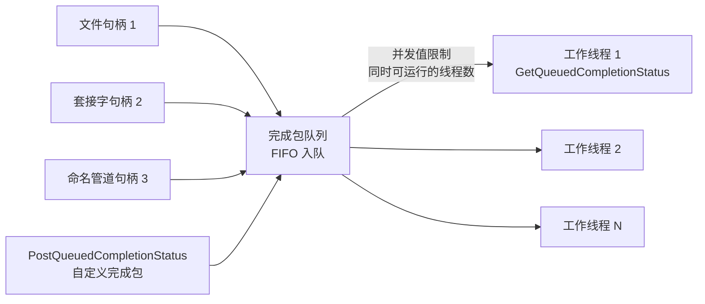

# A.15 I/O 完成端口与线程池

在 [A.14](/教程/正文/系统编程/拓展A_Win32系统编程/A_14_异步IO与重叠结构) 中，基于内核事件数组配合 `WaitForMultipleObjects` 的异步等待模型固然直观清晰，但在面对高并发网络服务时却迅速遭遇了物理天花板：单次等待至多容纳 64 个句柄的硬性约束，迫使大规模服务必须引入复杂的多级线程分拣树；而若退守至经典的多线程阻塞模型（每连接一线程），上万并发连接将直接导致数万个线程争抢调度，仅默认的线程栈空间保留量便会轻易耗尽数以十计的千兆字节虚拟内存，伴随而来的海量 CPU 核间上下文切换更会迅速压垮处理器流水线。无论是事件数组还是独立线程，其本质症结都在于将「网络连接数」与「系统等待实体数」进行了硬性的一对一绑定。

Windows NT 内核设计的集大成者——I/O 完成端口（I/O Completion Port，简称 IOCP），从根基上解开了这种死板绑定。在内核空间中，完成端口本质上是一个高度优化的高吞吐完成包（Completion Packet）队列，支持将成千上万个异构重叠句柄（套接字、文件、管道）统一绑定到同一个端口之上；当任意在途 I/O 履行完毕后，驱动程序会自动向该队列追加一枚轻量完成元数据包；而在用户态，仅需维系与 CPU 逻辑核心数相近的精简工作线程池，共同守候在该队列上竞争出队任务。这种机制不仅彻底摆脱了句柄数量上限的桎梏，而且通过内核级的并发线程节流（Thread Throttling）与 LIFO 线程唤醒算法，将 CPU 缓存局部性发挥到了极致。

## 1. 完成端口的模型

### 1.1 创建与关联

在 Win32 API 中，完成端口的创建与句柄的绑定复用了同一个多态接口：

```c
HANDLE CreateIoCompletionPort(HANDLE FileHandle, HANDLE ExistingCompletionPort,
                              ULONG_PTR CompletionKey, DWORD NumberOfConcurrentThreads);
```

第一种用法是只创建：`FileHandle` 传 `INVALID_HANDLE_VALUE`，`ExistingCompletionPort` 传 `NULL`，得到一个还没有任何句柄的端口。第二种用法是关联：`FileHandle` 是一个已经打开、支持重叠 I/O 的句柄，`ExistingCompletionPort` 是端口，`CompletionKey` 是随这个句柄一起记住的一个整数。返回值都是端口句柄。

文档里的「文件句柄」指任何支持重叠 I/O 的端点，不限于磁盘文件：套接字、命名管道、邮槽都行。一个句柄只能关联一个端口，关联之后一直保持到句柄关闭；反过来，一个端口可以关联任意多个句柄。

`CompletionKey` 的宽度是 `ULONG_PTR`，在 x64 上能装下一个指针。后面写服务器时，每个连接有一个上下文结构体，关联时就把它的地址填进这个完成键（completion key）。这样一来，工作线程取出完成包，先看完成键就知道是哪个连接的 I/O，再看 `OVERLAPPED` 指针就知道是哪一次操作。

### 1.2 完成包

等待一端用 `GetQueuedCompletionStatus`：

```c
BOOL GetQueuedCompletionStatus(HANDLE CompletionPort,
                               LPDWORD lpNumberOfBytesTransferred,
                               PULONG_PTR lpCompletionKey,
                               LPOVERLAPPED *lpOverlapped,
                               DWORD dwMilliseconds);
```

它一次给出三个值：这次 I/O 传输了多少字节、关联这个句柄时登记的完成键、发起 I/O 时用的那个 `OVERLAPPED` 结构的地址。返回值与 `lpOverlapped` 的组合决定了发生了什么：

- 返回 TRUE：取到了一个成功的完成包。
- 返回 FALSE，`*lpOverlapped` 非空：取到了一个失败的完成包，具体错误用 `GetLastError()`。被取消的操作也走这条路，错误码是 `ERROR_OPERATION_ABORTED`。
- 返回 FALSE，`*lpOverlapped` 为空：没有取到包，通常是超时。这时另外两个输出参数的值没有意义。

在底层调度队列中，完成包严格按照先进先出（FIFO）的顺序排入内核链表。然而，挂起在该端口上的工作线程唤醒策略却别具匠心地采用了后进先出（LIFO）的栈式调度：最后进入等待、刚刚释放 CPU 的那个线程，会被内核优先激活以出队最早到达的完成包。这一看似反常的设计蕴含着深刻的微架构优化——最近刚运行过的线程，其 CPU 核心私有一级/二级缓存（L1/L2 Data Cache）以及 TLB 页表缓存中极大概率依然“温热”，立刻唤醒它能最大程度规避冷启动带来的总线预取颠簸，使数据处理效率达到峰值。

::: concept win-iocp-packet title="完成包的三个字段"

每个完成包携带三项信息：本次 I/O 传输的字节数、发起 I/O 的句柄关联端口时指定的完成键、发起 I/O 时传入的 `OVERLAPPED` 结构的地址。`OVERLAPPED` 的 `Internal` 和 `InternalHigh` 两个成员由系统用来记录操作状态，应用不应依赖；完成键与 `OVERLAPPED` 指针本身的含义完全由应用定义。`PostQueuedCompletionStatus` 投递的包连这个结构都不需要，系统不检查也不改写其中任何内容。

:::

`GetQueuedCompletionStatusEx` 一次取多个完成包，填进一个 `OVERLAPPED_ENTRY` 数组，在高负载下能减少系统调用次数；代价是它对整批只返回一个布尔值，要自己检查每个条目里 `OVERLAPPED` 的状态才知道哪一次操作失败了。示例代码都用逐条取出的版本，逻辑更直白。

### 1.3 并发值

创建端口时的 `NumberOfConcurrentThreads` 限制的是「同时可运行的、与这个端口关联的线程数」，不是端口能关联的句柄数，也不是工作线程的总数。传 0 表示取处理器个数。

这个区别值得用代码看清楚。下面每轮创建 3 个工作线程，投递 6 个各占 100 ms 的任务，端口的并发值都是 1，只有任务的内容不同：一轮让工作线程忙等，一轮让它 `Sleep`。

```c
/* concurrency_probe.c 的 worker：完成键是任务编号，包内数值 0 表示忙等。 */
static DWORD WINAPI worker(LPVOID arg) {
    HANDLE port = (HANDLE)arg;
    DWORD count;
    ULONG_PTR key;
    OVERLAPPED *ov;

    for (;;) {
        if (!GetQueuedCompletionStatus(port, &count, &key, &ov, INFINITE)) {
            return 1;
        }
        if (key == 0) {
            return 0;
        }
        printf("  任务 %llu：线程 %lu\n", (unsigned long long)key,
               GetCurrentThreadId());
        if (count == 0) {
            spin(WORK_MS);
        } else {
            Sleep(WORK_MS);
        }
    }
}
```

::: terminal title="PowerShell - concurrency_probe"

```text
PS> gcc -std=c17 -Wall -Wextra concurrency_probe.c -o concurrency_probe.exe
PS> ./concurrency_probe.exe
并发值 1，任务忙等 100 ms：
  任务 1：线程 23304
  任务 2：线程 23304
  任务 3：线程 23304
  任务 4：线程 23304
  任务 5：线程 23304
  任务 6：线程 23304
  总计 656 ms
并发值 1，任务Sleep 100 ms：
  任务 1：线程 22348
  任务 2：线程 13788
  任务 3：线程 4020
  任务 4：线程 13788
  任务 5：线程 22348
  任务 6：线程 4020
  总计 219 ms
```

:::

在相同配置为 1 的并发阈值约束下，实测结果展现出了鲜明的调度反差：忙等版本中的 6 个计算任务被紧密锚定在单个工作线程上串行吞吐，总耗时达 656 毫秒；而在休眠版本中，三个线程交替接力，总耗时骤降至 219 毫秒。出现这一性能鸿沟的核心机理，完全系于「当前处于可运行状态（Runnable/Active）」这一定义上：持续忙等的线程始终霸占着 CPU 时间片，牢牢占据着该端口唯一的并发配额，致使系统绝不放行其他挂起的兄弟线程；而一旦运行中的线程因调用 `Sleep`、执行同步文件访问或获取锁而步入挂起等待状态，内核便能敏锐捕获到活跃线程数的暂时归零，从而毫不犹豫地从池中唤醒另一个候补线程顶上执行。官方工程指南通常建议将实际启动的工作线程数设置为物理核心数的两倍左右，正是为了确保在部分工作线程遭遇不可避免的外部同步阻塞时，CPU 计算资源依然能被迅速替补拉满。

由此机制推导出的另一项核心架构红利在于自动节流（Throttling）：当处于活动态的线程数已经达到并发上限时，即使内核队列中堆积了成千上万个已完成的 I/O 数据包，系统也绝不会鲁莽地唤醒更多线程引发争夺。这种刚性约束确保了系统的活跃线程数始终与物理处理器的并发能力精准匹配，彻底阻断了多线程高并发系统中最致命的“线程颠簸”（Thread Thrashing）。对于每次完成包处理耗时均在微秒级内的极速网络服务器，将并发值设为系统逻辑核心数即是最优解；而若单次业务逻辑伴随长耗时的混合计算，则可适度调大并发阈值以榨取更大的并行度。



<Quiz
  :options="[
    { label: '这个端口最多能关联的句柄数', value: 'A' },
    { label: '同时允许运行的、与该端口关联的线程数', value: 'B' },
    { label: '完成包队列的最大长度', value: 'C' },
    { label: '进程里工作线程的总数', value: 'D' }
  ]"
  answer="B"
>

<template #question>

`CreateIoCompletionPort` 的 `NumberOfConcurrentThreads` 参数表示什么？

</template>

正确答案是 **B**。它限制同时处于可运行状态的关联线程数，传 0 表示处理器个数；超过这个数的线程会等在端口上，直到有线程进入等待或结束。端口能关联多少个句柄不受它限制。

</Quiz>

## 2. 先把完成端口当作工作队列

完成端口不依赖 I/O。`PostQueuedCompletionStatus` 可以把任意三个值打包成一个完成包放进队列，系统不检查也不使用它们。于是完成端口就是一个由内核维护、按完成键分派的多生产者多消费者队列，应用这一侧不需要自己加锁。

下面这个程序完全不做 I/O：主线程投递 8 个任务包，完成键是任务结构体的地址，包内数值是任务编号；3 个工作线程取包、打印线程 ID、睡 30 ms。全部处理完后主线程投递 3 个完成键为 0 的退出包，工作线程看到 0 就返回。

```c
/* iocp_queue.c：投递任务包与退出包。 */
for (int i = 0; i < TASKS; i++) {
    g_tasks[i].id = i;
    PostQueuedCompletionStatus(port, (DWORD)(i + 1),
                               (ULONG_PTR)&g_tasks[i], NULL);
}
printf("main: 已投递 %d 个任务包\n", TASKS);

WaitForSingleObject(g_all_done, INFINITE);
printf("main: 全部任务处理完毕，投递 %d 个退出包\n", WORKERS);
for (int i = 0; i < WORKERS; i++) {
    PostQueuedCompletionStatus(port, 0, 0, &dummy);
}
```

::: terminal title="PowerShell - iocp_queue"

```text
PS> gcc -std=c17 -Wall -Wextra iocp_queue.c -o iocp_queue.exe
PS> ./iocp_queue.exe
main: 已投递 8 个任务包
worker 18708: 处理任务 0（包内数值 1）
worker 7984: 处理任务 1（包内数值 2）
worker 13436: 处理任务 2（包内数值 3）
worker 18708: 处理任务 3（包内数值 4）
worker 7984: 处理任务 4（包内数值 5）
worker 13436: 处理任务 5（包内数值 6）
worker 13436: 处理任务 6（包内数值 7）
worker 7984: 处理任务 7（包内数值 8）
main: 全部任务处理完毕，投递 3 个退出包
worker 13436: 收到退出包
worker 7984: 收到退出包
worker 18708: 收到退出包
```

:::

输出的线程 ID 每次运行都不同，任务落到哪个线程也不固定，这正是调度的正常表现。

退出方式值得记住：不要用 `TerminateThread`，也不要指望关掉端口句柄去叫醒线程。常用的做法是每个工作线程投递一个约定好的完成包，线程看到它就自行返回，返回前该关的句柄都关干净。关闭端口句柄是最后一步，此时已经没有线程在等它了。

::: concept win-iocp-exit-packet title="用完成包通知线程退出"

工作线程阻塞在 `GetQueuedCompletionStatus` 上时没有「停止」标志可查，正确做法是给每个线程投递一个约定的完成包（例如完成键为 0、`OVERLAPPED` 为空），线程取出后自行返回。关闭端口句柄虽然也能让等待中的调用以 `ERROR_ABANDONED_WAIT_0` 返回，但线程无法把它与真正的错误区分开，也来不及按自己的顺序收尾，所以只适合作为所有线程退出之后的最后一步。

:::

<Quiz
  :options="[
    { label: '关闭完成端口句柄', value: 'A' },
    { label: '为每个工作线程投递一个约定好的完成包', value: 'B' },
    { label: '对每个工作线程调用 TerminateThread', value: 'C' },
    { label: '设置一个全局停止标志，线程自己定期检查', value: 'D' }
  ]"
  answer="B"
>

<template #question>

怎样让阻塞在 `GetQueuedCompletionStatus` 上的工作线程干净地退出？

</template>

正确答案是 **B**。线程阻塞在系统调用里，看不到全局标志；投递退出包能让它从等待中返回并执行自己的清理代码。`TerminateThread` 不执行清理，关闭端口则会让线程来不及收尾。

</Quiz>

## 3. 每个 I/O 的上下文

完成包只给出字节数、完成键和一个 `OVERLAPPED` 指针，处理一次读还需要缓冲区、连接对象、下一次要做什么。这些都要放在一个自己定义的结构体里，让 `OVERLAPPED` 成为它的成员：

```c
struct conn {
    OVERLAPPED ov;
    SOCKET sock;
    WSABUF buf;
    char data[4096];
    int op;
    int id;
    LONG closing;
    unsigned long long total;
};
```

从 `OVERLAPPED` 指针求回整个结构体的地址有两种写法。第一种要求 `ov` 是第一个成员，这时两者的地址相同，直接转换就行。第二种用 `CONTAINING_RECORD`，它按成员在结构体里的偏移做减法，`ov` 放在哪里都可以：

```c
#define CONTAINING_RECORD(address, type, field) \
    ((type *)((PCHAR)(address) - (ULONG_PTR)(&((type *)0)->field)))
```

这个宏来自 Windows 驱动开发，随 `<windows.h>` 提供。参数分别是成员地址、结构体类型和成员名。页末的习题会让你把 `ov` 挪到结构体末尾再验证一遍。

::: concept win-iocp-context-lifetime title="上下文与缓冲区只由完成处理代码释放"

每次发起的异步 I/O 都要有自己的 `OVERLAPPED` 和缓冲区，它们在操作完成之前必须保持有效。即使发起函数立即返回成功，完成包仍然会排入端口，所以释放上下文和缓冲区的代码只能写在完成处理里，发起函数不能因为「已经成功」就提前释放。一个连接同一时刻只保留一个未完成的操作，可以省掉大半的计数逻辑。

:::

「立即成功也照样有完成包」这一条在文件上不容易观察到：对一个带 `FILE_FLAG_OVERLAPPED` 的文件句柄调用 `ReadFile`，本机对小文件的读也返回 `ERROR_IO_PENDING`。套接字上则很容易造出来：接收缓冲区里已有数据时，`WSARecv` 直接返回 0 并把数据放进缓冲区，随后完成包照样到达。

::: terminal title="PowerShell - sync_success_probe"

```text
数据已到达，开始 WSARecv
WSARecv 返回 0，错误 0，立即读到 10 字节
取完成包: 返回 1，字节 10，完成键 42，指针就是刚才那个
```

:::

如果发起函数一看到返回 0 就把连接上下文释放掉，工作线程稍后处理这个完成包时用的就是已经释放的内存。这类错误在测试里不一定崩，压力一大就出现，属于最难查的一类。

<Quiz
  :options="[
    { label: '把句柄转换成指针', value: 'A' },
    { label: '由成员的地址求出整个结构体的地址', value: 'B' },
    { label: '复制一份 OVERLAPPED', value: 'C' },
    { label: '计算完成键的哈希值', value: 'D' }
  ]"
  answer="B"
>

<template #question>

`CONTAINING_RECORD(ov, struct conn, ov)` 的作用是什么？

</template>

正确答案是 **B**。它减去成员在结构体里的偏移，得到结构体起始地址。成员是不是第一个都可以，这也是它比直接强制转换更通用的地方。

</Quiz>

## 4. 回声服务器

把上面几块拼起来就是 [A.13](/教程/正文/系统编程/拓展A_Win32系统编程/A_13_Winsock特有主题) 那个回声服务器的完成端口版。完整程序在 `code/系统编程/拓展A_Win32系统编程/A_15_IO完成端口与线程池/iocp_echo.c`，编译命令：

::: terminal title="PowerShell - 编译 iocp_echo"

```text
PS> gcc -std=c17 -Wall -Wextra iocp_echo.c -o iocp_echo.exe -lws2_32
```

:::

主线程负责接受连接。为了让程序在指定的秒数后自然结束，监听这一段用 `select` 带 200 ms 超时轮询，而不是一直阻塞在 `accept` 上；真正的服务器里这一段通常由 `AcceptEx` 代替，见 4.1 节末尾。

```c
SOCKET s = accept(listen_sock, NULL, NULL);
struct conn *c = calloc(1, sizeof *c);
c->sock = s;
c->id = next_id++;

/* 关联句柄，完成键就是这个连接的上下文指针 */
if (CreateIoCompletionPort((HANDLE)s, g_port, (ULONG_PTR)c, 0) == NULL) {
    /* ... */
}
AcquireSRWLockExclusive(&g_lock);
g_conns[g_conn_count++] = c;
ReleaseSRWLockExclusive(&g_lock);
InterlockedIncrement(&g_live);
printf("main: 接受 conn %d\n", c->id);

if (post_io(c, OP_RECV, 0) < 0) {
    conn_release(c);
}
```

工作线程只有一个循环：取包，出错就关连接，收到数据就发回去，发送完成再投下一次接收。`post_io` 在锁内检查 `closing` 标志再发起 I/O，避免关闭过程中又冒出一个新的挂起操作。

```c
/* 发起读或写。返回 0 表示请求已提交，完成包一定会到达。 */
static int post_io(struct conn *c, int op, DWORD len) {
    DWORD n = 0;
    DWORD flags = 0;
    int rc;

    AcquireSRWLockExclusive(&g_lock);
    if (c->closing) {
        ReleaseSRWLockExclusive(&g_lock);
        return -1;
    }
    c->op = op;
    c->buf.buf = c->data;
    c->buf.len = op == OP_RECV ? BUF_SIZE : len;
    ZeroMemory(&c->ov, sizeof c->ov);
    if (op == OP_RECV) {
        rc = WSARecv(c->sock, &c->buf, 1, &n, &flags, &c->ov, NULL);
    } else {
        rc = WSASend(c->sock, &c->buf, 1, &n, 0, &c->ov, NULL);
    }
    ReleaseSRWLockExclusive(&g_lock);
    if (rc == SOCKET_ERROR && WSAGetLastError() != WSA_IO_PENDING) {
        return -1;
    }
    return 0;
}
```

服务器运行 4 秒，期间用 A.13 的 `echo_client.exe` 同时连 3 个客户端，每个发 3 行（客户端分别在三个 PowerShell 窗口里启动）：

::: terminal title="PowerShell - 三个客户端打 iocp_echo"

```text
PS> ./iocp_echo.exe 4
工作线程 16 个，监听 127.0.0.1:23456，运行 4 秒
main: 接受 conn 1
worker 19276: conn 1 收到 24 字节
worker 1932: conn 1 回送 24 字节
worker 19276: conn 1 对端关闭
conn 1: 关闭，累计回送 24 字节
main: 接受 conn 2
worker 19276: conn 2 收到 24 字节
worker 1932: conn 2 回送 24 字节
worker 19276: conn 2 对端关闭
conn 2: 关闭，累计回送 24 字节
main: 接受 conn 3
worker 19276: conn 3 收到 30 字节
worker 1932: conn 3 回送 30 字节
worker 19276: conn 3 对端关闭
conn 3: 关闭，累计回送 30 字节
main: 时间到，取消所有连接的挂起 I/O
main: 全部连接已释放
main: 16 个工作线程全部退出
```

另外两个客户端的输出：

```text
bravo-1
bravo-2
bravo-3
charlie-1
charlie-2
charlie-3
```

:::

三个客户端各自完成得很快，所以主要看到两个工作线程轮流处理，接收和发送往往落在不同的线程上。把客户端换成 `slow_client.c`（每 300 ms 发一行、收到回显再发下一行），三个连接同时在跑，日志里会出现更多线程：

::: terminal title="PowerShell - 三个 slow_client"

```text
PS> ./iocp_echo.exe 5
工作线程 16 个，监听 127.0.0.1:23456，运行 5 秒
main: 接受 conn 1
worker 16928: conn 1 收到 13 字节
worker 14792: conn 1 回送 13 字节
main: 接受 conn 2
worker 14792: conn 2 收到 13 字节
worker 16928: conn 2 回送 13 字节
main: 接受 conn 3
worker 16928: conn 3 收到 15 字节
worker 14792: conn 3 回送 15 字节
worker 24080: conn 1 收到 13 字节
worker 16928: conn 3 收到 15 字节
worker 14792: conn 2 收到 13 字节
worker 26300: conn 1 回送 13 字节
worker 26300: conn 2 回送 13 字节
worker 14792: conn 3 回送 15 字节
worker 14792: conn 2 收到 13 字节
worker 26300: conn 1 收到 13 字节
worker 16928: conn 3 收到 15 字节
worker 24080: conn 2 回送 13 字节
worker 14792: conn 3 回送 15 字节
worker 14792: conn 1 回送 13 字节
worker 24080: conn 3 对端关闭
worker 14792: conn 1 对端关闭
worker 26300: conn 2 对端关闭
conn 2: 关闭，累计回送 39 字节
conn 3: 关闭，累计回送 45 字节
conn 1: 关闭，累计回送 39 字节
main: 时间到，取消所有连接的挂起 I/O
main: 全部连接已释放
main: 16 个工作线程全部退出
```

:::

三个连接由五个不同的线程处理过。线程数没变，连接数可以继续加，这就是完成端口要解决的事。

### 4.1 关闭时挂起的 I/O

服务器退出时，每个连接可能还有一个挂起的接收或发送。这些操作不会自己消失，必须先让它们完成，才能释放上下文。常见的三种做法在完成端口上给出的错误码并不相同，实测如下（`abort_probe.c`，对一个没有数据的套接字发起 `WSARecv`，300 ms 后由另一线程执行动作）：

::: terminal title="PowerShell - abort_probe"

```text
PS> gcc -std=c17 -Wall -Wextra abort_probe.c -o abort_probe.exe -lws2_32
PS> ./abort_probe.exe
mode 0：另一线程 closesocket
  完成包错误 1236（ERROR_CONNECTION_ABORTED）
mode 1：另一线程 CancelIoEx
  完成包错误 995（ERROR_OPERATION_ABORTED）
mode 2：另一线程 shutdown(SD_BOTH)
  没有完成包，调用超时（258）
```

:::

三行结果分别说明了三件事。`closesocket` 的文档说它会发起取消该套接字上所有挂起的重叠操作，但不保证 `closesocket` 返回时这些操作已经完成，因此不能关完套接字就去释放上下文；这里拿到的错误码是 `ERROR_CONNECTION_ABORTED`（1236）而不是 995，说明这条路的完成状态不能只按一种错误码来认，处理代码要按「任何失败都回收」来写。`CancelIoEx` 得到的是 `ERROR_OPERATION_ABORTED`（995）。`shutdown` 只是半关闭，它不会取消挂起的读，`GetQueuedCompletionStatus` 一直等到 2000 ms 超时才返回，错误码 258 是 `WAIT_TIMEOUT`，`lpOverlapped` 为空。

所以关闭顺序是：先 `CancelIoEx`，等工作线程拿到 995 的完成包，再由它关闭套接字并释放上下文。`iocp_echo` 的退出走这条路线：

```c
/* 挂起的 I/O 以 ERROR_OPERATION_ABORTED 完成，由工作线程负责释放 */
AcquireSRWLockExclusive(&g_lock);
for (int i = 0; i < g_conn_count; i++) {
    InterlockedExchange(&g_conns[i]->closing, 1);
    CancelIoEx((HANDLE)g_conns[i]->sock, NULL);
}
ReleaseSRWLockExclusive(&g_lock);

if (WaitForSingleObject(g_all_closed, 5000) == WAIT_OBJECT_0) {
    printf("main: 全部连接已释放\n");
}
```

用一个连上就不发数据的客户端验证：服务器在 4 秒后取消它的读，日志里出现「挂起 I/O 被取消」，连接随之释放。

::: terminal title="PowerShell - 取消挂起的读"

```text
PS> ./iocp_echo.exe 4
工作线程 16 个，监听 127.0.0.1:23456，运行 4 秒
main: 接受 conn 1
main: 时间到，取消所有连接的挂起 I/O
worker 3300: conn 1 的挂起 I/O 被取消
conn 1: 关闭，累计回送 0 字节
main: 全部连接已释放
main: 16 个工作线程全部退出
```

:::

::: details AcceptEx 与跳过完成包

生产服务器不希望在 `accept` 上阻塞主线程，`AcceptEx` 把接受连接本身也变成重叠操作：先用 `socket` 预建一个套接字，调 `AcceptEx(监听套接字, 预建套接字, 地址缓冲区, 0, sizeof(sockaddr_in) + 16, sizeof(sockaddr_in) + 16, &bytes, &ov)`。地址缓冲区要各留 `sizeof(sockaddr_in) + 16` 字节，多出的 16 字节放本地和远端地址；完成后用 `setsockopt(SO_UPDATE_ACCEPT_CONTEXT)` 把预建套接字与监听套接字绑定，它才能正常收发。`AcceptEx` 不在 `<winsock2.h>` 里，链接时加 `-lmswsock`，或者用 `WSAIoctl` 加 `SIO_GET_EXTENSION_FUNCTION_POINTER` 在运行时取函数指针。预建套接字要在 `CreateIoCompletionPort` 关联之后才能投递。

另一个选项是 `SetFileCompletionNotificationModes(handle, FILE_SKIP_COMPLETION_PORT_ON_SUCCESS)`：句柄关联了端口、又是以异步方式打开的，操作立即成功时不再排完成包。对套接字就很有用，因为接收缓冲区里已有数据时 `WSARecv` 经常直接返回 0。代价是发起函数必须自己处理立即成功的结果，而且要记得在这种情况下不等待完成包，否则会永远等下去。注意它是按句柄设置的，设置之后不能撤销。

:::

## 5. Windows 线程池

自己做线程池要处理不少杂事：线程数随负载伸缩、空闲线程回收、关闭时等待回调结束、回调出异常不能让进程崩掉。Windows 从 Vista 起提供了一组线程池对象，这些都由系统负责。四类对象覆盖四种等待来源：

| 对象 | 创建与投递 | 等待什么 |
| --- | --- | --- |
| 工作对象 | `CreateThreadpoolWork` / `SubmitThreadpoolWork` | 手动提交，立刻排队 |
| 计时器对象 | `CreateThreadpoolTimer` / `SetThreadpoolTimer` | 到期时间，可周期触发 |
| 等待对象 | `CreateThreadpoolWait` / `SetThreadpoolWait` | 一个可等待句柄有信号 |
| I/O 对象 | `CreateThreadpoolIo` / `StartThreadpoolIo` | 绑定句柄上的异步 I/O 完成 |

这四类对象默认在进程的默认线程池里运行；需要隔离时先用 `CreateThreadpool` 建一个独立池，再通过回调环境（`TP_CALLBACK_ENVIRON`）把对象放进去，这样一个模块的大量回调不会挤占别的模块。

四类对象都遵循同一套生命周期：创建、使用、`WaitForThreadpoolXxxCallbacks` 等待正在运行的回调结束、`CloseThreadpoolXxx`。这最后两步不能省，否则对象释放后回调还在跑。

### 5.1 工作对象

工作对象是最简单的异步执行：提交就排队，回调在池里的某个线程上运行。同一个工作对象可以提交多次，每次都产生一次回调。

```c
static VOID CALLBACK work_cb(PTP_CALLBACK_INSTANCE instance, PVOID context,
                             PTP_WORK work) {
    struct item *it = (struct item *)context;

    (void)instance;
    (void)work;
    printf("工作项 %2d：线程 %lu\n", it->id, GetCurrentThreadId());
    Sleep(50);
    InterlockedIncrement(&g_done);
}
```

提交 10 个，每个睡 50 ms：

::: terminal title="PowerShell - tp_work"

```text
PS> gcc -std=c17 -Wall -Wextra tp_work.c -o tp_work.exe
PS> ./tp_work.exe
工作项  0：线程 25816
工作项  1：线程 10712
工作项  2：线程 21372
工作项  3：线程 16824
工作项  4：线程 10712
工作项  5：线程 21372
工作项  6：线程 16824
工作项  7：线程 25816
工作项  8：线程 16824
工作项  9：线程 25816
全部完成：10 个
```

:::

10 个任务只用了 4 个线程，线程被反复复用。任务顺序也不固定，池里哪个线程空了就取下一个。

如果要提交的只是一次性的小回调，不需要对象，用 `TrySubmitThreadpoolCallback` 把函数和参数交出去即可；它失败时返回 FALSE，可以直接回退到同步执行。旧的 `QueueUserWorkItem` 属于上一代线程池接口，新代码不再使用。

### 5.2 计时器对象

计时器对象的到期时间用 `FILETIME` 表示，单位是 100 ns。正值表示从 1601 年起的绝对时间，负值表示相对于现在的时间，所以「300 ms 后」写成 `-(LONGLONG)300 * 10000`。周期以毫秒为单位，0 表示只触发一次。

```c
/* 相对时间：负的 100 ns 计数表示从现在起 300 ms */
li.QuadPart = -(LONGLONG)300 * 10000;
due.dwLowDateTime = li.LowPart;
due.dwHighDateTime = li.HighPart;

timer = CreateThreadpoolTimer(timer_cb, done, NULL);
SetThreadpoolTimer(timer, &due, 300, 0);
```

::: terminal title="PowerShell - tp_timer"

```text
PS> gcc -std=c17 -Wall -Wextra tp_timer.c -o tp_timer.exe
PS> ./tp_timer.exe
第 1 次触发：线程 25548，距开始 313 ms
第 2 次触发：线程 25548，距开始 610 ms
第 3 次触发：线程 25548，距开始 922 ms
第 4 次触发：线程 25548，距开始 1219 ms
第 5 次触发：线程 25548，距开始 1516 ms
计时器已关闭，共触发 5 次
```

:::

间隔都在 300 ms 上下浮动十几毫秒，这是线程池调度的正常误差，不是计时器不准。`SetThreadpoolTimer` 的最后一个参数是窗口长度，填非零值时系统可以把多个计时器攒到一起触发以省电，代价是精度进一步下降。取消计时器用 `SetThreadpoolTimer(timer, NULL, 0, 0)`，它只保证不再排新的回调，已经排队的回调照样会执行，所以后面还要 `WaitForThreadpoolTimerCallbacks`。

### 5.3 等待对象

等待对象把一个可等待的内核对象接到线程池上，句柄有信号时调用回调。与 [A.10](/教程/正文/系统编程/拓展A_Win32系统编程/A_10_同步原语_等待函数与内核对象) 的 `WaitForSingleObject` 相比，它不占线程；与 `RegisterWaitForSingleObject` 相比，它是新接口。

有一条规则容易踩：**每次有信号之前都要重新登记**。回调触发一次之后，等待对象就不再等这个句柄了。

```c
static void run_case(HANDLE ev, PTP_WAIT wait, int rearm) {
    LONG before = g_count;

    for (int i = 0; i < ROUNDS; i++) {
        if (rearm) {
            SetThreadpoolWait(wait, ev, NULL);
        }
        Sleep(80);
        SetEvent(ev);
        Sleep(120);
    }
    printf("  本轮共回调 %ld 次\n", (long)(g_count - before));
}
```

::: terminal title="PowerShell - tp_wait"

```text
PS> gcc -std=c17 -Wall -Wextra tp_wait.c -o tp_wait.exe
PS> ./tp_wait.exe
只登记一次，之后连续 3 次 SetEvent：
  第 1 次回调：线程 23848，result = 0
  本轮共回调 1 次
每次 SetEvent 前重新登记：
  第 2 次回调：线程 23848，result = 0
  第 3 次回调：线程 23848，result = 0
  第 4 次回调：线程 23848，result = 0
  本轮共回调 3 次
结束，共 4 次回调
```

:::

第一轮只登记一次，后面两次 `SetEvent` 没有任何反应；第二轮每次 `SetEvent` 前重新 `SetThreadpoolWait`，三次都触发了。`result` 参数为 0 表示句柄有信号，为 `WAIT_TIMEOUT` 表示超时。

等待对象不能等互斥量，传互斥量句柄会抛 `STATUS_THREADPOOL_HANDLE_EXCEPTION`。取消等待用 `SetThreadpoolWait(wait, NULL, NULL)`，同样要跟 `WaitForThreadpoolWaitCallbacks`。

### 5.4 I/O 对象

I/O 对象把文件句柄接到线程池内部的完成端口上，异步 I/O 完成时回调在池线程里运行。参数比前面三个多：回调收到 I/O 结果码、传输字节数，以及发起时用的 `OVERLAPPED` 指针。

使用它的关键是每次发起异步 I/O 之前都要调用 `StartThreadpoolIo`：

```c
OVERLAPPED ov = {0};
StartThreadpoolIo(io);
if (!ReadFile(f, g_buf, sizeof g_buf - 1, NULL, &ov)) {
    DWORD err = GetLastError();
    if (err == ERROR_IO_PENDING) {
        WaitForSingleObject(g_event, 5000);
    } else {
        /* 发起就失败了，要撤销刚才的通知 */
        CancelThreadpoolIo(io);
        printf("ReadFile 失败: %lu\n", err);
    }
}
```

::: concept win-threadpool-startio title="每次异步 I/O 前都要 StartThreadpoolIo"

在 I/O 对象绑定的句柄上发起每一次异步 I/O 之前，都必须调用 `StartThreadpoolIo`。漏掉这一步，线程池会忽略这次操作完成的通知，并破坏内存。发起函数立即失败时（返回值不是 `ERROR_IO_PENDING`），要调用 `CancelThreadpoolIo` 撤销刚才的通知，否则同样会出问题。

:::

这不是理论上的警告。把 `StartThreadpoolIo` 去掉、其余代码不动，本机三次运行都以 `0xC000000D`（`STATUS_INVALID_PARAMETER`）在 `WaitForThreadpoolIoCallbacks` 里终止，前面那句 `ReadFile` 的打印正常出现。文档没有承诺一定会崩，只说「可能破坏内存」，崩溃只是最容易被发现的一种后果。

正常运行时，程序读一个内容固定的测试文件：

::: terminal title="PowerShell - tp_io"

```text
PS> gcc -std=c17 -Wall -Wextra tp_io.c -o tp_io.exe
PS> ./tp_io.exe
读取完成：81 字节，首行：第一行：线程池 I/O
结束，回调 1 次
```

:::

如果句柄设置了 `FILE_SKIP_COMPLETION_PORT_ON_SUCCESS`，立即成功的操作不会触发回调，这时 `StartThreadpoolIo` 之后要自己检查发起函数的返回值并取消通知。这也是线程池 I/O 文档反复强调 `CancelThreadpoolIo` 的原因。

<Quiz
  :options="[
    { label: '没有影响，回调照常执行', value: 'A' },
    { label: '线程池忽略这次完成，并可能破坏内存', value: 'B' },
    { label: '读取一定失败，返回错误码', value: 'C' },
    { label: '回调会执行两次', value: 'D' }
  ]"
  answer="B"
>

<template #question>

在 I/O 对象上发起异步读之前忘记调用 `StartThreadpoolIo`，会怎样？

</template>

正确答案是 **B**。文档的说法是线程池会忽略这次操作的完成通知并破坏内存；本机实测是在随后等待回调结束时以 `0xC000000D` 终止。发起失败时还要用 `CancelThreadpoolIo` 撤销通知。

</Quiz>

### 5.5 清理组与选型

对象多了以后，逐个 `WaitForThreadpoolXxxCallbacks` 加 `CloseThreadpoolXxx` 很啰嗦。清理组（cleanup group）把这些对象登记在一起，`CloseThreadpoolCleanupGroupMembers` 一次等完并释放全部成员。适合一个请求、一个会话对应一组对象，结束时整组回收。

什么时候用线程池，什么时候自己开线程？回调很短、数量不定、希望线程数随负载自动调整，用线程池；需要控制线程优先级、亲和性、线程本地状态，或者线程要活很久且有自己的循环，就自己开。完成端口服务器属于后者：工作线程数按并发值固定，每个线程有自己的循环，用线程池反而不好控制。

## 6. 与 epoll 事件循环对照

主线[第 12 章](/教程/正文/系统编程/12_事件循环)的 evl 和这里的完成端口解决同一个问题，模型相反。

epoll 是就绪通知：`epoll_wait` 告诉你某个描述符现在可读，接下来由你调用 `read`，读多少、读几次、数据放在哪里都是你自己的事。整台服务器通常只有一个循环线程，回调里不能阻塞。完成端口是完成通知：你先发起读，内核把数据放进你给的缓冲区，读完再通知你。处理完成包的是多个线程，可以阻塞，但同一个连接的两个完成包可能落在不同线程上，所以连接状态要么加锁，要么保证同一时刻只有一个操作在飞。

| 方面 | epoll 事件循环（第 12 章） | I/O 完成端口 |
| --- | --- | --- |
| 通知时机 | 就绪，可以读了 | 已完成，数据在缓冲区里 |
| 谁执行 I/O | 调用方在循环线程里调用 `read` | 内核执行，应用只发起和收尾 |
| 并发单位 | 一个循环一个线程 | 一个端口配一组线程 |
| 连接状态 | 只在循环线程里访问，无需加锁 | 多个工作线程访问，要同步 |
| 缓冲区 | 由应用在读之前准备 | 发起时随 `OVERLAPPED` 一起交出 |
| 关闭路径 | 摘表、`epoll_ctl` 删除、关闭 | 取消挂起 I/O，等完成包回收上下文 |

跨平台的库在两边各用一套机制：libuv 在 Linux 上用 epoll，在 Windows 上用 IOCP，向上提供同一套回调接口。所以「用 libuv 就不用懂完成端口」只对了一半：调优、排查泄漏、理解回调在哪个线程运行，仍然要知道底下是哪套机制。

在工程选型权衡上：面向现代 Windows 开发的高吞吐服务端系统，若希望将底层的线程生命周期管理全权托付给系统内核、且并发规模处于几十至数百个操作的区间内，线程池 I/O 对象（`TP_IO`）通常是代码维护成本最低的优选方案；而当系统需要面对成千上万的高并发长连接、需要对端口并发阈值施加精准节流、需要定制专属工作线程的优先级与亲和性、或者需要将异构的文件与套接字请求纳入统一队列调度时，原生 I/O 完成端口则是不可逾越的工业级中流砥柱。对于单线程或请求偶发的轻量工具，则直接采用清晰简洁的同步 I/O 即可。

::: generate win-iocp-vs-epoll kind=comparison concepts=win-iocp-packet,win-iocp-context-lifetime

面向刚读完第 12 章、熟悉 epoll 就绪模型的读者，把同一个回声服务器的两种写法并排讲清楚：epoll 版里「读」发生在回调中、缓冲区属于连接对象，IOCP 版里「读」在发起时就把缓冲区交出去、完成包由任意工作线程处理。重点说明连接状态为什么在一种写法里可以不加锁、在另一种里必须加锁，以及关闭连接时两者分别要等什么。

:::

## 7. 习题

### 7.1 巩固

<Exercise id="46501" :d="2" :w="2">

`concurrency_probe.c` 在并发值为 1 时，忙等版本 6 个任务用了 656 ms，`Sleep` 版本只用了 219 ms。把两个 `run` 调用的并发值分别改成 2 和 0，先写下你预计的总时间，再运行验证。

然后解释：为什么并发值限制的是「可运行的线程数」而不是「工作线程总数」，以及这对服务器该开多少工作线程意味着什么。

</Exercise>

<Exercise id="46502" :d="3" :w="3">

`iocp_echo.c` 的 `struct conn` 把 `OVERLAPPED ov` 放在第一个成员。把 `ov` 移到结构体末尾，改用 `CONTAINING_RECORD` 从完成包里的指针求回 `conn`，重新编译，用三个客户端验证输出与改动前一致。

再回答：如果 `ov` 属于另一个结构体，而那个结构体才是 `conn` 的成员，`CONTAINING_RECORD(ov, struct conn, ov)` 会得到什么？

</Exercise>

<Exercise id="46503" :d="3" :w="3">

用完成端口做一个任务队列：主线程投递 20 个「计算」任务，每个任务把编号的平方累加进一个全局结果；3 个工作线程取任务，处理完用 `InterlockedIncrement` 更新完成计数；主线程等计数到 20 后打印总和并投递退出包。

要求：

1. 任务参数用完成键传递指针，用 `PostQueuedCompletionStatus` 的字节数参数传递编号，说明为什么不能反过来把指针放进字节数参数。
2. 连续运行两次，总和一致，且都等于 1² + 2² + … + 20²。

</Exercise>

### 7.2 编程

<Exercise id="46504" :d="4" :w="3">

把 `iocp_echo.c` 改成大写回声服务器：收到一行就转成大写回送，收到 `quit` 时关闭这个连接。

要求：

1. 就地转换：`CharUpperBuffA` 接受缓冲区和长度，直接在 `c->data` 上前 N 个字节做转换，转换后仍用 `c->buf.len = n` 发回去。
2. 每个连接记住自己累计收到和回送的字节数，关闭时打印。判断 `quit` 时要先把行尾的回车换行去掉再比较。
3. 用 `slow_client.c` 开 3 个并发连接验证，其中一个发送 `quit`。

</Exercise>

<Exercise id="46505" :d="4" :w="4">

用线程池 I/O 对象写一个 `tp_cat.c`：异步读命令行给出的文件，把内容写到标准输出，读到文件末尾为止。

要求：

1. 每次发起 `ReadFile` 前调用 `StartThreadpoolIo`，发起失败时调用 `CancelThreadpoolIo`。
2. 用「本次读到的字节数小于请求的字节数」或读到 0 字节判断结束；结束时打印总字节数，与文件大小对照。
3. 把一个几 MB 的文件和一个空文件都跑一遍。

</Exercise>

<Exercise id="46506" :d="4" :w="3">

用线程池等待对象接上 [A.10](/教程/正文/系统编程/拓展A_Win32系统编程/A_10_同步原语_等待函数与内核对象) 的命名事件 `Local\MdrTutorial.Ready`：写两个程序，一个 `CreateEventW` 创建这个命名事件并在 2 秒后 `SetEvent`，另一个用 `CreateThreadpoolWait` 等它，回调里打印经过的毫秒数。

要求：

1. 等待方每次回调后重新 `SetThreadpoolWait`，连续触发 3 次，验证三次回调都发生。
2. 结束前用 `SetThreadpoolWait(wait, NULL, NULL)` 和 `WaitForThreadpoolWaitCallbacks` 收尾，并说明为什么不能直接 `CloseThreadpoolWait`。

</Exercise>

<Exercise id="46507" :d="5" :w="4">

给 `iocp_echo.c` 加空闲超时：每个连接记录最后一次收到数据的时刻，另一个线程每 2 秒扫描一次连接表，超过 10 秒没有数据的连接调用 `CancelIoEx` 并标记关闭。

要求：

1. 扫描线程与工作线程用同一把 SRW 锁保护连接表；`CancelIoEx` 在锁内调用，释放上下文仍在工作线程里。
2. 用 `idle_client.exe` 连上后不发数据，观察它在 10 秒左右被关闭；再用 `slow_client.exe` 每 300 ms 发一行，确认它不会被误关。
3. 说明为什么扫描线程不能直接 `closesocket` 并 `free`。

</Exercise>

### 7.3 综合与挑战

<Exercise id="46508" :d="6" :w="5">

用完成端口写一个并行文件复制器 `iocp_copy.c`：命令行给出若干「源文件 目标文件」对，全部复制完成后退出。

要求：

1. 源和目的句柄都以 `FILE_FLAG_OVERLAPPED` 打开，都关联到同一个端口；读完成包发起写，写完成包发起下一次读，读到 0 字节时结束这一对。
2. 每个文件对有自己的上下文，完成键指向它；所有文件对复制完后，主线程投递退出包。
3. 用 `fc /b 源 目标` 验证副本，并复制一个不小于 10 MB 的文件确认分块读写正确。
4. 说明为什么每个文件对同一时刻只能有一个读或一个写在进行，以及如果同时投递读和写需要改什么。

</Exercise>

<Exercise id="46509" :d="7" :w="4" scope="*">

阅读[第 12 章](/教程/正文/系统编程/12_事件循环)的 `lecho_evl.c` 与本页的 `iocp_echo.c`，写一份对照说明，回答三个问题：

1. 连接的读缓冲区在两边分别由谁持有、什么时候可以释放？
2. 一边的连接状态为什么可以不加锁，另一边为什么必须加锁？如果给 IOCP 版改成「同一连接同时只有一个操作在飞」，还需要锁吗？
3. 一边在 `SIGTERM` 下优雅退出，另一边在「运行时间到」时退出，两者要等的对象分别是什么？

可以只在 Windows 上编译运行 IOCP 版，Linux 版阅读源码即可；如果手边有 Linux 环境，把两边都跑一遍，用 `slow_client` 与 `nc` 各发 3 行，比较服务器日志的交错方式。

</Exercise>

## 8. 参考资料

- Microsoft Learn，I/O Completion Ports：<https://learn.microsoft.com/en-us/windows/win32/fileio/i-o-completion-ports>
- Microsoft Learn，CreateIoCompletionPort：<https://learn.microsoft.com/en-us/windows/win32/fileio/createiocompletionport>
- Microsoft Learn，GetQueuedCompletionStatus：<https://learn.microsoft.com/en-us/windows/win32/api/ioapiset/nf-ioapiset-getqueuedcompletionstatus>
- Microsoft Learn，GetQueuedCompletionStatusEx：<https://learn.microsoft.com/en-us/windows/win32/api/ioapiset/nf-ioapiset-getqueuedcompletionstatusex>
- Microsoft Learn，PostQueuedCompletionStatus：<https://learn.microsoft.com/en-us/windows/win32/fileio/postqueuedcompletionstatus>
- Microsoft Learn，CancelIoEx：<https://learn.microsoft.com/en-us/windows/win32/fileio/cancelioex-func>
- Microsoft Learn，closesocket：<https://learn.microsoft.com/en-us/windows/win32/api/winsock/nf-winsock-closesocket>
- Microsoft Learn，SetFileCompletionNotificationModes：<https://learn.microsoft.com/en-us/windows/win32/api/winbase/nf-winbase-setfilecompletionnotificationmodes>
- Microsoft Learn，AcceptEx：<https://learn.microsoft.com/en-us/windows/win32/api/mswsock/nf-mswsock-acceptex>
- Microsoft Learn，Thread Pools：<https://learn.microsoft.com/en-us/windows/win32/procthread/thread-pools>
- Microsoft Learn，Thread Pool API：<https://learn.microsoft.com/en-us/windows/win32/procthread/thread-pool-api>
- Microsoft Learn，StartThreadpoolIo：<https://learn.microsoft.com/en-us/windows/win32/api/threadpoolapiset/nf-threadpoolapiset-startthreadpoolio>
- Microsoft Learn，CreateThreadpoolIo：<https://learn.microsoft.com/en-us/windows/win32/api/threadpoolapiset/nf-threadpoolapiset-createthreadpoolio>
- Microsoft Learn，SetThreadpoolTimer：<https://learn.microsoft.com/en-us/windows/win32/api/threadpoolapiset/nf-threadpoolapiset-setthreadpooltimer>
- Microsoft Learn，SetThreadpoolWait：<https://learn.microsoft.com/en-us/windows/win32/api/threadpoolapiset/nf-threadpoolapiset-setthreadpoolwait>
- libuv Design overview：<https://docs.libuv.org/en/v1.x/design.html>
- Johnson M. Hart，*Windows System Programming*，4th ed.，第 9、14 章。
- Jeffrey Richter、Christophe Nasarre，*Windows via C/C++*，5th ed.，第 10、11 章。
- Pavel Yosifovich，*Windows 10 System Programming, Part 1*，第 9 章。
