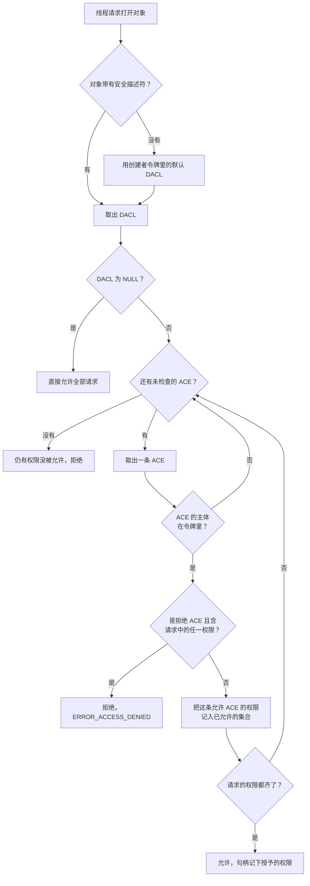

# A.16 安全与访问控制（ACL 与令牌）

同一份程序，装在 `C:\Program Files` 下就能跑，拷到别的目录也正常，可它一启动就报「拒绝访问」，因为程序要往自己的安装目录写日志。A.12 的回声服务器用默认设置创建了命名管道，任何本机用户都能连上来读走数据。还有人遇到「拒绝访问」时，直接把对象的访问控制改成「所有人完全控制」，问题当场消失，也没有人再提。

这三件事分别对应访问检查、安全描述符里的访问控制列表和访问令牌。这一页先把一次访问检查的参与者讲清楚，再分别拆开令牌和访问控制列表两部分：怎样读自己进程的令牌，怎样读一个文件的安全描述符并与 `icacls` 对上，怎样为新文件或命名管道指定只有自己人才能访问的 DACL，最后是怎样正确启用特权。做完这些，应当能回答「这次打开为什么被拒绝」，也能写出一个默认就拒绝别人的对象。

本页的示例都在 Windows 11 x64 上用 MinGW-w64 GCC 13.2 编译运行，全部以普通（未提升）用户身份执行，不触发用户账户控制（User Account Control，UAC）的提示。输出里的计算机名、用户名和 SID 的机器部分已替换成 `DESKTOP-EXAMPLE`、`user` 与 `S-1-5-21-…-1001`。

## 1. 一次访问检查里有哪些角色

访问检查（access check）有两方。主动的一方是发起请求的线程，它带着一个访问令牌（access token），令牌里写着这个线程代表哪个用户、属于哪些组、有哪些特权。被动的一方是可保护对象（securable object），文件、目录、注册表项、命名管道、进程、线程、事件、互斥量都算，每个对象带一个安全描述符（security descriptor），里面有一份自主访问控制列表（discretionary access control list，DACL）。

线程请求打开对象时，系统拿令牌里的安全标识符（security identifier，SID）逐条比对 DACL 里的访问控制项（access control entry，ACE），得出允许或拒绝。这个过程只发生在打开的那一刻。

::: concept win-ac-check-once title="访问权限在打开对象时检查一次"

打开对象（`CreateFileW`、`CreateNamedPipeW`、`OpenProcess` 等）时，系统做一次访问检查，把结果记在返回的句柄上。此后用这个句柄读写、等待、查询，都不再重新检查 DACL。想改变已经打开的句柄能做什么，只能关闭它再打开一次。

:::

这条规则贯穿整页。它解释了为什么「文件正在被使用」时可以删掉它，也解释了为什么给一个正在运行的程序补权限不会立刻生效：程序手里的句柄是旧的。



用 POSIX 的说法对照一下。主线第 3 章讲的权限模型是三个三元组加上一个「谁是属主」的判断，能表达的只是读、写、执行三种权限，一条记录管一个属主或一个组；root 直接跳过整套检查，`CAP_DAC_OVERRIDE` 和 `CAP_DAC_READ_SEARCH` 两个能力也绕过检查。Windows 这边没有「超级用户一律放行」这回事：管理员能不能写一个文件，同样要看 DACL，区别只在于管理员可以改 DACL、可以接管所有权。访问控制列表也不止三项权限，而是 32 位的访问掩码，还能按主体逐条排列、按继承关系下发到子对象。

## 2. SID 与访问令牌

### 2.1 SID 的写法

SID 是变长结构，字符串形式是 `S-1-5-21-…-1001` 这样一串用连字符分开的数字，依次是修订号、标识颁发机构、若干子颁发机构。最后一段叫相对标识符（relative identifier，RID），同一个域里的账户靠它区分。

常用的众所周知的 SID 有几个，写 SDDL 时可以直接用缩写：

| SID | 缩写 | 含义 |
| --- | --- | --- |
| `S-1-1-0` | `WD` | Everyone，包括匿名登录在内的所有用户 |
| `S-1-5-11` | `AU` | Authenticated Users，通过身份验证的用户 |
| `S-1-5-18` | `SY` | LocalSystem，操作系统自己使用的账户 |
| `S-1-5-32-544` | `BA` | 本机 Administrators 组 |
| `S-1-5-32-545` | `BU` | 本机 Users 组 |
| `S-1-16-8192` | `ME` | 中完整性级别 |
| `S-1-16-4096` | `LW` | 低完整性级别 |
| `S-1-16-12288` | `HI` | 高完整性级别 |

用户的 SID 里带着机器或域的标识，换一台机器就变了；最后的 RID 在同一个域内唯一。写死一个具体用户的 SID 在别的机器上没有意义，这也是下面构造 DACL 时要先查出当前用户 SID 的原因。

### 2.2 令牌里有什么

访问令牌是进程或线程的安全上下文。进程有一个主令牌（primary token），线程在模拟别的用户时还有一个模拟令牌（impersonation token）。令牌里装着用户 SID、组 SID 及每组的属性、特权列表、所有者 SID、主要组 SID、默认 DACL、完整性级别等信息。

下面这个程序把自己进程的令牌读出来打印。它用 `OpenProcessToken` 取得令牌句柄，用 `GetTokenInformation` 分几次取不同类别的内容；`GetTokenInformation` 的「两次调用」写法与 A.2 的字符转换一样：第一次传空缓冲区取得所需字节数，第二次再取数据。

```c
/* tokeninfo.c 的取数据工具：第一次问大小，第二次取内容。 */
static void *token_info(HANDLE token, TOKEN_INFORMATION_CLASS cls) {
    DWORD size = 0;
    void *buf;

    if (!GetTokenInformation(token, cls, NULL, 0, &size) &&
        GetLastError() != ERROR_INSUFFICIENT_BUFFER) {
        fail("GetTokenInformation");
    }
    buf = malloc(size);
    if (buf == NULL) {
        printf("out of memory\n");
        exit(1);
    }
    if (!GetTokenInformation(token, cls, buf, size, &size)) {
        fail("GetTokenInformation");
    }
    return buf;
}
```

程序取 `TokenUser`、`TokenElevationType`、`TokenElevation`、`TokenIntegrityLevel`、`TokenGroups`、`TokenPrivileges` 六项，把 SID 用 `ConvertSidToStringSidW` 转成字符串，用 `LookupAccountSidW` 查账户名，用 `LookupPrivilegeNameW` 把特权的 LUID 转回名字。完整程序在 `code/系统编程/拓展A_Win32系统编程/A_16_安全与访问控制_ACL与令牌/tokeninfo.c`。

::: terminal title="PowerShell - tokeninfo"

```text
PS> gcc -std=c17 -Wall -Wextra tokeninfo.c -o tokeninfo.exe
PS> .\tokeninfo.exe
用户 SID: S-1-5-21-…-1001
帐户:     DESKTOP-EXAMPLE\user

提升类型: Limited（UAC 筛选后的令牌）
已提升:   否

完整性 SID: S-1-16-8192（RID 0x2000）

组 14 个:
  S-1-16-8192                                   Mandatory Label\Medium Mandatory Level 完整性
  S-1-1-0                                       Everyone 强制 默认启用 已启用
  S-1-5-114                                     NT AUTHORITY\本地帐户和管理员组成员 仅用于拒绝
  S-1-5-32-544                                  BUILTIN\Administrators 仅用于拒绝
  S-1-5-32-545                                  BUILTIN\Users 强制 默认启用 已启用
  S-1-5-4                                       NT AUTHORITY\INTERACTIVE 强制 默认启用 已启用
  S-1-2-1                                       CONSOLE LOGON 强制 默认启用 已启用
  S-1-5-11                                      NT AUTHORITY\Authenticated Users 强制 默认启用 已启用
  S-1-5-15                                      NT AUTHORITY\This Organization 强制 默认启用 已启用
  S-1-11-96-…                                   MicrosoftAccount\user@example.com 强制 默认启用 已启用
  S-1-5-113                                     NT AUTHORITY\本地帐户 强制 默认启用 已启用
  S-1-5-5-0-1270688                             NT AUTHORITY\LogonSessionId_0_1270688 强制 默认启用 已启用 登录会话
  S-1-2-0                                       LOCAL 强制 默认启用 已启用
  S-1-5-64-36                                   NT AUTHORITY\云帐户身份验证 强制 默认启用 已启用

特权 5 个:
  SeShutdownPrivilege             已禁用
  SeChangeNotifyPrivilege         已启用
  SeUndockPrivilege               已禁用
  SeIncreaseWorkingSetPrivilege   已禁用
  SeTimeZonePrivilege             已禁用
```

:::

把这份输出与 `whoami /all` 对一遍，两者是同一份数据：

::: terminal title="PowerShell - whoami /all（节选）"

```text
PS> whoami /all
USER INFORMATION
----------------

User Name             SID
===================== ==============================================
desktop-example\user  S-1-5-21-…-1001


GROUP INFORMATION
-----------------

Group Name                             Type             SID           Attributes
====================================== ================ ============= ==================================================
Mandatory Label\Medium Mandatory Level Label            S-1-16-8192
Everyone                               Well-known group S-1-1-0       Mandatory group, Enabled by default, Enabled group
NT AUTHORITY\本地帐户和管理员组成员    Well-known group S-1-5-114     Group used for deny only
BUILTIN\Administrators                 Alias            S-1-5-32-544  Group used for deny only
BUILTIN\Users                          Alias            S-1-5-32-545  Mandatory group, Enabled by default, Enabled group
NT AUTHORITY\Authenticated Users       Well-known group S-1-5-11    Mandatory group, Enabled by default, Enabled group


PRIVILEGES INFORMATION
----------------------

Privilege Name                Description                          State
============================= ==================================== ========
SeShutdownPrivilege           Shut down the system                 Disabled
SeChangeNotifyPrivilege       Bypass traverse checking             Enabled
SeUndockPrivilege             Remove computer from docking station Disabled
SeIncreaseWorkingSetPrivilege Increase a process working set       Disabled
SeTimeZonePrivilege           Change the time zone                 Disabled
```

:::

### 2.3 「仅用于拒绝」的组

输出里最值得注意的是 `BUILTIN\Administrators` 那一行的属性：`Group used for deny only`，中文版是「只用于拒绝的组」。它表示当前账户确实属于管理员组，但在这个进程的令牌里，这个组只在匹配拒绝型 ACE 时起作用，不能用来换取访问权限。

这个区别不是文字游戏。下面两个文件，一个的 DACL 只给 `BUILTIN\Administrators`，一个只给 `BUILTIN\Users`，用同一个普通进程去打开：

```c
/* 两个文件各自的 DACL 只有一条允许 ACE。 */
make(L"admin_only.txt", L"D:P(A;;FA;;;BA)");
make(L"users_only.txt", L"D:P(A;;FA;;;BU)");
try_open(L"admin_only.txt", L"DACL 只给 BUILTIN\\Administrators");
try_open(L"users_only.txt", L"DACL 只给 BUILTIN\\Users");
```

::: terminal title="PowerShell - deny_only_group"

```text
PS> gcc -std=c17 -Wall -Wextra deny_only_group.c -o deny_only_group.exe
PS> .\deny_only_group.exe
DACL 只给 BUILTIN\Administrators：失败，error 5
DACL 只给 BUILTIN\Users：成功
```

:::

按成员关系算，当前账户既在 Administrators 里也在 Users 里，可第一条打开失败。原因就是「仅用于拒绝」：令牌里 `BUILTIN\Administrators` 这个组不能被允许型 ACE 使用。完整程序在 `code/系统编程/拓展A_Win32系统编程/A_16_安全与访问控制_ACL与令牌/deny_only_group.c`。

<Quiz
  type="single"
  :options="[
    { label: '用户不是管理员', value: 'A' },
    { label: '这个组只在匹配拒绝型 ACE 时生效，不能用来获得访问', value: 'B' },
    { label: '该组已从令牌里删除', value: 'C' },
    { label: '需要重新登录才会生效', value: 'D' }
  ]"
  answer="B"
>

<template #question>

未提升进程的令牌里，`BUILTIN\Administrators` 标为「仅用于拒绝」，正确含义是什么？

</template>

正确答案是 **B**。组还在令牌里，只是属性变成了仅用于拒绝：允许型 ACE 遇上这个组不生效，拒绝型 ACE 照样命中。这正是管理员账户日常以普通权限运行、又能被明确拒绝的机制。

</Quiz>

## 3. UAC 与完整性级别

### 3.1 一对关联令牌

管理员账户登录时，系统发一对关联令牌（linked token）：一个是完整令牌，一个是筛选后的令牌。资源管理器等日常程序用筛选后的令牌启动，令牌里 Administrators 组的属性变成「仅用于拒绝」，大部分高权限特权被删掉，完整性级别是中。点「以管理员身份运行」时，系统创建的是一个新进程，它使用完整令牌；已经在运行的进程不能原地提权。

程序可以通过清单里的 `requestedExecutionLevel` 声明自己需要哪种令牌，也可以用 `ShellExecuteExW` 的 `runas` 动词请求提权。两者都会让系统弹一次同意对话框，由用户确认。

::: warning `runas` 不会把当前进程变成管理员

「以管理员身份运行」的结果是一个新进程，不是当前进程获得了权限。已经打开的文件句柄、已经创建的对象都不会因此改变。

:::

示例程序不触发这一步。上面的 `tokeninfo.exe` 输出 `Limited`，就是筛选后的令牌在起作用：同一个账户在提权的命令行里运行，会打印 `Full`。

### 3.2 完整性级别

完整性级别（integrity level）是 DACL 之外的第二道检查，先于 DACL 执行。系统里定义了四档：低、中、高、系统。普通用户拿到中，提权后的进程是高，系统服务是系统级；低留给浏览器渲染进程这类处理不可信输入的程序。

进程的级别放在令牌里，以组的 SID 出现（`S-1-16-8192` 为中）；对象的级别叫完整性标签（integrity label），放在系统访问控制列表（system access control list，SACL）的一条 `SYSTEM_MANDATORY_LABEL_ACE` 里。标签的访问掩码规定「比对象级别低的进程能做什么」，默认是 `SYSTEM_MANDATORY_LABEL_NO_WRITE_UP`（`NW`），也就是不能写。

::: concept win-ac-no-write-up title="完整性级别限制向上写"

进程的完整性级别低于对象时，即使 DACL 允许写，写操作也会失败。默认策略是「不能向上写」；读和执行默认不受限制。没有完整性标签的对象按中级别处理。

:::

验证很简单：先在中完整性下建一个文件，再把令牌降到低完整性，然后改写它。

```c
/* 把自己的令牌降到低完整性。 */
PSID low = NULL;
TOKEN_MANDATORY_LABEL tml;
DWORD size;

ConvertStringSidToSidW(L"S-1-16-4096", &low);   /* 低完整性 */
tml.Label.Sid = low;
tml.Label.Attributes = SE_GROUP_INTEGRITY;
size = GetLengthSid(low);
SetTokenInformation(token, TokenIntegrityLevel, &tml,
                    sizeof(TOKEN_MANDATORY_LABEL) + size);
```

::: terminal title="PowerShell - low_integrity"

```text
PS> gcc -std=c17 -Wall -Wextra low_integrity.c -o low_integrity.exe
PS> .\low_integrity.exe
中完整性时：
  改写 medium_target.txt：成功
  在 medium_dir 里新建文件：成功
令牌已降到低完整性
降到低完整性后：
  改写 medium_target.txt：失败，error 5
  在 medium_dir 里新建文件：失败，error 5
```

:::

第二次失败不是 DACL 的问题：两个对象的 DACL 里都有当前用户的完全控制。失败来自完整性级别。降到低完整性之后，连在临时目录里新建文件也会被拒绝，因为临时目录的标签是中（没有标签的对象按中处理）。

反过来，低级别的进程想给对象贴高级别的标签也不行。整个过程不需要管理员权限，只在中完整性下尝试：

::: terminal title="PowerShell - integrity_label"

```text
PS> gcc -std=c17 -Wall -Wextra integrity_label.c -o integrity_label.exe
PS> .\integrity_label.exe
label_medium.txt 创建成功
label_low.txt    创建成功
label_high.txt   创建失败: error 1314
```

:::

1314 是 `ERROR_PRIVILEGE_NOT_HELD`。中完整性的进程只能贴中及以下的标签，贴一个高标签就等于给自己开了向上写的口子，系统直接拒绝。完整的程序在 `code/系统编程/拓展A_Win32系统编程/A_16_安全与访问控制_ACL与令牌/integrity_label.c`，它用 `D:P(A;;FA;;;WD)S:(ML;;NW;;;ME)` 这样的 SDDL 一次给出 DACL 和完整性标签，`S:` 后面的 `ML` 就是 mandatory label。

## 4. 安全描述符与 ACL

### 4.1 四个组成部分

安全描述符有四个部分，SDDL（Security Descriptor Definition Language）把它们写成一串文本：

| 字段 | 内容 |
| --- | --- |
| `O:` | 所有者（owner）的 SID |
| `G:` | 主要组（primary group）的 SID |
| `D:` | DACL，后面跟若干括号包起来的 ACE；`D:` 后面什么都不写表示空 DACL |
| `S:` | SACL，存放审核项和完整性标签 |

`D:` 后面可以带几个控制标志，常用的有两个：`P`（protected）表示 DACL 受保护，不从父容器继承 ACE；`AI`（auto-inherited）表示 DACL 里已经包含从父容器继承来的 ACE。`D:P` 和 `D:AI` 经常一起出现，写成 `D:PAI`。

一条 ACE 的字符串形式是六个用分号隔开的字段：

```text
ace_type;ace_flags;rights;object_guid;inherit_object_guid;account_sid
```

前三个最常用。`ace_type` 为 `A` 是允许，`D` 是拒绝，`OA`、`OD` 是带对象类型的版本，`AU` 是审核。`ace_flags` 写继承方式，`CI`（container inherit）表示容器继承，`OI`（object inherit）表示对象继承，`IO`（inherit only）表示只作用于子对象、不作用于自己。`rights` 是访问掩码，可以写十六进制，也可以用缩写，文件对象的常用缩写是 `FA`（完全控制）、`FR`（读）、`FW`（写）、`FX`（执行）。

所以 `D:P(A;;FA;;;SY)` 的意思是：DACL 受保护，一条允许 ACE，完全控制，给 LocalSystem。

### 4.2 访问掩码

ACE 里的权限是一个 32 位掩码，分成三段：

<BitField
  title="访问掩码的位分配"
  :width="32"
  :lane="32"
  :fields="[
    { name: 'GENERIC_READ', range: 31, value: '1', tone: 'brand', desc: '通用读，打开时映射为该对象类型的读权限' },
    { name: 'GENERIC_WRITE', range: 30, value: '1', tone: 'brand', desc: '通用写' },
    { name: 'GENERIC_EXECUTE', range: 29, value: '1', tone: 'brand', desc: '通用执行' },
    { name: 'GENERIC_ALL', range: 28, value: '1', tone: 'brand', desc: '通用完全控制' },
    { name: '保留', range: [27, 25], reserved: true },
    { name: 'ACCESS_SYSTEM_SECURITY', range: 24, desc: '读写对象的 SACL' },
    { name: '保留', range: [23, 21], reserved: true },
    { name: 'SYNCHRONIZE', range: 20, tone: 'yellow', desc: '用于等待函数的同步权限' },
    { name: 'WRITE_OWNER', range: 19, desc: '改变所有者' },
    { name: 'WRITE_DAC', range: 18, desc: '改变 DACL' },
    { name: 'READ_CONTROL', range: 17, desc: '读取安全描述符中的 DACL 与所有者' },
    { name: 'DELETE', range: 16, desc: '删除对象' },
    { name: '对象专用权限', range: [15, 0], tone: 'green', desc: '文件对象：FILE_READ_DATA、FILE_WRITE_DATA 等 16 位' }
  ]"
/>

高 4 位是通用权限（generic rights），只在请求访问时使用；打开对象时系统按对象类型把它们换成具体的位。中间 8 位是标准权限，所有对象通用。低 16 位由对象类型自己定义，文件对象里是 `FILE_READ_DATA`、`FILE_WRITE_DATA`、`FILE_APPEND_DATA`、`FILE_READ_ATTRIBUTES` 等等。

在 SDDL 的 ACE 里写通用缩写（例如 `GA`），存进对象时也会被映射成具体位：拿 `D:P(A;;GA;;;SY)` 建出来的文件，`sddl_show` 读回来是 `D:P(A;;FA;;;SY)`。所以读一个对象的安全描述符时看到的总是具体位，通用位不会留在 DACL 里。

`GENERIC_READ` 换成文件权限的结果是 `FILE_GENERIC_READ`。用 `MapGenericMask` 可以看到这次映射：

::: terminal title="PowerShell - access_mask"

```text
PS> gcc -std=c17 -Wall -Wextra access_mask.c -o access_mask.exe
PS> .\access_mask.exe
FILE_READ_DATA           0x00000001
FILE_WRITE_DATA          0x00000002
FILE_APPEND_DATA         0x00000004
FILE_READ_EA             0x00000008
FILE_WRITE_EA            0x00000010
FILE_EXECUTE             0x00000020
FILE_DELETE_CHILD        0x00000040
FILE_READ_ATTRIBUTES     0x00000080
FILE_WRITE_ATTRIBUTES    0x00000100
DELETE                   0x00010000
READ_CONTROL             0x00020000
WRITE_DAC                0x00040000
WRITE_OWNER              0x00080000
SYNCHRONIZE              0x00100000
GENERIC_READ             0x80000000
GENERIC_WRITE            0x40000000
GENERIC_EXECUTE          0x20000000
GENERIC_ALL              0x10000000
FILE_GENERIC_READ        0x00120089
FILE_GENERIC_WRITE       0x00120116
FILE_GENERIC_EXECUTE     0x001200A0
FILE_ALL_ACCESS          0x001F01FF

MapGenericMask:
GENERIC_READ          -> 0x00120089
GENERIC_WRITE         -> 0x00120116
GENERIC_READ|WRITE    -> 0x0012019F
GENERIC_ALL           -> 0x001F01FF
```

:::

`FILE_GENERIC_READ` 的值是 `0x00120089`，拆开来看是 `FILE_READ_DATA`（1）、`FILE_READ_ATTRIBUTES`（0x80）、`FILE_READ_EA`（8）、`READ_CONTROL`（0x20000）与 `SYNCHRONIZE`（0x100000）。也就是说，请求「读文件」顺带要了「读安全信息」和「同步」，缺任何一位都不行。这解释了后面一个容易踩的坑：DACL 里只写 `READ_CONTROL` 时，文件打不开，因为 `CreateFileW` 至少要 `SYNCHRONIZE`。

### 4.3 ACE 的顺序决定结果

DACL 不是集合，是有序列表。系统从第一条开始检查，遇到能拒绝所请求权限中任何一项的拒绝 ACE 就立刻拒绝，遇到把请求权限补齐的允许 ACE 就立刻通过，走完全部 ACE 还有没被允许的权限也拒绝。

::: concept win-ac-ace-order title="ACE 的检查顺序"

检查按 DACL 中的顺序逐条进行，先命中先结束。规范的顺序是：显式拒绝、显式允许、继承的拒绝、继承的允许。`SetEntriesInAclW` 在建新 DACL 时把新的拒绝 ACE 放在最前面，把新的允许 ACE 放在已有允许 ACE 之前。

:::

同样两条 ACE，换个顺序结果就相反：

```c
make_file(L"order_allow_first.txt", L"D:P(A;;FR;;;BU)(D;;FR;;;BU)");
make_file(L"order_deny_first.txt", L"D:P(D;;FR;;;BU)(A;;FR;;;BU)");
```

::: terminal title="PowerShell - order_demo"

```text
PS> gcc -std=c17 -Wall -Wextra order_demo.c -o order_demo.exe
PS> .\order_demo.exe
先允许 BUILTIN\Users 读，再拒绝:
  DACL: D:P(A;;FR;;;BU)(D;;FR;;;BU)
  只读打开成功

先拒绝 BUILTIN\Users 读，再允许:
  DACL: D:P(D;;FR;;;BU)(A;;FR;;;BU)
  只读打开失败: error 5
```

:::

第一个文件的允许 ACE 排在前面，检查到它时请求的权限已经齐了，后面那条拒绝 ACE 根本不会被看到。第二个文件先碰到拒绝 ACE，直接结束。Windows 之所以规定拒绝在前，就是为了让「拒绝某人」这条规则不会被同一主体的允许规则盖掉。

手工拼接 DACL 时顺序由调用者负责。用 `SetEntriesInAclW` 的好处之一就是它替你排好这个顺序。

<Quiz
  type="single"
  :options="[
    { label: '允许，遇到允许 ACE 时已拿到全部请求的权限', value: 'A' },
    { label: '拒绝，后面那条拒绝 ACE 优先', value: 'B' },
    { label: '取决于继承标志', value: 'C' },
    { label: '报错，同一主体不能有两条 ACE', value: 'D' }
  ]"
  answer="A"
>

<template #question>

某个 DACL 依次是「允许 `BUILTIN\Users` 读」「拒绝 Alice 读」，Alice 属于 Users，她请求读这个文件，结果是？

</template>

正确答案是 **A**。检查走到第一条时，请求的读权限已经被允许，检查立即结束，后面的拒绝 ACE 不会被看到。模板作者把拒绝排在允许后面的写法在这里不起作用，这也是规范顺序要求拒绝在前的原因。

</Quiz>

用 `AccessCheck` 可以在不真正打开对象的情况下预演一次访问检查。它需要令牌的副本（模拟令牌）和一份带所有者与主要组的安全描述符：

```c
/* 用当前令牌的副本检查一份 SDDL。 */
DuplicateToken(token, SecurityImpersonation, &imp);
MapGenericMask(&mask, &map);        /* 通用权限必须先映射掉 */
AccessCheck(sd, imp, mask, &map, (PPRIVILEGE_SET)priv, &priv_len,
            &granted, &status);
```

::: terminal title="PowerShell - access_check"

```text
PS> gcc -std=c17 -Wall -Wextra access_check.c -o access_check.exe
PS> .\access_check.exe
允许 Users 读：请求 0x00120089 -> 允许，授予 0x00120089
允许 Users 读：请求 0x00120116 -> 拒绝，授予 0x00000000
允许 Users 读：请求 0x02000000 -> 允许，授予 0x00120089
先全权，后拒绝写：请求 0x00120089 -> 允许，授予 0x00120089
先全权，后拒绝写：请求 0x00120116 -> 允许，授予 0x00120116
先拒绝写，后全权：请求 0x00120089 -> 允许，授予 0x00120089
先拒绝写，后全权：请求 0x00120116 -> 拒绝，授予 0x00000000
```

:::

第三行请求的是 `MAXIMUM_ALLOWED`（`0x02000000`），返回的授予掩码是 DACL 允许的全部权限，用来做「这个对象我到底能做什么」的诊断最方便。后四行再次说明顺序的作用：全权 ACE 在前时，后加的拒绝写不起作用；拒绝写在前时，请求写立刻被拒。

`AccessCheck` 的调用本身有两个要求：安全描述符必须包含所有者与主要组，否则返回 `ERROR_INVALID_SECURITY_DESCR`（1338）；`DesiredAccess` 里的通用权限必须先用 `MapGenericMask` 换掉。这两条都在上面的程序里处理了。

### 4.4 读一个文件的安全描述符

`GetNamedSecurityInfoW` 按名字取对象的安全描述符，`ConvertSecurityDescriptorToStringSecurityDescriptorW` 把它转成 SDDL。把两段拼起来的程序只有几十行：

```c
err = GetNamedSecurityInfoW(path, SE_FILE_OBJECT,
                            OWNER_SECURITY_INFORMATION |
                                GROUP_SECURITY_INFORMATION |
                                DACL_SECURITY_INFORMATION,
                            &owner, &group, &dacl, NULL, &sd);
ConvertSecurityDescriptorToStringSecurityDescriptorW(
    sd, SDDL_REVISION_1,
    OWNER_SECURITY_INFORMATION | GROUP_SECURITY_INFORMATION |
        DACL_SECURITY_INFORMATION,
    &sddl, NULL);
```

再往下用 `GetAce` 逐条取出 ACE，打印类型、掩码和 SID。完整程序在 `code/系统编程/拓展A_Win32系统编程/A_16_安全与访问控制_ACL与令牌/sddl_show.c`。

先看一个普通文件的输出。这个文件是在用户目录下直接创建的，DACL 全部来自父目录的继承：

::: terminal title="PowerShell - sddl_show sample.txt"

```text
PS> gcc -std=c17 -Wall -Wextra sddl_show.c -o sddl_show.exe
PS> .\sddl_show.exe sample.txt
SDDL:
O:S-1-5-21-…-1001G:S-1-5-21-…-1001D:AI(A;ID;0x1301ff;;;S-1-5-21-…-1002)(A;ID;0x1301ff;;;S-1-5-21-…-1003)(A;ID;FA;;;SY)(A;ID;FA;;;BA)(A;ID;FA;;;S-1-5-21-…-1001)

ACE 共 5 条（按检查顺序）:
  [0] 允许     掩码 0x001301FF  S-1-5-21-…-1002
  [1] 允许     掩码 0x001301FF  S-1-5-21-…-1003
  [2] 允许     掩码 0x001F01FF  S-1-5-18
  [3] 允许     掩码 0x001F01FF  S-1-5-32-544
  [4] 允许     掩码 0x001F01FF  S-1-5-21-…-1001
```

:::

`icacls` 显示的是同一份东西，只是把 SID 换成了账户名：

::: terminal title="PowerShell - icacls sample.txt"

```text
PS> icacls sample.txt
sample.txt DESKTOP-EXAMPLE\SandboxUsers:(I)(M,DC)
           S-1-5-21-…-1003:(I)(M,DC)
           NT AUTHORITY\SYSTEM:(I)(F)
           BUILTIN\Administrators:(I)(F)
           DESKTOP-EXAMPLE\user:(I)(F)

Successfully processed 1 files; Failed processing 0 files
```

:::

两边逐项对得上：

| SDDL | icacls | 含义 |
| --- | --- | --- |
| `D:AI` | 每行末尾的 `(I)` | 这些 ACE 是继承来的 |
| `A;ID;…` | 与 `(I)` 同时出现 | `ID` 表示 ACE 继承自父容器 |
| `0x1301ff` | `(M,DC)` | 修改权限加删除子项，`M` 是 `0x1301FF` |
| `FA` | `(F)` | 完全控制 |
| `S-1-5-18` | `NT AUTHORITY\SYSTEM` | LocalSystem |
| `S-1-5-32-544` | `BUILTIN\Administrators` | 管理员组 |

`icacls` 的权限缩写只有几个：`N` 无、`F` 完全控制、`M` 修改、`RX` 读和执行、`R` 只读、`W` 只写、`D` 删除。需要看具体位时用括号里的高级权限，例如 `(RD)`、`(WD)`、`(WDAC)`。

### 4.5 NULL DACL 与空 DACL

DACL 有两种「空」，效果完全相反：

```c
make_file(L"null_dacl.txt", L"D:NO_ACCESS_CONTROL");  /* NULL DACL */
make_file(L"empty_dacl.txt", L"D:");                  /* 空 DACL */
```

::: terminal title="PowerShell - dacl_kinds"

```text
PS> gcc -std=c17 -Wall -Wextra dacl_kinds.c -o dacl_kinds.exe
PS> .\dacl_kinds.exe
已创建 null_dacl.txt
  以读写打开成功
已创建 empty_dacl.txt
  以读写打开失败: error 5
```

:::

`icacls` 对两者的描述也很直接：

::: terminal title="PowerShell - icacls 两个文件"

```text
PS> icacls null_dacl.txt
null_dacl.txt  未设置任何权限。所有用户都具有完全控制权限。
已成功处理 1 个文件; 处理 0 个文件时失败
PS> icacls empty_dacl.txt
empty_dacl.txt
已成功处理 1 个文件; 处理 0 个文件时失败
```

:::

::: concept win-ac-null-vs-empty title="NULL DACL 与空 DACL"

NULL DACL 表示「没有访问控制」，任何人对这个对象都有完全访问权限，系统不做检查。空 DACL 是一份分配好、初始化好、但一条 ACE 都没有的列表，它拒绝所有人的一切访问，包括创建者自己。

:::

两者都把权限交给了错误的一方，只是方向相反。一个追求安全的对象用空 DACL 会把自己锁在外面，用 NULL DACL 则等于没有锁。正确做法是列出需要访问的主体，别的都不写。

<Quiz
  type="single"
  :options="[
    { label: '都拒绝所有人', value: 'A' },
    { label: 'NULL DACL 允许所有人完全访问，空 DACL 拒绝所有人', value: 'B' },
    { label: '都允许所有人完全访问', value: 'C' },
    { label: 'NULL DACL 拒绝所有人，空 DACL 允许所有人', value: 'D' }
  ]"
  answer="B"
>

<template #question>

NULL DACL 与空 DACL 的效果分别是什么？

</template>

正确答案是 **B**。NULL DACL 让系统跳过访问检查，任何请求都通过；空 DACL 是存在的、但一条 ACE 也没有的列表，检查走完没有一条能允许，于是全部拒绝。用 SDDL 写出来，前者是 `D:NO_ACCESS_CONTROL`，后者是 `D:`。

</Quiz>

## 5. 为新对象指定 DACL

### 5.1 把安全描述符交给创建函数

`CreateFileW`、`CreateNamedPipeW`、`CreateEventW`、`CreateFileMappingW` 这些函数都接收一个 `SECURITY_ATTRIBUTES` 指针，其中的 `lpSecurityDescriptor` 就是新对象的安全描述符。传 `NULL` 时，对象使用创建者令牌里的默认 DACL，再加上父容器的继承。

```c
PSECURITY_DESCRIPTOR sd = NULL;
SECURITY_ATTRIBUTES sa;
HANDLE file;

/* SDDL 转成安全描述符；用完 LocalFree。 */
ConvertStringSecurityDescriptorToSecurityDescriptorW(
    L"D:P(A;;FA;;;SY)", SDDL_REVISION_1, &sd, NULL);

sa.nLength = sizeof sa;
sa.lpSecurityDescriptor = sd;
sa.bInheritHandle = FALSE;

file = CreateFileW(path, GENERIC_WRITE, 0, &sa, CREATE_ALWAYS,
                   FILE_ATTRIBUTE_NORMAL, NULL);
LocalFree(sd);   /* 创建函数已经把内容复制进对象，这里可以释放 */
```

SDDL 里的 `P` 要写上。显式给出的安全描述符在创建对象时不会被父目录的继承 ACE 合并进来，写不写 `P` 实测结果一样，但写上去能表明意图，也方便读代码的人一眼看出「这份 DACL 不打算继承」。受影响的是后面用 `SetNamedSecurityInfoW` 改 DACL 的场合：不带 `PROTECTED_DACL_SECURITY_INFORMATION` 时，写回操作会重新按继承规则计算，把父目录的 ACE 合进来。

### 5.2 一个只有自己能访问的文件

思路是：先查出当前用户的 SID 字符串，拼进 SDDL，再用它创建文件。除了当前用户，还要留一条给 `SYSTEM`，否则备份、杀毒、系统还原这类以 LocalSystem 身份运行的东西都碰不到这个文件。

```c
if (!ConvertSidToStringSidW(user->User.Sid, &user_text)) {
    /* 处理错误 */
}
/* D:P 表示 DACL 受保护；两条 ACE 分别给当前用户和 SYSTEM 完全控制。 */
_snwprintf(sddl, 256, L"D:P(A;;FA;;;%ls)(A;;FA;;;SY)", user_text);
ConvertStringSecurityDescriptorToSecurityDescriptorW(sddl, SDDL_REVISION_1, &sd, NULL);
```

在任意一个允许继承的目录里创建这个文件，结果一样：显式给出的 DACL 不会合入父目录的继承 ACE。

::: terminal title="PowerShell - private_file"

```text
PS> gcc -std=c17 -Wall -Wextra private_file.c -o private_file.exe
PS> .\private_file.exe sec\report.txt
已创建 sec\report.txt
PS> .\sddl_show.exe sec\report.txt
SDDL:
O:S-1-5-21-…-1001G:S-1-5-21-…-1001D:P(A;;FA;;;S-1-5-21-…-1001)(A;;FA;;;SY)

ACE 共 2 条（按检查顺序）:
  [0] 允许     掩码 0x001F01FF  S-1-5-21-…-1001
  [1] 允许     掩码 0x001F01FF  S-1-5-18
PS> icacls sec\report.txt
sec\report.txt DESKTOP-EXAMPLE\user:(F)
               NT AUTHORITY\SYSTEM:(F)

Successfully processed 1 files; Failed processing 0 files
```

:::

`icacls` 的输出里没有 `(I)`，也没有 `BUILTIN\Administrators` 或 `Everyone`，说明继承被切断、DACL 只有两条。这是本页推荐的新对象默认写法：**列出必须能访问的主体，其余一概不写**。

完整程序在 `code/系统编程/拓展A_Win32系统编程/A_16_安全与访问控制_ACL与令牌/private_file.c`。

### 5.3 命名管道

A.12 提到过，`CreateNamedPipeW` 不指定安全描述符时，管道的默认 DACL 允许 Everyone 与匿名账户读。把两份 DACL 并排打出来：

```c
def_pipe = CreateNamedPipeW(L"\\\\.\\pipe\\mdr_default_demo", ...);
priv_pipe = CreateNamedPipeW(L"\\\\.\\pipe\\mdr_private_demo", ..., &sa);
show_dacl(def_pipe, "默认安全描述符的管道");
show_dacl(priv_pipe, "私有安全描述符的管道");
```

::: terminal title="PowerShell - private_pipe"

```text
PS> gcc -std=c17 -Wall -Wextra private_pipe.c -o private_pipe.exe
PS> .\private_pipe.exe
默认安全描述符的管道:
  D:(A;;FA;;;SY)(A;;FA;;;BA)(A;;FA;;;S-1-5-21-…-1001)(A;;FR;;;WD)(A;;FR;;;AN)
私有安全描述符的管道:
  D:P(A;;FA;;;S-1-5-21-…-1001)(A;;FA;;;SY)
客户端以当前用户身份连接成功
```

:::

默认的 DACL 里 `WD` 是 Everyone、`AN` 是匿名登录，都拿到了 `FR`（读）。私有版本只剩两条完全控制。管道对象用 `SE_KERNEL_OBJECT` 类型取安全描述符，管道名本身用 `FILE_GENERIC_READ` 之类的文件权限打开，两套权限名不一样，但语义都是「读这个管道」。

完整的 `private_pipe.c` 在 `code/系统编程/拓展A_Win32系统编程/A_16_安全与访问控制_ACL与令牌/` 下。它用 `GetSecurityInfo` 直接读句柄的安全描述符，比按名字取更直接，也顺便演示了内核对象的权限类型。

### 5.4 给已有对象加 ACE

修改已有对象的 DACL 分三步：读出旧 DACL，用 `SetEntriesInAclW` 把新 ACE 合进去，用 `SetNamedSecurityInfoW` 写回。

`SetEntriesInAclW` 接收一个 `EXPLICIT_ACCESS_W` 数组，每个元素说明「给谁、什么权限、允许还是拒绝、是否继承」：

```c
ZeroMemory(&ea, sizeof ea);
ea.grfAccessPermissions = GENERIC_READ;
ea.grfAccessMode = GRANT_ACCESS;          /* 或 DENY_ACCESS */
ea.grfInheritance = NO_INHERITANCE;
ea.Trustee.TrusteeForm = TRUSTEE_IS_SID;
ea.Trustee.TrusteeType = TRUSTEE_IS_GROUP;
ea.Trustee.ptstrName = (LPWSTR)sid_buf;

GetNamedSecurityInfoW(path, SE_FILE_OBJECT, DACL_SECURITY_INFORMATION,
                      NULL, NULL, &old_acl, NULL, &sd);
SetEntriesInAclW(1, &ea, old_acl, &new_acl);
SetNamedSecurityInfoW(path, SE_FILE_OBJECT, DACL_SECURITY_INFORMATION,
                      NULL, NULL, new_acl, NULL);
```

给一个已有的文件加一条「Users 可读」。下面同时对比两种情况：一个创建时没指定安全描述符、DACL 全部继承自父目录的文件，和一个创建时就用 `D:P` 指定了 DACL 的文件：

```c
printf("未保护的文件（继承自父目录）：\n");
create_plain(L"plain.txt");
print_dacl(L"plain.txt");
grant_users_read(L"plain.txt", DACL_SECURITY_INFORMATION);
print_dacl(L"plain.txt");

printf("\n受保护的文件（创建时指定 D:P）：\n");
create_private(L"private.txt");
print_dacl(L"private.txt");
grant_users_read(L"private.txt", DACL_SECURITY_INFORMATION);
print_dacl(L"private.txt");
```

::: terminal title="PowerShell - add_ace"

```text
PS> gcc -std=c17 -Wall -Wextra add_ace.c -o add_ace.exe
PS> .\add_ace.exe
未保护的文件（继承自父目录）：
  D:AI(A;ID;0x1301ff;;;S-1-5-21-…-1002)(A;ID;0x1301ff;;;S-1-5-21-…-1003)(A;ID;FA;;;SY)(A;ID;FA;;;BA)(A;ID;FA;;;S-1-5-21-…-1001)
追加 Users 读取 -> 0
  D:AI(A;;FR;;;BU)(A;ID;0x1301ff;;;S-1-5-21-…-1002)(A;ID;0x1301ff;;;S-1-5-21-…-1003)(A;ID;FA;;;SY)(A;ID;FA;;;BA)(A;ID;FA;;;S-1-5-21-…-1001)

受保护的文件（创建时指定 D:P）：
  D:P(A;;FA;;;OW)(A;;FA;;;SY)
追加 Users 读取 -> 0
  D:PAI(A;;FR;;;BU)(A;;FA;;;OW)(A;;FA;;;SY)

对受保护的文件显式解除保护：
追加并解除保护 -> 0
  D:AI(A;;FR;;;BU)(A;;FA;;;OW)(A;;FA;;;SY)(A;ID;0x1301ff;;;S-1-5-21-…-1002)(A;ID;0x1301ff;;;S-1-5-21-…-1003)(A;ID;FA;;;SY)(A;ID;FA;;;BA)(A;ID;FA;;;S-1-5-21-…-1001)
```

:::

三段输出各说明一件事。

第一段里新 ACE 被插在已有允许 ACE 之前，这是 `SetEntriesInAclW` 的既定行为。旧 DACL 里的继承项被原样复制进新 ACL，所以写回之后 `D:AI` 和那些 `(A;ID;…)` 都还在。

第二段的文件创建时就带 `P`，写回之后仍然是 `D:PAI`，继承的 ACE 一条也没混进来。`SetNamedSecurityInfoW` 只带 `DACL_SECURITY_INFORMATION` 时会保留对象原有的保护状态，所以这里不必额外指定。

第三段显式要求解除保护，写回时带了 `UNPROTECTED_DACL_SECURITY_INFORMATION`，输出立刻变成 `D:AI`，父目录的继承 ACE 全部补了回来。反过来，写回时带 `PROTECTED_DACL_SECURITY_INFORMATION` 会把对象设成受保护，父目录的可继承 ACE 不再自动补进新的 DACL。两个控制位：

```c
/* 保住受保护状态 */
SetNamedSecurityInfoW(path, SE_FILE_OBJECT,
                      DACL_SECURITY_INFORMATION |
                          PROTECTED_DACL_SECURITY_INFORMATION,
                      NULL, NULL, new_acl, NULL);
/* 解除保护，重新继承 */
SetNamedSecurityInfoW(path, SE_FILE_OBJECT,
                      DACL_SECURITY_INFORMATION |
                          UNPROTECTED_DACL_SECURITY_INFORMATION,
                      NULL, NULL, new_acl, NULL);
```

`OW` 是「所有者权利」（Owner Rights）SID。做访问检查时，如果发起请求的账户正是对象的所有者，系统把它当作请求者令牌里的一个组来匹配。给 `OW` 写的允许和拒绝因此只对所有者本人生效，用它做模板不必写死某个用户名，换一台机器、换一个账户都成立。

要加拒绝 ACE，把 `GRANT_ACCESS` 换成 `DENY_ACCESS` 即可。`SetEntriesInAclW` 会把新的拒绝 ACE 放到整个 DACL 的最前面，于是它一定先于所有允许 ACE 被看到。同一主体同时有允许和拒绝两条时，排在前面的那条决定结果，两者不会互相抵消。

完整程序在 `code/系统编程/拓展A_Win32系统编程/A_16_安全与访问控制_ACL与令牌/add_ace.c`。`SetEntriesInAclW` 分配的新 ACL 要用 `LocalFree` 释放，`GetNamedSecurityInfoW` 返回的安全描述符也一样。

### 5.5 权限只在打开时检查

回到开头的规则。下面这个程序先开一个只读句柄和一个带 `WRITE_DAC` 的句柄，然后通过后者给自己的读取加一条拒绝 ACE：

```c
reader = CreateFileW(PATH, GENERIC_READ, ...);
control = CreateFileW(PATH, WRITE_DAC | READ_CONTROL, ...);
add_deny_read(control, me);
```

::: terminal title="PowerShell - check_once"

```text
PS> gcc -std=c17 -Wall -Wextra check_once.c -o check_once.exe
PS> .\check_once.exe
已用一个只读句柄和一个 WRITE_DAC 句柄打开文件
  DACL: D:P(A;;FA;;;S-1-5-21-…-1001)(A;;FA;;;SY)

通过已有的 WRITE_DAC 句柄加一条拒绝自己读取的 ACE:
  DACL: D:PAI(D;;FR;;;S-1-5-21-…-1001)(A;;FA;;;S-1-5-21-…-1001)(A;;FA;;;SY)

已有的读句柄继续读:
  ReadFile 成功，读到 "hello"

再新开一个只读句柄:
  CreateFileW 失败: error 5

通过仍然有效的 WRITE_DAC 句柄把 DACL 恢复原样:
  新的只读句柄打开成功
```

:::

三件事同时成立：DACL 已经拒绝自己，可旧的读句柄照读不误；新的读句柄被拒绝；而那个带 `WRITE_DAC` 的句柄仍然能改 DACL，因为它在 DACL 被改之前就把权限拿到手了。这就是「检查一次」的全部含义。

这也是一类真实的故障来源：服务在启动时以管理员身份打开了一个目录，之后管理员把自己的组禁用，服务手里的句柄还能写。排查这类问题时，看的是进程启动时的身份，而不是现在的身份。

### 5.6 DACL 是从哪来的

不指定安全描述符时，新对象的 DACL 从父容器来：父目录上标了 `OI`、`CI` 的 ACE 会以继承项的形式出现在新对象里。父目录一条可继承的 ACE 也没有时，才改用创建者令牌里的默认 DACL。

令牌的默认 DACL 在这个环境里有三条，分别给当前用户、`BUILTIN\Administrators` 和 `SYSTEM` 完全控制，这是系统在登录时按账户类型生成的一份通用设置。用它建出来的文件因此会对本机管理员敞开，和 `private_file.c` 的结果不同。

一个演示：

::: terminal title="PowerShell - default_dacl"

```text
PS> gcc -std=c17 -Wall -Wextra default_dacl.c -o default_dacl.exe
PS> .\default_dacl.exe
令牌的默认 DACL 有 3 条 ACE
当前目录允许继承时：
  plain.txt
    D:AI(A;ID;0x1301ff;;;S-1-5-21-…-1002)(A;ID;0x1301ff;;;S-1-5-21-…-1003)(A;ID;FA;;;SY)(A;ID;FA;;;BA)(A;ID;FA;;;S-1-5-21-…-1001)
父目录受保护、没有可继承的 ACE 时：
  isolated\plain.txt
    D:AI(A;;FA;;;S-1-5-21-…-1001)(A;;FA;;;BA)(A;;FA;;;SY)
```

:::

第二种情况下父目录的 DACL 受保护、没有可继承的 ACE，文件只能拿到令牌默认的那三条，`BUILTIN\Administrators` 也在里面。想让新对象只对指定主体开放，唯一可靠的办法是创建时自己给出 DACL；敏感数据不要指望「默认设置应该够严」。

`default_dacl.c` 在 `code/系统编程/拓展A_Win32系统编程/A_16_安全与访问控制_ACL与令牌/` 下。它先在当前目录建一个文件，再建一个 DACL 受保护、没有可继承 ACE 的 `isolated` 子目录，在里面建第二个文件，最后打印两者的 DACL 与令牌默认 DACL 的条数。

::: compare left-title="为了消除拒绝访问设 NULL DACL" right-title="只授予需要的主体"

```c
PSECURITY_DESCRIPTOR sd = NULL;

/* 谁都能完全控制，等于没有访问控制 */
ConvertStringSecurityDescriptorToSecurityDescriptorW(
    L"D:NO_ACCESS_CONTROL", SDDL_REVISION_1, &sd, NULL);

CreateFileW(path, GENERIC_WRITE, 0, &sa, CREATE_ALWAYS, ...);
```

---

```c
PSECURITY_DESCRIPTOR sd = NULL;
wchar_t sddl[256];

/* 当前用户与 SYSTEM 完全控制，别人没有 */
_snwprintf(sddl, 256, L"D:P(A;;FA;;;%ls)(A;;FA;;;SY)", user_sid);
ConvertStringSecurityDescriptorToSecurityDescriptorW(
    sddl, SDDL_REVISION_1, &sd, NULL);

CreateFileW(path, GENERIC_WRITE, 0, &sa, CREATE_ALWAYS, ...);
```

:::

左栏那种改法让本机任何一个账户都能完全控制这个文件，等于把数据交给了所有本机程序，其中也包括从浏览器里跑出来的低权限代码。看起来「问题解决了」，实际上是把锁换成了没有锁。

## 6. 特权

### 6.1 特权与对象权限不是一回事

DACL 管的是「谁能访问这个对象」，特权（privilege）管的是「谁能执行这类系统操作」。前者按对象逐份设置，后者跟着账户走，在令牌里以 LUID 标识，登录时就确定了。

常见的几个：

| 特权 | 常量 | 作用 |
| --- | --- | --- |
| 关闭系统 | `SeShutdownPrivilege` | 调用关机、重启相关的函数 |
| 调试程序 | `SeDebugPrivilege` | 打开任意进程，包括别的用户的 |
| 备份文件和目录 | `SeBackupPrivilege` | 绕过 DACL 读文件 |
| 还原文件和目录 | `SeRestorePrivilege` | 绕过 DACL 写文件 |
| 取得文件或其他对象的所有权 | `SeTakeOwnershipPrivilege` | 改任意对象的所有者 |

每个特权都有两种状态：在令牌里但未启用，和根本不在令牌里。差别很大。默认情况下多数特权处于「已启用」之外的禁用状态，程序要用时自己启用，用完禁用。

::: concept win-ac-not-all-assigned title="AdjustTokenPrivileges 返回 TRUE 不等于成功"

`AdjustTokenPrivileges` 在令牌里没有指定特权时仍然返回 `TRUE`，只是什么都没做。调用之后必须检查 `GetLastError()` 是否为 `ERROR_NOT_ALL_ASSIGNED`（1300）。

:::

### 6.2 启用、使用、禁用

```c
LUID luid;
TOKEN_PRIVILEGES tp;

LookupPrivilegeValueW(NULL, L"SeShutdownPrivilege", &luid);
tp.PrivilegeCount = 1;
tp.Privileges[0].Luid = luid;
tp.Privileges[0].Attributes = SE_PRIVILEGE_ENABLED;

AdjustTokenPrivileges(token, FALSE, &tp, 0, NULL, NULL);
if (GetLastError() == ERROR_NOT_ALL_ASSIGNED) {
    /* 令牌里没有这个特权，刚才的调用什么也没做 */
}
```

`OpenProcessToken` 时要带上 `TOKEN_ADJUST_PRIVILEGES`，只带 `TOKEN_QUERY` 会得到错误 5。

下面这个程序对自己的令牌做四件事：查初始状态、启用 `SeShutdownPrivilege`、再查、禁用。然后试着启用一个令牌里没有的 `SeDebugPrivilege`，把返回值和错误码都打出来。它只改令牌状态，不会关机。

::: terminal title="PowerShell - privilege"

```text
PS> gcc -std=c17 -Wall -Wextra privilege.c -o privilege.exe
PS> .\privilege.exe
初始 SeShutdownPrivilege: 已禁用
SeShutdownPrivilege: 启用成功
启用后 SeShutdownPrivilege: 已启用
SeShutdownPrivilege: 禁用成功
禁用后 SeShutdownPrivilege: 已禁用

SeDebugPrivilege: 令牌中没有这个特权，错误码 1300 (ERROR_NOT_ALL_ASSIGNED)
```

:::

专门验证一下最后一条：把最后错误码先设成一个无关的值，再调用 `AdjustTokenPrivileges`，看它的返回值与错误码分别是什么。

::: terminal title="PowerShell - adjust_ret"

```text
PS> gcc -std=c17 -Wall -Wextra adjust_ret.c -o adjust_ret.exe
PS> .\adjust_ret.exe
AdjustTokenPrivileges -> 1, GetLastError -> 1300
```

:::

返回值是 1（TRUE），错误码是 1300。只判断返回值就会以为启用成功，接着去调用关机函数，再收到一个莫名其妙的错误。这是 Win32 里少数几个「成功也设错误码」的函数之一，和 A.5 讲的 `GetLastError` 一般规律不一样，只能记住。

两个程序都在 `code/系统编程/拓展A_Win32系统编程/A_16_安全与访问控制_ACL与令牌/` 下：`privilege.c` 演示启用与禁用，`adjust_ret.c` 单独验证返回值与错误码。

### 6.3 对照 Linux capabilities

Linux 的 capability 把 root 的特权拆成几十项，装在线程的凭证里，可以用 `capset` 增删，也可以在文件上打 `cap_*` 扩展属性。Windows 的特权机制在形状上很接近：同样细分成几十项，同样跟着令牌走，同样要显式启用。

区别在于覆盖面。capability 管的是内核里那些「原本只有 root 能做」的操作；Windows 的特权覆盖范围更窄，主要是备份还原、调试、关机、改系统时间、取得所有权这类，绝大多数文件访问根本不经特权，只经 DACL。所以「给程序一个特权让它能写某个目录」在 Windows 上不成立，写目录要改 DACL 或换账户。

主线第 14 章的 `CAP_DAC_OVERRIDE` 在 Windows 上没有等价物。管理员能改任何 DACL，是因为他本来就在 DACL 里有一条允许 `WRITE_DAC`，或者能接管所有权，而不是因为有一个可以无视检查的能力。

<Quiz
  type="single"
  :options="[
    { label: '什么也不用检查', value: 'A' },
    { label: '检查 GetLastError() 是否为 ERROR_NOT_ALL_ASSIGNED', value: 'B' },
    { label: '检查令牌句柄是否已关闭', value: 'C' },
    { label: '检查是否需要重启', value: 'D' }
  ]"
  answer="B"
>

<template #question>

`AdjustTokenPrivileges` 返回 `TRUE` 之后，还必须检查什么？

</template>

正确答案是 **B**。令牌里没有指定特权时它照样返回 `TRUE`，只在最后错误码里留下 `ERROR_NOT_ALL_ASSIGNED`（1300）。不查这一步，程序会带着「特权已启用」的错觉继续往下走。

</Quiz>

## 7. 工程上的做法

几条可以直接照做的规则。

**新对象一律显式指定 DACL。** 命名管道、共享内存、命名事件、命名互斥量都是全机器可见的名字，默认 DACL 往往允许 Everyone 读（第 5.3 节实测）。敏感对象用 `D:P` 加当前用户与 `SYSTEM` 两条，需要别的账户时再加。

**不用 NULL DACL 解决拒绝访问。** 遇到错误 5 先弄清是哪条 ACE 挡住的：用 `sddl_show` 打出 DACL，用 `icacls` 看继承，必要时用 `AccessCheck` 预演请求的权限。改 DACL 时要写清楚给谁、给什么，别整份替换成 `Everyone:(F)`。

**权限跟着账户走，最小权限从账户开始。** 服务用 `LocalService` 或虚拟账户（A.18），不要用 `LocalSystem`；桌面程序不要申请提权，需要写系统位置时把数据写到 `%LOCALAPPDATA%`。

**需要以调用者身份做事时用模拟。** 命名管道服务器读完请求后，`ImpersonateNamedPipeClient` 把线程的令牌临时换成客户端的，此后打开文件、访问注册表都按客户端的权限检查，做完 `RevertToSelf`。这是本机服务做权限判断的标准做法，比服务自己猜「客户端有没有资格」可靠。

**排查工具。** `whoami /all` 看自己的令牌，`icacls` 看对象的 DACL，Sysinternals 的 AccessChk 按账户查权限，Process Explorer 的 Security 页能直接看到进程令牌和句柄的权限。

::: generate win-ac-vs-posix kind=comparison

面向熟悉 POSIX 权限模型的读者，把 Windows 的 DACL、完整性级别与 Linux 的 mode 位、POSIX ACL、capabilities 放在一起对照：说明各自能表达什么、不能表达什么，为什么 Windows 里没有 root 绕过检查的对应物，以及同一个「只有属主能读写」的需求在两边分别怎么写。不要复述正文里的 API 参数。

:::

## 8. 习题

### 8.1 巩固

<Exercise id="46601" :d="1" :w="1">

编译运行本页的 `tokeninfo.c` 与 `token_member.c`，然后回答：

(1) 你的令牌里 `BUILTIN\Administrators` 的属性是什么？如果当前账户不是管理员，改为解释 `BUILTIN\Users` 那一行。

(2) `token_member.exe` 对 `BUILTIN\Administrators` 报告「是成员」还是「不是成员」？这个结果与 `tokeninfo` 里看到的组列表是否矛盾，为什么？

`token_member.c` 用 `CheckTokenMembership` 判断当前令牌是否属于某个众所周知的 SID，源码在 `code/系统编程/拓展A_Win32系统编程/A_16_安全与访问控制_ACL与令牌/token_member.c`。

</Exercise>

<Exercise id="46602" :d="2" :w="2">

下面三份 SDDL 都用来创建文件，创建者都是当前用户。先写下你对「以 `GENERIC_READ | GENERIC_WRITE` 打开」的预测，再写一个小程序逐份验证：

1. `D:P(A;;FA;;;SY)`
2. `D:P(A;;FR;;;BU)(A;;FA;;;SY)`
3. `D:P(D;;FR;;;BU)(A;;FR;;;BU)(A;;FA;;;SY)`

提示：第 1 份的 DACL 只给 `SYSTEM`，自己根本不在里面；另外别忘了 `CreateFileW` 会顺带请求 `SYNCHRONIZE`，只关心读写的位会漏掉这一点。三份都应当以不同方式失败或成功，用 `sddl_show.exe` 确认创建出来的 DACL 与写的 SDDL 一致，再对照第 4.3 节的检查规则逐条解释。

</Exercise>

<Exercise id="46603" :d="2" :w="2">

找一个你自己的普通文件，分别运行 `sddl_show.exe` 和 `icacls`，把 SDDL 里的每个字段与 `icacls` 输出逐项对应起来，做成一张表。然后回答：

(1) `D:AI` 与每行末尾的 `(I)` 是什么关系？
(2) `0x1301ff` 对应 `icacls` 的哪个缩写？把它拆成具体的权限位。
(3) 把这个文件的 SDDL 改写成「只给当前用户与 SYSTEM 完全控制、切断继承」的形式，用 `icacls` 验证改写成功。

</Exercise>

### 8.2 编程

<Exercise id="46604" :d="3" :w="3">

写一个 `fileacl.exe 路径...` 工具，对每个路径打印：

1. 所有者与主要组的账户名（查不到时打印 SID 字符串）；
2. DACL 是否为 NULL、是否受保护、ACE 条数；
3. 按检查顺序列出每条 ACE：序号、允许还是拒绝、继承标志、掩码的十六进制、拆开后的权限名（至少认识 `FILE_READ_DATA`、`FILE_WRITE_DATA`、`FILE_APPEND_DATA`、`DELETE`、`READ_CONTROL`、`WRITE_DAC`、`WRITE_OWNER`、`SYNCHRONIZE`）、主体 SID 与账户名。

验收：对 `C:\Windows\System32\drivers\etc\hosts` 运行，输出里应当能看出 Users 只有读权限；对你用 `private_file.exe` 建的文件运行，应当只有两条 ACE。同一路径连续运行两次输出应当完全一致。

</Exercise>

<Exercise id="46605" :d="3" :w="4">

写一个 `private_dir.exe 目录名` 工具：创建一个只有当前用户与 SYSTEM 能访问的目录，并把完全控制权限按 `(OI)(CI)` 继承给子对象；再提供 `private_dir.exe --restore 目录名`，把目录的 DACL 恢复成从父目录继承。

要求：

1. 创建时用 `D:P` 加上两条带 `OI`、`CI` 标志的 ACE，SDDL 形如 `D:P(A;OICI;FA;;;<用户 SID>)(A;OICI;FA;;;SY)`；
2. 在目录里创建一个文件，用 `sddl_show.exe` 验证文件继承了这两条 ACE（带 `ID` 标志）；
3. 用 `--restore` 时使用 `UNPROTECTED_DACL_SECURITY_INFORMATION`，再用 `icacls` 确认继承恢复；
4. 写一段说明：为什么子对象上的继承 ACE 标为 `ID` 而不是显式 ACE。

</Exercise>

<Exercise id="46606" :d="4" :w="4">

写一个 `privtool.exe [--enable 名称 | --disable 名称 | --list]` 工具：

1. `--list` 列出令牌里的全部特权、LUID 与状态（启用、默认启用、禁用）；
2. `--enable`、`--disable` 用 `AdjustTokenPrivileges` 修改状态，修改后再查询一次确认，并打印返回值与 `GetLastError()`；
3. 对令牌里没有的特权，打印错误码 1300 并返回退出码 1；对调用本身失败的情况（例如没有 `TOKEN_ADJUST_PRIVILEGES`），打印系统错误消息并返回退出码 2。

验收：

```text
privtool.exe --enable SeShutdownPrivilege     -> 返回 0，再 --list 显示已启用
privtool.exe --disable SeShutdownPrivilege    -> 返回 0
privtool.exe --enable SeDebugPrivilege        -> 打印 1300，返回 1
```

最后一条在普通用户身份下必须失败；如果你以管理员身份运行，说明为什么结果不同。

</Exercise>

### 8.3 综合与挑战

<Exercise id="46607" :d="5" :w="4">

写一个 `acl_audit.exe 目录` 工具，递归扫描目录树，列出「本机普通用户可写」的文件与子目录。判断标准是不能靠字符串比对 DACL，要用 `AccessCheck`：

1. 构造一个「普通用户」的模拟令牌：可以复制当前令牌，也可以用 `CreateRestrictedToken` 去掉管理员组，或直接用 `LogonUser` 以某个低权限账户登录（这一项需要密码，做不到就跳过并在输出里注明）；
2. 对每个对象读出安全描述符（含所有者与组，否则 `AccessCheck` 返回 1338），把 `GENERIC_WRITE` 用 `MapGenericMask` 映射后做检查；
3. 输出路径、授予的掩码、命中的前三条 ACE，按可写程度排序；
4. 在一棵你自己造的测试目录树上验证：至少准备「Everyone 可写」「Users 可写」「只有自己可写」「空 DACL」四种情况，确认四者的判定都对。

提示：`GENERIC_WRITE` 映射后是 `0x00120116`，它包含 `SYNCHRONIZE`。用 `MAXIMUM_ALLOWED` 取得全部允许的权限，再与 `FILE_GENERIC_WRITE` 按位与，结果非零即「可写」，这样比直接请求写权限更接近 `CreateFileW` 的判定。

</Exercise>

<Exercise id="46608" :d="6" :w="5">

在 A.12 的 `pipe_echo_server.c` 基础上写一个 `secured_pipe_server.exe`，做三件事：

1. 用 `D:P(A;;FA;;;<当前用户 SID>)(A;;FA;;;SY)` 加上 `PIPE_REJECT_REMOTE_CLIENTS` 与 `FILE_FLAG_FIRST_PIPE_INSTANCE` 创建 `\\.\pipe\mdr_secured`；
2. 每接受一个客户端，打印 `GetNamedPipeClientProcessId` 得到的 PID 与用 `QueryFullProcessImageNameW` 得到的映像路径；
3. 客户端发来一个文件路径，服务器用 `ImpersonateNamedPipeClient` 切换到客户端身份，打开该文件并回送「可读」「不可读」与错误码，然后 `RevertToSelf`。

验收：用同一份客户端程序测试——以当前用户运行时应当对文件返回「可读」；再用一个限制 SID 为 `S-1-0-0` 的受限令牌（参考本页的 `restrict_token.c`，`CreateRestrictedToken` 加 `ImpersonateLoggedOnUser`）运行同一个客户端，应当返回「不可读」。这说明服务器的判断跟着客户端走，而不是跟着自己走。

</Exercise>

<Exercise id="46609" :d="7" :w="5" scope="*">

设计并实现一个最小权限沙箱 `sandbox.exe [--check] -- 命令行`：

1. 用 `CreateRestrictedToken` 从当前令牌造一个受限令牌，去掉 `BUILTIN\Administrators`，再附加一个无成员的限制 SID；
2. `--check` 模式：不启动子进程，对一组给定的路径（例如临时目录、`C:\Windows`、你自己建的私有目录）分别用正常令牌与受限令牌做 `AccessCheck`，打印两边的结果；
3. 不带 `--check` 时：用受限令牌启动命令行给出的程序，等待结束并打印退出码。启动方式需要能在不触发 UAC 的前提下实现，说明你选的方法需要哪些前提，做不到就只做第 2 步并写明原因；
4. 报告里给出一个「预演结果与实际打开结果不一致」的例子并解释。提示：`CreateFileW` 除 `dwDesiredAccess` 之外还会请求 `SYNCHRONIZE`，而 `AccessCheck` 只检查你传给它的掩码。

这一题需要理解令牌、模拟、访问检查与进程创建几块内容，允许只完成第 1、2 步。

</Exercise>

## 9. 参考资料

- Microsoft Learn，Access Control：<https://learn.microsoft.com/en-us/windows/win32/secauthz/access-control>
- Microsoft Learn，Access Tokens：<https://learn.microsoft.com/en-us/windows/win32/secauthz/access-tokens>
- Microsoft Learn，Security Identifiers：<https://learn.microsoft.com/en-us/windows/win32/secauthz/security-identifiers>
- Microsoft Learn，Well-known SIDs：<https://learn.microsoft.com/en-us/windows/win32/secauthz/well-known-sids>
- Microsoft Learn，Security Descriptors：<https://learn.microsoft.com/en-us/windows/win32/secauthz/security-descriptors>
- Microsoft Learn，How AccessCheck Works：<https://learn.microsoft.com/en-us/windows/win32/secauthz/how-dacls-control-access-to-an-object>
- Microsoft Learn，Order of ACEs in a DACL：<https://learn.microsoft.com/en-us/windows/win32/secauthz/order-of-aces-in-a-dacl>
- Microsoft Learn，Null DACLs and Empty DACLs：<https://learn.microsoft.com/en-us/windows/win32/secauthz/null-dacls-and-empty-dacls>
- Microsoft Learn，Access Mask Format：<https://learn.microsoft.com/en-us/windows/win32/secauthz/access-mask-format>
- Microsoft Learn，Security Descriptor String Format：<https://learn.microsoft.com/en-us/windows/win32/secauthz/security-descriptor-string-format>
- Microsoft Learn，ACE Strings：<https://learn.microsoft.com/en-us/windows/win32/secauthz/ace-strings>
- Microsoft Learn，SID Strings：<https://learn.microsoft.com/en-us/windows/win32/secauthz/sid-strings>
- Microsoft Learn，Mandatory Integrity Control：<https://learn.microsoft.com/en-us/windows/win32/secauthz/mandatory-integrity-control>
- Microsoft Learn，Enabling and Disabling Privileges in C++：<https://learn.microsoft.com/en-us/windows/win32/secauthz/enabling-and-disabling-privileges-in-c-->
- Microsoft Learn，AdjustTokenPrivileges：<https://learn.microsoft.com/en-us/windows/win32/api/securitybaseapi/nf-securitybaseapi-adjusttokenprivileges>
- Microsoft Learn，AccessCheck：<https://learn.microsoft.com/en-us/windows/win32/api/securitybaseapi/nf-securitybaseapi-accesscheck>
- Microsoft Learn，SetEntriesInAcl：<https://learn.microsoft.com/en-us/windows/win32/api/aclapi/nf-aclapi-setentriesinacla>
- Microsoft Learn，Modifying the ACLs of an Object in C++：<https://learn.microsoft.com/en-us/windows/win32/secauthz/modifying-the-acls-of-an-object-in-c-->
- Microsoft Learn，icacls：<https://learn.microsoft.com/en-us/windows-server/administration/windows-commands/icacls>
- Microsoft Learn，whoami：<https://learn.microsoft.com/en-us/windows-server/administration/windows-commands/whoami>
- Microsoft Learn，Automatic Propagation of Inheritable ACEs：<https://learn.microsoft.com/en-us/windows/win32/secauthz/automatic-propagation-of-inheritable-aces>
- Johnson M. Hart，*Windows System Programming*，4th ed.，第 15 章（安全与访问控制）。
- Pavel Yosifovich，*Windows 10 System Programming*，Part 2 的 Security 部分（令牌、访问检查、特权）。
