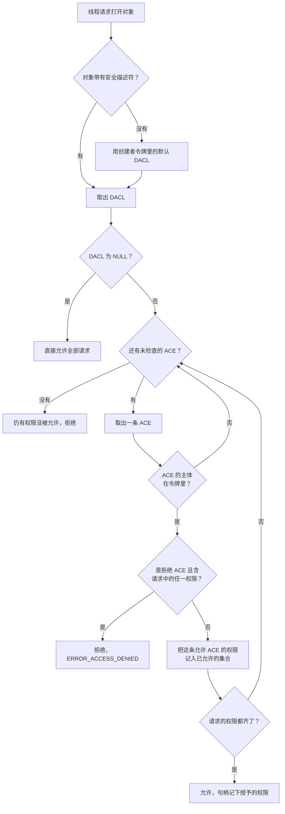

# A.16 安全与访问控制（ACL 与令牌）

在 Windows 平台进行系统开发时，权限问题几乎总会在某些意想不到的时刻浮出水面。一份在开发者本地工作目录下调试通畅的程序，打包安装到 `C:\Program Files` 后启动便崩溃并报错「拒绝访问」，原因往往只是它在试图将日志写进自己的安装目录；A.12 中建立的命名管道如果沿用系统默认的安全属性，局域网或本机上的其他未受信任主体可能轻而易举连接进来读取传输内容；更有不少初学者在被 `ERROR_ACCESS_DENIED` 困扰时，习惯于粗暴地将目标文件或内核对象的安全描述符改成「对所有人完全开放」，尽管报错立刻消失，却在系统防御面上留下了难以察觉的巨大豁口。

这些看似分散的现象，背后遵循着同一套严整的访问控制架构。操作系统并非通过简单的「黑白名单」或粗粒度的用户身份来决定每一次行为，而是将每一次资源请求解构为三位一体的判定流程：主动发起动作的主体所持有的访问令牌（Access Token）、附着在目标资源上的安全描述符（Security Descriptor）及其内部的自主访问控制列表（DACL），以及在打开句柄那一瞬由内核统一执行的访问检查逻辑。理解了这套体系，开发者不仅能准确排查每一次被内核拦截的具体缘由，更能在创建共享内存、管道、事件以及敏感配置文件时，主动构建起最小权限原则所要求的防御边界。

本页的所有示例均在 Windows 11 x64 环境下使用 MinGW-w64 GCC 13.2 编译运行，且全程保持在普通未提升权限的用户会话中执行，不会弹出 UAC 提权提示。为了通用性与隐私，终端输出中的机器名、用户名和局域网 SID 均统一展示为 `DESKTOP-EXAMPLE`、`user` 与 `S-1-5-21-…-1001` 等占位形式。

## 1. 一次访问检查里有哪些角色

Windows 的安全子系统将安全模型清晰地划分为请求者与被请求对象两端。主动的一方通常是正在执行某段代码的线程，它代表着某个特定的安全上下文，其身份与权限边界完全凝结在一个被称为访问令牌（Access Token）的内核对象中。令牌中记录了该主体属于哪个具体用户、归入哪些安全组、拥有哪些被系统赋予的特权，以及处于何种完整性级别。

被动的一方则是系统中的各类可保护对象（Securable Object）。在 Windows 中，文件、目录、注册表键值、命名管道、进程与线程句柄、同步事件以及文件映射等，均属于可保护对象的范畴。每个可保护对象在创建时都会关联一个安全描述符（Security Descriptor），其中最核心的组成部分便是一份自主访问控制列表（Discretionary Access Control List，简称 DACL）。

当线程试图调用 `CreateFileW`、`OpenProcess` 或 `CreateNamedPipeW` 打开或新建某个对象时，安全引用监视器（Security Reference Monitor，SRM）会介入其中，取出调用者令牌里的安全标识符（SID）列表，逐项与对象 DACL 内部的访问控制项（ACE）进行比对演算，最终做出允许或是拒绝的裁决。这个判定流程具有严格的时效特征：它仅仅发生在获取对象句柄的那一瞬间。

::: concept win-ac-check-once title="访问权限在打开对象时检查一次"

打开对象（`CreateFileW`、`CreateNamedPipeW`、`OpenProcess` 等）时，系统做一次访问检查，把结果记在返回的句柄上。此后用这个句柄读写、等待、查询，都不再重新检查 DACL。想改变已经打开的句柄能做什么，只能关闭它再打开一次。

:::

这一设计具有深远的系统编程含义。它直观地解释了为什么一个文件即便正在被某个只读进程打开使用，拥有删除权限的进程依然可以直接标记并完成删除；也解释了为什么在管理员临时调整了某个正在运行的服务的 ACL 之后，服务原先持有的句柄依然能够按照打开时的权限正常工作——因为已分发出去的内核句柄内部已经固化了授予的权限掩码，内核在后续的数据读写路径上绝不会重复遍历复杂的 ACL 链表。



如果将这套逻辑与 POSIX 体系进行对比，两者的哲学差异尤为鲜明。传统 Unix 依靠属主、所属组与其它人这三组读写执行（rwx）九个位构成的权限位，辅以 root 用户无视绝大部分权限检查的特权语义；即便引入了 capabilities，本质上依然是给调用者线程赋予豁免检查的能力（例如 `CAP_DAC_OVERRIDE`）。然而 Windows 在设计之初就没有所谓的「绝对豁免超级用户」概念。即便是内置的管理员（Administrator）甚至系统服务（LocalSystem），想要打开一个指定的文件，同样必须老老实实经过 DACL 的规则遍历。管理员之所以强大，是因为管理员组通常天然拥有修改 DACL（`WRITE_DAC`）或接管对象所有权（`WRITE_OWNER`）的标准权限，他们能通过改写规则来获得权限，但绝不能绕过判决流水线本身。此外，DACL 中的每一项控制都可以精细控制多达 32 个维度的具体访问位，并且原生支持复杂的树状容器继承机制。

## 2. SID 与访问令牌

### 2.1 SID 的写法

在 Windows 安全世界中，用户名和组名只是面向人类操作员的可读外壳，底层所有权限认定的真正载体是安全标识符（Security Identifier，简称 SID）。SID 是一个变长的数据结构，在序列化为文本时，通常呈现形如 `S-1-5-21-…-1001` 的格式。它的每一个字段都有明确的数学与组织含义：前缀 `S` 代表标识符本身，接下来的 `1` 是数据修订版本号，随后的 `5` 是标识颁发机构（Identifier Authority，5 代表 NT Authority），后面的若干段数字构成了子机构层次，而最末端的一段数值则被称为相对标识符（Relative Identifier，简称 RID）。在一个特定的域或单机数据库内，每个独立的用户或安全组都由唯一的 RID 进行区分。

除了每个系统动态生成的具体用户 SID 外，Windows 还预置了一组具有全局通用含义的固定 SID。在配置权限或撰写安全描述符定义语言（SDDL）时，开发者可以直接使用系统定义的简写字符串：

| SID | 缩写 | 含义 |
| --- | --- | --- |
| `S-1-1-0` | `WD` | Everyone，包括匿名登录在内的所有用户 |
| `S-1-5-11` | `AU` | Authenticated Users，通过身份验证的用户 |
| `S-1-5-18` | `SY` | LocalSystem，操作系统自己使用的账户 |
| `S-1-5-32-544` | `BA` | 本机 Administrators 组 |
| `S-1-5-32-545` | `BU` | 本机 Users 组 |
| `S-1-16-8192` | `ME` | 中完整性级别 |
| `S-1-16-4096` | `LW` | 低完整性级别 |
| `S-1-16-12288` | `HI` | 高完整性级别 |

用户的 SID 里带着机器或域的标识，换一台机器就变了；最后的 RID 在同一个域内唯一。写死一个具体用户的 SID 在别的机器上没有意义，这也是下面构造 DACL 时要先查出当前用户 SID 的原因。

### 2.2 令牌里有什么

访问令牌构成了进程或线程在内核层面的完整安全上下文。在 Windows 体系中，每个进程启动时都会被赋予一个主令牌（Primary Token），它代表了该进程基础的身份与权力底线；而当工作线程需要临时假借远程客户端或其他账户的身份处理局部任务时，还可以为该线程单独挂载一个模拟令牌（Impersonation Token）。令牌内部封存了关于发起者的一切安全要素：主体自身的用户 SID、所属安全组的 SID 数组及其附带的行为属性、系统特权列表、默认对象所有者 SID、新建对象时缺省下发的默认 DACL，以及用于强制完整性控制的级别标签。

通过 Win32 API 探索进程自身的令牌结构，有助于直观建立起对这套凭据机制的感知。调用 `OpenProcessToken` 获取当前进程的主令牌句柄后，可以通过 `GetTokenInformation` 逐项拉取不同分类的安全数据。由于安全描述结构在长度上往往高度动态（例如安全组的数量与特权列表的大小各不相同），`GetTokenInformation` 普遍沿用了 Win32 经典的「两阶段探测」约定：初次调用传入 NULL 缓冲区以探知内核实际所需的内存字节大小，在堆上分配足额空间后，再发起第二次调用读取真实的二进制数据块。

```c
/* tokeninfo.c 的取数据工具：第一次问大小，第二次取内容。 */
static void *token_info(HANDLE token, TOKEN_INFORMATION_CLASS cls) {
    DWORD size = 0;
    void *buf;

    if (!GetTokenInformation(token, cls, NULL, 0, &size) &&
        GetLastError() != ERROR_INSUFFICIENT_BUFFER) {
        fail("GetTokenInformation");
    }
    buf = malloc(size);
    if (buf == NULL) {
        printf("out of memory\n");
        exit(1);
    }
    if (!GetTokenInformation(token, cls, buf, size, &size)) {
        fail("GetTokenInformation");
    }
    return buf;
}
```

配套示例中按顺序提取了 `TokenUser`、`TokenElevationType`、`TokenElevation`、`TokenIntegrityLevel`、`TokenGroups` 与 `TokenPrivileges` 等关键项，借助 `ConvertSidToStringSidW` 与 `LookupAccountSidW` 将底层二进制 SID 还原为人类可读的账户名称，并用 `LookupPrivilegeNameW` 将系统特权的 64 位本地唯一标识符（LUID）映射为系统宏名称。完整源码位于 `code/系统编程/拓展A_Win32系统编程/A_16_安全与访问控制_ACL与令牌/tokeninfo.c`。

::: terminal title="PowerShell - tokeninfo"

```text
PS> gcc -std=c17 -Wall -Wextra tokeninfo.c -o tokeninfo.exe
PS> .\tokeninfo.exe
用户 SID: S-1-5-21-…-1001
帐户:     DESKTOP-EXAMPLE\user

提升类型: Limited（UAC 筛选后的令牌）
已提升:   否

完整性 SID: S-1-16-8192（RID 0x2000）

组 14 个:
  S-1-16-8192                                   Mandatory Label\Medium Mandatory Level 完整性
  S-1-1-0                                       Everyone 强制 默认启用 已启用
  S-1-5-114                                     NT AUTHORITY\本地帐户和管理员组成员 仅用于拒绝
  S-1-5-32-544                                  BUILTIN\Administrators 仅用于拒绝
  S-1-5-32-545                                  BUILTIN\Users 强制 默认启用 已启用
  S-1-5-4                                       NT AUTHORITY\INTERACTIVE 强制 默认启用 已启用
  S-1-2-1                                       CONSOLE LOGON 强制 默认启用 已启用
  S-1-5-11                                      NT AUTHORITY\Authenticated Users 强制 默认启用 已启用
  S-1-5-15                                      NT AUTHORITY\This Organization 强制 默认启用 已启用
  S-1-11-96-…                                   MicrosoftAccount\user@example.com 强制 默认启用 已启用
  S-1-5-113                                     NT AUTHORITY\本地帐户 强制 默认启用 已启用
  S-1-5-5-0-1270688                             NT AUTHORITY\LogonSessionId_0_1270688 强制 默认启用 已启用 登录会话
  S-1-2-0                                       LOCAL 强制 默认启用 已启用
  S-1-5-64-36                                   NT AUTHORITY\云帐户身份验证 强制 默认启用 已启用

特权 5 个:
  SeShutdownPrivilege             已禁用
  SeChangeNotifyPrivilege         已启用
  SeUndockPrivilege               已禁用
  SeIncreaseWorkingSetPrivilege   已禁用
  SeTimeZonePrivilege             已禁用
```

:::

如果将上述输出与系统内置诊断命令 `whoami /all` 进行对照，会发现两者的底层数据完全一致：

::: terminal title="PowerShell - whoami /all（节选）"

```text
PS> whoami /all
USER INFORMATION
----------------

User Name             SID
===================== ==============================================
desktop-example\user  S-1-5-21-…-1001


GROUP INFORMATION
-----------------

Group Name                             Type             SID           Attributes
====================================== ================ ============= ==================================================
Mandatory Label\Medium Mandatory Level Label            S-1-16-8192
Everyone                               Well-known group S-1-1-0       Mandatory group, Enabled by default, Enabled group
NT AUTHORITY\本地帐户和管理员组成员    Well-known group S-1-5-114     Group used for deny only
BUILTIN\Administrators                 Alias            S-1-5-32-544  Group used for deny only
BUILTIN\Users                          Alias            S-1-5-32-545  Mandatory group, Enabled by default, Enabled group
NT AUTHORITY\Authenticated Users       Well-known group S-1-5-11    Mandatory group, Enabled by default, Enabled group


PRIVILEGES INFORMATION
----------------------

Privilege Name                Description                          State
============================= ==================================== ========
SeShutdownPrivilege           Shut down the system                 Disabled
SeChangeNotifyPrivilege       Bypass traverse checking             Enabled
SeUndockPrivilege             Remove computer from docking station Disabled
SeIncreaseWorkingSetPrivilege Increase a process working set       Disabled
SeTimeZonePrivilege           Change the time zone                 Disabled
```

:::

### 2.3 「仅用于拒绝」的组

在上述输出列表中，`BUILTIN\Administrators` 那一行的属性格外值得深思：它的状态被标记为 `Group used for deny only`（仅用于拒绝的组）。很多开发者初次见到时会感到困惑：当前登录的明明是这台计算机的主人，属于管理员组，为什么这个组既没有被直接移除，也没有正常生效？

这正是 Windows 用户账户控制体系（UAC）防范权限越界的一处绝妙工程折中。如果操作系统在生成普通令牌时直接将 Administrators 组从组列表中剔除，那么一旦某个文件的安全描述符中显式写了一行「拒绝 Administrators 组的一切访问」，这个未提升的普通进程反而会因为不再具有管理员身份而侥幸绕过这条拒绝规则，从而非法读取到敏感数据。为了杜绝这种利用降权反向穿透拒绝策略的漏洞，内核保留了该组的 SID，但将其打上 `SE_GROUP_USE_FOR_DENY_ONLY` 标记：在后续的每一次访问检查中，系统如果扫描到了针对该组的「拒绝 ACE」，该组依然参与匹配并将访问果断掐断；然而一旦遇到针对该组的「允许 ACE」，该组则被视同不存在，无法为当前线程主张任何积极的访问授权。

这个机制带来的直接后果可以通过实验清晰展现。我们准备两个新文件：一个文件的 DACL 仅授予 `BUILTIN\Administrators` 完全控制权限，另一个则仅授予普通的 `BUILTIN\Users`，然后让同一个处于未提升状态的普通进程尝试打开它们：

```c
/* 两个文件各自的 DACL 只有一条允许 ACE。 */
make(L"admin_only.txt", L"D:P(A;;FA;;;BA)");
make(L"users_only.txt", L"D:P(A;;FA;;;BU)");
try_open(L"admin_only.txt", L"DACL 只给 BUILTIN\\Administrators");
try_open(L"users_only.txt", L"DACL 只给 BUILTIN\\Users");
```

::: terminal title="PowerShell - deny_only_group"

```text
PS> gcc -std=c17 -Wall -Wextra deny_only_group.c -o deny_only_group.exe
PS> .\deny_only_group.exe
DACL 只给 BUILTIN\Administrators：失败，error 5
DACL 只给 BUILTIN\Users：成功
```

:::

从单纯的用户组成员身份来看，当前登录账户确确实实同时归属于这两个组。然而在未提权的日常执行流中，试图打开仅对管理员开放的文件却以 `ERROR_ACCESS_DENIED`（错误代码 5）告终。原因正是当前令牌中的 Administrators 处于「仅用于拒绝」状态，无法被允许 ACE 所兑现。完整示例参见 `code/系统编程/拓展A_Win32系统编程/A_16_安全与访问控制_ACL与令牌/deny_only_group.c`。

<Quiz
  type="single"
  :options="[
    { label: '用户不是管理员', value: 'A' },
    { label: '这个组只在匹配拒绝型 ACE 时生效，不能用来获得访问', value: 'B' },
    { label: '该组已从令牌里删除', value: 'C' },
    { label: '需要重新登录才会生效', value: 'D' }
  ]"
  answer="B"
>

<template #question>

未提升进程的令牌里，`BUILTIN\Administrators` 标为「仅用于拒绝」，正确含义是什么？

</template>

正确答案是 **B**。组还在令牌里，只是属性变成了仅用于拒绝：允许型 ACE 遇上这个组不生效，拒绝型 ACE 照样命中。这正是管理员账户日常以普通权限运行、又能被明确拒绝的机制。

</Quiz>

## 3. UAC 与完整性级别

### 3.1 一对关联令牌

现代 Windows 运行环境中，管理员在交互式登录时并不会直接获得全权的运行环境，系统登录服务（LSASS）会在后台为该会话同时派发一对互相关联的令牌（Linked Tokens）：其一为拥有全部特权与完整管理组属性的完整令牌（Full Token），其二则是剔除了高危特权、将管理员组降格为「仅用于拒绝」并贴上中完整性标签的受限令牌（Filtered Token / Limited Token）。日常使用的资源管理器（`explorer.exe`）以及由其派生的所有常规应用均默认承载这份受限令牌运行。

当用户在界面上右键选择「以管理员身份运行」，或者某个应用程序在内嵌的应用程序清单（Manifest）中通过 `requestedExecutionLevel` 声明了 `requireAdministrator` 时，系统便会借助应用程序信息服务（AppInfo）向用户弹出知名的提权许可确认框。用户点击同意后，系统会依据当前受限令牌所关联的完整令牌凭证，创建一个崭新的、运行在提升上下文中的独立进程。

::: warning `runas` 不会把当前进程变成管理员

「以管理员身份运行」会创建一个新进程，当前进程不会因此获得权限。已经打开的文件句柄、已经创建的对象都不会因此改变。

:::

在工程上必须建立清醒的认知：Windows 没有类似 POSIX 中 `setuid` 改变当前进程有效用户 ID 的原地提权途径。一个已经在运行的进程绝不可能凭空将自身的受限令牌刷新为完整令牌。提权实质上是一次全新的进程派生；原本进程内部已经打开的文件句柄、网络套接字以及映射视图，既不会继承新进程的高权限，也不能反向把高权限传递回旧进程。

### 3.2 完整性级别

除了经典的基于用户和组 SID 的自主访问控制（DACL）外，Windows 自 Vista 时代起还引入了强制完整性控制（Mandatory Integrity Control，简称 MIC）。它构成了访问判决流水线上的另一道关卡，并且在逻辑上先于 DACL 被求值。系统内预先划定了四个核心完整性阶梯：低（Low）、中（Medium）、高（High）以及系统级（System）。

在默认配置下，普通用户启动的日常进程被赋予中完整性级别；以管理员身份提升启动的进程获得高完整性级别；核心系统服务运行在系统级别；而像现代 Web 浏览器的沙箱渲染进程或受限网络下载器这类容易接触外部不可信载荷的组件，则往往被主动降级至低完整性级别。

进程的完整性级别以特定的标签 SID 形式内嵌在访问令牌中（例如 `S-1-16-8192` 对应中完整性）。与之相对应，受保护的内核或文件对象也可以在其安全描述符的系统访问控制列表（SACL）中附带一条 `SYSTEM_MANDATORY_LABEL_ACE` 完整性标签。该标签定义了当低完整性进程试图接触高完整性对象时的阻断策略，缺省的系统行为是 `SYSTEM_MANDATORY_LABEL_NO_WRITE_UP`（简写为 `NW`，即「禁止向上写入」）。

::: concept win-ac-no-write-up title="完整性级别限制向上写"

进程的完整性级别低于对象时，即使 DACL 允许写，写操作也会失败。默认策略是「不能向上写」；读和执行默认不受限制。没有完整性标签的对象按中级别处理。

:::

进程的完整性级别低于对象时，即使 DACL 允许写，写操作也会失败。默认策略是「不能向上写」；读和执行默认不受限制。没有完整性标签的对象按中级别处理。

:::

为了验证完整性控制的强制性，可以通过一个极具启发性的实验进行观察：首先在常规的中完整性环境下建立一个目标测试文件与测试目录，随后在程序内部主动调用 `SetTokenInformation` 将当前主令牌的完整性级别降阶至低完整性（`S-1-16-4096`），接着再次尝试对先前的目标发起写入与创建动作：

```c
/* 把自己的令牌降到低完整性。 */
PSID low = NULL;
TOKEN_MANDATORY_LABEL tml;
DWORD size;

ConvertStringSidToSidW(L"S-1-16-4096", &low);   /* 低完整性 */
tml.Label.Sid = low;
tml.Label.Attributes = SE_GROUP_INTEGRITY;
size = GetLengthSid(low);
SetTokenInformation(token, TokenIntegrityLevel, &tml,
                    sizeof(TOKEN_MANDATORY_LABEL) + size);
```

::: terminal title="PowerShell - low_integrity"

```text
PS> gcc -std=c17 -Wall -Wextra low_integrity.c -o low_integrity.exe
PS> .\low_integrity.exe
中完整性时：
  改写 medium_target.txt：成功
  在 medium_dir 里新建文件：成功
令牌已降到低完整性
降到低完整性后：
  改写 medium_target.txt：失败，error 5
  在 medium_dir 里新建文件：失败，error 5
```

:::

仔细审视终端里的第二次失败：它与 DACL 没有任何关系。目标文件的 DACL 中白纸黑字地为当前用户授予了完全控制权限，但在降低完整性级别之后，内核的强制完整性检查优先拦截了这次打开请求。由于目标文件与目录继承了父目录的缺省中完整性标签，而发起请求的线程已沦为低完整性级别，根据「禁止向上写入」的铁律，内核直接返回了 `ERROR_ACCESS_DENIED`（5）。甚至此时在系统临时目录下新建临时文件同样会被拒绝，因为未显式打标的系统目录默认均处于中完整性水准。

同样，低级别的进程也绝无可能逾越特权去给新对象张贴更高的完整性标签。即使在中完整性下尝试为新文件赋予高完整性标签：

::: terminal title="PowerShell - integrity_label"

```text
PS> gcc -std=c17 -Wall -Wextra integrity_label.c -o integrity_label.exe
PS> .\integrity_label.exe
label_medium.txt 创建成功
label_low.txt    创建成功
label_high.txt   创建失败: error 1314
```

:::

系统返回了错误代码 1314（`ERROR_PRIVILEGE_NOT_HELD`）。中完整性进程只能为主管对象贴上自身级别及以下的标签；如果允许普通程序自由标注高完整性，低权限代码便能通过制造高完整性陷阱实施特权提升攻击。完整验证源码见 `code/系统编程/拓展A_Win32系统编程/A_16_安全与访问控制_ACL与令牌/integrity_label.c`。其中通过形如 `D:P(A;;FA;;;WD)S:(ML;;NW;;;ME)` 的 SDDL 串统一指定了 DACL 与 SACL，`S:` 引导的 `ML` 即代表 Mandatory Label。

## 4. 安全描述符与 ACL

### 4.1 四个组成部分

安全描述符是系统内核保护所有资源实体的元数据容器。为了避免在代码与脚本中直接手工操纵复杂的底层二进制 C 结构体指针，Windows 引入了安全描述符定义语言（Security Descriptor Definition Language，简称 SDDL），将安全描述符的四大支柱压缩为精炼紧凑的文本格式：

| 字段前缀 | 内容定义 |
| --- | --- |
| `O:` | 资源所有者（Owner）的 SID |
| `G:` | 主要组（Primary Group）的 SID（主要用于 POSIX 子系统兼容） |
| `D:` | 自主访问控制列表（DACL），后接若干对圆括号封装的 ACE 项；若 `D:` 后紧随空内容，则代表空 DACL |
| `S:` | 系统访问控制列表（SACL），专门存放审计（Audit）规则与强制完整性标签 |

在 `D:` 标头后通常可以紧跟若干控制位。工程中最为常见的有两个：其一是 `P`（Protected，受保护），声明当前 DACL 被严密隔绝，拒绝自父级目录或容器自动继承任何 ACE；其二是 `AI`（Auto-Inherited，自动继承），声明当前列表内已经包含了按树状层级由父级下发继承而来的规则。两者在很多生产配置中会联合出现，简写为 `D:PAI`。

在括号内部，每一条访问控制项（ACE）均由六个以英文分号分隔的字段所定义：

```text
ace_type;ace_flags;rights;object_guid;inherit_object_guid;account_sid
```

日常系统编程主要关注前三项与最后一项：
1. `ace_type`：控制规则的定性，`A` 代表允许访问（Allow），`D` 代表拒绝访问（Deny），`AU` 代表系统审计；
2. `ace_flags`：继承传播标志，`CI`（Container Inherit）表示子目录等容器继承，`OI`（Object Inherit）表示子文件等非容器对象继承，`IO`（Inherit Only）表示当前规则不作用于自身、仅向下渗透；
3. `rights`：授予或剥夺的具体权限位掩码，既可以直接书写十六进制常量，也可以使用系统缩写，例如文件对象中最常见的 `FA`（File All Access，完全控制）、`FR`（只读）、`FW`（只写）与 `FX`（执行）；
4. `account_sid`：此项规则所绑定的主体 SID（或系统预置缩写如 `SY`、`BA`）。

例如字符串 `D:P(A;;FA;;;SY)` 便是一套完整的安全声明：它宣告这是一份切断了继承的独立受保护 DACL，其中包含一条允许规则，将完全控制权限无保留地授予操作系统核心服务账户（LocalSystem）。

### 4.2 访问掩码

ACE 中的权限字段本质上是一个 32 位的双字访问掩码（Access Mask）。系统将其划分为层层递进的三大区间：

<BitField
  title="访问掩码的位分配"
  :width="32"
  :lane="32"
  :fields="[
    { name: 'GENERIC_READ', range: 31, value: '1', tone: 'brand', desc: '通用读，打开时映射为该对象类型的读权限' },
    { name: 'GENERIC_WRITE', range: 30, value: '1', tone: 'brand', desc: '通用写' },
    { name: 'GENERIC_EXECUTE', range: 29, value: '1', tone: 'brand', desc: '通用执行' },
    { name: 'GENERIC_ALL', range: 28, value: '1', tone: 'brand', desc: '通用完全控制' },
    { name: '保留', range: [27, 25], reserved: true },
    { name: 'ACCESS_SYSTEM_SECURITY', range: 24, desc: '读写对象的 SACL' },
    { name: '保留', range: [23, 21], reserved: true },
    { name: 'SYNCHRONIZE', range: 20, tone: 'yellow', desc: '用于等待函数的同步权限' },
    { name: 'WRITE_OWNER', range: 19, desc: '改变所有者' },
    { name: 'WRITE_DAC', range: 18, desc: '改变 DACL' },
    { name: 'READ_CONTROL', range: 17, desc: '读取安全描述符中的 DACL 与所有者' },
    { name: 'DELETE', range: 16, desc: '删除对象' },
    { name: '对象专用权限', range: [15, 0], tone: 'green', desc: '文件对象：FILE_READ_DATA、FILE_WRITE_DATA 等 16 位' }
  ]"
/>

这一划分体现了 Win32 接口对不同抽象层次的兼容：
- **高 4 位（31-28）为通用权限（Generic Rights）**：包括 `GENERIC_READ`、`GENERIC_WRITE`、`GENERIC_EXECUTE` 与 `GENERIC_ALL`。这是应用程序在发起打开动作时最常申请的宽泛意图；内核在真正实施安全检查时，会依据具体的对象类型，自动将通用位展开映射到对应的具体权限位上。
- **中间 8 位（23-16）为标准权限（Standard Rights）**：包括 `DELETE`、`READ_CONTROL`、`WRITE_DAC`、`WRITE_OWNER` 以及非常关键的 `SYNCHRONIZE`。这组权限与具体对象的种类无关，所有可保护内核对象均共享这套语义。
- **低 16 位（15-0）为对象专用权限（Specific Rights）**：其含义完全交由具体子系统定义。在文件系统语境下，它被拆解为 `FILE_READ_DATA`、`FILE_WRITE_DATA`、`FILE_APPEND_DATA`、`FILE_EXECUTE` 等十余种细粒度操作。

值得注意的是，在 SDDL 中书写通用缩写（例如 `GA` 代表 Generic All）时，内核在将其存入持久化对象之前就会完成展开映射。因此通过 `GetNamedSecurityInfoW` 读回的真实安全描述符中，永远只会存在明确展开后的具体权限位。

借助 `MapGenericMask` API 可以清晰观察到这一映射过程：

::: terminal title="PowerShell - access_mask"

```text
PS> gcc -std=c17 -Wall -Wextra access_mask.c -o access_mask.exe
PS> .\access_mask.exe
FILE_READ_DATA           0x00000001
FILE_WRITE_DATA          0x00000002
FILE_APPEND_DATA         0x00000004
FILE_READ_EA             0x00000008
FILE_WRITE_EA            0x00000010
FILE_EXECUTE             0x00000020
FILE_DELETE_CHILD        0x00000040
FILE_READ_ATTRIBUTES     0x00000080
FILE_WRITE_ATTRIBUTES    0x00000100
DELETE                   0x00010000
READ_CONTROL             0x00020000
WRITE_DAC                0x00040000
WRITE_OWNER              0x00080000
SYNCHRONIZE              0x00100000
GENERIC_READ             0x80000000
GENERIC_WRITE            0x40000000
GENERIC_EXECUTE          0x20000000
GENERIC_ALL              0x10000000
FILE_GENERIC_READ        0x00120089
FILE_GENERIC_WRITE       0x00120116
FILE_GENERIC_EXECUTE     0x001200A0
FILE_ALL_ACCESS          0x001F01FF

MapGenericMask:
GENERIC_READ          -> 0x00120089
GENERIC_WRITE         -> 0x00120116
GENERIC_READ|WRITE    -> 0x0012019F
GENERIC_ALL           -> 0x001F01FF
```

:::

仔细分析 `FILE_GENERIC_READ` 映射得到的数值 `0x00120089`：它实际上是由 `FILE_READ_DATA`（0x1）、`FILE_READ_ATTRIBUTES`（0x80）、`FILE_READ_EA`（0x8）、`READ_CONTROL`（0x20000）以及 `SYNCHRONIZE`（0x100000）按位或聚合而成的。这揭示了一个在 Windows 系统编程中极易踩中的暗坑：当我们调用 `CreateFileW(..., GENERIC_READ, ...)` 时，底层请求的不仅是读取数据本身，还包括了读取对象安全属性以及等待该句柄的同步权。如果手写 DACL 时仅仅狭隘地开放了 `FILE_READ_DATA` 却漏掉了 `SYNCHRONIZE`，那么以常规方式调用 `CreateFileW` 依然会遭遇拒绝访问。

### 4.3 ACE 的顺序决定结果

自主访问控制列表不是无序的集合，而是一个严格遵循物理排布次序的链表。内核的安全判定算法遵循「首个匹配原则（First-Match Rule）」：当检查流水线沿着 DACL 逐项比对时，一旦某条拒绝型 ACE 命中了请求权限中的任意一位，整个请求当场被宣告失败；而一旦若干条允许型 ACE 累积的权限已经完全覆盖了调用方本次申请的所有位，判定流程立即提前宣告成功并退出。

::: concept win-ac-ace-order title="ACE 的检查顺序"

检查按 DACL 中的顺序逐条进行，先命中先结束。规范的顺序是：显式拒绝、显式允许、继承的拒绝、继承的允许。`SetEntriesInAclW` 在建新 DACL 时把新的拒绝 ACE 放在最前面，把新的允许 ACE 放在已有允许 ACE 之前。

:::

列表中的物理顺序直接主导了最终判定。下面两组文件配置仅仅对调了两条规则的位置，表现出的行为却截然相反：

```c
make_file(L"order_allow_first.txt", L"D:P(A;;FR;;;BU)(D;;FR;;;BU)");
make_file(L"order_deny_first.txt", L"D:P(D;;FR;;;BU)(A;;FR;;;BU)");
```

::: terminal title="PowerShell - order_demo"

```text
PS> gcc -std=c17 -Wall -Wextra order_demo.c -o order_demo.exe
PS> .\order_demo.exe
先允许 BUILTIN\Users 读，再拒绝:
  DACL: D:P(A;;FR;;;BU)(D;;FR;;;BU)
  只读打开成功

先拒绝 BUILTIN\Users 读，再允许:
  DACL: D:P(D;;FR;;;BU)(A;;FR;;;BU)
  只读打开失败: error 5
```

:::

在第一个配置中，允许规则排在最前；当属于 `BUILTIN\Users` 的调用者发起只读请求时，第一条规则就已经完全满足了申请所需的位，判决立刻绿灯放行，排在后方的拒绝规则根本没有被执行到的机会。而在第二个配置中，检查首轮便命中了拒绝规则，流程直接被掐断。为了避免这种隐晦的顺序陷阱，Windows 定义了所谓的标准正规次序（Canonical Order）：显式拒绝必定置于显式允许之前，而本地显式项又必定先于所有从父级继承而来的项。使用高级 API `SetEntriesInAclW` 维护权限时，内核与工具库会自动按照正规次序重整链表。

<Quiz
  type="single"
  :options="[
    { label: '允许，遇到允许 ACE 时已拿到全部请求的权限', value: 'A' },
    { label: '拒绝，后面那条拒绝 ACE 优先', value: 'B' },
    { label: '取决于继承标志', value: 'C' },
    { label: '报错，同一主体不能有两条 ACE', value: 'D' }
  ]"
  answer="A"
>

<template #question>

某个 DACL 依次是「允许 `BUILTIN\Users` 读」「拒绝 Alice 读」，Alice 属于 Users，她请求读这个文件，结果是？

</template>

正确答案是 **A**。检查走到第一条时，请求的读权限已经被允许，检查立即结束，后面的拒绝 ACE 不会被看到。模板作者把拒绝排在允许后面的写法在这里不起作用，这也是规范顺序要求拒绝在前的原因。

</Quiz>

借助 `AccessCheck` API，开发者甚至可以在不真正触发内核句柄创建的前提下，脱机预演并诊断一次完整的访问检查流程。该函数需要传入一份令牌的模拟副本（Impersonation Token）以及一份完整包含所有者与主组信息的安全描述符：

```c
/* 用当前令牌的副本检查一份 SDDL。 */
DuplicateToken(token, SecurityImpersonation, &imp);
MapGenericMask(&mask, &map);        /* 通用权限必须先映射掉 */
AccessCheck(sd, imp, mask, &map, (PPRIVILEGE_SET)priv, &priv_len,
            &granted, &status);
```

::: terminal title="PowerShell - access_check"

```text
PS> gcc -std=c17 -Wall -Wextra access_check.c -o access_check.exe
PS> .\access_check.exe
允许 Users 读：请求 0x00120089 -> 允许，授予 0x00120089
允许 Users 读：请求 0x00120116 -> 拒绝，授予 0x00000000
允许 Users 读：请求 0x02000000 -> 允许，授予 0x00120089
先全权，后拒绝写：请求 0x00120089 -> 允许，授予 0x00120089
先全权，后拒绝写：请求 0x00120116 -> 允许，授予 0x00120116
先拒绝写，后全权：请求 0x00120089 -> 允许，授予 0x00120089
先拒绝写，后全权：请求 0x00120116 -> 拒绝，授予 0x00000000
```

:::

第三行测试申请了 `MAXIMUM_ALLOWED`（`0x02000000`），内核返回的授予掩码直接展示了当前调用者所能榨取的所有最大权能，这在安全故障排查中是极其实用的诊断技术。而后四行测试则再次以确凿的数据证实了物理次序的决定性：一旦全权允许规则居于首位，后续追加的局部拒绝规则将被彻底架空；唯有将拒绝规则置于前列，负向拦截才能切实奏效。

调用 `AccessCheck` 有两项不可忽视的前提约束：其一，输入的底层安全描述符必须完备绑定所有者与主要组 SID，若有缺失将返回 `ERROR_INVALID_SECURITY_DESCR`（错误码 1338）；其二，传入的目标掩码中不能残留未解析的高位通用权限位，必须先用 `MapGenericMask` 展开为特定类型的具体掩码。

### 4.4 读一个文件的安全描述符

在实际排查中，最直接的手段是将现有对象上的二进制安全描述符提取出来，反序列化为易读的 SDDL 文本。通过 `GetNamedSecurityInfoW` 指定所需读取的安全信息类别（所有者、主组、DACL），再交由 `ConvertSecurityDescriptorToStringSecurityDescriptorW` 转换为标准字符串，整个流程非常简洁：

```c
err = GetNamedSecurityInfoW(path, SE_FILE_OBJECT,
                            OWNER_SECURITY_INFORMATION |
                                GROUP_SECURITY_INFORMATION |
                                DACL_SECURITY_INFORMATION,
                            &owner, &group, &dacl, NULL, &sd);
ConvertSecurityDescriptorToStringSecurityDescriptorW(
    sd, SDDL_REVISION_1,
    OWNER_SECURITY_INFORMATION | GROUP_SECURITY_INFORMATION |
        DACL_SECURITY_INFORMATION,
    &sddl, NULL);
```

进一步利用 `GetAce` 可以顺次解开 ACL 链表中的每一个物理节点，打印出判定类型、掩码位以及关联的主体 SID。完整工具源码见 `code/系统编程/拓展A_Win32系统编程/A_16_安全与访问控制_ACL与令牌/sddl_show.c`。

我们以一个在标准用户目录下直接新建的普通文本文件为例，观察其原始的安全形态。此时该文件尚未经过特殊配置，其权限完全来自于其所在父级目录的树状继承：

::: terminal title="PowerShell - sddl_show sample.txt"

```text
PS> gcc -std=c17 -Wall -Wextra sddl_show.c -o sddl_show.exe
PS> .\sddl_show.exe sample.txt
SDDL:
O:S-1-5-21-…-1001G:S-1-5-21-…-1001D:AI(A;ID;0x1301ff;;;S-1-5-21-…-1002)(A;ID;0x1301ff;;;S-1-5-21-…-1003)(A;ID;FA;;;SY)(A;ID;FA;;;BA)(A;ID;FA;;;S-1-5-21-…-1001)

ACE 共 5 条（按检查顺序）:
  [0] 允许     掩码 0x001301FF  S-1-5-21-…-1002
  [1] 允许     掩码 0x001301FF  S-1-5-21-…-1003
  [2] 允许     掩码 0x001F01FF  S-1-5-18
  [3] 允许     掩码 0x001F01FF  S-1-5-32-544
  [4] 允许     掩码 0x001F01FF  S-1-5-21-…-1001
```

:::

如果换用系统管理员熟悉的命令行工具 `icacls` 查看同一个文件，会发现两者所表达的内容毫厘不差，只是 `icacls` 贴心地将底层 SID 翻译成了域或本地账户名：

::: terminal title="PowerShell - icacls sample.txt"

```text
PS> icacls sample.txt
sample.txt DESKTOP-EXAMPLE\SandboxUsers:(I)(M,DC)
           S-1-5-21-…-1003:(I)(M,DC)
           NT AUTHORITY\SYSTEM:(I)(F)
           BUILTIN\Administrators:(I)(F)
           DESKTOP-EXAMPLE\user:(I)(F)

Successfully processed 1 files; Failed processing 0 files
```

:::

我们可以将 SDDL 标记与 `icacls` 选项逐条建立起精确映射：

| SDDL 文本段 | `icacls` 对应表现 | 底层工程含义 |
| --- | --- | --- |
| `D:AI` | 列表每行结尾附带 `(I)` | 整个 DACL 处于自动继承状态 |
| `(A;ID;…)` | 与 `(I)` 同时成对出现 | `ID` 显式标明该项 ACE 源自父容器派生继承 |
| `0x1301ff` | `(M,DC)` | 修改权限（Modify，0x1301BF）加删除子对象（Delete Child，0x40） |
| `FA` | `(F)` | 完全控制（Full Control，对应掩码 `0x1F01FF`） |
| `S-1-5-18` | `NT AUTHORITY\SYSTEM` | 本机核心服务主体 LocalSystem |
| `S-1-5-32-544` | `BUILTIN\Administrators` | 本机管理员别名组 |

在日常脚本中，`icacls` 提供了诸如 `F`（完全控制）、`M`（修改）、`RX`（读取与执行）、`R`（只读）与 `W`（只写）等宏观别名；而当需要洞悉更为严密的内核位定义时，则可以通过高级复合括号深入到位级别，例如 `(RD)` 代表读取数据、`(WDAC)` 代表写 DACL 等。

### 4.5 NULL DACL 与空 DACL

在处理访问控制逻辑时，有一个极易引起致命误解的概念差异：NULL DACL 与空 DACL（Empty DACL）。尽管两者在字面上听起来都有「空」的意味，但它们在内核判定算法中引发的结果却走到了两个极端：

```c
make_file(L"null_dacl.txt", L"D:NO_ACCESS_CONTROL");  /* NULL DACL */
make_file(L"empty_dacl.txt", L"D:");                  /* 空 DACL */
```

::: terminal title="PowerShell - dacl_kinds"

```text
PS> gcc -std=c17 -Wall -Wextra dacl_kinds.c -o dacl_kinds.exe
PS> .\dacl_kinds.exe
已创建 null_dacl.txt
  以读写打开成功
已创建 empty_dacl.txt
  以读写打开失败: error 5
```

:::

系统内置的 `icacls` 在面对这两个文件时的提示更是耐人寻味：

::: terminal title="PowerShell - icacls 两个文件"

```text
PS> icacls null_dacl.txt
null_dacl.txt  未设置任何权限。所有用户都具有完全控制权限。
已成功处理 1 个文件; 处理 0 个文件时失败
PS> icacls empty_dacl.txt
empty_dacl.txt
已成功处理 1 个文件; 处理 0 个文件时失败
```

:::

::: concept win-ac-null-vs-empty title="NULL DACL 与空 DACL"

NULL DACL 表示「没有访问控制」，任何人对这个对象都有完全访问权限，系统不做检查。空 DACL 是一份分配好、初始化好、但一条 ACE 都没有的列表，它拒绝所有人的一切访问，包括创建者自己。

:::

在系统安全架构中，这两个极端无一例外都是危险的设计疏漏：空 DACL 意味着一块配置完备却没有任何规则的空容器，当任何线程申请访问时，判定算法遍历完整个列表也没有找到哪怕一条能够允许的规则，最终一律判定为拒绝，连对象所有者自己都会被死死关在门外；而 NULL DACL 则意味着安全描述符内部根本没有分配 DACL 结构体指针（指针为 NULL），内核将其直接解释为「该资源彻底免除访问控制」，任何未经验证的第三方程序均可随意读取甚至覆写它。

在高质量的系统工程实践中，唯一的正道是**严密列举确有需要的主体与最小权限，除此以外一概不予授权**。

<Quiz
  type="single"
  :options="[
    { label: '都拒绝所有人', value: 'A' },
    { label: 'NULL DACL 允许所有人完全访问，空 DACL 拒绝所有人', value: 'B' },
    { label: '都允许所有人完全访问', value: 'C' },
    { label: 'NULL DACL 拒绝所有人，空 DACL 允许所有人', value: 'D' }
  ]"
  answer="B"
>

<template #question>

NULL DACL 与空 DACL 的效果分别是什么？

</template>

正确答案是 **B**。NULL DACL 让系统跳过访问检查，任何请求都通过；空 DACL 是存在的、但一条 ACE 也没有的列表，检查走完没有一条能允许，于是全部拒绝。用 SDDL 写出来，前者是 `D:NO_ACCESS_CONTROL`，后者是 `D:`。

</Quiz>

## 5. 为新对象指定 DACL

### 5.1 把安全描述符交给创建函数

在 Win32 API 族系中，诸如 `CreateFileW`、`CreateNamedPipeW`、`CreateEventW` 以及 `CreateFileMappingW` 等几乎所有创建内核对象或文件系统对象的函数，其参数列表中都会包含一个可选的 `LPSECURITY_ATTRIBUTES` 结构指针。该结构中的核心成员 `lpSecurityDescriptor`，正是用来挂载开发者定制的安全描述符。若传入 NULL，内核便会按照创建者访问令牌中的默认 DACL 与父级目录的继承规则自动合成。

```c
PSECURITY_DESCRIPTOR sd = NULL;
SECURITY_ATTRIBUTES sa;
HANDLE file;

/* SDDL 转成安全描述符；用完 LocalFree。 */
ConvertStringSecurityDescriptorToSecurityDescriptorW(
    L"D:P(A;;FA;;;SY)", SDDL_REVISION_1, &sd, NULL);

sa.nLength = sizeof sa;
sa.lpSecurityDescriptor = sd;
sa.bInheritHandle = FALSE;

file = CreateFileW(path, GENERIC_WRITE, 0, &sa, CREATE_ALWAYS,
                   FILE_ATTRIBUTE_NORMAL, NULL);
LocalFree(sd);   /* 创建函数已经把内容复制进对象，这里可以释放 */
```

在此处显式书写 SDDL 中的 `P`（受保护）具有重要的工程规范价值。虽然在新建文件时如果显式给出了自定义的安全描述符，其本身就不会自动吸纳父目录的继承规则，但写上 `P` 能够向后续的代码维护者以及系统审计脚本清晰传达「切断继承链」的设计意图；更重要的是，如果未来有维护代码通过 `SetNamedSecurityInfoW` 动态刷新该对象的 DACL，带有 `P` 属性的对象将避免在写回时被错误地重新注入父容器的继承条目。

### 5.2 一个只有自己能访问的文件

为了遵循最小权限设计，一种极其常见的需求是：创建一个高度私密的配置文件或凭据文件，除了当前用户进程与系统运维基座之外，杜绝任何外部主体的窥探。

实现此需求的核心路径是：首先在运行时动态探查当前用户的主体 SID 字符串，将其嵌入预先构造的 SDDL 模板中，并在规则中额外加入针对 LocalSystem（`SY`）的授权——保留 SYSTEM 访问至关重要，否则本机的全盘备份守护进程、系统级杀毒扫描或还原任务在遍历到该文件时都将遭受权限阻塞而报错。

```c
if (!ConvertSidToStringSidW(user->User.Sid, &user_text)) {
    /* 处理错误 */
}
/* D:P 表示 DACL 受保护；两条 ACE 分别给当前用户和 SYSTEM 完全控制。 */
_snwprintf(sddl, 256, L"D:P(A;;FA;;;%ls)(A;;FA;;;SY)", user_text);
ConvertStringSecurityDescriptorToSecurityDescriptorW(sddl, SDDL_REVISION_1, &sd, NULL);
```

无论我们将这个文件建在权限多么宽松的公共目录下，显式指定的保护性 DACL 都能确保它是一座孤岛：

::: terminal title="PowerShell - private_file"

```text
PS> gcc -std=c17 -Wall -Wextra private_file.c -o private_file.exe
PS> .\private_file.exe sec\report.txt
已创建 sec\report.txt
PS> .\sddl_show.exe sec\report.txt
SDDL:
O:S-1-5-21-…-1001G:S-1-5-21-…-1001D:P(A;;FA;;;S-1-5-21-…-1001)(A;;FA;;;SY)

ACE 共 2 条（按检查顺序）:
  [0] 允许     掩码 0x001F01FF  S-1-5-21-…-1001
  [1] 允许     掩码 0x001F01FF  S-1-5-18
PS> icacls sec\report.txt
sec\report.txt DESKTOP-EXAMPLE\user:(F)
               NT AUTHORITY\SYSTEM:(F)

Successfully processed 1 files; Failed processing 0 files
```

:::

观察 `icacls` 的输出：没有出现继承标记 `(I)`，也没有出现宽泛的 `BUILTIN\Administrators` 或 `Everyone`。整份文件纯净地只受控于两条显式 ACE。这正是严谨系统编程所倡导的标准基线。完整范例可参阅 `code/系统编程/拓展A_Win32系统编程/A_16_安全与访问控制_ACL与令牌/private_file.c`。

### 5.3 命名管道

在 A.12 中介绍命名管道通信时曾提及：如果调用 `CreateNamedPipeW` 时将安全属性指针置为 NULL，系统分发给该管道的默认安全描述符将异常宽松——不仅本机管理员和当前用户拥有完全控制权，连 `Everyone` 组与匿名访问账户（`AN`）都被赋予了只读权限（`FILE_GENERIC_READ`）。把系统默认生成的 DACL 与手工定制的私有 DACL 并排打印对比：

```c
def_pipe = CreateNamedPipeW(L"\\\\.\\pipe\\mdr_default_demo", ...);
priv_pipe = CreateNamedPipeW(L"\\\\.\\pipe\\mdr_private_demo", ..., &sa);
show_dacl(def_pipe, "默认安全描述符的管道");
show_dacl(priv_pipe, "私有安全描述符的管道");
```

::: terminal title="PowerShell - private_pipe"

```text
PS> gcc -std=c17 -Wall -Wextra private_pipe.c -o private_pipe.exe
PS> .\private_pipe.exe
默认安全描述符的管道:
  D:(A;;FA;;;SY)(A;;FA;;;BA)(A;;FA;;;S-1-5-21-…-1001)(A;;FR;;;WD)(A;;FR;;;AN)
私有安全描述符的管道:
  D:P(A;;FA;;;S-1-5-21-…-1001)(A;;FA;;;SY)
客户端以当前用户身份连接成功
```

:::

在默认配置下，`WD`（Everyone）与 `AN`（Anonymous Logon）赫然在列；如果该管道被设计用于接收控制指令或分发私密密钥，未受保护的管道便极易遭受未授权窥探。而在显式注入了定制 DACL 的私有管道中，外部非授权账户在连接阶段就会被内核断然阻断。需要留意的是，命名管道自身作为内核同步对象，使用 `SE_KERNEL_OBJECT` 类别操作安全描述符，而客户端在以文件形式发起 `CreateFileW` 时请求的则是文件通用的读取位，两者在抽象层级上虽然位名不同，但内核的安全引用监视器会自动完成对齐。示例代码可参考 `code/系统编程/拓展A_Win32系统编程/A_16_安全与访问控制_ACL与令牌/private_pipe.c`。

### 5.4 给已有对象加 ACE

在动态软件生命周期中，往往需要调整已有文件或对象的访问控制列表。在 Win32 底层直接用指针拼凑二进制 ACL 结构不仅容易损坏内存布局，更极易破坏标准正规次序。微软推荐的工程标准流程是清晰的「读出—合并—写回」三部曲：
1. 调用 `GetNamedSecurityInfoW` 读取对象当前的旧 DACL 与安全描述符指针；
2. 构建 `EXPLICIT_ACCESS_W` 描述结构，调用 `SetEntriesInAclW` 自动将新规则以正规次序插入旧 ACL，生成新的复合 ACL；
3. 调用 `SetNamedSecurityInfoW` 将合并后的 ACL 写回内核对象。

`EXPLICIT_ACCESS_W` 结构精确描述了授权意图：授予还是拒绝、具体权限掩码、是否参与容器继承，以及通过 `TRUSTEE_W` 绑定的目标用户或组 SID：

```c
ZeroMemory(&ea, sizeof ea);
ea.grfAccessPermissions = GENERIC_READ;
ea.grfAccessMode = GRANT_ACCESS;          /* 或 DENY_ACCESS */
ea.grfInheritance = NO_INHERITANCE;
ea.Trustee.TrusteeForm = TRUSTEE_IS_SID;
ea.Trustee.TrusteeType = TRUSTEE_IS_GROUP;
ea.Trustee.ptstrName = (LPWSTR)sid_buf;

GetNamedSecurityInfoW(path, SE_FILE_OBJECT, DACL_SECURITY_INFORMATION,
                      NULL, NULL, &old_acl, NULL, &sd);
SetEntriesInAclW(1, &ea, old_acl, &new_acl);
SetNamedSecurityInfoW(path, SE_FILE_OBJECT, DACL_SECURITY_INFORMATION,
                      NULL, NULL, new_acl, NULL);
```

下面的实验同时比对了两类场景：一个是在普通可继承目录下自然创建的文件，另一个是创建时便显式附加了 `D:P` 受保护属性的文件。我们通过代码向两份文件分别追加一条「允许 Users 组读取」的规则：

```c
printf("未保护的文件（继承自父目录）：\n");
create_plain(L"plain.txt");
print_dacl(L"plain.txt");
grant_users_read(L"plain.txt", DACL_SECURITY_INFORMATION);
print_dacl(L"plain.txt");

printf("\n受保护的文件（创建时指定 D:P）：\n");
create_private(L"private.txt");
print_dacl(L"private.txt");
grant_users_read(L"private.txt", DACL_SECURITY_INFORMATION);
print_dacl(L"private.txt");
```

::: terminal title="PowerShell - add_ace"

```text
PS> gcc -std=c17 -Wall -Wextra add_ace.c -o add_ace.exe
PS> .\add_ace.exe
未保护的文件（继承自父目录）：
  D:AI(A;ID;0x1301ff;;;S-1-5-21-…-1002)(A;ID;0x1301ff;;;S-1-5-21-…-1003)(A;ID;FA;;;SY)(A;ID;FA;;;BA)(A;ID;FA;;;S-1-5-21-…-1001)
追加 Users 读取 -> 0
  D:AI(A;;FR;;;BU)(A;ID;0x1301ff;;;S-1-5-21-…-1002)(A;ID;0x1301ff;;;S-1-5-21-…-1003)(A;ID;FA;;;SY)(A;ID;FA;;;BA)(A;ID;FA;;;S-1-5-21-…-1001)

受保护的文件（创建时指定 D:P）：
  D:P(A;;FA;;;OW)(A;;FA;;;SY)
追加 Users 读取 -> 0
  D:PAI(A;;FR;;;BU)(A;;FA;;;OW)(A;;FA;;;SY)

对受保护的文件显式解除保护：
追加并解除保护 -> 0
  D:AI(A;;FR;;;BU)(A;;FA;;;OW)(A;;FA;;;SY)(A;ID;0x1301ff;;;S-1-5-21-…-1002)(A;ID;0x1301ff;;;S-1-5-21-…-1003)(A;ID;FA;;;SY)(A;ID;FA;;;BA)(A;ID;FA;;;S-1-5-21-…-1001)
```

:::

仔细对比这三段结果，能够透彻理解 Windows 的继承防线：
- 在第一段普通文件中，新添加的 `(A;;FR;;;BU)` 被工整地放置在已有显式允许项的最前列，同时旧列表中的继承项 `(A;ID;…)` 被原样复制，因此输出依然带有 `D:AI`；
- 在第二段受保护文件中，写回之后依然坚守 `D:PAI`，父级目录的规则丝毫未能混入。调用 `SetNamedSecurityInfoW` 时若仅传入 `DACL_SECURITY_INFORMATION`，系统会自动保全对象既有的保护状态；
- 第三段则展示了显式解除保护的效果。若传入 `UNPROTECTED_DACL_SECURITY_INFORMATION`，原本筑起的护城河瞬间瓦解，输出重新退化为 `D:AI`，父级的所有继承规则被系统强制重新洗入。反之，如果想要锁定保护，则需显式传入 `PROTECTED_DACL_SECURITY_INFORMATION`。

两个核心控制位：

```c
/* 保住受保护状态 */
SetNamedSecurityInfoW(path, SE_FILE_OBJECT,
                      DACL_SECURITY_INFORMATION |
                          PROTECTED_DACL_SECURITY_INFORMATION,
                      NULL, NULL, new_acl, NULL);
/* 解除保护，重新继承 */
SetNamedSecurityInfoW(path, SE_FILE_OBJECT,
                      DACL_SECURITY_INFORMATION |
                          UNPROTECTED_DACL_SECURITY_INFORMATION,
                      NULL, NULL, new_acl, NULL);
```

`OW` 是「所有者权利」（Owner Rights）专用伪 SID。当发起请求的主体恰好是该对象的所有者时，该主体将被内核隐式划入 `OW` 所代表的虚拟组。借助 `OW`，我们可以写出与具体用户名完全解耦的通用安全模板，无论是拷到别的系统还是由不同账户执行，都能确保规则语义始终锚定在「资源所有者」身上。

若需追加一条拒绝规则，只需将 `grfAccessMode` 设为 `DENY_ACCESS`。`SetEntriesInAclW` 会自动将拒绝项推至整张列表的最顶端，以确保其优先于所有允许规则被评估。完整范例位于 `code/系统编程/拓展A_Win32系统编程/A_16_安全与访问控制_ACL与令牌/add_ace.c`。`SetEntriesInAclW` 分配的新 ACL 要用 `LocalFree` 释放，`GetNamedSecurityInfoW` 返回的安全描述符也一样。

### 5.5 权限只在打开时检查

### 5.5 访问检查仅在打开时发生

重温本页最初强调的原则：访问权限仅在句柄创建时评估一次。下面的程序清晰演示了这一时序特征：程序首先以只读方式打开一份文件，同时另外持有一个具备 `WRITE_DAC` 权限的管理句柄；随后，程序通过该管理句柄动态向文件的 DACL 中插入一条专门拒绝当前用户读取的 ACE：

```c
reader = CreateFileW(PATH, GENERIC_READ, ...);
control = CreateFileW(PATH, WRITE_DAC | READ_CONTROL, ...);
add_deny_read(control, me);
```

::: terminal title="PowerShell - check_once"

```text
PS> gcc -std=c17 -Wall -Wextra check_once.c -o check_once.exe
PS> .\check_once.exe
已用一个只读句柄和一个 WRITE_DAC 句柄打开文件
  DACL: D:P(A;;FA;;;S-1-5-21-…-1001)(A;;FA;;;SY)

通过已有的 WRITE_DAC 句柄加一条拒绝自己读取的 ACE:
  DACL: D:PAI(D;;FR;;;S-1-5-21-…-1001)(A;;FA;;;S-1-5-21-…-1001)(A;;FA;;;SY)

已有的读句柄继续读:
  ReadFile 成功，读到 "hello"

再新开一个只读句柄:
  CreateFileW 失败: error 5

通过仍然有效的 WRITE_DAC 句柄把 DACL 恢复原样:
  新的只读句柄打开成功
```

:::

三项事实并存且逻辑自洽：
1. 虽然 DACL 已经在物理上加入了封杀当前用户读取的拒绝规则，但先前已经打开的只读句柄在后续调用 `ReadFile` 时依然畅通无阻；
2. 如果此时尝试调用 `CreateFileW` 重新打开一个只读句柄，新请求会在内核判定流水线中立刻触礁，返回错误代码 5；
3. 先前持有的 `WRITE_DAC` 句柄并未失效，依然可以从容将 DACL 还原。

这揭示了真实生产环境中很多难以捉摸的「幽灵权限」故障根源：某些长期驻留的系统后台服务在初始化阶段以高权限打开了一批工作句柄，之后即使管理员在磁盘上收紧了目录权限甚至将服务账户移出了特权组，该服务依然能凭借手头持有的陈旧句柄长期执行写操作。排查此类异常时，不能仅仅静态观察磁盘当前的 ACL，更要追溯进程启动与获取句柄时的历史上下文。

### 5.6 DACL 的溯源机制

如果在调用创建 API 时将安全描述符置空，系统究竟从何处合成一份新对象的 DACL？
答案遵循明确的双层后备机制：内核首先向上追溯其父容器（例如所在的文件夹）；若父级安全描述符中包含带有 `OI`（对象继承）或 `CI`（容器继承）标记的规则，这些规则将以继承项的形式自动注入新对象。唯有当父容器未配置任何可继承项、或者创建的是无父容器的纯内核对象时，内核才会退而求其次，采用创建者访问令牌内部附带的「默认 DACL」（Default DACL）。

在常规开发环境中，主令牌内嵌的默认 DACL 通常预置了三条完全控制规则，分别授予当前用户、`BUILTIN\Administrators` 与 `SYSTEM`。如果仅仅依赖令牌默认 DACL，创建出来的对象实际上天然对本地所有管理员敞开大门：

::: terminal title="PowerShell - default_dacl"

```text
PS> gcc -std=c17 -Wall -Wextra default_dacl.c -o default_dacl.exe
PS> .\default_dacl.exe
令牌的默认 DACL 有 3 条 ACE
当前目录允许继承时：
  plain.txt
    D:AI(A;ID;0x1301ff;;;S-1-5-21-…-1002)(A;ID;0x1301ff;;;S-1-5-21-…-1003)(A;ID;FA;;;SY)(A;ID;FA;;;BA)(A;ID;FA;;;S-1-5-21-…-1001)
父目录受保护、没有可继承的 ACE 时：
  isolated\plain.txt
    D:AI(A;;FA;;;S-1-5-21-…-1001)(A;;FA;;;BA)(A;;FA;;;SY)
```

:::

由此可以得出一条严谨的工程定论：**对于包含敏感业务数据的文件、命名管道或共享内存，绝不能心存侥幸依赖系统的默认行为**。唯一能确保访问边界坚不可摧的做法，是在创建 API 中显式交付一份经过明确裁量、带有受保护标记的专属安全描述符。

`default_dacl.c` 演示了这一机制：源码位于 `code/系统编程/拓展A_Win32系统编程/A_16_安全与访问控制_ACL与令牌/default_dacl.c`。

::: compare left-title="为了消除拒绝访问设 NULL DACL" right-title="只授予需要的主体"

```c
PSECURITY_DESCRIPTOR sd = NULL;

/* 谁都能完全控制，等于没有访问控制 */
ConvertStringSecurityDescriptorToSecurityDescriptorW(
    L"D:NO_ACCESS_CONTROL", SDDL_REVISION_1, &sd, NULL);

CreateFileW(path, GENERIC_WRITE, 0, &sa, CREATE_ALWAYS, ...);
```

---

```c
PSECURITY_DESCRIPTOR sd = NULL;
wchar_t sddl[256];

/* 当前用户与 SYSTEM 完全控制，别人没有 */
_snwprintf(sddl, 256, L"D:P(A;;FA;;;%ls)(A;;FA;;;SY)", user_sid);
ConvertStringSecurityDescriptorToSecurityDescriptorW(
    sddl, SDDL_REVISION_1, &sd, NULL);

CreateFileW(path, GENERIC_WRITE, 0, &sa, CREATE_ALWAYS, ...);
```

:::

对比左栏的做法：它虽然能够迅速消除 `ERROR_ACCESS_DENIED`，却等于卸掉了大门上的整把锁，任何沙箱内的低权限脚本均可对其执行篡改；而右栏的做法在清晰授予合法主体的同时，筑牢了防御边界。

## 6. 特权

### 6.1 特权与对象权限的区别

在 Windows 安全模型中，必须严格区分对象权限（Object Rights / Permissions）与特权（Privileges）的概念界限：
- **对象权限**：牢牢绑定在具体的资源对象（文件、管道、注册表键值）之上，由对象的安全描述符与 DACL 决定「谁有权对这个特定实体进行何种操作」；
- **特权**：牢牢绑定在主体的访问令牌之上，用于向内核证明该安全主体是否被授权执行某些跨越常规对象边界的全局系统级操作（例如系统关机、调试其他进程、绕过读安全检查备份全盘等）。

常见的关键系统特权包括：

| 特权名称 | 系统常量宏 | 核心工程能力 |
| --- | --- | --- |
| 关闭系统 | `SeShutdownPrivilege` | 调用触发操作系统关机、注销或重启的系统函数 |
| 调试程序 | `SeDebugPrivilege` | 允许越权打开并附加到任意其他用户的进程上下文 |
| 备份文件和目录 | `SeBackupPrivilege` | 以备份为目的调用特定 API 绕过 DACL 直接读取敏感文件 |
| 还原文件和目录 | `SeRestorePrivilege` | 绕过 DACL 将备份数据写入受保护位置 |
| 取得对象的所有权 | `SeTakeOwnershipPrivilege` | 强制接管任意内核对象的所有者身份 |

值得特别注意的是：令牌中拥有一项特权，并不等于该特权已处于激活状态。出于最小特权防御原则，绝大多数高危特权在令牌被创建时默认都处于「已禁用（Disabled）」状态。程序在真正执行关键系统动作前，必须在运行时显式将其激活；在操作完成后，应立即将其恢复至禁用状态。

::: concept win-ac-not-all-assigned title="AdjustTokenPrivileges 返回 TRUE 不等于成功"

`AdjustTokenPrivileges` 在令牌里没有指定特权时仍然返回 `TRUE`，只是什么都没做。调用之后必须检查 `GetLastError()` 是否为 `ERROR_NOT_ALL_ASSIGNED`（1300）。

:::

### 6.2 启用、使用、禁用

调整自身令牌特权的标准操作手法如下：

```c
LUID luid;
TOKEN_PRIVILEGES tp;

LookupPrivilegeValueW(NULL, L"SeShutdownPrivilege", &luid);
tp.PrivilegeCount = 1;
tp.Privileges[0].Luid = luid;
tp.Privileges[0].Attributes = SE_PRIVILEGE_ENABLED;

AdjustTokenPrivileges(token, FALSE, &tp, 0, NULL, NULL);
if (GetLastError() == ERROR_NOT_ALL_ASSIGNED) {
    /* 令牌里没有这个特权，刚才的调用什么也没做 */
}
```

在打开自身令牌时，必须在 `OpenProcessToken` 的访问掩码中显式包含 `TOKEN_ADJUST_PRIVILEGES`，若仅带有 `TOKEN_QUERY`，后续调用将遭遇拒绝访问。

观察下面这个测试特权启闭生命周期的范例：它依次完成特权探测、激活、校验、还原，并在最后尝试强行开启一个普通令牌所根本不具备的调试特权（`SeDebugPrivilege`）：

::: terminal title="PowerShell - privilege"

```text
PS> gcc -std=c17 -Wall -Wextra privilege.c -o privilege.exe
PS> .\privilege.exe
初始 SeShutdownPrivilege: 已禁用
SeShutdownPrivilege: 启用成功
启用后 SeShutdownPrivilege: 已启用
SeShutdownPrivilege: 禁用成功
禁用后 SeShutdownPrivilege: 已禁用

SeDebugPrivilege: 令牌中没有这个特权，错误码 1300 (ERROR_NOT_ALL_ASSIGNED)
```

:::

单独用简短测试验证 `AdjustTokenPrivileges` 的返回值特性：

::: terminal title="PowerShell - adjust_ret"

```text
PS> gcc -std=c17 -Wall -Wextra adjust_ret.c -o adjust_ret.exe
PS> .\adjust_ret.exe
AdjustTokenPrivileges -> 1, GetLastError -> 1300
```

:::

这个结果值得刻在每一位 Win32 程序员的脑海中：API 返回了布尔值 1（`TRUE`），但 `GetLastError` 却留下了 1300（`ERROR_NOT_ALL_ASSIGNED`）。若仅仅凭借传统的 `if (!AdjustTokenPrivileges(...))` 进行判空，逻辑将误以为特权已经成功就位，随即在后续调用系统级 API 时遭遇意料之外的失败。这种「函数调用本身虽未抛出底层异常、但请求未能完全满足」的设计，是 Win32 安全子系统的一大特异之处。

两个配套程序均存放在 `code/系统编程/拓展A_Win32系统编程/A_16_安全与访问控制_ACL与令牌/`：`privilege.c` 演示完整的特权启闭流程，`adjust_ret.c` 专注验证错误码特性。

### 6.3 对照 Linux capabilities

在 Linux 世界中，POSIX capabilities 将原本凌驾一切的 root 权力细分为数十项独立的能力位（如 `CAP_NET_ADMIN`、`CAP_SYS_ADMIN` 等），挂载在线程的安全凭据中，并支持文件级别的持久化赋权。Windows 的特权系统在形态划分上与其颇为神似：同样被切割为数十个具名特权，同样附着在进程安全令牌之上，同样要求在真正施展权力时显式激活。

但两者的覆盖边界与防守重心存在本质分歧：Linux 的 capability 旨在拆解超级用户的特权池；而 Windows 的特权机制主要聚焦在跨系统的基础设施管理动作（关机、审计、系统时钟同步、接管所有权）。日常绝大多数文件、管道与同步原语的访问，在 Windows 中完全由 DACL 统辖。在 Windows 上并不存在类似「给进程赋予某个特权即可随意读写私有业务目录」的旁路逻辑；即便需要实现系统全盘防灾备份，也必须先开启 `SeBackupPrivilege`，并在此基础上于调用 `CreateFileW` 时显式指定 `FILE_FLAG_BACKUP_SEMANTICS` 标志，才能令内核授权旁路读取。

主线第 14 章的 `CAP_DAC_OVERRIDE` 在 Windows 上没有等价物。管理员能改任何 DACL，是因为他本来就在 DACL 里有一条允许 `WRITE_DAC`，或者能接管所有权。

<Quiz
  type="single"
  :options="[
    { label: '什么也不用检查', value: 'A' },
    { label: '检查 GetLastError() 是否为 ERROR_NOT_ALL_ASSIGNED', value: 'B' },
    { label: '检查令牌句柄是否已关闭', value: 'C' },
    { label: '检查是否需要重启', value: 'D' }
  ]"
  answer="B"
>

<template #question>

`AdjustTokenPrivileges` 返回 `TRUE` 之后，还必须检查什么？

</template>

正确答案是 **B**。令牌里没有指定特权时它照样返回 `TRUE`，只在最后错误码里留下 `ERROR_NOT_ALL_ASSIGNED`（1300）。不查这一步，程序会带着「特权已启用」的错觉继续往下走。

</Quiz>

## 7. 工程上的做法

在大型工业级软件与系统组件的设计中，良好的安全架构并非依靠事后补丁，而是建立在遵循最小特权设计的一系列工程共识之上：

- **新建受保护对象时必须显式指定 DACL**：对于命名管道、文件映射、全局事件与互斥量等跨进程资源，它们的名字处于全局可见的命名空间中。若不指定安全描述符，极易让未经鉴权的本地主体连入。推荐的标准实践是采用 `D:P(A;;FA;;;<用户SID>)(A;;FA;;;SY)` 模式切断继承，仅放行必要主体。
- **杜绝使用 NULL DACL 掩盖权限设计缺陷**：在遇到 `ERROR_ACCESS_DENIED` 时，应当通过 `sddl_show`、`icacls` 或 `AccessCheck` 仔细理清具体的阻断 ACE 与完整性级别冲突，精准补充所需最小位，而不是以 NULL DACL 弃守全部防线。
- **从服务账户选型贯彻最小权限原则**：开发 Windows 后台服务时，除非确实需要深度介入底层内核状态，应优先选用 `NT AUTHORITY\LocalService`、`NetworkService` 或虚拟服务账户（Virtual Accounts，A.18），尽量避免盲目运行在无所不能的 `LocalSystem` 之下。
- **在服务端跨安全边界时使用凭据模拟**：在处理命名管道或 RPC 客户端请求时，服务端应调用 `ImpersonateNamedPipeClient` 将当前处理线程的上下文切换为客户端的模拟令牌，借助内核自身的安全检查流水线代为核验文件或注册表访问权限，任务完成后立即执行 `RevertToSelf`，避免服务自身的高权限被利用成为提权跳板。
- **构建熟练的诊断工具箱**：日常排查时，善用 `whoami /all` 剖析自身令牌结构，用 `icacls` 审查磁盘文件继承树，借助 Sysinternals 的 AccessChk 与 Process Explorer 深入透视进程与句柄的实际权限分配。

::: generate win-ac-vs-posix kind=comparison

面向熟悉 POSIX 权限模型的读者，把 Windows 的 DACL、完整性级别与 Linux 的 mode 位、POSIX ACL、capabilities 放在一起对照：说明各自能表达什么、不能表达什么，为什么 Windows 里没有 root 绕过检查的对应物，以及同一个「只有属主能读写」的需求在两边分别怎么写。不要复述正文里的 API 参数。

:::

## 8. 习题

### 8.1 巩固

<Exercise id="44601" :d="1" :w="1">

编译运行本页的 `tokeninfo.c` 与 `token_member.c`，然后回答：

(1) 你的令牌里 `BUILTIN\Administrators` 的属性是什么？如果当前账户不是管理员，改为解释 `BUILTIN\Users` 那一行。

(2) `token_member.exe` 对 `BUILTIN\Administrators` 报告「是成员」还是「不是成员」？这个结果与 `tokeninfo` 里看到的组列表是否矛盾，为什么？

`token_member.c` 用 `CheckTokenMembership` 判断当前令牌是否属于某个众所周知的 SID，源码在 `code/系统编程/拓展A_Win32系统编程/A_16_安全与访问控制_ACL与令牌/token_member.c`。

</Exercise>

<Exercise id="44602" :d="2" :w="2">

下面三份 SDDL 都用来创建文件，创建者都是当前用户。先写下你对「以 `GENERIC_READ | GENERIC_WRITE` 打开」的预测，再写一个小程序逐份验证：

1. `D:P(A;;FA;;;SY)`
2. `D:P(A;;FR;;;BU)(A;;FA;;;SY)`
3. `D:P(D;;FR;;;BU)(A;;FR;;;BU)(A;;FA;;;SY)`

提示：第 1 份的 DACL 只给 `SYSTEM`，自己根本不在里面；另外别忘了 `CreateFileW` 会顺带请求 `SYNCHRONIZE`，只关心读写的位会漏掉这一点。三份都应当以不同方式失败或成功，用 `sddl_show.exe` 确认创建出来的 DACL 与写的 SDDL 一致，再对照第 4.3 节的检查规则逐条解释。

</Exercise>

<Exercise id="44603" :d="2" :w="2">

找一个你自己的普通文件，分别运行 `sddl_show.exe` 和 `icacls`，把 SDDL 里的每个字段与 `icacls` 输出逐项对应起来，做成一张表。然后回答：

(1) `D:AI` 与每行末尾的 `(I)` 是什么关系？
(2) `0x1301ff` 对应 `icacls` 的哪个缩写？把它拆成具体的权限位。
(3) 把这个文件的 SDDL 改写成「只给当前用户与 SYSTEM 完全控制、切断继承」的形式，用 `icacls` 验证改写成功。

</Exercise>

### 8.2 编程

<Exercise id="44604" :d="3" :w="3">

写一个 `fileacl.exe 路径...` 工具，对每个路径打印：

1. 所有者与主要组的账户名（查不到时打印 SID 字符串）；
2. DACL 是否为 NULL、是否受保护、ACE 条数；
3. 按检查顺序列出每条 ACE：序号、允许还是拒绝、继承标志、掩码的十六进制、拆开后的权限名（至少认识 `FILE_READ_DATA`、`FILE_WRITE_DATA`、`FILE_APPEND_DATA`、`DELETE`、`READ_CONTROL`、`WRITE_DAC`、`WRITE_OWNER`、`SYNCHRONIZE`）、主体 SID 与账户名。

验收：对 `C:\Windows\System32\drivers\etc\hosts` 运行，输出里应当能看出 Users 只有读权限；对你用 `private_file.exe` 建的文件运行，应当只有两条 ACE。同一路径连续运行两次输出应当完全一致。

</Exercise>

<Exercise id="44605" :d="3" :w="4">

写一个 `private_dir.exe 目录名` 工具：创建一个只有当前用户与 SYSTEM 能访问的目录，并把完全控制权限按 `(OI)(CI)` 继承给子对象；再提供 `private_dir.exe --restore 目录名`，把目录的 DACL 恢复成从父目录继承。

要求：

1. 创建时用 `D:P` 加上两条带 `OI`、`CI` 标志的 ACE，SDDL 形如 `D:P(A;OICI;FA;;;<用户 SID>)(A;OICI;FA;;;SY)`；
2. 在目录里创建一个文件，用 `sddl_show.exe` 验证文件继承了这两条 ACE（带 `ID` 标志）；
3. 用 `--restore` 时使用 `UNPROTECTED_DACL_SECURITY_INFORMATION`，再用 `icacls` 确认继承恢复；
4. 写一段说明：为什么子对象上的继承 ACE 标为 `ID` 而不是显式 ACE。

</Exercise>

<Exercise id="44606" :d="4" :w="4">

写一个 `privtool.exe [--enable 名称 | --disable 名称 | --list]` 工具：

1. `--list` 列出令牌里的全部特权、LUID 与状态（启用、默认启用、禁用）；
2. `--enable`、`--disable` 用 `AdjustTokenPrivileges` 修改状态，修改后再查询一次确认，并打印返回值与 `GetLastError()`；
3. 对令牌里没有的特权，打印错误码 1300 并返回退出码 1；对调用本身失败的情况（例如没有 `TOKEN_ADJUST_PRIVILEGES`），打印系统错误消息并返回退出码 2。

验收：

```text
privtool.exe --enable SeShutdownPrivilege     -> 返回 0，再 --list 显示已启用
privtool.exe --disable SeShutdownPrivilege    -> 返回 0
privtool.exe --enable SeDebugPrivilege        -> 打印 1300，返回 1
```

最后一条在普通用户身份下必须失败；如果你以管理员身份运行，说明为什么结果不同。

</Exercise>

### 8.3 综合与挑战

<Exercise id="44607" :d="5" :w="4">

写一个 `acl_audit.exe 目录` 工具，递归扫描目录树，列出「本机普通用户可写」的文件与子目录。判断标准是不能靠字符串比对 DACL，要用 `AccessCheck`：

1. 构造一个「普通用户」的模拟令牌：可以复制当前令牌，也可以用 `CreateRestrictedToken` 去掉管理员组，或直接用 `LogonUser` 以某个低权限账户登录（这一项需要密码，做不到就跳过并在输出里注明）；
2. 对每个对象读出安全描述符（含所有者与组，否则 `AccessCheck` 返回 1338），把 `GENERIC_WRITE` 用 `MapGenericMask` 映射后做检查；
3. 输出路径、授予的掩码、命中的前三条 ACE，按可写程度排序；
4. 在一棵你自己造的测试目录树上验证：至少准备「Everyone 可写」「Users 可写」「只有自己可写」「空 DACL」四种情况，确认四者的判定都对。

提示：`GENERIC_WRITE` 映射后是 `0x00120116`，它包含 `SYNCHRONIZE`。用 `MAXIMUM_ALLOWED` 取得全部允许的权限，再与 `FILE_GENERIC_WRITE` 按位与，结果非零即「可写」，这样比直接请求写权限更接近 `CreateFileW` 的判定。

</Exercise>

<Exercise id="44608" :d="6" :w="5">

在 A.12 的 `pipe_echo_server.c` 基础上写一个 `secured_pipe_server.exe`，做三件事：

1. 用 `D:P(A;;FA;;;<当前用户 SID>)(A;;FA;;;SY)` 加上 `PIPE_REJECT_REMOTE_CLIENTS` 与 `FILE_FLAG_FIRST_PIPE_INSTANCE` 创建 `\\.\pipe\mdr_secured`；
2. 每接受一个客户端，打印 `GetNamedPipeClientProcessId` 得到的 PID 与用 `QueryFullProcessImageNameW` 得到的映像路径；
3. 客户端发来一个文件路径，服务器用 `ImpersonateNamedPipeClient` 切换到客户端身份，打开该文件并回送「可读」「不可读」与错误码，然后 `RevertToSelf`。

验收：用同一份客户端程序测试——以当前用户运行时应当对文件返回「可读」；再用一个限制 SID 为 `S-1-0-0` 的受限令牌（参考本页的 `restrict_token.c`，`CreateRestrictedToken` 加 `ImpersonateLoggedOnUser`）运行同一个客户端，应当返回「不可读」。这说明服务器的判断跟着客户端走，而不是跟着自己走。

</Exercise>

<Exercise id="44609" :d="7" :w="5" scope="*">

设计并实现一个最小权限沙箱 `sandbox.exe [--check] -- 命令行`：

1. 用 `CreateRestrictedToken` 从当前令牌造一个受限令牌，去掉 `BUILTIN\Administrators`，再附加一个无成员的限制 SID；
2. `--check` 模式：不启动子进程，对一组给定的路径（例如临时目录、`C:\Windows`、你自己建的私有目录）分别用正常令牌与受限令牌做 `AccessCheck`，打印两边的结果；
3. 不带 `--check` 时：用受限令牌启动命令行给出的程序，等待结束并打印退出码。启动方式需要能在不触发 UAC 的前提下实现，说明你选的方法需要哪些前提，做不到就只做第 2 步并写明原因；
4. 报告里给出一个「预演结果与实际打开结果不一致」的例子并解释。提示：`CreateFileW` 除 `dwDesiredAccess` 之外还会请求 `SYNCHRONIZE`，而 `AccessCheck` 只检查你传给它的掩码。

这一题需要理解令牌、模拟、访问检查与进程创建几块内容，允许只完成第 1、2 步。

</Exercise>

## 9. 参考资料

- Microsoft Learn，Access Control：<https://learn.microsoft.com/en-us/windows/win32/secauthz/access-control>
- Microsoft Learn，Access Tokens：<https://learn.microsoft.com/en-us/windows/win32/secauthz/access-tokens>
- Microsoft Learn，Security Identifiers：<https://learn.microsoft.com/en-us/windows/win32/secauthz/security-identifiers>
- Microsoft Learn，Well-known SIDs：<https://learn.microsoft.com/en-us/windows/win32/secauthz/well-known-sids>
- Microsoft Learn，Security Descriptors：<https://learn.microsoft.com/en-us/windows/win32/secauthz/security-descriptors>
- Microsoft Learn，How AccessCheck Works：<https://learn.microsoft.com/en-us/windows/win32/secauthz/how-dacls-control-access-to-an-object>
- Microsoft Learn，Order of ACEs in a DACL：<https://learn.microsoft.com/en-us/windows/win32/secauthz/order-of-aces-in-a-dacl>
- Microsoft Learn，Null DACLs and Empty DACLs：<https://learn.microsoft.com/en-us/windows/win32/secauthz/null-dacls-and-empty-dacls>
- Microsoft Learn，Access Mask Format：<https://learn.microsoft.com/en-us/windows/win32/secauthz/access-mask-format>
- Microsoft Learn，Security Descriptor String Format：<https://learn.microsoft.com/en-us/windows/win32/secauthz/security-descriptor-string-format>
- Microsoft Learn，ACE Strings：<https://learn.microsoft.com/en-us/windows/win32/secauthz/ace-strings>
- Microsoft Learn，SID Strings：<https://learn.microsoft.com/en-us/windows/win32/secauthz/sid-strings>
- Microsoft Learn，Mandatory Integrity Control：<https://learn.microsoft.com/en-us/windows/win32/secauthz/mandatory-integrity-control>
- Microsoft Learn，Enabling and Disabling Privileges in C++：<https://learn.microsoft.com/en-us/windows/win32/secauthz/enabling-and-disabling-privileges-in-c-->
- Microsoft Learn，AdjustTokenPrivileges：<https://learn.microsoft.com/en-us/windows/win32/api/securitybaseapi/nf-securitybaseapi-adjusttokenprivileges>
- Microsoft Learn，AccessCheck：<https://learn.microsoft.com/en-us/windows/win32/api/securitybaseapi/nf-securitybaseapi-accesscheck>
- Microsoft Learn，SetEntriesInAcl：<https://learn.microsoft.com/en-us/windows/win32/api/aclapi/nf-aclapi-setentriesinacla>
- Microsoft Learn，Modifying the ACLs of an Object in C++：<https://learn.microsoft.com/en-us/windows/win32/secauthz/modifying-the-acls-of-an-object-in-c-->
- Microsoft Learn，icacls：<https://learn.microsoft.com/en-us/windows-server/administration/windows-commands/icacls>
- Microsoft Learn，whoami：<https://learn.microsoft.com/en-us/windows-server/administration/windows-commands/whoami>
- Microsoft Learn，Automatic Propagation of Inheritable ACEs：<https://learn.microsoft.com/en-us/windows/win32/secauthz/automatic-propagation-of-inheritable-aces>
- Johnson M. Hart，*Windows System Programming*，4th ed.，第 15 章（安全与访问控制）。
- Pavel Yosifovich，*Windows 10 System Programming*，Part 2 的 Security 部分（令牌、访问检查、特权）。
