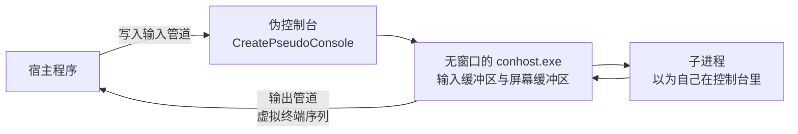

# A.17 控制台与 ConPTY

在现代系统编程中，终端交互是一个既承载着深厚历史包袱、又高度依赖底层抽象约定的领域。一个看似简单的交互式命令行工具，往往需要应对诸多细致入微的控制诉求：在终端窗口里实时刷新一条平滑且色彩分明的进度条，在操作员敲下任意单键时立即捕获响应而不必等待回车换行，或者在收到 Ctrl+C 时从容拦截中断信号、将尚未落盘的缓存妥善写出后再行退出。而在工具链的另一端，持续集成执行器（CI Runner）、语言服务器（LSP）、集成开发环境的内置终端以及 Windows Terminal 这样的现代终端模拟器，则需要扮演宿主角色，去拉起并托管外部控制台进程，将子程序原本绘制在屏幕上的光标移动、色彩渲染乃至全屏刷新动作原原本本地接管过来。

在 Linux 环境中，这套交互机制主要依托终端驱动里的 `termios` 结构、行规程切换以及伪终端（PTY）主从设备来运转。而在 Windows 的演进历程中，控制台从一开始就与内核对象及专门的用户态宿主进程（`conhost.exe`）紧密咬合，共同构成了一套有状态的窗口环境。随着 Windows 10 引入虚拟终端序列（Virtual Terminal Sequences）并在 1809 版本正式推出伪控制台架构（Pseudoconsole，简称 ConPTY），Windows 下的控制台编程终于与跨平台终端标准实现了顺畅汇合。

要驾驭这套体系，我们需要顺着控制台的数据流向与生命周期层层深入：从鉴别标准句柄是否关联着物理控制台开始，逐步理清输入与输出缓冲区模式标志的运作机理、利用标准 VT 序列操控色彩与光标的工程写法、异步控制事件（Ctrl+C 与进程组信号）在多线程下的并发边界，直至用 ConPTY 搭建起一个能够托管外部控制台进程的微型终端宿主。本页的所有示例均在 MinGW-w64 GCC 下编译运行，其中涉及交互式按键注入与控制序列捕获的实验，均由第 6 节编写的伪控制台宿主脱机驱动并采集输出。

## 1. 控制台的结构

在 Windows 架构中，控制台从来不是简单的「标准输入输出管道」，它由一个专门的控制台宿主（Console Host，即 `conhost.exe`）所持有和管理。传统形态下，`conhost.exe` 负责为控制台进程维护一块结构化的输入缓冲区与一块或多块字符屏幕缓冲区，同时承担着处理 GDI 窗口渲染以及将物理键盘消息打包为事件记录的职责。而在现代 Windows 11 中，即便默认前台终端换成了基于 DirectX 硬件加速渲染的 Windows Terminal，其底层依然通过 ConPTY 机制在无头模式（Headless）下寄生着一个无窗口的 `conhost.exe` 实例。对于上层运行的 C 程序而言，其面对的控制台系统接口依然保持着严格的一致性。

当一个可执行文件被操作系统加载时，其 PE 标头中的子系统字段（Subsystem）直接决定了控制台的绑定行为：
- 编译为控制台子系统（MinGW 默认的 `-mconsole`，MSVC 的 `/SUBSYSTEM:CONSOLE`）的程序，启动时由操作系统负责关联至当前会话的控制台；若从图形界面双击启动，系统则会自动为其拉起一个全新的 `conhost.exe` 窗口。此时内核会为其初始化三个标准句柄：标准输入指向控制台输入缓冲区，标准输出与标准错误则默认绑定到活动的屏幕缓冲区。
- 编译为图形界面子系统（`-mwindows`，MSVC 的 `/SUBSYSTEM:WINDOWS`）的程序，启动时默认不附带任何控制台，`GetStdHandle(STD_OUTPUT_HANDLE)` 直接返回 NULL；如果这类 GUI 程序在运行途中需要调试输出，必须主动调用 `AllocConsole()` 显式向系统申请创建或附加一个控制台。

标准句柄在现实工程中经常被重定向到普通磁盘文件、匿名管道甚至是空设备。因此，当程序需要决定是否输出 ANSI 彩色控制字符时，绝不能单凭粗粒度的句柄类型做出武断推测：

::: concept win-console-isatty title="怎样判断标准句柄是否连到控制台"

对一个句柄调用 `GetFileType`，返回 `FILE_TYPE_CHAR` 之后还要再调用一次 `GetConsoleMode`。两次都成立，这个句柄才是控制台句柄。`FILE_TYPE_CHAR` 只说明它是字符设备，`NUL` 设备同样返回 `FILE_TYPE_CHAR`，而 `GetConsoleMode` 对它失败，错误码 6（`ERROR_INVALID_HANDLE`）。

:::

这构成了 Win32 平台下对 POSIX `isatty()` 函数的严格实现范式。下面的探测程序逐项排查三个标准句柄的真实物理从属，并在末尾尝试显式打开一次控制台设备专有符号 `CONOUT$`：

```c
static void report(const char *name, DWORD std_id) {
    HANDLE h = GetStdHandle(std_id);
    DWORD type = GetFileType(h);
    DWORD mode = 0;
    BOOL is_console = GetConsoleMode(h, &mode);

    printf("%-6s %-18s console: %s", name, type_name(type), is_console ? "yes" : "no");
    if (is_console) {
        printf(" (mode 0x%04lX)", (unsigned long)mode);
    }
    printf("\n");
}
```

完整代码位于 `code/系统编程/拓展A_Win32系统编程/A_17_控制台与ConPTY/isconsole.c`。在未发生重定向的交互式控制台下执行，三个句柄均展现出标准的控制台特征：

::: terminal title="PowerShell - isconsole"

<span class="prompt">PS&gt;</span> gcc -std=c17 -Wall -Wextra -o isconsole.exe isconsole.c

<span class="prompt">PS&gt;</span> ./isconsole.exe

```text
stdin  FILE_TYPE_CHAR     console: yes (mode 0x01F7)
stdout FILE_TYPE_CHAR     console: yes (mode 0x0007)
stderr FILE_TYPE_CHAR     console: yes (mode 0x0007)
CONOUT$ is a console (mode 0x0007)
```

:::

如果将标准输出重定向到磁盘文件：

::: terminal title="PowerShell - isconsole 重定向"

<span class="prompt">PS&gt;</span> cmd /c ".\isconsole.exe > out.txt & type out.txt"

```text
stdin  FILE_TYPE_CHAR     console: yes (mode 0x01F7)
stdout FILE_TYPE_DISK     console: no
stderr FILE_TYPE_CHAR     console: yes (mode 0x0007)
CONOUT$ is a console (mode 0x0007)
```

:::

再通过管道传递给下游过滤工具，并将标准输入接入 `NUL` 设备：

::: terminal title="PowerShell - isconsole 管道与 NUL"

<span class="prompt">PS&gt;</span> cmd /c ".\isconsole.exe | findstr stdout"

```text
stdout FILE_TYPE_PIPE     console: no
```

<span class="prompt">PS&gt;</span> cmd /c ".\isconsole.exe < nul"

```text
stdin  FILE_TYPE_CHAR     console: no
stdout FILE_TYPE_CHAR     console: yes (mode 0x0007)
stderr FILE_TYPE_CHAR     console: yes (mode 0x0007)
CONOUT$ is a console (mode 0x0007)
```

:::

分析重定向的输出表现：重定向仅换掉了标准输出的指向，而标准输入与标准错误依然维持着与原始控制台宿主的连通；通过 `cmd /c` 调度可以规避某些现代 shell 对原生二进制输出的二次包装。尤其需要注意的是接入 `NUL` 设备的测试行：`NUL` 设备被系统划入字符设备类型（`FILE_TYPE_CHAR`），但当对其调用 `GetConsoleMode` 时，底层会明确返回失败并置错误码为 6（`ERROR_INVALID_HANDLE`）。如果仅凭 `GetFileType` 进行单一判定，便会错误地将空设备误判为交互式终端。

此外，Win32 保留了 `CONIN$` 与 `CONOUT$` 两个专有设备别名。无论标准输入输出被重定向至何处，程序只要调用 `CreateFileW(L"CONOUT$", GENERIC_WRITE, ...)`，便总能绕过重定向重获当前物理控制台活动屏幕缓冲区的句柄。这在需要将标准数据输出重定向给外部管道、同时又必须向操作员屏幕即时打印交互提示的场景中至关重要。

## 2. 控制台模式

控制台的数据流动与解析行为，受控于输入缓冲区与屏幕缓冲区各自维护的模式字（Console Modes）。读取与更改该配置通过一对紧凑的 API 完成：

```c
BOOL GetConsoleMode(HANDLE hConsoleHandle, LPDWORD lpMode);
BOOL SetConsoleMode(HANDLE hConsoleHandle, DWORD dwMode);
```

对于输入缓冲区句柄，`wincon.h` 中定义了一组控制字符交付与预处理特性的标志位：

| 模式位 | 十六进制值 | 工程语义与行为控制 |
| --- | --- | --- |
| `ENABLE_PROCESSED_INPUT` | 0x0001 | 系统负责截获 Ctrl+C 并派发控制事件，不将其当作普通字符压入输入缓冲区 |
| `ENABLE_LINE_INPUT` | 0x0002 | 开启行缓冲模式，`ReadFile` 或 `ReadConsole` 只有在收到回车符时才向调用者返回 |
| `ENABLE_ECHO_INPUT` | 0x0004 | 自动将用户键入的字符回显到活动屏幕上（必须与行输入模式联用） |
| `ENABLE_WINDOW_INPUT` | 0x0008 | 将操作员拖拽窗口引发的尺寸变更作为事件记录注入输入缓冲区 |
| `ENABLE_MOUSE_INPUT` | 0x0010 | 将控制台窗口内的鼠标点击与移动作为事件记录送入输入队列 |
| `ENABLE_VIRTUAL_TERMINAL_INPUT` | 0x0200 | 开启按键 VT 编码转换，将功能键（如方向键、F1-F12）自动转译为 ANSI 转义序列交付 |

而对于输出屏幕缓冲区，可配置的模式项则聚焦于文本流的排版与解析：`ENABLE_PROCESSED_OUTPUT`（0x0001，自动转译退格、制表符与回车换行控制符）、`ENABLE_WRAP_AT_EOL_OUTPUT`（0x0002，光标触达屏幕右边界时自动换行折叠）、`ENABLE_VIRTUAL_TERMINAL_PROCESSING`（0x0004，启用对 ANSI/VT100 转义控制序列的即时解析引擎），以及 `DISABLE_NEWLINE_AUTO_RETURN`（0x0008，写入最后一列时光标暂停于边界，抑制隐式回车）。

新创建的控制台输入模式通常默认开启行缓冲、回显与预处理（对应实测读出的 0x01F7）。屏幕缓冲区缺省模式为 0x0003，VT 序列解析默认处于关闭状态。但在现代 ConPTY 环境下，输出句柄往往默认已被宿主预设为 0x0007。因此，健壮的系统代码绝不能在没有前置探测的情况下做主观预设。

改动控制台模式时，有一条必须时刻谨记的底层性质：**模式状态保存在控制台缓冲区对象内部，由附着到该控制台的所有进程共同感知**。

::: concept win-console-mode-restore title="修改控制台模式前先保存，退出前恢复"

`GetConsoleMode` 读出的值要存进一个 `DWORD`。修改时在保存值的基础上按位或、按位与，不要直接赋一个常量，否则会把其他模式位一起清掉。程序结束前用保存值调用 `SetConsoleMode` 恢复。控制台模式是整个控制台共享的：同一控制台上的其他进程（包括调用你的那个 shell）看到的都是修改后的值。

:::

在 Linux 中，终端控制由 `tcgetattr` 与 `tcsetattr` 承载，修改 `struct termios` 影响的是当前打开的伪终端实例；而在 Windows 下，控制台模式同样是当前会话共享的全局状态。如果在程序退出前遗漏了模式恢复，随后接管前台的 PowerShell 或 cmd 将被迫在被改动的模式下继续运行，给操作员带来反常的交互体验。

| 交互行为 | POSIX termios 对应项 | Win32 控制台模式映射 |
| --- | --- | --- |
| 规范模式（按行交付） | `ICANON` | `ENABLE_LINE_INPUT` |
| 字符回显 | `ECHO` | `ENABLE_ECHO_INPUT` |
| 中断信号截获 | `ISIG`（截获 `^C` 生成 `SIGINT`） | `ENABLE_PROCESSED_INPUT`（截获 Ctrl+C 并生成控制事件） |
| 输出换行自动转译 | `OPOST` / `ONLCR` | 无等价设置；Windows 控制台将 `\n` 原样视为光标垂直下移，需显式输出 `\r\n` |
| 原始模式逐键读取 | 清除 `ICANON` 与 `ECHO` | 清除 `ENABLE_LINE_INPUT` 与 `ENABLE_ECHO_INPUT` |

`mode_demo.c` 演示了安全修改控制台模式的标准范式：先读取并妥善备份原始模式，清空行缓冲与回显标志，执行单字符无缓冲读取，最后在离开前将原值无损写回：

```c
HANDLE in = GetStdHandle(STD_INPUT_HANDLE);
DWORD saved;
if (!GetConsoleMode(in, &saved)) {
    printf("stdin is not a console (error %lu)\n", GetLastError());
    return 1;
}
show("original", saved);

if (!SetConsoleMode(in, saved & ~(DWORD)(ENABLE_LINE_INPUT | ENABLE_ECHO_INPUT))) {
    printf("SetConsoleMode failed: %lu\n", GetLastError());
    return 1;
}
```

通过伪控制台向其注入 `ab` 加回车的测试数据：

::: terminal title="PowerShell - mode_demo"

<span class="prompt">PS&gt;</span> gcc -std=c17 -Wall -Wextra -o mode_demo.exe mode_demo.c

<span class="prompt">PS&gt;</span> ./conpty_run.exe -in "ab\r" -- ./mode_demo.exe

```text
original             0x01F7  line=on  echo=on  processed=on
line/echo off        0x01F1  line=off echo=off processed=on
type a line, it will not be echoed:
read 2 byte(s): 61 62
restored             0x01F7  line=on  echo=on  processed=on
```

:::

0x01F7 在剔除了 `ENABLE_LINE_INPUT`（0x0002）与 `ENABLE_ECHO_INPUT`（0x0004）之后，精确沉淀为 0x01F1。行缓冲关闭后，`ReadFile` 只要检测到输入队列中有字符到达便立即返回，无须枯等回车符；回车符被从容留存在队列中供下一次读取。由于回显已被掐断，测试输入的文本不会自动打在屏幕上，仅在程序主动十六进制输出时才显露真容。

::: tip 把几个模式位当成一组来改

微软官方规范建议将行输入、回显与预处理输入作为一组原子特性进行统筹维护：全开时构成典型的「熟模式」（Cooked Mode），全关时则进入底层的「生模式」（Raw Mode）。孤立地开关某一个位往往会导致反直觉的交互死角，例如在开启行缓冲的前提下单独关闭回显，用户必须盲打完整行并按下回车之后才能得到程序的反馈。

:::

## 3. 虚拟终端序列

虚拟终端序列（Virtual Terminal Sequences）是一组由转义字符 ESC（ASCII 0x1B）领衔的控制字节流。这套发端于物理 VT100 终端与 xterm 的标准化协议，构成了跨平台终端控制的通用基石：以 `\x1b[` 引导的控制序列引导符（Control Sequence Introducer，简称 CSI）为核心，通过后接参数与终结字母，能够精确操纵文本渲染样式、调色板、光标坐标乃至备用屏幕缓冲区的切换。这一机制的最大工程优势在于纯粹的数据流抽象：同一段转义序列，无论流经 Linux PTY、SSH 远程隧道还是 Windows Terminal，均被解释为完全一致的视觉动作。

传统 Windows 控制台在默认状态下不会解析这组转义流，会将 ESC 与后续字节视作普通字符直接送入屏幕缓冲区。要唤醒控制台宿主的 VT 解释引擎，必须在目标输出屏幕缓冲区的模式字中激活 `ENABLE_VIRTUAL_TERMINAL_PROCESSING`：

```c
HANDLE out = GetStdHandle(STD_OUTPUT_HANDLE);
DWORD saved;
if (!GetConsoleMode(out, &saved)) {
    /* 不是控制台：序列照样写出去，重定向时得到的就是这些字节 */
    return 0;
}
SetConsoleMode(out, saved | ENABLE_PROCESSED_OUTPUT | ENABLE_VIRTUAL_TERMINAL_PROCESSING);
```

编写模式切换逻辑时需恪守两项准则：其一，永远采取「读出—按位或—写回」的安全路径，切莫直接赋常量，以防将自动折行（`ENABLE_WRAP_AT_EOL_OUTPUT`）等关键布局标志抹除；其二，必须确保 `ENABLE_PROCESSED_OUTPUT` 同步处于开启状态，系统要求预处理管道为 VT 解析提供底层协作。若在极早期的 Windows 版本上调用 `SetConsoleMode` 遭遇失败且错误码为 87（`ERROR_INVALID_PARAMETER`），则表明运行环境尚未接纳 VT 特性，程序应优雅降级为纯文本渲染。

日常编写命令行工具时，高频使用的控制序列主要集中在下面这张表里：

| 序列 | 作用 |
| --- | --- |
| `\x1b[0m` | 恢复默认属性 |
| `\x1b[1m` | 加亮（前景色变亮） |
| `\x1b[30m`～`\x1b[37m` | 前景色，黑、红、绿、黄、蓝、品红、青、白 |
| `\x1b[90m`～`\x1b[97m` | 对应的亮色 |
| `\x1b[40m`～`\x1b[47m` | 背景色 |
| `\x1b[38;2;r;g;b m` | 24 位前景色 |
| `\x1b[48;2;r;g;b m` | 24 位背景色 |
| `\x1b[2J` | 清屏 |
| `\x1b[H` | 光标移到左上角 |
| `\x1b[2K` | 清掉整行 |
| `\x1b[<n>A`、`\x1b[<n>C` | 光标上移、右移 n 格 |
| `\x1b[?25l`、`\x1b[?25h` | 隐藏、显示光标 |
| `\x1b[?1049h`、`\x1b[?1049l` | 进入、离开备用屏幕缓冲区 |

示例程序 `vt_color.c` 将基础 16 色、24 位真彩色以及原地行刷新依次演练了一遍：

```c
printf("\x1b[1mforeground 30-37 / 90-97\x1b[0m\n");
for (int i = 0; i < 8; i++) {
    printf("\x1b[%dm %d \x1b[0m", 30 + i, i);
}
```

随后的 24 位真彩色块与单行原地重绘分别使用了 `\x1b[48;2;200;60;20m` 和 `\x1b[2K\r`。完整源码位于 `code/系统编程/拓展A_Win32系统编程/A_17_控制台与ConPTY/vt_color.c`。在终端下编译执行，得到的渲染输出如下（代码块中包含了程序实际写出的原始转义字节，其中 ESC 为 0x1B）：

::: terminal title="PowerShell - vt_color"

<span class="prompt">PS&gt;</span> gcc -std=c17 -Wall -Wextra -o vt_color.exe vt_color.c

<span class="prompt">PS&gt;</span> ./vt_color.exe

```ansi
foreground 30-37 / 90-97
 0  1  2  3  4  5  6  7 
 8  9  10  11  12  13  14  15 

background 40-47 and 24-bit color
                              truecolor
```

:::

程序的最后一段将同一行文本连续重绘了四次，这也是各类进度条与状态指示工具的惯用写法：先发送 `\r` 将光标拉回行首，再发送 `\x1b[2K` 把整行残余字符擦除干净，随后写出新一帧文本。为了避免高频刷新时光标在行首行尾之间来回闪烁，进入循环前先用 `\x1b[?25l` 将光标隐藏，退出前再发送 `\x1b[?25h` 恢复显示。若将标准输出重定向到文件，便能清楚看到这一段实际写出的控制序列与文本字节（其中 `\r` 为回车符，仅复位水平列坐标而不产生垂直换行）：

::: terminal title="PowerShell - vt_color 重定向后的字节"

```text
\e[?25l\e[2K\rstep 0 of 3  \e[2K\rstep 1 of 3  \e[2K\rstep 2 of 3  \e[2K\rstep 3 of 3  \e[2K\rstep 3 of 3  done\r\n
\e[?25h
```

:::

对于 24 位 RGB 颜色序列，Windows Terminal 等现代终端模拟器会直接按原色值渲染；而传统的 `conhost.exe` 屏幕缓冲区内部仅维护一张 16 项调色板，遇到 `38;2;r;g;b` 时会自动从 16 色表里挑选最接近的一项近似替代，因此同一串真彩色序列在两种宿主下的视觉观感可能有所差异。如果希望在不同终端间保持一致的配色层次，可以直接选用 30～37 与 90～97 这两组标准 16 色，或者退一步使用 256 色索引（`\x1b[38;5;<n>m`）。

::: concept win-console-vt-default title="新代码用虚拟终端序列，经典 API 只留没有替代的部分"

微软对 Windows 命令行程序的建议是：与终端交互一律用虚拟终端序列；仍然必须用经典控制台 API 的只有几件事：取标准句柄（`GetStdHandle`）、读写模式位（`GetConsoleMode`/`SetConsoleMode`）、设置代码页（`SetConsoleOutputCP`/`SetConsoleCP`）、进出控制台（`AllocConsole` 等）、控制事件（`SetConsoleCtrlHandler` 与 `GenerateConsoleCtrlEvent`）、读输入事件（`ReadConsoleInput`）和取窗口大小（`GetConsoleScreenBufferInfo`）。

:::

这一演进方向背后的考量十分清晰：早期的经典屏幕缓冲区 API（如 `WriteConsoleOutput`、`SetConsoleTextAttribute`）属于 Windows 独有的本地句柄调用，写出的代码若要移植到 Linux 必须推倒重来；而虚拟终端序列本质上只是普通字节流，无论穿行于 SSH 隧道、标准管道还是伪控制台通道都无需任何特殊转换。因此，直接操作二维屏幕缓冲区的旧式函数在新编写的命令行程序里已不再推荐使用，本页也不再展开。

<Quiz
  :options="[
    { label: '调用 SetConsoleOutputCP(CP_UTF8)', value: 'A' },
    { label: '对输出句柄置位 ENABLE_VIRTUAL_TERMINAL_PROCESSING', value: 'B' },
    { label: '调用 AllocConsole 分配一个新控制台', value: 'C' },
    { label: '改用 WriteConsoleW 输出', value: 'D' }
  ]"
  answer="B"
>

<template #question>

要让 `printf("\x1b[31mred\x1b[0m")` 在控制台里显示成红色，必须先做什么？

</template>

正确答案是 **B**。如果输出句柄的模式位中没有开启 `ENABLE_VIRTUAL_TERMINAL_PROCESSING`，控制台宿主就会把 ESC 及其后的控制字符原样填入屏幕缓冲区，最终在屏幕上打印出一串可见乱码。输出代码页仅决定多字节流如何解码成字符，与转义控制序列的解析状态无关。

</Quiz>

## 4. 读取输入事件

除了通过 `ReadFile` 或 `ReadConsole` 读取字符流，程序还可以直接调用 `ReadConsoleInputW` 从控制台输入缓冲区中逐条提取底层事件记录。每条记录的具体类别由 `INPUT_RECORD` 结构体中的 `EventType` 字段标识：

```c
BOOL ReadConsoleInputW(HANDLE hConsoleInput, PINPUT_RECORD lpBuffer,
                       DWORD nLength, LPDWORD lpNumberOfEventsRead);
```

`INPUT_RECORD` 内部通过一个联合体承载不同种类的事件负载，其中应用层最常打交道的有以下三类：

| `EventType` | 联合体成员 | 主要字段 |
| --- | --- | --- |
| `KEY_EVENT` | `KeyEvent` | `bKeyDown`、`wVirtualKeyCode`、`uChar.UnicodeChar`、`wRepeatCount` |
| `WINDOW_BUFFER_SIZE_EVENT` | `WindowBufferSizeEvent` | `dwSize`（字符为单位的宽和高） |
| `MOUSE_EVENT` | `MouseEvent` | `dwMousePosition`、`dwButtonState` |

每当操作员敲击一次键盘，控制台都会向输入队列先后投递按下（`bKeyDown` 为真）和松开（`bKeyDown` 为假）两条事件记录，因此常规按键响应逻辑都需要先过滤 `bKeyDown` 字段。在 `KeyEvent` 成员中，`uChar.UnicodeChar` 保存着依据当前键盘布局转换出的 UTF-16 字符，而对于方向键、功能键这类不直接对应可打印字符的按键，该字段为 0，此时需结合 `winuser.h` 中定义的虚拟键码 `wVirtualKeyCode`（如 `VK_UP`、`VK_RETURN`、`VK_ESCAPE`）加以识别。

至于窗口尺寸变更事件 `WINDOW_BUFFER_SIZE_EVENT`，官方文档指出新建控制台默认关闭了 `ENABLE_WINDOW_INPUT` 标志，程序需显式将该位置位后方能收到通知；不过在本机通过伪控制台实测时发现，即便未显式置位，宿主调用 `ResizePseudoConsole` 后子进程依然能收到一条 `WINDOW_BUFFER_SIZE_EVENT`，说明 ConPTY 管线在此处的实际行为比文档描述更为宽容，但工程代码中按规范显式置位依然是最稳妥的做法。另外需要注意，无论该标志是否开启，高层的字符流读取函数 `ReadConsole` 与 `ReadFile` 在遇到窗口尺寸事件和鼠标事件时都会将其直接静默丢弃，唯有 `ReadConsoleInputW` 能够将它们完好取出。

示例程序 `keys.c` 先关掉行输入与回显、同时开启窗口输入事件，随后在循环中逐条读取并打印事件详情，直到捕获按键 `q` 为止：

```c
DWORD mode = (saved & ~(DWORD)(ENABLE_LINE_INPUT | ENABLE_ECHO_INPUT)) | ENABLE_WINDOW_INPUT;
if (!SetConsoleMode(in, mode)) {
    printf("SetConsoleMode failed: %lu\n", GetLastError());
    return 1;
}

for (;;) {
    INPUT_RECORD rec;
    DWORD n = 0;
    if (!ReadConsoleInputW(in, &rec, 1, &n)) {
        break;
    }
    describe(&rec);
    if (rec.EventType == KEY_EVENT && rec.Event.KeyEvent.bKeyDown &&
        rec.Event.KeyEvent.uChar.UnicodeChar == L'q') {
        break;
    }
}
```

完整代码位于 `code/系统编程/拓展A_Win32系统编程/A_17_控制台与ConPTY/keys.c`。通过伪控制台宿主向其注入 `ab\rq`（即依次敲入 `a`、`b`、回车和 `q`）：

::: terminal title="PowerShell - keys"

<span class="prompt">PS&gt;</span> gcc -std=c17 -Wall -Wextra -o keys.exe keys.c

<span class="prompt">PS&gt;</span> ./conpty_run.exe -in "ab\rq" -- ./keys.exe

```text
window 80x25, buffer 80x25
press keys, q to quit
KEY   down  code=0x41  char='a'  repeat=1
KEY   up    code=0x41  char='a'  repeat=1
KEY   down  code=0x42  char='b'  repeat=1
KEY   up    code=0x42  char='b'  repeat=1
KEY   down  code=0x0D  char=U+000D  repeat=1
KEY   up    code=0x0D  char=U+000D  repeat=1
KEY   down  code=0x51  char='q'  repeat=1
key-down events: 4
```

:::

观察事件输出序列：每次按键都成对产生 `down` 与 `up` 两条记录；当读到 `q` 的按下事件时，循环当即跳出，因此队列中紧随其后的 `q` 松开记录尚未被读取程序就已经退出了。同时可以看到，回车键产生的原始事件是虚拟键码 `0x0D`、字符 `U+000D`（即 `\r`），并未经过行缓冲模式下的 `\r\n` 转换。如果要在命令行中编写支持上下方向键的交互式菜单，只需直接比对 `wVirtualKeyCode` 与 `VK_UP`、`VK_DOWN`；若还需判断 Ctrl、Alt、Shift 等修饰键状态，则可进一步检查 `dwControlKeyState` 中的 `LEFT_CTRL_PRESSED` 等标志位。此外，如果希望让控制台宿主直接把方向键和功能键编码成 `\x1b[A` 这样的标准 ANSI 序列，只需对输入句柄置位 `ENABLE_VIRTUAL_TERMINAL_INPUT` 再改用 `ReadFile` 读取字节流——现代终端模拟器与 ConPTY 宿主之间传递特殊按键，底层走的正是这条转译通道。

若要在任意时刻主动查询当前终端窗口的行列尺寸，可以对标准输出句柄调用 `GetConsoleScreenBufferInfo`：

```c
CONSOLE_SCREEN_BUFFER_INFO info;
if (GetConsoleScreenBufferInfo(GetStdHandle(STD_OUTPUT_HANDLE), &info)) {
    int width = info.srWindow.Right - info.srWindow.Left + 1;
    int height = info.srWindow.Bottom - info.srWindow.Top + 1;
}
```

返回结构体中的 `srWindow` 描述了当前可视窗口在屏幕缓冲区内的矩形边界，而 `dwSize` 则是整块屏幕缓冲区的总尺寸，两者未必相等：在经典 `conhost.exe` 窗口中，缓冲区高度通常远大于可视窗口高度，以便操作员向上滚动翻阅历史输出；而在伪控制台会话中，由于历史滚屏改由前端终端模拟器自行维护，底层可视窗口与缓冲区的尺寸始终保持一致（如上例 `keys.c` 打印的 `window 80x25, buffer 80x25`）。当宿主调用 `ResizePseudoConsole` 调整终端尺寸时，子进程收到的 `WindowBufferSizeEvent.dwSize` 以及随后调用 `GetConsoleScreenBufferInfo` 读到的宽高都会同步更新为新值（详见第 6 节）。

::: warning 读输入用 W 函数

控制台输入管线对 UTF-8 多字节流的支持至今仍存在历史局限，微软官方文档明确指出默认的熟模式输入尚未完整支持 UTF-8，建议一律采用 `ReadConsoleW` 或 `ReadConsoleInputW` 按 UTF-16 宽字符读取。若直接使用窄字符接口 `ReadFile` 读取包含中文或 Emoji 的控制台输入，极易遭遇多字节序列被截断或编码错乱的问题。

:::

<Quiz
  :options="[
    { label: 'ReadConsoleW', value: 'A' },
    { label: 'ReadConsoleInputW', value: 'B' },
    { label: 'fgets', value: 'C' },
    { label: 'ReadFile', value: 'D' }
  ]"
  answer="B"
>

<template #question>

程序需要在用户拖动窗口改变大小时重新排版，应该用哪个函数取得这个事件？

</template>

正确答案是 **B**。窗口尺寸变更在控制台输入队列中表现为一条 `WINDOW_BUFFER_SIZE_EVENT` 记录，只有 `ReadConsoleInputW` 能够将其取出；面向字符流的 `ReadConsoleW`、`ReadFile` 以及标准库的 `fgets` 在遇到非字符事件时都会将其直接丢弃。按照文档规范，初始化时还应在输入模式中置位 `ENABLE_WINDOW_INPUT`。

</Quiz>

## 5. Ctrl+C 与控制事件

当操作员在控制台窗口按下 Ctrl+C、Ctrl+Break，或者点击窗口右上角的关闭按钮，乃至系统发生用户注销与关机时，控制台宿主都会将这些动作封装为控制事件（Control Event）投递给附着其上的各个进程。应用程序可以通过 `SetConsoleCtrlHandler` 注册自定义的回调函数来接管这些事件：

```c
BOOL WINAPI HandlerRoutine(DWORD dwCtrlType);
BOOL SetConsoleCtrlHandler(PHANDLER_ROUTINE HandlerRoutine, BOOL Add);
```

回调参数 `dwCtrlType` 用于区分具体的事件来源，取值涵盖 `CTRL_C_EVENT`（0）、`CTRL_BREAK_EVENT`（1）、`CTRL_CLOSE_EVENT`（2）、`CTRL_LOGOFF_EVENT`（5）以及 `CTRL_SHUTDOWN_EVENT`（6）。进程内部维护着一张后进先出的处理函数链表：当控制事件到达时，系统从最近注册的处理函数开始依次调用；若某个处理函数返回 `TRUE`，代表该事件已被妥善消化，调用链就此终止；若返回 `FALSE`，则继续向链表中的下一个处理函数传递，直至落入系统垫底的默认处理函数——后者会直接调用 `ExitProcess` 终止进程。此外，如果向该函数传入空函数指针并置 `Add` 为真（即 `SetConsoleCtrlHandler(NULL, TRUE)`），则会指示系统直接忽略 `CTRL_C_EVENT`；传 `SetConsoleCtrlHandler(NULL, FALSE)` 则恢复对 Ctrl+C 的正常响应。

编写控制事件处理函数时，最重要的一条并发准则是理解它的执行上下文：

::: concept win-console-ctrl-thread title="控制处理函数在系统新建的线程里运行"

收到控制事件时，系统在进程里新建一个线程来执行处理函数。它与主线程并发运行，不打断主线程正在执行的代码。处理函数里只做最少的事，通常是把一个停止事件置位，由主循环自己收尾；不要在里边加锁、分配内存或者等待其他线程。

:::

这一点与 POSIX 信号处理函数在当前线程上下文中异步穿插执行（或由专门的 `sigwait` 线程同步接收）的机制截然不同。示例程序 `ctrl_handler.c` 将主线程 ID 与控制处理函数所在线程的 ID 一并打印出来，直观印证了这一并发模型：

```c
static BOOL WINAPI on_control(DWORD type) {
    printf("[handler] type=%lu  handler thread=%lu  main thread=%lu\n", (unsigned long)type,
           (unsigned long)GetCurrentThreadId(), (unsigned long)g_main_thread);
    fflush(stdout);
    SetEvent(g_stop);
    return TRUE;
}
```

通过伪控制台宿主向运行中的子进程注入一个 Ctrl+C 字节（`\x03`）：

::: terminal title="PowerShell - ctrl_handler"

<span class="prompt">PS&gt;</span> gcc -std=c17 -Wall -Wextra -o ctrl_handler.exe ctrl_handler.c

<span class="prompt">PS&gt;</span> ./conpty_run.exe -in "\x03" -- ./ctrl_handler.exe

```text
main thread 27340, press Ctrl+C
[handler] type=0  handler thread=11828  main thread=27340
main: stop event is set, cleaning up
```

:::

输出中清晰呈现了两个不同的线程编号（具体数值随每次运行动态分配）。在回调函数 `on_control` 中，程序仅调用 `SetEvent(g_stop)` 将全局手动重置事件置为有信号状态便立即返回 `TRUE`；主线程则在 `WaitForSingleObject` 上阻塞等待该事件，被唤醒后在自己的线程上下文里安全地执行资源释放与收尾工作。这套「异步事件置位 + 主循环同步收尾」的协作结构，与 [A.10](/教程/正文/系统编程/拓展A_Win32系统编程/A_10_同步原语_等待函数与内核对象) 中协调工作线程优雅退出的模式一脉相承。

在五种控制事件中，`CTRL_CLOSE_EVENT` 带有严格的超时约束：当用户点击控制台窗口的关闭按钮时，系统会先派发该事件并留给进程大约 5 秒钟（受系统参数 `SPI_GETHUNGAPPTIMEOUT` 控制）的时间完成清理；一旦超时仍未退出，系统便会强制终结进程。至于 `CTRL_LOGOFF_EVENT` 与 `CTRL_SHUTDOWN_EVENT`，则主要用于通知后台服务，普通的交互式控制台程序在那之前就已被会话管理器先行关闭了。另外，微软文档特别提醒，由于控制处理函数运行在独立线程上，假如主线程在同一时刻恰好走到了 `return` 或主动调用了 `ExitProcess`，控制处理函数随时可能被半途截断，因此需要持久化的收尾动作应当交给主线程在收到停止事件后统一完成，随后再退出进程。

### 5.1 进程组与 CTRL_BREAK_EVENT

在默认配置下，控制台窗口中触发的 Ctrl+C 会广播给附着在该控制台上的全部进程。如果父进程希望只向自己派生出的某一组子进程定向发送中断事件，同时避免误伤自身或其他同台进程，就需要引入进程组（Process Group）机制：在调用 `CreateProcessW` 时指定 `CREATE_NEW_PROCESS_GROUP` 标志，新创建的子进程就会成为一个独立进程组的组长，其进程组 ID 恰好等于该子进程的 PID，且由它继续派生出的后代进程也会默认归属到这个进程组中。随后，父进程即可调用 `GenerateConsoleCtrlEvent` 向目标进程组定向投递控制事件：

```c
BOOL GenerateConsoleCtrlEvent(DWORD dwCtrlEvent, DWORD dwProcessGroupId);
```

使用该接口时必须留意两项硬性限制。第一，**`CTRL_C_EVENT` 无法定向发送给单个进程组**：当 `dwProcessGroupId` 传入非零值时，尽管调用 `GenerateConsoleCtrlEvent(CTRL_C_EVENT, pgid)` 在表面上仍会返回成功，但目标进程组内的进程实际上收不到任何信号；要想按进程组定向中断，必须改发 `CTRL_BREAK_EVENT`。第二，接收方必须与调用方共享同一个控制台实例，若子进程在启动时通过 `CREATE_NEW_CONSOLE` 或 `DETACHED_PROCESS` 脱离了父控制台，该调用同样无法送达。此外，传给 `dwProcessGroupId` 的参数必须是通过 `CREATE_NEW_PROCESS_GROUP` 正式建立的进程组 ID；如果在创建子进程时漏掉了建组标志，事后却把一个普通子进程的 PID 传进去，由于系统找不到对应的进程组，实测会将该事件退化为面向整个控制台的广播，导致连发起调用的父进程自己也被 `CTRL_BREAK_EVENT` 一并杀死。

示例程序 `stop_group.c` 先以 `CREATE_NEW_PROCESS_GROUP` 标志启动一个自身副本作为子进程，休眠 0.8 秒后向该子进程所属的进程组定向发送 `CTRL_BREAK_EVENT`：

```c
if (!CreateProcessW(NULL, cmd, NULL, NULL, FALSE, CREATE_NEW_PROCESS_GROUP, NULL, NULL, &si, &pi)) {
    printf("CreateProcessW failed: %lu\n", GetLastError());
    return 1;
}
Sleep(800);
if (!GenerateConsoleCtrlEvent(CTRL_BREAK_EVENT, pi.dwProcessId)) {
    printf("GenerateConsoleCtrlEvent failed: %lu\n", GetLastError());
}
WaitForSingleObject(pi.hProcess, 5000);
GetExitCodeProcess(pi.hProcess, &code);
printf("child exit code %lu (0x%08lX)\n", (unsigned long)code, (unsigned long)code);
```

完整代码位于 `code/系统编程/拓展A_Win32系统编程/A_17_控制台与ConPTY/stop_group.c`。编译并在伪控制台宿主下运行：

::: terminal title="PowerShell - stop_group"

<span class="prompt">PS&gt;</span> gcc -std=c17 -Wall -Wextra -o stop_group.exe stop_group.c

<span class="prompt">PS&gt;</span> ./conpty_run.exe -- ./stop_group.exe

```text
parent 27872 started child 9064 in its own process group
child 9064 started, sleeping
parent sent CTRL_BREAK_EVENT to group 9064
child exit code 3221225786 (0xC000013A)
```

:::

子进程的退出码 `0xC000013A` 对应 NT 状态码 `STATUS_CONTROL_C_EXIT`，表明该进程确实是被控制台控制事件终止的：由于子进程并未注册自定义处理函数，系统默认处理函数在收到 `CTRL_BREAK_EVENT` 后当即终结了子进程，而父进程自身则毫发无损地继续运行并打印出了回收结果。如果把代码中的 `CTRL_BREAK_EVENT` 改成 `CTRL_C_EVENT` 重新测试，子进程就会毫无反应地继续沉睡，父进程在 `WaitForSingleObject` 上苦等 5 秒超时后读到的退出码将是 259（`STILL_ACTIVE`），这正是「`CTRL_C_EVENT` 不支持定向发给非零进程组」的直观表现。

将这套机制与 Linux 对照来看：POSIX 环境下可以通过 `kill(-pgid, SIGINT)` 向任意进程组投递各类信号，shell 的作业控制（`fg`、`bg`、`Ctrl+Z`）更是深度围绕会话、前台进程组与后台进程组构建。相比之下，Windows 的控制台进程组仅服务于 `CTRL_BREAK_EVENT` 的定向投递，既没有与 `SIGTSTP` 对应的作业挂起信号，也不存在内核级的前后台进程组切换；若要强行中止一个拒不响应控制事件的子进程，父进程只能诉诸 `TerminateProcess` 或通过进程间通信通知其自行退出。

这里还有一处隐蔽的继承细节值得提防：`CREATE_NEW_PROCESS_GROUP` 会在创建新进程组的同时，隐式为子进程开启「忽略 Ctrl+C」的内部属性；此外，从某些持续集成代理（CI Agent）或后台脚本拉起的进程，也常常从父环境继承了忽略 Ctrl+C 的状态，导致程序启动后对注入的 `\x03` 毫无反应。要想显式恢复对 Ctrl+C 的响应，只需在程序入口处调用一次 `SetConsoleCtrlHandler(NULL, FALSE)`——本页编写的宿主工具 `conpty_run.exe` 在启动之初就执行了这行调用，以确保测试子进程能够正常接收 Ctrl+C 事件。顺带一提，C 标准库中的 `signal(SIGINT, ...)` 在 Windows 下正是构建在 `SetConsoleCtrlHandler` 之上的薄封装：CRT 会在内部注册一个控制台控制处理函数，待收到 `CTRL_C_EVENT` 时再转而调用用户登记的信号处理函数（详见 [22.1 signal](/教程/正文/语法和标准库/22_非局部控制与信号/22_1_signal)）。

<Quiz
  :options="[
    { label: '主线程', value: 'A' },
    { label: '系统为此新建的线程', value: 'B' },
    { label: '进程里最后创建的那个线程', value: 'C' },
    { label: '控制台宿主进程里的线程', value: 'D' }
  ]"
  answer="B"
>

<template #question>

`SetConsoleCtrlHandler` 注册的处理函数在哪个线程里运行？

</template>

正确答案是 **B**。每当控制台控制事件送达时，操作系统都会在目标进程内部临时创建一个新线程来执行注册的处理函数，因此它与正在运行的主线程处于并发执行状态。这也决定了处理函数内部应当只做置位事件对象的轻量动作，把复杂的数据结构清理留给主循环自己完成，从而避免多线程竞态冲突。

</Quiz>

## 6. 伪控制台 ConPTY

伪控制台（Pseudoconsole，简称 ConPTY）允许普通应用程序扮演终端模拟器的角色：宿主创建一对匿名管道并将其绑定到伪控制台实例上，随后将子进程放进一个无窗口的后台控制台环境中运行。对于子进程而言，它调用 `GetFileType` 与 `GetConsoleMode` 探测到的都是标准的控制台句柄，所有经典控制台 API 均照常运转；而在底层，伴随该伪控制台启动的无头 `conhost.exe` 会将子进程对屏幕缓冲区的修改实时差异化编译为标准的虚拟终端序列，通过输出管道源源不断地交付给宿主程序。这与[主线第 13 章](/教程/正文/系统编程/13_终端_伪终端与作业控制)中利用 `posix_openpt` 与 `forkpty` 构建主从伪终端的模型遥相呼应，区别主要在于 Linux 将终端行规程置于内核驱动内，而 Windows 则由用户态的 `conhost.exe` 承担了屏幕状态维护与 VT 协议翻译。

整个双向数据通路的拓扑结构如下：



在调用 `CreatePseudoConsole` 建立伪控制台会话之前，宿主需要先创建两条匿名管道，分别充当伪控制台的输入流与输出流：

```c
HANDLE in_read, in_write, out_read, out_write;
CreatePipe(&in_read, &in_write, NULL, 0);   /* 宿主写 in_write，伪控制台读 in_read */
CreatePipe(&out_read, &out_write, NULL, 0); /* 伪控制台写 out_write，宿主读 out_read */

HPCON hpc;
COORD size = {.X = 80, .Y = 25};
HRESULT hr = CreatePseudoConsole(size, in_read, out_write, 0, &hpc);
CloseHandle(in_read);
CloseHandle(out_write);
```

传入的 `size` 参数以字符网格为单位，决定了伪控制台内部初始屏幕缓冲区的宽高，子进程调用 `GetConsoleScreenBufferInfo` 查到的正是这一组数值。`CreatePseudoConsole` 的返回类型为 `HRESULT`，应当使用 `FAILED` 或 `SUCCEEDED` 宏判定成败；第四个标志位参数目前仅支持 `PSEUDOCONSOLE_INHERIT_CURSOR` 或填 0。一旦伪控制台创建成功，宿主应当立即调用 `CloseHandle` 关掉交付给伪控制台的那两个管道端（`in_read` 与 `out_write`）：因为 `conhost.exe` 已经在内部复制了这两个句柄，假如宿主自己还攥着 `out_write` 不放，后续伪控制台关闭时，宿主的读线程就永远等不到管道写端全部关闭所触发的 EOF（`ERROR_BROKEN_PIPE`）。

拿到伪控制台句柄 `HPCON` 后，下一步是通过扩展启动信息结构体 `STARTUPINFOEXW` 将其挂载到待创建的子进程上。由于其中的进程线程属性列表属于变长不透明结构，初始化时需要连续调用两次 `InitializeProcThreadAttributeList`：第一次传入 `NULL` 查询所需内存字节数，分配空间后第二次执行实际初始化，随后调用 `UpdateProcThreadAttribute` 将 `PROC_THREAD_ATTRIBUTE_PSEUDOCONSOLE` 属性填入表中：

```c
SIZE_T bytes = 0;
InitializeProcThreadAttributeList(NULL, 1, 0, &bytes);
STARTUPINFOEXW si = {.StartupInfo.cb = sizeof si, .StartupInfo.dwFlags = STARTF_USESTDHANDLES};
si.lpAttributeList = (PPROC_THREAD_ATTRIBUTE_LIST)malloc(bytes);
InitializeProcThreadAttributeList(si.lpAttributeList, 1, 0, &bytes);
UpdateProcThreadAttribute(si.lpAttributeList, 0, PROC_THREAD_ATTRIBUTE_PSEUDOCONSOLE,
                          hpc, sizeof hpc, NULL, NULL);

PROCESS_INFORMATION pi;
CreateProcessW(NULL, cmd, NULL, NULL, FALSE, EXTENDED_STARTUPINFO_PRESENT,
               NULL, NULL, &si.StartupInfo, &pi);
```

调用 `CreateProcessW` 时，`dwCreationFlags` 参数必须带上 `EXTENDED_STARTUPINFO_PRESENT` 标志，明确告知内核传入的是扩展结构 `STARTUPINFOEXW`。如果漏掉了这个标志，内核会直接忽略末尾的属性列表，`CreateProcessW` 依然会一声不响地返回成功，但启动出来的子进程会直接附着到宿主自己的原控制台上——实测此时子进程打印的文本会直接跳上宿主的屏幕，而伪控制台的输出管道里连一个字节都收不到。

与此同时，`STARTUPINFOEXW` 中关于标准句柄的设置也有一处极易踩中的暗礁：

::: concept win-console-conpty-stdhandles title="ConPTY 子进程要设 STARTF_USESTDHANDLES 且三个标准句柄为 NULL"

用伪控制台创建子进程时，`STARTUPINFOEXW` 的 `dwFlags` 要包含 `STARTF_USESTDHANDLES`，而三个标准句柄字段保持 `NULL`。少了这个标志，当宿主自己的标准输出被重定向到文件或管道时，系统会把宿主的标准句柄复制给子进程，子进程就绕过伪控制台，直接写进宿主的输出。加上标志、句柄留空，系统才让子进程使用伪控制台提供的控制台设备。

:::

这一行为往往与常规的重定向直觉相左：在 `CreateProcessW` 中将 `bInheritHandles` 设为 `FALSE` 只能阻止通用可继承句柄的传递，却拦不住操作系统在未指定 `STARTF_USESTDHANDLES` 时默认将父进程的标准句柄复制给子进程。实测表明，当宿主自身的标准输出被重定向到磁盘文件且未设置 `STARTF_USESTDHANDLES` 时，子进程 `cmd.exe /c echo hello` 输出的 `hello` 会径直写进宿主的重定向文件里，伪控制台的输出管道反而一片空白；唯有显式置上 `STARTF_USESTDHANDLES` 并将三个句柄字段留作 `NULL`，系统才会把子进程的标准输入输出严格绑定到伪控制台实例上。

此外，伪控制台的输出管道必须交由专门的独立线程持续排空。微软文档对此给出了明确警示：切勿在同一个线程里串行混用输入写入与输出读取，否则一旦某个方向的管道缓冲区被写满并阻塞等待对端取走数据，而对端恰好又阻塞在相反方向的读写调用上，双方就会立刻陷入死锁。在实测中，如果宿主故意不读取 `out_read` 管道，一个连续打印数千行文本的子进程在启动 5 秒后依然停留在运行状态（`GetExitCodeProcess` 返回 259），死死卡在写控制台的系统调用上；直到宿主开始读取管道，子进程才瞬间冲过终点并退出。输入方向也是同理，宿主若一次性灌入大段文本，同样可能撑满输入管道。

示例程序 `conpty_host.c` 构造了一个最精简的伪控制台宿主：它拉起 `cmd.exe /c echo hello`，由专门的读取线程从 `out_read` 中捞取全部字节，并将不可见的控制字符转译为可读形式打印出来：

::: terminal title="PowerShell - conpty_host"

<span class="prompt">PS&gt;</span> gcc -std=c17 -Wall -Wextra -D_WIN32_WINNT=0x0A00 -DNTDDI_VERSION=0x0A000006 -o conpty_host.exe conpty_host.c

<span class="prompt">PS&gt;</span> ./conpty_host.exe

```text
\e[?9001h\e[?1004h\e[?25l\e[2J\e[m\e[Hhello\r\n
\e]0;C:\Windows\SYSTEM32\cmd.exe\a\e[?25h\e[?9001l\e[?1004l
```

:::

这段看似紧凑的字节流，完整记录了无头 `conhost.exe` 从初始化屏幕到结束会话的全套动作，按先后顺序拆解如下：

- `\e[?9001h`：启用 Win32 输入模式（`win32-input-mode`），通知前端终端模拟器将按键按完整的控制台输入记录格式编码后送入伪控制台。
- `\e[?1004h`：开启焦点事件汇报，当宿主终端窗口获得或失去焦点时向伪控制台发送通知。
- `\e[?25l`：在重绘屏幕前先行隐藏光标。
- `\e[2J`：擦除整块屏幕。
- `\e[m`：复位所有字符颜色与样式属性（等价于 `\e[0m`）。
- `\e[H`：将光标移回屏幕左上角原点（第 1 行第 1 列）。
- `hello\r\n`：子进程 `echo hello` 输出的正文内容，行尾固定为回车加换行 `\r\n`。
- `\e]0;C:\Windows\SYSTEM32\cmd.exe\a`：操作系统控制序列（OSC），用于将宿主终端窗口的标题栏更新为子进程的可执行文件路径，以响铃符 BEL（0x07，记作 `\a`）收尾。
- `\e[?25h`：恢复显示光标。
- `\e[?9001l`、`\e[?1004l`：会话即将关闭时，依次撤销开头启用的 Win32 输入模式与焦点跟踪模式。

`conpty_host.c` 的完整源码位于 `code/系统编程/拓展A_Win32系统编程/A_17_控制台与ConPTY/conpty_host.c`。需要注意的是，编译任何调用了 ConPTY 接口的程序时，必须在命令行或头文件前部显式声明 Windows 10 1809 及以上的版本宏，否则头文件将隐藏相关声明：

::: terminal title="PowerShell - 不带版本宏编译"

<span class="prompt">PS&gt;</span> gcc -std=c17 -Wall -Wextra -o conpty_nomacro.exe conpty_host.c

```text
conpty_host.c: In function 'main':
conpty_host.c:50:5: error: unknown type name 'HPCON'; did you mean 'HICON'?
   50 |     HPCON hpc;
      |     ^~~~~
      |     HICON
conpty_host.c:52:18: warning: implicit declaration of function 'CreatePseudoConsole' [-Wimplicit-function-declaration]
conpty_host.c:69:59: error: 'PROC_THREAD_ATTRIBUTE_PSEUDOCONSOLE' undeclared (first use in this function)
```

:::

`HPCON`、`CreatePseudoConsole` 以及 `PROC_THREAD_ATTRIBUTE_PSEUDOCONSOLE` 在 SDK 头文件中均受 `_WIN32_WINNT >= 0x0A00` 与 `NTDDI_VERSION >= 0x0A000006` 保护，初次编写 ConPTY 程序的开发者几乎都会撞上这组编译报错。

在伪控制台会话运行期间，如果前端终端窗口被用户拖拽改变了尺寸，宿主可以随时调用 `ResizePseudoConsole` 同步更新伪控制台的网格大小：

```c
COORD new_size = {.X = 120, .Y = 40};
ResizePseudoConsole(hpc, new_size);
```

调用后，底层 `conhost.exe` 会向子进程的输入队列投递一条 `WINDOW_BUFFER_SIZE_EVENT` 记录，其中的 `dwSize` 即为新的宽高 `120x40`；子进程随后调用 `GetConsoleScreenBufferInfo` 读到的窗口与缓冲区尺寸也会立即反映这一变化。

当需要终结伪控制台会话时，宿主调用 `ClosePseudoConsole(hpc)`。根据文档规范，关闭伪控制台会自动终止仍附着在该会话上的子进程（若子进程是一个 shell，由它派生的整棵进程树也会一并终结）。由于关闭过程中 `conhost.exe` 往往还会往输出管道刷出最后一帧清理序列（如前面的 `\e[?9001l`），文档要求宿主的管道读取线程必须持续读取直至 `ReadFile` 返回 `FALSE`（管道彻底断开）后再退出，以免 `ClosePseudoConsole` 在等待管道排空时与提前停工的读线程发生互锁。

本页其余小节中的交互式控制台示例，均统一交由工具程序 `conpty_run.exe` 托管运行。它是一个支持延时注入按键与过滤控制序列的完整伪控制台宿主，源码位于 `code/系统编程/拓展A_Win32系统编程/A_17_控制台与ConPTY/conpty_run.c`，命令行语法如下：

```text
conpty_run [-raw] [-in 文本] [-delay 毫秒] [-timeout 毫秒] [-cols N] [-rows N] -- 命令行
```

其中 `-raw` 选项会将输出管道收到的原始字节流逐字节打印出来（将 ESC 转写为 `\e`、回车转写为 `\r`）；默认模式则会剥离 ANSI 控制序列，仅保留屏幕上可见的纯文本，并将光标右移序列自动折算为等量空格。`-in` 选项用于在子进程启动并稳定后向输入管道注入测试按键，支持 `\r`、`\n`、`\e`、`\\` 以及任意十六进制字节 `\xHH`（例如 `\x03` 即代表按下 Ctrl+C）。命令行解析器在遇到 `--`（或第一个非选项参数）时，会将后续部分整体拼成子进程的命令行。

<Quiz
  :options="[
    { label: '没有问题，伪控制台会自己缓冲', value: 'A' },
    { label: '一个方向的缓冲区写满后，双方互相等待（死锁）', value: 'B' },
    { label: '输出会乱码', value: 'C' },
    { label: '子进程无法启动', value: 'D' }
  ]"
  answer="B"
>

<template #question>

ConPTY 宿主在同一个线程里先写输入、再阻塞读输出，可能出现什么情况？

</template>

正确答案是 **B**。伪控制台的输入和输出通道底层都是容量有限的同步管道：一旦输入管道被写满，伪控制台内部的 `conhost.exe` 可能会因为等待宿主取走输出管道中的回显或屏幕更新而暂停读取输入；此时宿主又阻塞在写输入调用上无法转身去读输出，双方就会陷入永久死锁。因此宿主应当为输出管道配备专门的读取线程。

</Quiz>

## 7. 常见缺陷与故障排查

回顾前面各节的实验，控制台与 ConPTY 编程中最容易踩中的四类典型缺陷，其故障机理与外在表征都已经十分清晰：

**第一，程序退出前遗漏恢复控制台模式。** 控制台模式归属于底层的控制台输入与屏幕缓冲区对象，附着于同一控制台的所有进程共享同一份状态；子进程改动模式后若是直接退出，随后接管终端的父 shell 就会被迫在篡改后的模式下继续运行。

::: compare left-title="改完不恢复" right-title="保存并在退出前恢复"

```c
DWORD saved;
GetConsoleMode(in, &saved);
SetConsoleMode(in, saved & ~(DWORD)(ENABLE_LINE_INPUT | ENABLE_ECHO_INPUT));
ReadFile(in, buf, sizeof buf, &n, NULL);
return 0;   /* 回显和行输入就这么留给了 shell */
```

---

```c
DWORD saved;
if (!GetConsoleMode(in, &saved)) {
    return 1;
}
SetConsoleMode(in, saved & ~(DWORD)(ENABLE_LINE_INPUT | ENABLE_ECHO_INPUT));
ReadFile(in, buf, sizeof buf, &n, NULL);
SetConsoleMode(in, saved);   /* 正常路径恢复 */
return 0;
```

:::

左栏代码的破坏效果在实测中立竿见影：父进程启动前测得输入模式为 `0x01F7`，拉起左栏这样的子进程并等待其退出后，父进程再次查询自身标准输入的模式，发现已被改成了 `0x01F1`。此后父进程读取标准输入时，操作员敲下的字符毫无回显，同时 `ReadFile` 也不再按行等待回车，直接把后续连续敲入的两行文本连同回车符一股脑吞了进去（`61 62 63 0D 64 65 66 0D`）。在交互式 shell 中，这会直接表现为「盲打看不见字、命令却照常触发」，直到用户关掉整个终端窗口重开为止。对于密码输入这类需要临时关闭回显的程序，除了在正常返回路径上恢复模式，还应兼顾异常中断路径——例如用 `goto` 汇总到统一的清理出口，并配合第 5 节的 `SetConsoleCtrlHandler` 在收到 Ctrl+C 时先把控制台模式复原再行退出。

**第二，未开启 `ENABLE_VIRTUAL_TERMINAL_PROCESSING` 便直接输出转义序列。** 当输出模式中缺少该标志时，控制台宿主不会启动转义状态机，而是把字节流原封不动地当作普通字符填入屏幕网格。实测在关闭 VT 解析的状态下调用 `WriteFile` 写出 `\x1b[31mred\x1b[0m`，随后调用 `ReadConsoleOutputCharacterW` 读回屏幕第 0 行的字符单元，拿到的宽字符码位依次为 `001B 005B 0033 0031 006D 0072 0065 0064 001B 005B 0030 006D`——从开头的 ESC、左方括号、`31m` 到末尾的 `0m` 一字不落地陈列在屏幕上；而开启 VT 解析后，同样的检查只读回 `0072 0065 0064`（即红色的 `red` 三个字母）。

**第三，在单线程内同步阻塞读写伪控制台管道。** 正如第 6 节所验证的，伪控制台的输出管道一旦无人读取，输出量稍大的子进程很快就会因管道缓冲区满而卡死在控制台写入调用上，`GetExitCodeProcess` 持续返回 259（`STILL_ACTIVE`）；直到宿主启动读取线程排空管道，子进程才能继续推进。因此，宿主程序必须将输出管道的读取交由独立线程（或基于完成端口的异步 I/O）持续运转。

**第四，创建伪控制台子进程时未设置 `STARTF_USESTDHANDLES`。** 当宿主自身的标准输出被重定向到日志文件或上层管道时，漏掉该标志会导致子进程直接继承宿主的重定向句柄，从而绕过伪控制台把内容直接写进宿主的日志里，而伪控制台自己的输出管道却空空如也。宿主越是在后台自动化环境中运行，这类静默绕过就越容易被掩盖。

最后还有一项与字符编码息息相关的常规准备：向控制台输出 UTF-8 编码的中文字符前，应当先调用 `SetConsoleOutputCP(CP_UTF8)` 将控制台输出代码页切换为 UTF-8，否则宿主会按系统默认的本地 ANSI 代码页（如简体中文环境下的 GBK）错误拆分多字节序列并显示为乱码（详见 [A.2](/教程/正文/系统编程/拓展A_Win32系统编程/A_2_字符与文本_ANSI_Unicode与UTF16)）。虚拟终端控制序列本身全由单字节 ASCII 字符构成，不受代码页切换影响，但夹在颜色序列之间的中文文本则依赖于正确的代码页设置。

## 8. 习题

### 8.1 巩固

<Exercise id="46701" :d="1" :w="1">

下面这个函数想判断标准输出是不是控制台，但它有错。指出错误，给出改正后的版本，并说明在什么情况下它会误判。

```c
int stdout_is_console(void) {
    return GetFileType(GetStdHandle(STD_OUTPUT_HANDLE)) == FILE_TYPE_CHAR;
}
```

提示：本页 `isconsole.c` 把标准输入接到 `NUL` 设备时输出的那一行就是这种误判的实例。

</Exercise>

<Exercise id="46702" :d="2" :w="1">

某个控制台输入缓冲区的模式值是 0x01F7。依次回答：

(1) 把 `ENABLE_ECHO_INPUT` 和 `ENABLE_LINE_INPUT` 清掉之后，模式值是多少？写出十六进制。

(2) 在只改了这两个位的状态下调用一次 `ReadFile`，用户敲了 `abc` 再按回车，`ReadFile` 返回几个字节？这些字节是什么？剩下的输入留在哪里？

(3) 如果程序不恢复模式就退出，同一控制台上运行的 shell 会表现出什么现象？

</Exercise>

<Exercise id="46703" :d="2" :w="2">

写一个 `read_password.c`：从标准输入读一行口令，读的时候不回显。

要求：

- 用 `GetConsoleMode` 保存输入模式，清掉 `ENABLE_ECHO_INPUT`，读完恢复；
- 标准输入不是控制台时（比如 `read_password.exe < input.txt`）不要改动模式，直接读，并在标准错误上打印一行说明；
- 口令读进 `char buf[128]`，用 `ReadFile` 读，去掉行尾的 `\r\n`，打印它的长度，不打印内容；
- 恢复模式之后再打印一行普通文本，确认回显回来了。

验收：在终端里运行，输入 `secret` 回车，屏幕上看不到 `secret`，程序输出 `length 6`，随后那行普通文本正常显示；用 `conpty_run.exe -raw -in "secret\r" -- read_password.exe` 运行，原始字节流里搜不到 `secret`。

</Exercise>

### 8.2 编程

<Exercise id="46704" :d="3" :w="2">

写一个 `progress.c`，用虚拟终端序列在终端里画进度条，共 20 步，每步间隔 50 毫秒。

要求：

- 进度条固定在同一行：用 `\r` 回到行首、`\x1b[2K` 清行，再画 `[####      ]  40%` 这样的内容；
- 百分比部分用亮绿色（`\x1b[92m`），完成后用 `\x1b[0m` 复位；
- 开始前隐藏光标（`\x1b[?25l`），结束或提前退出前恢复（`\x1b[?25h`）；
- 标准输出不是控制台时不开启 VT、也不隐藏光标，只把纯文本进度打到标准错误，避免污染重定向的输出；
- 程序退出前用保存值恢复输出模式。

验收：在终端里运行只看到一行在变化；用 `cmd /c "progress.exe > out.txt"` 重定向之后，`out.txt` 里是 20 行纯文本，没有 ESC 字节（用 `Format-Hex` 或 `python -c` 检查）。

</Exercise>

<Exercise id="46705" :d="3" :w="3">

写一个 `keys2.c`，用 `ReadConsoleInputW` 做一个按键计数器，同时响应窗口大小变化。

要求：

- 关闭行输入和回显，置位 `ENABLE_WINDOW_INPUT`；
- 维护按下次数、松开次数和「有字符的按键」次数三个计数；
- 每读到一个 `WINDOW_BUFFER_SIZE_EVENT`，就打印新尺寸，并按新宽度输出一行 `-`；
- 按 Esc（`wVirtualKeyCode == VK_ESCAPE`）退出，退出前恢复输入模式并打印三个计数。

验收：用 `conpty_run.exe -in "abc\r" -- keys2.exe` 运行，最终按下 4 次、松开 4 次、有字符的 4 次（`a`、`b`、`c`、回车）；再写一个临时宿主调用 `ResizePseudoConsole`，确认程序打印出 `WINDOW_BUFFER_SIZE 120x40` 和宽度为 120 的分隔线。

</Exercise>

<Exercise id="46706" :d="4" :w="3">

写一个 `ctrl_cleanup.c`：程序在终端里循环打印计数，用户按 Ctrl+C 时先把输出模式恢复成启动时的值，打印一行统计，再以退出码 0 结束。

要求：

- 启动时保存输入和输出模式，并把输入模式改成关闭回显（为了模拟「程序改过控制台」）；
- 控制处理函数里只置位一个手动重置事件，不调用 `printf`；
- 主循环用 `WaitForSingleObject(..., 100)` 等待事件，超时就打印计数并继续；
- 看到事件后，主循环恢复两个模式、打印 `cleaned up after N ticks`、关闭事件、返回 0。

验收：`conpty_run.exe -in "\x03" -- ctrl_cleanup.exe` 的输出里，`cleaned up after` 之后的退出码是 0；处理函数打印的线程号（如果打印）与主线程不同；程序退出后终端仍能正常回显。

</Exercise>

<Exercise id="46707" :d="5" :w="4" multi>

写一对程序 `group_parent.c` 与 `group_child.c`，演示怎样停掉一整棵子进程树。

(1) _[4.3]_ `group_parent` 用 `CREATE_NEW_PROCESS_GROUP` 启动 `group_child`，后者再启动两个 `child.exe`（[A.8](/教程/正文/系统编程/拓展A_Win32系统编程/A_8_进程的创建_执行与等待) 的程序，带一个很大的睡眠时间）。`group_parent` 在 1 秒后调用 `GenerateConsoleCtrlEvent(CTRL_BREAK_EVENT, 子进程 PID)`，等 3 秒后用 `tasklist /FI "PID eq ..."` 确认三个进程都已不存在。

(2) _[5.4]_ 给 `group_child` 注册一个控制处理函数，收到 `CTRL_BREAK_EVENT` 时先向两个孙进程转发一次 `GenerateConsoleCtrlEvent`，再自己退出。说明不转发会怎样，用 `tasklist` 的输出验证。

(3) _[5.4*]_ 把 `CTRL_BREAK_EVENT` 换成 `CTRL_C_EVENT` 重跑，记录子进程的退出码，并用文档中的说明解释结果。

</Exercise>

### 8.3 综合与挑战

<Exercise id="46708" :d="6" :w="5" scope="*">

写一个交互式伪终端驱动 `ptyrelay.c`：它把宿主自己的标准输入转发进伪控制台的输入管道，把伪控制台的输出管道原样写到宿主的标准输出，并且响应宿主窗口的尺寸变化。

要求：

- 两条管道各用一个线程，输出线程把字节原样写给标准输出并 `fflush`，输入线程从标准输入读字节写进 `in_write`；
- 启动 `cmd.exe`，设置 `STARTF_USESTDHANDLES` 且三个标准句柄为 NULL；
- 主线程建立一个简单的窗口大小查询（`GetConsoleScreenBufferInfo`），每隔 200 毫秒比较一次，变了就调用 `ResizePseudoConsole`；
- 宿主标准输出不是控制台时拒绝运行并打印一行说明，因为尺寸变化无从获取；
- 子进程退出后关闭伪控制台、等待两个线程结束。

验收：运行后能在里面执行 `dir`、`echo`、`cls`，颜色和清屏正常；用 `mode con cols=100 lines=30` 改变窗口尺寸后，再执行 `mode con` 显示的是新值；按 Ctrl+C 时 `cmd` 收到中断而宿主不退出；输入 `exit` 后宿主正常结束，退出码为 0。

提示：这条转发路径里，宿主的标准输入是「生」模式还是「熟」模式会直接影响体验。先试试关掉行输入与回显，再试试不关，比较两次的差别。

</Exercise>

<Exercise id="46709" :d="7" :w="6" scope="*">

把本页的零件组装成一个 `mdr_run` 工具：带超时地运行任意命令行程序，超时先礼后兵。

要求：

- 命令行语法 `mdr_run [-t 秒] -- 命令行`，默认超时 10 秒；
- 用伪控制台运行子进程，把去掉控制序列后的文本按行写到标准输出，同时统计行数；
- 超时后先 `GenerateConsoleCtrlEvent(CTRL_BREAK_EVENT, pid)`，给 2 秒；仍在运行则 `TerminateProcess`；
- 结束时打印一行 `exit=<退出码> lines=<行数> timeout=<yes|no>`，其中退出码按无符号十六进制和十进制各给一次；
- 子进程以 `conpty_run.exe` 的输出为例测试，分别跑 `cmd.exe /c echo hello`、`cmd.exe /c ping -n 30 127.0.0.1`（超时 2 秒）和一个不存在的程序名。

验收：

1. 第一个命令输出 `hello`、`lines=1`、`exit=0x00000000`、`timeout=no`；
2. 第二个命令在约 2 秒后结束，`timeout=yes`，退出码解为控制事件退出码（0xC000013A）或终止码；
3. 第三个命令的退出码与 `CreateProcessW` 失败时的 `GetLastError` 一致，工具本身不崩溃；
4. 与 [A.12](/教程/正文/系统编程/拓展A_Win32系统编程/A_12_管道与进程间通信) 的匿名管道方案对比：`capture.exe` 捕获到的输出没有颜色和光标控制，本工具保留了什么、丢掉了什么，各写一句。

</Exercise>

## 9. 参考资料

- Microsoft Learn：Consoles，https://learn.microsoft.com/en-us/windows/console/consoles
- Microsoft Learn：Console Handles，https://learn.microsoft.com/en-us/windows/console/console-handles
- Microsoft Learn：High-Level Console Modes，https://learn.microsoft.com/en-us/windows/console/high-level-console-modes
- Microsoft Learn：Low-Level Console Modes，https://learn.microsoft.com/en-us/windows/console/low-level-console-modes
- Microsoft Learn：SetConsoleMode function，https://learn.microsoft.com/en-us/windows/console/setconsolemode
- Microsoft Learn：Console Virtual Terminal Sequences，https://learn.microsoft.com/en-us/windows/console/console-virtual-terminal-sequences
- Microsoft Learn：Classic Console APIs versus Virtual Terminal Sequences，https://learn.microsoft.com/en-us/windows/console/classic-vs-vt
- Microsoft Learn：ReadConsoleInput function，https://learn.microsoft.com/en-us/windows/console/readconsoleinput
- Microsoft Learn：Reading Input Buffer Events，https://learn.microsoft.com/en-us/windows/console/reading-input-buffer-events
- Microsoft Learn：SetConsoleCtrlHandler function，https://learn.microsoft.com/en-us/windows/console/setconsolectrlhandler
- Microsoft Learn：HandlerRoutine callback function，https://learn.microsoft.com/en-us/windows/console/handlerroutine
- Microsoft Learn：GenerateConsoleCtrlEvent function，https://learn.microsoft.com/en-us/windows/console/generateconsolectrlevent
- Microsoft Learn：Pseudoconsoles，https://learn.microsoft.com/en-us/windows/console/pseudoconsoles
- Microsoft Learn：Creating a Pseudoconsole session，https://learn.microsoft.com/en-us/windows/console/creating-a-pseudoconsole-session
- Windows Command Line 博客：Introducing the Windows Pseudo Console (ConPTY)，https://devblogs.microsoft.com/commandline/windows-command-line-introducing-the-windows-pseudo-console-conpty/
- microsoft/terminal 讨论 #15814（宿主标准句柄被重定向时的绕过问题），https://github.com/microsoft/terminal/discussions/15814
- microsoft/terminal 示例目录，https://github.com/microsoft/terminal/tree/main/samples/ConPTY
- Johnson M. Hart, *Windows System Programming*, 4th ed., Addison-Wesley, 2010，第 2 章（控制台 I/O）、第 4 章（控制台控制处理程序）。
