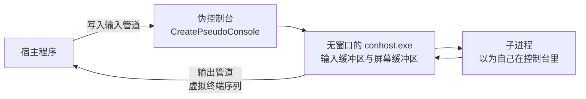

# A.17 控制台与 ConPTY

命令行工具要在终端里画一条彩色的进度条，读一个按键就立刻响应，在用户按下 Ctrl+C 时先把状态存盘再退出。另一边，一个 CI 工具或终端模拟器要启动别的控制台程序，把它「屏幕上」的内容拿到手：颜色、光标位置、清屏，一个都不能少。这两件事在 Linux 上分别对应 termios、读按键和伪终端，在 Windows 上则分别对应控制台模式、`ReadConsoleInputW` 和伪控制台（pseudoconsole，ConPTY）。

这一页沿着主线[第 13 章](/教程/正文/系统编程/13_终端_伪终端与作业控制)的顺序走：先说清控制台由谁持有、程序怎么知道自己连的是不是控制台；再说模式位怎样改变输入输出的行为；然后用虚拟终端序列输出颜色和控制光标；接着读按键和窗口大小事件；再处理 Ctrl+C 与进程组；最后用 ConPTY 托管一个控制台程序，把它输出的原始字节流读出来。示例都在 MinGW-w64 GCC 下编译运行，控制台相关的输出通过本页第 6 节写的伪控制台宿主取得。

## 1. 控制台的结构

控制台由控制台宿主（console host）持有。传统上宿主是 `conhost.exe`，它管理一块输入缓冲区和一块或多块屏幕缓冲区，负责把程序写入的字符画到窗口里，也负责把按键整理成输入记录。Windows 11 上默认终端是 Windows Terminal，窗口由它自己画，但它通过伪控制台（ConPTY）在背后仍然挂着一个无窗口的 `conhost.exe`，程序看到的接口没有变。

程序启动时，如果可执行文件的子系统是控制台（MinGW 默认的 `-mconsole`，MSVC 默认的控制台应用），系统会把它附加到一个控制台，并准备好三个标准句柄：标准输入指向控制台的输入缓冲区，标准输出和标准错误指向活动屏幕缓冲区。图形子系统的程序（`-mwindows`）启动时不会附加控制台，要用得自己调 `AllocConsole`；用 `objdump -p` 可以看到两者的 `Subsystem` 分别是 `Windows CUI` 和 `Windows GUI`，实测后者启动后 `GetStdHandle(STD_OUTPUT_HANDLE)` 返回 `NULL`。

标准句柄可以被重定向。`GetStdHandle` 拿到的可能是一个文件句柄、一个管道句柄，也可能是 `NUL` 设备，而不一定是控制台。判断方法不能只看句柄类型：

::: concept win-console-isatty title="怎样判断标准句柄是否连到控制台"

对一个句柄调用 `GetFileType`，返回 `FILE_TYPE_CHAR` 之后还要再调用一次 `GetConsoleMode`。两次都成立，这个句柄才是控制台句柄。`FILE_TYPE_CHAR` 只说明它是字符设备，`NUL` 设备同样返回 `FILE_TYPE_CHAR`，而 `GetConsoleMode` 对它失败，错误码 6（`ERROR_INVALID_HANDLE`）。

:::

这就是 Win32 里 `isatty` 的对应做法。下面的程序把三个标准句柄都查一遍，并额外打开一次 `CONOUT$`：

```c
static void report(const char *name, DWORD std_id) {
    HANDLE h = GetStdHandle(std_id);
    DWORD type = GetFileType(h);
    DWORD mode = 0;
    BOOL is_console = GetConsoleMode(h, &mode);

    printf("%-6s %-18s console: %s", name, type_name(type), is_console ? "yes" : "no");
    if (is_console) {
        printf(" (mode 0x%04lX)", (unsigned long)mode);
    }
    printf("\n");
}
```

完整文件在 `code/系统编程/拓展A_Win32系统编程/A_17_控制台与ConPTY/isconsole.c`。在控制台里运行，三个句柄都是控制台：

::: terminal title="PowerShell - isconsole"

<span class="prompt">PS&gt;</span> gcc -std=c17 -Wall -Wextra -o isconsole.exe isconsole.c

<span class="prompt">PS&gt;</span> ./isconsole.exe

```text
stdin  FILE_TYPE_CHAR     console: yes (mode 0x01F7)
stdout FILE_TYPE_CHAR     console: yes (mode 0x0007)
stderr FILE_TYPE_CHAR     console: yes (mode 0x0007)
CONOUT$ is a console (mode 0x0007)
```

:::

把标准输出重定向到文件：

::: terminal title="PowerShell - isconsole 重定向"

<span class="prompt">PS&gt;</span> cmd /c ".\isconsole.exe > out.txt & type out.txt"

```text
stdin  FILE_TYPE_CHAR     console: yes (mode 0x01F7)
stdout FILE_TYPE_DISK     console: no
stderr FILE_TYPE_CHAR     console: yes (mode 0x0007)
CONOUT$ is a console (mode 0x0007)
```

:::

再通过管道交给 `findstr`，并把标准输入接到 `NUL` 设备：

::: terminal title="PowerShell - isconsole 管道与 NUL"

<span class="prompt">PS&gt;</span> cmd /c ".\isconsole.exe | findstr stdout"

```text
stdout FILE_TYPE_PIPE     console: no
```

<span class="prompt">PS&gt;</span> cmd /c ".\isconsole.exe < nul"

```text
stdin  FILE_TYPE_CHAR     console: no
stdout FILE_TYPE_CHAR     console: yes (mode 0x0007)
stderr FILE_TYPE_CHAR     console: yes (mode 0x0007)
CONOUT$ is a console (mode 0x0007)
```

:::

重定向和管道只换掉标准输出，标准输入和标准错误仍然连着控制台，所以它们那两行和第一次运行完全一样。这两步走 `cmd /c` 而不是 PowerShell 自己的重定向，是因为 PowerShell 会给原生程序的输出重新编码，验证字节时必须绕开这一层。最后一组最能说明问题：`NUL` 设备的类型是 `FILE_TYPE_CHAR`，`GetConsoleMode` 却对它失败，错误码 6（`ERROR_INVALID_HANDLE`）。只看 `GetFileType` 会把它当成控制台，这就是判断条件要多一步的原因。

`CONOUT$` 和 `CONIN$` 是控制台设备的固定名字，可以用 `CreateFileW` 打开，拿到的是当前控制台的活动屏幕缓冲区和输入缓冲区。标准句柄被重定向时它们仍然可用，所以程序在把结果写到标准输出的同时，还能往屏幕上打一行提示。`CONOUT$` 打开的就是当前活动屏幕缓冲区，它的模式与屏幕缓冲区完全一致：模式属于缓冲区，不属于某一个句柄，重定向改变的只是 `GetStdHandle` 返回哪个句柄，碰不到缓冲区自己的状态。

## 2. 控制台模式

控制台的行为由输入缓冲区和屏幕缓冲区各自的一组模式位决定。读取和设置都用同一个函数：

```c
BOOL GetConsoleMode(HANDLE hConsoleHandle, LPDWORD lpMode);
BOOL SetConsoleMode(HANDLE hConsoleHandle, DWORD dwMode);
```

输入句柄接受下面这些位，取值来自 `wincon.h`：

| 模式位 | 值 | 作用 |
| --- | --- | --- |
| `ENABLE_PROCESSED_INPUT` | 0x0001 | 把 Ctrl+C 交给系统处理，不放进输入缓冲区 |
| `ENABLE_LINE_INPUT` | 0x0002 | `ReadFile` 与 `ReadConsole` 读到回车才返回 |
| `ENABLE_ECHO_INPUT` | 0x0004 | 读到的字符回显到屏幕，需要同时置位行输入 |
| `ENABLE_WINDOW_INPUT` | 0x0008 | 窗口大小变化作为事件放进输入缓冲区 |
| `ENABLE_MOUSE_INPUT` | 0x0010 | 鼠标事件放进输入缓冲区 |
| `ENABLE_VIRTUAL_TERMINAL_INPUT` | 0x0200 | 把按键重新编码成虚拟终端序列，供 `ReadFile` 读取 |

输出句柄接受的位少一些：`ENABLE_PROCESSED_OUTPUT`（0x0001，处理退格、制表、回车换行等控制字符）、`ENABLE_WRAP_AT_EOL_OUTPUT`（0x0002，满行自动换行）、`ENABLE_VIRTUAL_TERMINAL_PROCESSING`（0x0004，解释虚拟终端序列）、`DISABLE_NEWLINE_AUTO_RETURN`（0x0008，写到最后一列时不立即换行）。

新建控制台时，输入模式里除了窗口输入和 VT 输入，其余都默认开启，本机读到的 0x01F7 与这个描述一致。屏幕缓冲区的默认值是 0x0003，VT 处理关着；可是经伪控制台运行时，同一个程序读到的输出模式是 0x0007，说明这一位可能已经被别的东西打开。程序不能凭经验假定，只能读出来再按需要修改。

模式的第一个要点是它属于缓冲区，不属于句柄。

::: concept win-console-mode-restore title="修改控制台模式前先保存，退出前恢复"

`GetConsoleMode` 读出的值要存进一个 `DWORD`。修改时在保存值的基础上按位或、按位与，不要直接赋一个常量，否则会把其他模式位一起清掉。程序结束前用保存值调用 `SetConsoleMode` 恢复。控制台模式是整个控制台共享的：同一控制台上的其他进程（包括调用你的那个 shell）看到的都是修改后的值。

:::

Linux 上对应的是 `tcgetattr` 与 `tcsetattr`：读出整个 `struct termios`，改其中一两个标志，退出前写回。区别在于 termios 只影响当前描述符所属的终端，而 Windows 的控制台模式没有「只对我这个进程生效」的写法。

| 行为 | termios 里的控制 | 控制台模式位 |
| --- | --- | --- |
| 按行交付 | `ICANON` | `ENABLE_LINE_INPUT` |
| 回显 | `ECHO` | `ENABLE_ECHO_INPUT` |
| `^C` 由终端驱动截获、变成信号送给前台进程组 | `ISIG` | `ENABLE_PROCESSED_INPUT`：置位时系统截获 Ctrl+C，产生控制事件而不是字节 |
| 输出 `\n` 转 `\r\n` | `OPOST`、`ONLCR` | 没有对应项，控制台把 `\n` 直接当换行 |
| 关闭规范模式逐键读取 | 清 `ICANON`、`ECHO` | 清 `ENABLE_LINE_INPUT`、`ENABLE_ECHO_INPUT` |

`mode_demo.c` 保存输入模式，关掉行输入与回显，读一次，再恢复：

```c
HANDLE in = GetStdHandle(STD_INPUT_HANDLE);
DWORD saved;
if (!GetConsoleMode(in, &saved)) {
    printf("stdin is not a console (error %lu)\n", GetLastError());
    return 1;
}
show("original", saved);

if (!SetConsoleMode(in, saved & ~(DWORD)(ENABLE_LINE_INPUT | ENABLE_ECHO_INPUT))) {
    printf("SetConsoleMode failed: %lu\n", GetLastError());
    return 1;
}
```

读一次之后按保存值恢复。完整文件在 `code/系统编程/拓展A_Win32系统编程/A_17_控制台与ConPTY/mode_demo.c`。经伪控制台运行，输入 `ab` 加回车：

::: terminal title="PowerShell - mode_demo"

<span class="prompt">PS&gt;</span> gcc -std=c17 -Wall -Wextra -o mode_demo.exe mode_demo.c

<span class="prompt">PS&gt;</span> ./conpty_run.exe -in "ab\r" -- ./mode_demo.exe

```text
original             0x01F7  line=on  echo=on  processed=on
line/echo off        0x01F1  line=off echo=off processed=on
type a line, it will not be echoed:
read 2 byte(s): 61 62
restored             0x01F7  line=on  echo=on  processed=on
```

:::

0x01F7 减掉 0x0002 和 0x0004 正好是 0x01F1，其余位原样保留。读到的只有 `a`、`b` 两个字节：行输入关掉之后，`ReadFile` 一有字符就返回，不等回车，所以回车符还留在缓冲区里、下一次读才拿得到。回显关掉之后，注入的两个字符没有出现在屏幕上，`read` 那行的十六进制才是它们第一次露面。

::: tip 把几个模式位当成一组来改

微软文档的建议是把行输入、回显、处理后输入和 `ENABLE_PROCESSED_OUTPUT` 当作一组：全开就是「熟」模式（cooked），全关就是「生」模式（raw）。只改其中一两个位会得到一些奇怪的组合，比如关了回显却留着行输入，用户敲了一行什么都看不见，回车之后才有反应。

:::

## 3. 虚拟终端序列

虚拟终端序列（virtual terminal sequences）是以 ESC（0x1B）开头的控制串，从 VT100 和 xterm 继承下来，`\x1b[` 叫控制序列引导符（CSI），后面跟参数字节和最终字节。它的好处是跨平台：同样的字节在 Linux 终端、ssh、Windows Terminal 里含义相同。

Windows 的控制台默认不解释这些序列。要让它解释，必须在输出句柄上置位 `ENABLE_VIRTUAL_TERMINAL_PROCESSING`：

```c
HANDLE out = GetStdHandle(STD_OUTPUT_HANDLE);
DWORD saved;
if (!GetConsoleMode(out, &saved)) {
    /* 不是控制台：序列照样写出去，重定向时得到的就是这些字节 */
    return 0;
}
SetConsoleMode(out, saved | ENABLE_PROCESSED_OUTPUT | ENABLE_VIRTUAL_TERMINAL_PROCESSING);
```

写法上有两点。第一，先取原模式再按位或，这是微软文档给出的推荐做法，直接赋 `ENABLE_VIRTUAL_TERMINAL_PROCESSING` 会把 `ENABLE_WRAP_AT_EOL_OUTPUT` 之类的位清掉。第二，`ENABLE_PROCESSED_OUTPUT` 要一起置位，文档要求使用 VT 处理时它是开着的；顺便说一句，在旧的系统上如果 `SetConsoleMode` 失败、`GetLastError` 为 87（`ERROR_INVALID_PARAMETER`），说明这个系统不认新位，应当降级为不带 VT 的输出。

常用的序列不多，记住下面这一组就够写一个命令行工具：

| 序列 | 作用 |
| --- | --- |
| `\x1b[0m` | 恢复默认属性 |
| `\x1b[1m` | 加亮（前景色变亮） |
| `\x1b[30m`～`\x1b[37m` | 前景色，黑、红、绿、黄、蓝、品红、青、白 |
| `\x1b[90m`～`\x1b[97m` | 对应的亮色 |
| `\x1b[40m`～`\x1b[47m` | 背景色 |
| `\x1b[38;2;r;g;b m` | 24 位前景色 |
| `\x1b[48;2;r;g;b m` | 24 位背景色 |
| `\x1b[2J` | 清屏 |
| `\x1b[H` | 光标移到左上角 |
| `\x1b[2K` | 清掉整行 |
| `\x1b[<n>A`、`\x1b[<n>C` | 光标上移、右移 n 格 |
| `\x1b[?25l`、`\x1b[?25h` | 隐藏、显示光标 |
| `\x1b[?1049h`、`\x1b[?1049l` | 进入、离开备用屏幕缓冲区 |

`vt_color.c` 把颜色和光标控制各演示一遍：

```c
printf("\x1b[1mforeground 30-37 / 90-97\x1b[0m\n");
for (int i = 0; i < 8; i++) {
    printf("\x1b[%dm %d \x1b[0m", 30 + i, i);
}
```

后面的 24 位颜色和原地重画同一行分别用 `\x1b[48;2;200;60;20m` 和 `\x1b[2K\r`。完整文件在 `code/系统编程/拓展A_Win32系统编程/A_17_控制台与ConPTY/vt_color.c`。程序在终端里显示成这样（下面的代码块里就是程序写出的字节，ESC 是真正的 0x1B）：

::: terminal title="PowerShell - vt_color"

<span class="prompt">PS&gt;</span> gcc -std=c17 -Wall -Wextra -o vt_color.exe vt_color.c

<span class="prompt">PS&gt;</span> ./vt_color.exe

```ansi
foreground 30-37 / 90-97
 0  1  2  3  4  5  6  7 
 8  9  10  11  12  13  14  15 

background 40-47 and 24-bit color
                              truecolor
```

:::

程序最后一段把同一行重画四次，这是进度条类工具的常用写法：`\r` 回到行首，`\x1b[2K` 把整行擦干净，再写新内容。隐藏光标是为了避免它在行首跳动，退出前一定要 `\x1b[?25h` 把它放回来。把标准输出重定向到文件，这一段程序真正写出的字节是（`\r` 是回车，只把光标送回行首，不换行）：

::: terminal title="PowerShell - vt_color 重定向后的字节"

```text
\e[?25l\e[2K\rstep 0 of 3  \e[2K\rstep 1 of 3  \e[2K\rstep 2 of 3  \e[2K\rstep 3 of 3  \e[2K\rstep 3 of 3  done\r\n
\e[?25h
```

:::

24 位颜色在 Windows Terminal 里按原值显示。经典 conhost 的颜色表只有 16 项，文档说明它会从 16 色表里挑最接近的一项，所以同一串 `38;2;...` 在两种终端里的观感可能不同。要严格控制颜色，用 16 色的那两组值，或者直接用 256 色索引（`\x1b[38;5;<n>m`）。

::: concept win-console-vt-default title="新代码用虚拟终端序列，经典 API 只留没有替代的部分"

微软对 Windows 命令行程序的建议是：与终端交互一律用虚拟终端序列；仍然必须用经典控制台 API 的只有几件事：取标准句柄（`GetStdHandle`）、读写模式位（`GetConsoleMode`/`SetConsoleMode`）、设置代码页（`SetConsoleOutputCP`/`SetConsoleCP`）、进出控制台（`AllocConsole` 等）、控制事件（`SetConsoleCtrlHandler` 与 `GenerateConsoleCtrlEvent`）、读输入事件（`ReadConsoleInput`）和取窗口大小（`GetConsoleScreenBufferInfo`）。

:::

道理不难理解：经典 API 只在 Windows 上有，写出来的程序搬到 Linux 要重写一遍；序列是字节，通过 ssh、管道、伪控制台传过去都不变。经典 API 里那些直接操作屏幕缓冲区的函数（`WriteConsoleOutput`、`SetConsoleTextAttribute` 等）本页不展开，新程序也不该再用。

<Quiz
  :options="[
    { label: '调用 SetConsoleOutputCP(CP_UTF8)', value: 'A' },
    { label: '对输出句柄置位 ENABLE_VIRTUAL_TERMINAL_PROCESSING', value: 'B' },
    { label: '调用 AllocConsole 分配一个新控制台', value: 'C' },
    { label: '改用 WriteConsoleW 输出', value: 'D' }
  ]"
  answer="B"
>

<template #question>

要让 `printf("\x1b[31mred\x1b[0m")` 在控制台里显示成红色，必须先做什么？

</template>

正确答案是 **B**。默认输出模式里没有 `ENABLE_VIRTUAL_TERMINAL_PROCESSING`，控制台会把 ESC 和后面的字符原样放进屏幕缓冲区，屏幕上出现的是一串可见字符。代码页管的是字节怎样解释成字符，与转义序列无关。

</Quiz>

## 4. 读取输入事件

`ReadConsoleInputW` 从控制台的输入缓冲区取出一条记录，记录的类型由 `INPUT_RECORD` 的 `EventType` 区分：

```c
BOOL ReadConsoleInputW(HANDLE hConsoleInput, PINPUT_RECORD lpBuffer,
                       DWORD nLength, LPDWORD lpNumberOfEventsRead);
```

`INPUT_RECORD` 是一个联合体，最常用的三种是：

| `EventType` | 联合体成员 | 主要字段 |
| --- | --- | --- |
| `KEY_EVENT` | `KeyEvent` | `bKeyDown`、`wVirtualKeyCode`、`uChar.UnicodeChar`、`wRepeatCount` |
| `WINDOW_BUFFER_SIZE_EVENT` | `WindowBufferSizeEvent` | `dwSize`（字符为单位的宽和高） |
| `MOUSE_EVENT` | `MouseEvent` | `dwMousePosition`、`dwButtonState` |

按键有按下和松开两条记录，处理时先看 `bKeyDown`。`uChar.UnicodeChar` 是按当前键盘布局翻译出来的 UTF-16 字符，方向键这类没有字符的键它是 0；`wVirtualKeyCode` 是虚拟键码，`VK_UP`、`VK_RETURN` 这些常量在 `winuser.h` 里。窗口大小事件的开关是 `ENABLE_WINDOW_INPUT`，文档说新建控制台时它是关着的，要收到这类事件得先置位；本机经伪控制台测试时，即使不置位，调用 `ResizePseudoConsole` 之后仍然收到了一条 `WINDOW_BUFFER_SIZE_EVENT`，说明伪控制台这条路径与文档描述的行为不完全一致，按文档置位最保险。无论置不置位，用 `ReadConsole` 或 `ReadFile` 都读不到这些事件，它们会直接丢掉。

`keys.c` 关掉行输入与回显，逐条打印事件，读到 `q` 退出：

```c
DWORD mode = (saved & ~(DWORD)(ENABLE_LINE_INPUT | ENABLE_ECHO_INPUT)) | ENABLE_WINDOW_INPUT;
if (!SetConsoleMode(in, mode)) {
    printf("SetConsoleMode failed: %lu\n", GetLastError());
    return 1;
}

for (;;) {
    INPUT_RECORD rec;
    DWORD n = 0;
    if (!ReadConsoleInputW(in, &rec, 1, &n)) {
        break;
    }
    describe(&rec);
    if (rec.EventType == KEY_EVENT && rec.Event.KeyEvent.bKeyDown &&
        rec.Event.KeyEvent.uChar.UnicodeChar == L'q') {
        break;
    }
}
```

完整文件在 `code/系统编程/拓展A_Win32系统编程/A_17_控制台与ConPTY/keys.c`。向伪控制台注入 `ab` 加回车再加 `q`：

::: terminal title="PowerShell - keys"

<span class="prompt">PS&gt;</span> gcc -std=c17 -Wall -Wextra -o keys.exe keys.c

<span class="prompt">PS&gt;</span> ./conpty_run.exe -in "ab\rq" -- ./keys.exe

```text
window 80x25, buffer 80x25
press keys, q to quit
KEY   down  code=0x41  char='a'  repeat=1
KEY   up    code=0x41  char='a'  repeat=1
KEY   down  code=0x42  char='b'  repeat=1
KEY   up    code=0x42  char='b'  repeat=1
KEY   down  code=0x0D  char=U+000D  repeat=1
KEY   up    code=0x0D  char=U+000D  repeat=1
KEY   down  code=0x51  char='q'  repeat=1
key-down events: 4
```

:::

每个字符都有按下和松开两条记录，所以 `q` 之后程序立刻退出，`q` 的松开记录没有打印。回车是 `code=0x0D`、字符 U+000D，这是按下的回车键本身，不是行输入转换出来的 `\n`。要做方向键菜单，比较 `wVirtualKeyCode` 与 `VK_UP`、`VK_DOWN`；要看组合键，读 `dwControlKeyState` 里的 `LEFT_CTRL_PRESSED` 等位。如果想让控制台自己把按键翻译成 `\x1b[A` 这样的序列，置位 `ENABLE_VIRTUAL_TERMINAL_INPUT`，然后用 `ReadFile` 读字节，这正是伪控制台宿主和终端模拟器之间传递按键的方式。

窗口大小用 `GetConsoleScreenBufferInfo` 取：

```c
CONSOLE_SCREEN_BUFFER_INFO info;
if (GetConsoleScreenBufferInfo(GetStdHandle(STD_OUTPUT_HANDLE), &info)) {
    int width = info.srWindow.Right - info.srWindow.Left + 1;
    int height = info.srWindow.Bottom - info.srWindow.Top + 1;
}
```

`srWindow` 是当前可见窗口的矩形，`dwSize` 是屏幕缓冲区本身的尺寸，两者不一定相等：经典 conhost 的缓冲区通常比窗口高，向上滚动查看历史靠的就是多出来的那部分。在伪控制台里两者相同，`keys.c` 输出的 `window 80x25, buffer 80x25` 就是这种情况。宿主调用 `ResizePseudoConsole` 时，子进程收到的 `WindowBufferSizeEvent.dwSize` 就是新尺寸，随后的 `GetConsoleScreenBufferInfo` 也返回新值（第 6 节）。

::: warning 读输入用 W 函数

控制台的输入流对 UTF-8 的支持还不完整，文档明确说默认的熟模式输入没有完全支持 UTF-8，建议用 `ReadConsoleW` 或 `ReadConsoleInputW` 以 UTF-16 读取。用 `ReadFile` 读多字节编码的输入，中文和 emoji 可能被拆开或读错。

:::

<Quiz
  :options="[
    { label: 'ReadConsoleW', value: 'A' },
    { label: 'ReadConsoleInputW', value: 'B' },
    { label: 'fgets', value: 'C' },
    { label: 'ReadFile', value: 'D' }
  ]"
  answer="B"
>

<template #question>

程序需要在用户拖动窗口改变大小时重新排版，应该用哪个函数取得这个事件？

</template>

正确答案是 **B**。窗口大小变化是一条 `WINDOW_BUFFER_SIZE_EVENT` 记录，只有 `ReadConsoleInputW` 能读到；`ReadConsoleW`、`ReadFile`、`fgets` 都会把它丢掉。按文档的要求，输入模式里还要置位 `ENABLE_WINDOW_INPUT`。

</Quiz>

## 5. Ctrl+C 与控制事件

控制台窗口上的 Ctrl+C、Ctrl+Break、关闭窗口、注销、关机，都会以控制事件（control event）的形式送到进程。处理函数用 `SetConsoleCtrlHandler` 注册：

```c
BOOL WINAPI HandlerRoutine(DWORD dwCtrlType);
BOOL SetConsoleCtrlHandler(PHANDLER_ROUTINE HandlerRoutine, BOOL Add);
```

`dwCtrlType` 的取值是 `CTRL_C_EVENT`（0）、`CTRL_BREAK_EVENT`（1）、`CTRL_CLOSE_EVENT`（2）、`CTRL_LOGOFF_EVENT`（5）、`CTRL_SHUTDOWN_EVENT`（6）。处理函数返回 `TRUE` 表示这件事我处理了，不再往下传；返回 `FALSE` 则交给下一个处理函数，最后一个是默认处理函数，它调用 `ExitProcess` 结束进程。`SetConsoleCtrlHandler(NULL, TRUE)` 让本进程忽略 Ctrl+C，`SetConsoleCtrlHandler(NULL, FALSE)` 取消这个忽略。

::: concept win-console-ctrl-thread title="控制处理函数在系统新建的线程里运行"

收到控制事件时，系统在进程里新建一个线程来执行处理函数。它与主线程并发运行，不打断主线程正在执行的代码。处理函数里只做最少的事，通常是把一个停止事件置位，由主循环自己收尾；不要在里边加锁、分配内存或者等待其他线程。

:::

`ctrl_handler.c` 把两个线程的 ID 都打出来：

```c
static BOOL WINAPI on_control(DWORD type) {
    printf("[handler] type=%lu  handler thread=%lu  main thread=%lu\n", (unsigned long)type,
           (unsigned long)GetCurrentThreadId(), (unsigned long)g_main_thread);
    fflush(stdout);
    SetEvent(g_stop);
    return TRUE;
}
```

经伪控制台注入一个 Ctrl+C（`\x03`）：

::: terminal title="PowerShell - ctrl_handler"

<span class="prompt">PS&gt;</span> gcc -std=c17 -Wall -Wextra -o ctrl_handler.exe ctrl_handler.c

<span class="prompt">PS&gt;</span> ./conpty_run.exe -in "\x03" -- ./ctrl_handler.exe

```text
main thread 27340, press Ctrl+C
[handler] type=0  handler thread=11828  main thread=27340
main: stop event is set, cleaning up
```

:::

两个线程号不同，这一行就是本节结论的直接证据；具体的数字每次运行都不一样。处理函数置位的是一个手动重置事件，主线程在 `WaitForSingleObject` 上等它，被唤醒后做清理再退出。这种结构在 [A.10](/教程/正文/系统编程/拓展A_Win32系统编程/A_10_同步原语_等待函数与内核对象) 讲停止事件时已经用过，控制处理函数只是事件的又一个来源。

`CTRL_CLOSE_EVENT` 比较特殊：用户点了窗口的关闭按钮，系统给进程大约 5 秒（`SPI_GETHUNGAPPTIMEOUT`）做清理，超时就结束它。注销和关机事件只送给服务，交互式程序在那之前已经被结束了。文档还提醒，控制处理函数执行期间，进程里的其他线程可能把它结束掉，所以它和主线程之间的同步要正常做。

### 5.1 进程组与 CTRL_BREAK_EVENT

Ctrl+C 默认发给控制台上的所有进程。要让一组子进程单独收到，得用进程组：`CreateProcessW` 带 `CREATE_NEW_PROCESS_GROUP` 时，新进程的 PID 同时是它所在进程组的 ID，它的后代也属于这个组。之后用：

```c
BOOL GenerateConsoleCtrlEvent(DWORD dwCtrlEvent, DWORD dwProcessGroupId);
```

有两个限制，都在文档里写明。第一，`CTRL_C_EVENT` 不能只发给某个进程组：`dwProcessGroupId` 非零时函数照样返回成功，但组里的进程收不到信号。第二，接收方必须与调用者共享同一个控制台，自建控制台的子进程收不到。另外，进程组必须靠 `CREATE_NEW_PROCESS_GROUP` 建立。不建组而直接传一个普通 PID，这个 PID 不对应任何组，实测事件落到了整个控制台上，连调用者自己也被 `CTRL_BREAK` 结束掉了。

`stop_group.c` 启动一个自己的副本当子进程，0.8 秒后向它的进程组发 `CTRL_BREAK_EVENT`：

```c
if (!CreateProcessW(NULL, cmd, NULL, NULL, FALSE, CREATE_NEW_PROCESS_GROUP, NULL, NULL, &si, &pi)) {
    printf("CreateProcessW failed: %lu\n", GetLastError());
    return 1;
}
Sleep(800);
if (!GenerateConsoleCtrlEvent(CTRL_BREAK_EVENT, pi.dwProcessId)) {
    printf("GenerateConsoleCtrlEvent failed: %lu\n", GetLastError());
}
WaitForSingleObject(pi.hProcess, 5000);
GetExitCodeProcess(pi.hProcess, &code);
printf("child exit code %lu (0x%08lX)\n", (unsigned long)code, (unsigned long)code);
```

完整文件在 `code/系统编程/拓展A_Win32系统编程/A_17_控制台与ConPTY/stop_group.c`。

::: terminal title="PowerShell - stop_group"

<span class="prompt">PS&gt;</span> gcc -std=c17 -Wall -Wextra -o stop_group.exe stop_group.c

<span class="prompt">PS&gt;</span> ./conpty_run.exe -- ./stop_group.exe

```text
parent 27872 started child 9064 in its own process group
child 9064 started, sleeping
parent sent CTRL_BREAK_EVENT to group 9064
child exit code 3221225786 (0xC000013A)
```

:::

0xC000013A 是 `STATUS_CONTROL_C_EXIT`，表示进程是被控制事件结束的。子进程没有注册处理函数，默认处理函数收到 `CTRL_BREAK` 就调用 `ExitProcess`，所以它连自己那句「睡完了」都没来得及打印。把上面那行换成 `CTRL_C_EVENT` 再跑一次，子进程会一直睡着，父进程等满 5 秒拿到 259（`STILL_ACTIVE`），这正是「Ctrl+C 不能只发给某个进程组」的实测表现。

拿它和 Linux 对照：`kill(-pgid, SIGINT)` 把信号发给整个进程组，作业控制里的 `fg`、`bg`、`Ctrl+Z` 都是围绕进程组和前台组做的。Windows 只有进程组和控制事件这一层，没有挂起（SIGTSTP）的对应物，也没有作业控制意义上的前台组；要停一个进程只能用 `TerminateProcess` 或者让它自己配合。

还有一处容易踩：进程可以从父进程继承「忽略 Ctrl+C」的标志，从某些 CI 环境或脚本启动的程序天然收不到 `CTRL_C_EVENT`。清除它的办法是 `SetConsoleCtrlHandler(NULL, FALSE)`，本页的 `conpty_run.exe` 一开始就调用了这一句，否则注入的 `\x03` 不会有任何反应。CRT 的 `signal(SIGINT, ...)` 就建立在这套机制上：它用 `SetConsoleCtrlHandler` 注册一个内部处理函数，收到 `CTRL_C_EVENT` 时再调用你装的处理函数（见[22.1 signal](/教程/正文/语法和标准库/22_非局部控制与信号/22_1_signal)）。

<Quiz
  :options="[
    { label: '主线程', value: 'A' },
    { label: '系统为此新建的线程', value: 'B' },
    { label: '进程里最后创建的那个线程', value: 'C' },
    { label: '控制台宿主进程里的线程', value: 'D' }
  ]"
  answer="B"
>

<template #question>

`SetConsoleCtrlHandler` 注册的处理函数在哪个线程里运行？

</template>

正确答案是 **B**。系统在收到控制事件时于本进程内新建一个线程执行处理函数，所以它和主线程是并发的。这也是处理函数里只该置一个事件、由主循环收尾的原因：主线程可能正在改数据结构，处理函数贸然去动同一份数据就会冲突。

</Quiz>

## 6. 伪控制台 ConPTY

伪控制台（pseudoconsole，ConPTY）让一个程序扮演终端模拟器的角色：它创建一对虚拟的输入输出通道，把子进程放进一个无窗口的控制台里，子进程以为自己面对的是真正的控制台，而所有绘制结果以虚拟终端序列的形式从输出通道流出来。[主线第 13 章](/教程/正文/系统编程/13_终端_伪终端与作业控制)的 `posix_openpt` 加 `forkpty` 做的是同一件事，区别在于 Linux 的行规程在内核里，而 ConPTY 的「行规程」是用户态的 `conhost.exe`。

两个方向连起来是这样的：



创建伪控制台之前先建两条管道：

```c
HANDLE in_read, in_write, out_read, out_write;
CreatePipe(&in_read, &in_write, NULL, 0);   /* 宿主写 in_write，伪控制台读 in_read */
CreatePipe(&out_read, &out_write, NULL, 0); /* 伪控制台写 out_write，宿主读 out_read */

HPCON hpc;
COORD size = {.X = 80, .Y = 25};
HRESULT hr = CreatePseudoConsole(size, in_read, out_write, 0, &hpc);
CloseHandle(in_read);
CloseHandle(out_write);
```

尺寸以字符为单位，决定了伪控制台内部屏幕缓冲区的大小，子进程用 `GetConsoleScreenBufferInfo` 查到的就是它。`CreatePseudoConsole` 返回 `HRESULT`，用 `FAILED`/`SUCCEEDED` 判断。第三个参数是标志位，非零的只有 `PSEUDOCONSOLE_INHERIT_CURSOR`，本页用不到，填 0。两条管道的宿主侧句柄在创建成功后要立刻关掉：伪控制台已经复制了一份，宿主留着不放，会话关闭时读端就看不到管道断开。

接下来把伪控制台句柄放进子进程的启动信息。`STARTUPINFOEXW` 比 `STARTUPINFOW` 多一个属性列表，属性列表要调用两次 `InitializeProcThreadAttributeList`：第一次传 `NULL` 求所需字节数，分配之后第二次真正初始化：

```c
SIZE_T bytes = 0;
InitializeProcThreadAttributeList(NULL, 1, 0, &bytes);
STARTUPINFOEXW si = {.StartupInfo.cb = sizeof si, .StartupInfo.dwFlags = STARTF_USESTDHANDLES};
si.lpAttributeList = (PPROC_THREAD_ATTRIBUTE_LIST)malloc(bytes);
InitializeProcThreadAttributeList(si.lpAttributeList, 1, 0, &bytes);
UpdateProcThreadAttribute(si.lpAttributeList, 0, PROC_THREAD_ATTRIBUTE_PSEUDOCONSOLE,
                          hpc, sizeof hpc, NULL, NULL);

PROCESS_INFORMATION pi;
CreateProcessW(NULL, cmd, NULL, NULL, FALSE, EXTENDED_STARTUPINFO_PRESENT,
               NULL, NULL, &si.StartupInfo, &pi);
```

创建进程时 `dwCreationFlags` 必须带 `EXTENDED_STARTUPINFO_PRESENT`，否则系统根本不看属性列表。实测这种写法下 `CreateProcessW` 照样返回成功，子进程把 `NO-EXTENDED-FLAG` 直接写到了宿主自己的屏幕上，伪控制台的输出管道里一个字节都没有。错误很安静，不看输出管道的字节就发现不了。

::: concept win-console-conpty-stdhandles title="ConPTY 子进程要设 STARTF_USESTDHANDLES 且三个标准句柄为 NULL"

用伪控制台创建子进程时，`STARTUPINFOEXW` 的 `dwFlags` 要包含 `STARTF_USESTDHANDLES`，而三个标准句柄字段保持 `NULL`。少了这个标志，当宿主自己的标准输出被重定向到文件或管道时，系统会把宿主的标准句柄复制给子进程，子进程就绕过伪控制台，直接写进宿主的输出。加上标志、句柄留空，系统才让子进程使用伪控制台提供的控制台设备。

:::

这一点和普通的重定向直觉相反：`CreateProcessW` 的 `bInheritHandles` 传 `FALSE` 并不能阻止标准句柄被复制，它管的是可继承句柄的继承，标准句柄走的是另一条路。实测：把宿主的标准输出重定向到文件，不设这个标志时，`cmd.exe /c echo hello` 的 `hello` 直接出现在宿主那个文件里，伪控制台的输出通道里反而什么都没有；设了标志之后文件是空的，`hello` 只从输出管道出来。

输出管道必须由单独的线程持续读走。文档的原话是：所有通道都在同一个线程上处理，可能造成死锁：一个方向的缓冲区写满、等着你去取，而你正阻塞在另一个方向的操作上。实测宿主不读输出管道时，输出几千行的子进程在 5 秒后仍然活着（`GetExitCodeProcess` 返回 259），它卡在写控制台的那一步；此时宿主再开始读，子进程立刻跑完。输入方向同理：宿主一次写入太多按键也可能把输入管道堵住。

`conpty_host.c` 是最小的宿主，运行 `cmd.exe /c echo hello`，把输出管道里的每个字节转成可读形式打印：

::: terminal title="PowerShell - conpty_host"

<span class="prompt">PS&gt;</span> gcc -std=c17 -Wall -Wextra -D_WIN32_WINNT=0x0A00 -DNTDDI_VERSION=0x0A000006 -o conpty_host.exe conpty_host.c

<span class="prompt">PS&gt;</span> ./conpty_host.exe

```text
\e[?9001h\e[?1004h\e[?25l\e[2J\e[m\e[Hhello\r\n
\e]0;C:\Windows\SYSTEM32\cmd.exe\a\e[?25h\e[?9001l\e[?1004l
```

:::

这段字节流几乎每一段都在说话，按顺序读一遍：

- `\e[?9001h`：打开 Win32 输入模式，让按键以控制台输入记录的形式送进伪控制台。
- `\e[?1004h`：打开焦点事件，终端获得或失去焦点时报告。
- `\e[?25l`：隐藏光标。
- `\e[2J`：清屏。
- `\e[m`：恢复默认字符属性。
- `\e[H`：光标回到左上角。
- `hello\r\n`：子进程真正输出的内容，换行是 `\r\n`，因为控制台里的换行就是回车加换行。
- `\e]0;C:\Windows\SYSTEM32\cmd.exe\a`：OSC 序列，把窗口标题设成子进程的路径，以 BEL（0x07）结束。
- `\e[?25h`：显示光标。
- `\e[?9001l`、`\e[?1004l`：会话结束时把前面打开的两个模式关掉。

`conpty_host.c` 的完整代码在 `code/系统编程/拓展A_Win32系统编程/A_17_控制台与ConPTY/conpty_host.c`，核心就是上面那几段，外加一个读管道的线程。

编译 ConPTY 程序需要在命令行给出两个版本宏：

::: terminal title="PowerShell - 不带版本宏编译"

<span class="prompt">PS&gt;</span> gcc -std=c17 -Wall -Wextra -o conpty_nomacro.exe conpty_host.c

```text
conpty_host.c: In function 'main':
conpty_host.c:50:5: error: unknown type name 'HPCON'; did you mean 'HICON'?
   50 |     HPCON hpc;
      |     ^~~~~
      |     HICON
conpty_host.c:52:18: warning: implicit declaration of function 'CreatePseudoConsole' [-Wimplicit-function-declaration]
conpty_host.c:69:59: error: 'PROC_THREAD_ATTRIBUTE_PSEUDOCONSOLE' undeclared (first use in this function)
```

:::

`HPCON`、`CreatePseudoConsole`、`PROC_THREAD_ATTRIBUTE_PSEUDOCONSOLE` 都受 `_WIN32_WINNT` 控制，声明它们需要 Windows 10 1809（0x0A00）。`NTDDI_VERSION` 一起给是为了让同一批声明按同样的版本展开。这句报错在第一次写 ConPTY 程序时几乎人人都会遇到。

伪控制台在运行中还可以改大小：

```c
COORD new_size = {.X = 120, .Y = 40};
ResizePseudoConsole(hpc, new_size);
```

宿主一般是收到终端窗口的尺寸变化后调用它。实测子进程收到一条 `WINDOW_BUFFER_SIZE_EVENT`，`dwSize` 就是新值，随后 `GetConsoleScreenBufferInfo` 也返回 120x40。

结束会话调用 `ClosePseudoConsole(hpc)`。文档说明，会话关闭时附着在上面的子进程会被结束；如果子进程是个 shell，它启动的整棵进程树也一起结束。关闭时伪控制台可能还会往输出管道写最后一帧，文档因此要求读线程继续读到管道断开（`ReadFile` 返回 0）再退出，否则关闭过程可能和读线程互相等待。

本页剩下的控制台示例都用 `conpty_run.exe` 运行。它是带输入注入和输出过滤的完整宿主，源码在 `code/系统编程/拓展A_Win32系统编程/A_17_控制台与ConPTY/conpty_run.c`，用法：

```text
conpty_run [-raw] [-in 文本] [-delay 毫秒] [-timeout 毫秒] [-cols N] [-rows N] -- 命令行
```

`-raw` 打印原始字节流，把 ESC 写成 `\e`、CR 写成 `\r`；默认模式去掉控制序列，只留下屏幕上看得到的文本，并把光标右移序列换成等量空格。`-in` 在子进程启动一段时间后写入输入，支持 `\r`、`\n`、`\e`、`\\` 和 `\xHH` 转义，`\x03` 就是 Ctrl+C。参数按顺序解析，遇到第一个不认识的词就把它当作命令行的开头，所以子进程自己的选项必须写在 `--` 后面。

<Quiz
  :options="[
    { label: '没有问题，伪控制台会自己缓冲', value: 'A' },
    { label: '一个方向的缓冲区写满后，双方互相等待（死锁）', value: 'B' },
    { label: '输出会乱码', value: 'C' },
    { label: '子进程无法启动', value: 'D' }
  ]"
  answer="B"
>

<template #question>

ConPTY 宿主在同一个线程里先写输入、再阻塞读输出，可能出现什么情况？

</template>

正确答案是 **B**。伪控制台的两个方向都是同步管道：输入管道写满之后，伪控制台不再取输入，转而等待宿主读输出；宿主却阻塞在写输入上，谁都不动。文档要求两个方向各自用线程（至少输出方向要一直有人读）。

</Quiz>

## 7. 写错了会怎样

四种错误在本页的实验里都能直接看到后果。

**退出时不恢复控制台模式。** 模式不是进程私有的，它属于控制台，同一控制台上的所有进程共用一组值；程序退出后，shell 接着用到的就是被改过的值。

::: compare left-title="改完不恢复" right-title="保存并在退出前恢复"

```c
DWORD saved;
GetConsoleMode(in, &saved);
SetConsoleMode(in, saved & ~(DWORD)(ENABLE_LINE_INPUT | ENABLE_ECHO_INPUT));
ReadFile(in, buf, sizeof buf, &n, NULL);
return 0;   /* 回显和行输入就这么留给了 shell */
```

---

```c
DWORD saved;
if (!GetConsoleMode(in, &saved)) {
    return 1;
}
SetConsoleMode(in, saved & ~(DWORD)(ENABLE_LINE_INPUT | ENABLE_ECHO_INPUT));
ReadFile(in, buf, sizeof buf, &n, NULL);
SetConsoleMode(in, saved);   /* 正常路径恢复 */
return 0;
```

:::

左栏的后果实测过：父进程先读到模式 0x01F7，启动一个这样写的子进程、等它退出，再查自己的控制台模式已经变成 0x01F1。接下来读标准输入，敲进去的字符一个都不回显，而且 `ReadFile` 也不再等回车，把两行输入连同两个回车一次性读给了它（`61 62 63 0D 64 65 66 0D`）。在真实的 shell 里表现就是「打字看不见，命令照样执行」，直到关掉窗口重开。读口令这类程序还应当考虑崩溃路径：用 `goto` 统一清理，或者像第 5 节那样由控制处理函数在退出前恢复。

**没有开启 VT 处理就写颜色序列。** 控制台不解释这些字节，而是把它们当普通字符放进屏幕缓冲区。把 VT 处理关掉、用 `WriteFile` 写 `\x1b[31mred\x1b[0m`，再用 `ReadConsoleOutputCharacterW` 读回第 0 行，得到的码位是 `001B 005B 0033 0031 006D 0072 0065 0064 001B 005B 0030 006D`，ESC、左方括号、`31m`、`red`、`0m` 一字不差地摆在那里。开了 VT 之后同样的字节只剩下 `0072 0065 0064`（`red`）。

**在同一个线程里同步读写伪控制台。** 第 6 节实验的结果：宿主不读输出管道，输出量稍大的子进程在 5 秒后仍在运行，`GetExitCodeProcess` 返回 259；宿主开始读之后，它立刻跑完了，说明之前卡在写控制台那一步。输入方向写得太快也一样，所以两个方向都交给线程。

**不设 `STARTF_USESTDHANDLES` 就创建伪控制台子进程。** 宿主的标准输出被重定向时，子进程的输出跑到宿主的文件里，伪控制台的输出管道是空的。宿主自己的输出越是重定向到日志，这个问题越容易被忽略，因为日志里看起来「有输出」，只是颜色和光标全没了。

另外还有一个不是 ConPTY 特有的问题：输出中文之前要用 `SetConsoleOutputCP(CP_UTF8)` 把控制台代码页设成 UTF-8，否则按默认代码页解释，中文会变成乱码（见 [A.2](/教程/正文/系统编程/拓展A_Win32系统编程/A_2_字符与文本_ANSI_Unicode与UTF16)）。VT 序列本身都是 ASCII，不受代码页影响，但夹在里面的中文会。

## 8. 习题

### 8.1 巩固

<Exercise id="46701" :d="1" :w="1">

下面这个函数想判断标准输出是不是控制台，但它有错。指出错误，给出改正后的版本，并说明在什么情况下它会误判。

```c
int stdout_is_console(void) {
    return GetFileType(GetStdHandle(STD_OUTPUT_HANDLE)) == FILE_TYPE_CHAR;
}
```

提示：本页 `isconsole.c` 把标准输入接到 `NUL` 设备时输出的那一行就是这种误判的实例。

</Exercise>

<Exercise id="46702" :d="2" :w="1">

某个控制台输入缓冲区的模式值是 0x01F7。依次回答：

(1) 把 `ENABLE_ECHO_INPUT` 和 `ENABLE_LINE_INPUT` 清掉之后，模式值是多少？写出十六进制。

(2) 在只改了这两个位的状态下调用一次 `ReadFile`，用户敲了 `abc` 再按回车，`ReadFile` 返回几个字节？这些字节是什么？剩下的输入留在哪里？

(3) 如果程序不恢复模式就退出，同一控制台上运行的 shell 会表现出什么现象？

</Exercise>

<Exercise id="46703" :d="2" :w="2">

写一个 `read_password.c`：从标准输入读一行口令，读的时候不回显。

要求：

- 用 `GetConsoleMode` 保存输入模式，清掉 `ENABLE_ECHO_INPUT`，读完恢复；
- 标准输入不是控制台时（比如 `read_password.exe < input.txt`）不要改动模式，直接读，并在标准错误上打印一行说明；
- 口令读进 `char buf[128]`，用 `ReadFile` 读，去掉行尾的 `\r\n`，打印它的长度，不打印内容；
- 恢复模式之后再打印一行普通文本，确认回显回来了。

验收：在终端里运行，输入 `secret` 回车，屏幕上看不到 `secret`，程序输出 `length 6`，随后那行普通文本正常显示；用 `conpty_run.exe -raw -in "secret\r" -- read_password.exe` 运行，原始字节流里搜不到 `secret`。

</Exercise>

### 8.2 编程

<Exercise id="46704" :d="3" :w="2">

写一个 `progress.c`，用虚拟终端序列在终端里画进度条，共 20 步，每步间隔 50 毫秒。

要求：

- 进度条固定在同一行：用 `\r` 回到行首、`\x1b[2K` 清行，再画 `[####      ]  40%` 这样的内容；
- 百分比部分用亮绿色（`\x1b[92m`），完成后用 `\x1b[0m` 复位；
- 开始前隐藏光标（`\x1b[?25l`），结束或提前退出前恢复（`\x1b[?25h`）；
- 标准输出不是控制台时不开启 VT、也不隐藏光标，只把纯文本进度打到标准错误，避免污染重定向的输出；
- 程序退出前用保存值恢复输出模式。

验收：在终端里运行只看到一行在变化；用 `cmd /c "progress.exe > out.txt"` 重定向之后，`out.txt` 里是 20 行纯文本，没有 ESC 字节（用 `Format-Hex` 或 `python -c` 检查）。

</Exercise>

<Exercise id="46705" :d="3" :w="3">

写一个 `keys2.c`，用 `ReadConsoleInputW` 做一个按键计数器，同时响应窗口大小变化。

要求：

- 关闭行输入和回显，置位 `ENABLE_WINDOW_INPUT`；
- 维护按下次数、松开次数和「有字符的按键」次数三个计数；
- 每读到一个 `WINDOW_BUFFER_SIZE_EVENT`，就打印新尺寸，并按新宽度输出一行 `-`；
- 按 Esc（`wVirtualKeyCode == VK_ESCAPE`）退出，退出前恢复输入模式并打印三个计数。

验收：用 `conpty_run.exe -in "abc\r" -- keys2.exe` 运行，最终按下 4 次、松开 4 次、有字符的 4 次（`a`、`b`、`c`、回车）；再写一个临时宿主调用 `ResizePseudoConsole`，确认程序打印出 `WINDOW_BUFFER_SIZE 120x40` 和宽度为 120 的分隔线。

</Exercise>

<Exercise id="46706" :d="4" :w="3">

写一个 `ctrl_cleanup.c`：程序在终端里循环打印计数，用户按 Ctrl+C 时先把输出模式恢复成启动时的值，打印一行统计，再以退出码 0 结束。

要求：

- 启动时保存输入和输出模式，并把输入模式改成关闭回显（为了模拟「程序改过控制台」）；
- 控制处理函数里只置位一个手动重置事件，不调用 `printf`；
- 主循环用 `WaitForSingleObject(..., 100)` 等待事件，超时就打印计数并继续；
- 看到事件后，主循环恢复两个模式、打印 `cleaned up after N ticks`、关闭事件、返回 0。

验收：`conpty_run.exe -in "\x03" -- ctrl_cleanup.exe` 的输出里，`cleaned up after` 之后的退出码是 0；处理函数打印的线程号（如果打印）与主线程不同；程序退出后终端仍能正常回显。

</Exercise>

<Exercise id="46707" :d="5" :w="4" multi>

写一对程序 `group_parent.c` 与 `group_child.c`，演示怎样停掉一整棵子进程树。

(1) _[4.3]_ `group_parent` 用 `CREATE_NEW_PROCESS_GROUP` 启动 `group_child`，后者再启动两个 `child.exe`（[A.8](/教程/正文/系统编程/拓展A_Win32系统编程/A_8_进程的创建_执行与等待) 的程序，带一个很大的睡眠时间）。`group_parent` 在 1 秒后调用 `GenerateConsoleCtrlEvent(CTRL_BREAK_EVENT, 子进程 PID)`，等 3 秒后用 `tasklist /FI "PID eq ..."` 确认三个进程都已不存在。

(2) _[5.4]_ 给 `group_child` 注册一个控制处理函数，收到 `CTRL_BREAK_EVENT` 时先向两个孙进程转发一次 `GenerateConsoleCtrlEvent`，再自己退出。说明不转发会怎样，用 `tasklist` 的输出验证。

(3) _[5.4*]_ 把 `CTRL_BREAK_EVENT` 换成 `CTRL_C_EVENT` 重跑，记录子进程的退出码，并用文档中的说明解释结果。

</Exercise>

### 8.3 综合与挑战

<Exercise id="46708" :d="6" :w="5" scope="*">

写一个交互式伪终端驱动 `ptyrelay.c`：它把宿主自己的标准输入转发进伪控制台的输入管道，把伪控制台的输出管道原样写到宿主的标准输出，并且响应宿主窗口的尺寸变化。

要求：

- 两条管道各用一个线程，输出线程把字节原样写给标准输出并 `fflush`，输入线程从标准输入读字节写进 `in_write`；
- 启动 `cmd.exe`，设置 `STARTF_USESTDHANDLES` 且三个标准句柄为 NULL；
- 主线程建立一个简单的窗口大小查询（`GetConsoleScreenBufferInfo`），每隔 200 毫秒比较一次，变了就调用 `ResizePseudoConsole`；
- 宿主标准输出不是控制台时拒绝运行并打印一行说明，因为尺寸变化无从获取；
- 子进程退出后关闭伪控制台、等待两个线程结束。

验收：运行后能在里面执行 `dir`、`echo`、`cls`，颜色和清屏正常；用 `mode con cols=100 lines=30` 改变窗口尺寸后，再执行 `mode con` 显示的是新值；按 Ctrl+C 时 `cmd` 收到中断而宿主不退出；输入 `exit` 后宿主正常结束，退出码为 0。

提示：这条转发路径里，宿主的标准输入是「生」模式还是「熟」模式会直接影响体验。先试试关掉行输入与回显，再试试不关，比较两次的差别。

</Exercise>

<Exercise id="46709" :d="7" :w="6" scope="*">

把本页的零件组装成一个 `mdr_run` 工具：带超时地运行任意命令行程序，超时先礼后兵。

要求：

- 命令行语法 `mdr_run [-t 秒] -- 命令行`，默认超时 10 秒；
- 用伪控制台运行子进程，把去掉控制序列后的文本按行写到标准输出，同时统计行数；
- 超时后先 `GenerateConsoleCtrlEvent(CTRL_BREAK_EVENT, pid)`，给 2 秒；仍在运行则 `TerminateProcess`；
- 结束时打印一行 `exit=<退出码> lines=<行数> timeout=<yes|no>`，其中退出码按无符号十六进制和十进制各给一次；
- 子进程以 `conpty_run.exe` 的输出为例测试，分别跑 `cmd.exe /c echo hello`、`cmd.exe /c ping -n 30 127.0.0.1`（超时 2 秒）和一个不存在的程序名。

验收：

1. 第一个命令输出 `hello`、`lines=1`、`exit=0x00000000`、`timeout=no`；
2. 第二个命令在约 2 秒后结束，`timeout=yes`，退出码解为控制事件退出码（0xC000013A）或终止码；
3. 第三个命令的退出码与 `CreateProcessW` 失败时的 `GetLastError` 一致，工具本身不崩溃；
4. 与 [A.12](/教程/正文/系统编程/拓展A_Win32系统编程/A_12_管道与进程间通信) 的匿名管道方案对比：`capture.exe` 捕获到的输出没有颜色和光标控制，本工具保留了什么、丢掉了什么，各写一句。

</Exercise>

## 9. 参考资料

- Microsoft Learn：Consoles，https://learn.microsoft.com/en-us/windows/console/consoles
- Microsoft Learn：Console Handles，https://learn.microsoft.com/en-us/windows/console/console-handles
- Microsoft Learn：High-Level Console Modes，https://learn.microsoft.com/en-us/windows/console/high-level-console-modes
- Microsoft Learn：Low-Level Console Modes，https://learn.microsoft.com/en-us/windows/console/low-level-console-modes
- Microsoft Learn：SetConsoleMode function，https://learn.microsoft.com/en-us/windows/console/setconsolemode
- Microsoft Learn：Console Virtual Terminal Sequences，https://learn.microsoft.com/en-us/windows/console/console-virtual-terminal-sequences
- Microsoft Learn：Classic Console APIs versus Virtual Terminal Sequences，https://learn.microsoft.com/en-us/windows/console/classic-vs-vt
- Microsoft Learn：ReadConsoleInput function，https://learn.microsoft.com/en-us/windows/console/readconsoleinput
- Microsoft Learn：Reading Input Buffer Events，https://learn.microsoft.com/en-us/windows/console/reading-input-buffer-events
- Microsoft Learn：SetConsoleCtrlHandler function，https://learn.microsoft.com/en-us/windows/console/setconsolectrlhandler
- Microsoft Learn：HandlerRoutine callback function，https://learn.microsoft.com/en-us/windows/console/handlerroutine
- Microsoft Learn：GenerateConsoleCtrlEvent function，https://learn.microsoft.com/en-us/windows/console/generateconsolectrlevent
- Microsoft Learn：Pseudoconsoles，https://learn.microsoft.com/en-us/windows/console/pseudoconsoles
- Microsoft Learn：Creating a Pseudoconsole session，https://learn.microsoft.com/en-us/windows/console/creating-a-pseudoconsole-session
- Windows Command Line 博客：Introducing the Windows Pseudo Console (ConPTY)，https://devblogs.microsoft.com/commandline/windows-command-line-introducing-the-windows-pseudo-console-conpty/
- microsoft/terminal 讨论 #15814（宿主标准句柄被重定向时的绕过问题），https://github.com/microsoft/terminal/discussions/15814
- microsoft/terminal 示例目录，https://github.com/microsoft/terminal/tree/main/samples/ConPTY
- Johnson M. Hart, *Windows System Programming*, 4th ed., Addison-Wesley, 2010，第 2 章（控制台 I/O）、第 4 章（控制台控制处理程序）。
