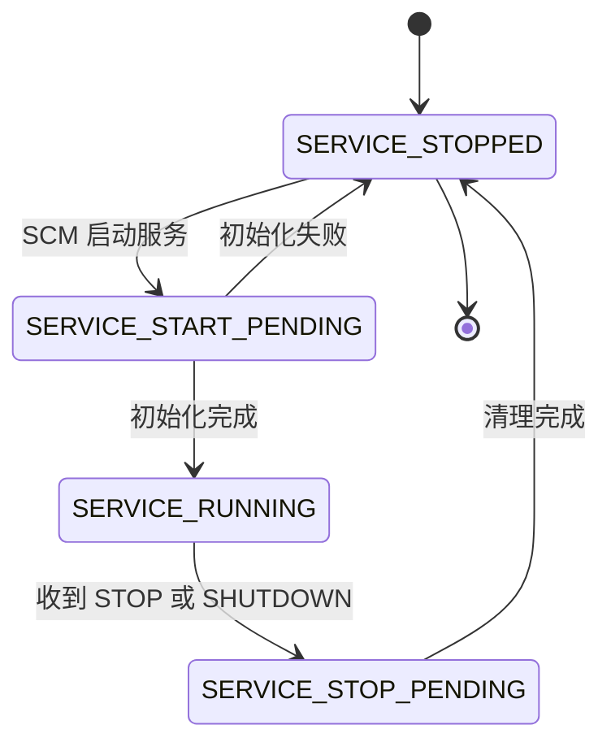

# A.18 Windows 服务、注册表与系统设施

在 [A.15](/教程/正文/系统编程/拓展A_Win32系统编程/A_15_IO完成端口与线程池) 中构建的回声服务器虽然已经能够依靠完成端口并发承载海量连接，但就其运行形态而言，它依然只是一个生命周期与交互式终端绑定的普通控制台程序：必须等操作员登录桌面并手动敲下命令才能启动，一旦关闭终端窗口或是注销当前用户会话，服务进程便随之灰飞烟灭；况且监听端口号还硬编码在源码里，运行期间也没有留存可供事后追查的诊断记录。若要将这样一个后台网络程序部署到无人值守的生产服务器上，必须补齐三块关键的系统工程拼图：一套随操作系统引导自动拉起、脱离交互式登录会话独立运转的服务宿主外壳；一处既便于程序在启动时高速读取、又允许系统管理员在外部集中调整的配置存储；以及一条在没有控制台屏幕的情况下依然能可靠留存运行轨迹的系统级日志通道。

本页将围绕这三项诉求，把回声服务器完整改造为标准的 Windows 后台服务 `MdrEcho`：由服务控制管理器托管生命周期，从注册表中读取监听端口，并将关键运行状态写入 Windows 事件日志。在此基础上，我们还会一并梳理高精度时钟、硬件与内存拓扑查询、已知文件夹路径解析等日常系统编程高频调用的基础设施，并在文末将它们与 Linux 下的对等机制放在同一张全景图下加以对照。

在实际生产环境中，Windows 服务、注册表与事件日志往往紧密咬合、协同工作：部署安装阶段，安装程序向服务控制管理器登记可执行文件路径与运行账户；启动初始化阶段，服务进程从注册表指定项下加载运行参数；而在漫长的后台值守期间，进程则将启动确认或异常告警源源不断地写入事件日志。这一套组合在系统架构上的定位，恰好对应着 Linux 世界里的 systemd 单元文件、`/etc` 配置文件以及 `syslog`/`journald` 日志服务。

本页的所有示例程序均在 Windows 11 x64 环境下使用 MinGW-w64 GCC 13.2 编译，并以未提权的普通用户身份运行测试（终端输出中涉及本机真实用户名的部分已统一脱敏为 `user`）。由于向系统安装服务、修改 `HKLM` 机器级注册表项以及登记全局事件源均涉及管理员特权或会持久改动宿主机系统状态，相关示例在验证时均遵循安全边界：`svc_install.c` 仅实测到普通权限下调用 `OpenSCManagerW` 被系统拒绝为止，`eventlog.c` 则仅作编译验证。

## 1. 服务的本质与运行环境

在 Windows 体系中，服务（Service）是由服务控制管理器（Service Control Manager，简称 SCM）统一启动并托管生命周期的后台进程。SCM 的本体是随系统引导阶段早期启动的守护进程 `services.exe`：它在内存中维护着全机已安装服务的数据库，按照各服务的启动策略在开机时依次拉起目标程序，并负责将管理员或系统发出的启动、停止、暂停、关机等控制指令转发给正在运行的服务进程。从二进制格式上看，服务程序本身只是一个普通的控制台子系统可执行文件（PE 标头为 `IMAGE_SUBSYSTEM_WINDOWS_CUI`）；它与日常命令行程序的根本分野，在于它由 `services.exe` 直接派生，固定运行在与所有交互式用户隔离的会话 0（Session 0）中，既没有关联的控制台窗口，也不从属于任何桌面登录会话。

理解服务架构时，需要先把「服务可执行程序」与「服务配置项」区分开来。前者是躺在磁盘目录里的 `.exe` 文件，负责实现具体的业务逻辑；后者则是持久保存在注册表 `HKLM\SYSTEM\CurrentControlSet\Services\<服务名>` 项下的一组元数据，SCM 正是依靠读取这组配置，才知道应当加载哪个二进制文件、以什么安全账户身份创建令牌、以及在系统引导时是否自动拉起它。我们可以直接借助系统自带的命令行工具 `sc.exe`，观察 Windows 核心日志服务 `EventLog` 的实时运行状态：

::: terminal title="PowerShell - sc.exe query EventLog"

```text
PS> sc.exe query EventLog

SERVICE_NAME: EventLog
        TYPE               : 30  WIN32
        STATE              : 4  RUNNING
                                (STOPPABLE, NOT_PAUSABLE, ACCEPTS_SHUTDOWN)
        WIN32_EXIT_CODE    : 0  (0x0)
        SERVICE_EXIT_CODE  : 0  (0x0)
        CHECKPOINT         : 0x0
        WAIT_HINT          : 0x0
```

:::

输出中的 `TYPE : 30` 为十六进制（即 `0x30`），对应宏定义 `SERVICE_WIN32`，它是独占进程服务 `SERVICE_WIN32_OWN_PROCESS`（`0x10`）与共享进程服务 `SERVICE_WIN32_SHARE_PROCESS`（`0x20`）两个标志位的按位或；紧接着下面 `sc.exe qc` 查出的具体配置值 `20 WIN32_SHARE_PROCESS`，则表明 `EventLog` 与系统中的其他若干基础服务共同寄居在同一个宿主进程（`svchost.exe`）内运行。`STATE : 4` 对应 `SERVICE_RUNNING`，括号里的标志列出了该服务当前声明愿意响应的控制命令。至于末尾的 `CHECKPOINT` 与 `WAIT_HINT`，则是服务处于启动或停止过渡阶段时用于向 SCM 汇报进度的握手字段，我们将在第 2 节详细拆解。

接着再用 `sc.exe qc` 查看 `EventLog` 服务登记在 SCM 数据库中的静态配置：

::: terminal title="PowerShell - sc.exe qc EventLog"

```text
PS> sc.exe qc EventLog
[SC] QueryServiceConfig SUCCESS

SERVICE_NAME: EventLog
        TYPE               : 20  WIN32_SHARE_PROCESS
        START_TYPE         : 2   AUTO_START
        ERROR_CONTROL      : 1   NORMAL
        BINARY_PATH_NAME   : C:\Windows\System32\svchost.exe -k LocalServiceNetworkRestricted -p
        LOAD_ORDER_GROUP   : Event Log
        TAG                : 0
        DISPLAY_NAME       : Windows Event Log
        DEPENDENCIES       :
        SERVICE_START_NAME : NT AUTHORITY\LocalService
```

:::

这份静态配置在底层注册表中直接对应着同名项下的几个键值，用 `reg query` 即可印证：

::: terminal title="PowerShell - reg query 服务配置"

```text
PS> reg query "HKLM\SYSTEM\CurrentControlSet\Services\EventLog" /v Start
HKEY_LOCAL_MACHINE\SYSTEM\CurrentControlSet\Services\EventLog
    Start    REG_DWORD    0x2

PS> reg query "HKLM\SYSTEM\CurrentControlSet\Services\EventLog" /v ObjectName
HKEY_LOCAL_MACHINE\SYSTEM\CurrentControlSet\Services\EventLog
    ObjectName    REG_SZ    NT AUTHORITY\LocalService

PS> reg query "HKLM\SYSTEM\CurrentControlSet\Services\EventLog" /v ImagePath
HKEY_LOCAL_MACHINE\SYSTEM\CurrentControlSet\Services\EventLog
    ImagePath    REG_EXPAND_SZ    %SystemRoot%\System32\svchost.exe -k LocalServiceNetworkRestricted -p
```

:::

其中，`Start` 记录了启动类型（0 至 4 依次代表内核引导加载、I/O 子系统初始化加载、开机自动启动 `AUTO_START`、按需手动启动 `DEMAND_START` 以及禁用 `DISABLED`）；`ObjectName` 指定了服务进程登录时所使用的安全账户名；`ImagePath` 则保存了启动命令行，这里特意选用 `REG_EXPAND_SZ` 类型，是为了让路径中的 `%SystemRoot%` 环境变量在读取时自动展开。管理员在命令行执行 `sc.exe config` 修改服务属性时，本质上就是通过 SCM 接口去更新注册表里的这几个值。

配置中的运行账户（`ObjectName`）直接决定了 `services.exe` 为服务进程创建的访问令牌（Access Token），进而划定了该服务在本地文件系统、注册表以及网络通信上的权限边界。Windows 为后台服务预置了三类内置特殊账户以及按服务隔离的虚拟账户：

| 账户 | 本地权限 | 网络身份 |
| --- | --- | --- |
| `LocalSystem` | 最高，属于 Administrators 组 | 以计算机账户访问网络 |
| `LocalService` | 最小 | 匿名 |
| `NetworkService` | 最小 | 计算机账户 |
| `NT SERVICE\<服务名>`（虚拟账户，Windows 7 起） | 最小，按服务名区分 | 匿名 |

为服务挑选运行账户时，应当严格遵循 [A.16](/教程/正文/系统编程/拓展A_Win32系统编程/A_16_安全与访问控制_ACL与令牌) 强调的最小权限原则：只授予刚好够完成业务工作的最低特权身份。例如，一个仅在本地回环地址 `127.0.0.1` 上收发数据的回声服务器，完全不需要动用权限通天的 `LocalSystem`，选用受限的 `LocalService` 便绰绰有余。一旦将网络服务草率地配置为 `LocalSystem`，攻击者只要在协议解析代码里找到一处内存破坏漏洞，就能直接夺取整台机器的最高系统控制权——历史上无数高危的本地提权与远程代码执行漏洞，正是借着过度授权的服务进程长驱直入的。

::: concept win-svc-session-zero title="服务运行在会话 0，没有用户界面"

服务进程运行在会话 0（session 0），与任何登录用户的会话隔离。服务不能显示窗口、不能弹对话框，也不能假设有用户登录，或假设桌面上有人能看见它的输出。需要与用户交互时，服务与一个运行在用户会话里的界面程序通过命名管道等机制通信，界面程序单独启动。

:::

自 Windows Vista 引入「会话 0 隔离」（Session 0 Isolation）安全机制以来，系统将所有后台服务统一圈禁在专用的会话 0 中，而真实用户的桌面登录则从会话 1 开始分配；即便强行为旧式服务勾选了「允许服务与桌面交互」，它弹出的窗口也无法直接呈现在当前登录用户的桌面上。在编写服务代码时，必须把「没有任何控制台与图形界面」当作铁律：服务里调用的 `printf` 或 `MessageBoxW` 既没人看得见，还可能让进程卡死在无人点击的模态弹窗上；一切运行状态与故障诊断，都应当老老实实写进事件日志或专用日志文件。

把视线转向 Linux，与 Windows 服务直接对应的设施是由 systemd 托管的 `.service` 单元。若将本页的回声服务器放到 Linux 下部署，其最小单元配置文件如下所示：

```ini
[Unit]
Description=Mdr Echo Service
After=network.target

[Service]
ExecStart=/usr/local/bin/mdr_echo
User=nobody
Restart=on-failure

[Install]
WantedBy=multi-user.target
```

两相对照，`ExecStart` 对应注册表中的 `ImagePath`，`User` 对应 `ObjectName`，而 `[Install]` 段的 `WantedBy` 配合 `systemctl enable` 则对应启动类型 `AUTO_START`。两套体系在生命周期管理哲学上有一处明显差异：systemd 默认借助 cgroups 直接监控服务进程树，只需一行 `Restart=on-failure` 就能接管崩溃重启；而在 Windows 下，SCM 与服务进程之间维护着一套显式的状态机握手协议，且服务意外退出后默认不会自动拉起，需额外通过 `ChangeServiceConfig2W`（或 `sc.exe failure`）配置恢复策略（Failure Actions）。

<Quiz
  type="single"
  :options="[
    { label: 'LocalSystem', value: 'A' },
    { label: 'LocalService', value: 'B' },
    { label: '当前登录的管理员账户', value: 'C' },
    { label: 'NetworkService', value: 'D' }
  ]"
  answer="B"
>

<template #question>

一个只在 `127.0.0.1` 上提供回环服务的后台程序，运行账户应当选哪个？

</template>

正确答案是 **B**。该程序仅在本机回环接口上收发字节，既不需要对外发起带域身份的网络认证，也不需要改动系统级配置，`LocalService` 提供的普通用户级本地最小权限已经完全够用。`LocalSystem` 拥有本机最高特权，一旦服务存在漏洞极易被利用提权；`NetworkService` 允许以计算机账户身份访问外部网络，对该场景而言属于多余权限；至于绑定当前登录的管理员个人账户，既违背了最小权限原则，又必须在安装时提供账户口令，日后管理员一旦更改登录密码，服务就会在下次启动时因认证失败而瘫痪。

</Quiz>

## 2. 服务程序的结构

Windows 服务程序的编译入口依然是标准的 `main`（或 `wmain`），但进程启动后主线程要做的第一件事，是调用 `StartServiceCtrlDispatcherW` 将自己移交给服务控制管理器：

```c
int main(void) {
    SERVICE_TABLE_ENTRYW table[] = {
        {(LPWSTR)SERVICE_NAME, service_main},
        {NULL, NULL},
    };

    if (StartServiceCtrlDispatcherW(table)) {
        return 0;
    }
    /* 失败：第 3 节按错误码处理 */
    return 1;
}
```

传给该函数的分发表是一个以 `{NULL, NULL}` 哨兵项收尾的 `SERVICE_TABLE_ENTRYW` 数组，表中每一项将服务名与该服务的入口函数 `ServiceMain` 绑定起来（独占进程服务通常只在表里登记一项）。一旦 `StartServiceCtrlDispatcherW` 调用成功，当前主线程便原地转化为**服务控制分派线程**（Service Control Dispatcher）并一直阻塞在函数内部：该线程在底层与 `services.exe` 建立起一条命名管道连接，并进入循环监听状态——当收到 SCM 发来的启动指令时，分派线程会在进程内派生一个新线程去执行对应的 `ServiceMain`；当收到停止、关机等控制指令时，分派线程则直接在自己的线程上下文中调用服务注册的控制处理函数。直到进程内托管的所有服务全部宣告进入 `SERVICE_STOPPED` 状态，分派线程才会从 `StartServiceCtrlDispatcherW` 中返回，进而让 `main` 函数正常退出。

这里有一条严苛的启动时限：当 SCM 拉起服务进程后，会启动一个 30 秒的倒计时等待新进程调用 `StartServiceCtrlDispatcherW` 完成管道握手。假如程序在 `main` 函数的开头直接塞入了耗时的配置加载或网络连接逻辑，导致超过 30 秒仍未调用分派函数，SCM 就会当即判定服务启动超时，强行终结该进程并在系统日志中留下一条著名的错误码 1053（「服务没有及时响应启动或控制请求」）。因此，`main` 函数应当保持极度精简，一切初始化工作都必须推迟到 `ServiceMain` 内部，并配合状态汇报机制分阶段推进。

当 SCM 为服务拉起专属线程进入 `ServiceMain` 后，该线程必须第一时间调用 `RegisterServiceCtrlHandlerExW` 注册控制处理函数，并随即把服务状态更新为 `SERVICE_START_PENDING`：

```c
static void WINAPI service_main(DWORD argc, LPWSTR *argv) {
    g_status_handle = RegisterServiceCtrlHandlerExW(SERVICE_NAME, service_ctrl, NULL);
    if (g_status_handle == NULL) {
        return;
    }
    report_status(SERVICE_START_PENDING, 3000);

    g_stop = CreateEventW(NULL, TRUE, FALSE, NULL);
    if (g_stop == NULL) {
        report_status(SERVICE_STOPPED, 0);
        return;
    }
    run_echo();
    CloseHandle(g_stop);
}
```

之所以要求必须先完成注册再汇报状态，是因为后续所有 `SetServiceStatus` 调用都依赖 `RegisterServiceCtrlHandlerExW` 返回的 `SERVICE_STATUS_HANDLE` 句柄。如果连这一步注册都遭遇失败，服务便失去了与 SCM 对话的唯一凭证，只能直接返回结束。`ServiceMain` 接收的 `argc` 与 `argv` 来自管理员在启动服务时传入的附加启动参数（与进程命令行参数相互独立），其中 `argv[0]` 固定为服务名本身。

向 SCM 汇报当前状态的核心辅助函数 `report_status`，围绕填充 `SERVICE_STATUS` 结构体并调用 `SetServiceStatus` 展开：

```c
static void report_status(DWORD state, DWORD wait_hint) {
    static DWORD checkpoint = 1;

    if (g_status_handle == NULL) {
        return;
    }
    g_status.dwServiceType = SERVICE_WIN32_OWN_PROCESS;
    g_status.dwCurrentState = state;
    g_status.dwControlsAccepted =
        (state == SERVICE_RUNNING) ? (SERVICE_ACCEPT_STOP | SERVICE_ACCEPT_SHUTDOWN) : 0;
    g_status.dwWin32ExitCode = NO_ERROR;
    g_status.dwServiceSpecificExitCode = 0;
    g_status.dwWaitHint = wait_hint;
    if (state == SERVICE_START_PENDING || state == SERVICE_STOP_PENDING) {
        g_status.dwCheckPoint = checkpoint++;
    } else {
        g_status.dwCheckPoint = 0;
        checkpoint = 1;
    }
    SetServiceStatus(g_status_handle, &g_status);
}
```

结构体中的几个关键字段承担着精密的协同职责：
- `dwCurrentState` 标示服务此刻所处的状态机节点；
- `dwControlsAccepted` 用于声明服务当前愿意接收哪些控制指令。注意上面的条件表达式：唯有当服务正式进入 `SERVICE_RUNNING` 状态后，才向 SCM 开放 `SERVICE_ACCEPT_STOP | SERVICE_ACCEPT_SHUTDOWN`；而在 `SERVICE_START_PENDING` 初始化阶段或 `SERVICE_STOP_PENDING` 收尾阶段，该字段一律置为 0，从而阻止 SCM 在半途塞入新的停止请求打乱节奏；
- `dwCheckPoint`（检查点）与 `dwWaitHint`（预计等待毫秒数）共同构成了过渡阶段的心跳握手协议。当服务处于 `START_PENDING` 或 `STOP_PENDING` 等挂起状态时，每次调用 `report_status` 都会将 `dwCheckPoint` 递增 1，同时给出一个略大于下一步初始化耗时的 `dwWaitHint` 预估上限。如果 SCM 在 `dwWaitHint` 设定的时间窗口内，既没有等到服务切换进最终状态，也没有看到 `dwCheckPoint` 数值向前推进，就会认定服务已经卡死并终止它。因此，任何耗时较长的初始化或优雅停机流程，都应当拆分成若干小步，在循环中定期递增检查点向 SCM 报平安。

与之配合的控制处理回调函数 `service_ctrl` 则应当遵循「极速响应」原则，只做两件轻量操作：向 SCM 报告 `SERVICE_STOP_PENDING` 状态，并将全局停止事件 `g_stop` 置位：

```c
static DWORD WINAPI service_ctrl(DWORD control, DWORD event_type, void *event_data,
                                 void *context) {
    (void)event_type;
    (void)event_data;
    (void)context;

    if (control == SERVICE_CONTROL_STOP || control == SERVICE_CONTROL_SHUTDOWN) {
        report_status(SERVICE_STOP_PENDING, 5000);
        SetEvent(g_stop);
    }
    return NO_ERROR;
}
```

由于 `service_ctrl` 是由主线程转化而来的分派线程直接同步调用的，它必须立刻返回 `NO_ERROR`；假如在回调函数内部直接阻塞等待工作线程退出、关闭大批句柄或刷写海量日志，就会把整条分派管道堵死，导致 SCM 迟迟收不到回调应答而报出超时错误。正确的分工是：控制处理函数只负责拉响 `g_stop` 停止信号；正在运行的工作循环检测到 `g_stop` 触发后，主动跳出监听循环、清理套接字与内存，最后回到 `ServiceMain` 线程调用 `report_status(SERVICE_STOPPED, 0)` 画上句号。

为了直观展示状态转换期间各字段的演进规律，`lifecycle.c` 将 `SetServiceStatus` 替换成了控制台打印，模拟了一次从启动挂起、正常运行到停止挂起、彻底退出的完整轨迹：

```c
int main(void) {
    DWORD check = 1;

    report(SERVICE_START_PENDING, 0, check++, 3000);
    Sleep(100);
    report(SERVICE_START_PENDING, 0, check++, 3000);
    report(SERVICE_RUNNING, SERVICE_ACCEPT_STOP | SERVICE_ACCEPT_SHUTDOWN, 0, 0);
    report(SERVICE_STOP_PENDING, 0, check, 5000);
    Sleep(100);
    report(SERVICE_STOPPED, 0, 0, 0);
    return 0;
}
```

::: terminal title="PowerShell - lifecycle"

```text
PS> gcc -std=c17 -Wall -Wextra -o lifecycle.exe lifecycle.c
PS> ./lifecycle.exe
SERVICE_START_PENDING  controls 0x00 checkpoint 1 wait_hint 3000 ms
SERVICE_START_PENDING  controls 0x00 checkpoint 2 wait_hint 3000 ms
SERVICE_RUNNING        controls 0x05 checkpoint 0 wait_hint 0 ms
SERVICE_STOP_PENDING   controls 0x00 checkpoint 3 wait_hint 5000 ms
SERVICE_STOPPED        controls 0x00 checkpoint 0 wait_hint 0 ms
```

:::

可以看到，在两步 `SERVICE_START_PENDING` 期间，`controls` 保持为 `0x00`，`checkpoint` 从 1 递增到 2；一旦跨入 `SERVICE_RUNNING` 稳态，`controls` 立即变为 `0x05`（即 `SERVICE_ACCEPT_STOP` 0x01 与 `SERVICE_ACCEPT_SHUTDOWN` 0x04 的组合），同时 `checkpoint` 和 `wait_hint` 双双归零，因为稳态运行期间不再有挂起的过渡操作。

将上述状态流转绘制成状态图，服务的完整生命周期只有几条严格受控的转移路径：



对于支持暂停与恢复的服务，还可以在 `SERVICE_RUNNING` 一侧扩展出 `SERVICE_PAUSE_PENDING`、`SERVICE_PAUSED` 与 `SERVICE_CONTINUE_PENDING` 三个状态（前提是在 `dwControlsAccepted` 中额外声明 `SERVICE_ACCEPT_PAUSE_CONTINUE`）。对于网络回声服务器而言，只需妥善处理停止与系统关机两类事件便已足够。

本节的完整服务程序位于 `code/系统编程/拓展A_Win32系统编程/A_18_Windows服务_注册表与系统设施/echo_svc.c`。它将回声服务的核心网络循环封装在 `run_echo` 函数中，供服务模式与控制台调试模式共同复用。为了将代码焦点集中在服务外壳与生命周期控制上，示例中的网络循环采用单连接顺序服务配合 `select` 的 200 毫秒超时来轮询 `g_stop` 事件；在实际工程中，只需将 `echo_loop` 替换为 [A.15](/教程/正文/系统编程/拓展A_Win32系统编程/A_15_IO完成端口与线程池) 的完成端口模型，外层的服务状态机框架无需任何改动。

## 3. 在控制台里调试服务

在开发服务程序的过程中，几乎没有人会从一开始就把半成品装进 SCM 里去调试。如果我们直接在 PowerShell 或 cmd 窗口中手动敲命令运行一个标准服务程序，主线程调用的 `StartServiceCtrlDispatcherW` 会立即返回失败，并给出错误码 1063：

```c
static void WINAPI svc_main(DWORD argc, LPWSTR *argv) {
    (void)argc;
    (void)argv;
}

int main(void) {
    SERVICE_TABLE_ENTRYW table[] = {
        {L"MdrProbe", svc_main},
        {NULL, NULL},
    };
    WCHAR *msg = NULL;
    DWORD err;

    setlocale(LC_ALL, ".UTF8");
    SetConsoleOutputCP(CP_UTF8);

    if (!StartServiceCtrlDispatcherW(table)) {
        err = GetLastError();
        FormatMessageW(FORMAT_MESSAGE_ALLOCATE_BUFFER | FORMAT_MESSAGE_FROM_SYSTEM |
                           FORMAT_MESSAGE_IGNORE_INSERTS,
                       NULL, err, 0, (LPWSTR)&msg, 0, NULL);
        wprintf(L"StartServiceCtrlDispatcherW failed: %lu\n", (unsigned long)err);
        wprintf(L"message: %ls", msg != NULL ? msg : L"(none)\n");
        LocalFree(msg);
        return 1;
    }
    return 0;
}
```

::: terminal title="PowerShell - svc_probe"

```text
PS> gcc -std=c17 -Wall -Wextra -o svc_probe.exe svc_probe.c
PS> ./svc_probe.exe
StartServiceCtrlDispatcherW failed: 1063
message: 服务进程无法连接到服务控制器上。
```

:::

错误码 1063（`ERROR_FAILED_SERVICE_CONTROLLER_CONNECT`）的语义极其明确：当前进程不是由 `services.exe` 拉起的，因此无法建立通往服务控制管理器的内部命名管道。这一特定错误码恰好为开发者提供了一个浑然天成的双模分流入口：当 `StartServiceCtrlDispatcherW` 返回失败且 `GetLastError()` 为 1063 时，程序便知道自己是被人从交互式终端直接启动的，于是顺势切入控制台前台运行模式；只有遇到 1063 以外的其他错误码时，才将其视作启动故障报错退出。

`echo_svc.c` 的 `main` 函数正是按照这一双模架构编写的：

```c
int main(void) {
    SERVICE_TABLE_ENTRYW table[] = {
        {(LPWSTR)SERVICE_NAME, service_main},
        {NULL, NULL},
    };

    setlocale(LC_ALL, ".UTF8");
    SetConsoleOutputCP(CP_UTF8);
    setvbuf(stdout, NULL, _IONBF, 0);

    if (StartServiceCtrlDispatcherW(table)) {
        return 0;
    }

    DWORD err = GetLastError();
    if (err != ERROR_FAILED_SERVICE_CONTROLLER_CONNECT) {
        wprintf(L"[svc] StartServiceCtrlDispatcherW failed: %lu\n", (unsigned long)err);
        return 1;
    }

    wprintf(L"[svc] not started by the SCM (error %lu), console mode\n", (unsigned long)err);
    g_stop = CreateEventW(NULL, TRUE, FALSE, NULL);
    if (g_stop == NULL) {
        wprintf(L"[svc] CreateEventW failed: %lu\n", (unsigned long)GetLastError());
        return 1;
    }
    SetConsoleCtrlHandler(console_ctrl, TRUE);
    int rc = run_echo();
    CloseHandle(g_stop);
    return rc;
}
```

仔细对照可以看到，控制台分支在进入 `run_echo()` 之前补齐的两样东西，恰好就是服务模式下由 `ServiceMain` 和 `service_ctrl` 负责准备的基础设施：一个手动重置事件 `g_stop`，以及一个在收到外部停止信号时负责调用 `SetEvent(g_stop)` 的触发源。在控制台模式下，这个触发源自然就落到了 [A.17](/教程/正文/系统编程/拓展A_Win32系统编程/A_17_控制台与ConPTY) 刚讲过的控制台控制事件处理函数 `SetConsoleCtrlHandler` 肩上：

```c
static BOOL WINAPI console_ctrl(DWORD type) {
    if (type == CTRL_C_EVENT || type == CTRL_BREAK_EVENT || type == CTRL_CLOSE_EVENT ||
        type == CTRL_SHUTDOWN_EVENT) {
        wprintf(L"[svc] console control %lu, stopping\n", (unsigned long)type);
        SetEvent(g_stop);
        return TRUE;
    }
    return FALSE;
}
```

与此同时，由于控制台模式下没有调用 `RegisterServiceCtrlHandlerExW`，全局状态句柄 `g_status_handle` 保持为 `NULL`，`report_status` 函数开头的空指针检查会自动将其化为空操作。借由这种巧妙的对称设计，底层的核心业务函数 `run_echo`、套接字监听循环以及客户端收发逻辑做到了百分之百的代码复用，无需掺杂任何区分运行模式的条件编译。

下面我们在控制台模式下完整演练一次回声服务的启动、通信与优雅停机。配套的测试客户端位于 `code/系统编程/拓展A_Win32系统编程/A_18_Windows服务_注册表与系统设施/echo_client.c`，它会依次将命令行传入的字符串参数发送给服务端，并将读回的回声响应打印出来。首先在第一个终端窗口里直接启动 `echo_svc.exe`：

::: terminal title="PowerShell - echo_svc 控制台模式"

```text
PS> ./echo_svc.exe
[svc] not started by the SCM (error 1063), console mode
[svc] port 23456 from HKCU\Software\MdrTutorial\Echo\Port
[svc] listening on 127.0.0.1:23456
[svc] running
```

:::

客户端的核心收发循环如下：

```c
int main(int argc, char *argv[]) {
    /* 省略 WSAStartup、socket、inet_pton、connect */

    for (int i = 3; i < argc; i++) {
        int len = (int)strlen(argv[i]);
        int got = 0;

        send(s, argv[i], len, 0);
        while (got < len) {
            got += recv(s, buf + got, len - got, 0);
        }
        buf[got] = '\0';
        printf("echo: %s\n", buf);
    }
    return 0;
}
```

在第二个终端窗口中编译并运行客户端，向 `127.0.0.1:23456` 连续发送三个单词：

::: terminal title="PowerShell - echo_client"

```text
PS> gcc -std=c17 -Wall -Wextra -o echo_client.exe echo_client.c -lws2_32
PS> ./echo_client.exe 127.0.0.1 23456 alpha beta gamma
echo: alpha
echo: beta
echo: gamma
```

:::

通信完成后切回第一个服务端窗口按下 Ctrl+C，观察服务端的收尾日志：

::: terminal title="PowerShell - echo_svc 收到 Ctrl+C"

```text
[svc] client 127.0.0.1:52193 connected
[svc] client 127.0.0.1 disconnected, echoed 14 bytes
[svc] console control 0, stopping
[svc] stopped, 1 client(s) served
```

:::

客户端发出的 `alpha`（5 字节）、`beta`（4 字节）与 `gamma`（5 字节）合计 14 字节，与服务端打印的 `echoed 14 bytes` 严丝合缝；随后 `console_ctrl` 截获 `CTRL_C_EVENT`（控制类型 0）并置位停止事件，主循环顺利退出并汇总打印出 `1 client(s) served`。上面展示的这段交互输出同样是在 [A.17](/教程/正文/系统编程/拓展A_Win32系统编程/A_17_控制台与ConPTY) 的伪控制台宿主 `conpty_run.exe` 中通过注入 `\x03` 自动化采集的，与人工在终端窗口按下 Ctrl+C 的行为完全一致。

::: tip 每个服务程序都保留控制台模式

将服务注册到系统中调试，每次操作都需要管理员权限，而且每改一行代码都要经历「停止服务 → 重新编译覆盖二进制文件 → 启动服务 → 查阅事件日志」的繁琐周转；倘若服务在启动初期发生崩溃，更是连一行错误输出都来不及看清。因此，在每个服务程序的骨架中常驻保留「遇错误码 1063 自动转入控制台模式」的分支，让绝大多数业务逻辑、并发压力测试与内存检查都在普通命令行下直接跑通，最后仅在验收安装脚本与低权限服务账户（如 `LocalService`）的资源访问边界时才将其安装为系统服务。这短短二十余行分流代码，能为日常研发省下成倍的调试时间。

:::

<Quiz
  :options="[
    { label: '报错退出，提示必须由 SCM 启动', value: 'A' },
    { label: '切换到控制台模式，运行同一套工作逻辑', value: 'B' },
    { label: '等待 30 秒后重试 StartServiceCtrlDispatcherW', value: 'C' },
    { label: '以管理员身份重新启动自己', value: 'D' }
  ]"
  answer="B"
>

<template #question>

在命令行直接运行服务程序，`StartServiceCtrlDispatcherW` 返回 `FALSE`、错误码 1063，正确的处理是什么？

</template>

正确答案是 **B**。错误码 1063（`ERROR_FAILED_SERVICE_CONTROLLER_CONNECT`）表明当前进程不是由 `services.exe` 启动的，这正是开发者从控制台直接运行并调试服务程序的标准入口。原地等待重试毫无意义，因为 SCM 不会半途接管一个普通控制台进程；提升管理员权限也无法消除 1063，因为该错误取决于父进程身份，与令牌权限高低无关。唯有将 1063 分流至控制台模式、而将其他错误码视为异常退出，才是最合理的工程实践。

</Quiz>

## 4. 服务的安装与管理

将编译好的服务程序注册进操作系统，最便捷的命令行工具是系统自带的 `sc.exe`。使用 `sc.exe` 时有一条极具年代感的语法铁律必须留意：每一个配置选项的等号都紧贴在参数名末尾，而**等号与后面的参数值之间必须留出一个空格**；一旦顺手写成 `binPath=C:\...`，命令解析就会直接报错失败。

```text
sc.exe create MdrEcho binPath= "C:\work\echo_svc.exe" start= demand obj= "NT AUTHORITY\LocalService" displayname= "Mdr Echo Service"
```

在这条创建命令中，`binPath=` 指定服务可执行文件的绝对路径（若路径中含有空格或附带命令行参数，外层必须用双引号括起，SCM 会将该字符串作为完整命令行传给 `CreateProcessW`）；`start= demand` 将服务设为按需手动启动，若改为 `auto` 则会在每次系统开机时自动拉起；`obj=` 用于指定服务运行账户，填入内置的 `NT AUTHORITY\LocalService` 时无需提供登录口令。

由于增删服务直接改动系统级配置，上述命令必须在提升过权限的管理员终端中执行。如果在普通用户权限的 PowerShell 里直接尝试创建，立刻就会收到错误码 5（拒绝访问）：

::: terminal title="PowerShell - 普通权限下的 sc.exe create"

```text
PS> sc.exe create MdrEcho binPath= "C:\work\echo_svc.exe" start= demand obj= "NT AUTHORITY\LocalService"
[SC] OpenSCManager FAILED 5:

Access is denied.
```

:::

::: warning 安装和管理服务需要管理员权限

创建、启动、停止、删除服务都要先打开 SCM 数据库，而 `OpenSCManagerW` 的 `SC_MANAGER_CREATE_SERVICE` 权限只授予管理员。普通命令行得到的错误码是 5（`ERROR_ACCESS_DENIED`），程序里表现为 `OpenSCManagerW` 返回 `NULL`。只读的查询（`sc.exe query`、`QueryServiceStatusEx`）不需要管理员。

:::

当服务成功登记到 SCM 数据库后，管理员即可使用 `sc.exe start`、`sc.exe stop`、`sc.exe query` 与 `sc.exe delete` 分别完成启动、停止、状态查询与卸载操作。需要注意，`sc.exe delete` 只是在 SCM 数据库中为目标服务打上待删除标记；如果该服务此刻仍在运行，要等到它彻底停止且所有打开的服务句柄全部关闭后，注册表中的配置项才会被彻底移除。倘若对一个尚未安装的服务名执行启停操作，`sc.exe` 会返回错误码 1060（`ERROR_SERVICE_DOES_NOT_EXIST`）：

::: terminal title="PowerShell - 对不存在的服务执行 sc.exe"

```text
PS> sc.exe start MdrEcho
[SC] StartService: OpenService FAILED 1060:

The specified service does not exist as an installed service.

PS> sc.exe stop MdrEcho
[SC] OpenService FAILED 1060:

The specified service does not exist as an installed service.
```

:::

如果要在自定义的部署安装程序中用 C 代码完成同样的一套管理动作，只需按顺序调用 `winsvc.h` 提供的 SCM 管理接口。示例程序 `svc_install.c` 将安装、启动、停止与删除分别封装成了四个子命令：

| 操作 | 主要调用 |
| --- | --- |
| 安装 | `OpenSCManagerW` → `CreateServiceW` → `CloseServiceHandle` |
| 启动 | `OpenServiceW(SERVICE_START)` → `StartServiceW` |
| 停止 | `OpenServiceW(SERVICE_STOP)` → `ControlService(SERVICE_CONTROL_STOP)` |
| 删除 | `OpenServiceW(DELETE)` → `DeleteService` |

其中 `CreateServiceW` 接收的参数列表虽然比 `sc.exe` 命令行冗长，但各项语义一一对应：依次传入服务内部名、显示名称、期望访问权限、服务类型 `SERVICE_WIN32_OWN_PROCESS`、启动策略 `SERVICE_DEMAND_START`、错误严重度 `SERVICE_ERROR_NORMAL`、二进制完整路径以及运行账户名。在未提权的普通终端里运行 `svc_install.exe`，程序同样会在第一步调用 `OpenSCManagerW` 请求创建权限时被拦下：

::: terminal title="PowerShell - svc_install"

```text
PS> ./svc_install.exe install C:\work\echo_svc.exe
OpenSCManagerW failed: 5: 拒绝访问。
```

:::

与之相对，只读性质的服务状态查询对普通用户完全开放。示例程序 `svc_query.c` 通过 `OpenSCManagerW(..., GENERIC_READ)` 与 `OpenServiceW(..., SERVICE_QUERY_STATUS)` 打开目标服务，再调用 `QueryServiceStatusEx` 获取扩展状态结构 `SERVICE_STATUS_PROCESS`——相比基础的 `SERVICE_STATUS`，它额外提供了服务宿主当前对应的进程标识符 `dwProcessId`：

::: terminal title="PowerShell - svc_query"

```text
PS> ./svc_query.exe
service    : EventLog
state      : 4 (SERVICE_RUNNING)
type       : 0x00000030
pid        : 3364
controls   : 0x00000205
exit code  : 0

PS> ./svc_query.exe ADPSvc
service    : ADPSvc
state      : 1 (SERVICE_STOPPED)
type       : 0x00000020
pid        : 0
controls   : 0x00000000
exit code  : 1077

PS> ./svc_query.exe MdrEcho
OpenServiceW(MdrEcho) failed: 1060
```

:::

对照这三组查询结果：正在运行的 `EventLog` 服务其 `pid` 为 3364，`controls` 字段的值 `0x205` 是 `STOP`（0x001）、`SHUTDOWN`（0x004）与 `TIMECHANGE`（0x200）三个标志的组合，说明它除了响应停机与关机，还订阅了系统墙上时间变更通知。而当前处于停止状态的 `ADPSvc` 服务，其 `pid` 为 0，退出码 `1077`（`ERROR_SERVICE_NEVER_STARTED`）表示自本次系统开机以来尚未尝试启动过该服务。最后查询未安装的 `MdrEcho` 时，`OpenServiceW` 直接返回错误码 1060，与 `sc.exe` 的输出完全吻合。拿到运行中服务的 `pid` 后，运维人员便可用它在任务管理器或 `Get-Process -Id` 中定位具体的宿主进程。

## 5. 注册表

注册表（Registry）是 Windows 内核与系统组件共同维护的一座层次化树形配置数据库。树中的每一个目录节点称为**项**（Key），项下既可以继续嵌套**子项**（Subkey），也可以挂载零个或多个键值条目，称为**值**（Value）。每一个值由名称、数据类型和字节负载三部分组成（其中有一个特殊条目没有名称，称为该项的「默认值」）。整座注册表森林由若干预定义的顶层根项领衔，日常系统编程中最常打交道的有以下五个：

| 根项 | 内容 |
| --- | --- |
| `HKEY_LOCAL_MACHINE`（HKLM） | 本机配置，所有用户共享，写它需要管理员 |
| `HKEY_CURRENT_USER`（HKCU） | 当前用户的配置，是 `HKEY_USERS` 下该用户配置单元（hive）的一个链接 |
| `HKEY_CLASSES_ROOT`（HKCR） | 文件关联与 COM 注册，是 HKLM 与 HKCU 下 `Software\Classes` 的合并视图 |
| `HKEY_USERS`（HKU） | 所有已加载的用户配置单元 |
| `HKEY_CURRENT_CONFIG`（HKCC） | 当前硬件配置，是 HKLM 下当前硬件配置文件的链接 |

在规划配置存储位置时，仅影响当前登录用户的个性化设置应当放入 `HKCU\Software\<厂商名>\<产品名>`，而面向整台机器所有用户或后台服务的全局设置则应归入 `HKLM\Software\<厂商名>\<产品名>`。写入 `HKCU` 无需管理员特权，因为每个用户令牌天生对自身所属的注册表配置单元（Hive）拥有写权限；反之，若将普通程序提权至管理员账户运行，此时它的 `HKCU` 将指向管理员账户自己的配置单元，普通用户账户下的 `HKCU` 反而不会被触及。

更需要引起警惕的是：**`HKCU` 始终动态映射到当前进程运行账户的配置单元**，这一机制在编写 Windows 服务时极易引发配置失联。回顾第 3 节的 `echo_svc.c`，为了方便在未提权的控制台模式下测试注册表读写，示例代码特意从 `HKCU\Software\MdrTutorial\Echo` 读取 `Port` 键值；当我们在自己的交互式终端里运行它时，进程令牌属于当前登录用户，自然能顺利读到我们刚才写进 `HKCU` 的端口。然而，一旦将同一个可执行文件安装为以 `LocalService` 身份运行的系统服务，服务进程启动时的 `HKCU` 就会被内核映射到 `HKEY_USERS\S-1-5-19`（即 `LocalService` 专属的配置单元）——普通用户在自己桌面会话里写入的 `HKCU` 键值根本不在那里，服务进程最终只能因查无此项而回退到默认端口 23456。因此，投入生产环境的后台服务，其配置参数必须统一存放在 `HKLM` 下（由安装程序在管理员权限下写入），或者存放在 `ProgramData` 目录的配置文件中，切不可依赖 `HKCU`。

注册表中的每一个值都带有一个明确的数据类型标签，用于指导读取方如何解释底层的字节序列：

| 类型 | 数据 | 典型用途 |
| --- | --- | --- |
| `REG_SZ` | 以空字符结尾的字符串 | 名字、路径、问候语 |
| `REG_EXPAND_SZ` | 以空字符结尾、可含 `%VAR%` 引用的字符串 | 路径，读取时可展开环境变量 |
| `REG_MULTI_SZ` | 一串以空字符分隔的字符串，末尾再加一个空字符 | 列表 |
| `REG_DWORD` | 32 位整数 | 端口、开关、超时 |
| `REG_QWORD` | 64 位整数 | 大计数、文件大小 |
| `REG_BINARY` | 任意字节 | 二进制块、结构体快照 |
| `REG_NONE` | 没有定义类型的数据 | 系统内部使用 |

操作注册表的 API 声明在 `winreg.h` 中（由 `windows.h` 默认包含，链接 `advapi32`）。创建或打开一个注册表项通常使用 `RegCreateKeyExW`：若目标子项尚不存在，它会递归创建整条路径上的缺失项；若已经存在，则直接将其打开，并通过输出参数 `lpdwDisposition` 告知调用方本次操作究竟是新建了项（`REG_CREATED_NEW_KEY`，值为 1）还是打开了既有项（`REG_OPENED_EXISTING_KEY`，值为 2）：

```c
LSTATUS RegCreateKeyExW(HKEY hKey, LPCWSTR lpSubKey, DWORD Reserved, LPWSTR lpClass,
                        DWORD dwOptions, REGSAM samDesired,
                        const LPSECURITY_ATTRIBUTES lpSecurityAttributes,
                        PHKEY phkResult, LPDWORD lpdwDisposition);
```

拿到打开的项句柄后，向其中写入键值使用 `RegSetValueExW`：

```c
LSTATUS RegSetValueExW(HKEY hKey, LPCWSTR lpValueName, DWORD Reserved, DWORD dwType,
                       const BYTE *lpData, DWORD cbData);
```

注意参数 `cbData` 按**字节数**计算，不按宽字符个数计算；在写入 `REG_SZ` 或 `REG_EXPAND_SZ` 字符串时，**必须把末尾的宽字符空终结符 `L'\0'`（2 字节）一并计入总长度**。对于编译期已知的宽字符数组字面量，直接传入 `sizeof(arr)` 最为稳妥；对于动态拼接的字符串，则应传入 `(wcslen(s) + 1) * sizeof(wchar_t)`。参数 `Reserved` 必须固定传 0。

而在读取注册表值时，现代 Win32 代码应优先选用高层封装函数 `RegGetValueW`，它将「打开子项、校验类型、读取数据、自动补齐字符串结尾空字符乃至展开环境变量」一站式合并完成：

```c
LSTATUS RegGetValueW(HKEY hkey, LPCWSTR lpSubKey, LPCWSTR lpValue, DWORD dwFlags,
                     LPDWORD pdwType, PVOID pvData, LPDWORD pcbData);
```

相比早期需要调用方自行防范未以 `\0` 结尾字符串的 `RegQueryValueExW`，`RegGetValueW` 具备两项显著的安全优势：首先，调用方可以通过 `dwFlags` 中的 `RRF_RT_*` 掩码（如 `RRF_RT_REG_DWORD`、`RRF_RT_REG_SZ`）严格限定期望的数据类型，一旦注册表里的实际类型与期望不符，函数会直接返回错误码 1630（`ERROR_UNSUPPORTED_TYPE`），绝不会把一段长字符串野蛮截断塞进一个 `DWORD` 整数里；其次，读取字符串类型时，即便原先写入注册表的数据因人为失误漏掉了结尾的 `\0`，`RegGetValueW` 也会在返回缓冲区末尾自动补齐空终结符。当缓冲区空间不足时，函数返回 `ERROR_MORE_DATA`（234）并将所需字节数写回 `pcbData`；若先把 `pvData` 传 `NULL`、`pcbData` 传非空指针，则可先行探测所需缓冲区大小再动态分配内存。

调用注册表系列函数时，有一条与绝大多数 Win32 API 不同的错误处理惯例：

::: concept win-reg-lstatus title="注册表函数直接返回错误码"

注册表函数返回 `LSTATUS`，成功是 0，失败是 `winerror.h` 里的错误码本身。它们不设置线程的最后错误码，`GetLastError()` 在这里没有意义。判断返回值时直接与 `ERROR_SUCCESS` 比较，出错信息也直接来自返回值。

:::

示例程序 `reg_config.c` 在 `HKCU\Software\MdrTutorial\Echo` 项下依次写入 `Port`（`REG_DWORD`）、`Greeting`（`REG_SZ`）与 `DataDir`（`REG_EXPAND_SZ`）三个值，随后演示了不同标志下的读取、键值枚举以及整棵子树的清理：

```c
static LSTATUS write_config(HKEY key) {
    const wchar_t greeting[] = L"hello";
    const wchar_t data_dir[] = L"%LOCALAPPDATA%\\MdrTutorial\\Echo";
    DWORD port = 23456;
    LSTATUS st;

    st = RegSetValueExW(key, L"Port", 0, REG_DWORD, (const BYTE *)&port, sizeof port);
    if (st != ERROR_SUCCESS) {
        return st;
    }
    st = RegSetValueExW(key, L"Greeting", 0, REG_SZ, (const BYTE *)greeting,
                        (DWORD)sizeof greeting);
    if (st != ERROR_SUCCESS) {
        return st;
    }
    return RegSetValueExW(key, L"DataDir", 0, REG_EXPAND_SZ, (const BYTE *)data_dir,
                          (DWORD)sizeof data_dir);
}
```

传入 `keep` 参数运行该程序，使其在演示结束后保留创建的注册表项以便外部核验：

::: terminal title="PowerShell - reg_config"

```text
PS> gcc -std=c17 -Wall -Wextra -o reg_config.exe reg_config.c
PS> ./reg_config.exe keep
key created, disposition 1 (1 = new, 2 = existing)
Port     = 23456 (type 4)
Greeting = hello (type 1)
DataDir  = C:\Users\user\AppData\Local\MdrTutorial\Echo (type 1, expanded)
DataDir  = %LOCALAPPDATA%\MdrTutorial\Echo (type 2, RRF_NOEXPAND)
DataDir restricted to REG_EXPAND_SZ -> 1630
Port as REG_SZ -> 1630
values under HKCU\Software\MdrTutorial\Echo:
  [0] Port       type 4, 4 bytes
  [1] Greeting   type 1, 12 bytes
  [2] DataDir    type 2, 64 bytes
key kept, inspect it with: reg query HKCU\Software\MdrTutorial\Echo
```

:::

这段输出把注册表读写中的几个核心细节展现得淋漓尽致：
- 首次运行时 `disposition` 为 1（新建项）；若紧接着再跑一次，由于项已存在，`disposition` 就会变为 2。
- 枚举结果中，`Greeting` 长度为 12 字节（5 个 UTF-16 字符占 10 字节，加上末尾 `L'\0'` 占 2 字节）；`DataDir` 长度为 64 字节（31 个字符加结尾空字符），这正是 `sizeof` 运算符连同数组末尾空字符一并测算出的精确字节数。
- 读取 `REG_EXPAND_SZ` 类型的 `DataDir` 时，`RegGetValueW` 默认会在内部调用环境变量展开逻辑，并将展开后的结果当作普通字符串 `REG_SZ`（类型 1）交付给调用方，因此第一行 `DataDir` 直接打印出了展开后的完整路径 `C:\Users\user\AppData\Local\...`。如果希望读取未经展开的原始模板字符串 `%LOCALAPPDATA%\...`，必须在 `dwFlags` 中同时传入 `RRF_RT_REG_EXPAND_SZ | RRF_NOEXPAND`，此时返回类型保持为 2（`REG_EXPAND_SZ`）。
- 尤为关键的是倒数第六行 `DataDir restricted to REG_EXPAND_SZ -> 1630`：如果在调用 `RegGetValueW` 时只写了 `RRF_RT_REG_EXPAND_SZ` 却没有配合 `RRF_NOEXPAND`，由于函数默认将值展开成了 `REG_SZ`，随后的类型检查就会发现展开后的 `REG_SZ` 不符合调用方限定的 `RRF_RT_REG_EXPAND_SZ`，从而直接报错 1630（`ERROR_UNSUPPORTED_TYPE`）！因此，想要读取并自动展开 `REG_EXPAND_SZ` 值，类型掩码应当传 `RRF_RT_REG_SZ | RRF_RT_REG_EXPAND_SZ`（或 `RRF_RT_ANY`）。

此时在外部使用系统命令行工具 `reg.exe` 查询该项，可以看到持久保存在用户配置单元里的原始记录：

::: terminal title="PowerShell - reg query"

```text
PS> reg query HKCU\Software\MdrTutorial\Echo

HKEY_CURRENT_USER\Software\MdrTutorial\Echo
    Port    REG_DWORD    0x5ba0
    Greeting    REG_SZ    hello
    DataDir    REG_EXPAND_SZ    %LOCALAPPDATA%\MdrTutorial\Echo
```

:::

其中十六进制 `0x5ba0` 即十进制的 23456。这组配置正是第 3 节 `echo_svc.exe` 启动时所读取的源头：当该注册表项存在时，服务端打印 `port 23456 from HKCU\...`；如果我们不带 `keep` 参数再次运行 `./reg_config.exe` 将该注册表项清理掉，随后启动的 `echo_svc.exe` 就会收到状态码 2（`ERROR_FILE_NOT_FOUND`），并平稳回退到内置默认端口：

::: terminal title="PowerShell - echo_svc 没有找到配置"

```text
PS> ./echo_svc.exe
[svc] not started by the SCM (error 1063), console mode
[svc] no usable Port value (status 2), falling back to 23456
[svc] listening on 127.0.0.1:23456
[svc] running
```

:::

卸载清理整棵配置子树可以使用 `RegDeleteTreeW`，它会递归删除指定子项及其下属的全部子项与键值：

```c
st = RegDeleteTreeW(HKEY_CURRENT_USER, CONFIG_KEY);
wprintf(L"RegDeleteTreeW -> %ld\n", (long)st);
```

若只需删除单个键值而保留项本身，则调用 `RegDeleteValueW`。在完成注册表操作后，切记对所有通过 `RegCreateKeyExW` 或 `RegOpenKeyExW` 打开的 `HKEY` 句柄调用 `RegCloseKey` 予以释放。此外，当需要遍历某个项下的全部键值时，可循环调用 `RegEnumValueW`：令索引参数 `dwIndex` 从 0 开始递增，直到函数返回 `ERROR_NO_MORE_ITEMS`（259）表示枚举完毕。

为了集中对比各类异常情形下的返回值，`reg_errors.c` 依次构造了缓冲区过小、类型掩码不匹配、单独指定 `RRF_RT_REG_EXPAND_SZ`、访问不存在的子项以及访问不存在的键值五种场景：

::: terminal title="PowerShell - reg_errors"

```text
PS> gcc -std=c17 -Wall -Wextra -o reg_errors.exe reg_errors.c
PS> ./reg_errors.exe
4-byte buffer              -> 234, needs 14 bytes
read DWORD as REG_SZ      -> 1630
REG_EXPAND_SZ only         -> 1630
RRF_NOEXPAND               -> 0, type 2, "%LOCALAPPDATA%\MdrTutorial\Echo"
missing key                -> 2
missing value              -> 2
```

:::

可以看到，缓冲区不足返回 `234`（`ERROR_MORE_DATA`）并顺带告知所需的 14 字节；类型不符返回 `1630`（`ERROR_UNSUPPORTED_TYPE`）；而「子项不存在」与「子项存在但键值不存在」这两种情形，在 `RegGetValueW` 看来统一返回错误码 `2`（`ERROR_FILE_NOT_FOUND`）。在日常工程代码中，面对返回码 2 通常无需区分究竟缺了哪一层，直接启用程序内置的默认配置继续运行即可。

在 64 位 Windows 系统上读写注册表，还有一处与架构兼容层（WOW64）相关的注册表重定向机制需要注意：当一个 32 位程序访问 `HKLM\Software` 时，系统默认会将其透明重定向到 `HKLM\Software\WOW6432Node` 子项下，使其与 64 位程序的机器级配置彼此隔离。如果 32 位程序确需跨视图读写 64 位程序的注册表项（或反之），可以在 `RegOpenKeyExW` 的权限参数中或上 `KEY_WOW64_64KEY`（或 `KEY_WOW64_32KEY`），在 `RegGetValueW` 中则可传入 `RRF_SUBKEY_WOW6464KEY`。本页编译的均为原生 64 位程序，默认直接访问 64 位视图，无需额外附加这些标志。

::: tip 配置放注册表还是放文件

注册表的设计初衷是存放轻量、扁平、需要按用户或按机器统一检索的键值对：诸如服务启动参数、监听端口号、功能特性开关、上次打开的窗口坐标或配置文件路径。它并不适合充当大容量数据库或深层嵌套配置树：微软官方文档明确建议，单个注册表值的数据量一旦超过 2 KB，就应当改存为外部磁盘文件，而在注册表中仅保留指向该文件的路径；况且用多层子项去硬凑复杂的数组与嵌套对象，无论代码读写还是人工维护都极为笨拙。对于结构复杂的业务配置，更合理的做法是采用 INI、JSON 或 TOML 等文本格式，存放在第 6.3 节介绍的系统已知文件夹（如 `LocalAppData` 或 `ProgramData`）下。

:::

<Quiz
  type="single"
  :options="[
    { label: 'GetLastError', value: 'A' },
    { label: '函数的返回值', value: 'B' },
    { label: 'errno', value: 'C' },
    { label: 'RegQueryInfoKey', value: 'D' }
  ]"
  answer="B"
>

<template #question>

`RegGetValueW` 失败时，错误码从哪里取得？

</template>

正确答案是 **B**。注册表 API 的返回类型为 `LSTATUS`，调用成功时返回 `ERROR_SUCCESS`（0），失败时直接将 Win32 错误码（如 2、234、1630）作为函数返回值给出，不会更新线程本地的 Last-Error 状态。因此此时若去调用 `GetLastError()`，读到的只会是此前其他 API 遗留的旧值；而 `errno` 属于 C 标准库，与 Win32 注册表接口无关。

</Quiz>

<Quiz
  type="single"
  :options="[
    { label: '只能存数字', value: 'A' },
    { label: '可以包含 %VAR% 形式的环境变量引用，读取时展开', value: 'B' },
    { label: '以二进制形式保存', value: 'C' },
    { label: '一个值可以保存多个字符串', value: 'D' }
  ]"
  answer="B"
>

<template #question>

`REG_EXPAND_SZ` 与 `REG_SZ` 的区别是什么？

</template>

正确答案是 **B**。两者在底层存储的都是以空字符结尾的 Unicode 字符串，区别在于 `REG_EXPAND_SZ` 标记该字符串内含有形如 `%LOCALAPPDATA%` 或 `%SystemRoot%` 的环境变量占位符，由 `RegGetValueW`（未指定 `RRF_NOEXPAND` 时）或调用方通过 `ExpandEnvironmentStringsW` 在读取阶段动态展开。保存多字符串列表使用的是 `REG_MULTI_SZ`，保存任意原始字节块使用的是 `REG_BINARY`。

</Quiz>

## 6. 其他系统设施

除了服务托管与注册表配置，后台系统程序在日常运转中还离不开时钟读取、硬件拓扑探测、标准数据目录定位以及事件日志记录。下面将这四组高频系统设施逐一展开。

### 6.1 时间与睡眠粒度

Windows 提供的时钟接口按工程用途清晰地划分为三类，与 Linux 下的 POSIX 时钟体系遥相呼应：

1. **高精度墙上时钟 `GetSystemTimePreciseAsFileTime`**：读取当前的协调世界时（UTC），结果填入 `FILETIME` 结构——即自公元 1601 年 1 月 1 日 00:00:00 UTC 起算的 100 纳秒（0.1 微秒）刻度数。该接口对应 Linux 的 `CLOCK_REALTIME`，专门服务于生成日志时间戳或跨机器对时；它在底层融合了硬件性能计数器（QPC）插值校准，精度远高于仅按系统时钟节拍更新的传统接口 `GetSystemTimeAsFileTime`。
2. **高分辨率单调性能计数器 `QueryPerformanceCounter`（QPC）**：读取一个随时间严格单调递增的硬件计数器，配合 `QueryPerformanceFrequency` 给出的每秒滴答数（频率在系统引导时固定，程序启动后读取一次缓存即可），能够以亚微秒级精度测量时间间隔、计算函数耗时或驱动精细超时。它对应 Linux 的 `CLOCK_MONOTONIC`，不过有一处细节差异：QPC 在系统进入睡眠或休眠状态期间依然累计时长，行为上更接近 Linux 的 `CLOCK_BOOTTIME`。
3. **粗粒度毫秒节拍计数 `GetTickCount64`**：直接返回系统自开机以来经历的毫秒数，开销极低，但分辨率受限于内核时钟中断节拍（通常为 10 至 15.6 毫秒）。它非常适合用来维护粗粒度的连接空闲超时或在调试日志里打上相对运行毫秒数，却不宜用于测量毫秒级以内的短促耗时。

示例程序 `times.c` 将这三类时钟接口放在一起进行了实测对比：

```c
static void show_system_time(void) {
    FILETIME ft;
    SYSTEMTIME st;
    ULARGE_INTEGER v;

    GetSystemTimePreciseAsFileTime(&ft);
    v.LowPart = ft.dwLowDateTime;
    v.HighPart = ft.dwHighDateTime;
    FileTimeToSystemTime(&ft, &st);
    wprintf(L"GetSystemTimePreciseAsFileTime: %04u-%02u-%02u %02u:%02u:%02u.%03u UTC\n",
            st.wYear, st.wMonth, st.wDay, st.wHour, st.wMinute, st.wSecond, st.wMilliseconds);
    wprintf(L"  as Unix seconds: %.7f\n", filetime_to_unix_seconds(ft));
    wprintf(L"  raw 100 ns ticks: %llu\n", (unsigned long long)v.QuadPart);
}
```

::: terminal title="PowerShell - times"

```text
PS> gcc -std=c17 -Wall -Wextra -o times.exe times.c
PS> ./times.exe
GetSystemTimePreciseAsFileTime: 2026-10-20 19:06:58.103 UTC
  as Unix seconds: 1792523218.1039715
  raw 100 ns ticks: 134369968181039704
QueryPerformanceFrequency: 10000000 Hz
smallest nonzero step: 1 ticks (0.100 us)
Sleep(250) measured: 261.082 ms
GetTickCount64: 156050828 -> 156050937, delta 109 ms
```

:::

在本机测试环境中，`QueryPerformanceFrequency` 报告的硬件计数器频率为 10 MHz，即每 1 个刻度恰好对应 100 纳秒（0.1 微秒）；在紧邻的循环中连续调用两万次 `QueryPerformanceCounter`，测得相邻两次读数的最小非零步长就是 1 个刻度，证明调用开销本身并未掩盖硬件计数器的物理分辨率。

紧接着看 `Sleep(250)` 的实测表现：请求休眠 250 毫秒，QPC 测出的实际经过时间为 261.082 毫秒。这多出来的 11 毫秒源自 Windows 内核调度器的时钟节拍粒度（通常为 64 Hz，即每拍 15.625 毫秒）。传给 `Sleep` 的毫秒参数仅仅规定了线程挂起的**最短下限**，内核必须等到期满之后的下一个时钟节拍中断到来，才会将线程重新放回就绪队列。示例程序 `sleep_grain.c` 对几组常见的短睡眠参数各重复测量了 10 次：

::: terminal title="PowerShell - sleep_grain"

```text
PS> gcc -std=c17 -Wall -Wextra -o sleep_grain.exe sleep_grain.c
PS> ./sleep_grain.exe
Sleep(  0): avg    0.00 ms, min    0.00, max    0.00
Sleep(  1): avg   14.12 ms, min    1.09, max   15.87
Sleep(  5): avg   15.56 ms, min   15.04, max   16.03
Sleep( 10): avg   15.62 ms, min   15.21, max   16.23
Sleep( 50): avg   62.51 ms, min   61.48, max   63.37
Sleep(100): avg  108.70 ms, min  107.14, max  110.53
```

:::

数据规律一目了然：`Sleep(1)`、`Sleep(5)` 与 `Sleep(10)` 的平均耗时全都收敛在 15.6 毫秒附近（即一个完整的时钟节拍）；`Sleep(50)` 的平均耗时为 62.51 毫秒，恰好等于 $4 \times 15.625$ 毫秒；`Sleep(100)` 的平均耗时为 108.70 毫秒，对应 $7 \times 15.625 \approx 109.375$ 毫秒。由于请求时长总是被向上取整到时钟节拍的整数倍，请求的睡眠时间越短，相对误差比例就越惊人。如果业务场景确实需要几毫秒量级的稳定周期唤醒，应当使用 [A.10](/教程/正文/系统编程/拓展A_Win32系统编程/A_10_同步原语_等待函数与内核对象) 中带 `CREATE_WAITABLE_TIMER_HIGH_RESOLUTION` 标志的高精度可等待计时器，切勿指望 `Sleep(1)`。

另外，当需要将 `FILETIME` 转换为 Unix 纪元秒数（自 1970-01-01 00:00:00 UTC 起算）时，只需将 64 位整数形式的 100 纳秒刻度值除以 $10^7$，再减去 1601 年至 1970 年之间跨越的常数 `11644473600` 秒即可。正如[主线第 6 章](/教程/正文/系统编程/6_信号_时间与定时器)讨论 `clock_gettime` 时所确立的准则：凡是计算时间差与超时一律使用单调时钟（QPC），唯有需要向外部记录绝对日历时间时才读取墙上时钟（`GetSystemTimePreciseAsFileTime`）。

### 6.2 系统与硬件信息

若要在程序启动阶段探知当前机器的 CPU 核心数量、虚拟内存页面大小与地址空间布局，可以调用 `GetSystemInfo`：

```c
SYSTEM_INFO si;
GetSystemInfo(&si);
```

返回结构中的 `dwPageSize`（通常为 4096 字节）与 `dwAllocationGranularity`（通常为 65536 字节，即 64 KiB）正是 [A.6](/教程/正文/系统编程/拓展A_Win32系统编程/A_6_内存管理与内存映射文件) 中虚拟内存管理的基础常数：`VirtualAlloc` 保留地址空间时按 64 KiB 边界对齐，提交物理页面时则按 4 KiB 页面对齐。而 `dwNumberOfProcessors` 给出了当前处理器组内的逻辑核心数，在 [A.9](/教程/正文/系统编程/拓展A_Win32系统编程/A_9_线程与线程本地存储) 和 [A.15](/教程/正文/系统编程/拓展A_Win32系统编程/A_15_IO完成端口与线程池) 中计算工作线程池规模时都需要参考该字段。

若需进一步查询当前系统的物理内存总量、可用内存以及页面文件提交上限（Commit Limit），则可调用 `GlobalMemoryStatusEx`（调用前必须先将结构体首字段 `dwLength` 初始化为 `sizeof(MEMORYSTATUSEX)`）：

```c
MEMORYSTATUSEX ms = {.dwLength = sizeof ms};
GlobalMemoryStatusEx(&ms);
```

至于读取操作系统版本号，Win32 历史上留下了一处极易让新手困惑的兼容性设计：自 Windows 8.1 起，如果可执行文件没有在内部嵌入声明支持新系统的应用程序清单（Application Manifest），调用传统的 `GetVersionExW` 总是会被系统善意地「欺骗」，固定返回 Windows 8 的版本号 `6.2 (build 9200)`。如果出于诊断日志目的确实需要获取真实的内核版本，可以直接调用 `ntdll.dll` 导出的底层函数 `RtlGetVersion`；而在业务代码中决定是否启用某项新特性时，微软官方建议优先使用 `<versionhelpers.h>` 中的 `IsWindows10OrGreater()` 等判别宏，或者直接用 `GetProcAddress` 动态探测目标 API 是否存在。

::: terminal title="PowerShell - sysinfo"

```text
PS> gcc -std=c17 -Wall -Wextra -o sysinfo.exe sysinfo.c
PS> ./sysinfo.exe
processor architecture : 9
processors             : 16 logical, 16 native
page size              : 4096 bytes
allocation granularity : 65536 bytes
min/max app address    : 0000000000010000 / 00007FFFFFFEFFFF
memory load            : 37%
physical memory        : 31.5 GiB total, 19.8 GiB available
commit limit           : 51.5 GiB, available 37.5 GiB
GetVersionExW          : 6.2 build 9200
RtlGetVersion          : 10.0 build 26300
```

:::

输出中的架构编号 `9` 对应 `PROCESSOR_ARCHITECTURE_AMD64`（即 x86-64）。可以看到，在同一台 Windows 11（内部构建号 26300）机器上，未附带清单文件的 `sysinfo.exe` 调用 `GetVersionExW` 拿到了被冻结的 `6.2 build 9200`，而调用 `RtlGetVersion` 则如实反映了 `10.0 build 26300`。

### 6.3 已知文件夹与环境变量

应用程序运行期间产生的配置文件、持久数据、临时缓存与运行日志究竟应当存放在磁盘的哪个目录下？Windows 通过一套标准化的**已知文件夹**（Known Folders）体系给出了答案。程序只需向 `SHGetKnownFolderPath` 传入目标目录的 `KNOWNFOLDERID`（GUID 常量），系统就会返回对应的宽字符绝对路径；使用完毕后，调用方必须使用 COM 内存释放函数 `CoTaskMemFree` 回收该路径字符串（编译链接时需附加 `-lole32 -luuid`）：

```c
PWSTR path = NULL;
HRESULT hr = SHGetKnownFolderPath(&FOLDERID_LocalAppData, KF_FLAG_DEFAULT, NULL, &path);
if (SUCCEEDED(hr)) {
    wprintf(L"%ls\n", path);
    CoTaskMemFree(path);
}
```

工程中最常使用的四个已知文件夹各司其职：
- `FOLDERID_LocalAppData`（对应 `%LOCALAPPDATA%`）：当前用户的本地专属应用数据目录（`C:\Users\<用户名>\AppData\Local`），适合存放体积较大、无需跨机器同步的本地配置、数据库缓存与运行日志；
- `FOLDERID_RoamingAppData`（对应 `%APPDATA%`）：当前用户的漫游应用数据目录（`C:\Users\<用户名>\AppData\Roaming`），在企业域环境中会随用户配置文件跨机器同步，适合存放轻量的核心偏好设置；
- `FOLDERID_ProgramData`（对应 `%ProgramData%`）：整台机器所有用户与后台服务共享的应用数据目录（`C:\ProgramData`），普通用户默认只读，适合存放由安装程序写入的机器级配置；
- `FOLDERID_Documents`：当前用户的个人文档目录。

如果手头拿到的是包含 `%LOCALAPPDATA%` 或 `%TEMP%` 等占位符的路径模板，也可以直接调用 `ExpandEnvironmentStringsW` 将其中的环境变量一次性展开：

```c
wchar_t buf[512];
ExpandEnvironmentStringsW(L"%LOCALAPPDATA%", buf, 512);
```

示例程序 `folders.c` 先后通过 `SHGetKnownFolderPath` 和环境变量接口查询了上述标准目录，并在 `LocalAppData\MdrTutorial\Echo` 下实际创建并清理了一个 `echo.ini` 配置文件：

::: terminal title="PowerShell - folders"

```text
PS> gcc -std=c17 -Wall -Wextra -o folders.exe folders.c -lole32 -luuid
PS> ./folders.exe
LocalAppData      : C:\Users\user\AppData\Local
RoamingAppData    : C:\Users\user\AppData\Roaming
ProgramData       : C:\ProgramData
Documents         : C:\Users\user\Documents
Profile           : C:\Users\user

environment variables:
%LOCALAPPDATA%    : C:\Users\user\AppData\Local
%APPDATA%         : C:\Users\user\AppData\Roaming
%USERPROFILE%     : C:\Users\user
%TEMP%            : C:\Users\user\AppData\Local\Temp
%OS%              : Windows_NT

wrote C:\Users\user\AppData\Local\MdrTutorial\Echo\echo.ini
```

:::

这里有一条关乎软件工程规范的底线原则：**永远不要让程序把运行期配置、缓存或日志写往可执行文件自身所在的安装目录**。在现代 Windows 系统中，正规安装的软件位于 `C:\Program Files` 下，该目录的 ACL 默认对普通用户（以及 `LocalService` 服务账户）严格只读，任何企图在程序目录原地创建 `.ini` 或 `.log` 的做法都会因权限不足而直接失败；退一步说，即便强行放开了目录写权限，多用户登录同一台机器时也会因争抢同一份配置文件而互相覆盖。将用户级数据放入 `LocalAppData`/`RoamingAppData`、将机器级数据放入 `ProgramData`，与 Linux 桌面及服务端遵循的 XDG 基础目录规范（`~/.config`、`~/.local/share`、`~/.cache` 以及 `/etc`、`/var/lib`）在设计思想上完全相通。

### 6.4 事件日志

由于后台服务运行在完全隔绝用户界面的会话 0 中，一旦遇到端口绑定失败、配置损坏或权限拒绝等严重故障，最可靠的汇报渠道就是写入 Windows **事件日志**（Event Log）。最基础的事件上报流程仅由三个 API 组成：

```c
HANDLE log = RegisterEventSourceW(NULL, L"MdrTutorial");
ReportEventW(log, EVENTLOG_INFORMATION_TYPE, 0, 1000, NULL, 2, 0, strings, NULL);
DeregisterEventSource(log);
```

其中，`RegisterEventSourceW` 的首个参数指定目标服务器名称（本机传 `NULL`），第二个参数给出自定义的**事件源名称**（Event Source Name）；随后调用的 `ReportEventW` 将一条结构化事件写入日志：参数 `wType` 用于标定严重级别（取 `EVENTLOG_ERROR_TYPE`、`EVENTLOG_WARNING_TYPE` 或 `EVENTLOG_INFORMATION_TYPE`），`dwEventID` 为应用层自定义的 32 位事件编号，`wNumStrings` 与字符串数组 `lpStrings` 则提供一组动态插入文本。

有一个非常实用的容错特性值得了解：即便安装程序尚未在注册表里预先登记某个事件源名称，普通进程或服务直接拿这个名字去调用 `RegisterEventSourceW`，系统依然会返回一个有效的日志句柄（本机实测传入未注册的 `L"MdrTutorialNotRegistered"` 成功返回非空句柄），并将后续 `ReportEventW` 提交的记录自动归入默认的 `Application`（应用程序）日志通道中。未注册事件源的唯一代价是：当管理员打开事件查看器浏览该条记录时，系统因为找不到配套的消息资源 DLL（Message File），会在正文开头提示「找不到来自源……的事件 ID 的描述」，但紧随其后依然会把程序传入的 `lpStrings` 字符串数组原原本本地展示出来。若要消除这句提示、呈现格式完备的本地化消息模板，安装程序需要在管理员权限下向 `HKLM\SYSTEM\CurrentControlSet\Services\EventLog\Application\<事件源名>` 项写入 `EventMessageFile`（消息二进制路径）与 `TypesSupported` 两个键值。

为避免向读者本机的系统事件日志灌入测试垃圾数据，配套示例 `eventlog.c`（位于 `code/系统编程/拓展A_Win32系统编程/A_18_Windows服务_注册表与系统设施/eventlog.c`）仅作编译验证。在实际运维中，管理员既可以通过图形化的事件查看器（`eventvwr.msc`）检索日志，也可以直接在终端使用命令行工具 `wevtutil` 快速拉取记录：

```text
wevtutil el
wevtutil qe Application /c:5 /rd:true /f:text
```

第一条命令列出系统中注册的全部日志通道名称；第二条命令则从 `Application` 通道中按时间倒序（`/rd:true`）提取最近产生的 5 条事件（`/c:5`），并以纯文本格式（`/f:text`）直接打印到终端。这与 Linux 下使用 `syslog` 接口写日志、再用 `journalctl -u <服务名> -n 5` 检索记录的工作流如出一辙。

除了面向常规运维审计的 Event Log，Windows 还拥有一套面向内核、驱动程序与大型高性能服务的底层追踪框架 **ETW**（Event Tracing for Windows），用于高吞吐、低开销的性能剖析与诊断追踪；而对于「每天凌晨三点执行一次日志归档」这类非持续驻留的周期性作业，在 Windows 下则应交由**任务计划程序**（Task Scheduler，命令行工具为 `schtasks.exe`，对应 Linux 的 `cron` 或 `systemd.timer`）按时拉起，无需为此专门编写一个长驻内存的 Windows 服务。

### 6.5 与 Linux 系统设施的全景对照

走完整个拓展 A 专题，我们可以将本页涉及的后台服务与系统设施同主线教程中的 Linux 对应机制汇总在同一张对照表中：

| 用途 | Windows | Linux |
| --- | --- | --- |
| 常驻后台程序 | 服务（SCM 管理） | systemd 单元 |
| 启动、停止、查询 | `sc.exe`、服务管理器 | `systemctl` |
| 开机自动启动 | 启动类型 `auto` | `systemctl enable` |
| 运行账户 | `obj=` / `CreateServiceW` 的账户参数 | 单元里的 `User=` |
| 程序配置 | 注册表 HKCU、HKLM | `/etc`、`~/.config` 下的文件 |
| 运行日志 | 事件日志 | syslog、journald |
| 定时任务 | 任务计划程序（`schtasks`） | cron、systemd timer |
| 用户数据目录 | 已知文件夹 | XDG 目录 |

透过这张对照表不难体会两套操作系统在工程哲学上的异曲同工：Windows 倾向于将服务的静态属性、启动策略与运行账户统一收归注册表数据库，由 `services.exe` 扮演集中式的控制中枢，并要求服务进程通过 `SetServiceStatus` 显式推进状态机握手；而 Linux 的 systemd 则以纯文本单元文件承载声明式配置，借助进程退出码、cgroups 与 `sd_notify` 套接字感知服务就绪状态。尽管两边的 API 形态与配置载体大相径庭，但底层的隔离边界、最小权限原则、超时看门狗以及配置日志分离的思想始终高度一致。

## 7. 习题

### 7.1 巩固

<Exercise id="46801" :d="1" :w="1">

下面是 `sc.exe qc EventLog` 的部分输出：

```text
        START_TYPE         : 2   AUTO_START
        BINARY_PATH_NAME   : C:\Windows\System32\svchost.exe -k LocalServiceNetworkRestricted -p
        SERVICE_START_NAME : NT AUTHORITY\LocalService
```

回答三个问题：

1. 这个服务开机时会不会自动启动？对应注册表里哪个值、取值是多少？
2. 它以哪个账户运行？这个账户在网络上的身份是什么？
3. 如果要把它的启动类型改成手动，用哪条命令？

</Exercise>

<Exercise id="46802" :d="2" :w="2">

为一个文本编辑器选择注册表值的类型，并写出对应的 `RegSetValueExW` 调用（只要调用本身，不用完整程序）：

1. 上次打开的窗口宽度，取值 800 到 2000；
2. 插件目录，路径里允许写 `%LOCALAPPDATA%`，读取时展开；
3. 最近打开的 5 个文件路径；
4. 是否显示行号，只有开、关两种状态；
5. 一份 4 KB 的窗口布局快照。

每个值给出类型名、`dwType` 常量和 `cbData` 的计算方式。

</Exercise>

<Exercise id="46803" :d="2" :w="2" multi>

下面这段服务骨架有四处错误：

```c
static void WINAPI service_main(DWORD argc, LPWSTR *argv) {
    report_status(SERVICE_START_PENDING, 3000);
    g_status_handle = RegisterServiceCtrlHandlerExW(SERVICE_NAME, service_ctrl, NULL);
    Sleep(60000); /* 初始化 */
    report_status(SERVICE_RUNNING, 0);
}

static DWORD WINAPI service_ctrl(DWORD control, DWORD type, void *data, void *ctx) {
    if (control == SERVICE_CONTROL_STOP) {
        Sleep(3000); /* 等待工作线程退出 */
        report_status(SERVICE_STOPPED, 0);
    }
    return NO_ERROR;
}

int main(void) {
    Sleep(60000); /* 读配置、打开日志 */
    SERVICE_TABLE_ENTRYW table[] = {{(LPWSTR)SERVICE_NAME, service_main}, {NULL, NULL}};
    StartServiceCtrlDispatcherW(table);
    return 0;
}
```

(1) _[2.2]_ 指出每一处错误，说明它会让 SCM 或事件查看器看到什么结果。

(2) _[2.2*]_ 写出改正后的 `service_main` 与 `main`，只保留骨架，初始化用 `Sleep(100)` 代替。

</Exercise>

<Exercise id="46804" :d="2" :w="2">

写一个 `svc_selfcheck.c`：调用 `StartServiceCtrlDispatcherW`，失败时按错误码分流。

要求：

- 错误码是 1063 时，打印 `console mode` 并返回 0；
- 其他错误码，打印错误码本身并返回 1；
- 成功时返回 0；
- 编译时 `-Wall -Wextra` 无警告。

验收：在 PowerShell 里运行 `./svc_selfcheck.exe`，输出 `console mode`，`$LASTEXITCODE` 为 0；把 `StartServiceCtrlDispatcherW` 的表格故意写成没有结尾的空项，观察返回的错误码并说明它属于哪一类。

</Exercise>

### 7.2 编程

<Exercise id="46805" :d="3" :w="3">

写一个 `reg_tool.c`，用命令行管理 `HKCU\Software\MdrTutorial\Tool` 下的一小段配置：

```text
reg_tool set <name> <value>    写入一个 REG_SZ 值
reg_tool get <name>            读取并打印；不存在时打印 (none) 并返回 0
reg_tool list                  列出全部值名与类型
reg_tool del                   删除整个项
```

要求：

- `get` 和 `list` 用 `RegGetValueW` 与 `RegEnumValueW`，缓冲区按「先问大小再分配」的方式处理；
- `get` 遇到不存在的值不算错误，返回 0；`set` 失败时返回 1；
- 删除用 `RegDeleteTreeW`；
- 值名和值都以 UTF-8 从命令行传入，内部转成宽字符。

验收：

1. 依次执行 `set port 23456`、`set greeting hello`、`list`，输出中能看到两个值；
2. 用 `reg query HKCU\Software\MdrTutorial\Tool` 核对；
3. `get missing` 输出 `(none)` 且退出码为 0；
4. `del` 之后 `reg query` 返回 1（项不存在）。

</Exercise>

<Exercise id="46806" :d="3" :w="3">

写一个 `svc_list.c`：列出本机所有「启动类型为自动、当前已停止」的服务，每行打印服务名与显示名，最后打印总数。

要求：

- 用 `EnumServicesStatusExW`，类型 `SERVICE_WIN32`，状态 `SERVICE_STATE_ALL`；
- 第一次调用传 NULL、0 字节取得所需缓冲区大小，再分配缓冲并重新枚举；
- 处理 `ERROR_MORE_DATA`，直到 `lpResumeHandle` 返回 0；
- 启动类型不在枚举结果里，要另外用 `QueryServiceConfigW` 的 `lpStartType` 逐个查；
- 只读操作，不需要管理员。

验收：

- 在普通 PowerShell 里能运行并输出结果；
- 用 `Get-Service | Where-Object { $_.StartType -eq 'Automatic' -and $_.Status -eq 'Stopped' }` 对照，服务名集合一致；
- 缓冲区释放，句柄关闭，`-Wall -Wextra` 无警告。

提示：`ENUM_SERVICE_STATUS_PROCESSW` 只有服务的运行状态，没有启动类型。可以先用枚举结果筛掉正在运行的服务，再对剩下的逐个调用 `QueryServiceConfigW`，这样查询次数最少。

</Exercise>

<Exercise id="46807" :d="3" :w="3">

写一个 `clock_check.c`，验证本机的时钟分辨率与睡眠粒度：

1. 用 `QueryPerformanceFrequency` 取频率，用两万次连续 `QueryPerformanceCounter` 找出最小非零步长，换算成纳秒；
2. 对 `Sleep(0)`、`Sleep(1)`、`Sleep(10)`、`Sleep(50)` 各测 10 次，用 QPC 计实际耗时，输出平均值、最小值、最大值；
3. 用 `GetTickCount64` 测 `Sleep(50)`，与 QPC 的结果对比，解释差值来源；
4. 用 `GetSystemTimePreciseAsFileTime` 与 `GetSystemTimeAsFileTime` 各取一次时间，打印两者差值。

验收：

- 输出表格形式，单位统一为毫秒或微秒；
- `Sleep(1)` 的平均值明显大于 1（本机在 15 毫秒左右）；
- 回答：要把一个 5 毫秒周期的任务跑准，为什么不能靠 `Sleep`？

</Exercise>

<Exercise id="46808" :d="4" :w="4">

给 `echo_svc.c` 加上「注册表、文件、默认值」三级配置：

- 配置项是端口与问候语；
- 读取顺序：`HKCU\Software\MdrTutorial\Echo` 里的值优先；没有则读 `%LOCALAPPDATA%\MdrTutorial\Echo\echo.ini`（两行 `port=...`、`greeting=...`）；再没有则用 23456 和 `hello`；
- 客户端连上时，服务端回的第一行是问候语，之后才是回声；
- 服务端启动时打印每一级配置的来源，便于对照。

验收（控制台模式实测）：

1. 三项都不存在时，打印 `config: default`，端口 23456；
2. 只写 ini 文件时，打印 `config: file`，使用文件里的端口；
3. 再写入注册表值时，打印 `config: registry`，注册表值覆盖文件；
4. 用 `echo_client.exe` 连上，确认第一行是问候语；
5. 测试结束删除注册表项与 ini 文件。

</Exercise>

### 7.3 综合与挑战

<Exercise id="46809" :d="6" :w="5" scope="*" multi>

把 `MdrEcho` 做成一个能安装到系统里的完整服务包。

(1) _[5.4*]_ 写 `install.ps1` 与 `uninstall.ps1`：安装脚本检查当前是否管理员，创建服务、写入 `HKLM\Software\MdrTutorial\Echo` 下的配置、启动服务，每一步失败时打印错误码并回滚已做的操作；卸载脚本停止并删除服务，清理配置项。服务以 `LocalService` 运行。

(2) _[6.5*]_ 服务启动时把「监听端口」与「运行账户名」写进事件日志（`RegisterEventSourceW` / `ReportEventW`）；账户名用 `OpenProcessToken` 与 `GetTokenInformation` 取。对比以当前用户身份运行控制台模式、以 `LocalService` 运行服务模式两种情况下读到的 `HKCU` 配置，把结论写进注释：服务为什么读不到用户写的端口，这项配置应该放在哪里。

(3) _[6.5*]_ 处理 `SERVICE_CONTROL_STOP` 与 `SERVICE_CONTROL_SHUTDOWN` 两种控制：先报告 `STOP_PENDING`，再关闭监听套接字、等待工作线程退出，最后报告 `STOPPED`。在虚拟机上安装、启动、用 `echo_client` 验证、`sc.exe stop`、`sc.exe delete`，把每一步的真实输出整理成记录。

验收：安装后 `sc.exe query MdrEcho` 显示 `RUNNING`；停止后为 `STOPPED`；事件日志里有启动记录且账户名是 `LOCAL SERVICE`；卸载后 `sc.exe query` 返回 1060。本题需要管理员权限与一台可随意安装服务的虚拟机，标为选做。

</Exercise>

## 8. 参考资料

- Microsoft Learn：Services，https://learn.microsoft.com/en-us/windows/win32/services/services
- Microsoft Learn：Service Programs，https://learn.microsoft.com/en-us/windows/win32/services/service-programs
- Microsoft Learn：Service Control Manager，https://learn.microsoft.com/en-us/windows/win32/services/service-control-manager
- Microsoft Learn：Service Entry Point，https://learn.microsoft.com/en-us/windows/win32/services/service-entry-point
- Microsoft Learn：Writing a ServiceMain Function，https://learn.microsoft.com/en-us/windows/win32/services/writing-a-servicemain-function
- Microsoft Learn：Writing a Control Handler Function，https://learn.microsoft.com/en-us/windows/win32/services/writing-a-control-handler-function
- Microsoft Learn：Service State Transitions，https://learn.microsoft.com/en-us/windows/win32/services/service-status-transitions
- Microsoft Learn：Interactive Services，https://learn.microsoft.com/en-us/windows/win32/services/interactive-services
- Microsoft Learn：StartServiceCtrlDispatcherW function，https://learn.microsoft.com/en-us/windows/win32/api/winsvc/nf-winsvc-startservicectrldispatcherw
- Microsoft Learn：Service User Accounts，https://learn.microsoft.com/en-us/windows/win32/services/service-user-accounts
- Microsoft Learn：LocalService Account，https://learn.microsoft.com/en-us/windows/win32/services/localservice-account
- Microsoft Learn：sc.exe create，https://learn.microsoft.com/en-us/windows-server/administration/windows-commands/sc-create
- Microsoft Learn：Registry，https://learn.microsoft.com/en-us/windows/win32/sysinfo/registry
- Microsoft Learn：Structure of the Registry，https://learn.microsoft.com/en-us/windows/win32/sysinfo/structure-of-the-registry
- Microsoft Learn：Registry Value Types，https://learn.microsoft.com/en-us/windows/win32/sysinfo/registry-value-types
- Microsoft Learn：RegSetValueExW function，https://learn.microsoft.com/en-us/windows/win32/api/winreg/nf-winreg-regsetvalueexw
- Microsoft Learn：RegGetValueW function，https://learn.microsoft.com/en-us/windows/win32/api/winreg/nf-winreg-reggetvaluew
- Microsoft Learn：32-bit and 64-bit Application Data in the Registry，https://learn.microsoft.com/en-us/windows/win32/sysinfo/32-bit-and-64-bit-application-data-in-the-registry
- Microsoft Learn：Acquiring high-resolution time stamps，https://learn.microsoft.com/en-us/windows/win32/sysinfo/acquiring-high-resolution-time-stamps
- Microsoft Learn：GetTickCount64 function，https://learn.microsoft.com/en-us/windows/win32/api/sysinfoapi/nf-sysinfoapi-gettickcount64
- Microsoft Learn：GetSystemTimePreciseAsFileTime function，https://learn.microsoft.com/en-us/windows/win32/api/sysinfoapi/nf-sysinfoapi-getsystemtimepreciseasfiletime
- Microsoft Learn：SHGetKnownFolderPath function，https://learn.microsoft.com/en-us/windows/win32/api/shlobj_core/nf-shlobj_core-shgetknownfolderpath
- Microsoft Learn：Known Folder ID，https://learn.microsoft.com/en-us/windows/win32/shell/knownfolderid
- Microsoft Learn：Event Logging，https://learn.microsoft.com/en-us/windows/win32/eventlog/event-logging
- Microsoft Learn：RegisterEventSourceW function，https://learn.microsoft.com/en-us/windows/win32/api/winbase/nf-winbase-registereventsourcew
- Microsoft Learn：ReportEventW function，https://learn.microsoft.com/en-us/windows/win32/api/winbase/nf-winbase-reporteventw
- Johnson M. Hart, *Windows System Programming*, 4th ed., Addison-Wesley, 2010，第 3 章（注册表）、第 13 章（服务）。
- Pavel Yosifovich, *Windows 10 System Programming, Part 1*，Part 2「The Registry」「Services」，https://leanpub.com/windows10systemprogramming
