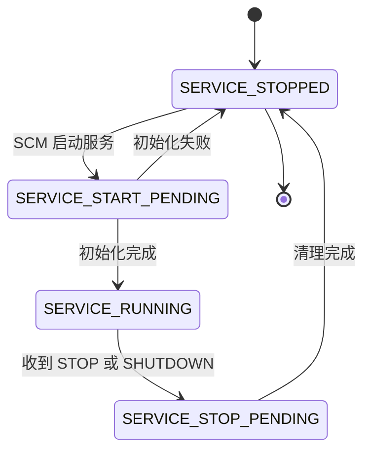

# A.18 Windows 服务、注册表与系统设施

[A.15](/教程/正文/系统编程/拓展A_Win32系统编程/A_15_IO完成端口与线程池) 的回声服务器已经能同时处理许多连接，但它仍然是一个控制台程序：谁登录谁启动，关掉窗口就退出，监听端口写死在源代码里。把它交给一台无人值守的机器，需要三样东西：开机就运行、不依赖任何用户登录的服务外壳；一处程序能读到、管理员也能改的配置；出问题时能被查到的记录渠道。这一页把这三件事做完，把回声服务器包装成服务 `MdrEcho`，端口从注册表读取，运行情况写进事件日志；最后把 Windows 上几个常用的系统设施一次讲清，并与 Linux 的对应物排在一起。

服务、注册表、事件日志经常一起出现，因为一个后台程序从安装到运行要依次经过它们：安装程序把可执行文件路径和运行账户写进服务配置，服务启动时从注册表读参数，运行中把错误写进事件日志。Linux 上对应的三件东西是 systemd 单元、配置文件与 syslog。

本页的示例都在 Windows 11 x64 上用 MinGW-w64 GCC 13.2 编译运行，以普通（未提升）用户身份执行。输出里的用户名已替换成 `user`。安装服务、写 HKLM、往事件日志写记录这三件事需要管理员权限或会改动本机状态，相应的程序没有执行：`svc_install.c` 只跑到 `OpenSCManagerW` 被拒绝那一步，`eventlog.c` 只编译。

## 1. 服务是什么

服务（service）是由服务控制管理器（service control manager，SCM）启动和管理的进程。SCM 是 `services.exe`，随系统启动，维护已安装服务的数据库，按启动类型拉起服务，并把控制请求转给正在运行的服务。服务程序本身只是一个普通的控制台程序，区别在于它由 `services.exe` 启动，运行在会话 0，没有控制台窗口，也不属于任何用户的登录会话。

服务程序与服务配置是两样东西。程序是磁盘上的可执行文件；配置是注册表中 `HKLM\SYSTEM\CurrentControlSet\Services\` 下的一个项，SCM 从这里知道该运行哪个文件、用哪个账户、开机要不要自动启动。系统自带的 EventLog 服务可以直接拿来观察这两样东西，先看它的运行状态：

::: terminal title="PowerShell - sc.exe query EventLog"

```text
PS> sc.exe query EventLog

SERVICE_NAME: EventLog
        TYPE               : 30  WIN32
        STATE              : 4  RUNNING
                                (STOPPABLE, NOT_PAUSABLE, ACCEPTS_SHUTDOWN)
        WIN32_EXIT_CODE    : 0  (0x0)
        SERVICE_EXIT_CODE  : 0  (0x0)
        CHECKPOINT         : 0x0
        WAIT_HINT          : 0x0
```

:::

`TYPE` 的 30（0x30）就是 `SERVICE_WIN32`，它由 `SERVICE_WIN32_OWN_PROCESS`（0x10）与 `SERVICE_WIN32_SHARE_PROCESS`（0x20）两个标志组成；`sc.exe qc` 后面显示的 `20 WIN32_SHARE_PROCESS` 说明 EventLog 与别的服务共享进程。`STATE` 的 4 是 `SERVICE_RUNNING`。`CHECKPOINT` 与 `WAIT_HINT` 在服务启动或停止的过程中才会用到，第 2 节解释。

再看它的配置：

::: terminal title="PowerShell - sc.exe qc EventLog"

```text
PS> sc.exe qc EventLog
[SC] QueryServiceConfig SUCCESS

SERVICE_NAME: EventLog
        TYPE               : 20  WIN32_SHARE_PROCESS
        START_TYPE         : 2   AUTO_START
        ERROR_CONTROL      : 1   NORMAL
        BINARY_PATH_NAME   : C:\Windows\System32\svchost.exe -k LocalServiceNetworkRestricted -p
        LOAD_ORDER_GROUP   : Event Log
        TAG                : 0
        DISPLAY_NAME       : Windows Event Log
        DEPENDENCIES       :
        SERVICE_START_NAME : NT AUTHORITY\LocalService
```

:::

同一份配置在注册表里就是几个值：

::: terminal title="PowerShell - reg query 服务配置"

```text
PS> reg query "HKLM\SYSTEM\CurrentControlSet\Services\EventLog" /v Start
HKEY_LOCAL_MACHINE\SYSTEM\CurrentControlSet\Services\EventLog
    Start    REG_DWORD    0x2

PS> reg query "HKLM\SYSTEM\CurrentControlSet\Services\EventLog" /v ObjectName
HKEY_LOCAL_MACHINE\SYSTEM\CurrentControlSet\Services\EventLog
    ObjectName    REG_SZ    NT AUTHORITY\LocalService

PS> reg query "HKLM\SYSTEM\CurrentControlSet\Services\EventLog" /v ImagePath
HKEY_LOCAL_MACHINE\SYSTEM\CurrentControlSet\Services\EventLog
    ImagePath    REG_EXPAND_SZ    %SystemRoot%\System32\svchost.exe -k LocalServiceNetworkRestricted -p
```

:::

`Start` 是启动类型，0 到 4 依次是引导、系统、自动、手动（`demand`）、禁用；`ObjectName` 是运行账户；`ImagePath` 是可执行文件路径，用 `REG_EXPAND_SZ` 存是为了让 `%SystemRoot%` 在被读取时展开。`sc.exe config` 改的就是这三个值。

运行账户决定服务进程拿到的访问令牌，也就决定了它能碰哪些文件、注册表项和网络资源。常用的几个特殊账户：

| 账户 | 本地权限 | 网络身份 |
| --- | --- | --- |
| `LocalSystem` | 最高，属于 Administrators 组 | 以计算机账户访问网络 |
| `LocalService` | 最小 | 匿名 |
| `NetworkService` | 最小 | 计算机账户 |
| `NT SERVICE\<服务名>`（虚拟账户，Windows 7 起） | 最小，按服务名区分 | 匿名 |

选择的原则与 [A.16](/教程/正文/系统编程/拓展A_Win32系统编程/A_16_安全与访问控制_ACL与令牌) 一致：能完成工作的最低权限账户。只监听 `127.0.0.1` 的回声服务器不需要 `LocalSystem`，`LocalService` 就够。`LocalSystem` 的服务一旦被利用，攻击者直接拿到本机管理员，很多提权漏洞就是从这类服务里找入口的。

::: concept win-svc-session-zero title="服务运行在会话 0，没有用户界面"

服务进程运行在会话 0（session 0），与任何登录用户的会话隔离。服务不能显示窗口、不能弹对话框，也不能假设有用户登录，或假设桌面上有人能看见它的输出。需要与用户交互时，服务与一个运行在用户会话里的界面程序通过命名管道等机制通信，界面程序单独启动。

:::

从 Windows Vista 起，即使把服务配置成「允许与桌面交互」，系统默认也不再把它的界面显示给登录用户。写服务时把这条当成硬性前提，可以省掉很多调试时的困惑：服务的 `printf` 没有地方可去，日志必须写进事件日志或文件。

Linux 上与之对应的是 systemd 单元。一个最小单元文件：

```ini
[Unit]
Description=Mdr Echo Service
After=network.target

[Service]
ExecStart=/usr/local/bin/mdr_echo
User=nobody
Restart=on-failure

[Install]
WantedBy=multi-user.target
```

`ExecStart` 相当于 `ImagePath`，`User` 相当于 `ObjectName`，`WantedBy` 加 `systemctl enable` 相当于启动类型 `auto`。区别在于 systemd 直接管理进程组、负责重启策略，而 SCM 只负责启动和转发控制请求，进程退出后要不要重启由服务的恢复选项决定，默认不重启。

<Quiz
  type="single"
  :options="[
    { label: 'LocalSystem', value: 'A' },
    { label: 'LocalService', value: 'B' },
    { label: '当前登录的管理员账户', value: 'C' },
    { label: 'NetworkService', value: 'D' }
  ]"
  answer="B"
>

<template #question>

一个只在 `127.0.0.1` 上提供回环服务的后台程序，运行账户应当选哪个？

</template>

正确答案是 **B**。它只在本机回环上收发，不需要网络身份，也不需要本机管理员权限，`LocalService` 的权限已经够用且最小。`LocalSystem` 权限过大；`NetworkService` 用计算机账户访问网络，对这个程序是多余的；用当前登录的管理员账户则要在安装时提供密码，用户改密码之后服务就起不来，SCM 不会替你更新。

</Quiz>

## 2. 服务程序的结构

服务程序的入口仍然是 `main`，但它要做的第一件事是把主线程交给 SCM，而不是自己开始干活：

```c
int main(void) {
    SERVICE_TABLE_ENTRYW table[] = {
        {(LPWSTR)SERVICE_NAME, service_main},
        {NULL, NULL},
    };

    if (StartServiceCtrlDispatcherW(table)) {
        return 0;
    }
    /* 失败：第 3 节按错误码处理 */
    return 1;
}
```

`SERVICE_TABLE_ENTRYW` 的数组以两个空成员结尾，每一项给出服务名与对应的 `ServiceMain` 函数。`StartServiceCtrlDispatcherW` 成功之后不返回，它把调用线程变成服务控制分派线程（service control dispatcher），一直阻塞到进程里所有服务都进入 `SERVICE_STOPPED` 状态。SCM 通过一个命名管道把控制请求送到这个线程，线程要么调用服务的控制处理函数，要么新建一个线程去执行 `ServiceMain`。

这里有一条时间限制：SCM 启动服务进程后等它调用 `StartServiceCtrlDispatcherW`，等待上限是 30 秒。超过 30 秒还没连上，SCM 判定服务启动失败，记录的错误是 1053（「服务没有及时响应启动或控制请求。」）。所以耗时的初始化不能放在 `main` 里，要放到 `ServiceMain` 中并分阶段报告进度。

`ServiceMain` 的第一件非失败操作必须是注册控制处理函数：

```c
static void WINAPI service_main(DWORD argc, LPWSTR *argv) {
    g_status_handle = RegisterServiceCtrlHandlerExW(SERVICE_NAME, service_ctrl, NULL);
    if (g_status_handle == NULL) {
        return;
    }
    report_status(SERVICE_START_PENDING, 3000);

    g_stop = CreateEventW(NULL, TRUE, FALSE, NULL);
    if (g_stop == NULL) {
        report_status(SERVICE_STOPPED, 0);
        return;
    }
    run_echo();
    CloseHandle(g_stop);
}
```

先注册再报告状态，是因为 `SetServiceStatus` 需要这个句柄。如果注册失败，服务已经没有办法向 SCM 报告任何东西，只能直接返回。`ServiceMain` 在 SCM 新建的线程里运行，参数里至少有一项，第一项是服务名。

状态报告填的是 `SERVICE_STATUS` 结构：

```c
static void report_status(DWORD state, DWORD wait_hint) {
    static DWORD checkpoint = 1;

    if (g_status_handle == NULL) {
        return;
    }
    g_status.dwServiceType = SERVICE_WIN32_OWN_PROCESS;
    g_status.dwCurrentState = state;
    g_status.dwControlsAccepted =
        (state == SERVICE_RUNNING) ? (SERVICE_ACCEPT_STOP | SERVICE_ACCEPT_SHUTDOWN) : 0;
    g_status.dwWin32ExitCode = NO_ERROR;
    g_status.dwServiceSpecificExitCode = 0;
    g_status.dwWaitHint = wait_hint;
    if (state == SERVICE_START_PENDING || state == SERVICE_STOP_PENDING) {
        g_status.dwCheckPoint = checkpoint++;
    } else {
        g_status.dwCheckPoint = 0;
        checkpoint = 1;
    }
    SetServiceStatus(g_status_handle, &g_status);
}
```

三个字段各有分工。`dwCurrentState` 是此刻的状态；`dwControlsAccepted` 只在 `SERVICE_RUNNING` 时声明愿意接收哪些控制，初始化期间它为 0，SCM 就不会送来停止请求；`dwCheckPoint` 与 `dwWaitHint` 配合，告诉 SCM「我还在动，预计还要这么久」。处于 PENDING 状态时每次报告都把 `dwCheckPoint` 加一，并给出一个不小于实际剩余时间的 `dwWaitHint`。SCM 在 `dwWaitHint` 的时间内既没看到状态变化、也没看到检查点前进，就会终止进程并记录启动失败。长时间初始化或长时间停止都要定期报告，不能沉默。

控制处理函数只做两件事：报告状态，置位停止事件。

```c
static DWORD WINAPI service_ctrl(DWORD control, DWORD event_type, void *event_data,
                                 void *context) {
    (void)event_type;
    (void)event_data;
    (void)context;

    if (control == SERVICE_CONTROL_STOP || control == SERVICE_CONTROL_SHUTDOWN) {
        report_status(SERVICE_STOP_PENDING, 5000);
        SetEvent(g_stop);
    }
    return NO_ERROR;
}
```

处理函数由分派线程调用，所以它必须尽快返回，不能在里面做清理、等待线程或者写大块日志，否则 SCM 的后续控制请求全部堵住。真正的停止动作放在工作线程里：工作线程看到停止事件有信号，结束工作循环、释放资源，最后由 `ServiceMain` 报告 `SERVICE_STOPPED`。

把报告状态的动作换成打印，就能在控制台上看到一次完整的生命周期：

```c
int main(void) {
    DWORD check = 1;

    report(SERVICE_START_PENDING, 0, check++, 3000);
    Sleep(100);
    report(SERVICE_START_PENDING, 0, check++, 3000);
    report(SERVICE_RUNNING, SERVICE_ACCEPT_STOP | SERVICE_ACCEPT_SHUTDOWN, 0, 0);
    report(SERVICE_STOP_PENDING, 0, check, 5000);
    Sleep(100);
    report(SERVICE_STOPPED, 0, 0, 0);
    return 0;
}
```

::: terminal title="PowerShell - lifecycle"

```text
PS> gcc -std=c17 -Wall -Wextra -o lifecycle.exe lifecycle.c
PS> ./lifecycle.exe
SERVICE_START_PENDING  controls 0x00 checkpoint 1 wait_hint 3000 ms
SERVICE_START_PENDING  controls 0x00 checkpoint 2 wait_hint 3000 ms
SERVICE_RUNNING        controls 0x05 checkpoint 0 wait_hint 0 ms
SERVICE_STOP_PENDING   controls 0x00 checkpoint 3 wait_hint 5000 ms
SERVICE_STOPPED        controls 0x00 checkpoint 0 wait_hint 0 ms
```

:::

`controls` 的 0x05 是 `SERVICE_ACCEPT_STOP`（0x1）与 `SERVICE_ACCEPT_SHUTDOWN`（0x4）的组合。进入 STOPPED 之后检查点归零，因为已经没有什么在进行中的操作。

服务的状态转换只有固定的几条路：



`SERVICE_RUNNING` 之前的启动阶段和之后的停止阶段都可能插入 `SERVICE_PAUSED` 与 `SERVICE_CONTINUE_PENDING`，只有声明了 `SERVICE_ACCEPT_PAUSE_CONTINUE` 的服务才会收到暂停请求；回声服务器不需要暂停，声明停止与关机两种控制就够。

完整程序在 `code/系统编程/拓展A_Win32系统编程/A_18_Windows服务_注册表与系统设施/echo_svc.c`。它把 [A.15](/教程/正文/系统编程/拓展A_Win32系统编程/A_15_IO完成端口与线程池) 的回声逻辑放进工作线程，服务模式与控制台模式共用同一个 `run_echo`。为了把篇幅留给服务本身，工作线程一次服务一个连接，用 `select` 的 200 毫秒超时轮询停止事件；把 `echo_loop` 换成 A.15 的完成端口循环，其余部分不用改。

## 3. 在控制台里调试服务

服务程序的第一次运行几乎不可能是在 SCM 里。直接从命令行启动它，会看到 `StartServiceCtrlDispatcherW` 失败，错误码 1063：

```c
static void WINAPI svc_main(DWORD argc, LPWSTR *argv) {
    (void)argc;
    (void)argv;
}

int main(void) {
    SERVICE_TABLE_ENTRYW table[] = {
        {L"MdrProbe", svc_main},
        {NULL, NULL},
    };
    WCHAR *msg = NULL;
    DWORD err;

    setlocale(LC_ALL, ".UTF8");
    SetConsoleOutputCP(CP_UTF8);

    if (!StartServiceCtrlDispatcherW(table)) {
        err = GetLastError();
        FormatMessageW(FORMAT_MESSAGE_ALLOCATE_BUFFER | FORMAT_MESSAGE_FROM_SYSTEM |
                           FORMAT_MESSAGE_IGNORE_INSERTS,
                       NULL, err, 0, (LPWSTR)&msg, 0, NULL);
        wprintf(L"StartServiceCtrlDispatcherW failed: %lu\n", (unsigned long)err);
        wprintf(L"message: %ls", msg != NULL ? msg : L"(none)\n");
        LocalFree(msg);
        return 1;
    }
    return 0;
}
```

::: terminal title="PowerShell - svc_probe"

```text
PS> gcc -std=c17 -Wall -Wextra -o svc_probe.exe svc_probe.c
PS> ./svc_probe.exe
StartServiceCtrlDispatcherW failed: 1063
message: 服务进程无法连接到服务控制器上。
```

:::

`ERROR_FAILED_SERVICE_CONTROLLER_CONNECT`（1063）只有一个含义：这个进程不是 SCM 启动的。它恰好给了服务程序一个天然的调试入口：把 1063 当成「有人在控制台里运行我」，切换到控制台模式，其余的 1063 以外的错误才当成真正的失败。

`echo_svc.c` 的 `main` 就是这么写的：

```c
int main(void) {
    SERVICE_TABLE_ENTRYW table[] = {
        {(LPWSTR)SERVICE_NAME, service_main},
        {NULL, NULL},
    };

    setlocale(LC_ALL, ".UTF8");
    SetConsoleOutputCP(CP_UTF8);
    setvbuf(stdout, NULL, _IONBF, 0);

    if (StartServiceCtrlDispatcherW(table)) {
        return 0;
    }

    DWORD err = GetLastError();
    if (err != ERROR_FAILED_SERVICE_CONTROLLER_CONNECT) {
        wprintf(L"[svc] StartServiceCtrlDispatcherW failed: %lu\n", (unsigned long)err);
        return 1;
    }

    wprintf(L"[svc] not started by the SCM (error %lu), console mode\n", (unsigned long)err);
    g_stop = CreateEventW(NULL, TRUE, FALSE, NULL);
    if (g_stop == NULL) {
        wprintf(L"[svc] CreateEventW failed: %lu\n", (unsigned long)GetLastError());
        return 1;
    }
    SetConsoleCtrlHandler(console_ctrl, TRUE);
    int rc = run_echo();
    CloseHandle(g_stop);
    return rc;
}
```

控制台模式补上的东西正好是服务模式由 SCM 提供的那部分：一个停止事件，以及一个能把它置位的来源。这里用的是 [A.17](/教程/正文/系统编程/拓展A_Win32系统编程/A_17_控制台与ConPTY) 的 `SetConsoleCtrlHandler`：

```c
static BOOL WINAPI console_ctrl(DWORD type) {
    if (type == CTRL_C_EVENT || type == CTRL_BREAK_EVENT || type == CTRL_CLOSE_EVENT ||
        type == CTRL_SHUTDOWN_EVENT) {
        wprintf(L"[svc] console control %lu, stopping\n", (unsigned long)type);
        SetEvent(g_stop);
        return TRUE;
    }
    return FALSE;
}
```

状态报告在控制台模式下是空操作：`g_status_handle` 是 NULL，`report_status` 直接返回。工作逻辑 `run_echo`、监听循环、客户端处理都只有一份。

控制台模式的完整会话如下。配套的客户端在 `code/系统编程/拓展A_Win32系统编程/A_18_Windows服务_注册表与系统设施/echo_client.c`，它把命令行里每个参数发出去并打印回来的内容，用来确认回声确实走了一个来回。先在窗口里启动服务程序，再在另一个窗口运行客户端，最后按 Ctrl+C 停止：

::: terminal title="PowerShell - echo_svc 控制台模式"

```text
PS> ./echo_svc.exe
[svc] not started by the SCM (error 1063), console mode
[svc] port 23456 from HKCU\Software\MdrTutorial\Echo\Port
[svc] listening on 127.0.0.1:23456
[svc] running
```

:::

```c
int main(int argc, char *argv[]) {
    /* 省略 WSAStartup、socket、inet_pton、connect */

    for (int i = 3; i < argc; i++) {
        int len = (int)strlen(argv[i]);
        int got = 0;

        send(s, argv[i], len, 0);
        while (got < len) {
            got += recv(s, buf + got, len - got, 0);
        }
        buf[got] = '\0';
        printf("echo: %s\n", buf);
    }
    return 0;
}
```

::: terminal title="PowerShell - echo_client"

```text
PS> gcc -std=c17 -Wall -Wextra -o echo_client.exe echo_client.c -lws2_32
PS> ./echo_client.exe 127.0.0.1 23456 alpha beta gamma
echo: alpha
echo: beta
echo: gamma
```

:::

回到第一个窗口按 Ctrl+C：

::: terminal title="PowerShell - echo_svc 收到 Ctrl+C"

```text
[svc] client 127.0.0.1:52193 connected
[svc] client 127.0.0.1 disconnected, echoed 14 bytes
[svc] console control 0, stopping
[svc] stopped, 1 client(s) served
```

:::

三行客户端消息回来的是 `alpha`、`beta`、`gamma`，共 14 字节，与服务端统计的 `echoed 14 bytes` 对得上。上面这段会话是在 [A.17](/教程/正文/系统编程/拓展A_Win32系统编程/A_17_控制台与ConPTY) 的伪控制台宿主里跑的，Ctrl+C 由 `\x03` 注入；手工操作时在服务窗口直接按 Ctrl+C，效果相同。

::: tip 每个服务程序都保留控制台模式

安装服务需要管理员权限，还要经过创建、启动、停止、删除几步，一轮调试下来很慢；服务进程崩溃时也没有窗口能看到消息。因此把「1063 就切到控制台」写进服务程序的骨架，平时所有逻辑都在控制台里验证，只在验证安装脚本和账户权限时才真正装成服务。这个分支的代码不到二十行，省下的时间远多于写它的时间。

:::

<Quiz
  :options="[
    { label: '报错退出，提示必须由 SCM 启动', value: 'A' },
    { label: '切换到控制台模式，运行同一套工作逻辑', value: 'B' },
    { label: '等待 30 秒后重试 StartServiceCtrlDispatcherW', value: 'C' },
    { label: '以管理员身份重新启动自己', value: 'D' }
  ]"
  answer="B"
>

<template #question>

在命令行直接运行服务程序，`StartServiceCtrlDispatcherW` 返回 `FALSE`、错误码 1063，正确的处理是什么？

</template>

正确答案是 **B**。1063 表示进程不是 SCM 启动的，这是从控制台调试服务的正常入口，不是故障。重试没有意义，SCM 不会因为多等一会儿就出现；提权也不解决问题，SCM 的管道连接与权限无关。把 1063 以外的错误当成真正的失败，才是这个分支应该做的区分。

</Quiz>

## 4. 安装与管理

安装服务最直接的工具是 `sc.exe`。语法里有一个必须注意的细节：每个选项名本身包含等号，等号与值之间**必须**有一个空格，写成 `binPath=C:\...` 会失败。

```text
sc.exe create MdrEcho binPath= "C:\work\echo_svc.exe" start= demand obj= "NT AUTHORITY\LocalService" displayname= "Mdr Echo Service"
```

`binPath=` 是服务程序的完整路径，路径里有空格时必须加引号，SCM 会把它当作整个命令行；`start= demand` 表示手动启动，改成 `auto` 就是开机自动启动；`obj=` 是运行账户，写 `NT AUTHORITY\LocalService` 时不需要密码。

这些操作都要在提升过的管理员命令行里执行。普通命令行里试一下，得到的是拒绝访问：

::: terminal title="PowerShell - 普通权限下的 sc.exe create"

```text
PS> sc.exe create MdrEcho binPath= "C:\work\echo_svc.exe" start= demand obj= "NT AUTHORITY\LocalService"
[SC] OpenSCManager FAILED 5:

Access is denied.
```

:::

::: warning 安装和管理服务需要管理员权限

创建、启动、停止、删除服务都要先打开 SCM 数据库，而 `OpenSCManagerW` 的 `SC_MANAGER_CREATE_SERVICE` 权限只授予管理员。普通命令行得到的错误码是 5（`ERROR_ACCESS_DENIED`），程序里表现为 `OpenSCManagerW` 返回 `NULL`。只读的查询（`sc.exe query`、`QueryServiceStatusEx`）不需要管理员。

:::

创建成功后，`sc.exe start`、`sc.exe stop`、`sc.exe query`、`sc.exe delete` 分别用于启动、停止、查询、删除。删除只是给服务打上删除标记，正在运行时要在停止之后才真正移除。对一个不存在的服务执行这些命令，返回的是 1060：

::: terminal title="PowerShell - 对不存在的服务执行 sc.exe"

```text
PS> sc.exe start MdrEcho
[SC] StartService: OpenService FAILED 1060:

The specified service does not exist as an installed service.

PS> sc.exe stop MdrEcho
[SC] OpenService FAILED 1060:

The specified service does not exist as an installed service.
```

:::

用代码做同样的事，是一串 SCM API 的调用。`svc_install.c` 把安装、启动、停止、删除各做成一个子命令：

| 操作 | 主要调用 |
| --- | --- |
| 安装 | `OpenSCManagerW` → `CreateServiceW` → `CloseServiceHandle` |
| 启动 | `OpenServiceW(SERVICE_START)` → `StartServiceW` |
| 停止 | `OpenServiceW(SERVICE_STOP)` → `ControlService(SERVICE_CONTROL_STOP)` |
| 删除 | `OpenServiceW(DELETE)` → `DeleteService` |

`CreateServiceW` 的参数比 `sc.exe` 多，但一一对应：服务名、显示名、访问权限、服务类型 `SERVICE_WIN32_OWN_PROCESS`、启动类型 `SERVICE_DEMAND_START`、错误控制 `SERVICE_ERROR_NORMAL`、可执行文件路径、运行账户。同一个程序在普通权限下运行时，第一句 `OpenSCManagerW` 就失败：

::: terminal title="PowerShell - svc_install"

```text
PS> ./svc_install.exe install C:\work\echo_svc.exe
OpenSCManagerW failed: 5: 拒绝访问。
```

:::

只读的查询不需要管理员，可以随时运行。`svc_query.c` 用 `QueryServiceStatusEx` 取 `SERVICE_STATUS_PROCESS`，比 `sc.exe query` 多一个进程 ID：

::: terminal title="PowerShell - svc_query"

```text
PS> ./svc_query.exe
service    : EventLog
state      : 4 (SERVICE_RUNNING)
type       : 0x00000030
pid        : 3364
controls   : 0x00000205
exit code  : 0

PS> ./svc_query.exe ADPSvc
service    : ADPSvc
state      : 1 (SERVICE_STOPPED)
type       : 0x00000020
pid        : 0
controls   : 0x00000000
exit code  : 1077

PS> ./svc_query.exe MdrEcho
OpenServiceW(MdrEcho) failed: 1060
```

:::

`controls` 的 0x205 是 `STOP | SHUTDOWN | TIMECHANGE` 三项，说明 EventLog 服务接受停止和关机通知，还关心系统时间被修改。停止的服务 `pid` 为 0，`exit code` 是上一次启动失败留下的 1077（「上次启动之后，仍未尝试引导服务。」）。服务名不存在时 `OpenServiceW` 返回 1060，与 `sc.exe` 的提示相同。

`SERVICE_STATUS_PROCESS` 里的 `dwProcessId` 是服务进程的 PID，需要进一步检查进程时用它去对照任务管理器或 `Get-Process`。

## 5. 注册表

注册表（registry）是一个树形的配置数据库。树上的每个节点叫项（key），项下面可以有子项（subkey），也可以有若干值（value）。值由名字、类型和数据三部分组成，名字可以省略，省略时是该项的默认值。整棵树分成几个根项，常用的五个：

| 根项 | 内容 |
| --- | --- |
| `HKEY_LOCAL_MACHINE`（HKLM） | 本机配置，所有用户共享，写它需要管理员 |
| `HKEY_CURRENT_USER`（HKCU） | 当前用户的配置，是 `HKEY_USERS` 下该用户配置单元（hive）的一个链接 |
| `HKEY_CLASSES_ROOT`（HKCR） | 文件关联与 COM 注册，是 HKLM 与 HKCU 下 `Software\Classes` 的合并视图 |
| `HKEY_USERS`（HKU） | 所有已加载的用户配置单元 |
| `HKEY_CURRENT_CONFIG`（HKCC） | 当前硬件配置，是 HKLM 下当前硬件配置文件的链接 |

按用户保存的配置写 HKCU，按机器保存的配置写 HKLM。HKCU 的写操作不需要管理员，因为每个用户只能改自己的配置单元；这也意味着以管理员身份运行的程序改的是管理员自己的 HKCU，而不是发起操作的那个普通用户。

HKCU 指向的是**当前进程那个账户**的配置单元，这一点在服务上尤其容易踩。`echo_svc.c` 在控制台模式下读 `HKCU\Software\MdrTutorial\Echo`，因为调试时它以当前用户身份运行；一旦装成 `LocalService` 的服务，同样的代码读到的是 `LocalService` 账户的配置单元，用户写下的端口值根本不在那里，程序只能落到默认端口。服务级的配置写在 `HKLM`（安装时由管理员写入）或 `ProgramData` 下的文件里，`HKCU` 留给以用户身份运行的程序。

值的类型决定了数据怎么解释：

| 类型 | 数据 | 典型用途 |
| --- | --- | --- |
| `REG_SZ` | 以空字符结尾的字符串 | 名字、路径、问候语 |
| `REG_EXPAND_SZ` | 以空字符结尾、可含 `%VAR%` 引用的字符串 | 路径，读取时可展开环境变量 |
| `REG_MULTI_SZ` | 一串以空字符分隔的字符串，末尾再加一个空字符 | 列表 |
| `REG_DWORD` | 32 位整数 | 端口、开关、超时 |
| `REG_QWORD` | 64 位整数 | 大计数、文件大小 |
| `REG_BINARY` | 任意字节 | 二进制块、结构体快照 |
| `REG_NONE` | 没有定义类型的数据 | 系统内部使用 |

读写注册表用 `winreg.h` 里的函数。打开或创建项用 `RegCreateKeyExW`，它既能创建也能打开，通过最后一个参数告诉调用者这次是新建还是命中已有的项：

```c
LSTATUS RegCreateKeyExW(HKEY hKey, LPCWSTR lpSubKey, DWORD Reserved, LPWSTR lpClass,
                        DWORD dwOptions, REGSAM samDesired,
                        const LPSECURITY_ATTRIBUTES lpSecurityAttributes,
                        PHKEY phkResult, LPDWORD lpdwDisposition);
```

写值用 `RegSetValueExW`：

```c
LSTATUS RegSetValueExW(HKEY hKey, LPCWSTR lpValueName, DWORD Reserved, DWORD dwType,
                       const BYTE *lpData, DWORD cbData);
```

`cbData` 的单位是字节。字符串类型的长度要包含结尾空字符，最省事的写法是把数组名直接传进 `sizeof`，数组有多大就写多大。`Reserved` 必须是 0，这一位没有别的用途。

读值用 `RegGetValueW`，它把打开子项、读取、展开环境变量合成一步：

```c
LSTATUS RegGetValueW(HKEY hkey, LPCWSTR lpSubKey, LPCWSTR lpValue, DWORD dwFlags,
                     LPDWORD pdwType, PVOID pvData, LPDWORD pcbData);
```

`dwFlags` 用 `RRF_RT_*` 限定可接受的类型，类型不符时函数直接失败，不会把四种类型的字节硬塞进一个 `DWORD`。`pvData` 传 NULL、`pcbData` 传非空指针时，函数返回所需字节数，可以先问大小再分配。读取字符串时它保证结果以空字符结尾；缓冲区不够时返回 `ERROR_MORE_DATA`（234），并把需要的字节数写回 `pcbData`。

::: concept win-reg-lstatus title="注册表函数直接返回错误码"

注册表函数返回 `LSTATUS`，成功是 0，失败是 `winerror.h` 里的错误码本身。它们不设置线程的最后错误码，`GetLastError()` 在这里没有意义。判断返回值时直接与 `ERROR_SUCCESS` 比较，出错信息也直接来自返回值。

:::

`reg_config.c` 在 `HKCU\Software\MdrTutorial\Echo` 下写三个值，再读回、枚举，最后删除整个项：

```c
static LSTATUS write_config(HKEY key) {
    const wchar_t greeting[] = L"hello";
    const wchar_t data_dir[] = L"%LOCALAPPDATA%\\MdrTutorial\\Echo";
    DWORD port = 23456;
    LSTATUS st;

    st = RegSetValueExW(key, L"Port", 0, REG_DWORD, (const BYTE *)&port, sizeof port);
    if (st != ERROR_SUCCESS) {
        return st;
    }
    st = RegSetValueExW(key, L"Greeting", 0, REG_SZ, (const BYTE *)greeting,
                        (DWORD)sizeof greeting);
    if (st != ERROR_SUCCESS) {
        return st;
    }
    return RegSetValueExW(key, L"DataDir", 0, REG_EXPAND_SZ, (const BYTE *)data_dir,
                          (DWORD)sizeof data_dir);
}
```

::: terminal title="PowerShell - reg_config"

```text
PS> gcc -std=c17 -Wall -Wextra -o reg_config.exe reg_config.c
PS> ./reg_config.exe keep
key created, disposition 1 (1 = new, 2 = existing)
Port     = 23456 (type 4)
Greeting = hello (type 1)
DataDir  = C:\Users\user\AppData\Local\MdrTutorial\Echo (type 1, expanded)
DataDir  = %LOCALAPPDATA%\MdrTutorial\Echo (type 2, RRF_NOEXPAND)
DataDir restricted to REG_EXPAND_SZ -> 1630
Port as REG_SZ -> 1630
values under HKCU\Software\MdrTutorial\Echo:
  [0] Port       type 4, 4 bytes
  [1] Greeting   type 1, 12 bytes
  [2] DataDir    type 2, 64 bytes
key kept, inspect it with: reg query HKCU\Software\MdrTutorial\Echo
```

:::

输出里的用户名已替换为 `user`。几处值得对照：

- `disposition` 第一次是 1，表示新建；再运行一次变成 2，表示项已存在。
- `Greeting` 占 12 字节：`hello` 五个字符在 UTF-16 下是 10 字节，加结尾空字符 2 字节。`DataDir` 的 64 字节同理，`sizeof` 把结尾空字符算进去了。
- `REG_EXPAND_SZ` 默认在读取时展开，展开之后类型按 `REG_SZ`（1）返回，所以第一行 `DataDir` 显示的是展开后的路径。加上 `RRF_NOEXPAND` 才能拿到原样的 `%LOCALAPPDATA%`，此时类型是 2。
- 第二行 `DataDir restricted to REG_EXPAND_SZ` 返回 1630，正是因为展开之后类型不再是 `REG_EXPAND_SZ`。只允许 `RRF_RT_REG_EXPAND_SZ` 反而读不到值，这是这个 API 最容易踩的一处。

用 `reg.exe` 从外面看同一个项：

::: terminal title="PowerShell - reg query"

```text
PS> reg query HKCU\Software\MdrTutorial\Echo

HKEY_CURRENT_USER\Software\MdrTutorial\Echo
    Port    REG_DWORD    0x5ba0
    Greeting    REG_SZ    hello
    DataDir    REG_EXPAND_SZ    %LOCALAPPDATA%\MdrTutorial\Echo
```

:::

0x5ba0 就是 23456。`REG_EXPAND_SZ` 在 `reg query` 里显示原样，不展开。这段配置正是 `echo_svc.c` 启动时读的那一份：存在 `Port` 时它用这个端口，没有时回落到 23456 并说明原因。

::: terminal title="PowerShell - echo_svc 没有找到配置"

```text
PS> ./echo_svc.exe
[svc] not started by the SCM (error 1063), console mode
[svc] no usable Port value (status 2), falling back to 23456
[svc] listening on 127.0.0.1:23456
[svc] running
```

:::

状态 2 是 `ERROR_FILE_NOT_FOUND`：项不存在。读配置时把「没有这个值」当成正常情况，用默认值继续，比把它当错误处理更常见。

删除用 `RegDeleteTreeW`，它递归删除项及其所有子项和值：

```c
st = RegDeleteTreeW(HKEY_CURRENT_USER, CONFIG_KEY);
wprintf(L"RegDeleteTreeW -> %ld\n", (long)st);
```

不带 `keep` 参数运行时这行输出 0，项就被清掉了。只删一个值用 `RegDeleteValueW`；删除之前记得 `RegCloseKey` 已经打开的句柄，句柄不关不会阻止删除，但会一直占着资源。

只读取值名和类型时用 `RegEnumValueW`：下标从 0 开始，每次取一个值，取到 `ERROR_NO_MORE_ITEMS`（259）为止。名字和数据的缓冲区都由调用者提供，长度不够时返回 `ERROR_MORE_DATA`。

几个常见错误放在一起看最清楚。`reg_errors.c` 依次试了缓冲区不足、类型不符、只允许 `REG_EXPAND_SZ`、项不存在、值不存在：

::: terminal title="PowerShell - reg_errors"

```text
PS> gcc -std=c17 -Wall -Wextra -o reg_errors.exe reg_errors.c
PS> ./reg_errors.exe
4-byte buffer              -> 234, needs 14 bytes
read DWORD as REG_SZ      -> 1630
REG_EXPAND_SZ only         -> 1630
RRF_NOEXPAND               -> 0, type 2, "%LOCALAPPDATA%\MdrTutorial\Echo"
missing key                -> 2
missing value              -> 2
```

:::

234 是 `ERROR_MORE_DATA`，1630 是 `ERROR_UNSUPPORTED_TYPE`，2 是 `ERROR_FILE_NOT_FOUND`。项不存在和值不存在返回同一个错误码，程序没法从错误码区分两者，只能分别调用 `RegOpenKeyExW` 和 `RegQueryValueExW` 才知道缺的是哪一层。读配置时把「没有这个值」当成正常情况，用默认值继续，比把它当错误处理更常见。

64 位 Windows 上还有一处视图问题：32 位程序访问 `HKLM\Software` 时会被重定向到 `HKLM\Software\WOW6432Node`，读到的是 32 位程序的配置。要显式访问 64 位视图，在 `RegOpenKeyExW` 的访问权限里加 `KEY_WOW64_64KEY`；`RegGetValueW` 则用 `RRF_SUBKEY_WOW6464KEY`。64 位程序默认就在 64 位视图里，不需要这些标志。

::: tip 配置放注册表还是放文件

注册表适合少量、扁平、需要按用户或按机器区分的设置：端口、开关、上次打开的目录、窗口位置。它不适合存放大量数据或结构化配置：单个值超过 2 KB 时微软建议改存文件，把文件路径放进注册表，嵌套的结构用项和值拼出来既难读也难改。这类配置写成文件，放在已知文件夹里（第 6.3 节），用普通的文件 API 读写、用文本编辑器修改。Linux 上的分工相同：零散设置放 `/etc` 或 `~/.config` 下的文件，而不是塞进某个全局数据库。

:::

<Quiz
  type="single"
  :options="[
    { label: 'GetLastError', value: 'A' },
    { label: '函数的返回值', value: 'B' },
    { label: 'errno', value: 'C' },
    { label: 'RegQueryInfoKey', value: 'D' }
  ]"
  answer="B"
>

<template #question>

`RegGetValueW` 失败时，错误码从哪里取得？

</template>

正确答案是 **B**。注册表函数返回 `LSTATUS`，失败时返回值本身就是错误码，例如 2、1630、234。它们不设置线程的最后错误码，所以 `GetLastError` 拿到的是别的调用留下的值；`errno` 是 C 运行库的，与 Win32 无关。

</Quiz>

<Quiz
  type="single"
  :options="[
    { label: '只能存数字', value: 'A' },
    { label: '可以包含 %VAR% 形式的环境变量引用，读取时展开', value: 'B' },
    { label: '以二进制形式保存', value: 'C' },
    { label: '一个值可以保存多个字符串', value: 'D' }
  ]"
  answer="B"
>

<template #question>

`REG_EXPAND_SZ` 与 `REG_SZ` 的区别是什么？

</template>

正确答案是 **B**。两者的数据都是一段以空字符结尾的字符串，区别只在于 `REG_EXPAND_SZ` 允许写 `%LOCALAPPDATA%` 这样的引用，读取时由系统或调用者展开。存多个字符串是 `REG_MULTI_SZ`，二进制是 `REG_BINARY`。

</Quiz>

## 6. 其他系统设施

### 6.1 时间

Windows 的时间接口分成三类，用途与 Linux 的时钟一一对应。

`GetSystemTimePreciseAsFileTime` 读墙上时间，返回 `FILETIME`：从 1601-01-01 UTC 起算的 100 纳秒计数。它对应 `CLOCK_REALTIME`，用于日志时间戳、与外部系统交换时间。它的精度来自与 `QueryPerformanceCounter` 的校准，比老的 `GetSystemTimeAsFileTime` 高得多。

`QueryPerformanceCounter` 读一个单调递增的硬件计数器，配套的 `QueryPerformanceFrequency` 给出每秒的计数次数。它对应 `CLOCK_MONOTONIC`，测量间隔、超时、耗时都用它。计数器的频率在系统启动时固定，读一次缓存起来即可。与 Linux 的单调时钟有一处差别：QPC 把系统休眠的时间也算进去，更接近 `CLOCK_BOOTTIME`。

`GetTickCount64` 返回开机以来的毫秒数，分辨率受系统时钟节拍限制，通常 10 到 16 毫秒。它适合做粗粒度的超时和日志里的相对时间，不适合测量短间隔。

```c
static void show_system_time(void) {
    FILETIME ft;
    SYSTEMTIME st;
    ULARGE_INTEGER v;

    GetSystemTimePreciseAsFileTime(&ft);
    v.LowPart = ft.dwLowDateTime;
    v.HighPart = ft.dwHighDateTime;
    FileTimeToSystemTime(&ft, &st);
    wprintf(L"GetSystemTimePreciseAsFileTime: %04u-%02u-%02u %02u:%02u:%02u.%03u UTC\n",
            st.wYear, st.wMonth, st.wDay, st.wHour, st.wMinute, st.wSecond, st.wMilliseconds);
    wprintf(L"  as Unix seconds: %.7f\n", filetime_to_unix_seconds(ft));
    wprintf(L"  raw 100 ns ticks: %llu\n", (unsigned long long)v.QuadPart);
}
```

::: terminal title="PowerShell - times"

```text
PS> gcc -std=c17 -Wall -Wextra -o times.exe times.c
PS> ./times.exe
GetSystemTimePreciseAsFileTime: 2026-10-20 19:06:58.103 UTC
  as Unix seconds: 1792523218.1039715
  raw 100 ns ticks: 134369968181039704
QueryPerformanceFrequency: 10000000 Hz
smallest nonzero step: 1 ticks (0.100 us)
Sleep(250) measured: 261.082 ms
GetTickCount64: 156050828 -> 156050937, delta 109 ms
```

:::

本机计数器的频率是 10 MHz，一格 100 纳秒；反复读两万次，相邻两次读数的最小非零差是一格，说明它的分辨率没有受到访问开销的限制。`Sleep(250)` 实测 261 毫秒，多出来的部分来自时钟节拍。请求的毫秒数只是下限，`sleep_grain.c` 对几个常见的值各测 10 次：

::: terminal title="PowerShell - sleep_grain"

```text
PS> gcc -std=c17 -Wall -Wextra -o sleep_grain.exe sleep_grain.c
PS> ./sleep_grain.exe
Sleep(  0): avg    0.00 ms, min    0.00, max    0.00
Sleep(  1): avg   14.12 ms, min    1.09, max   15.87
Sleep(  5): avg   15.56 ms, min   15.04, max   16.03
Sleep( 10): avg   15.62 ms, min   15.21, max   16.23
Sleep( 50): avg   62.51 ms, min   61.48, max   63.37
Sleep(100): avg  108.70 ms, min  107.14, max  110.53
```

:::

`Sleep(1)` 有几次恰好落在节拍边界上，只等了 1 毫秒就返回；其余时候要等到下一个节拍到来，平均下来 14 毫秒。`Sleep(50)` 平均 62.5 毫秒，约等于四个 15.6 毫秒的节拍；`Sleep(100)` 平均 108.7 毫秒，约等于七个节拍。请求的等待时间会被向上取整到时钟节拍的整数倍，所以短睡眠的误差比例最大。需要毫秒级精度的周期，要用 [A.10](/教程/正文/系统编程/拓展A_Win32系统编程/A_10_同步原语_等待函数与内核对象) 的可等待计时器并加上高精度标志，不能靠 `Sleep`。

把 `FILETIME` 换算成 Unix 秒，减的是 1601 年到 1970 年之间的 11644473600 秒。[第 6 章](/教程/正文/系统编程/6_信号_时间与定时器)讲 `clock_gettime` 时强调过，测量间隔用单调节拍，只有需要与人对表时才读实时钟；这条规则在 Windows 上同样成立。

### 6.2 系统信息

`GetSystemInfo` 返回处理器架构、逻辑处理器数、页面大小、分配粒度这些启动后不变的参数：

```c
SYSTEM_INFO si;
GetSystemInfo(&si);
```

页面大小 4096 字节，分配粒度 65536 字节，这两个数与 [A.6](/教程/正文/系统编程/拓展A_Win32系统编程/A_6_内存管理与内存映射文件) 的虚拟内存管理直接相关：`VirtualAlloc` 按 64 KiB 对齐保留地址，按 4 KiB 提交页面。处理器数用 `dwNumberOfProcessors`，[A.9](/教程/正文/系统编程/拓展A_Win32系统编程/A_9_线程与线程本地存储) 和 [A.15](/教程/正文/系统编程/拓展A_Win32系统编程/A_15_IO完成端口与线程池) 决定线程数时要读它。

`GlobalMemoryStatusEx` 返回物理内存与提交限制，调用前要把 `dwLength` 设成结构大小：

```c
MEMORYSTATUSEX ms = {.dwLength = sizeof ms};
GlobalMemoryStatusEx(&ms);
```

取系统版本要注意一个陷阱：`GetVersionExW` 在程序没有清单时返回的是兼容版本 6.2、内部版本 9200，而不是真实版本。要拿真实版本，用 ntdll 导出的 `RtlGetVersion`；判断功能时不要比较版本号，改用 `IsWindows10OrGreater` 之类的辅助函数或直接探测接口是否存在。

::: terminal title="PowerShell - sysinfo"

```text
PS> gcc -std=c17 -Wall -Wextra -o sysinfo.exe sysinfo.c
PS> ./sysinfo.exe
processor architecture : 9
processors             : 16 logical, 16 native
page size              : 4096 bytes
allocation granularity : 65536 bytes
min/max app address    : 0000000000010000 / 00007FFFFFFEFFFF
memory load            : 37%
physical memory        : 31.5 GiB total, 19.8 GiB available
commit limit           : 51.5 GiB, available 37.5 GiB
GetVersionExW          : 6.2 build 9200
RtlGetVersion          : 10.0 build 26300
```

:::

架构字段 9 是 `PROCESSOR_ARCHITECTURE_AMD64`。两个版本函数在同一台 Windows 11（内部版本 26300）上给出的结果差了一整个大版本，就是清单在起作用。

### 6.3 已知文件夹与环境变量

程序的配置、缓存、日志该放在哪里，Windows 用已知文件夹（known folder）回答。`SHGetKnownFolderPath` 按文件夹的 GUID 返回路径，结果用 `CoTaskMemFree` 释放：

```c
PWSTR path = NULL;
HRESULT hr = SHGetKnownFolderPath(&FOLDERID_LocalAppData, KF_FLAG_DEFAULT, NULL, &path);
if (SUCCEEDED(hr)) {
    wprintf(L"%ls\n", path);
    CoTaskMemFree(path);
}
```

链接时要加 `-lole32 -luuid`。`FOLDERID_LocalAppData` 是本机的程序数据，`FOLDERID_RoamingAppData` 是会随漫游配置文件同步到其他机器的数据，`FOLDERID_ProgramData` 是全机器共享的数据，`FOLDERID_Documents` 是用户文档。环境变量 `%LOCALAPPDATA%`、`%APPDATA%` 指向同样的位置，用 `ExpandEnvironmentStringsW` 可以展开：

```c
wchar_t buf[512];
ExpandEnvironmentStringsW(L"%LOCALAPPDATA%", buf, 512);
```

::: terminal title="PowerShell - folders"

```text
PS> gcc -std=c17 -Wall -Wextra -o folders.exe folders.c -lole32 -luuid
PS> ./folders.exe
LocalAppData      : C:\Users\user\AppData\Local
RoamingAppData    : C:\Users\user\AppData\Roaming
ProgramData       : C:\ProgramData
Documents         : C:\Users\user\Documents
Profile           : C:\Users\user

environment variables:
%LOCALAPPDATA%    : C:\Users\user\AppData\Local
%APPDATA%         : C:\Users\user\AppData\Roaming
%USERPROFILE%     : C:\Users\user
%TEMP%            : C:\Users\user\AppData\Local\Temp
%OS%              : Windows_NT

wrote C:\Users\user\AppData\Local\MdrTutorial\Echo\echo.ini
```

:::

输出里的用户名已替换为 `user`。最后一行是 `folders.c` 顺手做的一件事：拼出 `LocalAppData\MdrTutorial\Echo\echo.ini`，写入两行配置，再删掉文件和目录，演示程序数据该落在哪里。`ProgramData` 对所有用户可读，适合放全机器共享的数据，但写入需要管理员。

作者判断很明确：程序的数据写到 `LocalAppData` 或 `RoamingAppData`，日志写到 `LocalAppData` 下的日志目录，不要写到可执行文件所在目录。`Program Files` 对普通用户只读，程序装好之后往自己目录里写文件会失败；即便能写，多用户共用一份配置也会互相覆盖。Linux 上的对应物是 XDG 目录规范：`~/.config`、`~/.local/share`、`~/.cache`，与 `RoamingAppData`、`LocalAppData`、`LocalAppData\Temp` 一一对应。

### 6.4 事件日志

服务的输出没有控制台可去，运行记录要写进事件日志（event log）。写入用三个函数：

```c
HANDLE log = RegisterEventSourceW(NULL, L"MdrTutorial");
ReportEventW(log, EVENTLOG_INFORMATION_TYPE, 0, 1000, NULL, 2, 0, strings, NULL);
DeregisterEventSource(log);
```

`RegisterEventSourceW` 的第一个参数是远程计算机名，本机传 NULL；第二个是事件源的名字。`ReportEventW` 的 `wType` 取 `EVENTLOG_ERROR_TYPE`、`EVENTLOG_WARNING_TYPE`、`EVENTLOG_INFORMATION_TYPE` 之一，`dwEventID` 是事件编号，`wNumStrings` 与 `lpStrings` 是一组插入字符串，事件查看器会把它们填进消息模板。

事件源不必事先注册也能写入：`RegisterEventSourceW` 找不到这个名字时退回 Application 日志，事件照样记录，只是看不到描述文字，因为没有对应的消息文件。这一点在本机验证过：用 `L"MdrTutorialNotRegistered"` 调用 `RegisterEventSourceW` 返回的是有效句柄，不是 NULL。要让事件查看器显示完整的描述，安装程序要在 `HKLM\SYSTEM\CurrentControlSet\Services\EventLog\Application\事件源名` 下登记消息文件路径，这一步需要管理员。

`eventlog.c` 只编译不运行，因为运行会往本机事件日志里留下测试记录。它在 `code/系统编程/拓展A_Win32系统编程/A_18_Windows服务_注册表与系统设施/eventlog.c`，编译命令与其余示例相同。

管理员查看事件用事件查看器（`eventvwr.msc`）或命令行 `wevtutil`：

```text
wevtutil el
wevtutil qe Application /c:5 /rd:true /f:text
```

第一条列出所有日志通道，第二条从 Application 日志里取最近 5 条，按时间倒序。Linux 上的对应物是 syslog 与 journald：`/var/log/syslog`、`journalctl -u 服务名`。差别在于 Windows 的事件日志按通道分类、按事件源登记消息模板，结构化程度更高，代价是登记事件源需要管理员。

ETW（Event Tracing for Windows）是另一套更底层的跟踪设施，内核、驱动和大型组件用它做性能与诊断事件，普通的服务记录不需要碰它。计划任务用 `schtasks.exe` 管理，作用相当于 cron，适合「每天凌晨跑一次清理」这类需求，不适合常驻进程。

### 6.5 与 Linux 的对照

把这一页和主线对应的部分放在一起：

| 用途 | Windows | Linux |
| --- | --- | --- |
| 常驻后台程序 | 服务（SCM 管理） | systemd 单元 |
| 启动、停止、查询 | `sc.exe`、服务管理器 | `systemctl` |
| 开机自动启动 | 启动类型 `auto` | `systemctl enable` |
| 运行账户 | `obj=` / `CreateServiceW` 的账户参数 | 单元里的 `User=` |
| 程序配置 | 注册表 HKCU、HKLM | `/etc`、`~/.config` 下的文件 |
| 运行日志 | 事件日志 | syslog、journald |
| 定时任务 | 任务计划程序（`schtasks`） | cron、systemd timer |
| 用户数据目录 | 已知文件夹 | XDG 目录 |

这张表不是一一映射。Windows 把服务的身份、启动类型、运行账户做成了注册表项，SCM 是这个数据库的管理者，服务程序通过 `SetServiceStatus` 主动汇报状态；systemd 把单元写成文件，用进程的退出状态和 `sd_notify` 判断服务是否就绪。两边都能完成同样的事，维护方式不同。

## 7. 习题

### 7.1 巩固

<Exercise id="46801" :d="1" :w="1">

下面是 `sc.exe qc EventLog` 的部分输出：

```text
        START_TYPE         : 2   AUTO_START
        BINARY_PATH_NAME   : C:\Windows\System32\svchost.exe -k LocalServiceNetworkRestricted -p
        SERVICE_START_NAME : NT AUTHORITY\LocalService
```

回答三个问题：

1. 这个服务开机时会不会自动启动？对应注册表里哪个值、取值是多少？
2. 它以哪个账户运行？这个账户在网络上的身份是什么？
3. 如果要把它的启动类型改成手动，用哪条命令？

</Exercise>

<Exercise id="46802" :d="2" :w="2">

为一个文本编辑器选择注册表值的类型，并写出对应的 `RegSetValueExW` 调用（只要调用本身，不用完整程序）：

1. 上次打开的窗口宽度，取值 800 到 2000；
2. 插件目录，路径里允许写 `%LOCALAPPDATA%`，读取时展开；
3. 最近打开的 5 个文件路径；
4. 是否显示行号，只有开、关两种状态；
5. 一份 4 KB 的窗口布局快照。

每个值给出类型名、`dwType` 常量和 `cbData` 的计算方式。

</Exercise>

<Exercise id="46803" :d="2" :w="2" multi>

下面这段服务骨架有四处错误：

```c
static void WINAPI service_main(DWORD argc, LPWSTR *argv) {
    report_status(SERVICE_START_PENDING, 3000);
    g_status_handle = RegisterServiceCtrlHandlerExW(SERVICE_NAME, service_ctrl, NULL);
    Sleep(60000); /* 初始化 */
    report_status(SERVICE_RUNNING, 0);
}

static DWORD WINAPI service_ctrl(DWORD control, DWORD type, void *data, void *ctx) {
    if (control == SERVICE_CONTROL_STOP) {
        Sleep(3000); /* 等待工作线程退出 */
        report_status(SERVICE_STOPPED, 0);
    }
    return NO_ERROR;
}

int main(void) {
    Sleep(60000); /* 读配置、打开日志 */
    SERVICE_TABLE_ENTRYW table[] = {{(LPWSTR)SERVICE_NAME, service_main}, {NULL, NULL}};
    StartServiceCtrlDispatcherW(table);
    return 0;
}
```

(1) _[2.2]_ 指出每一处错误，说明它会让 SCM 或事件查看器看到什么结果。

(2) _[2.2*]_ 写出改正后的 `service_main` 与 `main`，只保留骨架，初始化用 `Sleep(100)` 代替。

</Exercise>

<Exercise id="46804" :d="2" :w="2">

写一个 `svc_selfcheck.c`：调用 `StartServiceCtrlDispatcherW`，失败时按错误码分流。

要求：

- 错误码是 1063 时，打印 `console mode` 并返回 0；
- 其他错误码，打印错误码本身并返回 1；
- 成功时返回 0；
- 编译时 `-Wall -Wextra` 无警告。

验收：在 PowerShell 里运行 `./svc_selfcheck.exe`，输出 `console mode`，`$LASTEXITCODE` 为 0；把 `StartServiceCtrlDispatcherW` 的表格故意写成没有结尾的空项，观察返回的错误码并说明它属于哪一类。

</Exercise>

### 7.2 编程

<Exercise id="46805" :d="3" :w="3">

写一个 `reg_tool.c`，用命令行管理 `HKCU\Software\MdrTutorial\Tool` 下的一小段配置：

```text
reg_tool set <name> <value>    写入一个 REG_SZ 值
reg_tool get <name>            读取并打印；不存在时打印 (none) 并返回 0
reg_tool list                  列出全部值名与类型
reg_tool del                   删除整个项
```

要求：

- `get` 和 `list` 用 `RegGetValueW` 与 `RegEnumValueW`，缓冲区按「先问大小再分配」的方式处理；
- `get` 遇到不存在的值不算错误，返回 0；`set` 失败时返回 1；
- 删除用 `RegDeleteTreeW`；
- 值名和值都以 UTF-8 从命令行传入，内部转成宽字符。

验收：

1. 依次执行 `set port 23456`、`set greeting hello`、`list`，输出中能看到两个值；
2. 用 `reg query HKCU\Software\MdrTutorial\Tool` 核对；
3. `get missing` 输出 `(none)` 且退出码为 0；
4. `del` 之后 `reg query` 返回 1（项不存在）。

</Exercise>

<Exercise id="46806" :d="3" :w="3">

写一个 `svc_list.c`：列出本机所有「启动类型为自动、当前已停止」的服务，每行打印服务名与显示名，最后打印总数。

要求：

- 用 `EnumServicesStatusExW`，类型 `SERVICE_WIN32`，状态 `SERVICE_STATE_ALL`；
- 第一次调用传 NULL、0 字节取得所需缓冲区大小，再分配缓冲并重新枚举；
- 处理 `ERROR_MORE_DATA`，直到 `lpResumeHandle` 返回 0；
- 启动类型不在枚举结果里，要另外用 `QueryServiceConfigW` 的 `lpStartType` 逐个查；
- 只读操作，不需要管理员。

验收：

- 在普通 PowerShell 里能运行并输出结果；
- 用 `Get-Service | Where-Object { $_.StartType -eq 'Automatic' -and $_.Status -eq 'Stopped' }` 对照，服务名集合一致；
- 缓冲区释放，句柄关闭，`-Wall -Wextra` 无警告。

提示：`ENUM_SERVICE_STATUS_PROCESSW` 只有服务的运行状态，没有启动类型。可以先用枚举结果筛掉正在运行的服务，再对剩下的逐个调用 `QueryServiceConfigW`，这样查询次数最少。

</Exercise>

<Exercise id="46807" :d="3" :w="3">

写一个 `clock_check.c`，验证本机的时钟分辨率与睡眠粒度：

1. 用 `QueryPerformanceFrequency` 取频率，用两万次连续 `QueryPerformanceCounter` 找出最小非零步长，换算成纳秒；
2. 对 `Sleep(0)`、`Sleep(1)`、`Sleep(10)`、`Sleep(50)` 各测 10 次，用 QPC 计实际耗时，输出平均值、最小值、最大值；
3. 用 `GetTickCount64` 测 `Sleep(50)`，与 QPC 的结果对比，解释差值来源；
4. 用 `GetSystemTimePreciseAsFileTime` 与 `GetSystemTimeAsFileTime` 各取一次时间，打印两者差值。

验收：

- 输出表格形式，单位统一为毫秒或微秒；
- `Sleep(1)` 的平均值明显大于 1（本机在 15 毫秒左右）；
- 回答：要把一个 5 毫秒周期的任务跑准，为什么不能靠 `Sleep`？

</Exercise>

<Exercise id="46808" :d="4" :w="4">

给 `echo_svc.c` 加上「注册表、文件、默认值」三级配置：

- 配置项是端口与问候语；
- 读取顺序：`HKCU\Software\MdrTutorial\Echo` 里的值优先；没有则读 `%LOCALAPPDATA%\MdrTutorial\Echo\echo.ini`（两行 `port=...`、`greeting=...`）；再没有则用 23456 和 `hello`；
- 客户端连上时，服务端回的第一行是问候语，之后才是回声；
- 服务端启动时打印每一级配置的来源，便于对照。

验收（控制台模式实测）：

1. 三项都不存在时，打印 `config: default`，端口 23456；
2. 只写 ini 文件时，打印 `config: file`，使用文件里的端口；
3. 再写入注册表值时，打印 `config: registry`，注册表值覆盖文件；
4. 用 `echo_client.exe` 连上，确认第一行是问候语；
5. 测试结束删除注册表项与 ini 文件。

</Exercise>

### 7.3 综合与挑战

<Exercise id="46809" :d="6" :w="5" scope="*" multi>

把 `MdrEcho` 做成一个可以真正安装的服务包。

(1) _[5.4*]_ 写 `install.ps1` 与 `uninstall.ps1`：安装脚本检查当前是否管理员，创建服务、写入 `HKLM\Software\MdrTutorial\Echo` 下的配置、启动服务，每一步失败时打印错误码并回滚已做的操作；卸载脚本停止并删除服务，清理配置项。服务以 `LocalService` 运行。

(2) _[6.5*]_ 服务启动时把「监听端口」与「运行账户名」写进事件日志（`RegisterEventSourceW` / `ReportEventW`）；账户名用 `OpenProcessToken` 与 `GetTokenInformation` 取。对比以当前用户身份运行控制台模式、以 `LocalService` 运行服务模式两种情况下读到的 `HKCU` 配置，把结论写进注释：服务为什么读不到用户写的端口，这项配置应该放在哪里。

(3) _[6.5*]_ 处理 `SERVICE_CONTROL_STOP` 与 `SERVICE_CONTROL_SHUTDOWN` 两种控制：先报告 `STOP_PENDING`，再关闭监听套接字、等待工作线程退出，最后报告 `STOPPED`。在虚拟机上安装、启动、用 `echo_client` 验证、`sc.exe stop`、`sc.exe delete`，把每一步的真实输出整理成记录。

验收：安装后 `sc.exe query MdrEcho` 显示 `RUNNING`；停止后为 `STOPPED`；事件日志里有启动记录且账户名是 `LOCAL SERVICE`；卸载后 `sc.exe query` 返回 1060。本题需要管理员权限与一台可随意安装服务的虚拟机，标为选做。

</Exercise>

## 8. 参考资料

- Microsoft Learn：Services，https://learn.microsoft.com/en-us/windows/win32/services/services
- Microsoft Learn：Service Programs，https://learn.microsoft.com/en-us/windows/win32/services/service-programs
- Microsoft Learn：Service Control Manager，https://learn.microsoft.com/en-us/windows/win32/services/service-control-manager
- Microsoft Learn：Service Entry Point，https://learn.microsoft.com/en-us/windows/win32/services/service-entry-point
- Microsoft Learn：Writing a ServiceMain Function，https://learn.microsoft.com/en-us/windows/win32/services/writing-a-servicemain-function
- Microsoft Learn：Writing a Control Handler Function，https://learn.microsoft.com/en-us/windows/win32/services/writing-a-control-handler-function
- Microsoft Learn：Service State Transitions，https://learn.microsoft.com/en-us/windows/win32/services/service-status-transitions
- Microsoft Learn：Interactive Services，https://learn.microsoft.com/en-us/windows/win32/services/interactive-services
- Microsoft Learn：StartServiceCtrlDispatcherW function，https://learn.microsoft.com/en-us/windows/win32/api/winsvc/nf-winsvc-startservicectrldispatcherw
- Microsoft Learn：Service User Accounts，https://learn.microsoft.com/en-us/windows/win32/services/service-user-accounts
- Microsoft Learn：LocalService Account，https://learn.microsoft.com/en-us/windows/win32/services/localservice-account
- Microsoft Learn：sc.exe create，https://learn.microsoft.com/en-us/windows-server/administration/windows-commands/sc-create
- Microsoft Learn：Registry，https://learn.microsoft.com/en-us/windows/win32/sysinfo/registry
- Microsoft Learn：Structure of the Registry，https://learn.microsoft.com/en-us/windows/win32/sysinfo/structure-of-the-registry
- Microsoft Learn：Registry Value Types，https://learn.microsoft.com/en-us/windows/win32/sysinfo/registry-value-types
- Microsoft Learn：RegSetValueExW function，https://learn.microsoft.com/en-us/windows/win32/api/winreg/nf-winreg-regsetvalueexw
- Microsoft Learn：RegGetValueW function，https://learn.microsoft.com/en-us/windows/win32/api/winreg/nf-winreg-reggetvaluew
- Microsoft Learn：32-bit and 64-bit Application Data in the Registry，https://learn.microsoft.com/en-us/windows/win32/sysinfo/32-bit-and-64-bit-application-data-in-the-registry
- Microsoft Learn：Acquiring high-resolution time stamps，https://learn.microsoft.com/en-us/windows/win32/sysinfo/acquiring-high-resolution-time-stamps
- Microsoft Learn：GetTickCount64 function，https://learn.microsoft.com/en-us/windows/win32/api/sysinfoapi/nf-sysinfoapi-gettickcount64
- Microsoft Learn：GetSystemTimePreciseAsFileTime function，https://learn.microsoft.com/en-us/windows/win32/api/sysinfoapi/nf-sysinfoapi-getsystemtimepreciseasfiletime
- Microsoft Learn：SHGetKnownFolderPath function，https://learn.microsoft.com/en-us/windows/win32/api/shlobj_core/nf-shlobj_core-shgetknownfolderpath
- Microsoft Learn：Known Folder ID，https://learn.microsoft.com/en-us/windows/win32/shell/knownfolderid
- Microsoft Learn：Event Logging，https://learn.microsoft.com/en-us/windows/win32/eventlog/event-logging
- Microsoft Learn：RegisterEventSourceW function，https://learn.microsoft.com/en-us/windows/win32/api/winbase/nf-winbase-registereventsourcew
- Microsoft Learn：ReportEventW function，https://learn.microsoft.com/en-us/windows/win32/api/winbase/nf-winbase-reporteventw
- Johnson M. Hart, *Windows System Programming*, 4th ed., Addison-Wesley, 2010，第 3 章（注册表）、第 13 章（服务）。
- Pavel Yosifovich, *Windows 10 System Programming, Part 1*，Part 2「The Registry」「Services」，https://leanpub.com/windows10systemprogramming
