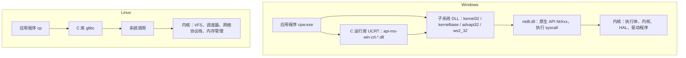

# A.1 Win32 API 概览与 POSIX 对照

主线第 2 章写过一个文件复制程序：`open` 打开源文件，`read` 一页一页读进缓冲区，`write` 写到目标文件，`close` 收尾。把这份程序搬到 Windows 上，`<unistd.h>` 和 `<fcntl.h>` 都不存在，`open` 的返回值也不再是「非负整数是文件描述符，-1 是失败」那么简单。换一组函数名只是第一步。需要弄清的是：Windows 的系统能力以什么形式提供，哪些类型和返回值约定会反复出现，以及主线里学过的每一个 POSIX 概念在 Windows 上对应哪一页。

这一页先给出一张全景图：应用代码下面依次是 C 运行库、子系统 DLL、`ntdll.dll` 和内核，稳定的是中间那层文档化的导出函数。然后写出第一个 Win32 程序，编译运行，用 `objdump` 看清它依赖了哪些 DLL，再逐条讲明白 Win32 的类型名、命名习惯、调用约定和返回值约定。最后一节是一张 POSIX 与 Win32 的对照表，本拓展后面每一页都可以从表里查到位置。本页程序在本机 MinGW-w64 GCC 13.2（UCRT 运行库）与 MSVC 14.51 上编译运行，输出照实粘贴。

## 1. Windows API 在哪一层

Linux 上的程序调用 `read`，进去的是 glibc 提供的包装函数，包装函数把系统调用号放进寄存器，执行 `syscall` 指令，内核按号分派。Windows 的层次多一些，而且每一层的名字都出现在可执行文件里。



图中上半部分是 Windows，下半部分是 Linux。Windows 这一侧自上而下各层的分工如下，Linux 一侧在[第 1 章](/教程/正文/系统编程/1_平台边界_POSIX与系统调用)讲过。

**C 运行库（Universal C Runtime，UCRT）** 提供 `printf`、`malloc`、`fopen` 这些 ISO C 函数，被拆成一组以 `api-ms-win-crt-` 开头的 DLL。Windows 10 起 UCRT 属于操作系统的一部分，以 API 集（API set）的形式随系统提供，不需要随程序分发 `ucrtbase.dll`。

**子系统 DLL（subsystem DLL）** 是 Win32 API 的实现，kernel32 与 kernelbase 提供文件、内存、进程、线程、同步，advapi32 提供注册表、安全与服务，ws2_32 提供 Winsock，user32 与 gdi32 提供窗口和图形。本拓展只讲前面几类，图形界面不在范围内。

**`ntdll.dll`** 实现原生 API（native API），函数名以 `Nt` 开头，例如 `NtCreateFile`、`NtReadFile`。它包含执行 `syscall` 指令的系统服务分发桩。子系统 DLL 调用这些桩，桩切到内核态。

**内核** 是 `ntoskrnl.exe`：执行体（executive）管对象管理、内存管理、I/O 管理、进程与线程，下面的内核（kernel）管调度和中断，HAL 屏蔽硬件差异。

子系统 DLL 与 kernelbase 的关系可以直接在进程里验证。下面这个程序列出这条链上几个模块的真实路径，完整文件在 `code/系统编程/拓展A_Win32系统编程/A_1_Win32API概览与POSIX对照/modules.c`：

```c
static void show(const wchar_t *name) {
    HMODULE m = GetModuleHandleW(name);
    wchar_t path[MAX_PATH];

    if (m == NULL) {
        m = LoadLibraryW(name);
        if (m == NULL) {
            printf("%-36ls not present, error %lu\n", name, GetLastError());
            return;
        }
    }
    DWORD n = GetModuleFileNameW(m, path, MAX_PATH);
    path[n < MAX_PATH ? n : MAX_PATH - 1] = L'\0';
    printf("%-36ls -> %ls\n", name, path);
}
```

::: terminal title="PowerShell - modules"

<span class="prompt">PS&gt;</span> gcc -std=c17 -Wall -Wextra modules.c -o modules.exe

<span class="prompt">PS&gt;</span> ./modules.exe

```text
kernel32.dll                         -> C:\Windows\System32\KERNEL32.DLL
kernelbase.dll                       -> C:\Windows\System32\KERNELBASE.dll
ntdll.dll                            -> C:\Windows\SYSTEM32\ntdll.dll
ucrtbase.dll                         -> C:\Windows\System32\ucrtbase.dll
api-ms-win-crt-stdio-l1-1-0.dll      -> C:\Windows\System32\ucrtbase.dll
api-ms-win-core-file-l1-2-0.dll      -> C:\Windows\System32\KERNELBASE.dll
```

:::

两个 `api-ms-win-*` 名字在 `System32` 下没有同名文件（`dir` 的结果是「File Not Found」），加载器把它们解析到承载实现的 DLL：UCRT 的 API 集落到 `ucrtbase.dll`，内核的 API 集落到 `kernelbase.dll`。这就是 API 集的作用，名字表示一组接口约定，不表示一个文件；实现可以在不同 Windows 版本之间拆分、合并、改名，而引用这些名字的程序照常运行。Microsoft Learn 对 API 集的说明是：它在承载某个 Win32 API 实现的宿主 DLL 与这个 API 所属的功能约定之间提供架构上的分离。

::: concept win-api-stable-interface title="Windows 上稳定的接口"

Windows 承诺保持兼容的是系统 DLL 文档化的导出函数：`CreateFileW`、`ReadFile`、`CreateProcessW` 这些函数在 SDK 头文件里声明，在 Microsoft Learn 上有文档，在后续版本的 Windows 上保持名字、参数和语义。系统调用号、原生 API（`NtXxx`）以及内核里的数据结构都不在此列：系统调用号随内部版本变化，原生 API 大多不公开，内核结构体布局更是每个版本都可能不同。应用程序调用系统 DLL，由系统自己负责把它转成当前版本的内核调用；直接调用 `ntdll.dll` 的导出函数在技术上可行，但不属于受支持的用法。

:::

Windows API 不是任何标准化组织制定的标准。权威定义是 Windows SDK 里的头文件和导入库，加上 Microsoft Learn 的参考页。头文件是编译器实际看到的东西，文档页的头文件、库、DLL 三项在 Requirements 表里，两者不一致时以头文件为准，因为编译和链接用的是它。

<Quiz
  :options="[
    { label: 'ntdll.dll 导出的 NtXxx 函数', value: 'A' },
    { label: '每个 Windows 版本的系统调用号', value: 'B' },
    { label: 'kernel32 等系统 DLL 的文档化导出函数', value: 'C' },
    { label: '内核里的对象结构体布局', value: 'D' }
  ]"
  answer="C"
>

<template #question>

Windows 上微软承诺保持兼容、可以放心依赖的是哪一层？

</template>

正确答案是 **C**。系统 DLL 的导出函数有 SDK 头文件声明、有文档、在后续版本中保持名字和语义。`NtXxx` 原生 API 大多没有公开文档，系统调用号随内部版本变化，内核结构体布局每个版本都可能改；这三样都不构成应用程序可以依赖的接口。

</Quiz>

## 2. 第一个程序：用 Win32 复制文件

`cpw.c` 做的事和主线的复制程序一样：打开源文件，循环读写，关闭。完整文件在 `code/系统编程/拓展A_Win32系统编程/A_1_Win32API概览与POSIX对照/cpw.c`：

```c
#include <stdio.h>
#include <windows.h>

#define BUF_SIZE 65536

int wmain(int argc, wchar_t *argv[]) {
    if (argc != 3) {
        printf("usage: cpw source destination\n");
        return 2;
    }

    HANDLE in = INVALID_HANDLE_VALUE;
    HANDLE out = INVALID_HANDLE_VALUE;
    static char buf[BUF_SIZE];
    unsigned long long total = 0;
    int rc = 1;

    in = CreateFileW(argv[1], GENERIC_READ, FILE_SHARE_READ, NULL, OPEN_EXISTING,
                     FILE_ATTRIBUTE_NORMAL, NULL);
    if (in == INVALID_HANDLE_VALUE) {
        printf("CreateFileW failed: error %lu\n", GetLastError());
        goto cleanup;
    }

    out = CreateFileW(argv[2], GENERIC_WRITE, 0, NULL, CREATE_ALWAYS,
                      FILE_ATTRIBUTE_NORMAL, NULL);
    if (out == INVALID_HANDLE_VALUE) {
        printf("CreateFileW failed: error %lu\n", GetLastError());
        goto cleanup;
    }

    for (;;) {
        DWORD got = 0;
        if (!ReadFile(in, buf, sizeof buf, &got, NULL)) {
            printf("ReadFile failed: error %lu\n", GetLastError());
            goto cleanup;
        }
        if (got == 0) {
            break;
        }
        DWORD put = 0;
        if (!WriteFile(out, buf, got, &put, NULL) || put != got) {
            printf("WriteFile failed: error %lu\n", GetLastError());
            goto cleanup;
        }
        total += got;
    }

    printf("copied %llu bytes\n", total);
    rc = 0;

cleanup:
    if (out != INVALID_HANDLE_VALUE) {
        CloseHandle(out);
    }
    if (in != INVALID_HANDLE_VALUE) {
        CloseHandle(in);
    }
    return rc;
}
```

和主线版本逐项对照，形状几乎一样：

::: compare left-title="POSIX（主线第 2 章）" right-title="Win32"

```c
int in = open(src, O_RDONLY);
if (in == -1) {
    perror("open");
    return 1;
}
int out = open(dst, O_WRONLY | O_CREAT | O_TRUNC, 0644);
if (out == -1) {
    perror("open");
    close(in);
    return 1;
}

for (;;) {
    ssize_t got = read(in, buf, sizeof buf);
    if (got == -1) {
        perror("read");
        close(out);
        close(in);
        return 1;
    }
    if (got == 0) {
        break;
    }
    if (write_all(out, buf, (size_t)got) != 0) {
        close(out);
        close(in);
        return 1;
    }
}

close(out);
close(in);
```

---

```c
HANDLE in = CreateFileW(src, GENERIC_READ, FILE_SHARE_READ,
                        NULL, OPEN_EXISTING,
                        FILE_ATTRIBUTE_NORMAL, NULL);
if (in == INVALID_HANDLE_VALUE) {
    printf("CreateFileW failed: error %lu\n", GetLastError());
    return 1;
}
HANDLE out = CreateFileW(dst, GENERIC_WRITE, 0, NULL, CREATE_ALWAYS,
                         FILE_ATTRIBUTE_NORMAL, NULL);
if (out == INVALID_HANDLE_VALUE) {
    printf("CreateFileW failed: error %lu\n", GetLastError());
    CloseHandle(in);
    return 1;
}

for (;;) {
    DWORD got = 0;
    if (!ReadFile(in, buf, sizeof buf, &got, NULL)) {
        printf("ReadFile failed: error %lu\n", GetLastError());
        CloseHandle(out);
        CloseHandle(in);
        return 1;
    }
    if (got == 0) {
        break;
    }
    DWORD put = 0;
    if (!WriteFile(out, buf, got, &put, NULL) || put != got) {
        CloseHandle(out);
        CloseHandle(in);
        return 1;
    }
}

CloseHandle(out);
CloseHandle(in);
```

:::

粗略看去，两套代码的整体脉络基本一致，但在具体设计细节上体现了四处显著差异：

第一，访问意图与创建处置方式被清晰拆解为独立参数。在 POSIX 中，`O_RDONLY`、`O_CREAT` 与 `O_TRUNC` 混杂在同一个掩码参数中；而在 `CreateFileW` 中，访问模式由 `GENERIC_READ` 或 `GENERIC_WRITE` 明确指示读写意图，创建处置则由独立参数指定——例如 `OPEN_EXISTING` 表示仅打开已存在的文件，而 `CREATE_ALWAYS` 则指示若文件已存在则截断覆写，若不存在则直接创建。

第二，引入了 POSIX 标准所不具备的共享模式（`dwShareMode`）。POSIX 文件打开后，默认其他进程也可以随意打开与读写；而在 Windows 下，打开文件必须显式声明「在当前句柄保持打开的期间，允许外部其他进程执行哪些并发操作」。在示例中，输入文件传递了 `FILE_SHARE_READ`，允许其他程序并发读取该源文件；而输出目标文件则传入了 `0`，表明独占写入，防止在此期间其他进程读取或修改尚未写入完成的半成品文件。

第三，数据传输量的反馈机制不同。POSIX 的 `read` 与 `write` 直接将成功传输的字节数作为有符号返回值（`ssize_t`），并以 `-1` 标识失败；而在 Win32 中，传输字节数统一通过专用的指针输出参数回传（如 `ReadFile` 中的 `&got` 与 `WriteFile` 中的 `&put`），函数的返回值本身只充当纯粹的布尔状态指示器（`BOOL`）。

第四，流末尾判定与循环推进方式存在语义差异。Win32 下的 `ReadFile` 当读取到文件末尾时，API 依然会返回非零表示函数成功执行，只是传出的读入字节数 `got` 会变为 0。因此，文件读完的跳出分支必须放置在基础的 API 失败判定之后，而非将 0 视作出错。至于函数失败的具体表示与状态提取，我们在第 3 节专门展开分析。

`wmain` 和 `wchar_t *argv[]` 是另一个话题：Win32 的 W 版函数接收 UTF-16 字符串，`L"..."` 是宽字符串字面量，为了从命令行原样拿到 Unicode 参数，入口点用 `wmain`，链接时加 `-municode`。不写 `-municode` 时链接器报 `undefined reference to 'WinMain'`，因为 `wmain` 的启动代码在 `libmingw32.a` 里由这个选项引入。字符集的完整讨论在 [A.2](/教程/正文/系统编程/拓展A_Win32系统编程/A_2_字符与文本_ANSI_Unicode与UTF16)。

用 MinGW 编译运行：

::: terminal title="PowerShell - cpw"

<span class="prompt">PS&gt;</span> gcc -std=c17 -Wall -Wextra -municode cpw.c -o cpw.exe

<span class="prompt">PS&gt;</span> ./cpw.exe cpw.c copy.c

copied 1641 bytes

<span class="prompt">PS&gt;</span> fc.exe /b cpw.c copy.c

Comparing files cpw.c and COPY.C

FC: no differences encountered

<span class="prompt">PS&gt;</span> ./cpw.exe no_such.c x.c

CreateFileW failed: error 2

<span class="prompt">PS&gt;</span> \$LASTEXITCODE

1

:::

`fc.exe /b` 是 Windows 上的二进制比较命令，相当于 `cmp`。源文件不存在时错误码是 2，即 `ERROR_FILE_NOT_FOUND`，文字说明是「系统找不到指定的文件。」，格式化错误消息的写法在 [A.5](/教程/正文/系统编程/拓展A_Win32系统编程/A_5_错误处理与结构化异常处理)。

MSVC 用另一条命令编译同一个文件，不需要 `-municode`（它的启动代码本来就认 `wmain`）：

::: terminal title="PowerShell - cl"

<span class="prompt">PS&gt;</span> cmd /c "D:\Software\VS\1\VC\Auxiliary\Build\vcvars64.bat >nul 2>&1 && cl /nologo /W4 /std:c17 /utf-8 cpw.c"

```text
cpw.c
```

<span class="prompt">PS&gt;</span> ./cpw.exe cpw.c copy_msvc.c

copied 1641 bytes

<span class="prompt">PS&gt;</span> fc.exe /b cpw.c copy_msvc.c

Comparing files cpw.c and COPY_MSVC.C

FC: no differences encountered

:::

`/utf-8` 让 cl 按 UTF-8 读源文件。源文件里有中文注释时不加这个选项，cl 会按当前 ANSI 代码页 936 解释字节并报 C4819 警告，程序照常编译，但源码里的非 ASCII 字符可能损坏。本拓展的 MSVC 命令一律带 `/utf-8`。

手工循环读写只适合教学和需要细粒度控制的场合。整文件复制有现成的函数，`copyfile.c` 把上面几十行换成一次调用：

```c
if (!CopyFileW(argv[1], argv[2], FALSE)) {
    printf("CopyFileW failed: error %lu\n", GetLastError());
    return 1;
}
```

第三个参数 `bFailIfExists` 为 `TRUE` 时目标已存在就失败（错误 80，`ERROR_FILE_EXISTS`），为 `FALSE` 时覆盖。`CopyFileW` 还会复制文件属性，源文件是只读的，副本也是只读的。要复制就用它，不要自己写循环；自己写循环的场合是需要在复制过程中处理数据，比如 [A.14](/教程/正文/系统编程/拓展A_Win32系统编程/A_14_异步IO与重叠结构) 的重叠 I/O 版本。

## 3. 读懂 Win32 的写法

### 3.1 类型

Win32 头文件把基本类型重新起了名字。这些名字来自 16 位 Windows 时代，那时 `int` 是 16 位，指针有 near 和 far 之分，所以需要一个与编译器无关的固定宽度命名体系。现在它们的宽度固定下来了，但在 64 位 Windows 上还有一处与 Linux 不同：`long` 是 32 位。

| Win32 类型 | 定义 | 实际宽度 | 对应的 C 类型 |
| --- | --- | --- | --- |
| `BOOL` | `typedef int BOOL` | 4 | `int`，非零为真 |
| `BYTE` | `typedef unsigned char BYTE` | 1 | `unsigned char` |
| `WORD` | `typedef unsigned short WORD` | 2 | `unsigned short` |
| `DWORD` | `typedef unsigned long DWORD` | 4 | `unsigned long`（x64 上也是 4 字节） |
| `LONG` | `typedef long LONG` | 4 | `long` |
| `WCHAR` | `typedef wchar_t WCHAR` | 2 | `wchar_t`（Windows 上是 16 位） |
| `HANDLE` | `typedef PVOID HANDLE`，`PVOID` 是 `void *` | 8 | `void *` |
| `LPVOID` | `typedef void *LPVOID` | 8 | `void *` |
| `SIZE_T` | `typedef ULONG_PTR SIZE_T` | 8 | `size_t` 的宽度，无符号 |
| `LARGE_INTEGER` | 一个 64 位有符号整数的 union | 8 | `long long`，另带 `HighPart`/`LowPart` |
| `LPCWSTR` / `PCWSTR` | `typedef const WCHAR *` | 8 | `const wchar_t *` |
| `LPWSTR` / `PWSTR` | `typedef WCHAR *` | 8 | `wchar_t *` |
| `HRESULT` | `typedef LONG HRESULT` | 4 | 有符号 32 位，最高位表示失败 |

实测值来自 `code/系统编程/拓展A_Win32系统编程/A_1_Win32API概览与POSIX对照/win32types.c`：

::: terminal title="PowerShell - win32types"

<span class="prompt">PS&gt;</span> gcc -std=c17 -Wall -Wextra win32types.c -o win32types.exe

<span class="prompt">PS&gt;</span> ./win32types.exe

```text
BOOL          4
DWORD         4
LONG          4
WCHAR         2
HANDLE        8
SIZE_T        8
LARGE_INTEGER 8
long          4
void *        8
```

:::

`DWORD` 在头文件里是 `unsigned long`，而 `printf` 打印 `unsigned long` 用 `%lu`；这在 x64 上成立，因为 Windows 的 `long` 是 32 位，与 `DWORD` 同宽。`HANDLE` 是 `void *`，用 `%p` 打印并转成 `(void *)`。`LONG`、`LSTATUS` 以及 `winerror.h` 里带 `L` 后缀的 `ERROR_xxx` 常量是 32 位有符号，用 `%ld`。

`SIZE_T` 与 `size_t` 同宽，但打印时不能用 `%zu`。MinGW 的 GCC 按 Microsoft 运行库的规则检查格式串，`%zu` 会触发警告：

::: terminal title="PowerShell - zu"

<span class="prompt">PS&gt;</span> gcc -std=c17 -Wall -Wextra zu.c -o zu.exe

```text
zu.c: In function 'main':
zu.c:6:14: warning: unknown conversion type character 'z' in format [-Wformat=]
    6 |     printf("%zu\n", n);
      |              ^
zu.c:6:12: warning: too many arguments for format [-Wformat-extra-args]
    6 |     printf("%zu\n", n);
      |            ^~~~~~~
```

:::

UCRT 在运行时其实认 `%zu`，单独跑一个不带 `-Wall` 的小程序能正常输出 `value = 42`（实测），但既然要求 `-Wall -Wextra` 无警告，本拓展统一把 `size_t` 转换成 `unsigned long long` 后用 `%llu`。加上 `-D__USE_MINGW_ANSI_STDIO=1` 也能让警告消失，那是让 MinGW 用自己的一套格式化实现代替 UCRT 的，代价是行为与 MSVC 编译出的程序不一致，本拓展不用。

::: tip MinGW 下打印 size_t

`size_t` 转 `unsigned long long` 用 `%llu`，`DWORD` 用 `%lu`，`LONG` 用 `%ld`，`HANDLE` 用 `%p` 并转 `(void *)`。这几个搭配在 MinGW 与 MSVC 下都不报警告。

:::

### 3.2 命名

函数名是动词开头的大驼峰：`CreateFileW`、`ReadFile`、`CloseHandle`、`GetLastError`。参数名带一个匈牙利前缀，表示类型和用途，读文档时认得就行，自己写代码不必模仿：

| 前缀 | 含义 | 例子 |
| --- | --- | --- |
| `h` | 句柄 | `hObject`、`hFile` |
| `lp` | 长指针（32 位时代的遗留） | `lpFileName`、`lpBuffer` |
| `dw` | `DWORD` | `dwDesiredAccess`、`dwShareMode` |
| `b` | `BOOL` | `bFailIfExists`、`bInheritHandles` |
| `sz` | 以空字符结尾的字符串 | `szFileName` |
| `c` | 计数 | `cchWideChar` |
| `p` / `psz` | 指针 | `pMessage` |

很多函数有成对的 A 版和 W 版，`CreateFileA` 收 `char *`，`CreateFileW` 收 `wchar_t *`。不带后缀的 `CreateFile` 是宏，由 `UNICODE` 宏决定展开成哪个。实测：不定义 `UNICODE` 时，`CreateFile(L"nofile.txt", ...)` 被展开成 `CreateFileA`，GCC 报 `passing argument 1 of 'CreateFileA' from incompatible pointer type`；MSVC 报 C4133，提示从 `unsigned short [11]` 到 `LPCSTR` 的类型不兼容。加上 `-DUNICODE` 后编译干净。本拓展一律显式调用 W 版，不用宏，也不用为兼容两套字符串设计的 `TCHAR`。

### 3.3 WINAPI 与调用约定

函数声明里常看到 `WINAPI`：

```c
HANDLE WINAPI CreateFileW(LPCWSTR lpFileName, DWORD dwDesiredAccess, ...);
```

`WINAPI` 在头文件里是 `#define WINAPI __stdcall`，表示调用约定：参数从右往左压栈，由被调用方清理栈。这只在 x86 上有意义；x64 只有一种调用约定（前四个参数放寄存器，调用方清理栈），`__stdcall` 被忽略。实测在 x64 的 MSVC 下 `int __stdcall f(int)` 编译无警告，GCC 同样接受。写回调函数时要带上 `WINAPI`（或同义的 `CALLBACK`），因为在 x86 上漏掉它会导致栈不平衡，程序在回调返回时崩溃；x64 上漏掉不影响运行，但代码仍应照写，保持可移植。

### 3.4 返回值

Win32 的返回值约定按函数类型分成几套，混淆它们是最常见的错误来源。

**返回 `BOOL` 的函数**：非零表示成功，零表示失败。`TRUE` 定义为 1，但成功时的返回值不保证等于 1。判断失败写 `if (!ok)`，不要写 `if (ok != TRUE)`。文档里这句提醒出现在很多地方，最典型的是 `GetMessageW`：它成功时返回非零、收到 `WM_QUIT` 时返回 0、出错时返回 -1，所以不能写 `while (GetMessage(...))`，文档专门给出反面例子。实测其他 `BOOL` 函数成功时都返回 1（`FlushFileBuffers`、`WriteFile`、`SetFileAttributesW`、`CreateProcessW` 等），但这不是约定，别依赖。

**返回句柄的函数**：失败值因函数而异。`CreateFileW`、`FindFirstFileW`、`CreateNamedPipeW` 失败返回 `INVALID_HANDLE_VALUE`，即 `(HANDLE)-1`；`CreateEventW`、`OpenEventW`、`CreateMutexW`、`CreateThread` 失败返回 `NULL`。这个不一致源于 16 位 Windows 的兼容性。判断前先查文档的 Return value 一节，不要凭印象。实测：

::: terminal title="PowerShell - failcheck"

<span class="prompt">PS&gt;</span> gcc -std=c17 -Wall -Wextra failcheck.c -o failcheck.exe

<span class="prompt">PS&gt;</span> ./failcheck.exe

```text
CreateFileW   -> FFFFFFFFFFFFFFFF
INVALID_HANDLE_VALUE = FFFFFFFFFFFFFFFF
OpenEventW    -> 0000000000000000, error 2
FindFirstFileW -> FFFFFFFFFFFFFFFF
GetFileAttributesW(".") -> 16
GetFileAttributesW("no_such") -> 4294967295
```

:::

把 `CreateFileW` 的返回值拿去和 `NULL` 比较，失败时会通过检查，后面所有操作作用在一个无效句柄上，`ReadFile` 返回 `FALSE`、错误 6（`ERROR_INVALID_HANDLE`）。这类错误不会崩，只是让错误定位多绕几层。

注意最后两行：`GetFileAttributesW` 的返回类型是 `DWORD`，别把它当 `BOOL` 用，成功时返回属性位（目录是 16，即 `FILE_ATTRIBUTE_DIRECTORY`），失败返回 `INVALID_FILE_ATTRIBUTES`（`0xFFFFFFFF`）。`0xFFFFFFFF` 非零，拿它当 `BOOL` 判断会把失败当成成功。

**返回 `HRESULT` 的函数**：最高位为 1 表示失败，用 `SUCCEEDED(hr)`/`FAILED(hr)` 宏判断，不要写 `hr == S_OK`。成功码不止 `S_OK` 一个，`S_FALSE` 也是成功，用 `== S_OK` 判断会把这类调用误判为失败。

**错误码**：函数失败后调用 `GetLastError()`。这个值是每线程一份的「最后错误码」，任何一次 API 调用都可能改写它，失败后要立刻存进局部对象，中间不要插入别的调用。[A.5](/教程/正文/系统编程/拓展A_Win32系统编程/A_5_错误处理与结构化异常处理) 给出了保存与格式化错误消息的完整做法。

<Quiz
  :options="[
    { label: 'if (!ok)', value: 'A' },
    { label: 'if (ok != TRUE)', value: 'B' },
    { label: 'if (ok &lt; 0)', value: 'C' },
    { label: 'if (ok == -1)', value: 'D' }
  ]"
  answer="A"
>

<template #question>

`BOOL ok = WriteFile(...);` 之后，判断这次调用是否失败，正确的写法是哪个？

</template>

正确答案是 **A**。`BOOL` 非零即真，成功的返回值在文档里只保证「非零」，不保证等于 `TRUE`（1）。`ok != TRUE` 会把返回 2 或别的非零值的成功调用误判为失败；`ok < 0` 和 `ok == -1` 在返回值是正数时碰巧能过，但语义上把 `BOOL` 当成了有符号错误码。

</Quiz>

## 4. 头文件、宏与库

### 4.1 windows.h

Win32 程序只包含一个头文件 `<windows.h>`，它把几百个头文件串起来：`windef.h`（类型与宏）、`winbase.h`（文件、进程、同步的声明）、`winnt.h`（底层类型）、`winerror.h`（错误码常量），以及 user32、gdi32 等子系统的头文件。一个 `#include <windows.h>` 编译起来要读十几万行声明，这是 Windows 编译慢的主要原因之一。

`WIN32_LEAN_AND_MEAN` 让 `<windows.h>` 少包含一批不常用的头文件，包括加密（CryptoAPI）、DDE、RPC、Shell 的一部分，以及 Winsock 1.1 的 `<winsock.h>`。最后一个最关键：`<winsock.h>` 与 `<winsock2.h>` 定义了大量同名但不同内容的类型和常量，两者同时进入一个翻译单元会出重定义错误。实测在 MSVC 下先包含 `<windows.h>` 再包含 `<winsock2.h>`：

```text
warning C4005: “AF_IPX”: 宏重定义
...
error C2011: “sockaddr”:“struct”类型重定义
error C2059: 语法错误:“常数”
```

MinGW 下同样的顺序只报一条警告（`#warning Please include winsock2.h before windows.h`），编译能通过；头文件自己都要求这个顺序，照做就是。套接字程序的标准写法是：

```c
#define WIN32_LEAN_AND_MEAN
#include <winsock2.h>
#include <ws2tcpip.h>
#include <windows.h>
```

`WIN32_LEAN_AND_MEAN` 放在最前面，`<winsock2.h>` 在 `<windows.h>` 之前。Winsock 的细节在 [A.13](/教程/正文/系统编程/拓展A_Win32系统编程/A_13_Winsock特有主题)。

### 4.2 版本宏

头文件里有些函数声明被条件编译包着，只有定义了足够高的目标版本宏才可见。两个宏配合使用：`_WIN32_WINNT` 表示最低支持的 Windows 版本（`0x0601` 是 Windows 7，`0x0A00` 是 Windows 10），`NTDDI_VERSION` 表示最低支持的发行版（`0x0A000006` 是 Windows 10 1809）。

实测：MinGW 头文件默认把 `_WIN32_WINNT` 定为 `0x0601`（Windows 7），MSVC 14.51 的默认值是 `0x0A00`（Windows 10），所以同一个源文件在两套工具链下能看到的函数不完全一样。用 `CreatePseudoConsole` 举例，它的参数类型 `HPCON` 只在目标版本不低于 1809 时声明：

::: terminal title="PowerShell - HPCON"

<span class="prompt">PS&gt;</span> gcc -std=c17 -Wall -Wextra winver3.c -o winver3.exe

```text
winver3.c: In function 'main':
winver3.c:6:5: error: unknown type name 'HPCON'; did you mean 'HICON'?
    6 |     HPCON pc = NULL;
      |     ^~~~~
```

<span class="prompt">PS&gt;</span> gcc -std=c17 -Wall -Wextra -D_WIN32_WINNT=0x0A00 -DNTDDI_VERSION=0x0A000006 winver3.c -o winver3.exe

<span class="prompt">PS&gt;</span> ./winver3.exe

```text
_WIN32_WINNT = 0x0A00
HPCON size = 8
```

:::

宏的取值决定程序能在哪些系统上跑：定得越高，能用的 API 越多，能运行的最低系统版本也越高。本拓展以 Windows 10 1809 及以后的 x64 系统为基线，只有用到较新特性的页面才在命令行给出这两个宏。伪控制台那一页（[A.17](/教程/正文/系统编程/拓展A_Win32系统编程/A_17_控制台与ConPTY)）就要加它们。

### 4.3 链接哪些库

MinGW 的 GCC 默认链接 `kernel32`、`user32`、`advapi32`、`shell32` 和 `pthread`；`gcc -v` 打印的链接命令行里有 `-lkernel32 -lpthread -ladvapi32 -lshell32 -luser32`。所以调用注册表、安全、服务和 user32 的函数不需要额外选项。实测：一个同时调用 `MessageBoxW`、`RegOpenKeyExW`、`ShellExecuteW` 的程序不加任何 `-l` 就能链接。gdi32 不在默认列表里：调用 `CreateSolidBrush` 不写 `-lgdi32` 时报 `undefined reference to '__imp_CreateSolidBrush'`。ole32 也不在，`CoTaskMemFree` 同样要 `-lole32`。

不在默认列表里的库按需写在命令行末尾：Winsock 是 `-lws2_32`，ole32 是 `-lole32`（用 `FOLDERID_*` 时还要 `-luuid`），dbghelp 是 `-ldbghelp`，`WaitOnAddress` 在 `-lsynchronization` 里。漏掉时的报错形如（一个只调用 `WSAStartup` 与 `WSACleanup` 的小程序，命令行没写 `-lws2_32`）：

```text
ld.exe: ...nolib.c:(.text+0x24): undefined reference to `__imp_WSAStartup'
ld.exe: ...nolib.c:(.text+0x4a): undefined reference to `__imp_WSACleanup'
```

`__imp_` 前缀表示调用被编成了对导入地址表的间接跳转，链接器找不到这一项。看到它就去查对应的库。

MSVC 没有这样一份默认清单。不加库参数时，实测只调用 kernel32 函数的程序能链接，调用 `MessageBoxW` 报 `LNK2019: 无法解析的外部符号 __imp_MessageBoxW`，调用 `RegOpenKeyExW` 报 `__imp_RegOpenKeyExW`，`ShellExecuteW`、`CoTaskMemFree`、`CreateSolidBrush` 也都要各自给出库。MSVC 的惯例是写 `#pragma comment(lib, "user32.lib")`，让编译器把库名写进对象文件的 `/DEFAULTLIB` 指令；Windows SDK 的头文件里就有这样的指令（`uuid.lib` 是一例）。

本拓展两头都不用，库一律写在命令行。`#pragma comment` 在 GCC 下不生效，一个写了 `#pragma comment(lib, "user32.lib")` 的程序在 `-Wall` 下报一句：

```text
pragma.c:5: warning: ignoring '#pragma comment ' [-Wunknown-pragmas]
```

同一份源码若写成 `#pragma`，在 GCC 下仍要在命令行给库，在 MSVC 下库名又散落在源码里，两边的构建命令对不上。命令行写清楚更省事：

```text
gcc -std=c17 -Wall -Wextra 程序.c -o 程序.exe -luser32
cl /nologo /W4 /std:c17 /utf-8 程序.c user32.lib
```

### 4.4 CRT 与 POSIX 名字

UCRT 里保留了 `_open`、`_read`、`_write`、`_close` 这一套函数和对应的描述符语义。MinGW 的头文件还提供不带下划线的 `open`、`read`、`close` 作为别名，MSVC 则只认带下划线的名字并给出弃用警告：

```text
warning C4996: 'close': The POSIX name for this item is deprecated. Instead,
use the ISO C and C++ conformant name: _close.
```

这套函数只覆盖文件描述符语义的一小部分：没有 `fork`、没有 `poll`、没有信号，`O_NONBLOCK` 连定义都没有（实测 MinGW 的 `<fcntl.h>` 里查不到这个宏）。用它来「让 POSIX 代码在 Windows 上编译通过」会把程序限制在一个很小的交集里，遇到文件锁、异步 I/O、管道就无路可走。第 7 节还会回到这个问题。

## 5. 程序依赖了哪些 DLL

`cpw.exe` 是 MinGW 编译的，用 `objdump -p` 看导入表：

::: terminal title="PowerShell - objdump"

<span class="prompt">PS&gt;</span> objdump -p cpw.exe | findstr /c:"DLL Name:"

```text
	DLL Name: KERNEL32.dll
	DLL Name: api-ms-win-crt-environment-l1-1-0.dll
	DLL Name: api-ms-win-crt-heap-l1-1-0.dll
	DLL Name: api-ms-win-crt-math-l1-1-0.dll
	DLL Name: api-ms-win-crt-private-l1-1-0.dll
	DLL Name: api-ms-win-crt-runtime-l1-1-0.dll
	DLL Name: api-ms-win-crt-stdio-l1-1-0.dll
	DLL Name: api-ms-win-crt-string-l1-1-0.dll
	DLL Name: api-ms-win-crt-time-l1-1-0.dll
```

:::

程序只用了 `CreateFileW`、`ReadFile`、`WriteFile`、`CloseHandle`、`GetLastError` 五个 Win32 函数，它们都在 `KERNEL32.dll` 里；`printf` 来自 C 运行库；`wmain` 的启动代码和格式化输出把 UCRT 的一组模块带了进来。八个 `api-ms-win-crt-*` 名字在磁盘上也都没有对应文件，加载器把它们全部解析到 `ucrtbase.dll`（第 1 节的 `modules.exe` 已经演示过）。UCRT 从 Windows 10 起随系统提供，所以这份 exe 拷到任何一台 Windows 10 或 11 上都能直接运行，不用附带 DLL。

`-lws2_32` 这类库如果写了但程序没用到，导入表里不会多出 `WS2_32.dll`，链接器只把被引用的导入项留在里面。实测给 `win32types.c` 加 `-lws2_32` 编译，导入表与不加时完全一样。

MSVC 的对应工具是 `dumpbin`。同一份源码用 `/MD`（动态链接 CRT）编译，导入表里多出 `VCRUNTIME140.dll`：

::: terminal title="PowerShell - dumpbin"

<span class="prompt">PS&gt;</span> cmd /c "D:\Software\VS\1\VC\Auxiliary\Build\vcvars64.bat >nul 2>&1 && cl /nologo /W4 /std:c17 /utf-8 /MD cpw.c /Fecpw_md.exe"

```text
cpw.c
```

<span class="prompt">PS&gt;</span> cmd /c "D:\Software\VS\1\VC\Auxiliary\Build\vcvars64.bat >nul 2>&1 && dumpbin /nologo /imports cpw_md.exe"

```text
    KERNEL32.dll
    VCRUNTIME140.dll
    api-ms-win-crt-stdio-l1-1-0.dll
    api-ms-win-crt-runtime-l1-1-0.dll
    api-ms-win-crt-math-l1-1-0.dll
    api-ms-win-crt-locale-l1-1-0.dll
    api-ms-win-crt-heap-l1-1-0.dll
```

:::

`VCRUNTIME140.dll` 不随系统提供，目标机器要装 Visual C++ 运行库（或程序自带）。加 `/MT` 静态链接 CRT 后，导入表里只剩 `KERNEL32.dll`，代价是 exe 从 10240 字节涨到 135680 字节。这是 MSVC 的运行时库选择，与 Win32 API 本身无关，但部署时要知道。

::: tip Sysinternals 的 Process Explorer 与 Process Monitor

这两个工具相当于 Windows 上的 `lsof` 和 `strace`。Process Explorer 的模块视图列出某个进程加载的所有 DLL 及其路径，句柄视图按类型列出该进程持有的全部句柄；Process Monitor 实时记录文件、注册表、网络、进程活动的每一次调用，带结果码和调用栈。调试「文件被谁占用」「程序在找哪个 DLL」这类问题时，它们比在代码里加打印快得多。下载地址：<https://learn.microsoft.com/en-us/sysinternals/>。

:::

## 6. POSIX 与 Win32 对照

主线各章讲过的 POSIX 能力，在 Windows 上分别由什么承担，见下表。第三列是本拓展里讲它的页面。

| 主题 | POSIX 与主线章节 | Win32 与本拓展页 |
| --- | --- | --- |
| 文件 I/O | `open`/`read`/`write`/`close`，[第 2 章](/教程/正文/系统编程/2_文件描述符与非缓冲IO) | `CreateFileW`/`ReadFile`/`WriteFile`/`CloseHandle`，A.1、A.4 |
| 描述符与句柄 | 文件描述符是小整数，进程表索引 | 句柄是 `void *`，进程句柄表索引，A.3 |
| 错误码 | `errno`，`perror`/`strerror` | `GetLastError` 加 `FormatMessageW`，A.5 |
| 非法访问 | `SIGSEGV`，退出码 139 | 结构化异常 `0xC0000005`，进程退出码 -1073741819，A.5 |
| 内存映射 | `mmap`/`munmap`，[第 4 章](/教程/正文/系统编程/4_虚拟内存与内存映射) | 文件映射对象加视图，A.6 |
| 动态库 | `dlopen`/`dlsym`/`dlclose`，`.so` | `LoadLibraryW`/`GetProcAddress`/`FreeLibrary`，`.dll`，A.7 |
| 创建进程 | `fork` 加 `exec`，[第 5 章](/教程/正文/系统编程/5_进程的创建_执行与回收) | `CreateProcessW` 一步完成，A.8 |
| 回收子进程 | `waitpid`，僵尸进程加 `SIGCHLD` | `WaitForSingleObject` 加 `GetExitCodeProcess`，A.8 |
| 进程组 | `setpgid`/`kill(-pgid)` | 控制台进程组加 `GenerateConsoleCtrlEvent`，A.17 |
| 信号 | `sigaction`/`kill`，[第 6 章](/教程/正文/系统编程/6_信号_时间与定时器) | 没有统一机制：控制台事件 A.17、事件对象 A.10、APC A.10 |
| 定时器 | `timerfd`、`setitimer`、`nanosleep` | 可等待计时器 A.10，`Sleep` |
| 线程 | `pthread_create`，[第 8 章](/教程/正文/系统编程/8_操作系统线程与同步) | `CreateThread`/`_beginthreadex`，A.9 |
| 线程私有数据 | `pthread_key_create`、`_Thread_local` | TLS 与 FLS，A.9 |
| 互斥与条件 | `pthread_mutex_t`、`pthread_cond_t` | SRW 锁、临界区对象、条件量，A.11 |
| 信号量 | `sem_t` | 信号量对象，A.10 |
| 等待多个对象 | `poll`/`epoll`，[第 11 章](/教程/正文/系统编程/11_非阻塞IO与IO多路复用) | `WaitForMultipleObjects`，上限 64，A.10 |
| 管道 | `pipe`、FIFO，[第 7 章](/教程/正文/系统编程/7_进程间通信) | 匿名管道、命名管道，A.12 |
| 共享内存 | `shm_open` 加 `mmap` | 命名文件映射对象，A.6 |
| 套接字 | BSD 套接字，[第 10 章](/教程/正文/系统编程/10_套接字编程) | Winsock，A.13 |
| 异步 I/O 模型 | 就绪模型：`poll` 报告可读可写 | 完成模型：重叠 I/O 加完成端口，A.14、A.15 |
| 权限 | uid/gid 与 mode 位，[第 3 章](/教程/正文/系统编程/3_文件系统_目录与权限) | 访问令牌与 DACL，A.16 |
| 终端 | termios 与伪终端，[第 13 章](/教程/正文/系统编程/13_终端_伪终端与作业控制) | 控制台模式、虚拟终端序列、ConPTY，A.17 |
| 守护进程、配置、日志 | `daemon`、`/etc`、syslog | 服务、注册表、事件日志，A.18 |

在上述系统级对照中，有三处深层的架构分歧尤为值得深思：

**其一，无 `fork` 机制。** POSIX 体系中创建新进程习惯于两步走范式：先调用 `fork` 完整复制当前调用者的地址空间、文件描述符表以及信号屏蔽掩码，随后在子进程上下文内调整环境，再通过 `exec` 族函数彻底替换进程映像。而在 Windows 体系中，操作系统自始至终未提供这种完整克隆进程空间的机制，而是直接提供 `CreateProcessW`：调用方必须显式传入目标可执行文件路径、完整的命令行参数、环境块以及启动配置结构，内核直接为该程序分配崭新的虚拟地址空间并初始化主线程。在实际行为上，`CreateProcessW` 与现代 POSIX 的 `posix_spawn` 具有更高的相似度。这一设计带来的工程影响深远：在 UNIX 下惯常依靠 `fork` 在父子进程间隐式继承配置与文件描述符、并在子进程 `exec` 前完成重定向的写法，在 Windows 下必须转为显式配置——所有句柄重定向必须提前写入 `STARTUPINFOW` 结构体并在生成进程时一并交由内核处理。关于进程生成的详细控制逻辑，我们在 A.8 与 A.12 会细致推演。

**其二，内核对象的统一可等待性。** POSIX 传统上将多路等待的范畴高度收束在文件描述符上，`poll` 与 `epoll` 监视的核心是文件或套接字的读写就绪事件；后续为了将定时器触发、信号送达乃至子进程退出纳入这套监视框架，Linux 陆续引入了 `timerfd`、`signalfd` 与 `pidfd` 等机制将其打包装入描述符表中。Windows 的设计哲学则从相反方向切入：无论是进程、线程、控制台输入、事件、互斥体、信号量还是可等待计时器，在内核中均被抽象为标准的「内核对象」，并在内部统一维护「有信号（Signaled）」与「无信号（Nonsignaled）」的状态位。调度器提供的 `WaitForSingleObject` 与 `WaitForMultipleObjects` 原生支持直接等待上述任意内核对象，或者等待多类对象的任意交集。这种高度统一的等待抽象极大简化了跨类事件聚合，但内核对象在创建、句柄索引、访问控制和上下文切换上均伴随不可忽视的系统开销；因此在仅涉及同一进程内部的高性能同步场景下，系统另行演化出了纯用户态的互锁与轻量同步原语（见 A.11）。

**其三，异步 I/O 的完成通知模型。** POSIX 经典的 `poll` 与 `epoll` 本质上属于「状态就绪通知（Readiness Model）」：系统负责告知应用程序某个通道何时可以无阻塞地进行 I/O，而真正将内核缓冲区数据拷贝到用户缓冲区的动作，依然必须由用户线程主动调用 `read` 来同步完成。Windows 的重叠 I/O（Overlapped I/O）则走向了彻底的「操作完成通知（Proactor / Completion Model）」：在发起 `ReadFile` 之初，应用程序就将承载数据的用户态缓冲区地址与预定操作偏移量直接递交给内核驱动，随后函数立即返回，由 I/O 子系统在后台完成实际的物理读写与内存拷贝。直到整批数据已完好写入缓冲区之后，内核才通过事件句柄、异步例程回调或 I/O 完成端口（IOCP）通知调用方「读取已毕，可直接消费」。这两种模型在服务器架构设计上引出了完全不同的思维路径：完成模型免去了为每个并发连接维护半读状态机的琐碎心智负担，但要求传入的每一个数据缓冲区和 `OVERLAPPED` 元数据在内核完成通知送达之前必须保持绝对稳定，不得提前释放或移作他用。Linux 后来演进出的 `io_uring` 亦吸收了此类完成模型的设计精髓。

<Quiz
  type="multi"
  :options="[
    { label: 'read ↔ ReadFile', value: 'A' },
    { label: 'fork ↔ CreateProcessW', value: 'B' },
    { label: 'mmap ↔ MapViewOfFile', value: 'C' },
    { label: 'errno ↔ GetLastError', value: 'D' }
  ]"
  :answer="['A', 'C', 'D']"
>

<template #question>

下列 POSIX 与 Win32 的对应中，哪些成立？

</template>

正确答案是 **A、C、D**。`fork` 与 `CreateProcessW` 的对应不成立：`fork` 复制父进程的地址空间和打开的描述符，`CreateProcessW` 从可执行文件建一个全新进程，它对应的是 `fork` 加 `exec` 两步合起来的效果，更接近 `posix_spawn`。`errno` 与 `GetLastError` 的对应成立，但取值来源不同：Win32 错误码是 `DWORD`，与 `errno` 的编号体系无关。

</Quiz>

::: generate win32-posix-differences kind=comparison concepts=win-api-stable-interface

面向已经熟悉 POSIX 的读者，解释上面三点差异在写实际程序时的影响：没有 fork 之后，哪些以前靠 fork 继承状态完成的初始化要改成显式传递；所有内核对象可等待，对「一个线程等多种事件」的程序结构有什么简化，又在什么场合反而更贵；完成模型与就绪模型在缓冲区管理、错误处理和线程模型上的不同要求。不要逐条念对照表，讲清楚取舍就行。

:::

## 7. 该用哪一层

Windows 上写程序，可选的层次不止一个，选错了会在后面付出代价。

**可移植的逻辑用标准 C。** 字符串处理、数据结构、文件内容的解析、格式化输出，这些用 ISO C 写，两边都能编译。本教程第一部分和第二部分讲的全部内容在这里都适用。

**需要系统能力时直接调用 Win32。** 打开文件、创建进程、同步线程、建套接字，用本拓展讲的接口。它们是系统能力的原生形式，文档完整，行为在版本之间稳定。

**不要用 CRT 的 `_open`/`_read` 一类函数模拟 POSIX。** 这套接口在 Windows 上只提供最小的描述符语义，`O_NONBLOCK` 不完全支持，没有 `poll`，没有 `fork`，没有 Unix 域套接字。用它写出来的程序在 Linux 上能编译，在 Windows 上会在某个具体功能上卡住，然后还是要回到 Win32。需要跨平台的代码用跨平台库（libuv、SDL、Boost.Asio 之类），那些库在 Windows 上内部调用的正是本拓展讲的接口——比如 libuv 的 Windows 后端就是 I/O 完成端口。

**MSYS2 和 Cygwin 是兼容层。** 它们提供一个 POSIX 运行时，把 `fork`、信号、`/dev`、符号链接这些概念模拟出来。代价是程序依赖这一层运行时（msys-2.0.dll 或 cygwin1.dll），并且 `fork` 在 Windows 上只能靠复制整个进程状态来模拟，慢得多，与原生程序交互也有各种缝隙。用它们编译命令行工具很方便，写要分发的 Windows 程序不合适。

**WSL 是真 Linux。** 在 Windows 里跑一个 Linux 内核，主线的内容在那里原样成立。那是 Linux 编程，解决的是另一类问题。

本拓展只讲原生 Win32：系统 DLL 的文档化接口，配合 MinGW 或 MSVC 编译。这条路上的程序不依赖额外的运行时层，分发给任何一台 Windows 10 及以上系统的机器都能直接跑。

## 8. 习题

### 8.1 巩固

<Exercise id="45101" :d="1" :w="1">

本页的 `failcheck.c` 打印了几个函数的失败值和两个属性值。不看代码，先写下你的预测，再运行对照：

1. `CreateFileW` 打开不存在的文件返回什么？
2. `OpenEventW` 打开不存在的事件返回什么？
3. `GetFileAttributesW` 查询不存在的文件返回什么？

然后回答：如果把 `CreateFileW` 的返回值拿去和 `NULL` 比较，会发生什么？写一个十行的小程序验证：用 `if (h == NULL)` 判断打开不存在的文件，然后调用 `ReadFile`，打印它的返回值和 `GetLastError()`。

</Exercise>

<Exercise id="45102" :d="2" :w="1">

下面的程序在两个编译器下表现不同，说明原因并给出修改。

```c
#include <windows.h>
#include <winsock2.h>

int main(void) {
    WSADATA wsa;
    WSAStartup(MAKEWORD(2, 2), &wsa);
    WSACleanup();
    return 0;
}
```

要求：

1. 用 MSVC 的 `cl /W4` 编译，把报错原文抄下来；
2. 改成正确顺序并加上 `WIN32_LEAN_AND_MEAN`，链接时给出 `ws2_32`（MinGW 写 `-lws2_32`，MSVC 在命令行写 `ws2_32.lib`），确认两个编译器都干净通过；
3. 一句话说明 `WIN32_LEAN_AND_MEAN` 在这里排除了什么，再写一个 `#ifdef _WINSOCKAPI_` 检查自己验证这个结论。

</Exercise>

<Exercise id="45103" :d="2" :w="1">

`win32types.c` 打印了九个宽度。补上 `WPARAM`、`LPARAM`、`LRESULT`、`LSTATUS`、`HRESULT`、`DWORD_PTR` 六个类型，预测宽度后再运行验证。其中有几个类型在 x86 和 x64 上宽度不同？分别写出两个平台上的值（x86 的答案可以查 Microsoft Learn 的 Windows Data Types 页）。

</Exercise>

<Exercise id="45104" :d="3" :w="2">

本页的 `winver3.c` 要用 `-D_WIN32_WINNT=0x0A00 -DNTDDI_VERSION=0x0A000006` 才能编译（源文件在 `code/系统编程/拓展A_Win32系统编程/A_1_Win32API概览与POSIX对照/winver3.c`）。写一个程序，不定义这两个宏，打印出当前工具链的默认值：

1. 打印 `_WIN32_WINNT` 和 `WINVER` 的数值（用 `#ifdef` 判断是否定义）；
2. 用 `#if _WIN32_WINNT >= 0x0A00` 条件编译一段只在目标版本不低于 Windows 10 时出现的代码，输出一行提示；
3. 分别在 MinGW 默认、MinGW 加 `-D_WIN32_WINNT=0x0A00`、MSVC 默认三种情况下编译运行，把三组输出抄下来，解释 MSVC 与 MinGW 默认值的差别来自哪里。

</Exercise>

### 8.2 编程

<Exercise id="45105" :d="3" :w="2">

写一个 `catw.c`：像 `cat` 一样，把命令行给出的每个文件内容原样写到标准输出。要求：

1. 用 `wmain` 接收参数，`CreateFileW` 打开文件，`ReadFile`/`WriteFile` 循环，不经过 stdio 的文件层；
2. 一个文件打不开时向标准错误打印文件名和 `GetLastError()` 的数字，继续处理下一个文件，最后返回非零；
3. 缓冲区用 64 KiB 的静态数组，不用 `malloc`；
4. 验收：`cmd /c "catw.exe cpw.c > out.txt"` 之后 `fc.exe /b cpw.c out.txt` 显示无差异；`./catw.exe no_such.c cpw.c` 先报错误 2 再输出内容，退出码为 1。

</Exercise>

<Exercise id="45106" :d="3" :w="3">

写一个 `cpw2.c`，在 `cpw.c` 的基础上加三个功能：

1. 支持 `-f` 选项，不带 `-f` 时目标文件已存在就失败（用 `CREATE_NEW`），带上时覆盖（用 `CREATE_ALWAYS`）；
2. 复制结束后用 `GetFileSizeEx` 分别取源文件和目标文件的大小，打印两个数值，两者不等时返回 1；
3. 读写循环里 `WriteFile` 的返回值既要检查 `BOOL`，也要检查实际写出的字节数是否等于 `got`，不等时按错误处理。

验收：

- `./cpw2.exe cpw.c out.txt` 输出的三个数值都等于 `(Get-Item cpw.c).Length`（本页的 `cpw.c` 是 1641 字节），退出码 0；
- 再运行一次，输出 `open destination: error 80`，退出码 1；
- 加上 `-f` 再运行，成功；
- 用一个 10000 字节的文件测试，结果三个数值都是 10000。

</Exercise>

<Exercise id="45107" :d="4" :w="3">

下面这段复制程序有几处缺陷。它只读一次、不检查返回值、用 `NULL` 判断 `CreateFileW`：

```c
#include <stdio.h>
#include <windows.h>

int wmain(int argc, wchar_t *argv[]) {
    if (argc != 3) {
        return 2;
    }

    HANDLE in = CreateFileW(argv[1], GENERIC_READ, 0, NULL, OPEN_EXISTING, 0, NULL);
    if (in == NULL) {
        printf("open source failed: %lu\n", GetLastError());
        return 1;
    }

    char buf[4096];
    DWORD got = 0;
    ReadFile(in, buf, sizeof buf, &got, NULL);

    HANDLE out = CreateFileW(argv[2], GENERIC_WRITE, 0, NULL, CREATE_ALWAYS, 0, NULL);
    DWORD put = 0;
    WriteFile(out, buf, got, &put, NULL);

    printf("copied %lu bytes\n", (unsigned long)got);
    return 0;
}
```

要求：

1. 先不改，用一个 10000 字节的文本文件运行，记录它报告复制的字节数和目标文件的实际大小（实测分别是 4096 和 4096）；再用一个不存在的源文件运行，记录输出和退出码（实测输出 `copied 0 bytes`，退出码 0）；
2. 逐条指出缺陷，每条说明「在这个输入下导致什么现象」，至少找到三处；
3. 修好它，使复制任意大小的文件结果都正确，并且源文件不存在时返回非零退出码；
4. 最后用本页的 `fc.exe /b` 验证修复后的副本与原文件二进制一致。

</Exercise>

<Exercise id="45108" :d="5" :w="4">

写一个 `where.c`，在一个进程里回答「这些模块从哪来」：

1. 对 `kernel32.dll`、`kernelbase.dll`、`ntdll.dll`、`ucrtbase.dll` 以及任意两个 `api-ms-win-*` 名字，打印 `GetModuleHandleW` 得到的地址和 `GetModuleFileNameW` 得到的路径；
2. 再打印每个模块里一个代表性导出函数的地址（`GetProcAddress` 加 `%p`）：kernel32 的 `CreateFileW`、kernelbase 的 `CreateFileW`、ntdll 的 `NtCreateFile`；
3. 从输出回答：`kernel32.dll` 的 `CreateFileW` 与 `kernelbase.dll` 的同名函数地址相同吗？如果不同，`kernel32` 的那个地址上是什么内容（把前 6 个字节按十六进制打印出来，第一个字节是 `0xFF` 时说明什么）？
4. 把程序分别用 MinGW 和 MSVC 编译，对比两者对 `api-ms-win-*` 名字的解析结果是否一致。

提示：`objdump -p C:\Windows\System32\KERNEL32.DLL` 的 `Forwarder RVA` 一栏能印证你的结论。

</Exercise>

### 8.3 综合与挑战

<Exercise id="45109" :d="6" :w="4" scope="*">

把本页第 6 节的对照表做成一个可查询、可自检的小工具：

1. 写一个 `portmap.c`，内嵌一张至少 12 行的表（主题、POSIX 接口名、Win32 接口名、本拓展页码），支持 `./portmap.exe read` 这样按主题或按任一接口名查询，输出匹配的行；
2. 对每个 Win32 接口，用 `GetProcAddress` 在对应的系统 DLL 里查它是否导出，输出「已导出/未找到」；DLL 名与函数名都要能在表里查到；
3. 用本页出现过的至少 8 个 Win32 函数和 8 个 POSIX 函数填表，缺的接口从 [A.2](/教程/正文/系统编程/拓展A_Win32系统编程/A_2_字符与文本_ANSI_Unicode与UTF16) 到 [A.18](/教程/正文/系统编程/拓展A_Win32系统编程/A_18_Windows服务_注册表与系统设施) 的标题里找；
4. 验收：对表里每个 Win32 接口，`GetProcAddress` 的结果都不是 `NULL`；对故意写错的名字，结果为 `NULL` 且 `GetLastError()` 为 127。

这个练习的目标是让对照表变成能自己核对的事实，不再靠背下来的对应关系。

</Exercise>

## 9. 参考资料

- Microsoft Learn，Windows API index：<https://learn.microsoft.com/en-us/windows/win32/apiindex/windows-api-list>
- Microsoft Learn，API Index（Win32 与 Windows API 的定位）：<https://learn.microsoft.com/en-us/windows/win32/apiindex/api-index-portal>
- Microsoft Learn，Windows API sets（API 集与宿主 DLL 的分离）：<https://learn.microsoft.com/en-us/windows/win32/apiindex/windows-apisets>
- Microsoft Learn，User Mode and Kernel Mode（用户态、内核态与进程的句柄表）：<https://learn.microsoft.com/en-us/windows-hardware/drivers/gettingstarted/user-mode-and-kernel-mode>
- Microsoft Learn，Windows Data Types：<https://learn.microsoft.com/en-us/windows/win32/winprog/windows-data-types>
- Microsoft Learn，Using the Windows Headers（`WIN32_LEAN_AND_MEAN`、`_WIN32_WINNT`、`NTDDI_VERSION`）：<https://learn.microsoft.com/en-us/windows/win32/winprog/using-the-windows-headers>
- Microsoft Learn，CreateFileW：<https://learn.microsoft.com/en-us/windows/win32/api/fileapi/nf-fileapi-createfilew>
- Microsoft Learn，CopyFileW：<https://learn.microsoft.com/en-us/windows/win32/api/winbase/nf-winbase-copyfilew>
- Microsoft Learn，GetMessageW（返回值不能当 BOOL 用的例子）：<https://learn.microsoft.com/en-us/windows/win32/api/winuser/nf-winuser-getmessagew>
- Microsoft Learn，Universal CRT deployment（UCRT 随系统提供与 API 集转发 DLL）：<https://learn.microsoft.com/en-us/cpp/windows/universal-crt-deployment>
- Microsoft Learn，Sysinternals：<https://learn.microsoft.com/en-us/sysinternals/>
- MinGW-w64 项目主页：<https://www.mingw-w64.org/>
- Johnson M. Hart，**_Windows System Programming_**，第 4 版，第 1 章「Getting Started with Win32」与附录 B「Windows and UNIX」的对照，Addison-Wesley，ISBN 978-0-321-65774-9
- Pavel Yosifovich 等，**_Windows Internals_**，第 7 版 Part 1，第 2 章「System Architecture」，Microsoft Press，ISBN 978-0-7356-8378-8
