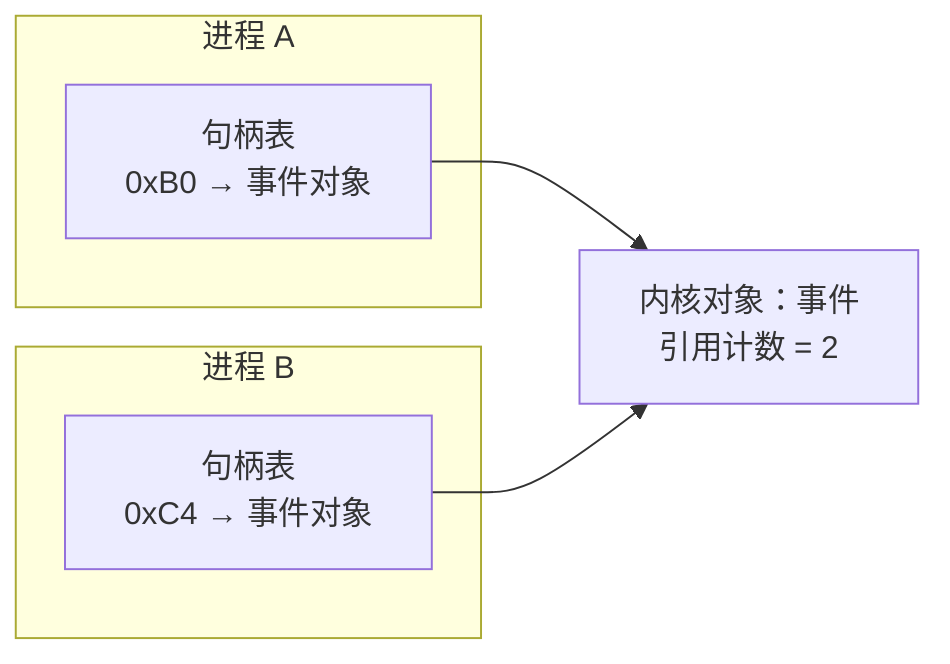

# A.3 内核对象与句柄

在日常系统开发中，我们常会遇到两类看似并不相干的典型场景：其一是客户端程序在二次启动时，需要敏锐察觉到已有实例正在运行，从而将焦点移交给旧进程并自我退出；其二是一个长期驻留的后台服务在处理客户端请求时频繁创建事件，却因异常分支遗漏了关闭操作，数天后任务管理器中的句柄占用一路飙升至上万，直至后续所有创建调用因配额耗尽而崩溃。这两类工程问题的底层机理，均指向 Windows 资源管理的核心中枢——句柄与内核对象。

在 Windows 架构中，应用程序绝不能直接解引用内核资源的内存指针，一切系统交互都必须借由不透明的句柄这一间接凭据完成。理解句柄表的工作机理、内核对象的引用计数法则、不同 API 在调用失败时的哨兵返回值约定，是编写稳定系统级软件的前提。在此基础上，我们将进一步推演利用命名对象实现应用程序单实例互斥的机制、跨进程安全共享对象的各条路径，以及定位并彻底修复句柄泄漏的诊断方法。

这一页用到的事件、互斥量只作为例子出现，它们各自的语义在 [A.10](/教程/正文/系统编程/拓展A_Win32系统编程/A_10_同步原语_等待函数与内核对象) 里讲；文件对象在 [A.4](/教程/正文/系统编程/拓展A_Win32系统编程/A_4_文件与目录操作) 里讲。句柄的读写权限最终由安全描述符决定，那是 [A.16](/教程/正文/系统编程/拓展A_Win32系统编程/A_16_安全与访问控制_ACL与令牌) 的内容。

## 1. 内核对象

进程、线程、文件、事件、互斥量、信号量、可等待计时器、文件映射、管道、作业、访问令牌、I/O 完成端口，这些在 Windows 上都叫内核对象（kernel object）。它们由内核里的对象管理器（object manager）统一创建和维护，用户态程序看不到对象的内存布局，只能拿到一个句柄（handle），把句柄交给 API 来间接操作对象。创建或打开对象的函数以 `Create`、`Open` 开头，返回值的类型是 `HANDLE`。

对象内部有一个引用计数（reference count）。每打开一个句柄加一，每关闭一个减一；计数归零，并且内核里没有别的地方还引用这个对象时，对象才被销毁。这就是为什么下面这段代码是合法的：父进程关掉了自己的句柄，子进程手里的那一份仍然让对象活着。

::: concept win-handle-credential title="句柄与对象的关系"

句柄是当前进程访问某个内核对象的凭据。对象和它的内存都在内核里，程序手里只有一个编号，要经过 API 才能碰到对象。对象的生存期由引用计数决定：只要还有一个句柄指着它，对象就存在；最后一个句柄关闭之后，对象销毁，名字随之消失。句柄的值来自当前进程的句柄表，换一个进程就没有意义，也不能在两个进程之间换算。

:::

窗口（`HWND`）和 GDI 对象（`HPEN`、`HBRUSH`）不是内核对象，它们归窗口管理器管理；[A.11](/教程/正文/系统编程/拓展A_Win32系统编程/A_11_同步原语_临界区_SRWLock与条件变量) 的临界区对象和 SRW 锁也不是，它们连句柄都没有，只是一块用户态内存。判断的依据是它是否出现在 Microsoft Learn 的 Kernel Objects 表里、是否由 `Create`/`Open` 系列函数返回一个 `HANDLE`；名字像不像不作数。



两个进程的句柄表各自有一项指向同一个对象，两个句柄的值可以相同，也可以不同，互相之间没有换算关系。

## 2. 句柄

句柄是一个不透明的值，在 64 位 Windows 上占 8 字节，类型声明成 `void *`，内容是当前进程句柄表里的表项编号。本机打印出来的值总是 4 的倍数，相邻两次分配相差 4；这是句柄表的编码方式，属于实现细节，程序不该依赖它，也不该拿句柄值做大小比较或加减运算。句柄表项里记着两样程序能感知的东西：打开对象时请求的访问权限，以及这个句柄能否被子进程继承。

`handles.c` 创建三个事件，打印它们的值和进程的句柄数，最后拿一个私有堆的返回值做对照：

```c
static DWORD handle_count(void) {
    DWORD n = 0;

    if (!GetProcessHandleCount(GetCurrentProcess(), &n)) {
        printf("GetProcessHandleCount failed: %lu\n", GetLastError());
    }
    return n;
}

int main(void) {
    HANDLE events[3];
    DWORD flags = 0;
    BOOL known;
    int i;

    printf("handle count before: %lu\n", handle_count());
    for (i = 0; i < 3; i++) {
        events[i] = CreateEventW(NULL, FALSE, FALSE, NULL);
        printf("event[%d] = %p, value %% 4 = %llu\n", i, (void *)events[i],
               (unsigned long long)((uintptr_t)events[i] % 4));
    }
    printf("handle count with three events open: %lu\n", handle_count());
    CloseHandle(events[0]);
    events[0] = CreateEventW(NULL, FALSE, FALSE, NULL);
    printf("after closing event[0], a new event gets %p\n", (void *)events[0]);
    for (i = 0; i < 3; i++) {
        CloseHandle(events[i]);
        events[i] = NULL;
    }
    printf("handle count after closing all: %lu\n", handle_count());

    /* 私有堆的返回值类型也叫 HANDLE，但它不在进程的句柄表里 */
    HANDLE heap = HeapCreate(0, 0, 0);
    SetLastError(0);
    known = GetHandleInformation(heap, &flags);
    printf("heap %p: GetHandleInformation -> %d, error %lu, count %lu\n", (void *)heap, known,
           GetLastError(), handle_count());
    printf("CloseHandle(heap) -> %d, error %lu\n", CloseHandle(heap), GetLastError());
    HeapDestroy(heap);
}
```

完整文件在 `code/系统编程/拓展A_Win32系统编程/A_3_内核对象与句柄/handles.c`。在 PowerShell 里编译运行：

::: terminal title="PowerShell - handles"

```text
PS> gcc -std=c17 -Wall -Wextra handles.c -o handles.exe
PS> .\handles.exe
handle count before: 50
event[0] = 00000000000000AC, value % 4 = 0
event[1] = 00000000000000B0, value % 4 = 0
event[2] = 00000000000000B4, value % 4 = 0
handle count with three events open: 53
after closing event[0], a new event gets 00000000000000AC
handle count after closing all: 50
heap 000001A0BE520000: GetHandleInformation -> 0, error 6, count 50
CloseHandle(heap) -> 0, error 6
```

:::

三件事能从这段输出里读出来。句柄值每次加 4；关掉 `event[0]` 之后再创建一个事件，新句柄拿到的还是 `0xAC`，说明空出来的表项会被复用；句柄数从 50 涨到 53，三个句柄关闭之后又回到 50。前面那个数取决于进程启动时已经打开了多少东西，每次运行可能不同，这里和下面的输出都只是本机一次运行的记录。

最后两行是反例：`HeapCreate` 的返回类型也是 `HANDLE`，私有堆却不在进程的句柄表里。拿它去问 `GetHandleInformation` 得到失败和错误 6，拿它去 `CloseHandle` 同样失败，释放私有堆要用 `HeapDestroy`。[A.6](/教程/正文/系统编程/拓展A_Win32系统编程/A_6_内存管理与内存映射文件) 讲堆。类型名叫 `HANDLE` 不代表它一定是个句柄，这一点要靠每个函数的文档确认。

`GetProcessHandleCount` 数的是句柄表里有多少项，可以用来在程序内部自检。它也能查别的进程，只要拿到带 `PROCESS_QUERY_LIMITED_INFORMATION` 权限的进程句柄。

同一个对象可以同时有多个句柄。`two_handles.c` 先创建再按名字打开同一个事件，然后关掉第一个：

::: terminal title="PowerShell - two_handles"

```text
PS> gcc -std=c17 -Wall -Wextra two_handles.c -o two_handles.exe
PS> .\two_handles.exe
first = 00000000000000B4, second = 00000000000000B8, same value = 0
first closed, SetEvent through second = 1
after both handles are closed, OpenEventW -> 0000000000000000, error 2
```

:::

两个句柄的值不同，指向同一个对象。关掉 `first` 之后，通过 `second` 仍然能置位这个事件；两个都关掉，名字也就没了，再按名字打开得到 `NULL`、错误 2（`ERROR_FILE_NOT_FOUND`）。

<Quiz
  type="single"
  :options="[
    { label: '指向进程 A 里的同一个对象', value: 'A' },
    { label: '在进程 B 里没有意义，或者指向 B 自己的另一个对象', value: 'B' },
    { label: '系统会自动复制一份过去', value: 'C' },
    { label: '系统拒绝把这个数值传给 B', value: 'D' }
  ]"
  answer="B"
>

<template #question>

进程 A 里值为 `0xCC` 的句柄，被当作一个整数传给进程 B，B 直接把它交给 `WaitForSingleObject`。结果是？

</template>

正确答案是 **B**。句柄是进程句柄表里的表项编号，只在拥有它的进程里有意义。B 里同号的表项属于 B 自己，可能指向一个完全不同的对象，也可能根本不存在（本机实测为失败、错误 6）。要跨进程使用，只能靠按名字打开、继承或 `DuplicateHandle`。

</Quiz>

每个句柄各自带着自己的访问权限，这一条在按名字打开时最明显。`rights.c` 围绕同一个事件开了几个权限不同的句柄：

::: terminal title="PowerShell - rights"

```text
PS> gcc -std=c17 -Wall -Wextra rights.c -o rights.exe
PS> .\rights.exe
EVENT_MODIFY_STATE handle 00000000000000B8: SetEvent -> 1, wait -> 4294967295, error 5
SYNCHRONIZE handle        00000000000000BC: wait -> 0, SetEvent -> 0, error 5
DuplicateHandle with access 0 -> 00000000000000BC: SetEvent -> 0, error 5
DuplicateHandle with DUPLICATE_SAME_ACCESS -> 00000000000000BC: SetEvent -> 1
```

:::

第一行的句柄能 `SetEvent`，拿来等待则失败、错误 5；第二行的 `SYNCHRONIZE` 句柄正好相反，等待立刻成功（事件此时已被置位），`SetEvent` 失败。第三行用 `DuplicateHandle` 复制时把期望权限写成 0，得到的句柄什么也做不了；第四行用 `DUPLICATE_SAME_ACCESS` 照抄源句柄的权限，`SetEvent` 就成功了。权限在打开对象的那一刻就记进了表项，之后每次使用都按这份权限检查，同一个对象因此可以同时存在几份能力不同的句柄。

若将 Windows 句柄与 POSIX 环境下的文件描述符作横向对照，可以发现二者均扮演了「进程内部相对引用」的角色：文件描述符是进程文件描述符表的整数下标，句柄则是进程内核句柄表的条目索引，脱离了所属进程上下文均毫无意义，无法直接跨进程当做裸值使用。但在具体生命周期管理上，二者存在关键分野：POSIX 描述符严格遵循分配「最小可用整数」的确定性规则，开发者可以预判编号分配轨迹；而 Windows 句柄值通常按 4 的倍数跳跃，系统内部倾向于优先复用刚刚释放的表项槽位。更为重要的是，POSIX 资源几乎统一使用 `close()` 收尾，而 Windows 针对不同子系统分配了专属的资源释放 API：常规内核对象调用 `CloseHandle`，目录枚举句柄须使用 `FindClose`，注册表句柄需调用 `RegCloseKey`，网络套接字则必须走 `closesocket`。倘若混用甚至误调，往往不会当场报错，却会在底层留下极其隐蔽的系统状态错乱。

`CloseHandle` 关注册表项句柄就是这样一个例子。文档要求注册表项用 `RegCloseKey` 关闭，`CloseHandle` 不会正确关闭它，也不回错误；本机实测，`CloseHandle` 返回 1，看上去成功，随后 `RegQueryInfoKeyW` 失败、错误 6，再调 `RegCloseKey` 也失败、错误 6，句柄已经不可用。「不报错」不等于「做对了」。同理，用 `CloseHandle` 关 `FindFirstFileW` 返回的句柄，在调试器下会直接抛异常。

## 3. 失败时的返回值

`HANDLE` 是一个指针类型，失败时没有统一的空值。有的函数返回 `NULL`，有的返回 `INVALID_HANDLE_VALUE`（即 `(HANDLE)-1`），两者都是合法的 `HANDLE` 值，编译器和运行库都不会替程序分辨。

`fail_values.c` 把几种常见函数的失败结果放在一起：

::: terminal title="PowerShell - fail_values"

```text
PS> gcc -std=c17 -Wall -Wextra fail_values.c -o fail_values.exe
PS> .\fail_values.exe
CreateFileW (missing file)   -> FFFFFFFFFFFFFFFF, error 2
OpenEventW (missing event)   -> 0000000000000000, error 2
CreateEventW (bad name)      -> 0000000000000000, error 3
FindFirstFileW (missing dir) -> FFFFFFFFFFFFFFFF, error 3
CreateNamedPipeW (bad name)  -> FFFFFFFFFFFFFFFF, error 123
CreateEventW (success)       -> 00000000000000B0, last error 0
INVALID_HANDLE_VALUE as an integer: -1
INVALID_HANDLE_VALUE == GetCurrentProcess(): 1
ReadFile on it = 0, error 6
WaitForSingleObject on it with a 200 ms timeout -> 258
```

:::

`CreateFileW`、`FindFirstFileW`、`CreateNamedPipeW` 失败返回 `INVALID_HANDLE_VALUE`；`CreateEventW`、`CreateMutexW`、`CreateSemaphoreW`、`OpenEventW`、`OpenMutexW`、`CreateThread` 失败返回 `NULL`。这种不统一有历史原因：16 位 Windows 的 `OpenFile`、`_lopen`、`_lcreat` 失败时返回 -1，32 位的 `CreateFile` 为了便于移植沿用 `-1`；`CreateThread`、`CreateMutex` 在 16 位 Windows 上没有对应物，就用了 `NULL`；再往后的新接口两派都有，只能逐个查文档。

::: compare left-title="按 NULL 判断 CreateFileW 失败" right-title="按 INVALID_HANDLE_VALUE 判断"

```c
HANDLE h = CreateFileW(path, GENERIC_READ, FILE_SHARE_READ,
                       NULL, OPEN_EXISTING, 0, NULL);
if (h == NULL) {          /* 永远不会成立 */
    printf("CreateFileW failed\n");
    return 1;
}
/* 打开失败时 h 是 INVALID_HANDLE_VALUE，下面的 ReadFile 报错误 6 */
```

---

```c
HANDLE h = CreateFileW(path, GENERIC_READ, FILE_SHARE_READ,
                       NULL, OPEN_EXISTING, 0, NULL);
if (h == INVALID_HANDLE_VALUE) {
    printf("CreateFileW failed: %lu\n", GetLastError());
    return 1;
}
```

:::

写错的那一版里，`h` 是 `(HANDLE)-1`，既不等于 `NULL`，也不会让判断成立，程序带着一个失败值继续往下跑。更麻烦的是 `(HANDLE)-1` 恰好等于 `GetCurrentProcess()` 的返回值。把失败值交给 `WaitForSingleObject`，等的是当前进程自己，而进程对象只有在自己结束后才有信号，所以这个等待会一直挂到超时，返回值是 `WAIT_TIMEOUT`，看起来和正常等一个没被置位的事件一模一样。实测就是上一条输出里的最后一行：200 毫秒之后返回 258。

::: warning 每次查文档的 Return value 一节

不要凭印象判断某个函数失败返回 `NULL` 还是 `INVALID_HANDLE_VALUE`，也不要在项目里写「句柄判空的统一宏」。函数文档的 Return value 一节写得很明确，按它写，一次就对。

:::

<Quiz
  type="single"
  :options="[
    { label: 'CreateEventW', value: 'A' },
    { label: 'CreateFileW', value: 'B' },
    { label: 'OpenEventW', value: 'C' },
    { label: 'CreateThread', value: 'D' }
  ]"
  answer="B"
>

<template #question>

下面哪个函数失败时返回 `INVALID_HANDLE_VALUE`？

</template>

正确答案是 **B**。`CreateFileW`、`CreateNamedPipeW`、`FindFirstFileW` 这一类返回 `INVALID_HANDLE_VALUE`；`CreateEventW`、`OpenEventW`、`CreateThread` 失败返回 `NULL`。判断之前先看文档。

</Quiz>

## 4. 伪句柄与 DuplicateHandle

`GetCurrentProcess()` 和 `GetCurrentThread()` 返回的是伪句柄（pseudo handle）。本机实测，前者的值是 `FFFFFFFFFFFFFFFF`，后者是 `FFFFFFFFFFFFFFFE`，分别是 -1 和 -2。伪句柄只是一个约定值，在任何接受进程句柄或线程句柄的地方都表示「当前进程」或「当前线程」，只在调用它的进程里有意义，传给别的进程毫无用处。

伪句柄不需要关闭，`CloseHandle` 对它们没有效果。`pseudo_dup.c` 验证了这一点，并演示怎样用 `DuplicateHandle` 换到一个普通的句柄：

::: terminal title="PowerShell - pseudo_dup"

```text
PS> gcc -std=c17 -Wall -Wextra pseudo_dup.c -o pseudo_dup.exe
PS> .\pseudo_dup.exe
GetCurrentProcess() = FFFFFFFFFFFFFFFF
GetCurrentThread()  = FFFFFFFFFFFFFFFE
CloseHandle(pseudo process) = 1
CloseHandle(pseudo thread)  = 1
handle count before 50, after closing the pseudo handles 50
after DuplicateHandle: 00000000000000B4, count 51
GetProcessId(real) = 26940, GetCurrentProcessId() = 26940
```

:::

两次 `CloseHandle` 都返回 1，句柄数没变，说明表里根本没有被删掉的项。`DuplicateHandle` 把伪句柄换成普通的进程句柄，句柄数从 50 变成 51，`GetProcessId` 读出来和 `GetCurrentProcessId` 一致。这个真句柄可以用来等自己、改自己的优先级，或者继承给子进程；用完之后必须关闭。

`DuplicateHandle` 的完整形态有七个参数，把伪句柄变成真句柄只是其中一种用法：

```c
BOOL DuplicateHandle(HANDLE hSourceProcess, HANDLE hSource,
                     HANDLE hTargetProcess, LPHANDLE phTarget,
                     DWORD dwAccess, BOOL bInherit, DWORD dwOptions);
```

它可以把源进程句柄表里的一项复制到目标进程的句柄表里，新句柄带什么权限由 `dwAccess` 指定，`DUPLICATE_SAME_ACCESS` 表示照抄原来的。复制要求调用者对源进程和目标进程都有 `PROCESS_DUP_HANDLE` 权限。同一个对象因此可以有多份权限不同的句柄，这正是第 2 节 `rights.c` 里「访问 0」那份句柄的由来。

## 5. 命名对象与单实例

`CreateEventW`、`CreateMutexW`、`CreateSemaphoreW`、`CreateWaitableTimerW`、`CreateFileMappingW`、`CreateJobObjectW` 都可以给对象起名字。名字在整个会话（session）的命名空间里唯一，另一个进程用同一个名字调用对应的 `Create` 或 `Open`，拿到的是同一个对象。名字比较区分大小写。

`named_objects.c` 把几条规则一次跑完：

::: terminal title="PowerShell - named_objects"

```text
PS> gcc -std=c17 -Wall -Wextra named_objects.c -o named_objects.exe
PS> .\named_objects.exe
first  CreateMutexW -> 00000000000000AC, last error 0
second CreateMutexW -> 00000000000000B0, last error 183 (ERROR_ALREADY_EXISTS = 183)
CreateEventW with the mutex's name -> 0000000000000000, error 6 (ERROR_INVALID_HANDLE = 6)
a name differing in case -> 00000000000000B4, error 0
after all handles are closed, CreateMutexW -> 00000000000000B4, last error 0
```

:::

第一次创建互斥量，最后错误码是 0；第二次用同样的名字创建，函数**成功**返回一个指向已有对象的新句柄，同时把最后错误码设成 183（`ERROR_ALREADY_EXISTS`）。这是少数成功也设置错误码的函数（[A.5](/教程/正文/系统编程/拓展A_Win32系统编程/A_5_错误处理与结构化异常处理) 还会再提到这一类函数），判断「我是第一个还是第二个」就靠它，判断成败还是要看返回值。名字已经被占用、但类型不对时，`CreateEventW` 失败、错误 6（`ERROR_INVALID_HANDLE`）：事件、互斥量、信号量、计时器、文件映射、作业共用同一个命名空间，名字在这一层是全局的，类型是对象自己的属性。大小写不同的名字被当成另一个对象，创建成功。最后，所有句柄关闭之后对象消失，再创建又是全新的。

单实例判断就建立在这条规则上。`single_instance.c` 在启动时创建一个命名互斥量：

```c
HANDLE mutex = CreateMutexW(NULL, FALSE, INSTANCE_NAME);
if (mutex == NULL) {
    printf("CreateMutexW failed: %lu\n", GetLastError());
    return 2;
}

if (GetLastError() == ERROR_ALREADY_EXISTS) {
    printf("another instance is running, this one exits (pid %lu)\n", GetCurrentProcessId());
    CloseHandle(mutex);
    return 1;
}
```

名字用 `Local\MdrTutorial.SingleInstance`。在 PowerShell 里先后启动两次：

::: terminal title="PowerShell - single_instance"

```text
PS> gcc -std=c17 -Wall -Wextra single_instance.c -o single_instance.exe
PS> $p = Start-Process -FilePath .\single_instance.exe -ArgumentList 4 -PassThru -RedirectStandardOutput first.out
PS> Start-Sleep -Milliseconds 900
PS> .\single_instance.exe 0
another instance is running, this one exits (pid 10708)
PS> 'second instance exit code: ' + $LASTEXITCODE
second instance exit code: 1
PS> $p.WaitForExit()
PS> Get-Content first.out
running as the only instance (pid 20040) for 4 s
the only instance exits
```

:::

第一个实例持有互斥量 4 秒，第二个实例启动后立刻发现 `ERROR_ALREADY_EXISTS`，以退出码 1 结束。这里只创建、不等待，互斥量的「有信号」状态与单实例判断无关，用的是它的名字和生存期。互斥量对象本身的语义（等待、拥有、被遗弃）在 [A.10](/教程/正文/系统编程/拓展A_Win32系统编程/A_10_同步原语_等待函数与内核对象) 第 4 节。

名字前面的 `Local\` 和 `Global\` 是两个不同的命名空间。`Local\` 是当前登录会话的，同一台机器上另一个用户会话里的同名对象互不影响；`Global\` 是整个系统的，服务与所有会话共享。服务程序默认使用全局命名空间，普通程序默认使用会话命名空间。`Session\` 前缀保留给系统，程序不该使用。

::: details 抢先创建同名对象与私有命名空间

命名对象的创建遵循「先到先得」。如果某个进程在程序启动之前就创建了同名对象，程序拿到的会是一个别人控制的互斥量或事件；更糟的情况是对手创建一个拒绝访问的对象，程序此后每次启动都失败。这也是不要用一个固定的、容易被猜到的全局名字做安全相关判断的原因。

对安全敏感的程序可以把对象放进私有命名空间（private namespace）：用 `CreateBoundaryDescriptorW` 加 `AddSIDToBoundaryDescriptor` 描述一个边界，再调用 `CreatePrivateNamespaceW`。只有边界内的进程才能创建或打开这个命名空间里的对象。`private_ns.c` 演示了做法：

```text
boundary descriptor: 1, error 0
CreatePrivateNamespaceW -> 00000000000000D4, last error 0
CreateMutexW inside the namespace -> 00000000000000D8, last error 0
OpenMutexW on the same text outside -> 0000000000000000, error 3
```

命名空间里的对象名写成 `命名空间名\对象名`，从外面按 `Local\命名空间名\对象名` 打开会失败、错误 3（`ERROR_PATH_NOT_FOUND`）。私有命名空间的生命期跟着创建者的命名空间句柄走，进程结束时自动关闭。

:::

<Quiz
  type="single"
  :options="[
    { label: '创建失败，183 是错误码', value: 'A' },
    { label: '打开了一个已经存在的同名互斥量', value: 'B' },
    { label: '名字非法', value: 'C' },
    { label: '权限不足', value: 'D' }
  ]"
  answer="B"
>

<template #question>

`CreateMutexW(NULL, FALSE, L"Local\\X")` 返回非 `NULL`，而 `GetLastError()` 等于 183。这表示什么？

</template>

正确答案是 **B**。183 是 `ERROR_ALREADY_EXISTS`，函数本身成功，只是返回的句柄指向已有的同名对象。单实例判断用的正是这一点。

</Quiz>

## 6. 在进程间共享对象

把一个对象交给另一个进程有三条路：按名字打开、让子进程继承、用 `DuplicateHandle` 复制进去。

按名字打开最简单，上一节已经用过：一边 `Create`，另一边 `Open` 或同样 `Create`。它要求两边事先约定名字，也不要求两个进程有亲缘关系。

继承要求两个条件同时成立：创建句柄时 `SECURITY_ATTRIBUTES` 的 `bInheritHandle` 为 `TRUE`，创建子进程时 `bInheritHandles` 参数也为 `TRUE`。两个条件缺一个，子进程就拿不到这个句柄。`inherit_parent.c` 与 `inherit_child.c` 把三种组合各跑一遍：

::: terminal title="PowerShell - inherit_parent"

```text
PS> gcc -std=c17 -Wall -Wextra inherit_child.c -o inherit_child.exe
PS> gcc -std=c17 -Wall -Wextra inherit_parent.c -o inherit_parent.exe
PS> .\inherit_parent.exe
parent: inheritable event = 00000000000001B4, plain event = 00000000000001B8
bInheritHandles = FALSE:
child: handle 00000000000001B4, SetEvent -> 0, error 6
bInheritHandles = TRUE:
child: handle 00000000000001B4, SetEvent -> 1, error 0
bInheritHandles = TRUE, but created without bInheritHandle:
child: handle 00000000000001B8, SetEvent -> 0, error 6
```

:::

第一组 `bInheritHandles = FALSE`，子进程拿到的数值虽然是同一个，`SetEvent` 却失败、错误 6，说明它的句柄表里没有这一项，数值只是一个孤立的整数。第二组两个条件都满足，`SetEvent` 成功。第三组 `bInheritHandles = TRUE`，但事件创建时没给 `bInheritHandle`，同样失败。子进程打印出来的数值和父进程传给它的那个完全一样（前两组是 `0x1B4`，第三组是 `0x1B8`），继承保留句柄值本身，这也是子进程能从命令行参数里读到它的原因。实际程序通常用命令行、环境块或管道把这个数值告诉子进程，完整的做法在 [A.8](/教程/正文/系统编程/拓展A_Win32系统编程/A_8_进程的创建_执行与等待) 与 [A.12](/教程/正文/系统编程/拓展A_Win32系统编程/A_12_管道与进程间通信)。

继承还有一个容易忽略的性质：子进程拿到的是一份新的引用。`ref_parent.c` 在自己关闭句柄之后，用名字去打开同一个事件：

::: terminal title="PowerShell - ref_parent"

```text
PS> gcc -std=c17 -Wall -Wextra ref_child.c -o ref_child.exe
PS> gcc -std=c17 -Wall -Wextra ref_parent.c -o ref_parent.exe
PS> .\ref_parent.exe
parent: closed its own handle
child: inherited handle 00000000000000B0, usable = 1, flags = 0x1
child: handle closed, exiting
parent: OpenEventW by name while the child holds one -> 00000000000000B0, error 0
parent: OpenEventW by name after the child exited -> 0000000000000000, error 2
```

:::

父进程关闭自己的句柄之后，子进程还持有一份，对象没有销毁，父进程随即还能按名字把它打开；子进程退出、句柄关闭，名字才真正消失。引用计数按句柄计数，进程本身不参与。

第三条路是 `DuplicateHandle`，它不要求两个进程有亲缘关系，只要求调用者打开目标进程时拿到 `PROCESS_DUP_HANDLE` 权限。`dup_parent.c` 把自己的事件句柄复制进子进程：

::: terminal title="PowerShell - dup_parent"

```text
PS> gcc -std=c17 -Wall -Wextra dup_child.c -o dup_child.exe
PS> gcc -std=c17 -Wall -Wextra dup_parent.c -o dup_parent.exe
PS> .\dup_parent.exe
parent pid 20848, event handle 00000000000000AC
child: got a local handle 00000000000000BC for the parent's 00000000000000AC, SetEvent -> 1
parent: event is signaled by the child
```

:::

子进程先从命令行读到父进程 ID 和句柄值，`OpenProcess(PROCESS_DUP_HANDLE, ...)` 打开父进程，再把那一项复制到自己的句柄表，得到的新句柄值是 `0xBC`，和父进程的 `0xAC` 不同。复制之后子进程置位事件，父进程这边观察到事件变成有信号。

::: concept win-handle-inheritance-default title="继承的默认值"

POSIX 的文件描述符默认跨 `fork` 与 `exec` 继承，不想让子进程拿到的描述符要显式设置 `FD_CLOEXEC`。Windows 的内核对象句柄默认不继承，要继承必须同时满足两个条件：创建句柄时声明可继承，创建子进程时允许继承。没有「全局关闭继承」的开关，只有这两处逐次声明。

:::

<Quiz
  type="single"
  :options="[
    { label: 'POSIX 的文件描述符', value: 'A' },
    { label: 'Windows 的内核对象句柄', value: 'B' },
    { label: '两者都会', value: 'C' },
    { label: '两者都不会', value: 'D' }
  ]"
  answer="A"
>

<template #question>

默认情况下，子进程会继承哪一类引用？

</template>

正确答案是 **A**。POSIX 的描述符默认继承，除非设置了 `FD_CLOEXEC`；Windows 的句柄默认不继承，必须同时满足「句柄可继承」和「创建子进程时允许继承」两个条件。

</Quiz>

## 7. 句柄泄漏与排查

句柄泄漏的现象和内存泄漏一样：程序运行得越久，占用的资源越多，最后某个创建函数开始失败。区别在于句柄数有明确的上限，Windows 规定每个进程最多 2^24 个，实际能开到多少还受内存限制，所以泄漏通常在几天之内就会暴露。

`leak.c` 模拟一个每处理一个请求就漏一个事件的服务器：

```c
static void handle_request(int n, int fix) {
    HANDLE done = CreateEventW(NULL, FALSE, FALSE, NULL);
    if (done == NULL) {
        printf("CreateEventW failed: %lu\n", GetLastError());
        return;
    }
    (void)n;
    if (fix) {
        CloseHandle(done);
    }
}

int main(int argc, char *argv[]) {
    int fix = argc > 1 && strcmp(argv[1], "fix") == 0;
    DWORD base = handle_count();
    int i;

    printf("mode: %s, start: %lu handles\n",
           fix ? "CloseHandle every request" : "never close", base);
    for (i = 1; i <= REQUESTS; i++) {
        handle_request(i, fix);
        if (i % 2500 == 0) {
            printf("after %d requests: +%lu\n", i, handle_count() - base);
        }
    }
    printf("end: +%lu handles\n", handle_count() - base);
    return 0;
}
```

同一份代码跑两次，第二次带上 `fix` 参数，每轮都关闭：

::: terminal title="PowerShell - leak"

```text
PS> gcc -std=c17 -Wall -Wextra leak.c -o leak.exe
PS> .\leak.exe
mode: never close, start: 50 handles
after 2500 requests: +2500
after 5000 requests: +5000
after 7500 requests: +7500
after 10000 requests: +10000
end: +10000 handles
PS> .\leak.exe fix
mode: CloseHandle every request, start: 51 handles
after 2500 requests: +0
after 5000 requests: +0
after 7500 requests: +0
after 10000 requests: +0
end: +0 handles
```

:::

不关闭的那一版，一万个请求之后净增一万个句柄，增长与请求数完全对应；修复之后净增为零。输出打印的是相对起始值的增量，起始值本身取决于进程启动时打开了多少东西，两次运行相差一两个很常见。真实程序里泄漏不会这么整齐，可能每几百个请求漏一个，也可能只在某一条错误分支上漏，所以只看最终数值不够，要在请求前后定期采样。

::: tip 排查句柄泄漏的工具

任务管理器的「详细信息」页有「句柄」一列，按它排序就能看出哪个进程在涨；Process Explorer 的进程属性里有一个 Handles 列表，能看到每个句柄的类型和名字；Sysinternals 的 `handle.exe` 可以在命令行按进程名列出句柄，例如 `handle.exe -p mdr_server`。程序内部则用 `GetProcessHandleCount` 定时打点，配合日志定位是哪一类请求之后开始增长。

:::

关闭句柄时最容易出的错是重复关闭。第二次调用不会悄悄成功，`double_close.c` 的实测结果是返回 0、错误 6：

::: terminal title="PowerShell - double_close"

```text
PS> gcc -std=c17 -Wall -Wextra double_close.c -o double_close.exe
PS> .\double_close.exe
event 00000000000000AC: first CloseHandle = 1, second CloseHandle = 0, error 6
a = 00000000000000AC, b = 00000000000000AC: the slot is reused = 1
CloseHandle(a) after reuse = 1, error 0
SetEvent(b) afterwards = 0, error 6
CloseHandle(NULL) = 0, error 6
```

:::

第三、四行最危险。句柄值 `0xAC` 关闭之后又被新对象复用，此时拿着旧值再关一次，关掉的是新对象那个句柄，函数还返回 1，看不出任何异常；随后 `SetEvent(b)` 失败，错误 6，因为 `b` 的句柄已经被别人关掉了。这种错误在多线程程序里尤其难查：关闭句柄的线程和创建句柄的线程不是同一个，线程之间还可能已经释放了上下文。[A.9](/教程/正文/系统编程/拓展A_Win32系统编程/A_9_线程与线程本地存储) 里关闭线程句柄之后等待失败的那个例子，就是同一类问题。

习惯只有一条：关闭之后立刻把保存句柄的那一项置成 `NULL`（或 `INVALID_HANDLE_VALUE`），让第二次关闭在对 `NULL` 调用时明确失败，不会误伤别的对象。清理路径用 [第一部分 14.5](/教程/正文/语法和标准库/14_文本转换_错误与程序生命周期/14_5_goto清理模式) 的 `goto` 写法，按相反顺序释放：

```c
cleanup:
    if (file != INVALID_HANDLE_VALUE) {
        CloseHandle(file);
        file = INVALID_HANDLE_VALUE;
    }
    if (event != NULL) {
        CloseHandle(event);
        event = NULL;
    }
    return rc;
```

`cleanup.c` 把一个函数的两条退出路径，正常结束和中途失败，都接到同一个 `cleanup` 标号上，每一步都判断句柄是否还被持有。运行结果里，两条路径的句柄数都与进入函数时相同：

::: terminal title="PowerShell - cleanup"

```text
PS> gcc -std=c17 -Wall -Wextra cleanup.c -o cleanup.exe
PS> .\cleanup.exe
normal path:
  before: 50 handles
  work done on the file
  after:  50 handles
failure path:
  before: 50 handles
  simulated failure after the event was created
  after:  50 handles
end: 50 handles
```

:::

失败路径在创建了事件之后才出错，`goto cleanup` 会把已经拿到的句柄关掉，不会因为提前返回而漏掉。

## 8. 习题

### 8.1 巩固

<Exercise id="43301" :d="2" :w="1" multi>

(1) _[1.1]_ `handles.exe` 输出的三个事件句柄依次是 `0xAC`、`0xB0`、`0xB4`，关闭 `event[0]` 之后再创建，新句柄仍然是 `0xAC`。这说明句柄表的分配遵循什么规则？

(2) _[1.1]_ 同一个程序里，句柄数从 50 变成 53 再回到 50。如果清理代码只漏掉三个句柄中的一个，最终数字会是多少？

(3) _[2.1]_ 程序末尾创建了一个私有堆，`HeapCreate` 的返回类型也是 `HANDLE`，但 `GetHandleInformation` 失败、`CloseHandle` 也失败（错误 6）。这说明私有堆是不是内核对象？应该用什么函数释放它？

</Exercise>

<Exercise id="43302" :d="3" :w="2" multi>

(1) _[2.2]_ 下面四个函数失败时各自返回什么：`CreateFileW`、`CreateEventW`、`OpenEventW`、`FindFirstFileW`？

(2) _[3.2]_ 为什么 `WaitForSingleObject((HANDLE)-1, 200)` 会等到超时、返回 258，而不是立刻报错？

(3) _[3.2]_ 把下面这段代码改成正确的写法，并说明原写法在打开失败时会发生什么。

```c
HANDLE h = CreateFileW(L"data.bin", GENERIC_READ, 0, NULL, OPEN_EXISTING, 0, NULL);
if (h == NULL) {
    return 1;
}
char buf[64];
DWORD got;
ReadFile(h, buf, sizeof buf, &got, NULL);
CloseHandle(h);
```

(4) _[2.2]_ `GetCurrentProcess()` 的值和 `INVALID_HANDLE_VALUE` 相同，都等于 `(HANDLE)-1`。既然这样，`CloseHandle(GetCurrentProcess())` 为什么返回 1 却什么也没关掉？如果写反了，把 `INVALID_HANDLE_VALUE` 当成当前进程句柄去等待，会发生什么？

</Exercise>

### 8.2 编程

<Exercise id="43303" :d="3" :w="2">

写 `handle_probe.c`：从命令行读两个数 `n` 与 `k`，先打印进程当前的句柄数，然后创建 `n` 个事件，打印一次句柄数，关闭其中 `k` 个，再打印一次，最后全部关闭再打印一次。

要求：

- 每次打印的格式为 `count=<数字>`，四次输出之间没有别的行；
- 两次相邻输出的差值必须分别等于 `n`、`-k`、`-(n-k)`，用断言或 `if` 检查并在不符时返回 1；
- 用 `handle_probe.exe 10 4`、`handle_probe.exe 0 0`、`handle_probe.exe 100 100` 各跑一次，记录输出。

验收：三次运行的四行输出全部满足差值关系，退出码为 0。

</Exercise>

<Exercise id="43304" :d="3" :w="3">

写 `onlyone.c`：用命名互斥量实现单实例，程序输出自己的 PID 后工作 `n` 秒（`n` 由命令行给出，默认 3 秒），然后退出。要求：

- 第一个实例退出码为 0，第二个实例打印一行说明并以退出码 1 结束；
- 第二个实例打印的内容里要包含第一个实例的 PID。做法是第一个实例启动后把自己的 PID 用 `fopen`、`fprintf` 写进程序目录下的 `onlyone.pid`，第二个实例用 `fscanf` 读出来，退出时保留这个文件；第一个实例在正常退出前删掉它；
- 在 PowerShell 里用 `Start-Process -PassThru` 启动第一个实例，0.5 秒后启动第二个，分别读取两个进程的退出码。

验收：第二个实例的退出码是 1，输出里的 PID 等于第一个实例的 PID；第一个实例退出后立刻再启动一个新实例，它应当成为唯一的实例并正常退出，`onlyone.pid` 的内容随之更新。

</Exercise>

<Exercise id="43305" :d="3" :w="3">

写一对程序 `inherit_parent.c` 与 `inherit_child.c`：父进程创建一个可继承的自动重置事件，把事件句柄的数值作为命令行参数传给子进程，子进程用 `WaitForSingleObject` 等这个事件、超时 5 秒，等到则打印 `signaled` 并以 0 退出，超时则打印 `timeout` 并以 1 退出。父进程等 1 秒后 `SetEvent`，再等待子进程并打印它的退出码。

要求：

- 先按上面的描述实现，确认子进程返回 0；
- 再把事件的 `SECURITY_ATTRIBUTES` 换成 `NULL`（句柄不可继承），其余不变，记录子进程的输出；
- 最后保持可继承，但把 `CreateProcessW` 的 `bInheritHandles` 改成 `FALSE`，再记录一次。

验收：三种情况下子进程分别输出 `signaled`、失败、失败；后两种情况的错误码要在报告里写清楚。

</Exercise>

<Exercise id="43306" :d="4" :w="3">

写一对程序 `dup_parent.c` 与 `dup_child.c`：父进程创建事件和子进程，把自己的进程 ID 与事件句柄值通过命令行传给子进程；子进程用 `OpenProcess(PROCESS_DUP_HANDLE, ...)` 打开父进程，`DuplicateHandle` 复制事件句柄，`SetEvent` 之后退出；父进程等待子进程，检查事件是否被置位。

要求：

- 子进程打印复制前后的两个句柄值，说明它们为什么不同；
- 父进程打印 `signaled` 或 `not signaled`，并据此决定退出码；
- 增加一个变体：子进程改用 `OpenProcess(PROCESS_QUERY_LIMITED_INFORMATION, ...)` 打开父进程，记录 `DuplicateHandle` 的错误码并解释原因。

验收：正常版本父进程输出 `signaled`、退出码 0；变体版本 `DuplicateHandle` 失败、错误 5。

</Exercise>

### 8.3 综合与挑战

<Exercise id="43307" :d="5" :w="4" multi>

给一个模拟的请求处理循环加上句柄自检，找出漏掉的关闭点。

(1) _[3.3]_ 写 `requests.c`：循环 1000 次，每次依次创建事件 `done`、创建互斥量 `guard`、打开一个存在的文件；用 `GetProcessHandleCount` 在每 250 次之后打印句柄数。先故意漏掉 `guard` 的关闭，观察增长规律。

(2) _[4.3]_ 给每个创建函数写一对包装 `mdr_open_*` 与 `mdr_close_*`，包装里维护一个计数器，并在 `mdr_close_*` 里检查句柄是否为 `NULL`；程序结束时打印未关闭的数量，和 `GetProcessHandleCount` 的结果互相印证。

(3) _[5.4]_ 用任务管理器或 Process Explorer 观察这个程序运行期间的句柄数，与自检打点对比；再故意在某条提前返回的分支上漏一次关闭，说明为什么只看最终数值可能发现不了。

验收：修复之后的版本 1000 次循环前后句柄数完全相同；未修复版本每 250 次增长 250。

</Exercise>

<Exercise id="43308" :d="3" :w="2">

下面这段程序有四处与句柄有关的缺陷，找出它们并写出修复后的版本。

```c
HANDLE g_log = NULL;

int process_file(const wchar_t *path) {
    char buf[512];
    DWORD got = 0;
    DWORD written = 0;
    HANDLE file = CreateFileW(path, GENERIC_READ, 0, NULL, OPEN_EXISTING, 0, NULL);
    HANDLE event = CreateEventW(NULL, TRUE, FALSE, NULL);

    if (file == NULL) {
        return 1;
    }
    if (!ReadFile(file, buf, sizeof buf, &got, NULL)) {
        return 1;
    }
    if (g_log == NULL) {
        g_log = CreateFileW(L"app.log", FILE_APPEND_DATA, FILE_SHARE_READ, NULL,
                            OPEN_ALWAYS, 0, NULL);
    }
    WriteFile(g_log, buf, got, &written, NULL);
    CloseHandle(file);
    CloseHandle(event);
    CloseHandle(file);
    return 0;
}
```

要求：

1. 按 Microsoft Learn 的 Return value 说明，指出第一处判断错在哪里，并给出正确写法；
2. 指出两条早退路径上泄漏了哪些句柄；
3. 指出重复关闭的位置，说明它在本机运行时的返回值与错误码；
4. 把函数改写成用 `goto cleanup` 统一清理的版本，关闭之后把句柄置空，并补一个测试程序：正常路径、文件不存在、事件创建成功但读失败三种情况各跑一次，三次结束后进程句柄数不变。

验收：修复版在三种路径下句柄数都不增长；重复关闭的情况在报告里给出实测的错误码。

</Exercise>

<Exercise id="43309" :d="4" :w="3" scope="*">

写 `handle_census.exe`：枚举系统中所有进程，打印每个进程的 PID、映像名和句柄数，按句柄数从多到少排序，最后打印总数与平均值。

要求：

- 用 `CreateToolhelp32Snapshot(TH32CS_SNAPPROCESS, 0)` 枚举进程（[A.8](/教程/正文/系统编程/拓展A_Win32系统编程/A_8_进程的创建_执行与等待) 有同样的用法）；
- 对每个 PID 调用 `OpenProcess(PROCESS_QUERY_LIMITED_INFORMATION, FALSE, pid)` 再用 `GetProcessHandleCount`；打开失败（例如系统进程拒绝访问，错误 5）的行照样列出，句柄数打印为 `-`；
- 输出只保留句柄数最多的 10 行加上总数统计，避免刷屏；
- 程序运行前后各调用一次 `GetProcessHandleCount(GetCurrentProcess(), ...)`，证明枚举本身没有泄漏句柄。

验收：程序连续运行三次，排在前面的进程基本一致；把自己程序的行与任务管理器里显示的句柄数对照，误差不超过几（任务管理器的采样时刻不同）；三次运行结束后自身句柄数不变。

加分项：把结果同时按映像名聚合，说明为什么同一个程序开两个窗口会有两个进程、句柄数各自计算。

</Exercise>

## 9. 参考资料

- Microsoft Learn：Handles and Objects，https://learn.microsoft.com/en-us/windows/win32/sysinfo/handles-and-objects
- Microsoft Learn：About Handles and Objects，https://learn.microsoft.com/en-us/windows/win32/sysinfo/about-handles-and-objects
- Microsoft Learn：Kernel Objects，https://learn.microsoft.com/en-us/windows/win32/sysinfo/kernel-objects
- Microsoft Learn：Object Manager，https://learn.microsoft.com/en-us/windows/win32/sysinfo/object-manager
- Microsoft Learn：Handle Inheritance，https://learn.microsoft.com/en-us/windows/win32/sysinfo/handle-inheritance
- Microsoft Learn：Handle Limitations，https://learn.microsoft.com/en-us/windows/win32/sysinfo/handle-limitations
- Microsoft Learn：Object Names，https://learn.microsoft.com/en-us/windows/win32/sync/object-names
- Microsoft Learn：Object Namespaces（私有命名空间），https://learn.microsoft.com/en-us/windows/win32/sync/object-namespaces
- Microsoft Learn：Kernel Object Namespaces，https://learn.microsoft.com/en-us/windows/win32/termserv/kernel-object-namespaces
- Microsoft Learn：DuplicateHandle function，https://learn.microsoft.com/en-us/windows/win32/api/handleapi/nf-handleapi-duplicatehandle
- Microsoft Learn：CloseHandle function，https://learn.microsoft.com/en-us/windows/win32/api/handleapi/nf-handleapi-closehandle
- Microsoft Learn：GetCurrentProcess function，https://learn.microsoft.com/en-us/windows/win32/api/processthreadsapi/nf-processthreadsapi-getcurrentprocess
- Microsoft Learn：GetProcessHandleCount function，https://learn.microsoft.com/en-us/windows/win32/api/processthreadsapi/nf-processthreadsapi-getprocesshandlecount
- Raymond Chen，*Why are HANDLE return values so inconsistent?*，https://devblogs.microsoft.com/oldnewthing/20040302-00/?p=40443
- Microsoft Learn：Sysinternals Handle，https://learn.microsoft.com/en-us/sysinternals/downloads/handle
- Microsoft Learn：Sysinternals Process Explorer，https://learn.microsoft.com/en-us/sysinternals/downloads/process-explorer
- Jeffrey Richter, Christophe Nasarre，*Windows via C/C++*，5th ed.，第 3 章 Kernel Objects，Microsoft Press，2007
- Pavel Yosifovich，*Windows 10 System Programming, Part 1*，第 2 章 Objects and Handles，https://leanpub.com/windows10systemprogramming
