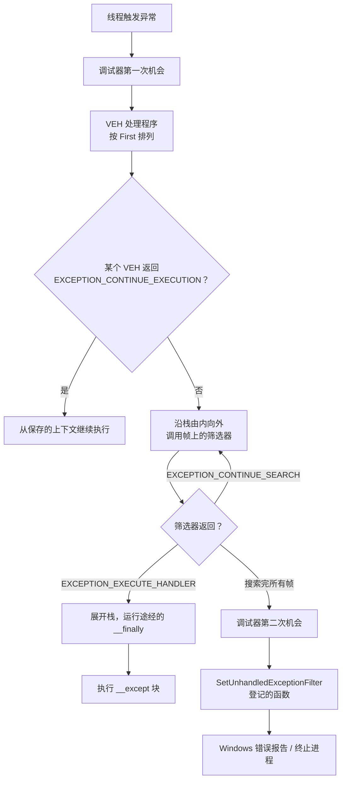

# A.5 错误处理与结构化异常处理（SEH）

一个读配置文件的程序启动失败，退出前在日志里留下一行 `open failed: 2`。数字 2 是 `ERROR_FILE_NOT_FOUND`，可运维的人不知道，只能去查表。同一份代码改成输出「系统找不到指定的文件。」，问题一眼就清楚了。另一个程序在用户机器上偶发闪退，用户只看到窗口消失，开发者手里只有一个退出码 `-1073741819`，既不知道崩在哪一行，也不知道当时调用栈是什么。

这两件事是 Windows 上错误处理的两半：一半是把失败的原因准确、及时地取出来并变成人能读的文字；另一半是当程序真的撞上访问违例、除零、栈溢出这类异常时，能按自己的意愿收场，最好还能留下一个可以事后分析的 dump。前半部分靠 `GetLastError` 与 `FormatMessageW`，后半部分靠结构化异常处理（structured exception handling，SEH）。

本页先讲最后错误码的取法与几个容易踩的坑，再把 Windows 上并存的几种错误码摆在一起对照；然后进入 SEH：异常是什么，MSVC 的 `__try`/`__except`/`__finally` 怎么写，MinGW 下没有这些关键字时用什么替代；最后讲哪些场合该用 SEH、哪些不该。示例在 Windows 11 x64 上用 MinGW-w64 GCC 13.2 编译运行，需要 `__try` 的几个程序用 MSVC（工具集 14.51，在开发者命令提示符里执行 `cl /nologo /W4 /std:c17`）编译。涉及 Windows 与 POSIX 的对照时，主线章节在 [第 6 章](/教程/正文/系统编程/6_信号_时间与定时器) 与 [22.1 节](/教程/正文/语法和标准库/22_非局部控制与信号/22_1_signal)。

## 1. GetLastError 与错误消息

Win32 的大部分函数不返回错误码，而是用一个布尔值或句柄表示成败；失败的具体原因放在一个每线程一份的「最后错误码」（last-error code）里，用 `GetLastError` 取。这个对象由系统为每个线程维护，一个线程的失败不会改写另一个线程的值：

::: terminal title="PowerShell - lasterror_thread"

<span class="prompt">PS&gt;</span> gcc -std=c17 -Wall -Wextra lasterror_thread.c -o lasterror_thread.exe

<span class="prompt">PS&gt;</span> ./lasterror_thread.exe

```text
main thread before: GetLastError() = 5
worker thread: GetLastError() = 2
main thread after:  GetLastError() = 5
```

:::

主线程把目录当文件打开，失败，错误码 5；新线程里打开一个不存在的文件，错误码 2；线程结束后主线程再取，还是 5。完整程序在 `code/系统编程/拓展A_Win32系统编程/A_5_错误处理与结构化异常处理/lasterror_thread.c`，主线程把 `C:\Windows` 交给 `CreateFileW`、不带 `FILE_FLAG_BACKUP_SEMANTICS`，于是得到 `ERROR_ACCESS_DENIED`。

有了错误码，还要把它变成文字。`FormatMessageW` 从系统消息表里取出对应语言的描述：

```c
static void print_error(DWORD code)
{
    wchar_t *msg = NULL;
    DWORD n = FormatMessageW(FORMAT_MESSAGE_ALLOCATE_BUFFER |
                                 FORMAT_MESSAGE_FROM_SYSTEM |
                                 FORMAT_MESSAGE_IGNORE_INSERTS,
                             NULL, code, 0, (wchar_t *)&msg, 0, NULL);

    if (n == 0) {
        wprintf(L"error %lu: (no message)\n", (unsigned long)code);
        return;
    }
    /* 系统消息以 CRLF 结尾，去掉 */
    while (n > 0 && (msg[n - 1] == L'\r' || msg[n - 1] == L'\n')) {
        msg[--n] = L'\0';
    }
    wprintf(L"error %lu: %ls\n", (unsigned long)code, msg);
    LocalFree(msg);
}
```

三个标志各有用途。`FORMAT_MESSAGE_FROM_SYSTEM` 表示去系统消息表里找；`FORMAT_MESSAGE_IGNORE_INSERTS` 表示消息里的 `%1`、`%2` 之类占位符原样保留，不做替换，否则必须另外准备参数数组；`FORMAT_MESSAGE_ALLOCATE_BUFFER` 让函数自己分配缓冲区，调用方拿到的是一块由 `LocalAlloc` 分配的内存，用完必须 `LocalFree`。开了这个标志时，第五个参数按 `LPWSTR *` 解释：函数把新分配的缓冲区地址写进你传进去的那个指针的地址，所以要写 `(wchar_t *)&msg` 而不是 `msg`。写成 `msg` 能编译通过（类型都是 `wchar_t *`），但函数会把它当作输出地址，实测返回 0、`GetLastError()` 是 87（`ERROR_INVALID_PARAMETER`），拿不到任何消息。

返回值的 `n` 是消息的字符数，**不含**结尾的空字符。系统消息末尾带一个回车换行，`n` 把它算在内：错误 2 的消息「系统找不到指定的文件。」是 11 个字符，`n` 是 13，最后两个字符是 `0x000D`、`0x000A`。直接 `printf` 会多出一个空行，所以上面先把它们删掉。

完整程序还演示了两种失败。一个不存在的文件得到错误 2，一个用 `FILE_ATTRIBUTE_NORMAL` 打开的目录得到错误 5：

::: terminal title="PowerShell - lasterror"

<span class="prompt">PS&gt;</span> gcc -std=c17 -Wall -Wextra lasterror.c -o lasterror.exe

<span class="prompt">PS&gt;</span> ./lasterror.exe

```text
CreateFileW: error 2: 系统找不到指定的文件。
CreateFileW: error 5: 拒绝访问。
```

:::

这里的文字来自本机的系统消息表，界面语言是中文就是中文；同一段程序在英文系统上会输出 `The system cannot find the file specified.`。程序里因此在 `main` 开头调用了 `setlocale(LC_ALL, ".UTF8")` 与 `SetConsoleOutputCP(CP_UTF8)`，让 `%ls` 按 UTF-8 转换、控制台按 UTF-8 解释。

::: concept win-last-error-save title="失败之后立刻保存错误码"

函数返回失败时，要在同一个表达式或下一条语句里调用 `GetLastError` 并把结果存进局部对象。这中间只要插进任何一次别的 API 调用，哪怕看起来完全无害（`CreateEventW`、`CloseHandle` 都算），最后错误码都可能被改写。

:::

::: warning `GetLastError` 不是「错误状态」

成功调用不会自动把最后错误码清零，所以失败之后连续取两次得到的是同一个值；只有中间插入的调用确实调用了 `SetLastError`，值才会变。反过来，有些函数在成功时也会设置它，例如以同名再次创建内核对象时 `CreateEventW` 返回新句柄、最后错误码为 183（`ERROR_ALREADY_EXISTS`，见 [A.3](/教程/正文/系统编程/拓展A_Win32系统编程/A_3_内核对象与句柄)）。所以判断成败看返回值，错误码只在返回值表示失败时才有意义。

:::

## 2. 写错了会怎样：错误码被覆盖

知道规则不等于不会写错。下面这段代码在真实项目里很常见：打开失败，先记一条日志，再取错误码。

::: compare left-title="先记日志再取码" right-title="先取码再记日志"

```c
h = try_open_missing();
if (h == INVALID_HANDLE_VALUE) {
    log_msg("open failed");
    code = GetLastError();
    printf("late GetLastError = %lu\n",
           (unsigned long)code);
}
```

---

```c
h = try_open_missing();
if (h == INVALID_HANDLE_VALUE) {
    code = GetLastError();
    log_msg("open failed");
    printf("early GetLastError = %lu\n",
           (unsigned long)code);
}
```

:::

`log_msg` 内部为了打时间戳或输出到文件，会调用一两个 Win32 函数。示例里它调用 `CreateEventW` 和 `CloseHandle`，两者都成功了，可前者顺手把最后错误码置成 0。

```c
static void log_msg(const char *msg)
{
    HANDLE ev = CreateEventW(NULL, FALSE, FALSE, NULL);

    printf("[log] %s\n", msg);
    CloseHandle(ev);
}
```

两种写法在一份程序里各跑一次（`lasterror_overwrite.c`），先记日志的那次拿到 0，先取码的那次拿到 2：

::: terminal title="PowerShell - lasterror_overwrite"

<span class="prompt">PS&gt;</span> gcc -std=c17 -Wall -Wextra lasterror_overwrite.c -o lasterror_overwrite.exe

<span class="prompt">PS&gt;</span> ./lasterror_overwrite.exe

```text
[log] open failed
late GetLastError = 0  (want 2)
[log] open failed
early GetLastError = 2
```

:::

0 不是「没有错误」，它是 `CreateEventW` 成功时写进去的值，`ERROR_SUCCESS` 恰好长得像正常。日志上于是留下一句「打开失败，原因：成功」，比没有日志更糟。

结论不是「日志函数不许调 API」（那做不到），而是「取码是调用点的事」。调用点保存了错误码，再把它作为参数传给日志函数，日志函数内部怎么折腾都与它无关。真正的工程写法是让每个可能失败的函数在失败时返回错误码（返回 `DWORD` 或通过输出参数），而不是让上层再回头问 `GetLastError`；这样错误码跟着返回值走，不依赖线程状态，也就不存在被谁覆盖的问题。

<Quiz
  type="single"
  :options="[
    { label: '没有问题，GetLastError 会一直保留失败时的值', value: 'A' },
    { label: 'log_msg 内部的调用可能改写最后错误码', value: 'B' },
    { label: 'GetLastError 只能调用一次', value: 'C' },
    { label: '应该改用 errno', value: 'D' }
  ]"
  answer="B"
>

<template #question>

下面这段代码有什么问题？

```c
h = CreateFileW(...);
if (h == INVALID_HANDLE_VALUE) {
    log_msg("open failed");
    err = GetLastError();
}
```

</template>

正确答案是 **B**。`log_msg` 里只要有一次 API 调用改写了最后错误码，取到的就不是 `CreateFileW` 的失败原因。示例里 `CreateEventW` 成功，把它改成了 0。A 错在「一直保留」，C 错在次数，D 错在对象来源：`errno` 是 C 运行库的，`CreateFileW` 不设置它。

</Quiz>

## 3. 错误码的四种表示

Windows 上同时存在几套错误码，长得像、含义不同，混用会得到莫名其妙的结果。先看一张表，再逐个说。

| 表示 | 典型来源 | 怎么取得 | 怎么变成文字 |
| --- | --- | --- | --- |
| Win32 错误码（`DWORD`） | `CreateFileW` 等多数 Win32 函数；Winsock 的 `WSAxxx` 码；注册表函数的 `LSTATUS` | `GetLastError`；Winsock 用 `WSAGetLastError`；注册表函数直接返回 | `FormatMessageW` 加 `FORMAT_MESSAGE_FROM_SYSTEM` |
| `HRESULT` | COM 方法与较新的 Win32 API（如 `CreatePseudoConsole`） | 函数返回值 | 多数也能直接交给 `FormatMessageW`；取不到文字时取低 16 位或换算 |
| `NTSTATUS` | 原生 API（`NtXxx`）与异常代码 | 函数返回值；异常的代码用 `GetExceptionCode` | `RtlNtStatusToDosError` 换成 Win32 码再取文字；或从 `ntdll.dll` 的消息表取 |
| `errno` | C 运行库函数（`_wfopen`、`strtol` 等） | `errno` | `strerror`、`_wcserror` |

同一段程序把这几种码都打印一遍：

```c
HRESULT hr = HRESULT_FROM_WIN32(ERROR_FILE_NOT_FOUND);
FILE *fp = _wfopen(L"no_such_file.txt", L"rb");
```

::: terminal title="PowerShell - errcodes"

<span class="prompt">PS&gt;</span> gcc -std=c17 -Wall -Wextra errcodes.c -o errcodes.exe

<span class="prompt">PS&gt;</span> ./errcodes.exe

```text
HRESULT_FROM_WIN32(ERROR_FILE_NOT_FOUND) = 0x80070002, FAILED=1, SUCCEEDED(S_OK)=1
0x00000002  系统找不到指定的文件。
0x80070002  系统找不到指定的文件。
0x00000005  拒绝访问。
0x000000B7  当文件已存在时，无法创建该文件。
0xC0000005  (no message)
0x0000274D  由于目标计算机积极拒绝，无法连接。
0x80004005  未指定的错误
_wfopen failed: errno=2 (No such file or directory)
CreateEventW #1: last_error=0
CreateEventW #2: last_error=183
```

:::

### 3.1 Win32 错误码

32 位无符号数，常量名以 `ERROR_` 开头，定义在 `winerror.h` 里。`0` 是 `ERROR_SUCCESS`。常见系统错误码都在低 16 位以内，第 29 位留给应用自定义的错误码（设置了这一位的码不会与系统的冲突）。

Winsock 的错误码（10000 以上）也在这张系统消息表里，`FormatMessageW` 同样能取到文字，上面输出里的 10061 就是「由于目标计算机积极拒绝，无法连接。」。但 Winsock 函数失败时要用 `WSAGetLastError` 取。本机实测两者返回同一个值（`connect` 失败都是 10061），也不要因此把 `GetLastError` 当成通用替代：Winsock 文档只承诺 `WSAGetLastError` 的语义，见 [A.13](/教程/正文/系统编程/拓展A_Win32系统编程/A_13_Winsock特有主题)。

注册表函数是另一类：它们直接把 `LSTATUS`（就是 `LONG`）作为返回值给出，不用 `GetLastError`，见 [A.18](/教程/正文/系统编程/拓展A_Win32系统编程/A_18_Windows服务_注册表与系统设施)。

### 3.2 HRESULT

`HRESULT` 是把成功、失败与「错误来自哪个子系统」编码进一个 32 位有符号数的约定。最高位是严重性：0 表示成功，1 表示失败。低 16 位是代码，紧挨着代码的一组位是设施（facility）字段，说明错误来自哪个子系统，`FACILITY_WIN32` 的值是 7。

由此有一条常用公式：把一个 Win32 错误码转成 `HRESULT`，就是把它放到 `0x8007` 后面，即 `HRESULT_FROM_WIN32(2)` = `0x80070000 | 2` = `0x80070002`。宏会把大于 0 的输入这样拼装，输入本来就非正时原样返回。判断成败一律用 `SUCCEEDED(hr)`、`FAILED(hr)`，不要写 `hr == S_OK`：成功值不止 `S_OK`（0）一个，本拓展 [A.9](/教程/正文/系统编程/拓展A_Win32系统编程/A_9_线程与线程本地存储) 里 `SetThreadDescription` 成功时返回 `0x10000000`，写 `== S_OK` 就会误判。

一个 `HRESULT` 能不能被 `FormatMessageW` 认出来，取决于它的设施字段是不是 7。`0x80070002` 可以，输出与 `0x00000002` 完全一样；`0x80004005`（`E_FAIL`）也能取到「未指定的错误」，因为系统消息表里确实登记了这个值；而 `0x90070002` 这种伪造的组合返回 0，表示表里没有。

### 3.3 NTSTATUS 与异常代码

`NTSTATUS` 是内核与原生 API 使用的 32 位状态码，最高两位是严重性：`0x0` 成功、`0x4` 信息、`0x8` 警告、`0xC` 错误。异常代码用的就是这一套编码，访问违例 `0xC0000005`、整数除零 `0xC0000094`、栈溢出 `0xC00000FD` 都属于「错误」档。

`FormatMessageW` 的 `FROM_SYSTEM` 找不到它们，输出里的 `0xC0000005 (no message)` 就是实测结果，此时 `GetLastError` 为 317（`ERROR_MR_MID_NOT_FOUND`）。要显示文字，先换成本地语言对应的 Win32 码：

```c
HMODULE ntdll = GetModuleHandleW(L"ntdll.dll");
rtl_ntstatus_to_dos_error_fn to_dos =
    (rtl_ntstatus_to_dos_error_fn)(void (*)(void))GetProcAddress(
        ntdll, "RtlNtStatusToDosError");
printf("%lu\n", (unsigned long)to_dos(0xC0000005u));
```

本机实测 `0xC0000005` 换成 998（「内存位置访问无效。」），`0xC0000135`（找不到 DLL）换成 126（「找不到指定的模块。」）。`ntdll.dll` 自己也带一份异常消息表，可以用 `FORMAT_MESSAGE_FROM_HMODULE` 指定模块来取，但那些消息里带着 `%p` 之类的占位符，需要按异常记录里的参数逐个填，日常排错用换算的办法就够了。

### 3.4 errno

C 运行库的错误码是另一套。`_wfopen` 打开不存在的文件时失败，`errno` 为 2，`strerror(2)` 是 `No such file or directory`。它和 Win32 错误码数值上偶尔相同（都是 2），但两套码表的编号互不相关，取值集合也不同。`errno` 在现代运行库上是每线程一份的宏，与 `GetLastError` 一样按线程隔离。用哪个 API 就查哪套：调 `_wfopen` 看 `errno`，调 `CreateFileW` 看 `GetLastError`。主线 [14.2 节](/教程/正文/语法和标准库/14_文本转换_错误与程序生命周期/14_2_errno与文本转换) 讲过 `errno` 的用法。

<Quiz
  type="single"
  :options="[
    { label: '0x00000002', value: 'A' },
    { label: '0x80070002', value: 'B' },
    { label: '0xC0000002', value: 'C' },
    { label: '0x80004005', value: 'D' }
  ]"
  answer="B"
>

<template #question>

`HRESULT_FROM_WIN32(ERROR_FILE_NOT_FOUND)` 的值是多少？

</template>

正确答案是 **B**。`ERROR_FILE_NOT_FOUND` 是 2，大于 0，宏把它放到 `FACILITY_WIN32`（7）的设施字段里，并把第 31 位置 1，得到 `0x80070002`。A 是原始的 Win32 错误码，C 是把它当成 `NTSTATUS` 错误的写法，D 是 `E_FAIL`。

</Quiz>

## 4. 结构化异常

结构化异常处理是 Windows 提供的一套机制：当一条指令触发了处理器异常，或者程序用 `RaiseException` 主动抛出异常时，系统暂停当前线程，按一套固定的顺序寻找处理程序。

硬件引发的异常最常见的有三种：解引用空指针或越界访问得到访问违例（access violation，`0xC0000005`），整数除以零得到 `0xC0000094`，无限递归把栈用光得到栈溢出（`0xC00000FD`）。软件异常由 `RaiseException` 抛出，代码由调用方指定。下面这个程序用命令行参数在四种崩溃方式里选一种：

::: terminal title="PowerShell - crash"

<span class="prompt">PS&gt;</span> gcc -std=c17 -Wall -Wextra crash.c -o crash.exe

<span class="prompt">PS&gt;</span> ./crash.exe av; "av exit=\$LASTEXITCODE (0x{0:X8})" -f \$LASTEXITCODE

```text
av exit=-1073741819 (0xC0000005)
```

<span class="prompt">PS&gt;</span> ./crash.exe div; "div exit=\$LASTEXITCODE (0x{0:X8})" -f \$LASTEXITCODE

```text
div exit=-1073741676 (0xC0000094)
```

<span class="prompt">PS&gt;</span> ./crash.exe stack; "stack exit=\$LASTEXITCODE (0x{0:X8})" -f \$LASTEXITCODE

```text
stack exit=-1073741571 (0xC00000FD)
```

<span class="prompt">PS&gt;</span> ./crash.exe raise; "raise exit=\$LASTEXITCODE (0x{0:X8})" -f \$LASTEXITCODE

```text
raise exit=-536870911 (0xE0000001)
```

:::

四行输出的共同点是：进程里没有任何处理程序，异常没有被任何人接住，系统终止了进程，**退出码就是异常代码**。PowerShell 把退出码当有符号 32 位整数显示，所以 `0xC0000005` 显示成 `-1073741819`。写十六进制看就清楚了。`RaiseException(0xE0000001, ...)` 抛出的自定义代码也原样成为退出码。

::: concept win-exception-codes title="异常代码不是错误码"

异常代码用 `NTSTATUS` 的编码，与 `GetLastError` 返回的 Win32 错误码是两套东西。异常发生时 `GetLastError` 不会被设置成异常代码，把 `0xC0000005` 直接交给 `FormatMessageW` 的 `FROM_SYSTEM` 也取不到文字。判断异常类型要在筛选器里比较 `GetExceptionCode()` 与 `EXCEPTION_ACCESS_VIOLATION` 这些常量，不要试图用错误码的办法处理它。

:::

POSIX 上对应的一幕是信号。访问非法地址收到 `SIGSEGV`，shell 把被信号杀死的子进程报告成 139（128 加 11）。主线的 [第 6 章](/教程/正文/系统编程/6_信号_时间与定时器) 讲过 `sigaction` 与 `SA_SIGINFO`，那里同样能拿到出错地址。两边的差别在于后续：POSIX 的信号处理函数返回后，引起故障的指令会重新执行，通常再次崩溃；Windows 的 SEH 可以展开栈、跳过出错的指令，甚至修好条件后重试。

异常的寻找顺序是固定的。向量化异常处理（vectored exception handling，VEH）是进程级的，先于任何基于栈帧的处理程序运行；之后系统沿调用栈由内向外，逐个调用每个 `__try` 块登记的筛选器；都没有人接手时，进入未处理异常筛选器（unhandled exception filter），它是进程最后一次自己处理的机会；再往后是 Windows 错误报告与终止进程。



VEH 的顺序由注册时传入的 `First` 参数决定：非零插到队首，0 放到队尾。这一点在本机实测过：先注册 `First=0` 的处理程序、再注册 `First=1` 的，两者都返回 `EXCEPTION_CONTINUE_SEARCH`，除零时打印顺序是先 `First=1` 后 `First=0`。同时注册 VEH 与 `__try`/`__except` 时，VEH 先于帧上的筛选器运行。

<Quiz
  type="single"
  :options="[
    { label: '正常退出', value: 'A' },
    { label: '访问违例导致的未处理异常', value: 'B' },
    { label: '找不到 DLL', value: 'C' },
    { label: '被 TerminateProcess 结束', value: 'D' }
  ]"
  answer="B"
>

<template #question>

一个进程的退出码是 `0xC0000005`，说明什么？

</template>

正确答案是 **B**。退出码落在 `0xC0000000` 段说明进程是被未处理的异常结束的，`0xC0000005` 是访问违例。找不到 DLL 是 `0xC0000135`（见 [A.7](/教程/正文/系统编程/拓展A_Win32系统编程/A_7_动态链接库_DLL)），`TerminateProcess` 可以用任意退出码，但最常见的用法是 `1` 之类的普通值。

</Quiz>

## 5. __try 与 __except（MSVC）

微软的 C/C++ 编译器提供了一组扩展关键字，把 SEH 直接写进语言里。捕获异常的写法是：

```c
__try {
    /* 受保护代码 */
} __except (筛选器表达式) {
    /* 处理块 */
}
```

受保护代码里任何地方抛出异常，包括它调用的函数里抛出的，都会让系统计算筛选器表达式。表达式的值三选一：

| 值 | 含义 |
| --- | --- |
| `EXCEPTION_EXECUTE_HANDLER`（1） | 我处理。系统展开栈，执行 `__except` 块，然后从这个块后面继续 |
| `EXCEPTION_CONTINUE_SEARCH`（0） | 我不处理。继续向调用栈外层找 |
| `EXCEPTION_CONTINUE_EXECUTION`（-1） | 回到出错的指令重新执行（严格说，是从保存的上下文继续，通常就是同一条指令） |

下面这个程序故意解引用空指针，并在筛选器里打印异常代码：

```c
static int filter(unsigned long code)
{
    printf("filter: code=0x%08lX\n", code);
    if (code == EXCEPTION_ACCESS_VIOLATION) {
        return EXCEPTION_EXECUTE_HANDLER;
    }
    return EXCEPTION_CONTINUE_SEARCH;
}

int main(void)
{
    int *p = NULL;
    int value = 0;

    __try {
        value = *p; /* 访问空指针，由硬件引发访问违例 */
    }
    __except (filter(GetExceptionCode())) {
        printf("handled access violation\n");
    }
    ...
}
```

::: terminal title="PowerShell - seh_msvc"

<span class="prompt">PS&gt;</span> cl /nologo /W4 /std:c17 seh_msvc.c

<span class="prompt">PS&gt;</span> ./seh_msvc.exe; "exit=\$LASTEXITCODE"

```text
filter: code=0xC0000005
handled access violation
still running, value=0
exit=0
```

:::

程序没有崩：异常被接住，`value` 保持初值，`main` 正常返回 0。这正是 SEH 与信号不同的地方：处理完之后程序继续按自己的逻辑走，而不是从故障指令处恢复。

`GetExceptionCode()` 只能出现在筛选器表达式或 `__except` 块里。要更多信息，用 `GetExceptionInformation()`，它返回 `EXCEPTION_POINTERS` 指针，里面是异常记录与当时的寄存器上下文：

```c
static int av_filter(PEXCEPTION_POINTERS info)
{
    EXCEPTION_RECORD *rec = info->ExceptionRecord;

    if (rec->ExceptionCode != EXCEPTION_ACCESS_VIOLATION) {
        return EXCEPTION_CONTINUE_SEARCH;
    }
    printf("access violation: %ls at %p, rip=%p\n",
           rec->ExceptionInformation[0] == 0 ? L"read" : L"write",
           (void *)rec->ExceptionInformation[1],
           (void *)info->ContextRecord->Rip);
    return EXCEPTION_EXECUTE_HANDLER;
}
```

::: terminal title="PowerShell - exc_info"

<span class="prompt">PS&gt;</span> cl /nologo /W4 /std:c17 exc_info.c

<span class="prompt">PS&gt;</span> ./exc_info.exe; "exit=\$LASTEXITCODE"

```text
access violation: write at 0000000000000010, rip=00007FF6961F10D8
handled, value=0
exit=0
```

:::

`ExceptionInformation[0]` 说明这次访问是读（0）还是写（1、8 或执行），`ExceptionInformation[1]` 是访问的地址，`ContextRecord->Rip` 是出错指令的地址。后两者在每次运行时都可能不同，`Rip` 随地址空间布局随机化（ASLR）变化。

`GetExceptionInformation()` 只能出现在筛选器表达式里。它指向的上下文通常位于栈上，等控制权转进 `__except` 块时那块栈可能已经被展开掉，再用就不可靠。想在处理块里留信息，必须在筛选器里把它复制出来，或者只把判断结果传进去。

筛选器写完，异常不一定就归这一个块处理。里层筛选器返回 `EXCEPTION_CONTINUE_SEARCH` 时，外层继续找：

::: terminal title="PowerShell - seh_nested（前四行）"

<span class="prompt">PS&gt;</span> cl /nologo /W4 /std:c17 seh_nested.c

<span class="prompt">PS&gt;</span> ./seh_nested.exe

```text
inner try
inner filter: code=0xC0000094
outer filter: code=0xC0000094
outer handler: code=0xC0000094
```

:::

内层的筛选器运行了，也打印了，但它返回 `EXCEPTION_CONTINUE_SEARCH`，于是处理块不执行、`after inner` 那行也不打印，搜索继续到外层。外层的筛选器再运行一次，这次返回 `EXCEPTION_EXECUTE_HANDLER`，处理块执行。

一个 `__try` 只能配 `__except` 或 `__finally` 其中之一。两个都写，MSVC 在 `__finally` 处报语法错误（为看清报错临时写的 `both.c`，不随本页提供）：

```text
both.c(13): error C2143: 语法错误: 缺少";"(在"__finally"的前面)
both.c(16): error C2059: 语法错误:"return"
```

要同时有捕获与清理，只能把 `__try`/`__finally` 嵌在 `__try`/`__except` 的受保护块里。

::: warning `__try` 是 MSVC 与 clang-cl 的扩展

GCC 不认识这几个关键字。写一个最小的骨架 `gcc_seh.c`（`__try { ... } __except (1) { ... }`），用 MinGW-w64 GCC 13.2 编译就报错：

```text
gcc_seh.c:7:5: error: '__try' undeclared (first use in this function)
gcc_seh.c:7:10: error: expected ';' before '{' token
```

`__try`、`__except`、`__finally`、`__leave` 都是微软的语言扩展，不在任何 C 标准里，其他编译器可能完全不支持。用 GCC 写 Windows 程序时，捕获异常只能用本页第 7 节的 VEH 与未处理异常筛选器。

:::

::: tip `EXCEPTION_CONTINUE_EXECUTION` 的用法很窄

返回它等于告诉系统「问题解决了，从出错的那条指令继续」。只有确实修好了引起异常的条件，它才有意义，例如把访问违例指向的那一页提交上（[A.6](/教程/正文/系统编程/拓展A_Win32系统编程/A_6_内存管理与内存映射文件) 的按需提交），或者把寄存器里的除数改成非零。没有修复就返回它，指令会再次触发同样的异常，进程在两个状态之间打转。`continue_exec.c` 用计数器在第三次之后放弃，模拟了这种情形（MSVC 编译）：

```text
dividing
filter call 1, code=0xC0000094
filter call 2, code=0xC0000094
filter call 3, code=0xC0000094
give up, execute handler
handler, filter ran 3 times
after __except
```

两次 `EXCEPTION_CONTINUE_EXECUTION` 之后都重新执行了 `10 / 0`，第三次筛选器改口返回 `EXCEPTION_EXECUTE_HANDLER` 才跳出循环。真实代码里不该靠计数退出，这个写法只用来观察行为。

:::

<Quiz
  type="single"
  :options="[
    { label: '执行本 __except 块', value: 'A' },
    { label: '回到出错指令重试', value: 'B' },
    { label: '继续向外层寻找处理程序', value: 'C' },
    { label: '进程立即结束', value: 'D' }
  ]"
  answer="C"
>

<template #question>

异常筛选器返回 `EXCEPTION_CONTINUE_SEARCH` 之后会发生什么？

</template>

正确答案是 **C**。`EXCEPTION_CONTINUE_SEARCH` 表示这个块不处理，系统继续沿调用栈向外找下一个筛选器。A 是 `EXCEPTION_EXECUTE_HANDLER`，B 是 `EXCEPTION_CONTINUE_EXECUTION`，D 只会在没有任何处理程序时发生。

</Quiz>

## 6. __try 与 __finally

`__finally` 不处理异常，它保证一段代码一定会被执行：无论是正常走完受保护块、从中间 `return` 或 `goto` 跳出去，还是异常展开经过这里。这正是 C 里用 `goto` 统一清理的那种需求，交给编译器来做。

```c
static int divide(int a, int b)
{
    int r = 0;

    __try {
        r = a / b;
        if (r > 100) {
            __leave; /* 直接跳到 __finally */
        }
        printf("  normal path, r=%d\n", r);
    }
    __finally {
        printf("  finally (abnormal=%d)\n", AbnormalTermination());
    }
    return r;
}
```

`AbnormalTermination()` 在 `__finally` 块里调用，正常顺序离开受保护块时返回 0；因为 `return`、`goto` 或异常展开而离开时返回 1。`__leave` 是例外，它算正常离开。三种路径各跑一次：

::: terminal title="PowerShell - finally_msvc"

<span class="prompt">PS&gt;</span> cl /nologo /W4 /std:c17 finally_msvc.c

<span class="prompt">PS&gt;</span> ./finally_msvc.exe; "exit=\$LASTEXITCODE"

```text
normal division:
  normal path, r=5
  finally (abnormal=0)
  result=5
divide by zero:
  finally (abnormal=1)
  caught 0xC0000094
__leave path:
  finally (abnormal=0)
  result=500
exit=0
```

:::

三处输出值得对照。正常除法时 `__finally` 在 `return` 之前运行，`result=5` 最后打印。除以零时，`divide` 里没有任何筛选器，异常穿过 `__finally` 向上展开：`finally (abnormal=1)` 先打印，异常继续传到 `main` 的 `__except`，`caught 0xC0000094` 后打印，`result=` 那一行根本没轮到。`__leave` 那一例里，`r` 是 500，大于 100，`__leave` 直接跳到 `__finally`，`AbnormalTermination()` 却返回 0，因为 `__leave` 算正常离开，不算异常。

`return` 和 `goto` 跳出受保护块时也是同样：`__finally` 会运行，`AbnormalTermination()` 返回 1。下面这个程序把三种退出方式排在一起，`finally_paths.c`：

::: terminal title="PowerShell - finally_paths"

<span class="prompt">PS&gt;</span> cl /nologo /W4 /std:c17 finally_paths.c

<span class="prompt">PS&gt;</span> ./finally_paths.exe; "exit=\$LASTEXITCODE"

```text
mode 0:
  normal exit of __try
  finally, abnormal=0
  after the guarded section
mode 1 (return):
  returning from inside __try
  finally, abnormal=1
mode 2 (goto):
  jumping out with goto
  finally, abnormal=1
  after the guarded section
exit=0
```

:::

`mode 1` 里 `__try` 里的 `return` 没有直接返回，而是先跑 `__finally`，再回到调用方，所以 `after the guarded section` 不打印。`mode 2` 用 `goto` 跳到 `out` 标号，`__finally` 照样先运行，然后才到标号处。

这两段输出还揭示了一个顺序：筛选器在**第一次遍历**时求值，那时栈还没有展开；`__finally` 在**第二次遍历**展开时运行；处理块最后执行。`seh_nested.c` 的第二个块把三者串在一起（下面是完整输出，前四行与上面相同）：

::: terminal title="PowerShell - seh_nested"

<span class="prompt">PS&gt;</span> ./seh_nested.exe; "exit=\$LASTEXITCODE"

```text
inner try
inner filter: code=0xC0000094
outer filter: code=0xC0000094
outer handler: code=0xC0000094
raise inside two __finally blocks
outer filter (second block): code=0xE0000002
inner finally
outer finally
caught 0xE0000002
after the last __except
exit=0
```

:::

`RaiseException` 抛出 `0xE0000002` 之后，外层的筛选器先打印（第一次遍历），此时里层的两个 `__finally` 还一个都没跑；筛选器决定处理，系统开始展开，`inner finally`、`outer finally` 依次执行，最后才进入 `__except` 块打印 `caught`。如果以为筛选器是在清理之后才运行，就会把依赖顺序的代码写反。

`__finally` 与 [14.5 节的 goto 清理](/教程/正文/语法和标准库/14_文本转换_错误与程序生命周期/14_5_goto清理模式) 相比，好处是编译器保证每条路径都经过，坏处是只有 MSVC 认。代码要交给 GCC 或别的编译器编译，就用 `goto`；只有确定锁死在 MSVC 上的项目，用 `__finally` 才划算。本拓展其余各页的示例统一用 `goto` 清理，原因就在这里。

## 7. MinGW 下的做法：VEH 与未处理异常筛选器

GCC 不支持 `__try`，但 SEH 本身是操作系统提供的，不依赖编译器关键字。MinGW 下有两个纯 API 的入口：`AddVectoredExceptionHandler` 注册进程级的处理程序，`SetUnhandledExceptionFilter` 登记最后一道防线。

`AddVectoredExceptionHandler` 的第一个参数决定顺序：非零表示插到最前面，0 表示放到最后面。处理程序的签名是 `LONG CALLBACK f(PEXCEPTION_POINTERS)`，返回值与帧筛选器相同：`EXCEPTION_CONTINUE_SEARCH` 交回正常分发，`EXCEPTION_CONTINUE_EXECUTION` 尝试恢复。它不基于栈帧，因此不管异常发生在哪个函数里都会运行，包括其他线程里发生的异常。

`SetUnhandledExceptionFilter` 登记的函数在异常穿过所有帧处理之后被调用，运行在**出错的那个线程**上。它返回 `EXCEPTION_EXECUTE_HANDLER` 之后，系统按终止流程处理进程。

把两者接起来，就得到一个最小的崩溃记录器：

```c
/* VEH：进程级，先于任何帧上的处理程序运行 */
static LONG CALLBACK veh_handler(PEXCEPTION_POINTERS info)
{
    EXCEPTION_RECORD *rec = info->ExceptionRecord;

    printf("VEH: code=0x%08lX address=%p\n", (unsigned long)rec->ExceptionCode,
           rec->ExceptionAddress);
    return EXCEPTION_CONTINUE_SEARCH; /* 交回正常的分发流程 */
}

/* 未处理异常筛选器：最后机会，写 dump */
static LONG WINAPI crash_filter(PEXCEPTION_POINTERS info)
{
    MINIDUMP_EXCEPTION_INFORMATION mei;
    ...
    mei.ThreadId = GetCurrentThreadId();
    mei.ExceptionPointers = info;
    mei.ClientPointers = FALSE;

    ok = MiniDumpWriteDump(GetCurrentProcess(), GetCurrentProcessId(), file,
                           MiniDumpNormal, &mei, NULL, NULL);
    ...
}
```

程序在 `main` 里先注册两者，再解引用空指针。完整源码在 `code/系统编程/拓展A_Win32系统编程/A_5_错误处理与结构化异常处理/veh_dump.c`，编译时要加 `-ldbghelp`：

::: terminal title="PowerShell - veh_dump"

<span class="prompt">PS&gt;</span> gcc -std=c17 -Wall -Wextra veh_dump.c -o veh_dump.exe -ldbghelp

<span class="prompt">PS&gt;</span> ./veh_dump.exe; "exit=\$LASTEXITCODE (0x{0:X8})" -f \$LASTEXITCODE

```text
about to dereference NULL
VEH: code=0xC0000005 address=00007FF643511900
unhandled filter: code=0xC0000005
MiniDumpWriteDump: ok
exit=-1073741819 (0xC0000005)
```

<span class="prompt">PS&gt;</span> (Get-Item crash.dmp).Length

```text
39702
```

:::

顺序与设计一致：VEH 先看到异常，它只记录、不处理，返回 `EXCEPTION_CONTINUE_SEARCH`；没有帧处理程序，异常进入未处理筛选器；筛选器写出 `crash.dmp`，然后返回 `EXCEPTION_EXECUTE_HANDLER`；进程终止，退出码仍是 `0xC0000005`。dump 的大小在 38 KB 到 41 KB 之间（本机几次运行分别是 39702、38274、40354、38418 字节），每次不同，因为它记录的是各线程的栈与已加载模块清单。

`MiniDumpNormal` 只写重建调用栈所需的信息：线程列表、栈内存、模块列表、异常记录。它不含堆上的数据，所以文件只有几十 KB。要看当时堆上的数据，换成 `MiniDumpWithFullMemory`，本机同一个崩溃在 64 位进程里写出的文件约 25 MB；两者之间还有若干档，按需要组合。

写 dump 时有两个细节。第一，`MINIDUMP_EXCEPTION_INFORMATION` 必须填上 `ExceptionPointers` 与 `ThreadId`，否则 dump 里没有异常记录，事后打开只会看到一堆线程。第二，`MiniDumpWriteDump` 最好在另一个进程里调用；在刚崩溃的进程里调用有死锁风险，官方文档建议至少放到一个专门的线程里，并且所有 `DbgHelp` 函数都是单线程的，多线程同时调用要自己加锁。

::: tip 用调试器打开 dump

`crash.dmp` 可以用 WinDbg 或 Visual Studio 打开。WinDbg 里先执行 `.symfix` 与 `.reload` 加载符号，再执行 `!analyze -v`，它会给出异常代码、出错模块、出错指令和调用栈。没有符号时至少能看到模块加偏移，配合链接器生成的 map 文件或 PDB 也能定位到函数。调试器的详细用法见 [开发与工程基础第 12 章](/教程/正文/开发与工程基础/12_调试器)。

:::

dump 文件以四个字节 `MDMP` 开头，后面是版本、流数量与各流的目录。第 6 号流是异常流，里面有异常记录本身；用 `MiniDumpReadDumpStream` 可以直接把它读出来，不必依赖调试器。这给自动化崩溃收集留了一条路：程序退出后由一个收集器扫描 `crash.dmp`，取出异常代码与地址，归类入库。

## 8. 什么时候用 SEH

SEH 能接住一切，正因如此容易被滥用。判断标准其实简单：**能通过返回值发现的错误，用返回值处理；只有无法用返回值表达的事件，才动用异常。**

- 打开文件失败、`WriteFile` 返回错误、参数不合法，这些都有明确的失败返回值，按第 1 节的办法检查即可。用 `__try` 把它们包起来，既慢又难读，还会把真正的编程错误一起吞掉。
- 顶层的崩溃报告是 SEH 的正当用途。程序不需要在崩溃后继续运行，只需要在死之前留下 dump 与日志，这正是第 7 节做的事。
- 访问内存映射文件时，底层 I/O 错误会以 `EXCEPTION_IN_PAGE_ERROR`（`0xC0000006`）的形式出现，而不是让 `ReadFile` 返回失败。[A.6](/教程/正文/系统编程/拓展A_Win32系统编程/A_6_内存管理与内存映射文件) 会用到这一点。
- 有意设计的异常，例如内存按需提交、`EXCEPTION_CONTINUE_EXECUTION` 修好条件后重试，是 SEH 设计时的目标场景。
- 不要用 `__except` 把访问违例吞掉让程序「接着跑」。地址已经错了，那块内存的内容不可信，继续执行只会把错误扩散到更远的地方，最后难以定位。收到不认识的异常，返回 `EXCEPTION_CONTINUE_SEARCH`，让它走到未处理筛选器。
- MSVC 的 C++ 异常（`try`/`catch`/`throw`）底层建立在 SEH 之上，`/EHa` 下 `catch (...)` 甚至能接住 SEH 异常。写 C 代码时两者不要混着用。

<Quiz
  type="single"
  :options="[
    { label: '用 __try/__except 包住每一次 ReadFile，统一处理所有失败', value: 'A' },
    { label: '检查 ReadFile 的返回值与 GetLastError，SEH 只用于顶层崩溃报告', value: 'B' },
    { label: '用 __except 接住访问违例后继续执行', value: 'C' },
    { label: '把 EXCEPTION_CONTINUE_EXECUTION 当作通用的重试手段', value: 'D' }
  ]"
  answer="B"
>

<template #question>

写一个读文件的函数，下面哪种做法符合本节的判断标准？

</template>

正确答案是 **B**。文件读失败有明确的返回值和错误码，用返回值处理最直接；SEH 留给无法用返回值表达的事件，例如顶层崩溃报告与内存映射文件里的 `EXCEPTION_IN_PAGE_ERROR`。A 把可预期的失败变成异常，既慢又难读；C 吞掉访问违例让程序带着坏地址继续跑；D 在没有修复条件时只会反复触发同一次异常。

</Quiz>

::: generate win-seh-vs-posix kind=comparison

面向熟悉 POSIX 的读者，比较 SEH、POSIX 信号与 `setjmp`/`longjmp` 三种机制：分别由谁发起、处理程序在哪个线程运行、能否从处理程序返回后继续执行、清理代码在什么时候运行、以及同一个进程里多线程同时出错时的行为。用本页的 `seh_msvc.c` 与主线的 `sigaction` 写法作对照，不展开新的 API 参数。

:::

## 9. 习题

题面用到的程序都在 `code/系统编程/拓展A_Win32系统编程/A_5_错误处理与结构化异常处理/` 下。标了 MSVC 的题要用 `cl /nologo /W4 /std:c17` 编译，其余用 MinGW。

### 9.1 巩固

<Exercise id="45501" :d="1" :w="1">

下面这段代码在目录 `C:\Windows` 上运行，打印什么？

```c
HANDLE h = CreateFileW(L"C:\\Windows", GENERIC_READ, FILE_SHARE_READ, NULL,
                       OPEN_EXISTING, FILE_ATTRIBUTE_NORMAL, NULL);
if (h == INVALID_HANDLE_VALUE) {
    printf("%lu\n", (unsigned long)GetLastError());
    printf("%lu\n", (unsigned long)GetLastError());
}
```

两次输出是否相同，为什么？如果在两次 `GetLastError` 中间插入一次成功的 `CreateEventW`，第二次会变成多少？用 `lasterror_overwrite.c` 的写法验证你的判断。

</Exercise>

<Exercise id="45502" :d="2" :w="2" multi>

`print_error` 里有几个细节值得单独弄清。

(1) _[1.1]_ 开了 `FORMAT_MESSAGE_ALLOCATE_BUFFER` 之后，为什么第五个参数要写成 `(wchar_t *)&msg`，而不能直接写 `msg`？换成 `msg` 能编译通过吗？运行时函数返回什么，`GetLastError()` 是多少？实测后回答。

(2) _[2.1]_ 错误 2 的消息在中文系统上是「系统找不到指定的文件。」，共 11 个字符，`FormatMessageW` 却返回 13。多出来的两个字符是什么？写出不删掉它们时终端里的显示效果。

(3) _[2.2]_ 把 `0xC0000005` 交给 `FormatMessageW` 的 `FORMAT_MESSAGE_FROM_SYSTEM`，返回 0，`GetLastError()` 是 317。317 对应哪个常量？给出两种能拿到可读文字的办法。

</Exercise>

### 9.2 编程

<Exercise id="45503" :d="2" :w="2">

写一个命令行工具 `errcode.exe CODE`，把任意一种错误码翻译成文字：

- 参数接受十进制与 `0x` 开头的十六进制两种写法，大小写不限；
- 高位是 `0x8007` 的，按 `HRESULT` 处理：取出设施字段与代码字段（低 16 位），取文字时两种办法都试一次并对比结果，输出里注明「HRESULT，设施 FACILITY_WIN32」；
- 落在 `0xC0000000` 段的，按 `NTSTATUS` 处理：先用 `RtlNtStatusToDosError` 换算，再取文字，输出里同时给出原始码与换算后的 Win32 码；
- 其余按 Win32 错误码处理。

验收：`errcode.exe 2`、`errcode.exe 0x80070002`、`errcode.exe 0xC0000005` 三条命令分别输出「系统找不到指定的文件。」、「系统找不到指定的文件。」（带 HRESULT 标注）、「内存位置访问无效。」（同时给出 998）。三者都不能是 `(no message)`。

</Exercise>

<Exercise id="45504" :d="3" :w="3">

写一个记录失败原因的小程序 `errlog.c`。要求：

1. 函数 `DWORD copy_file(const wchar_t *src, const wchar_t *dst)` 在失败时**返回**错误码，不依赖上层再调 `GetLastError`；
2. `main` 依次调用三次：复制一个存在的文件、复制一个不存在的源文件、复制到一个不存在的目录（`CreateFileW` 对这两种情况分别给出 2 与 3，本机实测）；
3. 每次调用后，把「操作名、错误码、`FormatMessageW` 得到的文字」写进 `errlog.txt`，文件用 `FILE_SHARE_READ | FILE_SHARE_WRITE` 打开，方便运行期间用记事本查看；
4. 日志函数只接收已保存的错误码作为参数，内部可以随意调用 API。

验收：`errlog.txt` 三行，第二行的错误码是 2（`ERROR_FILE_NOT_FOUND`）、第三行是 3（`ERROR_PATH_NOT_FOUND`）。再故意把「取错误码」挪到日志函数之后，检查结果是否仍然正确，说明为什么。

</Exercise>

<Exercise id="45505" :d="3" :w="3">

用 MSVC 写 `safediv.c`，比较 `__try`/`__except` 的两种筛选器写法。

1. 函数 `int safe_div(int a, int b)` 用 `__try` 包住 `a / b`，筛选器只在 `EXCEPTION_INT_DIVIDE_BY_ZERO` 时返回 `EXCEPTION_EXECUTE_HANDLER`，其余返回 `EXCEPTION_CONTINUE_SEARCH`；处理块返回一个约定的错误值。
2. 函数 `int safe_read(const int *arr, size_t n, size_t i)` 用同样的写法包住 `arr[i]`，但筛选器要求异常是 `EXCEPTION_ACCESS_VIOLATION`，并且 `ExceptionInformation[1]` 落在 `arr` 到 `arr + n` 的地址范围之外才处理；地址落在数组内部却仍然出错时返回 `EXCEPTION_CONTINUE_SEARCH`。
3. `main` 依次调用：`safe_div(10, 2)`、`safe_div(10, 0)`、`safe_read` 读一个合法下标、`safe_read` 读一个明显越界的下标（例如 `1u << 20`，保证越过栈上数组所在的页）。

验收：四次调用都返回，程序退出码 0；第二次返回错误值而不是崩溃；第四次能接住越界访问。最后回答：如果把第 2 步的地址判断去掉，会发生什么？

</Exercise>

<Exercise id="45506" :d="4" :w="3">

把 [14.5 节](/教程/正文/语法和标准库/14_文本转换_错误与程序生命周期/14_5_goto清理模式) 的 goto 清理写法改写成 `__try`/`__finally`，并对比两者。

- 写一个函数，依次获得两个资源（用 `CreateEventW` 与 `CreateFileW` 模拟），中途可能 `return`，也可能抛异常；
- 第一版用 `goto` 清理，用 MinGW 编译；
- 第二版用 `__try`/`__finally`，用 MSVC 编译，清理代码放在 `__finally` 里，并用 `AbnormalTermination()` 打印这次是正常离开还是异常展开；
- 两条路径各跑一次：一次正常返回，一次用 `RaiseException(0xE0000004, 0, 0, NULL)` 触发。

验收：两版在正常路径下的输出顺序完全一致；异常路径下第二版先打印清理信息、再让异常继续向外传（外层用 `__except` 接住）；两版都没有句柄泄漏。

</Exercise>

<Exercise id="45507" :d="4" :w="3">

用 MinGW 写 `watch.c`，观察四种崩溃方式下 VEH 与未处理筛选器各被调用几次。

1. 注册一个 VEH，打印异常代码、`ExceptionAddress`、`GetCurrentThreadId()`，返回 `EXCEPTION_CONTINUE_SEARCH`；
2. 注册未处理筛选器，打印异常代码与线程 ID，返回 `EXCEPTION_EXECUTE_HANDLER`；
3. 用命令行参数选择 `av`、`div`、`stack`、`raise` 四种崩溃方式（照 `crash.c`）；
4. 不用 `-ldbghelp`，不写 dump。

验收：四种方式各跑一次，每次都先出现 VEH 行、后出现筛选器行，且两行的线程 ID 相同；收集四次的退出码并写成十六进制，与 `crash.c` 的结果对照。栈溢出那一例要特别说明：此时栈已经用尽，处理程序里不要再调用递归或大缓冲区函数，`printf` 本身也要占用栈；本机实测该例仍能打印，但如果换成写文件等更重的操作就可能失败。把你的实测结果如实记录。

</Exercise>

### 9.3 综合与挑战

<Exercise id="45508" :d="5" :w="4">

写 `dumpparse.c`，不借助调试器从 `crash.dmp` 里读出一场崩溃的关键信息。

1. 用 `veh_dump.exe` 生成一份 dump；
2. 用 `CreateFileW` 打开它，`CreateFileMappingW` + `MapViewOfFile` 映射到内存，检查开头四个字节是不是 `MDMP`；
3. 用 `MiniDumpReadDumpStream(..., ExceptionStream, ...)` 取出异常流，打印线程 ID、异常代码、异常地址、`ExceptionInformation[0]`（读还是写）与 `ExceptionInformation[1]`；
4. 打印 dump 里一共有多少个流；
5. 用编译时写出的 PDB 或 map 文件，把异常地址换算到函数名（可以只手工对照一次）。

验收：输出的异常代码与生成 dump 时进程的退出码一致；异常地址与 `veh_dump.exe` 打印的 VEH 地址属于同一模块范围；能说出为什么 `MiniDumpNormal` 生成的文件只有几十 KB。最后回答：写 dump 这一步放在崩溃进程自己的未处理筛选器里，和放到另一个收集进程里做，各有什么代价？

</Exercise>

<Exercise id="45509" :d="6" :w="5" scope="*">

把本页的零件组装成一个可用的崩溃报告器 `crash_report.exe`，要求它既能用于开发，也能部署到没有调试器的机器上。

- 启动时注册 VEH 与未处理筛选器；VEH 只记录、不处理，并把时间、进程 ID、线程 ID、异常代码写进 `crash-<pid>.log`；
- 未处理筛选器写 `crash-<pid>.dmp`（`MiniDumpNormal`），日志里补上 dump 的完整路径与文件大小；
- 从异常地址反查模块：用 `GetModuleHandleExW` 的 `GET_MODULE_HANDLE_EX_FLAG_FROM_ADDRESS`，再配 `GetModuleFileNameW`，日志里写出「模块名 + 偏移」；
- 命令行参数选择 `av`、`div`、`raise` 三种崩溃方式，一个 `threads` 模式让两个线程同时崩溃，以及一个 `none` 模式正常退出；
- 提供一个 `--rethrow` 选项：未处理筛选器写完 dump 后返回 `EXCEPTION_CONTINUE_SEARCH`，让系统按默认方式处理，比较两种返回值的差别。
- 提供一个 `--dump full` 选项，把 `MiniDumpNormal` 换成 `MiniDumpWithFullMemory`，记录两种 dump 的大小；

验收：

1. 三种崩溃方式下，退出码分别保持 `0xC0000005`、`0xC0000094`、`0xE0000001`，`none` 模式退出码 0；
2. 每个 case 都有对应的日志与 dump，日志里的模块名是 `crash_report.exe`，偏移不为 0；
3. 用 `--rethrow` 跑一次，说明退出码有无变化、系统错误报告是否被触发；
4. `threads` 模式下两个线程同时崩溃时，日志不出现交错的半行（提示：`DbgHelp` 是单线程的，写日志与写 dump 都要串行化，用一个临界区对象即可，见 [A.11](/教程/正文/系统编程/拓展A_Win32系统编程/A_11_同步原语_临界区_SRWLock与条件变量)）；
5. `--dump full` 与默认模式各跑一次，两个 dump 的大小差两个数量级以上，说明原因。

</Exercise>

## 10. 参考资料

- Microsoft Learn：GetLastError function，https://learn.microsoft.com/en-us/windows/win32/api/errhandlingapi/nf-errhandlingapi-getlasterror
- Microsoft Learn：Retrieving the Last-Error Code，https://learn.microsoft.com/en-us/windows/win32/debug/retrieving-the-last-error-code
- Microsoft Learn：System Error Codes，https://learn.microsoft.com/en-us/windows/win32/debug/system-error-codes
- Microsoft Learn：FormatMessageW function，https://learn.microsoft.com/en-us/windows/win32/api/winbase/nf-winbase-formatmessagew
- Microsoft Learn：Structure of COM Error Codes，https://learn.microsoft.com/en-us/windows/win32/com/structure-of-com-error-codes
- Microsoft Learn：Structured Exception Handling，https://learn.microsoft.com/en-us/windows/win32/debug/structured-exception-handling
- Microsoft Learn：Structured Exception Handling (C/C++)，https://learn.microsoft.com/en-us/cpp/cpp/structured-exception-handling-c-cpp
- Microsoft Learn：try-except statement，https://learn.microsoft.com/en-us/cpp/cpp/try-except-statement
- Microsoft Learn：try-finally statement，https://learn.microsoft.com/en-us/cpp/cpp/try-finally-statement
- Microsoft Learn：Using an Exception Handler，https://learn.microsoft.com/en-us/windows/win32/debug/using-an-exception-handler
- Microsoft Learn：Vectored Exception Handling，https://learn.microsoft.com/en-us/windows/win32/debug/vectored-exception-handling
- Microsoft Learn：AddVectoredExceptionHandler function，https://learn.microsoft.com/en-us/windows/win32/api/errhandlingapi/nf-errhandlingapi-addvectoredexceptionhandler
- Microsoft Learn：SetUnhandledExceptionFilter function，https://learn.microsoft.com/en-us/windows/win32/api/errhandlingapi/nf-errhandlingapi-setunhandledexceptionfilter
- Microsoft Learn：RaiseException function，https://learn.microsoft.com/en-us/windows/win32/api/errhandlingapi/nf-errhandlingapi-raiseexception
- Microsoft Learn：MiniDumpWriteDump function，https://learn.microsoft.com/en-us/windows/win32/api/minidumpapiset/nf-minidumpapiset-minidumpwritedump
- Microsoft Learn：MINIDUMP_TYPE enumeration，https://learn.microsoft.com/en-us/windows/win32/api/minidumpapiset/ne-minidumpapiset-minidump_type
- Jeffrey Richter, Christophe Nasarre, *Windows via C/C++*, 5th ed., Microsoft Press, 2007，第 1 章与第 23～25 章。
- Johnson M. Hart, *Windows System Programming*, 4th ed., Addison-Wesley, 2010，第 4 章。
- 本教程[第 6 章](/教程/正文/系统编程/6_信号_时间与定时器)、[22.1 节](/教程/正文/语法和标准库/22_非局部控制与信号/22_1_signal)、[22.2 节](/教程/正文/语法和标准库/22_非局部控制与信号/22_2_非局部跳转)：POSIX 信号与非局部跳转。
