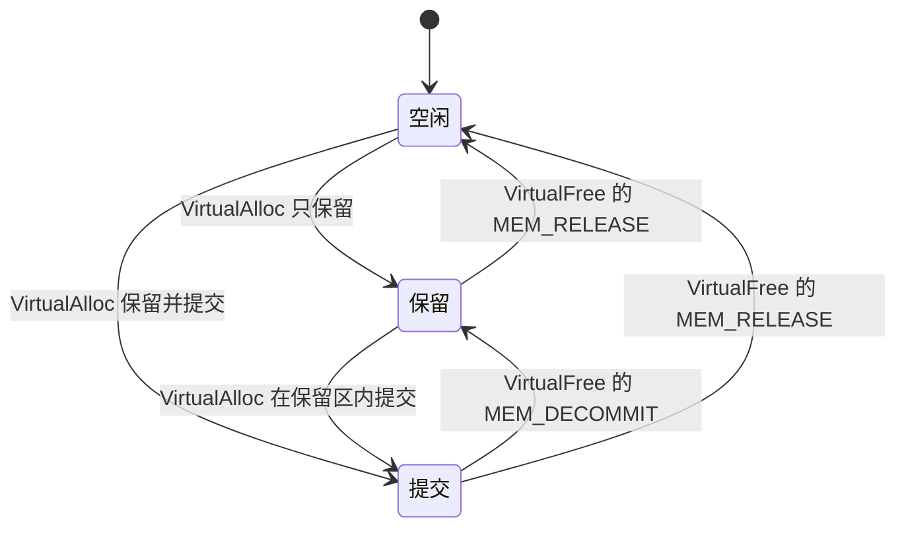

# A.6 内存管理与内存映射文件

在系统级应用开发中，内存管理面临的场景往往极度多样：一个规模达百万乘百万的稀疏矩阵，绝大多数索引格子空空如也，唯有数万处离散数据散落其间，若强行全量分配物理页将导致内存瞬间耗尽；一个体积数吉字节的高吞吐日志文件，需要以近乎裸内存访问的高速在极短时间内完成全量扫描与模式匹配；两个完全独立的进程，需要跨越特权边界共享同一组原子状态计数器，任何一方的改动必须立即对另一方无损呈现。这三类截然不同的工程需求，表面上指向不同的底层设施，而在操作系统的内核设计中，却统一构建在现代虚拟内存的页表抽象与地址空间投影体系之上。

Windows 将虚拟内存、系统堆分配器与内存映射文件收束在高度自洽的页级模型中：每一个进程拥有私有且连续的虚拟地址空间，其内部的内存页在空闲（Free）、保留（Reserved）与提交（Committed）这三种基础状态之间流转。开发者可以通过 `VirtualAlloc` 获得对地址空间与物理后备存储的细粒度掌控，利用文件映射对象（File Mapping Object）将磁盘上的持久化内容直接投射到指针寻址范围，亦或借助系统页面文件支撑的命名共享内存搭建零拷贝的跨进程协作通道。我们将深入探讨 64 KiB 分配粒度与 4 KiB 分页的历史渊源与对齐法则，界定用户态堆管理器与底层虚拟内存 API 的职责边界，拆解映射视图在多段切割与生命周期管理上的关键陷阱，并在实际工程维度建立清晰的内存选型基准。本页的程序在 `code/系统编程/拓展A_Win32系统编程/A_6_内存管理与内存映射文件/` 下，用 `gcc -std=c17 -Wall -Wextra` 编译，用到 `GetProcessMemoryInfo` 的程序再加 `-lpsapi`。

## 1. 地址空间与页面状态

Windows 的虚拟内存与 POSIX 的 `mmap` 是一套思路的两种实现，主线[第 4 章](/教程/正文/系统编程/4_虚拟内存与内存映射)讲过的概念这里都还用得上：进程有自己的地址空间，地址经页表翻译成物理地址，物理内存以页为单位管理。差别在接口：POSIX 用一个 `mmap` 加若干个 `mprotect`、`madvise` 覆盖全部操作，Windows 把地址空间本身做成一组可以直接操作的函数。

先看这台机器的参数：

::: terminal title="PowerShell - sysinfo"

```text
PS> gcc -std=c17 -Wall -Wextra -o sysinfo.exe sysinfo.c
PS> .\sysinfo.exe
page size              : 4096 bytes
allocation granularity : 65536 bytes
lowest user address    : 0000000000010000
highest user address   : 00007FFFFFFEFFFF
```

:::

页面大小 4096 字节，分配粒度 64 KiB。前者决定「一页多大」，后者决定「一次保留最少占多少地址」。x64 的用户地址空间从 64 KiB 起，到 128 TiB 为止，顶端再留出 64 KiB 不用，`lpMaximumApplicationAddress` 打印出的 `00007FFFFFFEFFFF` 就是最后一个可用字节。这个数字与实际可用量是两回事，进程实际能保留的地址远小于它。

64 KiB 的粒度来自 32 位时代的一次妥协。Raymond Chen 在《The Old New Thing》里解释过：Alpha AXP 这类 RISC 处理器没法用一条指令装载 32 位常量，要拆成两个 16 位半字分两次装，编译器会合并同一个 64 KiB 块内所有地址的高半字。如果重定位只把地址挪动 4 KiB，地址跨过 64 KiB 分界时高半字也要跟着改，那条合并过的装载指令就得拆成两条，重定位记录也得成对出现。把地址分配对齐到 64 KiB，这种跨越分界的情况就不会发生。同一个理由还解释了为什么 32 位地址空间顶部要空出 64 KiB。x64 上这个约束早就不存在了，粒度却保留了下来，程序按接口约定处理即可。

::: concept win-mem-page-state title="页面的三种状态"

进程地址空间里的每一页处于三种状态之一。空闲（free）页不属于任何分配，访问它触发访问违例。保留（reserve）页占住了这段地址，别的分配拿不到，但没有任何存储支撑，访问它同样触发访问违例。提交（commit）页从系统的内存与页面文件中计入了一笔额度，可以被访问，访问权限由保护属性决定。

保留只占地址，不花存储；提交要记账，但物理页仍要等到第一次读写时才真正分配。

:::

状态之间的转换用一个图表示最清楚。



用 `GetProcessMemoryInfo` 的 `PagefileUsage` 字段能直接看到「提交」这一步的账。写一个只做四件事的小程序：读一次计数、保留 256 MiB、提交其中 64 MiB、再逐页写一遍。

```c
show("start");
char *p = VirtualAlloc(NULL, (SIZE_T)256 << 20, MEM_RESERVE, PAGE_NOACCESS);
show("after reserve 256 MiB");
VirtualAlloc(p, (SIZE_T)64 << 20, MEM_COMMIT, PAGE_READWRITE);
show("after commit 64 MiB");
for (SIZE_T i = 0; i < ((SIZE_T)64 << 20); i += 4096) {
    p[i] = 1;
}
show("after touching 64 MiB");
VirtualFree(p, 0, MEM_RELEASE);
show("after release");
```

运行结果：

::: terminal title="PowerShell - memprobe"

```text
PS> gcc -std=c17 -Wall -Wextra -o memprobe.exe memprobe.c -lpsapi
PS> .\memprobe.exe
start                        PagefileUsage      544 KiB  WorkingSetSize     3696 KiB
after reserve 256 MiB        PagefileUsage      552 KiB  WorkingSetSize     3752 KiB
after commit 64 MiB          PagefileUsage    66216 KiB  WorkingSetSize     3752 KiB
after touching 64 MiB        PagefileUsage    66216 KiB  WorkingSetSize    69288 KiB
after release                PagefileUsage      552 KiB  WorkingSetSize     3760 KiB
```

:::

保留 256 MiB 之后提交量从 544 KiB 变成 552 KiB，8 KiB 的差别来自控制台输出等调用的开销，与 256 MiB 无关，说明保留只是一张地址占位表。提交 64 MiB 之后提交量涨到 66216 KiB，涨了 65664 KiB，正好 64 MiB 多一点记账开销。提交之后工作集还是 3752 KiB，直到逐页写一遍才涨到 69288 KiB：提交只记账，物理页要等第一次访问才分配。释放之后提交量回到保留时的水平，工作集也基本复原。

主线第 4 章讲过 Linux 的过量提交（overcommit），`malloc` 拿到一大块内存之后驻留集几乎不动，那是同一件事在 Linux 上的表现。两边的记账方式不同：Linux 默认允许申请量超过物理内存加交换区，真用超了由 OOM killer 挑一个进程杀掉；Windows 的提交额度有明确上限，通常是物理内存加页面文件的大小，超过这条线的 `VirtualAlloc(MEM_COMMIT)` 直接失败，程序当场拿到 `NULL`。

<Quiz
  type="single"
  :options="[
    { label: '4 KiB', value: 'A' },
    { label: '64 KiB，分配粒度决定的', value: 'B' },
    { label: '1 MiB', value: 'C' },
    { label: '不占用地址空间', value: 'D' }
  ]"
  answer="B"
>

`VirtualAlloc(NULL, 4096, MEM_RESERVE, PAGE_NOACCESS)` 一次调用实际占掉多少地址空间？

</Quiz>

## 2. VirtualAlloc 与 VirtualFree

`VirtualAlloc` 有四个参数：想要的起始地址（可以传 `NULL` 让系统挑）、大小、分配类型、保护属性。分配类型是 `MEM_RESERVE`、`MEM_COMMIT` 或两者按位或。

```c
LPVOID VirtualAlloc(LPVOID lpAddress, SIZE_T dwSize,
                    DWORD flAllocationType, DWORD flProtect);
```

保留时传 `NULL` 地址，系统在用户地址空间里找一段空闲区域，返回的首地址一定按分配粒度对齐。提交时传保留区域内的某个地址，只要落在保留区内就能成功，不必从区域首地址开始。释放用 `VirtualFree`：

```c
BOOL VirtualFree(LPVOID lpAddress, SIZE_T dwSize, DWORD dwFreeType);
```

`MEM_DECOMMIT` 把已提交的页退回保留状态，还要占着地址；`MEM_RELEASE` 把整段返还给系统，此时 `dwSize` 必须写 0，写别的值函数直接失败。

### 2.1 保留一大片、只提交几页

`sparse.c` 把这三件事串起来。它保留 1 GiB，只在 512 MiB 偏移处提交一页，用 `VirtualQuery` 观察三处地址的状态，再把这一页改成只读。

```c
unsigned long long before = commit_charge();
char *base = VirtualAlloc(NULL, REGION_SIZE, MEM_RESERVE, PAGE_NOACCESS);
printf("reserved 1 GiB at %p, commit charge %llu KiB -> %llu KiB\n",
       (void *)base, before / 1024, commit_charge() / 1024);
show_region("whole 1 GiB", base);

char *page = base + PAGE_OFFSET;
VirtualAlloc(page, si.dwPageSize, MEM_COMMIT, PAGE_READWRITE);
printf("first four bytes of the fresh page: %d %d %d %d\n", page[0], page[1],
       page[2], page[3]);
show_region("start of the region", base);
show_region("at 512 MiB", page);
show_region("the page after it", page + si.dwPageSize);
```

`show_region` 用 `VirtualQuery` 填一个 `MEMORY_BASIC_INFORMATION`，打印这一页所在区域的基址、长度、状态和保护属性。`VirtualQuery` 按属性把地址空间切成「连续的、状态和保护都相同」的区域，所以从区域起点查和从中间查会得到不同的长度。

运行：

::: terminal title="PowerShell - sparse"

```text
PS> gcc -std=c17 -Wall -Wextra -o sparse.exe sparse.c -lpsapi
PS> .\sparse.exe
page size 4096 bytes, allocation granularity 65536 bytes
reserved 1 GiB at 000002A380000000, commit charge 564 KiB -> 564 KiB
whole 1 GiB            base 000002A380000000  size  1048576 KiB  reserved   protect 0x000
committed one page at 000002A3A0000000 (512 MiB into the region), commit charge 576 KiB
first four bytes of the fresh page: 0 0 0 0
start of the region    base 000002A380000000  size   524288 KiB  reserved   protect 0x000
at 512 MiB             base 000002A3A0000000  size        4 KiB  committed  protect 0x004
the page after it      base 000002A3A0001000  size   524284 KiB  reserved   protect 0x000
read back: this page lives in the middle
VirtualProtect to read-only, previous protection 0x004
at 512 MiB             base 000002A3A0000000  size        4 KiB  committed  protect 0x002
```

:::

地址值每次运行都不同，这是地址空间布局随机化（ASLR）在起作用，与主线第 4 章看到的现象一样。输出里有三处值得看。保留 1 GiB 之后提交量没有变化，证明保留不记账。提交的那一页是 4 KiB，前后两段保留区各 524288 KiB 和 524284 KiB，加起来正好 1 GiB，说明提交把原来的保留区切成了两段。新提交的页里四个字节都是 0，这是文档承诺的：提交的页在被访问之前一律是零，不会把上一家的数据留给你。保护属性 `0x004` 是 `PAGE_READWRITE`，`0x002` 是 `PAGE_READONLY`。

`VirtualProtect` 的第四个参数带回旧属性，需要时用 `VirtualProtect` 再改回去。这个函数对应 POSIX 的 `mprotect`，用在页一级。

### 2.2 释放与解除提交

`MEM_DECOMMIT` 和 `MEM_RELEASE` 的区别用一个短程序验证。`sparse.c` 在上面的流程之后接着做：

```c
VirtualFree(page, si.dwPageSize, MEM_DECOMMIT);
show_region("at 512 MiB", page);

DWORD release_err = 0;
BOOL released = VirtualFree(base, REGION_SIZE, MEM_RELEASE);
if (!released) {
    release_err = GetLastError();
}
printf("MEM_RELEASE with a nonzero size: %s, error %lu\n",
       released ? "TRUE" : "FALSE", (unsigned long)release_err);
VirtualFree(base, 0, MEM_RELEASE);
```

输出：

::: terminal title="PowerShell - sparse（释放）"

```text
PS> .\sparse.exe
...
after MEM_DECOMMIT, commit charge 564 KiB
at 512 MiB             base 000002A3A0000000  size   524288 KiB  reserved   protect 0x000
MEM_RELEASE with a nonzero size: FALSE, error 87
after MEM_RELEASE the range is free again
```

:::

解除提交之后那一页回到保留，和前后的保留区合并成 512 MiB 一段，提交量也降回去了。`MEM_RELEASE` 带非零大小返回 FALSE、错误 87（`ERROR_INVALID_PARAMETER`），大小必须写 0；程序里再调用一次并传 0，整段才真正释放。这条规则本身不复杂，但在把释放操作封装成工具函数时很容易写错，错误码 87 是排查时的第一线索。

### 2.3 分配粒度：4 KiB 的保留占掉 64 KiB

页是提交的单位，分配粒度是保留的单位。`pagegran.c` 把两者的关系量出来：

```c
char *a = VirtualAlloc(NULL, 4096, MEM_RESERVE, PAGE_NOACCESS);
printf("aligned to the granularity: %s\n",
       (unsigned long long)(uintptr_t)a % si.dwAllocationGranularity == 0
           ? "yes" : "no");

void *b = VirtualAlloc(a + 4096, 4096, MEM_RESERVE, PAGE_NOACCESS);
printf("reserving 4 KiB at a + 4096: %s, error %lu\n",
       b == NULL ? "NULL" : "ok", (unsigned long)GetLastError());
printf("state of that page: 0x%04lX (0x10000 is MEM_FREE)\n",
       state_of(a + 4096));

char *c = VirtualAlloc(NULL, 4096, MEM_RESERVE | MEM_COMMIT, PAGE_READWRITE);
char *d = VirtualAlloc(NULL, 4096, MEM_RESERVE | MEM_COMMIT, PAGE_READWRITE);
printf("two 4 KiB reserve+commit blocks at %p and %p, distance %llu\n",
       (void *)c, (void *)d, (unsigned long long)((char *)d - (char *)c));
```

::: terminal title="PowerShell - pagegran"

```text
PS> gcc -std=c17 -Wall -Wextra -o pagegran.exe pagegran.c
PS> .\pagegran.exe
granularity 65536 bytes, a 4 KiB reservation at 0000024E8D7C0000
aligned to the granularity: yes
reserving 4 KiB at a + 4096: NULL, error 487
state of that page: 0x10000 (0x10000 is MEM_FREE)
two 4 KiB reserve+commit blocks at 0000024E8D7D0000 and 0000024E8D7E0000, distance 65536
the first block: 4 KiB committed, the next 60 KiB free
```

:::

一次 4 KiB 的保留，返回的地址按 64 KiB 对齐。紧挨着它的下一页虽然 `VirtualQuery` 报 `MEM_FREE`，却分不出去，错误 487（`ERROR_INVALID_ADDRESS`）。两个独立的 4 KiB 保留+提交分配相距 65536 字节，第一个分配所在的粒度块里只有 4 KiB 被提交，剩下 60 KiB 空闲也回不到分配器手里。这两条合起来说明：保留的最小单位是 64 KiB，一次保留不足 64 KiB 时，剩下的部分就白搭在这一块里。

这个规则落到代码上是两条：需要多次小保留时，与其一页一页留，不如一次留大块再逐页提交；按文件偏移创建视图时，偏移必须是分配粒度的倍数（第 4 节），不是页大小的倍数。

### 2.4 写错了会怎样

访问保留未提交的页、往只读页里写，结果都是访问违例。`sparse.exe` 带参数运行就能看到：

::: terminal title="PowerShell - sparse reserved"

```text
PS> .\sparse.exe reserved
page size 4096 bytes, allocation granularity 65536 bytes
reserved 1 GiB at 000001D300000000, commit charge 564 KiB -> 564 KiB
whole 1 GiB            base 000001D300000000  size  1048576 KiB  reserved   protect 0x000
committed one page at 000001D320000000 (512 MiB into the region), commit charge 576 KiB
first four bytes of the fresh page: 0 0 0 0
start of the region    base 000001D300000000  size   524288 KiB  reserved   protect 0x000
at 512 MiB             base 000001D320000000  size        4 KiB  committed  protect 0x004
the page after it      base 000001D320001000  size   524284 KiB  reserved   protect 0x000
read back: this page lives in the middle
VirtualProtect to read-only, previous protection 0x004
at 512 MiB             base 000001D320000000  size        4 KiB  committed  protect 0x002
writing to a reserved page that was never committed...
PS> $LASTEXITCODE
-1073741819
```

:::

`sparse.exe readonly` 的结果一样，只是出错的位置换成写只读页。`-1073741819` 的十六进制是 `0xC0000005`，就是[结构化异常处理](/教程/正文/系统编程/拓展A_Win32系统编程/A_5_错误处理与结构化异常处理)那一页讲的访问违例。没有任何处理程序时，进程以这个代码结束，PowerShell 把它显示成负数。

<Quiz
  type="single"
  :options="[
    { label: '系统自动提交这一页，然后继续', value: 'A' },
    { label: '读到 0，写入被丢弃', value: 'B' },
    { label: '引发访问违例', value: 'C' },
    { label: '分配物理页之后继续', value: 'D' }
  ]"
  answer="C"
>

访问一页「已保留但未提交」的内存，会发生什么？

</Quiz>

用 A.5 的 VEH，可以在访问到「已保留未提交」的页时当场提交它，再让出错的那条指令重新执行，这让「保留一大片、访问到哪提交到哪」变得可行。Microsoft Learn 的「Reserving and Committing Memory」示例用的就是这个思路，原例写的是 MSVC 的 `__try`，下面的写法换成 GCC 也能编的 VEH。

::: details 用 VEH 实现访问时按需提交

```c
static LONG CALLBACK commit_on_demand(EXCEPTION_POINTERS *info) {
    if (info->ExceptionRecord->ExceptionCode != EXCEPTION_ACCESS_VIOLATION) {
        return EXCEPTION_CONTINUE_SEARCH;
    }
    /* ExceptionInformation[1] 才是出错的那个地址；[0] 是访问类型 */
    char *fault = (char *)info->ExceptionRecord->ExceptionInformation[1];
    if (fault < g_reserved || fault >= g_reserved + PAGE_COUNT * g_page_size) {
        return EXCEPTION_CONTINUE_SEARCH;
    }
    MEMORY_BASIC_INFORMATION mbi;
    if (VirtualQuery(fault, &mbi, sizeof mbi) == 0 ||
        mbi.State != MEM_RESERVE) {
        return EXCEPTION_CONTINUE_SEARCH;
    }
    if (VirtualAlloc(mbi.BaseAddress, g_page_size, MEM_COMMIT, PAGE_READWRITE) ==
        NULL) {
        return EXCEPTION_CONTINUE_SEARCH;
    }
    g_commits++;
    printf("  handler: committed the page at %p, retrying the instruction\n",
           mbi.BaseAddress);
    return EXCEPTION_CONTINUE_EXECUTION;
}
```

主程序保留 16 页、装上 VEH，然后连续往四页里写。`veh_commit.exe` 的输出：

```text
writing to page 0 at 0000014AE8070000
  handler: committed the page at 0000014AE8070000, retrying the instruction
  value read back: a
writing to page 1 at 0000014AE8071000
  handler: committed the page at 0000014AE8071000, retrying the instruction
  value read back: b
writing to page 2 at 0000014AE8072000
  handler: committed the page at 0000014AE8072000, retrying the instruction
  value read back: c
writing to page 3 at 0000014AE8073000
  handler: committed the page at 0000014AE8073000, retrying the instruction
  value read back: d
pages committed by the handler: 4
```

每次写到新的一页，筛选器提交这一页并让指令重新执行，第二次执行就成功了。这里有两处值得记住：异常记录里的 `ExceptionInformation[0]` 是访问类型（0 表示读、1 表示写、8 表示执行），出错地址在 `[1]`；筛选器先确认这一页确实处于保留状态，否则把控制权交回去，别的访问违例照常让进程结束。返回 `EXCEPTION_CONTINUE_EXECUTION` 只在原因真的被消除之后才安全，A.5 已经强调过这一点。

:::

这个写法每一页第一次写都要走一遍异常分发，开销远大于一次普通的 `MEM_COMMIT`。它值得用的场景，是「绝大多数页永远用不到」的稀疏结构，异常路径根本不常走；普通程序不要拿它当懒加载的通用手段。

## 3. 堆

`VirtualAlloc` 以页为单位，最小一次 4 KiB 的提交、64 KiB 的保留；程序里一个几十字节的节点用它就太浪费了。堆（heap）是建立在虚拟内存上的一层分配器，把页切成小块，管理空闲块、记录大小和对齐。

### 3.1 默认堆与堆函数

每个进程有一个默认堆，用 `GetProcessHeap()` 拿到它的句柄。堆上的三件套是：

```c
HANDLE GetProcessHeap(void);
LPVOID HeapAlloc(HANDLE hHeap, DWORD dwFlags, SIZE_T dwBytes);
BOOL HeapFree(HANDLE hHeap, DWORD dwFlags, LPVOID lpMem);
```

配套的还有 `HeapReAlloc`、`HeapSize`（查一块已分配内存的实际大小）、`HeapValidate`（检查堆的完整性）。`HeapAlloc` 的标志位里常用的是 `HEAP_ZERO_MEMORY`，相当于 `calloc`；不写这个标志时，文档不承诺块里的内容，虽然小块的实现常常顺手给零，靠这个巧合是给自己埋雷。`HeapAlloc` 返回的指针在块被释放或重新分配之前一直有效，堆不会移动已分配的内存，所以不需要「锁定」。

C 运行库的 `malloc` 在这个平台上最终也从进程堆上要内存。MinGW 的 UCRT 版本实测：`malloc(1000)` 得到的指针交给 `HeapSize(GetProcessHeap(), 0, p)` 恰好返回 1000，说明它就是进程堆上的一块。

::: concept win-mem-pairing title="分配与释放必须配套"

用哪个函数分配，就用配套的函数释放。`HeapAlloc` 分配的内存用 `HeapFree`，`malloc` 分配的内存用 `free`。两套函数在同一块内存上混用属于未定义行为。

:::

混用不一定当场崩溃。`HeapFree` 拿到一个 `malloc` 来的块会返回 TRUE，`free` 拿到一个 `HeapAlloc` 来的块也可能安静地返回；两个分配器碰巧都长在进程堆上，头部结构有几分相似。这种「今天没事」正是最坏的情况：换一个编译器版本、换一种大小的块、或者中间夹了一次别的分配，同一份代码就崩在离出错点很远的地方。DLL 之间尤其要小心，一个 DLL 用 `malloc` 分配、宿主用 `HeapFree` 释放，两边链接的 CRT 可能根本不是同一份，这属于 [A.7](/教程/正文/系统编程/拓展A_Win32系统编程/A_7_动态链接库_DLL) 的内容。

### 3.2 私有堆

`HeapCreate` 创建一个只属于本进程的堆，有自己的初始大小、最大大小和标志位（`HEAP_NO_SERIALIZE` 表示调用者自己保证不会多线程同时用）。`HeapDestroy` 销毁它，把堆里所有已提交的页一次性解除提交并释放地址。

`heap_arena.c` 在一个私有堆里分配 1000 个链表节点，用完一次 `HeapDestroy` 全部归还：

```c
HANDLE heap = HeapCreate(0, 64 * 1024, 0);
struct node *head = NULL;
for (int i = 0; i < NODE_COUNT; i++) {
    struct node *n = HeapAlloc(heap, 0, sizeof *n);
    n->value = i;
    snprintf(n->label, sizeof n->label, "node-%03d", i);
    n->next = head;
    head = n;
}
...
HeapDestroy(heap);
```

::: terminal title="PowerShell - heap_arena"

```text
PS> gcc -std=c17 -Wall -Wextra -o heap_arena.exe heap_arena.c
PS> .\heap_arena.exe
private heap created, handle 000002A7D80B0000
allocated 1000 nodes, sum of values = 499500
sizeof(struct node) = 40, HeapSize of the head = 40
default heap handle 000002A7D7D60000, 1000 bytes at 000002A7D7D735D0, HeapSize 1000
HeapDestroy returned, all 1000 nodes are gone at once
```

:::

私有堆的句柄值（`000002A7D80B0000`）和默认堆的句柄值（`000002A7D7D60000`）不一样，两个堆的块分别从各自的地址段里切出来。`HeapSize` 对刚分配的块返回请求的字节数。

私有堆最有价值的用法是「按模块成批释放」：一个模块、一次请求、一个任务分配的所有对象都放进同一个私有堆，结束时不逐个 `HeapFree`，直接 `HeapDestroy`。这比逐个释放快，也彻底杜绝了漏释放。代价是这个堆和它的句柄绑在一起，句柄丢了就没法再往里面分配，堆销毁之后碰里面的指针就是访问违例。主线[第 11 章](/教程/正文/语法和标准库/11_动态存储与所有权)讲的所有权，在这里有了一个可以整体归还的容器。

一个需要注意的地方：`HeapCreate` 的初始大小是「一开始就提交的页数」，最大大小是「保留的页数」。初始大小传 0 表示用默认值。初始大小设得比实际需要大，等于白占提交额度；设得太小，分配超出时会从保留区里继续提交，不失败。

## 4. 内存映射文件

主线第 4 章用 `mmap` 把文件接进地址空间，同一个思路在 Windows 上要经过三个对象：文件句柄、文件映射对象（file mapping object）、视图（view）。文件映射对象代表「这段文件内容可以被映射」这件事，视图代表「它现在出现在进程地址空间的哪一段」。

```c
HANDLE CreateFileMappingW(HANDLE hFile, LPSECURITY_ATTRIBUTES sa,
                          DWORD flProtect, DWORD dwMaximumSizeHigh,
                          DWORD dwMaximumSizeLow, LPCWSTR lpName);
LPVOID MapViewOfFile(HANDLE hMap, DWORD dwDesiredAccess, DWORD dwOffsetHigh,
                     DWORD dwOffsetLow, SIZE_T dwNumberOfBytesToMap);
BOOL UnmapViewOfFile(LPCVOID lpBaseAddress);
```

创建映射对象时 `flProtect` 用 `PAGE_READONLY` 或 `PAGE_READWRITE`，它决定这个映射对象允许创建哪些视图；`dwMaximumSize` 传 0 表示按文件当前大小。创建视图时 `dwDesiredAccess` 用 `FILE_MAP_READ` 或 `FILE_MAP_WRITE`，它不能超出映射对象允许的范围：`PAGE_READONLY` 的映射对象上请求 `FILE_MAP_WRITE`，`MapViewOfFile` 直接返回 `NULL`、错误 5。这个约束在写代码时要记住：先决定文件要以什么方式打开（`GENERIC_READ` 还是 `GENERIC_READ | GENERIC_WRITE`），再决定映射对象的保护属性，最后才是视图的访问方式，三层必须相容。

### 4.1 读一个大文件

`mapcount.c` 用三种方式数同一个文件的行数：`ReadFile` 循环、整个文件一个视图、按 4 MiB 窗口分段映射。

```c
HANDLE map = CreateFileMappingW(h, NULL, PAGE_READONLY, 0, 0, NULL);
char *view = MapViewOfFile(map, FILE_MAP_READ, 0, 0, 0);
/* 映射对象自己持有文件的引用，文件句柄现在就可以关掉 */
CloseHandle(h);

*bytes = (unsigned long long)size.QuadPart;
*lines = count_newlines(view, (size_t)size.QuadPart);

UnmapViewOfFile(view);
CloseHandle(map);
```

在一个 16 MiB 的访问日志上运行：

::: terminal title="PowerShell - mapcount"

```text
PS> gcc -std=c17 -Wall -Wextra -municode -o mapcount.exe mapcount.c
PS> .\mapcount.exe access.log
ReadFile loop : 16166188 bytes, 200000 lines
one view      : 16166188 bytes, 200000 lines
4 MiB windows : 16166188 bytes, 200000 lines in 4 windows
view at offset 4096: NULL, error 1132
```

:::

三种方式的结果一致，`ReadFile` 循环那一行和直接读文件数出来的一样。这个文件有 16166188 字节，按 4 MiB 一段正好切成 4 个窗口，最后一个窗口比 4 MiB 小一点，`MapViewOfFile` 的最后一个参数就是实际要映射的长度。

输出的最后一行验证了偏移的对齐规则。`MapViewOfFile` 的偏移 4096 是页大小的倍数，却不是分配粒度的倍数，函数返回 `NULL`、错误 1132（`ERROR_MAPPED_ALIGNMENT`）。要按 64 KiB 的倍数为界切分文件，比如「每 64 MiB 一个窗口」。这条规则和 `mmap` 只要求页对齐不一样，跨平台代码在这里要单独处理。

换一个 1 GiB 的文件：

::: terminal title="PowerShell - mapcount（1 GiB）"

```text
PS> .\mapcount.exe big.log
ReadFile loop : 1073741760 bytes, 13765920 lines
one view      : 1073741760 bytes, 13765920 lines
4 MiB windows : 1073741760 bytes, 13765920 lines in 256 windows
view at offset 4096: NULL, error 1132
```

:::

1 GiB 的文件在 x64 上一个视图就能装下，进程的地址空间是 128 TiB，不缺地址。真正需要分段的原因有三个：32 位进程只有 2 GiB 或 3 GiB 地址空间，装不下大文件；视图的范围一大，页表与记账也跟着大；整个文件一次映射之后，凡是被访问过的页都留在工作集里，分段映射可以把这个数字压住。

后两条用 `viewstats.c` 量一下。它把 1 GiB 的文件整个映射进来，每 4 KiB 读一个字节，把整个视图的页都拉进工作集：

::: terminal title="PowerShell - viewstats"

```text
PS> gcc -std=c17 -Wall -Wextra -o viewstats.exe viewstats.c -lpsapi
PS> .\viewstats.exe big.log
start                          PagefileUsage      596 KiB  WorkingSetSize     4208 KiB
after mapping the whole file   PagefileUsage     2648 KiB  WorkingSetSize     4292 KiB
sum of the first byte of every page: 13766015
after touching every page      PagefileUsage     2648 KiB  WorkingSetSize  1052868 KiB
after unmapping                PagefileUsage      596 KiB  WorkingSetSize     4296 KiB
```

:::

只是建立一个 1 GiB 的视图，提交量就从 596 KiB 涨到 2648 KiB，工作集几乎没动；把每页都碰一遍之后，工作集涨到 1052868 KiB，整个文件都压在进程里。解除映射之后两项都回落，说明那些文件页可以被系统随时收回。`MapViewOfFile` 的最后一个参数写 0 表示「从偏移到文件末尾」，不写 0 就按给的长度来。

<Quiz
  type="single"
  :options="[
    { label: '任意偏移，函数自己对齐', value: 'A' },
    { label: '页大小的倍数，即 4096', value: 'B' },
    { label: '分配粒度的倍数，即 65536', value: 'C' },
    { label: '扇区大小的倍数', value: 'D' }
  ]"
  answer="C"
>

`MapViewOfFile` 的 `dwFileOffsetLow` 必须是下面哪一种倍数？

</Quiz>

::: warning 文件映射与 ReadFile 不保证一致

同一个文件同时有映射视图和 `ReadFile` 读写时，两边看到的内容不保证一致。系统会把视图的页在内存里缓存，`ReadFile` 走的是另一条路径。要么全部用映射，要么全部用 `ReadFile`，不要指望两者实时同步。

:::

::: tip 映射对象持有文件引用

创建映射对象之后，映射对象自己持有文件的引用，文件句柄可以立刻关掉，视图仍然有效。反过来，只要还有视图没有解除映射，映射对象就一直活着，那段地址也一直占着。所以完整的清理顺序是：`UnmapViewOfFile` 解除所有视图，再 `CloseHandle` 关闭映射对象，最后关闭文件句柄（如果还留着）。漏掉 `UnmapViewOfFile` 是内存泄漏，进程退出前那段地址释放不掉。

:::

### 4.2 可写视图

可写视图用在需要原地修改文件的场合：修改配置文件的几个字段、更新数据库页、给大文件打补丁。`mapwrite.c` 建一个 4 KiB 的文件，映射成可写视图，改掉开头一行，再用 `ReadFile` 读回来验证。

```c
strcpy(view, "hello from the view");
FlushViewOfFile(view, 0);
UnmapViewOfFile(view);
CloseHandle(map);
CloseHandle(h);

h = CreateFileW(L"greeting.txt", GENERIC_READ, FILE_SHARE_READ, NULL,
                OPEN_EXISTING, 0, NULL);
char buf[64] = {0};
DWORD got = 0;
ReadFile(h, buf, sizeof buf - 1, &got, NULL);
printf("read back with ReadFile: \"%s\"\n", buf);
```

::: terminal title="PowerShell - mapwrite"

```text
PS> gcc -std=c17 -Wall -Wextra -o mapwrite.exe mapwrite.c
PS> .\mapwrite.exe
read back with ReadFile: "hello from the view"
FILE_MAP_WRITE on a PAGE_READONLY mapping: NULL, error 5
```

:::

`FlushViewOfFile` 把视图里改过的页刷到磁盘，作用相当于 POSIX 的 `msync`。不调用它，修改也会在视图解除映射之后的某个时刻写回，但具体时机由系统决定；程序要在崩溃后仍能看到修改，就显式刷一次。刷完之后用另一个句柄 `ReadFile` 读到的内容也是新的，说明修改确实落到了文件。

最后一行演示了访问权限的检查发生在创建视图的时候，而不是第一次写的时候。`PAGE_READONLY` 的映射对象不能创建 `FILE_MAP_WRITE` 的视图，函数返回 `NULL`、错误 5（`ERROR_ACCESS_DENIED`）。

一个空文件不能直接映射：`CreateFileMappingW` 对长度为 0 的文件失败，错误 1006（`ERROR_FILE_INVALID`）。所以 `mapwrite.c` 先用 `SetFilePointerEx` 加 `SetEndOfFile` 把文件撑到一页，再创建映射。读文件的程序也要先 `GetFileSizeEx` 判一下长度，碰到空文件直接跳过。

::: compare left-title="POSIX 的 mmap" right-title="Win32 的文件映射"

```c
int fd = open(path, O_RDWR);
struct stat st;
fstat(fd, &st);
char *p = mmap(NULL, st.st_size, PROT_READ | PROT_WRITE,
               MAP_SHARED, fd, 0);
if (p == MAP_FAILED) { /* 处理错误 */ }

strcpy(p, "hello");
msync(p, st.st_size, MS_SYNC);
munmap(p, st.st_size);
close(fd);
```

---

```c
HANDLE h = CreateFileW(path, GENERIC_READ | GENERIC_WRITE, 0, NULL,
                       OPEN_EXISTING, 0, NULL);
LARGE_INTEGER size;
GetFileSizeEx(h, &size);
HANDLE map = CreateFileMappingW(h, NULL, PAGE_READWRITE, 0, 0, NULL);
char *view = MapViewOfFile(map, FILE_MAP_WRITE, 0, 0, 0);
if (view == NULL) { /* 处理错误 */ }

strcpy(view, "hello");
FlushViewOfFile(view, 0);
UnmapViewOfFile(view);
CloseHandle(map);
CloseHandle(h);
```

:::

两边是一一对应的：`open` 对 `CreateFileW`，`mmap` 对 `CreateFileMappingW` 加 `MapViewOfFile`，`msync` 对 `FlushViewOfFile`，`munmap` 对 `UnmapViewOfFile`。Win32 多出一个映射对象，换来的是它能独立于视图存在，也能被别的进程按名字打开。`mmap` 的偏移只要求页对齐，`MapViewOfFile` 的偏移要求分配粒度对齐，这是移植时最容易踩的一处差异。

### 4.3 视图里的 I/O 错误

访问映射视图时若发生 I/O 错误（比如文件所在的分区被拔掉、网络盘断线），系统引发 `EXCEPTION_IN_PAGE_ERROR`（`0xC0000006`），不是返回错误码。`ReadFile` 遇到同一件事返回 FALSE、`GetLastError` 给出错误码。差别在于映射视图的访问是普通的内存读写，没有返回值可查，错误只能走异常。需要处理这种情况的程序（通常在读写不可靠介质时）要把访问视图的代码放进异常处理里，[A.5](/教程/正文/系统编程/拓展A_Win32系统编程/A_5_错误处理与结构化异常处理) 的 VEH 就是其中一种做法。

## 5. 命名的共享内存

第 4 节的映射对象背后是一个磁盘文件。`CreateFileMappingW` 的第一个参数传 `INVALID_HANDLE_VALUE`，得到的映射对象背后是页面文件（paging file）：不需要任何磁盘文件，内容在最后一个引用消失后随之消失。给它起个名字，别的进程就能按名字打开它。这就是 Windows 的共享内存。

```c
HANDLE map = CreateFileMappingW(INVALID_HANDLE_VALUE, NULL, PAGE_READWRITE, 0,
                                4096, L"Local\\MdrTutorial.Shm");
```

名字的前缀决定谁看得到它。`Local\` 前缀的对象只在当前登录会话（Terminal Services 会话）里可见，这是本拓展统一的命名约定；`Global\` 前缀在整个系统里可见，从非零会话创建它需要 `SeCreateGlobalPrivilege`；不带前缀时按默认规则落在当前会话。名字不能包含反斜杠（前缀的那个除外）。

一组两个程序演示这条通路。`shm_writer.c` 创建映射、写入一段文字和一个每秒自增的计数：

```c
struct shared_block *shm =
    MapViewOfFile(map, FILE_MAP_ALL_ACCESS, 0, 0, SHM_SIZE);
shm->counter = 0;
shm->ticks = 0;
snprintf(shm->message, sizeof shm->message, "written by pid %lu",
         (unsigned long)GetCurrentProcessId());
for (int i = 0; i < 10; i++) {
    Sleep(300);
    InterlockedIncrement(&shm->counter);
    shm->ticks = i + 1;
}
```

`shm_reader.c` 用 `OpenFileMappingW` 按名字打开，映射同一块内存，隔 400 毫秒读一次：

```c
HANDLE map = OpenFileMappingW(FILE_MAP_ALL_ACCESS, FALSE, SHM_NAME);
struct shared_block *shm =
    MapViewOfFile(map, FILE_MAP_ALL_ACCESS, 0, 0, SHM_SIZE);
printf("message: \"%s\"\n", shm->message);
for (int i = 0; i < 5; i++) {
    printf("reader sees counter = %ld, ticks = %ld\n", (long)shm->counter,
           (long)shm->ticks);
    Sleep(400);
}
```

两个进程一前一后启动，先在后台起写方，400 毫秒后再起读方：

::: terminal title="PowerShell - shm_writer 与 shm_reader"

```text
PS> gcc -std=c17 -Wall -Wextra -o shm_writer.exe shm_writer.c
PS> gcc -std=c17 -Wall -Wextra -o shm_reader.exe shm_reader.c
PS> $w = Start-Process -FilePath .\shm_writer.exe -NoNewWindow -RedirectStandardOutput wlog.txt -PassThru
PS> Start-Sleep -Milliseconds 400
PS> .\shm_reader.exe
opened Local\MdrTutorial.Shm, view at 00000234848B0000
message: "written by pid 14312"
reader sees counter = 1, ticks = 1
reader sees counter = 2, ticks = 2
reader sees counter = 4, ticks = 4
reader sees counter = 5, ticks = 5
reader sees counter = 6, ticks = 6
PS> $w.WaitForExit()
PS> Get-Content wlog.txt
created Local\MdrTutorial.Shm (error 0; 183 would mean it already existed)
view at 000002599CA40000, message: "written by pid 14312"
writer: counter = 1
writer: counter = 2
writer: counter = 3
writer: counter = 4
writer: counter = 5
writer: counter = 6
writer: counter = 7
writer: counter = 8
writer: counter = 9
writer: counter = 10
writer done, all handles closed
```

:::

读方看到的是写方写进去的内容，`message` 里的进程 ID 与写方打印的一致，计数器一路涨到 6。读方少了 3，因为两边没有同步：读方每 400 毫秒采样一次，写方每 300 毫秒加一，采样正好落在 3 那一次之后、4 之前。这个数字每次运行都不同，能说明一件事就够了：读到的数据是写方真的写过的值，不是各写各的。

两个进程里 `shm` 指针的值不同（`00000234848B0000` 和 `000002599CA40000`），指向的却是同一块物理存储。地址由各进程的地址空间决定，在共享内存里放指针没有意义，跨进程的表达一律用偏移量。

::: warning 共享内存自己不带同步

两个进程同时读写同一块共享内存，没有任何机制保证先后顺序和原子性。写方写完一个结构体，读方可能读到写了一半的状态。上面的例子靠 `Sleep` 和采样间隔「凑」出了正确结果，工程上不能这么写。正确的做法是配一个命名事件或命名互斥量，[A.10](/教程/正文/系统编程/拓展A_Win32系统编程/A_10_同步原语_等待函数与内核对象) 讲等待函数时会把这一组示例改成事件通知。

:::

::: concept win-mem-named-object-lifetime title="命名映射对象的生存期"

命名的文件映射对象和 `shm_open` 创建的对象不一样，它在系统的对象管理器里没有持久的目录项。最后一个句柄关闭、最后一个视图解除映射，对象就销毁，名字随之消失，下一次同名的 `CreateFileMappingW` 会创建一个全新的、内容全零的对象。

只要还有视图没解除映射，对象就还活着，但名字已经不再能按名字打开：关闭最后一个句柄之后，`OpenFileMappingW` 会失败，错误 2。

:::

`shm_lifetime.c` 把这条规则逐项走一遍。它创建映射、写进一句话，然后关掉映射句柄，只留视图：

::: terminal title="PowerShell - shm_lifetime"

```text
PS> gcc -std=c17 -Wall -Wextra -o shm_lifetime.exe shm_lifetime.c
PS> .\shm_lifetime.exe
create #1: GetLastError = 0 (183 means the name existed)
closed the mapping handle; the view still reads: "the view still works"
OpenFileMappingW by name while only a view is alive: NULL, error 2
create #2 with the same name: handle, GetLastError = 0
the new object's view reads: "" (starts out zeroed)
after every handle and view is closed: NULL, error 2
```

:::

句柄一关，视图照常能读写，可是按名字已经打不开了；再用同一个名字 `CreateFileMappingW` 建一个，得到的是一个全新的对象，里面清零，和旧对象没半点关系。最后所有视图和句柄都没了，名字也跟着消失。

这条规则和 POSIX 的 `shm_open` 差别很大。`shm_open` 创建的对象挂在 `/dev/shm` 下面，进程退出之后还在，要显式 `shm_unlink` 才消失，所以 POSIX 程序里必须安排谁来清理。Windows 的命名映射对象没人引用就自动消失，省掉了清理，代价是别的进程必须赶在最后一个人走之前打开它。本页的 `shm_writer` 运行 3 秒，`shm_reader` 只要晚于这个窗口启动，就会拿到错误 2，实际用的时候由创建方负责活到所有使用方都打开为止。

<Quiz
  type="single"
  :options="[
    { label: '当前目录下的一个临时文件', value: 'A' },
    { label: '系统页面文件', value: 'B' },
    { label: '物理内存，且不可换出', value: 'C' },
    { label: '注册表', value: 'D' }
  ]"
  answer="B"
>

第一个参数传 `INVALID_HANDLE_VALUE` 的 `CreateFileMappingW` 创建的映射对象，背后是什么？

</Quiz>

## 6. 选哪一种

几种分配方式看起来都能给出一块内存，实际用起来各有位置。

| 场景 | 用什么 | 理由 |
| --- | --- | --- |
| 普通对象、结构体、字符串 | `malloc` / `free` | 最小分配单位是几十字节，不用关心页 |
| 大块缓冲区、自己管理生存期 | `VirtualAlloc` / `VirtualFree` | 按页提交、按页改保护，没有额外开销 |
| 一批对象按模块成批释放 | `HeapCreate` + `HeapDestroy` | 结束一次归还整块，不必逐个释放 |
| 大文件只读扫描、随机访问 | 文件映射 | 不用自己管缓冲区，不额外拷贝 |
| 进程间共享一块数据 | 命名映射 + 同步对象 | 两端拿到的是同一块存储 |

几条具体的判断。一般的节点、字符串、缓冲区，用 `malloc` 就够，它在这个平台上就长在进程堆上，没有理由为了「直接用 Win32」而换成 `HeapAlloc`。`VirtualAlloc` 适合大块、生存期明确、需要单独改保护属性的缓冲区，比如自己实现的 arena、JIT 生成代码（需要 `PAGE_EXECUTE_READWRITE`）、环形缓冲区；它不适合大量小分配，每次提交至少 4 KiB。私有堆适合「一个模块的所有对象一起活、一起死」的结构，比如解析一个文件时建的所有语法树节点，解析完就不再需要；它比逐个 `free` 快，也不会漏。

文件映射的取舍和主线第 4 章讲的 `mmap` 一致。顺序读一遍就丢的文件，`ReadFile` 加一个缓冲区代码更短、出错路径更少；需要随机访问、多次扫描、或者两个进程看同一份数据，映射才有价值。映射的一个隐性成本是文件被其他程序截短时会得到访问违例（对应 POSIX 的 `SIGBUS`），长时间映射的文件要考虑这个情况。

跨进程共享的选择在 [A.12](/教程/正文/系统编程/拓展A_Win32系统编程/A_12_管道与进程间通信) 有一张更完整的表。简单地说：数据量小、消息式地用匿名管道或命名管道；数据量大、读写频繁，用共享内存配同步对象；既要跨机器，就用套接字。

## 7. 习题

### 7.1 巩固

<Exercise id="43601" :d="1" :w="1">

下面这段代码里第二行的 `VirtualAlloc` 能成功吗？如果失败，错误码是多少？先用一两句话说明理由，再写程序验证。

```c
char *a = VirtualAlloc(NULL, 4096, MEM_RESERVE, PAGE_NOACCESS);
char *b = VirtualAlloc(a + 4096, 4096, MEM_RESERVE, PAGE_NOACCESS);
```

</Exercise>

<Exercise id="43602" :d="2" :w="2" multi>

`sparse.c` 的 `commit_charge()` 用 `GetProcessMemoryInfo` 的 `PagefileUsage` 观察提交量。

(1) _[1.1]_ 把 `MEM_RESERVE` 换成 `MEM_RESERVE | MEM_COMMIT`、大小仍是 1 GiB，运行后第一行提交量会怎样变化？预测之后再跑。

(2) _[2.2]_ 把 `MEM_DECOMMIT` 换成 `MEM_RELEASE`，程序还能继续用 `page` 这个地址吗？改一下验证，说明现象。

</Exercise>

<Exercise id="43603" :d="2" :w="2">

不看正文，回答下面三个问题，再各写几行代码验证：

1. 一个长度为 0 的文件，`CreateFileMappingW(h, NULL, PAGE_READONLY, 0, 0, NULL)` 能成功吗？错误码是多少？
2. `PAGE_READONLY` 的映射对象上，`MapViewOfFile(..., FILE_MAP_WRITE, 0, 0, 0)` 返回什么？
3. 把 `MapViewOfFile` 的偏移写成 4096 和 65536，各是什么结果？

提示：第 1 题里 `CreateFileW` 要用 `CREATE_ALWAYS` 建文件，别在已有文件上试。

</Exercise>

### 7.2 编程

<Exercise id="43604" :d="3" :w="3">

写一个 `pagestat.exe <address>`：命令行给出一个十六进制地址，程序打印这个地址所在区域的基址、长度、状态、保护属性和类型，如果状态是「保留」再打印它属于哪一次 `VirtualAlloc` 调用（用 `AllocationBase`）。

验收：

- 用 `pagestat` 查本进程的栈上一个局部对象的地址、`malloc` 出来的一大块内存、一个已加载 DLL 里的函数地址，把三份输出贴出来，说明 `Type` 这一栏的差别来自哪里；
- 用一个自己在程序里保留的地址再查一次；
- `AllocationBase` 对提交页和它所在的保留区要能给出同一组地址。

</Exercise>

<Exercise id="43605" :d="3" :w="3">

写一个 `bytescan.exe <file> <byte-in-hex> [window-size]`：把文件分窗口映射，统计指定字节出现的次数，窗口大小由可选的第三个参数给出，默认 16 MiB。要求：

- 每次只映射一个窗口，用完立刻 `UnmapViewOfFile`，不得一次映射整个文件；
- 窗口偏移量按 `GetSystemInfo` 返回的分配粒度对齐；
- 文件能被 `ReadFile` 版本和映射版本同时统计，两者结果一致；
- 用 32 位方式编译不要求，但代码里所有长度计算都要能容纳超过 4 GiB 的文件（用什么类型想清楚）。

验收：用一个自己生成的、大于 1 GiB、其中已知字节出现次数的文件，两种方式得到同一个数；窗口大小分别取 16 MiB、64 MiB，结果一样。

</Exercise>

<Exercise id="43606" :d="3" :w="3">

`heap_arena.c` 用私有堆分配 1000 个同构节点。改成 `slab.c`：一个私有堆里预先分配 `N` 个 64 字节的槽，用一个空闲链表管理，提供 `void *slab_alloc(void)` 和 `void slab_free(void *p)` 两个接口，并统计分配次数、释放次数、当前在用数。

验收：

- 分配 1000 个、释放 1000 个之后，当前在用数为 0；
- 再分配一次，拿到的地址是之前释放过的某个槽（空闲链表是后进先出）；
- 程序结束前 `HeapDestroy`，不需要逐个 `slab_free`；
- 加一个测试：故意 `slab_free` 一个不属于这个 slab 的指针，程序应当拒绝（打印错误并退出），而不是悄悄破坏数据结构。

</Exercise>

<Exercise id="43607" :d="4" :w="4">

把 `shm_writer.c` 和 `shm_reader.c` 扩展成「多读者」模式：写方每写完一轮就把一个序号写进共享内存，读方记住上次读到的序号，只在序号变化时打印，序号连续递增不能跳号。

要求：

- 用 `InterlockedIncrement` 维护序号（本页 `shm_writer.c` 已经在用，[A.11](/教程/正文/系统编程/拓展A_Win32系统编程/A_11_同步原语_临界区_SRWLock与条件变量) 会讲全这一族函数），读方直接读一次 `LONG` 的快照；
- 三个读方同时运行，各自打印的序号序列必须严格递增；
- 为了让读方知道该退出，写方在最后一轮写一个哨兵值（比如 `-1`）；
- 统计：三个读方各自读到的不同序号总数，与写方写的轮数比较，说明差额来自哪里。

这个练习只用互锁函数和内存序，不用任何等待对象；A.10 会给出正确的做法。

</Exercise>

### 7.3 综合与挑战

<Exercise id="43608" :d="5" :w="4">

有一份 8 GiB 的二进制索引文件，结构是：文件头 4 KiB，之后是若干个 4 KiB 的定长记录，记录按主键排序。写一个 `bsearch.exe <file> <key>`：

- 用文件映射做二分查找，每次只映射一个 4 KiB 的记录，不把整个文件接进地址空间；
- 文件头里有一个 4 字节的 magic 和一个 4 字节的记录数，要先校验 magic；
- 找不到时打印插入位置（保持排序应当插在哪一条之前）；
- 用 `ReadFile` 加 `SetFilePointerEx` 写第二份实现作对照，输出要能对同一个文件、同一个 key 给出相同结果。

验收：用程序生成一个测试文件（1 GiB 足够），按已知规律写入主键；对 20 个存在的 key 和 20 个不存在的 key 分别运行两份实现，结果完全一致；解释 `MapViewOfFile` 每次都要重新创建映射对象和视图，第二次查找的开销在哪里，能否复用同一个映射对象。

</Exercise>

<Exercise id="43609" :d="6" :w="5" scope="*">

把本页的三件工具组装成一个「稀疏矩阵」模块。写 `sparse_matrix.c`：

- 用 `VirtualAlloc` 保留一个很大的虚拟地址范围，比如 1 GiB，按 1 MiB 一块分成若干块，每块按需提交；
- 接口：`double sm_get(int row, int col)`、`void sm_set(int row, int col, double v)`、`size_t sm_used_blocks(void)`；
- 未提交的块访问时读回 0.0，写入时只提交那一块；
- 用一个规模为 100000 × 100000 的矩阵，随机写入 10 万个非零元素，统计实际提交的内存并打印；
- 与稀疏矩阵的常见做法（`(行, 列, 值)` 三元组数组）对比：在随机访问、按行扫描、内存占用三个指标上各给一段说明，并用程序实测随机访问 100 万次的耗时；
- 读路径用 VEH 自动提交，写路径显式提交并记录日志。

验收：100 万次随机访问能在 1 秒内完成；打印 `sm_used_blocks()` 与 `GetProcessMemoryInfo` 的提交量，两者要能对上；用三元组版本跑同样的随机访问，比较耗时。

</Exercise>

## 8. 参考资料

- Microsoft Learn：Memory Management，https://learn.microsoft.com/en-us/windows/win32/memory/memory-management
- Microsoft Learn：Page State，https://learn.microsoft.com/en-us/windows/win32/memory/page-state
- Microsoft Learn：Reserving and Committing Memory，https://learn.microsoft.com/en-us/windows/win32/memory/reserving-and-committing-memory
- Microsoft Learn：Memory Protection Constants，https://learn.microsoft.com/en-us/windows/win32/memory/memory-protection-constants
- Microsoft Learn：VirtualAlloc function，https://learn.microsoft.com/en-us/windows/win32/api/memoryapi/nf-memoryapi-virtualalloc
- Microsoft Learn：VirtualQuery function，https://learn.microsoft.com/en-us/windows/win32/api/memoryapi/nf-memoryapi-virtualquery
- Microsoft Learn：Heap Functions，https://learn.microsoft.com/en-us/windows/win32/memory/heap-functions
- Microsoft Learn：Comparing Memory Allocation Methods，https://learn.microsoft.com/en-us/windows/win32/memory/comparing-memory-allocation-methods
- Microsoft Learn：File Mapping，https://learn.microsoft.com/en-us/windows/win32/memory/file-mapping
- Microsoft Learn：Closing a File Mapping Object，https://learn.microsoft.com/en-us/windows/win32/memory/closing-a-file-mapping-object
- Microsoft Learn：Creating Named Shared Memory，https://learn.microsoft.com/en-us/windows/win32/memory/creating-named-shared-memory
- Microsoft Learn：CreateFileMappingW function，https://learn.microsoft.com/en-us/windows/win32/api/memoryapi/nf-memoryapi-createfilemappingw
- Microsoft Learn：MapViewOfFile function，https://learn.microsoft.com/en-us/windows/win32/api/memoryapi/nf-memoryapi-mapviewoffile
- Raymond Chen，Why is the address space allocation granularity 64KB?，https://devblogs.microsoft.com/oldnewthing/20031008-00/?p=42223
- Johnson M. Hart, *Windows System Programming*, 4th ed., Addison-Wesley, 2010，第 5 章。
- Jeffrey Richter, Christophe Nasarre, *Windows via C/C++*, 5th ed., Microsoft Press, 2007，第 13–15、17、18 章。
- Pavel Yosifovich, *Windows 10 System Programming, Part 1*，第 6 章，https://leanpub.com/windows10systemprogramming
