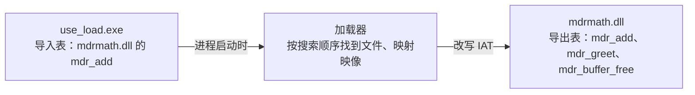

# A.7 动态链接库（DLL）

在大型软件架构与模块化工程中，共享公用逻辑与解耦组件是不可或缺的诉求：若多个独立的可执行文件都需要执行相同的数学算法或文本格式化操作，简单的源码级复制不仅会造成物理存储与内存页面的双重浪费，更为长期的版本升级和补丁维护埋下巨大的维护隐患；将公共逻辑提炼为动态链接库（Dynamic-Link Library，DLL），则能实现一份二进制映像在多个进程间的共享复用。与此同时，现代应用还广泛依托插件架构实现动态扩展：宿主程序在启动时扫描扩展目录，动态载入第三方 DLL 并定位约定的接口入口，无需在编译时硬编码任何具体实现细节。

前者对应于加载时动态链接（Load-time Dynamic Linking），后者则体现了运行时显式加载（Run-time Dynamic Linking）的灵活性。我们在前置课程中深入探讨过 ELF 共享对象（`.so`）的组织机制与依赖拓扑；然而当我们将目光投向 Windows PE 格式时，底层的链接与加载哲学展现出了鲜明的差异：ELF 默认倾向于全量导出所有全局符号，而 PE 规范下的 DLL 默认严格封闭、不导出任何未显式声明的函数条目；在 Linux 下调用 `dlopen` 缺失依赖仅会导致函数返回 `NULL` 错误，而在 Windows 下，静态导入表中若存在哪怕一个无法解析的依赖 DLL，进程在推进至 `main` 入口之前便会被操作系统加载器强制就地终止。

我们将循序渐进地构建一个兼顾跨编译器可移植性的规范 DLL，掌握导出表、导入库（Import Library）与导入地址表（IAT）的二进制链接机理；深入剖析 `DllMain` 在系统加载器锁（Loader Lock）严苛约束下的行为红线，规避极易引发死锁的深层隐患；推演 Windows 默认的 DLL 目录检索拓扑与劫持防御策略，并确立跨模块边界传递动态内存时的所有权法则。本页的程序在 `code/系统编程/拓展A_Win32系统编程/A_7_动态链接库_DLL/` 下，用一个 `Makefile` 构建。终端里显示的临时目录已换成 `C:\work\a7`。

## 1. DLL 是什么

DLL 和 `.exe` 是同一种文件格式，即 PE 映像（portable executable image）。文件头里有一个标志位区分两者，链接器在生成 DLL 时置上它。系统把 DLL 映射进加载它的那个进程的地址空间，映射方式和映射一个 exe 没有本质区别：按节（section）映射，代码节只读可执行，数据节可读可写。

一份 DLL 文件在物理内存里只有一份代码页，所有加载它的进程共享同一份。可写数据不同：每个进程拿到自己的一份拷贝，内核用写时复制把改动隔离在各自的地址空间里。这是 DLL 在内存占用上的主要好处，也是许多错误的来源——DLL 里的全局对象是每进程一份的，不能拿来当跨进程的计数器。

用一个小 DLL 看这件事。它只做一件事，每调用一次把内部的对象加一：

```c
static int g_count = 0;

__declspec(dllexport) int counter_bump(void) {
    return ++g_count;
}
```

两个进程各运行一次，各自打印三次调用的结果：

::: terminal title="PowerShell - counter_use"

```text
PS> .\counter_use.exe
pid 27092: bumps 1 2 3
PS> .\counter_use.exe
pid 27192: bumps 1 2 3

```

:::

第二个进程看到的计数仍然从 1 开始，两个进程的 `g_count` 各是各的。跨进程共享数据要用[内存映射文件](/教程/正文/系统编程/拓展A_Win32系统编程/A_6_内存管理与内存映射文件)，DLL 的全局对象做不到。

### 1.1 导出表与导入表

DLL 对外提供的函数登记在导出表（export table）里，每一项有一个名字、一个序号、一个相对虚拟地址（RVA）。使用 DLL 的程序在导入表（import table）里列出自己需要的 DLL 和函数名。加载器把两张表对上，把 DLL 里函数的实际地址填进调用方的导入地址表（import address table，IAT），此后调用方像调用本地函数一样调用它。



这个过程发生在 `main` 之前。加载时链接的程序只要有一个导入的 DLL 找不到，进程根本走不到第一行代码；第 3 节的实测会看到这一点。

和 ELF 的对比值得放在这里。用 `gcc -shared` 编一个 `.so`，所有非 `static` 的函数都自动出现在动态符号表里，除非用版本脚本或 `-fvisibility=hidden` 显式隐藏；链接方写 `-lfoo` 就能用。PE 的规则相反：DLL 默认什么都不导出，每个对外的函数都要明确标注。这个差别决定了下一节的写法。

## 2. 编写和构建 DLL

### 2.1 头文件里的 MDR_API

一个 DLL 的头文件要被两类代码包含：构建 DLL 自己的源文件，和使用 DLL 的源文件。前者要给函数加上导出标记，后者要加上导入标记。用一个宏在两者之间切换：

```c
#ifdef MDRMATH_BUILD
#define MDR_API __declspec(dllexport)
#else
#define MDR_API __declspec(dllimport)
#endif

MDR_API int mdr_add(int a, int b);
MDR_API char *mdr_greet(const char *name);
MDR_API void mdr_buffer_free(void *block);
```

`__declspec(dllexport)` 告诉链接器把这个函数放进导出表。`__declspec(dllimport)` 告诉编译器这个函数不在本模块里，调用时通过 IAT 间接跳转，不生成直接调用。省掉 `dllimport` 也能链接成功：链接器会在 exe 里生成一个同名的小跳板，它做一次 `jmp *IAT 槽`，所有调用先跳到这个跳板再跳到 DLL。用 `objdump -d` 看得到这个跳板，一条 `jmp *0x...(%rip)` 加几个填充字节。用不用它不影响正确性，但用了才少一次跳转。

宏名没有统一规定，`MDR_API`、`MYLIB_EXPORTS`、`BUILDING_DLL` 都有人用，关键是构建 DLL 的那条命令行要定义它。头文件里加 `extern "C"` 的包裹是为了 C++ 调用方，见第 7 节。

### 2.2 构建命令

```text
gcc -std=c17 -Wall -Wextra -shared -DMDRMATH_BUILD -o mdrmath.dll mdrmath.c -Wl,--out-implib,libmdrmath.dll.a
```

`-shared` 让链接器生成 DLL，没有它生成的是 exe。`-DMDRMATH_BUILD` 定义上面那个宏。`-Wl,--out-implib,...` 让链接器同时生成一个导入库（import library），文件名照 Windows 的习惯用 `libfoo.dll.a`（MinGW 传统）或 `foo.lib`（MSVC 传统），扩展名不影响使用。

导入库文件里不含 DLL 的代码，只有几十字节到几 KB，内容是每个导出函数的桩：一个 `__imp_mdr_add` 指针槽，加一小段跳转。链接时链接器把这些桩写进 exe 的导入表，加载时由加载器填上真实地址。

构建完先看导出表：

::: terminal title="PowerShell - 构建 DLL 并查看导出表"

```text
PS> gcc -std=c17 -Wall -Wextra -shared -DMDRMATH_BUILD -o mdrmath.dll mdrmath.c -Wl,--out-implib,libmdrmath.dll.a
PS> objdump -p mdrmath.dll | findstr /c:"mdr_"
	[   0] mdr_add
	[   1] mdr_buffer_free
	[   2] mdr_greet

```

:::

`objdump -p` 打印 PE 文件的各个数据目录，导出表排在导入表之后。方括号里是从 0 开始的下标，对应的序号从 1 开始（`Ordinal Base` 为 1），右边是导出名。三个函数一个不多一个不少。

::: tip 不要依赖 MinGW 的自动导出

MinGW 的链接器有一项自动导出（auto-export）功能：整个 DLL 里一个 `__declspec(dllexport)` 都没有时，它会把所有全局符号都放进导出表。这一条能让人少写一个宏，也让“为什么我的内部函数被外部调到了”变成可能。MSVC 没有这个行为，两条工具链都要能构建的 DLL 永远显式标注。`-Wl,--export-all-symbols` 可以显式打开自动导出，`-Wl,--exclude-all-symbols` 关掉它。只要源文件里出现任何一处 `__declspec(dllexport)`，自动导出就整体关闭，没标的函数一个也不会导出；写了 `.def` 时同理，导出表只由 `.def` 决定。

:::

### 2.3 不标 dllexport 会怎样

拿一个完全没有 `__declspec(dllexport)` 的源文件构建 DLL，看导出表：

::: terminal title="PowerShell - noexp"

```text
PS> gcc -std=c17 -Wall -Wextra -shared -o noexp.dll noexp.c
PS> objdump -p noexp.dll | findstr /c:"noexp_"
	[   0] noexp_other
	[   1] noexp_uses_static
	[   2] noexp_visible

```

:::

`noexp.c` 里有三个非 `static` 函数和一个 `static` 函数，导出表里恰好是前三个。自动导出不做任何筛选，只要名字在符号表里且不是本地的，就导出去。结果是一个 DLL 的每个内部辅助函数都变成对外接口，将来想改名、想删掉都要顾及外面的使用者。

`noexp_uses_static` 调用了一个 `static` 的 `helper`，后者没有进导出表，因为 `static` 符号在链接时是局部的。

自动导出在两种情况下自动关闭：出现了任何 `__declspec(dllexport)`，或者命令行给了 `.def` 文件。后者是另一种控制导出的办法：

```text
EXPORTS
noexp_visible
```

把这两行存成 `noexp.def`，构建时把它放在源文件后面，导出表里就只剩 `noexp_visible` 一项。`.def` 还能给导出改名字、指定序号，适合要精确控制 ABI 的场合。日常写 C 库，`__declspec(dllexport)` 更直观，本文全部用它。

### 2.4 MSVC 一侧

MSVC 构建 DLL 用 `/LD`，导出表用 `dumpbin /exports` 看。同一份 `mdrmath.c`：

::: terminal title="cmd - cl /LD 与 dumpbin"

```text
> cl /nologo /W4 /std:c17 /utf-8 /LD /DMDRMATH_BUILD mdrmath.c /Fe:mdrmath.dll /link /IMPLIB:libmdrmath.lib
> dumpbin /exports mdrmath.dll
  Section contains the following exports for mdrmath.dll

    00000000 characteristics
    FFFFFFFF time date stamp
        0.00 version
           1 ordinal base
           3 number of functions
           3 number of names

    ordinal hint RVA      name

          1    0 00001000 mdr_add
          2    1 000010B0 mdr_buffer_free
          3    2 00001020 mdr_greet

```

:::

同样三个导出。再看一个没有任何 `__declspec(dllexport)` 也没有 `.def` 的源文件，`dumpbin /exports` 只打印文件类型和各节的大小，没有 “Section contains the following exports” 这一段，导出表是空的。这正是上一节那句话的依据：MinGW 的自动导出是它自己的便利，PE 本身没有这条规则。

两份导入库是两种链接器各自生成的导入桩归档，能不能互换取决于链接器如何解析归档里的成员。本机实测两个方向都通：MSVC 的 `link.exe` 直接链接 MinGW 的 `libmdrmath.dll.a`，得到的 exe 导入表与用 `.lib` 时一样，运行输出相同；GCC 链接 MSVC 生成的 `libmdrmath.lib` 也能正常构建和运行。能互换的前提是导出名本身没有修饰——这里全是 `extern "C"` 的裸名字。换一套工具链未必还成立，链接器报错时就用 `gendef mdrmath.dll` 从 DLL 本身生成 `.def`，再 `dlltool -d mdrmath.def -l mdrmath_msvc.lib` 生成一份标准的 MSVC 导入库；用这份 `.lib` 编译的 MSVC 程序调用 MinGW 编的 DLL，输出与 MinGW 版本相同。

忘了定义 `MDRMATH_BUILD` 时，两边都会报警告：MinGW 报 `-Wattributes`（`'mdr_add' redeclared without dllimport attribute: previous dllimport ignored`），MSVC 报 C4273（本机中文界面的文字是「dll 链接不一致」）。看到这两条，先检查命令行。

## 3. 加载时动态链接

加载时动态链接（load-time dynamic linking）就是通常说的“链接一个库”。使用方源文件里看不到 `LoadLibrary`，函数照常声明、照常调用，编译时链上导入库：

```text
gcc -std=c17 -Wall -Wextra -o use_load.exe use_load.c -L. -lmdrmath
```

`-L.` 指出导入库在当前目录，`-lmdrmath` 找 `libmdrmath.dll.a`。链接器从导入库里取出三个函数的桩，写进 exe。运行：

::: terminal title="PowerShell - use_load"

```text
PS> .\use_load.exe
mdr_add(2, 3) = 5
hello, load-time linking

```

:::

看 exe 的导入表，`mdrmath.dll` 和三个函数名都在里面：

::: terminal title="PowerShell - use_load.exe 的导入表"

```text
PS> objdump -p use_load.exe | findstr /c:"mdrmath.dll" /c:"mdr_add" /c:"mdr_greet" /c:"mdr_buffer_free"
	DLL Name: mdrmath.dll
	a500	    1  mdr_add
	a50c	    2  mdr_buffer_free
	a520	    3  mdr_greet

```

:::

左边那列是 RVA，与文件偏移不同；中间的数字是序号，右边是导入名。加载器在进程启动时读这张表，逐个找到 DLL，再按名字或序号在导出表里查出地址，填进 IAT。

### 3.1 漏掉导入库会怎样

把 `-L. -lmdrmath` 删掉再链接，错误信息直接指出缺的是什么（前面的临时目标文件名随构建变化，这里省略）：

```text
...o:use_load.c:(.text+0x1a): undefined reference to `__imp_mdr_add'
...o:use_load.c:(.text+0x3e): undefined reference to `__imp_mdr_greet'
...o:use_load.c:(.text+0x6c): undefined reference to `__imp_mdr_buffer_free'
```

名字前面的 `__imp_` 是线索：`dllimport` 让编译器把 `mdr_add(2, 3)` 编译成“取 `__imp_mdr_add` 里的指针再调用”，那个指针槽由导入库提供。没有导入库，指针槽无处可取。看到 `__imp_` 开头的未定义引用，缺的一定是导入库，DLL 里的实现没有问题。

### 3.2 找不到 DLL 时

把 `use_load.exe` 单独复制到一个没有 `mdrmath.dll` 的目录里运行：

::: terminal title="PowerShell - 缺少 DLL 的加载时链接程序"

```text
PS> .\use_load.exe
PS> "exit code: $LASTEXITCODE"
exit code: -1073741515

```

:::

一行输出都没有，退出码 `-1073741515` 就是 `0xC0000135`，常量名 `STATUS_DLL_NOT_FOUND`。进程在进入 `main` 之前就被结束了，`printf` 一句也没执行。普通的桌面会话里，系统还会弹一个说明缺少哪个 DLL 的对话框；在这里错误模式被设成不弹窗，所以只有退出码。

这个行为和 Linux 上 `dlopen` 失败返回 `NULL` 完全不同，也和链接静态库时“函数没用到就不会被拉进来”不同。exe 的导入表里有 `mdrmath.dll` 这一项，加载器就必须找到它，哪怕程序从来不调用 `mdr_add`。

<Quiz
  type="single"
  :options="[
    { label: '0xC0000005', value: 'A' },
    { label: '0xC0000135', value: 'B' },
    { label: '126', value: 'C' },
    { label: '127', value: 'D' }
  ]"
  answer="B"
>

<template #question>

加载时链接的程序找不到所需的 DLL，进程的退出码是？

</template>

正确答案是 **B**。`0xC0000135` 是 `STATUS_DLL_NOT_FOUND`，进程在 `main` 之前就被结束。

- `0xC0000005` 是访问违例，见[第 A.5 页](/教程/正文/系统编程/拓展A_Win32系统编程/A_5_错误处理与结构化异常处理)。
- 126 和 127 是 `LoadLibraryW`、`GetProcAddress` 失败时 `GetLastError` 的值；进程退出码另有一套编号。

</Quiz>

::: warning 发布时 DLL 必须和 exe 放在一起

加载时链接的 DLL 在进程启动时就要找到，位置由第 6 节的搜索顺序决定。程序目录是最先搜的地方，把 DLL 放在 exe 旁边是最省事的做法；靠“运行时改当前目录”或“写进 PATH”都不可靠，后者还会带来安全问题。

:::

## 4. 运行时动态链接

运行时动态链接（run-time dynamic linking）不用导入库，也不在 exe 的导入表里留下记录。程序在需要的时候打开 DLL，按名字取函数地址，用完关闭。三个函数构成全部接口：

```c
HMODULE LoadLibraryW(LPCWSTR lpLibFileName);       /* 打开并映射，失败返回 NULL */
FARPROC GetProcAddress(HMODULE hModule, LPCSTR lpProcName); /* 失败返回 NULL */
BOOL FreeLibrary(HMODULE hLibModule);              /* 引用计数减一 */
```

`LoadLibraryW` 内部同样要按搜索顺序找文件（第 6 节），找到之后映射映像、调用 DLL 的入口函数、把引用计数加一。`FreeLibrary` 减一，减到零才真正卸载。

### 4.1 函数指针类型与取地址

`GetProcAddress` 返回 `FARPROC`，它的类型是 `long long int (*)()`，一个没有参数、返回整数的函数指针。调用之前必须转换成真实类型，所以要有一组 `typedef`：

```c
typedef int (*add_fn)(int, int);
typedef char *(*greet_fn)(const char *);
typedef void (*free_fn)(void *);

add_fn add = (add_fn)(void (*)(void))GetProcAddress(math, "mdr_add");
```

中间多转一次 `void (*)(void)` 有实际用处。直接写 `(add_fn)GetProcAddress(...)` 会触发 `-Wcast-function-type`：

```text
cast_warn.c:14:18: warning: cast between incompatible function types from
'FARPROC' {aka 'long long int (*)()'} to 'int (*)(int,  int)' [-Wcast-function-type]
```

警告的道理是：函数指针的调用约定和参数个数是类型的一部分，随意的类型转换在别的平台上会真的出错。`void (*)(void)` 是“任意函数指针”的公共中转，先转到它再转到目标类型，编译器的类型检查就满足了。这个写法在 A.9 从 `kernel32` 取 `SetThreadDescription` 时还会用到。

### 4.2 两种失败，两个错误码

`LoadLibraryW` 失败和 `GetProcAddress` 失败的含义不同，错误码也不同。`use_runtime.exe` 把两种都演示一遍：

::: terminal title="PowerShell - use_runtime"

```text
PS> .\use_runtime.exe
mdr_add(2, 3) = 5
hello, run-time linking
GetProcAddress(mdr_sub) = 0000000000000000, error 127

```

:::

`mdr_sub` 这个函数不存在，`GetProcAddress` 返回 `NULL`，`GetLastError` 是 127，系统消息为「找不到指定的程序。」。把 `use_runtime.exe` 复制到没有 DLL 的目录再运行，第一句就变成：

```text
LoadLibraryW(mdrmath.dll) failed: 126
```

126 是 `ERROR_MOD_NOT_FOUND`，系统消息为「找不到指定的模块。」。两个数字容易记混：126 说的是模块（DLL 文件本身）找不到，127 说的是模块里的函数找不到。

用运行时链接，缺 DLL 只是这一句调用失败，程序可以选择提示用户、换一个 DLL、或者继续用别的功能。这是它相对于加载时链接最实际的好处，也是插件机制的基础。

### 4.3 引用计数与重复加载

同一个 DLL 在同一个进程里被打开两次，加载器返回同一个模块基址，引用计数变成 2：

::: terminal title="PowerShell - refcount"

```text
PS> .\refcount.exe
two LoadLibraryW: 00007FFC40F90000 00007FFC40F90000
GetModuleHandleW now: 00007FFC40F90000
after one FreeLibrary: 00007FFC40F90000
after two FreeLibrary: 0000000000000000

```

:::

两次 `FreeLibrary` 之后 `GetModuleHandleW` 才返回 `NULL`，这时 DLL 才从地址空间里卸掉，`DLL_PROCESS_DETACH` 也在此时发生。每调用一次 `LoadLibraryW` 就要配一次 `FreeLibrary`，成对的规则和 `malloc`/`free` 一样。少了会泄漏映射，多了会提前卸载正在被调用的代码，后者通常会以访问违例结束。

“同一个 DLL”指的是同一个文件。两个目录里各放一份同名 `mdrmath.dll`，先后加载，得到的是两个不同的模块，基址不同，全局对象也是两份。工程上不要出现这种情况：同一份代码被加载两次，两边看到的静态状态互相独立，排错时极难发现。

`LoadLibraryW` 的返回值 `HMODULE` 和 `HINSTANCE` 是同一个东西，都表示模块基址。句柄不要用 `INVALID_HANDLE_VALUE` 比较，失败值是 `NULL`。

### 4.4 插件宿主

插件机制是运行时链接的典型用法：宿主不认识插件里的任何符号，只约定两个入口名。`plugin.h` 定义约定：

```c
#define MDR_PLUGIN_ENTRY "plugin_name"
#define MDR_PLUGIN_RUN "plugin_run"

typedef const char *(*plugin_name_fn)(void);
typedef int (*plugin_run_fn)(int);
```

每个插件 DLL 导出这两个函数。宿主用 `FindFirstFileW` 遍历 `plugins\*.dll`，按完整路径加载，取两个地址，调用，卸载：

```c
HMODULE mod = LoadLibraryW(path);
plugin_name_fn name = (plugin_name_fn)(void (*)(void))GetProcAddress(mod, MDR_PLUGIN_ENTRY);
plugin_run_fn run = (plugin_run_fn)(void (*)(void))GetProcAddress(mod, MDR_PLUGIN_RUN);
if (name == NULL || run == NULL) {
    printf("  missing entry point, error %lu\n", GetLastError());
    FreeLibrary(mod);
    return;
}
printf("  %s(7) = %d\n", name(), run(7));
FreeLibrary(mod);
```

路径拼法是“程序所在目录 + `plugins\` + 文件名”：`GetModuleFileNameW(NULL, ...)` 取出 exe 的完整路径，截掉文件名部分，再和 `*.dll` 拼起来。这样宿主在哪个目录启动都能找到自己的插件，与当前目录无关。

::: terminal title="PowerShell - plugin_host"

```text
PS> .\plugin_host.exe
loading C:\work\a7\plugins\plugin_double.dll
  double(7) = 14
loading C:\work\a7\plugins\plugin_square.dll
  square(7) = 49
2 plugin(s) loaded

```

:::

两个插件各有自己的 `plugin_name` 和 `plugin_run`，实现不同，宿主不用重新编译。目录里放一个只导出了 `plugin_run` 的 DLL，宿主的输出会多一行 `missing entry point, error 127`，然后继续处理下一个；这一行是判断插件是否合格的依据。`plugins` 目录不存在时 `FindFirstFileW` 失败、错误码 3（「系统找不到指定的路径。」），宿主打印 `no plugins found (error 3)` 并返回 1。

::: compare left-title="POSIX：dlopen 与 dlsym" right-title="Win32：LoadLibraryW 与 GetProcAddress"

```c
void *h = dlopen("./libmdrmath.so", RTLD_NOW);
if (h == NULL) {
    fprintf(stderr, "%s\n", dlerror());
    return 1;
}
add_fn add = (add_fn)dlsym(h, "mdr_add");
/* 这里必须自己判空：dlsym 返回 NULL 时不一定设置 dlerror */
if (add == NULL) { ... }
dlclose(h);
```

---

```c
HMODULE h = LoadLibraryW(L"mdrmath.dll");
if (h == NULL) {
    printf("error %lu\n", GetLastError());
    return 1;
}
add_fn add = (add_fn)(void (*)(void))GetProcAddress(h, "mdr_add");
if (add == NULL) { ... }
FreeLibrary(h);
```

:::

两边的结构一一对应：打开、取地址、关闭。差别有三处。Win32 的取地址函数返回 `FARPROC`，要转换；Win32 的错误码统一走 `GetLastError`，`GetProcAddress` 失败一定设 127；POSIX 的 `dlsym` 返回的 `NULL` 可能只是符号的值本身就是 `NULL`，判断成功与否要在调用前先 `dlerror()` 清空，调用后再查一次 `dlerror()`。

## 5. DllMain 与加载器锁

DLL 可以有一个入口函数 `DllMain`，加载、卸载、线程创建和退出时由系统调用。四个通知：

| 通知 | 值 | 什么时候调用 |
| --- | --- | --- |
| `DLL_PROCESS_ATTACH` | 1 | DLL 被映射进进程时，每个进程一次 |
| `DLL_PROCESS_DETACH` | 0 | DLL 被卸载或进程结束时，每个进程一次 |
| `DLL_THREAD_ATTACH` | 2 | 进程里新建了一个线程 |
| `DLL_THREAD_DETACH` | 3 | 一个线程正常退出 |

写一个只记录通知的 DLL，`DllMain` 里用 `WriteFile` 直接写标准输出（不走 CRT，理由见 5.2），宿主先加载、再建一个线程、再卸载：

::: terminal title="PowerShell - trace_host"

```text
PS> .\trace_host.exe
host: before LoadLibraryW
[trace] DLL_PROCESS_ATTACH
host: after LoadLibraryW
[trace] DLL_THREAD_ATTACH
[trace] DLL_THREAD_DETACH
host: thread finished
host: before FreeLibrary
[trace] DLL_PROCESS_DETACH
host: after FreeLibrary

```

:::

`DLL_PROCESS_ATTACH` 发生在 `LoadLibraryW` 返回之前，`DLL_PROCESS_DETACH` 发生在 `FreeLibrary` 返回之前。这正是加载时链接的程序在 `main` 之前就崩溃的原因：DLL 的初始化代码在 `main` 之前跑。

线程通知有一个容易踩空的地方：`LoadLibraryW` 之前就已经存在的线程，不会收到 `DLL_THREAD_ATTACH`。微软的文档把这一条写在运行时链接的页面里，也是“用 `DllMain` 给每个线程做初始化”这件事不成立的根本原因。这些线程退出时仍然会收到 `DLL_THREAD_DETACH`，因为卸载时不区分线程是什么时候建立的。

`trace_host.exe` 的宿主用 `setvbuf(stdout, NULL, _IONBF, 0)` 关掉了标准输出的缓冲。不关的话，宿主的 `printf` 留在缓冲区里，DLL 的 `WriteFile` 已经写到控制台，两边的顺序就错乱了。这类输出交错是调试 `DllMain` 时最常见的困惑。

### 5.1 DisableThreadLibraryCalls

不关心线程通知的 DLL 可以在 `DLL_PROCESS_ATTACH` 里调用 `DisableThreadLibraryCalls(hinstDLL)`，省掉每次建线程和退线程时的两次回调。实测有一个反直觉的结果：MinGW 编译的 DLL 调用了它，线程通知照样到达；用 MSVC 编译同一份代码，通知就消失了。

原因是静态线程本地存储（thread local storage，TLS）。MinGW 的 GCC 默认给 DLL 生成一个 TLS 目录，即使源码里没有 `_Thread_local` 对象，CRT 的初始化也需要它。`objdump -p` 里 `Thread Storage Directory` 一项非零就是有静态 TLS。微软的文档写明：DLL 有活动的静态 TLS 时，这个函数不起作用。用 `-nostdlib -Wl,--entry,DllMain -lkernel32` 编一个不含 CRT 的 DLL，TLS 目录变成全零，再跑 `trace_host.exe`，线程通知就不再出现，`DisableThreadLibraryCalls` 也返回非零。所以它省下的只是没有静态 TLS 的 DLL 的两次回调。判断办法就是看 `objdump -p` 的这一项，或者干脆不调用它。

### 5.2 加载器锁

`DllMain` 被调用时，加载器持有一把进程范围的锁，叫加载器锁（loader lock）。这把锁保证同一时刻只有一个 DLL 在做初始化，别的线程想加载 DLL 或等 DLL 初始化完成，都得排队。在锁里做任何需要另一把锁、或者需要另一个线程先跑起来的事，都可能与这把锁互相等待。

::: concept win32-dll-loader-lock title="DllMain 在加载器锁下运行"

系统调用 `DllMain` 时持有加载器锁。在 `DllMain` 里直接或间接调用 `LoadLibrary`/`LoadLibraryEx`、与其他线程同步、等待一个由正在等加载器锁的代码持有的对象、调用注册表函数、调用 `CreateProcess`、调用 `ExitThread`、使用 CRT 的内存管理函数、调用 `User32`/`Gdi32` 里的函数，都可能死锁，或者用到尚未初始化的 DLL。微软的文档给出的原则是：理想的 `DllMain` 是一个空函数，能推迟的初始化全部推迟。

:::

`CreateThread` 本身在文档里被列为“有风险”：如果不同步，创建线程可以工作；一旦在 `DllMain` 里等这个线程，就必然死锁。`hang_dll.c` 故意这么做：

```c
if (reason == DLL_PROCESS_ATTACH) {
    HANDLE th = CreateThread(NULL, 0, worker, NULL, 0, NULL);
    if (th != NULL) {
        WaitForSingleObject(th, INFINITE);   /* 新线程要先拿加载器锁发通知 */
        CloseHandle(th);
    }
}
```

新线程启动后，加载器要给它发 `DLL_THREAD_ATTACH`，发通知需要加载器锁；锁被当前正在执行 `DllMain` 的线程持有，而它在等新线程结束。两边都不动。

::: terminal title="PowerShell - hang_host"

```text
PS> $p = Start-Process -FilePath .\hang_host.exe -PassThru -NoNewWindow -RedirectStandardOutput hang.out
PS> $p.WaitForExit(3000)
False
PS> Get-Content hang.out
host: calling LoadLibraryW(hang_dll.dll)
PS> $p.Kill(); $p.WaitForExit()

```

:::

三秒之后进程还在，输出停在进入 `LoadLibraryW` 之前那一句。这就是加载器锁死锁的样子：没有错误码，没有异常，进程挂在那里，CPU 占用为零。调试这类问题时，先用 Process Explorer 看线程数和各线程的调用栈：如果主线程停在加载器的函数里，另有一个刚创建、几乎没做什么的线程也停在加载器里，基本就是这类死锁。

同样的道理适用于另外几类调用。`LoadLibrary` 在 `DllMain` 里会把依赖链拉长，可能形成环：A 的 `DllMain` 加载 B，B 的 `DllMain` 又加载 A，第二个 `LoadLibrary` 等到的是自己还没完成的初始化。`CreateProcess` 会加载新进程的 DLL，也可能走到加载器里。注册表函数看似无关，实际会创建或打开键对象，与某些系统组件的初始化有交互。`User32` 的函数会加载显示相关的 DLL，那些 DLL 可能还没初始化。

安全的部分很短：静态数据在编译期初始化好，创建和初始化同步对象，用 `HeapAlloc` 这类不经过 CRT 的函数分配内存，建立 TLS，读写文件，调用 `kernel32` 里不加载别的 DLL 的函数。`WriteFile` 属于最后这一类，所以 `trace_dll.c` 里没有用 `printf`。

<Quiz
  type="single"
  :options="[
    { label: '没有风险', value: 'A' },
    { label: '可能死锁，或者用到尚未初始化的 DLL', value: 'B' },
    { label: '只是慢一点', value: 'C' },
    { label: '编译失败', value: 'D' }
  ]"
  answer="B"
>

<template #question>

在 `DllMain` 的 `DLL_PROCESS_ATTACH` 分支里调用 `LoadLibraryW` 加载另一个 DLL，风险是什么？

</template>

正确答案是 **B**。`DllMain` 在持有加载器锁时被调用，`LoadLibraryW` 要拿同一把锁，依赖链还可能形成环。

- 慢一点的说法不成立：它可能永远不返回。
- 编译期不会报任何错误，问题只在运行时暴露。

</Quiz>

::: details 延迟加载与并行程序集

延迟加载（delay load）让加载时链接的 DLL 推迟到第一次调用它的函数时才加载，缺 DLL 时由用户写的钩子处理。MSVC 用 `/DELAYLOAD:foo.dll` 加 `delayimp.lib` 打开它。MinGW 没有这样一个链接选项（试 `-Wl,--enable-delay-load` 会报 `unrecognized option`），办法是先用 `dlltool -y libfoo_delay.a -d foo.def` 生成延迟导入库，链接时再带上 `-ldelayimp`：本机这样编出的程序在 DLL 缺席时能先执行到第一次调用，然后才以 127 结束；加载时链接的程序遇到同样的情况，在 `main` 之前就被结束了。它适合“程序的大部分功能用不到这个 DLL”的场合，代价是多一层跳板，钩子函数本身也在很受限的环境里运行。并行程序集（side-by-side assembly）是另一套机制，用清单文件指定 DLL 的精确版本，避免“装了新版本把旧程序弄坏”。两者都不属于日常写 DLL 要处理的问题，知道名字即可。

:::

### 5.3 该怎么做

把 `DllMain` 保持为空，初始化放到一个显式函数里：

```c
MDR_API int mdrmath_init(void);   /* 返回 0 表示成功 */
```

宿主在第一次调用其他函数之前调用它；或者用一次性初始化（[A.11](/教程/正文/系统编程/拓展A_Win32系统编程/A_11_同步原语_临界区_SRWLock与条件变量)）在第一次真正需要时执行，这样多线程同时进来也只跑一次。后者对使用者最友好，代价是每次对外函数都要先查一次标志。

`DllMain` 里还有一件必须做的事：如果 `DLL_PROCESS_ATTACH` 返回 `FALSE`，加载失败，`LoadLibraryW` 返回 `NULL`，`GetLastError` 是 1114（「动态链接库(DLL)初始化例程失败。」），系统随即以 `DLL_PROCESS_DETACH` 再调一次并卸载。加载时链接的程序遇到这种情况，进程在启动时直接结束。用这个返回值表达“初始化失败”是它唯一的用途，别用它做别的事。

## 6. 搜索顺序与安全加载

`LoadLibraryW`、`LoadLibraryExW`（不带搜索标志时）、以及进程启动时的加载器，都按同一套顺序找 DLL。在动文件系统之前，加载器先看几项预处理：同名模块是否已经加载（已加载的直接复用，不管从哪个目录来的）、是否在已知 DLL 列表（KnownDLLs，注册表里登记的系统 DLL，直接取系统那一份）、有没有清单或重定向把名字改掉。预处理都没命中，才按目录逐个找，对非打包的桌面程序大致是：

1. 应用程序所在目录；
2. 系统目录（`%SystemRoot%\system32`）；
3. 16 位系统目录；
4. Windows 目录；
5. 当前目录；
6. 系统 `PATH` 路径列表中所登记的目录。

排在前面的先命中。应用程序目录排在系统目录之前，这条规则让“把 DLL 放在 exe 旁边”能覆盖系统同名文件；当前目录排在系统目录之后，是“安全 DLL 搜索模式”（safe DLL search mode，默认开启）的结果，关掉它当前目录会提到第 2 位。

### 6.1 当前目录参与搜索

当前目录在这一串里，程序的行为就会随“从哪里启动”而变。`search_demo.exe` 放在一个没有 DLL 的目录里，DLL 只放在当前目录，从当前目录启动它：

::: terminal title="PowerShell - search_demo"

```text
PS> cd C:\work\a7\cwdonly
PS> ..\appdironly\search_demo.exe C:\work\a7\cwdonly\mdrmath.dll
before hardening: LoadLibraryW("mdrmath.dll") ok, mapped at 00007FFC40F90000
after hardening:  LoadLibraryW("mdrmath.dll") failed, error 126
full path:        LoadLibraryW(argv[1]) ok, mapped at 00007FFC40F90000

```

:::

第一行是加固之前：程序目录里没有，系统目录里没有，最后在当前目录找到了。第二行是调用 `SetDefaultDllDirectories` 之后：当前目录被踢出搜索路径，同样的调用返回 126。第三行用完整路径加载，与搜索顺序无关，永远成功。三次调用之间都 `FreeLibrary` 过，所以第二、三次都是重新搜索。

这就是 DLL 劫持（DLL hijacking）的入口。一个程序如果按名字加载一个不在自己目录里的 DLL，而它的当前目录可能是用户可控的（比如从下载目录里启动），攻击者把同名 DLL 放在那里，程序就会加载它。放在 `PATH` 里的目录问题更大，因为用户装的软件都可能往那里写。

### 6.2 程序目录也会被抢

`SetDefaultDllDirectories` 去掉了当前目录和 `PATH`，但保留了程序目录。程序目录如果是用户可写的（比如装在 `Downloads` 里、或者绿色软件解压到桌面），同名 DLL 照样会被优先加载。`hijack_demo` 在程序目录里放了一个只导出一个无关函数的假 `version.dll`：

::: terminal title="PowerShell - hijack_demo"

```text
PS> cd C:\work\a7\hijack
PS> .\hijack_demo.exe
default search        : C:\work\a7\hijack\version.dll
after SetDefaultDllDir: C:\work\a7\hijack\version.dll
LOAD_LIBRARY_SEARCH_SYSTEM32: C:\Windows\SYSTEM32\version.dll

```

:::

三次都成功，前两次拿到的是假的那一份，第三次才是系统的。程序目录排在系统目录之前，`SetDefaultDllDirectories` 不改这个次序，它只去掉当前目录和 `PATH`。

<Quiz
  type="single"
  :options="[
    { label: '只给文件名加载', value: 'A' },
    { label: '先 SetCurrentDirectory 到插件目录再加载', value: 'B' },
    { label: '用完整路径加载，并限制搜索目录', value: 'C' },
    { label: '把插件目录加进 PATH', value: 'D' }
  ]"
  answer="C"
>

<template #question>

要避免 DLL 劫持，加载自己目录里的插件时应当怎么做？

</template>

正确答案是 **C**。完整路径不经过搜索顺序，`SetDefaultDllDirectories` 再把当前目录和 `PATH` 从搜索路径里去掉。

- 只给文件名，加载器会按搜索顺序找，当前目录和 `PATH` 都可能被利用。
- `SetCurrentDirectory` 恰好把攻击者的目录变成当前目录，帮了倒忙。
- 把插件目录加进 `PATH`，等于把所有同名 DLL 的优先级都交给它。

</Quiz>

### 6.3 加固的做法

程序在 `main` 开头调用一次：

```c
SetDefaultDllDirectories(LOAD_LIBRARY_SEARCH_DEFAULT_DIRS);
```

`LOAD_LIBRARY_SEARCH_DEFAULT_DIRS` 是三个标志的合成：应用程序目录、系统目录、以及用 `AddDllDirectory`/`SetDllDirectory` 显式加进来的目录。调用之后，当前目录和 `PATH` 不再参与搜索。这个设置只影响当前进程，一旦设置不能撤销，所以只在 `main` 开头调一次。

系统 DLL 用 `LoadLibraryExW` 明确限定来源：

```c
HMODULE m = LoadLibraryExW(L"version.dll", NULL, LOAD_LIBRARY_SEARCH_SYSTEM32);
```

这样即使程序目录里有同名文件，拿到的也是 `%SystemRoot%\system32` 里的那一份。凡是按名字加载系统 DLL 的地方都该这么写。

自己的插件用完整路径，不经过搜索顺序：

```c
wchar_t dir[MAX_PATH];
GetModuleFileNameW(NULL, dir, MAX_PATH);   /* exe 的完整路径 */
wchar_t *slash = wcsrchr(dir, L'\\');
*slash = L'\0';                            /* 截掉文件名，剩下程序目录 */
_snwprintf(full, MAX_PATH, L"%ls\\plugins\\%ls", dir, fd.cFileName);
```

路径里的每个部分都由程序自己决定，攻击者没有插手的余地。插件的依赖 DLL 是另一回事：插件按完整路径加载后，它自己的导入表里的 DLL 仍然只按名字找，默认的 `LOAD_LIBRARY_SEARCH_DEFAULT_DIRS` 不含插件所在目录。实测一个放在 `plugins\` 下、依赖同目录另一个 DLL 的插件，按完整路径 `LoadLibraryExW` 且不给搜索标志，返回 `NULL`、错误 126；给标志加上 `LOAD_LIBRARY_SEARCH_DLL_LOAD_DIR` 就加载成功。插件有自己的依赖时，三条路可选：把依赖也放到程序目录，加 `LOAD_LIBRARY_SEARCH_DLL_LOAD_DIR`，或者用 `AddDllDirectory(插件目录)` 把它加到用户目录列表里。

::: tip 三个加固动作按顺序做

先把 `SetDefaultDllDirectories` 放在 `main` 的第一行，再检查每一处按名字的 `LoadLibraryW`：系统 DLL 改成 `LOAD_LIBRARY_SEARCH_SYSTEM32`，自己的 DLL 改成完整路径。最后检查插件的依赖，按需加 `LOAD_LIBRARY_SEARCH_DLL_LOAD_DIR` 或用 `AddDllDirectory`。三件事都做完，DLL 劫持的入口才关上。

:::

## 7. DLL 与调用方之间的约定

### 7.1 谁分配谁释放

DLL 里用 `malloc` 或 `HeapAlloc` 分配一块内存交给调用方，这块内存该由谁释放？规则是：分配它的模块提供释放函数，调用方调用那个函数，不自己 `free`。

道理在运行库。`malloc` 由 CRT 在进程堆上实现，每个 CRT 自带一份分配器。DLL 和 exe 可能链接不同的 CRT：一个用 UCRT 的 DLL 版本，一个静态链接 CRT，或者一个是 MSVC 编的、一个是 MinGW 编的。两个分配器各自维护自己的空闲链表，A 分配的块交给 B 释放，轻则链表损坏，重则当场崩溃。

`arena_dll.c` 把这件事做成必然失败：DLL 自己 `HeapCreate` 一个私有堆，`make_message` 从这个堆上分配，`release_message` 释放。宿主如果用自己的 `free` 去放：

::: terminal title="PowerShell - 跨模块释放"

```text
PS> .\arena_user.exe
hello, caller
released with the DLL's own function
PS> .\arena_user.exe bad
hello, caller
PS> "exit code: $LASTEXITCODE"
exit code: -1073740940

```

:::

第二行之后程序直接结束，`-1073740940` 是 `0xC0000374`，即 `STATUS_HEAP_CORRUPTION`，堆管理器发现释放的指针不属于这个堆。第一行用 DLL 提供的 `release_message` 就正常。DLL 提供释放函数这个做法本身也是接口的一部分：它把“这块内存由哪个分配器管”这件事封在 DLL 里，调用方不需要知道。

更隐蔽的情况是两个模块碰巧链接了同一份 UCRT。这时跨模块 `free` 往往能跑通，因为最后都落到同一份进程堆上。这种“今天没事”更危险：换一个编译器、换一个运行库选项，同一份代码就崩在离出错点很远的地方。[A.6](/教程/正文/系统编程/拓展A_Win32系统编程/A_6_内存管理与内存映射文件) 讲堆时提过同一条规则，DLL 是它最容易出事的场合。

::: compare left-title="调用方自己 free" right-title="由 DLL 提供的函数释放"

```c
char *msg = mdr_greet("caller");
printf("%s\n", msg);
free(msg);          /* 分配器可能不是同一个 */
```

---

```c
char *msg = mdr_greet("caller");
printf("%s\n", msg);
mdr_buffer_free(msg);   /* 释放逻辑和分配逻辑在同一个模块里 */
```

:::

<Quiz
  type="single"
  :options="[
    { label: '调用方 free', value: 'A' },
    { label: '调用 DLL 提供的释放函数', value: 'B' },
    { label: 'HeapFree', value: 'C' },
    { label: '不用释放', value: 'D' }
  ]"
  answer="B"
>

<template #question>

DLL 里用 `malloc` 分配一块缓冲区交给调用方，调用方应当怎么释放它？

</template>

正确答案是 **B**。分配和释放必须在同一个模块里，两边才一定用同一个分配器。

- `free` 和 `HeapFree` 都可能在另一个分配器上操作，结果是堆损坏。
- 不释放就是泄漏。

</Quiz>

### 7.2 接口只用 C 类型

DLL 的接口要能被任何调用方使用，包括用别的编译器、别的语言写的调用方。几条限制：

- 只用 C 类型，不用 C++ 的类、模板、异常、`std::string`。C++ 没有跨编译器的 ABI 标准，MSVC 和 GCC 生成的对象布局可能不同。
- 结构体要用固定宽度的整数（`int32_t`、`uint64_t`），不用 `long`：Windows 上 `long` 是 32 位，Linux 上是 64 位，同一个头文件在两边的布局不同。
- 结构体的布局要稳定。在末尾加字段可以，前提是调用方按新版本编译，并且 DLL 里对 `cbSize` 之类的字段做检查；在中间插入字段、改变字段顺序、改变字段类型，都是不兼容的修改。
- 不跨模块传 `FILE *`、`struct tm`、`va_list` 这类与运行库实现绑定的对象。`FILE *` 尤其危险：两边的 CRT 各有各的 `FILE` 结构，一个 CRT 打开的文件指针交给另一个 CRT 去读，行为未定义。要传文件，传路径或 `HANDLE`；要传格式化结果，在 DLL 里格式化成字符串。
- 在 x86 上，调用约定（calling convention）要两边一致。`WINAPI` 是 `__stdcall`，普通 C 函数是 `__cdecl`，声明里写的不一样，栈的清理方就不一样，函数返回时崩溃。x64 只有一种调用约定，`__stdcall` 被编译器接受但不产生任何区别，这个问题不存在。
- C++ 调用方要用 `extern "C"` 包住头文件里的声明，否则名字会被名字修饰（name mangling）成 `?mdr_add@@YAHHH@Z` 之类，和 DLL 导出表里的 `mdr_add` 对不上，`GetProcAddress` 返回 `NULL`。

头文件里的 `#ifdef __cplusplus extern "C" { #endif` 就是为最后一条准备的。它只在 C++ 编译时展开，C 编译器看不到。

## 8. 习题

### 8.1 巩固

<Exercise id="43701" :d="1" :w="1">

用本页的 `Makefile` 构建全部示例，然后回答并验证：

1. `objdump -p mdrmath.dll` 的导出表里有几个名字，分别是什么？
2. 把 `mdrmath.h` 里 `mdr_greet` 前面的 `MDR_API` 删掉，重新构建 DLL，导出表变成什么样？`use_load.exe` 还能链接吗？
3. `use_load.exe` 的导入表里，`mdrmath.dll` 下面列了哪几个名字？

</Exercise>

<Exercise id="43702" :d="2" :w="2">

下面三种做法都会出问题，各写一句原因，然后实际做一遍，贴出错误信息：

1. 构建 DLL 时忘了加 `-DMDRMATH_BUILD`（在 MinGW 下观察警告与导出表，说明为什么它仍然能导出函数）；
2. 链接 `use_load.exe` 时忘了加 `-L. -lmdrmath`；
3. 把 `use_load.exe` 复制到另一个没有 `mdrmath.dll` 的目录运行。

第 3 题要在 PowerShell 里用 `$LASTEXITCODE` 读出退出码，并换算成十六进制。

</Exercise>

<Exercise id="43703" :d="2" :w="2">

`mdrmath.dll` 里的 `mdr_greet` 返回的是堆上的字符串，调用方必须调用 `mdr_buffer_free`。把返回类型改成调用方提供缓冲区：

```c
MDR_API int mdr_greet_into(const char *name, char *buf, size_t cap);
```

成功返回写出的字符数，缓冲区不够时返回所需的大小（含结尾空字符）且不写任何东西。改完之后 `mdr_buffer_free` 还需要吗？把 `use_load.c` 和 `use_runtime.c` 都改过来，两个程序跑出同样的结果。

</Exercise>

### 8.2 编程

<Exercise id="43704" :d="3" :w="3">

写一个统计用的 DLL `mdrstats.dll` 和两个使用者：

```c
MDR_API int stats_sum(const int *a, size_t n);
MDR_API double stats_mean(const int *a, size_t n);
MDR_API int stats_max(const int *a, size_t n);
```

要求：

1. 用同一份头文件，`MDRSTATS_BUILD` 切换导出与导入；
2. `use_load.c` 版本用加载时链接，链接导入库；
3. `use_runtime.c` 版本用 `LoadLibraryW` + `GetProcAddress`，取不到任何一个函数就打印缺的名字和错误码；
4. 用 `objdump -p mdrstats.dll` 确认导出表里恰好是这三个名字，没有别的；
5. 两个程序对同一组数据（`{3, 1, 4, 1, 5, 9, 2, 6}`）打印出相同的结果。

</Exercise>

<Exercise id="43705" :d="3" :w="3">

给 `plugin_host.c` 加三项：

1. 第三个插件 `plugin_negate.dll`，`plugin_name` 返回 `negate`，`plugin_run(x)` 返回 `-x`；
2. 宿主在加载每个插件前先打印文件名，加载失败时打印 `LoadLibraryW` 的错误码并继续下一个，不要退出；
3. 最后打印一行统计：成功加载 `N` 个，失败 `M` 个。

验收：`plugins` 目录里放三个正常插件，输出三行结果加 `3 plugin(s) loaded, 0 failed`；再放一个只导出 `plugin_run` 的坏插件，输出里出现 `missing entry point, error 127`，统计变成 `3 plugin(s) loaded, 1 failed`，程序退出码仍为 0。

</Exercise>

<Exercise id="43706" :d="4" :w="4">

用 `DllMain` 记录线程通知，验证两件事：

1. 在 `LoadLibraryW` 之前创建的线程，收不到 `DLL_THREAD_ATTACH`，但退出时收得到 `DLL_THREAD_DETACH`；
2. `DisableThreadLibraryCalls` 对 MinGW 构建的 DLL 不起作用。用 `objdump -p` 找出原因（提示：看 `Thread Storage Directory` 那一行），再用 MSVC 编译同一个 DLL 对比。

要求输出里能清楚看出每个通知属于哪个线程（在 `DllMain` 里用 `GetCurrentThreadId` 的值区分），并解释为什么 `DllMain` 里不能用 `printf`。

</Exercise>

<Exercise id="43707" :d="4" :w="4">

写一对程序：`victim.exe` 按名字加载 `version.dll`，`attacker.exe` 把一份伪造的 `version.dll` 复制到 `victim.exe` 所在目录。

要求：

1. 第一次运行前确保 `victim.exe` 目录里没有伪造的 DLL，确认它加载的是系统的那一份（用 `GetModuleFileNameW` 打印路径）；
2. 复制伪造的 DLL 进去，再运行，确认加载的是伪造的那一份；
3. 给 `victim.exe` 加 `SetDefaultDllDirectories(LOAD_LIBRARY_SEARCH_DEFAULT_DIRS)`，重新运行，说明为什么伪造的 DLL 仍然被加载；
4. 改成 `LoadLibraryExW(L"version.dll", NULL, LOAD_LIBRARY_SEARCH_SYSTEM32)`，确认这次拿到的是系统的那一份；
5. 用一句话总结：`SetDefaultDllDirectories` 堵住了哪一个搜索位置，没堵住哪一个。

</Exercise>

### 8.3 综合与挑战

<Exercise id="43708" :d="6" :w="5">

把插件宿主改成一个会热重载的加载器 `plugin_reload.exe`：

1. 主循环每隔 500 毫秒用 `FindFirstFileW` 扫一遍 `plugins` 目录，记录每个 DLL 的最后写入时间；
2. 时间变了就先 `FreeLibrary` 旧的，再按完整路径 `LoadLibraryW` 新的，打印 `reloaded double` 之类的信息；加载失败时保留旧句柄，打印错误码继续跑；
3. 每次重载后调用一遍 `plugin_name()` 和 `plugin_run(7)`，把结果打出来；
4. 用户按 Ctrl+C 退出（可以用 `SetConsoleCtrlHandler`，见 [A.17](/教程/正文/系统编程/拓展A_Win32系统编程/A_17_控制台与ConPTY)），退出前卸载全部插件。

验收：运行期间重新编译 `plugin_double.dll` 覆盖原文件，观察宿主是否输出 `reloaded double` 并给出新的结果。如果覆盖时提示文件被占用，说明句柄还没释放干净：先 `FreeLibrary` 再编译才能成功。最后回答：为什么正在被加载的 DLL 文件不能直接覆盖，Windows 的哪一条机制在拦它？

</Exercise>

<Exercise id="43709" :d="4" :w="3" scope="*">

设计一个跨模块的字符串接口，把所有权完全封在 DLL 里：

```c
typedef struct {
    uint32_t version;   /* 结构布局的版本号，当前为 1 */
    uint32_t length;    /* 不含结尾空字符 */
    uint32_t capacity;
    uint32_t reserved;
    char *data;         /* 只由 DLL 分配和扩容 */
} mdr_string;

MDR_API int mdr_string_init(mdr_string *s, const char *text);
MDR_API int mdr_string_append(mdr_string *s, const char *text);
MDR_API void mdr_string_clear(mdr_string *s);
MDR_API void mdr_string_free(mdr_string *s);
```

要求：

1. 所有分配和释放都在 DLL 里完成，宿主只持有 `mdr_string` 对象，不碰 `data` 的释放；
2. `mdr_string_init` 检查 `version`，不是 1 就返回错误码，宿主必须在调用前把它填成 1；
3. 头文件里用 `MDR_STRING_BUILD` 切换 `MDR_API`（照第 2.1 节的写法），写两个宿主：一个用 MinGW 编译、一个用 MSVC 编译，两边都能 `append` 三次并打印结果；
4. 用 `objdump -p` 和 `dumpbin /exports` 各看一次导出表，比较两边导出的名字是否一致（都是 `extern "C"` 风格的裸名字）；
5. 写一个测试：宿主故意 `free(s->data)` 之后再 `mdr_string_free`，记录现象，并说明为什么接口要设计成宿主拿不到释放权。

</Exercise>

## 9. 参考资料

- Microsoft Learn：Dynamic-Link Libraries，<https://learn.microsoft.com/en-us/windows/win32/dlls/dynamic-link-libraries>
- Microsoft Learn：About Dynamic-Link Libraries，<https://learn.microsoft.com/en-us/windows/win32/dlls/about-dynamic-link-libraries>
- Microsoft Learn：Dynamic-Link Library Data，<https://learn.microsoft.com/en-us/windows/win32/dlls/dynamic-link-library-data>
- Microsoft Learn：Load-Time Dynamic Linking，<https://learn.microsoft.com/en-us/windows/win32/dlls/load-time-dynamic-linking>
- Microsoft Learn：Run-Time Dynamic Linking，<https://learn.microsoft.com/en-us/windows/win32/dlls/run-time-dynamic-linking>
- Microsoft Learn：DllMain entry point，<https://learn.microsoft.com/en-us/windows/win32/dlls/dllmain>
- Microsoft Learn：Dynamic-Link Library Best Practices，<https://learn.microsoft.com/en-us/windows/win32/dlls/dynamic-link-library-best-practices>
- Microsoft Learn：Dynamic-Link Library Search Order，<https://learn.microsoft.com/en-us/windows/win32/dlls/dynamic-link-library-search-order>
- Microsoft Learn：SetDefaultDllDirectories，<https://learn.microsoft.com/en-us/windows/win32/api/libloaderapi/nf-libloaderapi-setdefaultdlldirectories>
- Microsoft Learn：DisableThreadLibraryCalls，<https://learn.microsoft.com/en-us/windows/win32/api/libloaderapi/nf-libloaderapi-disablethreadlibrarycalls>
- Microsoft Learn：LoadLibraryW，<https://learn.microsoft.com/en-us/windows/win32/api/libloaderapi/nf-libloaderapi-loadlibraryw>
- Microsoft Learn：GetProcAddress，<https://learn.microsoft.com/en-us/windows/win32/api/libloaderapi/nf-libloaderapi-getprocaddress>
- Microsoft Learn：Exporting from a DLL Using __declspec(dllexport)，<https://learn.microsoft.com/en-us/cpp/build/exporting-from-a-dll-using-declspec-dllexport>
- GNU ld 手册，WIN32 一节（`--out-implib`、`--export-all-symbols` 与自动导出），<https://sourceware.org/binutils/docs/ld/WIN32.html>
- Microsoft Learn：dumpbin /EXPORTS 选项，<https://learn.microsoft.com/en-us/cpp/build/reference/dash-exports>
- Johnson M. Hart，**_Windows System Programming_**，第 4 版，第 5 章「Memory Management, Memory-Mapped Files, and DLLs」，Addison-Wesley，ISBN 978-0-321-65774-9
- Jeffrey Richter、Christophe Nasarre，**_Windows via C/C++_**，第 5 版，第 19、20 章，Microsoft Press，ISBN 978-0-7356-6377-0
- 本教程[第二部分第 5 章](/教程/正文/开发与工程基础/5_分别编译与统一链接)：分别编译、静态库与链接的基本概念。
- 本教程[第二部分第 10 章](/教程/正文/开发与工程基础/10_库与第三方依赖)：库的依赖与版本管理。
