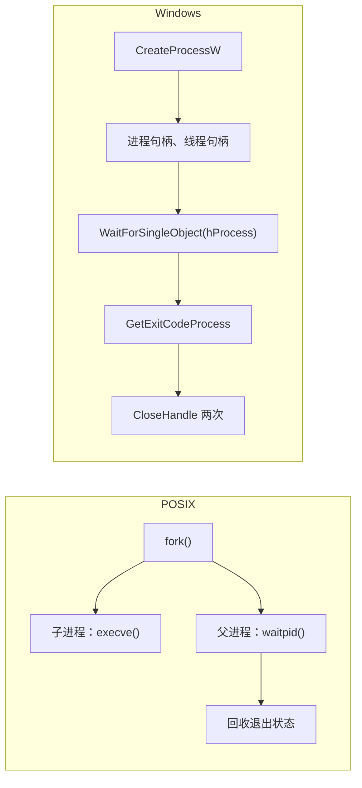

# A.8 进程的创建、执行与等待

构建脚本调用编译器，等它跑完，看退出码决定要不要继续；测试驱动一次启动四个用例进程，全跑完再汇总；终端里敲 `time`，它报出程序的运行时间、用户态和内核态时间。这三件事在 Windows 上共用一组接口：`CreateProcessW` 创建进程，等待函数等它结束，`GetExitCodeProcess` 取退出码，`GetProcessTimes` 取 CPU 时间。

这一页的示例都在 `code/系统编程/拓展A_Win32系统编程/A_8_进程的创建_执行与等待/` 下，同目录的 `Makefile` 用 `mingw32-make` 一次编完；正文只摘关键片段。页面从「Windows 为什么没有 fork」讲起，逐个说清 `CreateProcessW` 的参数，以及最容易写错的两处：命令行缓冲区必须可写、参数必须按规则引用。然后写出一个能替代 `time` 的 `run` 工具，再补上环境块、进程枚举、作业对象和并行等待。读完应当能写出启动任意程序、原样传参、可靠回收的代码，并说清它与 `fork`／`exec`／`waitpid` 的差别。

## 1. 没有 fork

POSIX 创建进程分两步：`fork` 复制当前进程，子进程再调用 `exec` 族函数把映像换成另一个程序（[第 5 章](/教程/正文/系统编程/5_进程的创建_执行与回收)）。Windows 没有 `fork`，也没有任何「复制当前进程」的系统调用。创建进程只有一个入口：把一个可执行文件加载成新进程，新进程有自己的地址空间和主线程，从映像的入口开始执行。

::: concept win32-proc-no-fork title="CreateProcessW 一步创建进程"

`CreateProcessW` 从可执行文件创建新进程和它的主线程，不复制调用者。新进程拥有独立的地址空间，从映像入口开始执行；它与父进程之间只共享创建时显式指定要继承的句柄。父进程得到两个句柄，分别是进程句柄和主线程句柄，都带完全访问权限，用完必须关闭。

:::



这个差别决定了后面所有的写法。`fork` 之后父子进程各自继续执行，子进程能在 `fork` 与 `exec` 之间修改自己的副本，重定向描述符、换用户、改环境都在这一步完成；Windows 把这些变成 `CreateProcessW` 的参数：继承哪些句柄、用哪个环境块、从哪个目录启动。反过来，新进程也无法「接着父进程往下跑」，每个进程都从映像入口重新开始。

`CreateProcessW` 返回时，子进程只是创建好了，初始化还没有完成。如果它需要的 DLL 找不到，或者 DLL 的初始化失败，进程会被系统终止，退出码是异常代码（[A.7](/教程/正文/系统编程/拓展A_Win32系统编程/A_7_动态链接库_DLL) 里缺 DLL 的 0xC0000135）。所以「创建成功」不等于「能正常跑」，一次启动是否成功要看退出码。

::: generate win32-proc-posix-reader kind=comparison

面向熟悉 `fork`／`exec`／`waitpid` 的读者，对照两种进程创建模型：父进程能传递什么（句柄、环境、当前目录、安全上下文）、子进程从哪里开始执行、退出状态怎么回收、父子关系如何记录，并说明哪些在 `fork` 里顺手就能做的事，在 Windows 上必须写成 `CreateProcessW` 的参数。不要展开具体参数名。

:::

## 2. CreateProcessW 的参数

函数原型里的参数很多，每次都要填的只有几个：

```c
BOOL CreateProcessW(
    LPCWSTR               lpApplicationName,
    LPWSTR                lpCommandLine,
    LPSECURITY_ATTRIBUTES lpProcessAttributes,
    LPSECURITY_ATTRIBUTES lpThreadAttributes,
    BOOL                  bInheritHandles,
    DWORD                 dwCreationFlags,
    LPVOID                lpEnvironment,
    LPCWSTR               lpCurrentDirectory,
    LPSTARTUPINFOW        lpStartupInfo,
    LPPROCESS_INFORMATION lpProcessInformation
);
```

### 2.1 最小的调用

先把配套的子进程写出来。整个拓展里反复用到它：打印收到的每个参数，把第一个参数当作退出码。

```c
/* 演示用的子进程：逐行打印收到的参数，以第一个参数作为退出码。 */
#include <locale.h>
#include <stdio.h>
#include <stdlib.h>
#include <wchar.h>
#include <windows.h>

int wmain(int argc, wchar_t *argv[]) {
    setlocale(LC_ALL, ".UTF8");
    SetConsoleOutputCP(CP_UTF8);

    for (int i = 1; i < argc; i++) {
        wprintf(L"argv[%d] = %ls\n", i, argv[i]);
    }
    if (argc > 1) {
        return _wtoi(argv[1]);
    }
    return 0;
}
```

启动它只需要一次调用：

```c
wchar_t cmd[] = L"child.exe 7 hello";
STARTUPINFOW si = {.cb = sizeof si};
PROCESS_INFORMATION pi;

if (!CreateProcessW(NULL, cmd, NULL, NULL, FALSE, 0, NULL, NULL, &si, &pi)) {
    printf("CreateProcessW failed: %lu\n", GetLastError());
    return 1;
}
CloseHandle(pi.hThread);
WaitForSingleObject(pi.hProcess, INFINITE);

DWORD code = 0;
GetExitCodeProcess(pi.hProcess, &code);
printf("exit code: %lu\n", (unsigned long)code);
CloseHandle(pi.hProcess);
```

`STARTUPINFOW` 的 `cb` 字段必须填成结构的大小，系统靠它判断调用者用的是哪个版本的结构，决定哪些字段可以读。用指定初始化器写 `{.cb = sizeof si}` 最省事，其余字段自动清零；写成 `{sizeof si}` 会触发 `-Wmissing-field-initializers` 警告（已实测）。`STARTUPINFOW si;` 这样完全不初始化更糟：`cb` 是栈上的随机值，`dwFlags` 也可能带上 `STARTF_USESTDHANDLES`，让系统去读三个没有设置的句柄。完整程序在 `code/系统编程/拓展A_Win32系统编程/A_8_进程的创建_执行与等待/spawn.c`，本页后面提到的其他程序也都在同一个目录。

::: terminal title="PowerShell - spawn"

<span class="prompt">PS&gt;</span> gcc -std=c17 -Wall -Wextra -municode child.c -o child.exe

<span class="prompt">PS&gt;</span> gcc -std=c17 -Wall -Wextra spawn.c -o spawn.exe

<span class="prompt">PS&gt;</span> ./spawn.exe

```text
argv[1] = 7
argv[2] = hello
exit code: 7
```

:::

### 2.2 逐个参数

| 参数 | 填什么 | 说明 |
| --- | --- | --- |
| `lpApplicationName` | 一般传 `NULL` | 传了就不搜索 `PATH`，按当前驱动器和目录补全，且必须带扩展名 |
| `lpCommandLine` | 一个可写的 `wchar_t` 数组 | 系统可能就地改写它；长度上限 32767 个字符 |
| `lpProcessAttributes`、`lpThreadAttributes` | 一般传 `NULL` | 非 `NULL` 时决定句柄能否被子进程继承、用什么安全描述符 |
| `bInheritHandles` | 不需要继承就传 `FALSE` | 传 `TRUE` 时，本进程所有可继承句柄都会进入子进程（[A.12](/教程/正文/系统编程/拓展A_Win32系统编程/A_12_管道与进程间通信) 靠它传管道） |
| `dwCreationFlags` | 一般传 0 | 控制台程序的控制台、进程组、挂起等，见下表 |
| `lpEnvironment` | 一般传 `NULL` | `NULL` 表示继承父进程的环境块，第 5 节讲自定义 |
| `lpCurrentDirectory` | 一般传 `NULL` | `NULL` 表示继承父进程的当前目录 |
| `lpStartupInfo` | `{.cb = sizeof si}` | 主窗口、标准句柄等，重定向在 A.12 |
| `lpProcessInformation` | 输出 | 拿到 PID、进程句柄、主线程句柄 |

常用的创建标志：

| 标志 | 作用 |
| --- | --- |
| `CREATE_NEW_CONSOLE` | 给子进程一个新的控制台窗口，不再共用父进程的 |
| `CREATE_NO_WINDOW` | 控制台程序不建窗口，用于后台工具 |
| `CREATE_SUSPENDED` | 主线程挂起，直到调用 `ResumeThread`，第 7 节用它先把进程放进作业对象 |
| `CREATE_UNICODE_ENVIRONMENT` | 环境块按 UTF-16 解释，第 5 节必须加 |
| `CREATE_NEW_PROCESS_GROUP` | 子进程成为新进程组的组长，同时默认忽略 Ctrl+C（[A.17](/教程/正文/系统编程/拓展A_Win32系统编程/A_17_控制台与ConPTY)） |

`lpApplicationName` 为 `NULL` 时，`lpCommandLine` 里第一个以空白分隔的记号被当作模块名。如果路径里有空格，必须给模块名加引号，否则系统按「`c:\program.exe` → `c:\program files\sub.exe` → …」的顺序逐个尝试。这也是一个安全问题的来源：恶意程序在 `C:\` 下放一个 `program.exe`，所有把 `C:\Program Files\MyApp` 直接拼进命令行的调用都会启动它。所以模块名带空格时，要么加引号，要么直接填 `lpApplicationName`。

经过 `cmd /c` 的命令行还要多过一层元字符解释，3.2 节末尾有实测。

### 2.3 写错了会怎样：命令行缓冲区

`lpCommandLine` 是 `[in, out]` 参数，不是 `const`。系统在解析时可能临时把模块名后面的空格改写成空字符，事后再改回来，也就是说它会写这块内存。传字符串字面量，字面量位于只读数据段，写入触发访问违例。

::: compare left-title="传字符串字面量" right-title="传可写的数组"

```c
CreateProcessW(NULL,
               L"child.exe 7 hello",
               NULL, NULL, FALSE, 0,
               NULL, NULL, &si, &pi);
```

---

```c
wchar_t cmd[] = L"child.exe 7 hello";

CreateProcessW(NULL, cmd,
               NULL, NULL, FALSE, 0,
               NULL, NULL, &si, &pi);
```

:::

`cp_literal.c` 把左边这种写法编译运行，进程直接崩溃（`LASTEXITCODE` 里的值已实测）：

::: terminal title="PowerShell - cp_literal"

<span class="prompt">PS&gt;</span> gcc -std=c17 -Wall -Wextra cp_literal.c -o cp_literal.exe

<span class="prompt">PS&gt;</span> ./cp_literal.exe

<span class="prompt">PS&gt;</span> \$LASTEXITCODE

```text
-1073741819
```

:::

`-1073741819` 的十六进制是 `0xC0000005`，就是访问违例（[A.5](/教程/正文/系统编程/拓展A_Win32系统编程/A_5_错误处理与结构化异常处理)）。这类错误只在字面量真正落在只读页上时才触发，编译器把字面量放进可写段的平台上同样的代码不会当场出错，于是问题常常拖到换编译器或者换优化级别才暴露。

用 `run.exe` 启动它，能看到崩溃进程的退出码在 32 位无符号值里长什么样：

::: terminal title="PowerShell - run 启动崩溃的进程"

<span class="prompt">PS&gt;</span> ./run.exe ./cp_literal.exe

```text
pid: 18440
exit code: 3221225477
elapsed: 6.7 ms, kernel: 0.0 ms, user: 0.0 ms
```

<span class="prompt">PS&gt;</span> \$LASTEXITCODE

```text
-1073741819
```

:::

`GetExitCodeProcess` 给出的是 `DWORD`，3221225477 与 `0xC0000005` 是同一个值；PowerShell 按有符号整数显示，成了负数。看到大的负数退出码，先换成十六进制再查异常代码表，不要当成程序自己返回的值。

### 2.4 两个句柄都要关

`PROCESS_INFORMATION` 里的两个句柄都带着完全访问权限，属于本进程的句柄表。子进程结束后它们不会自动消失，进程对象要等到最后一个句柄关闭才销毁。每次启动都不关，句柄数一直涨。

`handle_leak.c` 启动 200 次 `child.exe`，第一轮关闭两个句柄，第二轮不关，用 `GetProcessHandleCount` 对比：

```c
DWORD handle_count(void) {
    DWORD n = 0;
    GetProcessHandleCount(GetCurrentProcess(), &n);
    return n;
}

static void spawn(int close_handles) {
    for (int i = 0; i < N; i++) {
        wchar_t cmd[] = L"child.exe";
        STARTUPINFOW si = {.cb = sizeof si};
        PROCESS_INFORMATION pi;

        if (!CreateProcessW(NULL, cmd, NULL, NULL, FALSE, 0, NULL, NULL, &si, &pi)) {
            return;
        }
        WaitForSingleObject(pi.hProcess, INFINITE);
        if (close_handles) {
            CloseHandle(pi.hThread);
            CloseHandle(pi.hProcess);
        }
    }
}
```

::: terminal title="PowerShell - handle_leak"

<span class="prompt">PS&gt;</span> gcc -std=c17 -Wall -Wextra handle_leak.c -o handle_leak.exe

<span class="prompt">PS&gt;</span> ./handle_leak.exe

```text
closed:     48 -> 53
not closed: 53 -> 453
```

:::

第一轮多出来的 5 个句柄是运行时自己创建的，可以忽略；第二轮多出 400 个，正好是 200 次启动各泄漏两个。句柄数有上限，长期运行的服务几百天下来就会因为句柄耗尽而失败，而且失败点离泄漏点很远。用 [`goto` 统一清理](/教程/正文/语法和标准库/14_文本转换_错误与程序生命周期/14_5_goto清理模式)时，把这两个 `CloseHandle` 放在清理段里，就不会漏。

现在把两个句柄的用途和关闭时机分清楚：`pi.hThread` 只有在需要 `ResumeThread`、`SetThreadPriority` 这类操作时才用得上，用完立刻关；`pi.hProcess` 要留到等待和取退出码之后。本页的示例都按这个顺序写。

<Quiz
  :options="[
    { label: '参数顺序写错了', value: 'A' },
    { label: 'CreateProcessW 可能就地改写命令行，字面量在只读内存', value: 'B' },
    { label: '缺少 lpApplicationName', value: 'C' },
    { label: '必须改用 A 版本', value: 'D' }
  ]"
  answer="B"
>

<template #question>

`CreateProcessW(NULL, L"child.exe 1", NULL, NULL, FALSE, 0, NULL, NULL, &si, &pi)` 在运行中崩溃，最可能的原因是什么？

</template>

正确答案是 **B**。`lpCommandLine` 是 `[in, out]` 参数，系统解析时会碰这块内存，字面量所在页面是只读的，一写就访问违例。把命令放进 `wchar_t cmd[]` 数组即可。

</Quiz>

<Quiz
  :options="[
    { label: '只关 hProcess', value: 'A' },
    { label: '只关 hThread', value: 'B' },
    { label: 'hProcess 和 hThread 都关', value: 'C' },
    { label: '两个都不用关', value: 'D' }
  ]"
  answer="C"
>

<template #question>

`CreateProcessW` 成功后，父进程最终必须关闭哪些句柄？

</template>

正确答案是 **C**。两个句柄都属于父进程的句柄表，进程对象和线程对象各自等到使用它的最后一个句柄关闭才销毁。只关一个，另一个会一直占着。

</Quiz>

## 3. 命令行是一个字符串

命令行参数在 Windows 上没有结构。`CreateProcessW` 只把一整行文本交给新进程，新进程的 C 运行库在调用 `wmain` 之前把这一行切分成 `argv`。所以「传了三个参数」这件事并不存在，实际发生的是父进程把三个字符串拼成一行，子进程再把它拆回三个。

拼接和切分必须遵循同一套规则，否则对不上。MSVC 运行库的规则如下：

| 规则 | 含义 |
| --- | --- |
| 参数之间 | 以空格或制表符分隔 |
| `argv[0]` | 特殊处理：允许用引号包住其中带空格的部分，引号本身不进入结果 |
| 双引号 | 包住的一段算一个参数，可以嵌在参数中间；`^` 不是转义字符 |
| 引号内的一对双引号 | 当作一个字面双引号 |
| `\"` | 一个字面双引号 |
| 反斜杠 | 除了紧挨双引号的情况，都按字面出现 |
| `2n` 个反斜杠后接双引号 | 每对反斜杠变成一个反斜杠，双引号是分隔符 |
| `2n+1` 个反斜杠后接双引号 | 每对反斜杠变成一个反斜杠，剩下的那个转义双引号，结果是字面双引号 |

规则听起来绕，用 `child.exe` 跑几条固定的命令行就清楚了。`rules_demo.c` 把下面每一行原样交给子进程：

::: terminal title="PowerShell - rules_demo"

<span class="prompt">PS&gt;</span> gcc -std=c17 -Wall -Wextra rules_demo.c -o rules_demo.exe

<span class="prompt">PS&gt;</span> ./rules_demo.exe

```text
--- 引号内的空白
    child.exe 0 "a b c" d e
argv[1] = 0
argv[2] = a b c
argv[3] = d
argv[4] = e
--- 转义引号与单个反斜杠
    child.exe 0 "ab\"c" "\\" d
argv[1] = 0
argv[2] = ab"c
argv[3] = \
argv[4] = d
--- 三反斜杠加 b
    child.exe 0 a\\\b d"e f"g h
argv[1] = 0
argv[2] = a\\\b
argv[3] = de fg
argv[4] = h
--- 反斜杠转义引号
    child.exe 0 a\\\"b c d
argv[1] = 0
argv[2] = a\"b
argv[3] = c
argv[4] = d
--- 四个反斜杠
    child.exe 0 a\\\\"b c" d e
argv[1] = 0
argv[2] = a\\b c
argv[3] = d
argv[4] = e
--- 结尾反斜杠吃掉后一个参数
    child.exe 0 "C:\dir with space\" tail
argv[1] = 0
argv[2] = C:\dir with space" tail
--- 反斜杠成对保住参数
    child.exe 0 "C:\dir with space\\" tail
argv[1] = 0
argv[2] = C:\dir with space\
argv[3] = tail
```

:::

最后两行是实际写程序时最常踩的。`"C:\dir with space\"` 里，末尾的反斜杠紧挨结束引号，按 `2n+1` 规则，反斜杠把引号转义成了字面引号，字符串没有结束，后面的 ` tail` 也被吞进同一个参数。要传一个以反斜杠结尾、又含空格的路径，反斜杠必须写成两个：`"C:\dir with space\\"`。

一个程序也不能假定对方的切分规则和 MSVC 运行库一样，但绝大多数程序都用这套。可靠的写法是父进程按这套规则拼，不依赖对方的实现细节。

### 3.1 父进程负责引用

`sprintf` 加引号是不够的。要把任意参数原样送过去，得按上表反向编码。下面的函数移植自 MSDN 博客文章 **_Everyone quotes command line arguments the wrong way_** 里的 `ArgvQuote`，把参数追加到命令行末尾：

```c
/* 按子进程 CRT 的解析规则引用一个参数，追加到 dst 末尾。
 * 反斜杠只在双引号之前或参数末尾才需要成对。 */
static int append_quoted_arg(wchar_t *dst, size_t cap, size_t *len, const wchar_t *arg) {
    int quote = (*arg == L'\0');

    for (const wchar_t *p = arg; *p != L'\0'; p++) {
        if (*p == L' ' || *p == L'\t' || *p == L'\n' || *p == L'\v' || *p == L'"') {
            quote = 1;
        }
    }
    if (!quote) {
        for (const wchar_t *p = arg; *p != L'\0'; p++) {
            if (!put(dst, cap, len, *p)) {
                return 0;
            }
        }
        return 1;
    }

    if (!put(dst, cap, len, L'"')) {
        return 0;
    }
    const wchar_t *p = arg;
    while (*p != L'\0') {
        size_t backslashes = 0;

        while (*p == L'\\') {
            backslashes++;
            p++;
        }
        if (*p == L'\0') {
            /* 末尾的反斜杠成对，后面那个引号才是结束引号。 */
            for (size_t i = 0; i < backslashes * 2; i++) {
                if (!put(dst, cap, len, L'\\')) {
                    return 0;
                }
            }
        } else if (*p == L'"') {
            /* 反斜杠成对，再加一个转义这个引号。 */
            for (size_t i = 0; i < backslashes * 2 + 1; i++) {
                if (!put(dst, cap, len, L'\\')) {
                    return 0;
                }
            }
            if (!put(dst, cap, len, L'"')) {
                return 0;
            }
            p++;
        } else {
            for (size_t i = 0; i < backslashes; i++) {
                if (!put(dst, cap, len, L'\\')) {
                    return 0;
                }
            }
            if (!put(dst, cap, len, *p)) {
                return 0;
            }
            p++;
        }
    }
    return put(dst, cap, len, L'"');
}
```

`put` 是往缓冲区追加一个字符的小函数，缓冲区不够时返回 0。三个分支对应三条规则：扫到字符串末尾时反斜杠成对，扫到双引号时反斜杠成对再把引号自身转义，其余字符前反向斜杠按原样保留。不含空白、制表符、换行和引号的参数不加引号，这样命令行更短，也不会碰上有程序不认引号。

### 3.2 对比：简单加引号与正确引用

`quote_demo.c` 把同样的参数用两种方式拼好，分别启动 `child.exe`。参与对比的参数是 `a b`、`say "hi"`、`C:\dir with space\`，外加一个 `tail`，用来暴露末尾反斜杠吞掉后续参数的问题。

::: terminal title="PowerShell - quote_demo"

<span class="prompt">PS&gt;</span> gcc -std=c17 -Wall -Wextra quote_demo.c -o quote_demo.exe

<span class="prompt">PS&gt;</span> ./quote_demo.exe

```text
--- 简单加引号
    child.exe 0 "a b" "say "hi"" "C:\dir with space\" tail
argv[1] = 0
argv[2] = a b
argv[3] = say hi
argv[4] = C:\dir with space" tail
--- 正确引用
    child.exe 0 "a b" "say \"hi\"" "C:\dir with space\\" tail
argv[1] = 0
argv[2] = a b
argv[3] = say "hi"
argv[4] = C:\dir with space\
argv[5] = tail
```

:::

差别有三处。简单加引号把 `say "hi"` 包成 `"say "hi""`，内侧的引号提前结束了带引号的段，子进程收到的是 `say hi`，引号丢了。`C:\dir with space\` 末尾的反斜杠把结束引号转义掉，参数范围一直延伸到行尾，`tail` 被吞进去，还多出一个引号。正确引用把内部引号写成 `\"`、末尾反斜杠写成 `\\`，五个参数一个不多一个不少。

::: compare left-title="直接加引号" right-title="按规则引用"

```c
if (wcschr(arg, L' ') != NULL) {
    _snwprintf(dst, cap, L"\"%ls\"", arg);
} else {
    _snwprintf(dst, cap, L"%ls", arg);
}
```

---

```c
wchar_t cmd[CMD_MAX] = L"";
size_t len = 0;

for (int i = 1; i < argc; i++) {
    if (i > 1) {
        put(cmd, CMD_MAX, &len, L' ');
    }
    append_quoted_arg(cmd, CMD_MAX, &len, argv[i]);
}
```

:::

左边这种写法对小参数「看起来能用」，问题只在引号和结尾反斜杠上出现，而这两类字符在路径和用户输入里很常见，测试时又不容易想到。作者判断：凡是把外部数据拼进命令行，一律用完整的引用函数，不要写「只有含空格才加引号」的简化版。

:::: warning 经过 cmd 还有一层元字符

`cmd /c` 会先按自己的规则处理 `&`、`|`、`<`、`>`、`^`、`%`，再把结果交给 `CreateProcessW`。`cmd` 不认 `\"` 这种转义，它看到引号就直接切换状态。于是下面这条传给 `cmd` 的命令行，即使前半段按规则引用过，`&` 仍然落在引号外（计算机名与用户名已替换）：

::: terminal title="PowerShell - cmd 解释一层"

<span class="prompt">PS&gt;</span> cmd /c '.\child.exe 0 "safe\" & whoami'

```text
argv[1] = 0
argv[2] = safe" 
DESKTOP-EXAMPLE\user
```

:::

`whoami` 被执行了。`argv[2]` 的值是 `safe"` 加一个空格：结束引号被当成字面引号，后面的空格进了参数，`&` 则回到引号外。把不可信的数据拼进 `cmd /c` 的命令行，等于允许对方执行任意命令。需要经过 `cmd` 时，每个元字符前面还要加 `^`，或者干脆不经过 `cmd` 直接调用目标程序。

::::

## 4. 等待、退出码与终止

### 4.1 完整的 run 工具

`CreateProcessW` 返回时子进程可能已经开始跑了，也可能还在初始化。要等它结束，对进程句柄调用等待函数（[A.10](/教程/正文/系统编程/拓展A_Win32系统编程/A_10_同步原语_等待函数与内核对象)）：

```c
DWORD WaitForSingleObject(HANDLE hHandle, DWORD dwMilliseconds);
```

进程对象在进程结束时变成有信号状态，所以 `WaitForSingleObject(pi.hProcess, INFINITE)` 就是「一直等到子进程结束」。超时传毫秒数，返回 `WAIT_TIMEOUT` 表示还没结束。等待成功不会改变进程对象的状态，同一个句柄可以反复等。

`run.c` 把这段逻辑做成工具：把命令行上的参数逐个引用后拼成一行，启动、等待、取退出码和 CPU 时间。它自己的退出码用子进程的退出码，这样可以嵌进脚本。

```c
wchar_t cmd[CMD_MAX] = L"";
size_t len = 0;

for (int i = 1; i < argc; i++) {
    if (i > 1 && !put(cmd, CMD_MAX, &len, L' ')) {
        return 2;
    }
    if (!append_quoted_arg(cmd, CMD_MAX, &len, argv[i])) {
        return 2;
    }
}

STARTUPINFOW si = {.cb = sizeof si};
PROCESS_INFORMATION pi;

if (!CreateProcessW(NULL, cmd, NULL, NULL, FALSE, 0, NULL, NULL, &si, &pi)) {
    print_error(L"CreateProcessW");
    return 1;
}
CloseHandle(pi.hThread);

WaitForSingleObject(pi.hProcess, INFINITE);
```

::: terminal title="PowerShell - run"

<span class="prompt">PS&gt;</span> gcc -std=c17 -Wall -Wextra -municode run.c -o run.exe

<span class="prompt">PS&gt;</span> ./run.exe ./child.exe 7 hello

```text
argv[1] = 7
argv[2] = hello
pid: 20320
exit code: 7
elapsed: 6.6 ms, kernel: 0.0 ms, user: 0.0 ms
```

<span class="prompt">PS&gt;</span> \$LASTEXITCODE

```text
7
```

:::

`run.exe` 用 `wmain` 接收参数，`wmain` 的 `argv` 已经是 CRT 从原始命令行切好的宽字符串，所以它只需要引用后重新拼，不必自己解析。若换成 `main`，参数会先被按 ANSI 代码页转换（[A.2](/教程/正文/系统编程/拓展A_Win32系统编程/A_2_字符与文本_ANSI_Unicode与UTF16)），非 ANSI 字符变成 `?`。

找不存在的程序时，错误信息来自 `FormatMessageW`：

::: terminal title="PowerShell - run 的错误"

<span class="prompt">PS&gt;</span> ./run.exe nosuchprogram.exe

```text
CreateProcessW: error 2: 系统找不到指定的文件。
```

:::

::: tip 参数里的空字符串

真实工具会把这个空参数原样传过去。`append_quoted_arg` 对空串强制加引号（`quote` 初值为真），否则拼出来的命令行里什么都看不到，子进程那边就少了这个参数。验收方式：`./run.exe ./child.exe 0 ""`，输出里应当有一行 `argv[2] = `。

:::

### 4.2 退出码与 STILL_ACTIVE

退出码是一个 32 位值。`GetExitCodeProcess` 在进程还在运行时返回 `STILL_ACTIVE`（259），进程结束后返回真正的退出码：

```c
DWORD code = 0;
GetExitCodeProcess(h, &code);
if (code == STILL_ACTIVE) { /* 还在跑 */ }
```

`STILL_ACTIVE` 只是个约定的值，任何进程都可以返回 259。`child.exe 259` 正常退出时，`GetExitCodeProcess` 报告的也是 259，和「还在运行」分不开。`run.exe` 不区分这两种情况，直接打印 259；需要区分时只能用等待函数——等得到就是结束了。

::: terminal title="PowerShell - 退出码 259"

<span class="prompt">PS&gt;</span> ./run.exe ./child.exe 259 done

```text
argv[1] = 259
argv[2] = done
pid: 2200
exit code: 259
elapsed: 8.1 ms, kernel: 0.0 ms, user: 0.0 ms
```

:::

进程的退出码由最后一次 `ExitProcess` 或 `TerminateProcess` 决定。从 `main`／`wmain` 返回、调用 `exit`、调用 `ExitProcess`，最终都走到 `ExitProcess`，退出码是那个值。只有一种值容易看错：负数。退出码在进程里是 `DWORD`，`return -1` 实际返回 4294967295，PowerShell 显示成 `-1`。

### 4.3 崩溃的退出码

没有被处理的异常会让进程终止，退出码就是异常代码。访问违例的 0xC0000005、除零的 0xC0000094、栈溢出的 0xC00000FD 都走这条路（[A.5](/教程/正文/系统编程/拓展A_Win32系统编程/A_5_错误处理与结构化异常处理)）。`run.exe` 启动一个访问违例的程序，报告 3221225477，退出时 PowerShell 显示 -1073741819，前面已经见过。

这一类退出码的特征是最高位为 1，换算成有符号数都是很大的负数。给构建脚本判断成败时，`== 0` 是成功，其余一律失败；不要写 `> 0`，也不要假定失败的退出码是 1。

### 4.4 结束别人：TerminateProcess

`TerminateProcess` 强制结束一个进程，类似 `SIGKILL`：

```c
BOOL TerminateProcess(HANDLE hProcess, UINT uExitCode);
```

它不运行目标进程的 `atexit` 处理程序，不给 DLL 发 `DLL_PROCESS_DETACH`，不刷新该进程的缓冲区，正在执行的代码随时停在任意位置。`terminate.c` 启动一个注册了 `atexit` 处理程序、睡 30 秒的子进程，然后结束它：

::: terminal title="PowerShell - terminate"

<span class="prompt">PS&gt;</span> gcc -std=c17 -Wall -Wextra terminate.c -o terminate.exe

<span class="prompt">PS&gt;</span> ./terminate.exe

```text
running: exit code 259 (STILL_ACTIVE is 259)
after TerminateProcess(42): exit code 42
```

:::

子进程的 `cleanup ran` 一直没有出现。`cleanup_child.exe 0` 自己跑完时才会打印它：

::: terminal title="PowerShell - cleanup_child 正常退出"

<span class="prompt">PS&gt;</span> gcc -std=c17 -Wall -Wextra cleanup_child.c -o cleanup_child.exe

<span class="prompt">PS&gt;</span> ./cleanup_child.exe 0

```text
cleanup ran
```

:::

所以结束进程的正确顺序是：先请它自己退出（图形界面程序发 `WM_CLOSE`，控制台程序发 Ctrl+C 或 `CTRL_BREAK_EVENT`，服务用 `SERVICE_CONTROL_STOP`，见 [A.17](/教程/正文/系统编程/拓展A_Win32系统编程/A_17_控制台与ConPTY) 与 [A.18](/教程/正文/系统编程/拓展A_Win32系统编程/A_18_Windows服务_注册表与系统设施)），等一段时间，实在不退再 `TerminateProcess`。`TerminateProcess` 的第二个参数就是目标进程最终的退出码，和它自己返回值的含义不同：`TerminateProcess` 成功返回非零，失败返回 0。

::: concept win32-proc-object-lifetime title="进程结束不等于进程对象销毁"

进程终止后，内核里的进程对象仍然存在，退出码、CPU 时间这些统计都还查得到，直到所有指向它的句柄都关闭。`GetExitCodeProcess` 可以反复调用，`WaitForSingleObject` 每次都立即返回。最后一个句柄关闭时对象才销毁，PID 也从系统里消失。这一点类似 POSIX 的僵尸进程，但 Windows 没有 `SIGCHLD`，也没有「收养」：子进程只记录父进程的 PID，父进程退出时子进程照常运行，PID 也不会被回收。

:::

`zombie.c` 验证了这三件事：

```c
CloseHandle(pi.hThread);
DWORD pid = pi.dwProcessId;
WaitForSingleObject(pi.hProcess, INFINITE);
Sleep(200);
GetExitCodeProcess(pi.hProcess, &code);
printf("second WaitForSingleObject -> %lu\n",
       (unsigned long)WaitForSingleObject(pi.hProcess, 0));
...
CloseHandle(pi.hProcess);
SetLastError(0);
h = OpenProcess(PROCESS_QUERY_LIMITED_INFORMATION, FALSE, pid);
printf("OpenProcess after the last handle closed -> %p, error %lu\n", (void *)h,
       GetLastError());
```

::: terminal title="PowerShell - zombie"

<span class="prompt">PS&gt;</span> gcc -std=c17 -Wall -Wextra zombie.c -o zombie.exe

<span class="prompt">PS&gt;</span> ./zombie.exe

```text
argv[1] = 5
child 15528 finished: exit code 5
second WaitForSingleObject -> 0
OpenProcess while the object lives -> 0000000000000068
OpenProcess after the last handle closed -> 0000000000000000, error 87
```

:::

句柄还在时，`OpenProcess` 用 PID 又能打开一个；关掉最后一个句柄之后，同一个 PID 调 `OpenProcess` 失败，错误 87（`ERROR_INVALID_PARAMETER`）。这和一个刚退出的进程「查不到」是同一回事，不必再找回收子进程的 `wait`：在 Windows 上，关闭句柄就是回收。

父进程退出、子进程还活着时，子进程的父 PID 仍记着原来的值，但这个进程已经不存在了。`orphan.exe` 启动 `sleeper.exe 120` 后立即退出：

::: terminal title="PowerShell - orphan"

<span class="prompt">PS&gt;</span> gcc -std=c17 -Wall -Wextra orphan.c -o orphan.exe

<span class="prompt">PS&gt;</span> ./orphan.exe

```text
parent 26028 started child 15672, exits now
sleeper 15672: sleeping 120 s
```

<span class="prompt">PS&gt;</span> ./mini_ps.exe sleeper

```text
   PID   PPID  image
 15672  26028  sleeper.exe
```

:::

父 PID 是 26028，而那个进程已经不在了。POSIX 会把它改挂到 init 或 subreaper 上，Windows 不做这件事。需要「父进程一死子进程跟着死」时，用第 7 节的作业对象。

## 5. 环境块与当前目录

### 5.1 进程环境

每个进程都有一份环境块（environment block），是一串以空字符结尾的 `名=值` 字符串，最后再用一个空字符收尾。`GetEnvironmentVariableW` 按名字查，`SetEnvironmentVariableW` 改当前进程自己的环境：

```c
DWORD GetEnvironmentVariableW(LPCWSTR lpName, LPWSTR lpBuffer, DWORD nSize);
BOOL  SetEnvironmentVariableW(LPCWSTR lpName, LPCWSTR lpValue);
```

`GetEnvironmentVariableW` 在缓冲区不够时返回所需的大小（含结尾空字符），名字不存在时返回 0。常用的两次调用写法是先传 `NULL, 0` 求大小，再分配缓冲区。`SetEnvironmentVariableW` 只改当前进程的环境，不影响系统设置，也不影响已经在运行的别的进程；值传 `NULL` 表示删掉这一项。

默认情况下 `CreateProcessW` 的 `lpEnvironment` 传 `NULL`，子进程继承父进程此刻的环境。父进程在 `CreateProcessW` 之前用 `SetEnvironmentVariableW` 设的项，子进程能看到。这是唯一一种让一个进程修改另一个进程环境的方式：只能在创建的那一刻指定。

::: concept win32-proc-env-block title="环境块的格式"

环境块是一段连续的宽字符串，每个变量形如 `名=值\0`，全部变量之后再来一个 `\0` 表示结束；名字里不能有等号。传给 `CreateProcessW` 时必须同时指定 `CREATE_UNICODE_ENVIRONMENT`，否则系统按 ANSI 字符解释这块内存。环境块按名字的字母序排列——`CreateProcessW` 的说明里明确讲系统使用的是排好序的环境，自己拼的时候要保持这个顺序。

:::

按名字排序这一条容易忽略。`envblock.c` 给子进程一个只含两个变量的环境块，`SystemRoot` 必须留着，否则子进程里一部分系统功能会失败（比如加载依赖系统目录的 DLL、`GetSystemDirectory` 之类的查询）。

```c
static wchar_t *build_block(void) {
    wchar_t *root = NULL;
    DWORD n = GetEnvironmentVariableW(L"SystemRoot", NULL, 0);

    if (n > 0) {
        root = malloc(n * sizeof(wchar_t));
        if (root != NULL) {
            GetEnvironmentVariableW(L"SystemRoot", root, n);
        }
    }
    const wchar_t *mode = L"MDR_MODE=test";
    size_t root_len = root != NULL ? wcslen(root) : 0;
    size_t total = wcslen(mode) + 1 + 11 + root_len + 1 + 1;
    wchar_t *block = calloc(total, sizeof(wchar_t));
    ...
    *p++ = L'\0';
    *p = L'\0';
    free(root);
    return block;
}
```

`calloc` 保证结尾两个空字符已经就位，所以只需要写一个。整个块放在进程的堆上，`CreateProcessW` 返回后就可以释放——系统在创建时已经把内容复制进新进程。`lpCurrentDirectory` 传 `L"C:\\Windows"`，子进程的当前目录就设成那里，而不是继承父进程的临时目录。

子进程 `showenv.exe` 查这几个变量并打印当前目录：

::: terminal title="PowerShell - envblock"

<span class="prompt">PS&gt;</span> gcc -std=c17 -Wall -Wextra -municode showenv.c -o showenv.exe

<span class="prompt">PS&gt;</span> gcc -std=c17 -Wall -Wextra -municode envblock.c -o envblock.exe

<span class="prompt">PS&gt;</span> ./envblock.exe

```text
MDR_MODE = test
SystemRoot = C:\Windows
cwd = C:\Windows
PATH is missing
```

:::

`PATH` 不在自定义环境块里，所以是「未定义」，说明子进程确实没有继承父进程的环境。实际使用中，给子进程一个精简的环境块要小心：除了 `SystemRoot`，`PATH`、`TEMP`、`SystemDrive`、`COMSPEC` 这些变量少一个都可能让某些程序出问题。最常见做法是拿父进程的环境块复制一份、只增删几个变量，而不是从零构造。`GetEnvironmentStringsW` 拿到当前进程的块，改完用 `FreeEnvironmentStringsW` 释放。

### 5.2 当前目录

`lpCurrentDirectory` 为 `NULL` 时子进程继承父进程的当前目录。传一个完整路径就改到那里，这是 `fork` 之后在子进程里调 `chdir` 的对应物。路径里带盘符时要写完整：`C:` 和 `C:\` 在 Windows 上含义不同，前者是「C 盘的当前目录」，后者是根目录。

## 6. 进程信息与枚举

### 6.1 从 PID 到句柄

`PROCESS_INFORMATION` 的 `dwProcessId` 是系统分配的进程标识符（process identifier，PID），只在进程存活期间有效。句柄才是有访问权限的对象：有句柄就能等待、取退出码、读 CPU 时间；只有 PID 时需要先用 `OpenProcess` 换一个句柄：

```c
HANDLE OpenProcess(DWORD dwDesiredAccess, BOOL bInheritHandle, DWORD dwProcessId);
```

最小权限原则在这里同样适用：只查信息时用 `PROCESS_QUERY_LIMITED_INFORMATION`，不要用 `PROCESS_ALL_ACCESS`。前者对大多数进程都够（包括以更高权限运行的进程），后者会被拒绝。`procinfo.c` 用 PID 打开进程、取映像路径与累计 CPU 时间：

```c
HANDLE h = OpenProcess(PROCESS_QUERY_LIMITED_INFORMATION, FALSE, pid);
...
wchar_t path[MAX_PATH];
DWORD n = MAX_PATH;
QueryFullProcessImageNameW(h, 0, path, &n);

FILETIME creation, exit_time, kernel, user;
GetProcessTimes(h, &creation, &exit_time, &kernel, &user);
```

`QueryFullProcessImageNameW` 返回完整路径，正好是 `GetModuleFileNameW` 那种「自己查自己」做不到的。`GetProcessTimes` 给出四个时间，单位是 100 纳秒：

| 字段 | 含义 |
| --- | --- |
| `lpCreationTime` | 进程创建的时刻，UTC，从 1601-01-01 起算 |
| `lpExitTime` | 进程结束的时刻；还在运行时内容无意义 |
| `lpKernelTime` | 所有线程在内核态累计的时间 |
| `lpUserTime` | 所有线程在用户态累计的时间 |

`lpExitTime - lpCreationTime` 是进程的存活时间（wall clock），`lpKernelTime + lpUserTime` 是它实际用掉的 CPU 时间。这正是 Unix `time` 命令报告的三项：`real`、`sys`、`user`。`run.c` 就是这么算的：

```c
if (!GetProcessTimes(pi.hProcess, &creation, &exit_time, &kernel, &user)) {
    print_error(L"GetProcessTimes");
}
...
double elapsed = (double)(filetime_to_u64(exit_time) - filetime_to_u64(creation)) / 10000.0;
printf("elapsed: %.1f ms, kernel: %.1f ms, user: %.1f ms\n", elapsed,
       (double)filetime_to_u64(kernel) / 10000.0,
       (double)filetime_to_u64(user) / 10000.0);
```

除以 10000 把 100 纳秒换算成毫秒。`FILETIME` 拆成两个 32 位字段，比较和相减都要先合成 64 位，`ULARGE_INTEGER` 就是干这个的。

用一个空转约 150 毫秒的程序 `busy.exe` 验证：

::: terminal title="PowerShell - run 报告 CPU 时间"

<span class="prompt">PS&gt;</span> gcc -std=c17 -Wall -Wextra busy.c -o busy.exe

<span class="prompt">PS&gt;</span> ./run.exe ./busy.exe

```text
busy done, acc = 520497945000
pid: 18896
exit code: 0
elapsed: 158.6 ms, kernel: 15.6 ms, user: 140.6 ms
```

:::

用户态时间略少于经过时间，差额是进程启动、退出和等待调度的时间；内核态时间来自文件读写、内存分配这些系统调用。`child.exe` 太小，CPU 时间往往显示 0.0，这不代表计时出错。

::: tip 实时监视另一个进程

`procinfo.exe PID` 也能查任意进程。本机对自己查一次：

:::: terminal title="PowerShell - procinfo"

<span class="prompt">PS&gt;</span> ./procinfo.exe \$PID

```text
image: C:\Program Files\WindowsApps\Microsoft.PowerShell_7.6.7.0_x64__8wekyb3d8bbwe\pwsh.exe
kernel 93.8 ms, user 312.5 ms
```

::::

:::

PID 传 0 或一个不存在的值，`OpenProcess` 失败，错误 87。PID 0 是空闲进程，系统里没有它的句柄可开；不存在的 PID 同理。第 4 节的 `zombie.exe` 也演示了这一条：进程对象销毁之后，原来的 PID 就查不到了。

### 6.2 枚举进程

任务管理器里的进程列表从哪里来？`CreateToolhelp32Snapshot` 给当前所有进程拍一张快照，再逐个读出来：

```c
HANDLE CreateToolhelp32Snapshot(DWORD dwFlags, DWORD th32ProcessID);
BOOL   Process32FirstW(HANDLE hSnapshot, LPPROCESSENTRY32W lppe);
BOOL   Process32NextW(HANDLE hSnapshot, LPPROCESSENTRY32W lppe);
```

`dwFlags` 传 `TH32CS_SNAPPROCESS`，第二个参数传 0。传入 `PROCESSENTRY32W` 之前必须把 `dwSize` 填好，这一点和 `STARTUPINFOW` 一样，`Process32FirstW` 靠它判断结构版本。`Process32NextW` 返回 `FALSE` 时枚举结束，用 `GetLastError` 区分是正常结束还是出错：正常结束时错误码是 `ERROR_NO_MORE_FILES`。

`mini_ps.c` 打印 PID、父 PID 和映像名：

```c
PROCESSENTRY32W pe = {.dwSize = sizeof pe};
int count = 0;
DWORD self = GetCurrentProcessId();

wprintf(L"   PID   PPID  image\n");
if (Process32FirstW(snap, &pe)) {
    do {
        int match = filter != NULL ? (wcsstr(pe.szExeFile, filter) != NULL)
                                   : (count < 8 || pe.th32ProcessID == self);
        if (match) {
            wprintf(L"%6lu %6lu  %ls\n", (unsigned long)pe.th32ProcessID,
                    (unsigned long)pe.th32ParentProcessID, pe.szExeFile);
        }
        count++;
    } while (Process32NextW(snap, &pe));
}
```

::: terminal title="PowerShell - mini_ps"

<span class="prompt">PS&gt;</span> gcc -std=c17 -Wall -Wextra -municode mini_ps.c -o mini_ps.exe

<span class="prompt">PS&gt;</span> ./mini_ps.exe

```text
   PID   PPID  image
     0      0  [System Process]
     4      0  System
   236      4  Secure System
   280      4  Registry
   940      4  smss.exe
  1304   1096  csrss.exe
  1408   1096  wininit.exe
  1416   1400  csrss.exe
 26248  17160  mini_ps.exe
-- 280 processes; self is 26248
```

:::

前几行全是系统进程：PID 0 是空闲进程，PID 4 是内核，`smss.exe`、`csrss.exe`、`wininit.exe` 都是会话管理器在用户登录前就启动的。最后一个 `mini_ps.exe` 是它自己，父进程是本机的终端宿主。PID 和父 PID 每次都不同，这里贴的是一次运行的结果。

`PROCESSENTRY32W` 里还有 `cntThreads`（线程数）、`th32DefaultHeapID`、`dwFlags` 等字段，常用的就 PID、父 PID 和 `szExeFile`。要取映像的完整路径，对每个 PID 调 `OpenProcess` 加 `QueryFullProcessImageNameW`；系统进程可能打不开，失败就跳过。

::: tip 更省事的枚举

`GetProcessId` 从进程句柄反查 PID，`GetCurrentProcessId` 拿自己的 PID；工具里常配合 `Process32FirstW` 找出「同名进程有几个」。命令行下的 `tasklist` 就是这套 API 的现成前端，输出格式更适合脚本处理。

:::

## 7. 作业对象

### 7.1 父进程退出时子进程还在

第 4 节末尾的 `orphan.exe` 留下了一个还在睡的 `sleeper.exe`。POSIX 下这属于正常设计（孤儿进程被 init 收养），Windows 下则常常是缺陷：安装程序启动了一个后台组件、启动器把工作交给子进程后自己退出，用户看到的界面关了，后台还留着东西。

POSIX 可以用进程组加 `kill(-pgid, SIGKILL)`，Linux 还可以给子进程设 `PR_SET_PDEATHSIG` 让内核在父进程退出时发信号；更完整的资源控制用 cgroup。Windows 的对应物是作业对象（job object）。

::: concept win32-job-kill-on-close title="作业对象与 KILL_ON_JOB_CLOSE"

作业对象把一组进程当作一个单位管理，可以限制内存、CPU 时间，也可以一次结束组内全部进程。设置了 `JOB_OBJECT_LIMIT_KILL_ON_JOB_CLOSE` 之后，作业对象的最后一个句柄关闭时，系统结束组内所有进程，再销毁作业对象。进程一旦加入作业，这个关联就不能解除；此后它创建的子进程默认也加入同一个作业，除非作业设置了允许脱离（breakaway）的限制标志。

:::

### 7.2 job_kill.c

`CreateJobObjectW` 创建一个匿名作业对象，`SetInformationJobObject` 设上限标志，`AssignProcessToJobObject` 把子进程放进去：

```c
HANDLE job = CreateJobObjectW(NULL, NULL);
JOBOBJECT_EXTENDED_LIMIT_INFORMATION limit = {0};

limit.BasicLimitInformation.LimitFlags = JOB_OBJECT_LIMIT_KILL_ON_JOB_CLOSE;
SetInformationJobObject(job, JobObjectExtendedLimitInformation, &limit, sizeof limit);

STARTUPINFOW si = {.cb = sizeof si};
PROCESS_INFORMATION pi;

CreateProcessW(NULL, cmd, NULL, NULL, FALSE, CREATE_SUSPENDED, NULL, NULL, &si, &pi);
AssignProcessToJobObject(job, pi.hProcess);
ResumeThread(pi.hThread);

CloseHandle(pi.hThread);
CloseHandle(pi.hProcess);
Sleep(1000);
return 0;
```

`CREATE_SUSPENDED` 是关键的一步：进程创建出来但主线程挂着，先 `AssignProcessToJobObject` 把它放进作业，再 `ResumeThread`。不挂起的话，子进程可能在被放进去之前就创建了自己的子进程，那些孙进程不在作业里，父进程退出时不会跟着结束。

这里还有一处容易漏：`pi.hProcess` 和 `pi.hThread` 在加入作业后立刻关闭。作业对象持有自己的引用，父进程不需要靠这两个句柄维持什么。最后 `Sleep(1000)` 之后 `main` 返回，`job` 句柄随进程结束被系统关闭，`KILL_ON_JOB_CLOSE` 生效。

::: terminal title="PowerShell - job_kill"

<span class="prompt">PS&gt;</span> gcc -std=c17 -Wall -Wextra -municode job_kill.c -o job_kill.exe

<span class="prompt">PS&gt;</span> ./job_kill.exe ./sleeper.exe 60

```text
child pid 28088 started in job, parent exits in 1 second
job handle 00000000000000AC
sleeper 28088: sleeping 60 s
```

:::

作业句柄的值随每次运行变化。命令在 1 秒后返回，这时子进程应该已经没了。用 `tasklist` 确认：

::: terminal title="PowerShell - 确认子进程已结束"

<span class="prompt">PS&gt;</span> tasklist /FI "IMAGENAME eq sleeper.exe"

```text
INFO: No tasks are running which match the specified criteria.
```

:::

同一个命令在父进程还活着时（1 秒内）执行，会看到 `sleeper.exe` 那一行：

```text
Image Name                     PID Session Name        Session#    Mem Usage
========================= ======== ================ =========== ============
sleeper.exe                  28088 Console                    1      3,776 K
```

不用作业对象时，父进程退出后 `sleeper.exe` 会一直留到 60 秒睡完。配套的 `nojob.c` 就是这种写法：只启动子进程、关掉两个句柄、立即返回，子进程照样活着（用 `Get-Process sleeper` 能看到它，PID 与父进程打印的一致）。这就是默认行为，也是作业对象存在的理由。

作业对象还能限制内存和 CPU。`JOBOBJECT_BASIC_LIMIT_INFORMATION` 里，`PerProcessUserTimeLimit` 给组内每个进程设 CPU 时间上限（标志 `JOB_OBJECT_LIMIT_PROCESS_TIME`），`PerJobUserTimeLimit` 给整个作业设总上限（`JOB_OBJECT_LIMIT_JOB_TIME`），`ProcessMemoryLimit` 与 `JobMemoryLimit` 分别限制单个进程和整个作业的内存（`JOB_OBJECT_LIMIT_PROCESS_MEMORY`、`JOB_OBJECT_LIMIT_JOB_MEMORY`）。超限时系统结束进程或让分配失败，具体行为随标志而异。需要给一整组子进程设统一上限，而不是只靠父进程退出时统一结束，就用这几个字段。

::: tip 作业对象可能已经被占用

调试器会把被调试进程放进自己的作业；一些启动器（包括部分 IDE、部分终端）也这么做。`AssignProcessToJobObject` 失败时，先看 `GetLastError` 是不是 `ERROR_ACCESS_DENIED`（5），再用 `IsProcessInJob` 确认目标进程是不是已经在别的作业里。老系统上作业不能嵌套，Windows 8 之后可以。

:::

<Quiz
  :options="[
    { label: '给子进程发 WM_CLOSE', value: 'A' },
    { label: '把子进程放进设了 KILL_ON_JOB_CLOSE 的作业对象', value: 'B' },
    { label: '关闭子进程句柄', value: 'C' },
    { label: '用 CREATE_NEW_CONSOLE 创建', value: 'D' }
  ]"
  answer="B"
>

<template #question>

怎样保证父进程意外退出时，它启动的子进程也被结束？

</template>

正确答案是 **B**。`KILL_ON_JOB_CLOSE` 在作业对象的最后一个句柄关闭时结束组内所有进程，父进程崩溃时操作系统替它关闭句柄，子进程跟着结束。关闭子进程句柄只是放弃本进程的引用，对子进程没有任何影响；`WM_CLOSE` 只对窗口程序有效，而且对方可以不理会。

</Quiz>

## 8. 并行启动多个子进程

### 8.1 一次等四个

构建工具的常见形态是「同时跑 N 个任务，全部完成后汇总」。`WaitForMultipleObjects` 支持一次等最多 64 个对象：

```c
DWORD WaitForMultipleObjects(DWORD nCount, const HANDLE *lpHandles,
                             BOOL bWaitAll, DWORD dwMilliseconds);
```

`bWaitAll` 为 `TRUE` 时，要等到所有对象都有信号才返回。`parallel.c` 启动四个 `child.exe`，退出码各不相同，全部结束后逐个取退出码：

```c
static const int codes[N] = {3, 1, 4, 1};
HANDLE handles[N] = {0};
PROCESS_INFORMATION procs[N] = {0};
int started = 0;

for (int i = 0; i < N; i++) {
    wchar_t cmd[256];
    _snwprintf(cmd, 256, L"child.exe %d job%d", codes[i], i);
    STARTUPINFOW si = {.cb = sizeof si};
    PROCESS_INFORMATION pi;

    if (!CreateProcessW(NULL, cmd, NULL, NULL, FALSE, 0, NULL, NULL, &si, &pi)) {
        printf("CreateProcessW failed: %lu\n", GetLastError());
        break;
    }
    CloseHandle(pi.hThread);
    handles[i] = pi.hProcess;
    procs[i] = pi;
    started++;
}

DWORD w = WaitForMultipleObjects((DWORD)started, handles, TRUE, INFINITE);
if (w != WAIT_OBJECT_0) {
    printf("WaitForMultipleObjects -> %lu\n", (unsigned long)w);
}
for (int i = 0; i < started; i++) {
    DWORD code = 0;
    GetExitCodeProcess(handles[i], &code);
    printf("job %d (pid %lu): exit code %lu\n", i, (unsigned long)procs[i].dwProcessId,
           (unsigned long)code);
    CloseHandle(handles[i]);
}
```

::: terminal title="PowerShell - parallel"

<span class="prompt">PS&gt;</span> gcc -std=c17 -Wall -Wextra -municode parallel.c -o parallel.exe

<span class="prompt">PS&gt;</span> ./parallel.exe

```text
argv[1] = 3
argv[2] = job0
argv[1] = 1
argv[2] = job1
argv[1] = 4
argv[2] = job2
argv[1] = 1
argv[2] = job3
job 0 (pid 13656): exit code 3
job 1 (pid 26408): exit code 1
job 2 (pid 2920): exit code 4
job 3 (pid 10236): exit code 1
```

:::

四个子进程的输出混在一起，顺序每次运行都可能不同，取决于调度。`job` 汇总行是同一次运行的先后顺序，PID 每次都变。`parallel.exe` 自己的退出码是 0，因为「所有任务都跑完了」本身算成功；子任务的失败信息在它自己的输出里。要让它也报告失败，可以在循环里记录最大退出码或第一个非零值，最后返回那个值。

### 8.2 上限与分组

`WaitForMultipleObjects` 最多等 64 个句柄（`MAXIMUM_WAIT_OBJECTS`）。超过时，把 64 个分成一组开一个线程等，再把这个线程的句柄与其他组一起等——等待的是线程对象，线程结束时变成有信号。更常见的做法是不超过 64 个就够用：一次启动几百个编译进程会先把内存和 CPU 占满。

等待的数组里不能放同一个句柄的两份拷贝，也不能放 `NULL`：前者实测返回 `WAIT_FAILED`、错误 87（`ERROR_INVALID_PARAMETER`），后者返回 `WAIT_FAILED`、错误 6（`ERROR_INVALID_HANDLE`）。子进程启动失败时，`started` 记下实际成功数，等待时只传那么多，这个写法在上面已经用了。

::: tip 与 POSIX 的对应

`fork` 之后要回收子进程，靠 `waitpid`，一次一个；`waitpid(-1, ...)` 可以等任意一个，配合循环逐个回收。Windows 没有「等任意一个子进程」的等价物，因为内核不维护进程树，也没有子进程这个概念——只有你自己持有的句柄。所以「并行启动、全部等完」在 Windows 上必须由调用者自己维护句柄数组。需要「哪一个先完成」时，用 `bWaitAll = FALSE` 再循环，每次把已完成的下标从数组里换出去（[A.10](/教程/正文/系统编程/拓展A_Win32系统编程/A_10_同步原语_等待函数与内核对象) 的 `wait_multi`）。

:::

## 9. 习题

### 9.1 巩固

<Exercise id="45801" :d="1" :w="1">

编译本页的 `cp_literal.c`，运行前写下预测：进程会崩溃、`CreateProcessW` 返回失败，还是正常启动？退出码分别是多少（用十进制和十六进制两种写法）？

把 `L"child.exe 7 hello"` 改成 `wchar_t cmd[] = L"child.exe 7 hello"` 之后重新运行，对照两次结果。

</Exercise>

<Exercise id="45802" :d="2" :w="2">

下面这段代码至少有四处问题，逐一指出并改正，说明每一处对应本页哪一小节。

```c
STARTUPINFOW si;
PROCESS_INFORMATION pi;
CreateProcessW(NULL, L"child.exe 0", NULL, NULL, FALSE, 0, NULL, NULL, &si, &pi);
WaitForSingleObject(pi.hProcess, INFINITE);
printf("exit code: %lu\n", pi.dwProcessId);
CloseHandle(pi.hProcess);
```

改正后编译运行，用 `child.exe 3` 验证退出码打印为 3。

</Exercise>

<Exercise id="45803" :d="2" :w="2">

`tasklist` 显示不了 CPU 时间，但 `GetProcessTimes` 可以。用本页的 `procinfo.exe` 观察以下几个进程的 `kernel` 与 `user` 时间，各记一次，然后隔 10 秒再记一次：

- 一个空闲的 `sleeper.exe`（本页的示例，用 `Start-Process .\sleeper.exe 300 -PassThru` 启动，记下它的 PID）；
- 当前的 PowerShell（`$PID`）；
- `explorer.exe`（用 `(Get-Process explorer).Id` 取 PID）。

说明哪些进程的 CPU 时间在 10 秒内没有增长、哪些增长了，以及「经过时间」和「CPU 时间」为什么不是一回事。

</Exercise>

<Exercise id="45804" :d="2" :w="2">

把本页 `envblock.c` 构造的环境块改成含三个变量：`MDR_MODE=test`、`SystemRoot` 和 `PATH`（值取父进程的）。要求仍然自己拼缓冲区、按字母序排好，并且 `PATH` 只出现在块里一次。

用 `showenv.exe` 验证三个变量都能读到；再把 `PATH` 从块里去掉，确认它变回「未定义」。

</Exercise>

<Exercise id="45805" :d="3" :w="2">

下面这个函数想把 `argv` 里的参数拼成一行命令行，交给 `CreateProcessW`。它有三处会让子进程收到的参数和原来不一样，分别给出一个能触发问题的输入，改写成正确版本。

```c
/* 把 argv[1..argc-1] 拼进 cmd，参数之间用一个空格分隔。 */
static void build_cmd(wchar_t *cmd, int argc, wchar_t *argv[]) {
    cmd[0] = L'\0';
    for (int i = 1; i < argc; i++) {
        if (i > 1) {
            wcscat(cmd, L" ");
        }
        if (wcschr(argv[i], L' ') != NULL) {
            wcscat(cmd, L"\"");
            wcscat(cmd, argv[i]);
            wcscat(cmd, L"\"");
        } else {
            wcscat(cmd, argv[i]);
        }
    }
}
```

用 `./child.exe` 验证：至少要让 `say "hi"`、`C:\dir with space\`（结尾有反斜杠）和一个空串 `""` 三种输入都原样到达子进程。提示：三处分别对应本页 3 节规则表里的引号、反斜杠和空参数。缓冲区大小先按够用处理，不必关心溢出。

</Exercise>

### 9.2 编程

<Exercise id="45806" :d="3" :w="3">

写一个 `runlog.exe 程序 [参数...]`：启动给定的程序，把它的退出码、经过时间、用户态和内核态时间写进 `runlog.txt`，每行一项，格式为 `key=value`，然后再往标准输出打印一行摘要。

要求：

1. 参数引用直接用本页的 `append_quoted_arg`，把 `run.c` 里那段复制过来即可；
2. 时间用 `GetProcessTimes`，换算成毫秒、保留一位小数，用 `fprintf` 写文件；
3. 子进程返回非零退出码时，`runlog.exe` 也返回非零，且 `runlog.txt` 里要记录 `status=failed`；
4. 用 `./runlog.exe ./busy.exe` 和 `./runlog.exe ./cp_literal.exe` 验收，前者 `status=ok`，后者 `status=failed` 并记录 `exit_code=3221225477`；
5. 再跑一次 `./runlog.exe ./child.exe 259`，解释为什么记录下来的 `exit_code=259` 不能证明程序「还在运行」，以及要区分这两种情况应该改用什么函数。

</Exercise>

<Exercise id="45807" :d="4" :w="3">

写一个 `ptree.exe`：用 `CreateToolhelp32Snapshot` 枚举进程，打印以某个 PID 为根的整棵进程树（缩进表示层级，每一行是 `PID 映像名`）。

要求：

1. 先把快照读进一个动态数组（父 PID、PID、映像名），再用深度优先遍历建树；
2. 找不到根 PID 时打印 `no such process` 并返回 1；
3. 根进程没有子进程时只打印根一行；
4. 用 `./ptree.exe $PID` 查当前 PowerShell 底下的进程，再用 `Start-Process` 起一个 `cmd /c` 加 `ping -n 10 127.0.0.1`，在它退出前对 `cmd.exe` 的 PID 再跑一次，应当能看到 `PING.EXE` 在树里；
5. 用 `./ptree.exe 4` 看看 `System` 底下有哪些进程，说明 PID 4 只是 `smss.exe` 等几个系统进程在父 PID 字段里填的值，`System` 本身并没有像普通进程那样创建它们。

</Exercise>

<Exercise id="45808" :d="4" :w="4">

写一个 `spawnmany.exe N 命令 [参数...]`：一次启动 N 个该命令的子进程（每次在命令行末尾追加一个序号参数），全部放进同一个作业对象，等待它们全部结束，打印每个的退出码与总经过时间。

要求：

1. 作业对象要设 `KILL_ON_JOB_CLOSE`，用 `CREATE_SUSPENDED` 创建、加入作业后再 `ResumeThread`；
2. 用 `WaitForMultipleObjects(..., TRUE, 30000)`，超时后打印 `timeout` 并让作业对象在进程退出时收拾残局；
3. N 分别取 4、16、64 跑一次，打印实际启动数与总时间；
4. 用 `./spawnmany.exe 4 .\busy.exe` 验收，四个子进程几乎同时开始（总时间接近单个子进程的 1.5 倍以内，而不是四倍）；再用 `./spawnmany.exe 4 .\sleeper.exe 30` 配 3 秒超时验证超时分支：打印 `timeout`，进程退出后 `tasklist` 里没有 `sleeper.exe` 残留。

</Exercise>

### 9.3 综合与挑战

<Exercise id="45809" :d="6" :w="5" scope="*">

写一个 `runner.exe`，它同时具备 `run`、`spawnmany` 与作业对象的能力，并用它做一个对比实验：同一个 `busy.exe`，分别以串行 4 次、`--jobs 4` 并行 4 次、`--jobs 4` 并行但给作业对象设 CPU 时间上限三种方式运行，各跑三次，报告总经过时间。

要求：

1. 命令行是 `runner.exe [--jobs N] [--timeout MS] 程序 [参数...]`，`--jobs` 缺省为 1；
2. 超时用 `WaitForMultipleObjects` 的毫秒参数实现，超时后用 `TerminateJobObject` 结束整组；
3. 作业对象设置 `JOB_OBJECT_LIMIT_PROCESS_TIME`（每个进程的 CPU 时间上限）和 `KILL_ON_JOB_CLOSE`，上限定成 50 ms，记录超限进程的实际退出码，并与 `TerminateJobObject` 指定的退出码对照；
4. 三次测量报告最小值与中位数，说明本机 16 个逻辑处理器下并行 4 个 `busy.exe` 的总时间为什么和串行差不多（提示：`busy.exe` 每次只空转 150 ms，进程创建本身要五到十毫秒，调度和启动开销的占比很大；把时间改成 2 秒再测一次，并行才会明显缩短）；
5. 与主线[第 5 章](/教程/正文/系统编程/5_进程的创建_执行与回收)的 `fork`／`exec`／`waitpid` 版本对照，说明同样功能的 POSIX 程序需要哪些接口，以及哪一部分在 Windows 上更简单。

</Exercise>

## 10. 参考资料

- Microsoft Learn：Create processes，https://learn.microsoft.com/en-us/windows/win32/procthread/creating-processes
- Microsoft Learn：CreateProcessW function，https://learn.microsoft.com/en-us/windows/win32/api/processthreadsapi/nf-processthreadsapi-createprocessw
- Microsoft Learn：Parsing C command-line arguments，https://learn.microsoft.com/en-us/cpp/c-language/parsing-c-command-line-arguments
- Microsoft Learn：Everyone quotes command line arguments the wrong way，https://learn.microsoft.com/en-us/archive/blogs/twistylittlepassagesallalike/everyone-quotes-command-line-arguments-the-wrong-way
- Microsoft Learn：GetExitCodeProcess function，https://learn.microsoft.com/en-us/windows/win32/api/processthreadsapi/nf-processthreadsapi-getexitcodeprocess
- Microsoft Learn：Terminating a process，https://learn.microsoft.com/en-us/windows/win32/procthread/terminating-a-process
- Microsoft Learn：Environment variables，https://learn.microsoft.com/en-us/windows/win32/procthread/environment-variables
- Microsoft Learn：GetProcessTimes function，https://learn.microsoft.com/en-us/windows/win32/api/processthreadsapi/nf-processthreadsapi-getprocesstimes
- Microsoft Learn：Taking a snapshot and viewing processes，https://learn.microsoft.com/en-us/windows/win32/toolhelp/taking-a-snapshot-and-viewing-processes
- Microsoft Learn：Job objects，https://learn.microsoft.com/en-us/windows/win32/procthread/job-objects
- Johnson M. Hart，*Windows System Programming*，4th ed.，第 6 章（进程管理）
- Pavel Yosifovich，*Windows 10 System Programming, Part 1*，第 3、4 章（进程）
