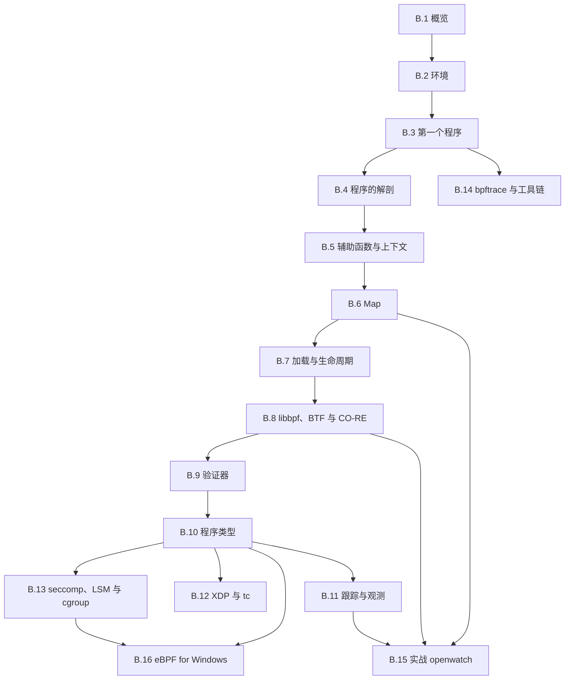

# 拓展B：eBPF

一个服务每隔几秒读一次 `/etc/myapp/limits.conf`，配置一改就生效，可日志里查不出是哪个进程在读、读的是哪个路径。另一个问题更常见：某个端口的连接总是被拒绝，防火墙、`iptables`、应用的访问控制都查过了，还是不知道包在哪一步被丢掉。这两种问题都发生在内核里，而手边的工具要么看不见（日志没有记录），要么代价太大（`strace` 让每次系统调用停两次，被追的服务明显变慢）。

eBPF（extended Berkeley Packet Filter）让一段经过验证的小程序挂到内核的钩子（hook）上运行，事件发生时执行，把结果经 BPF 映射（map）交回用户态。程序在加载前由验证器（verifier）检查，不会越界、一定会结束，所以既不用重编内核，也不必承担内核模块那样的风险；内核与用户态之间由此多了一条可以随时接通、随时断开的观察通道。

本拓展以 libbpf 加 CO-RE（一次编译、到处运行，Compile Once – Run Everywhere）为主线：用 C 写内核态程序，用 libbpf 加载，靠 BTF（BPF 类型格式，BPF Type Format）在运行时适配目标内核，做出的工具可以拿到别的机器上直接运行。bpftrace 用于临时排查，一行命令就能得到答案，不必为它建工程。最后一部分讲 eBPF for Windows。主线第四部分讲用户态程序怎样使用系统调用，这个拓展反过来，在内核里观察和控制这些调用，与拓展A 并列：一个换平台，一个换视角。

## 1. 前置内容与环境

eBPF 程序贴着内核跑，读的是 `task_struct`、套接字、文件这些内核对象。写之前至少要熟悉主线的这几块：系统调用的边界与 `strace` 的用法（[第 1 章](/教程/正文/系统编程/1_平台边界_POSIX与系统调用)）；文件描述符与 `openat` 的路径（[第 2 章](/教程/正文/系统编程/2_文件描述符与非缓冲IO)）；虚拟内存、页与映射（[第 4 章](/教程/正文/系统编程/4_虚拟内存与内存映射)）；进程的创建、退出与回收，因为大量示例跟踪的就是这些事件（[第 5 章](/教程/正文/系统编程/5_进程的创建_执行与回收)）；信号与定时器（[第 6 章](/教程/正文/系统编程/6_信号_时间与定时器)）；套接字与 I/O 多路复用，网络与安全类的程序建立在这两章之上（[第 10 章](/教程/正文/系统编程/10_套接字编程)、[第 11 章](/教程/正文/系统编程/11_非阻塞IO与IO多路复用)）；以及权限、`no_new_privs` 与 seccomp 的严格模式（[第 14 章](/教程/正文/系统编程/14_系统程序的健壮性与安全边界)）。

工程方面需要会写 Makefile、会看编译产物、会用调试器：从源文件到目标文件的流程见[第二部分第 3 章](/教程/正文/开发与工程基础/3_从源文件到可执行文件)，构建图见[第 8 章](/教程/正文/开发与工程基础/8_构建图与Make)，库与第三方依赖见[第 10 章](/教程/正文/开发与工程基础/10_库与第三方依赖)，调试器见[第 12 章](/教程/正文/开发与工程基础/12_调试器)。BPF 程序的编译产物是一个目标文件加一份生成的骨架头文件，不熟悉这两样东西，出错时很难判断问题出在哪一步。

运行环境是 x86-64 Linux，内核 6.6 以上，有 root 权限。本拓展的命令、版本与输出以 Debian 13 为准：内核 6.12，clang 与 LLVM 19，libbpf 1.5，bpftool 7.5，bpftrace 0.23.2。内核 6.6 是 tcx 的最低要求，B.12 的 tcx 一节用到；更旧的内核上其余各节多半也能跑，只是 tc 的写法要换成 libbpf 已经标为不推荐的旧接口。Ubuntu 24.04 的包名与命令相同，libbpf-dev 的版本是 1.3.0。Windows 读者用 WSL2 或虚拟机：微软的 WSL2 内核打开了 BTF、BPF LSM、kprobe 与 uprobe 这些选项，B.2 会逐项检查。

开工前用两条命令确认环境。第一行是内核的版本，第二行说明 bpftool 与它链接的 libbpf 版本；两者的版本号与书上的对不上时，后面生成的骨架和 bpftool 的输出会有出入，读的时候留意。

::: terminal title="bash - 检查环境"

```console
$ uname -r
6.12.86+deb13-amd64
$ bpftool version
bpftool v7.5.0
using libbpf v1.5
features: llvm, skeletons
```

:::

`uname -r` 的后缀说明这是 Debian 13（trixie）的内核。`features` 一行列出 bpftool 编译时启用的可选功能，`skeletons` 表示它支持从目标文件生成骨架，也就是 B.3 要用的 `bpftool gen skeleton`；这一行里没有它，后面的构建流程会在第一步失败。版本与这里对不上时，先在 [B.2](/教程/正文/系统编程/拓展B_eBPF/B_2_环境准备与工具链) 把工具链装成一致，再往下读。

在自己的机器或虚拟机上练习，不要在生产服务器上加载程序。加载本身要 root，一个写错条件的程序可以让目标进程变慢，或者把网络流量全部丢掉；练习阶段用不到的权限就不要给。

## 2. 本章内容

16 页按侧栏顺序排列。

1. [B.1 eBPF 概览：历史、架构与应用场景](/教程/正文/系统编程/拓展B_eBPF/B_1_eBPF概览)：给内核加逻辑的三条路各有什么代价，从经典 BPF 到 eBPF 的演变，从源码到运行的完整流程，以及观测、网络、安全三个方向各自的用途。
2. [B.2 环境准备与工具链](/教程/正文/系统编程/拓展B_eBPF/B_2_环境准备与工具链)：在 Debian 13 上确认内核带 BTF，装好 clang、libbpf-dev 与 bpftool，生成 `vmlinux.h`，并弄清每条命令前的 `sudo` 是从哪里来的。
3. [B.3 第一个 eBPF 程序](/教程/正文/系统编程/拓展B_eBPF/B_3_第一个eBPF程序)：写一个只认自己进程的 `write()` 观测程序，用三条命令构建，在 `trace_pipe` 里看到输出，把内核态与用户态两半程序的路走通。
4. [B.4 程序的解剖：受限的 C](/教程/正文/系统编程/拓展B_eBPF/B_4_程序的解剖_受限的C)：拆开 `.bpf.o`，看清节、指令编码与虚拟机，用一个百来行的解释器亲手执行字节码，并整理出 C 语言在 BPF 里不能用的写法及其原因。
5. [B.5 辅助函数与上下文](/教程/正文/系统编程/拓展B_eBPF/B_5_辅助函数与上下文)：辅助函数按编号调用的机制，tracepoint、kprobe、fentry 三种上下文的形态，哪些内核内存能直接读、哪些要经辅助函数，以及 kfunc。
6. [B.6 Map：内核态与用户态的数据交换](/教程/正文/系统编程/拓展B_eBPF/B_6_Map与数据交换)：哈希、数组、每 CPU 等 map 类型怎么选，内核态的查找与更新，用户态的读取与遍历，全局对象为什么也是 map，以及用环形缓冲区送出事件。
7. [B.7 加载与附加：bpf() 系统调用与程序生命周期](/教程/正文/系统编程/拓展B_eBPF/B_7_加载与附加_bpf系统调用与程序生命周期)：`bpf()` 的命令与参数，不用 libbpf 手写加载程序，骨架的四个调用对应到哪些系统调用，引用计数、BPF link 与 bpffs 固定。
8. [B.8 libbpf、BTF 与 CO-RE](/教程/正文/系统编程/拓展B_eBPF/B_8_libbpf_BTF与CO_RE)：BTF 记录了什么，`vmlinux.h` 从哪来，CO-RE 的重定位由编译器、libbpf 与内核各做哪一段，字段改名之后代码为什么还能用。
9. [B.9 验证器](/教程/正文/系统编程/拓展B_eBPF/B_9_验证器)：验证器要证明哪些性质、怎样证明，日志怎么读，最常见的几类拒绝分别对应源码里的哪一处修改。
10. [B.10 程序类型与附加类型](/教程/正文/系统编程/拓展B_eBPF/B_10_程序类型与附加类型)：程序类型决定了哪几件事，附加类型怎样区分同一类型下的挂载位置，SEC 名称与程序类型的对应关系，以及怎样查询当前内核支持什么。
11. [B.11 跟踪与观测：kprobe、uprobe 与 tracepoint](/教程/正文/系统编程/拓展B_eBPF/B_11_跟踪与观测_kprobe_uprobe与tracepoint)：拿到一个观测需求时该选哪类钩子，tracepoint、kprobe、fentry、uprobe、USDT 与 perf 采样各自能看到什么、稳定性与开销如何。
12. [B.12 网络应用：XDP 与 tc](/教程/正文/系统编程/拓展B_eBPF/B_12_网络应用_XDP与tc)：XDP 与 tc 在收发包路径上的位置，写一个带边界检查的报文解析器，在 `lo` 上按协议计数并丢弃指定端口的 UDP 报文，再用 tcx 做入口记录。
13. [B.13 安全应用：seccomp、LSM 与 cgroup](/教程/正文/系统编程/拓展B_eBPF/B_13_安全应用_seccomp_LSM与cgroup)：三种策略机制分别拦在哪一步、能看到什么信息、返回值怎样决定结果，以及什么时候该把哪两个组合起来。
14. [B.14 bpftrace 与编程工具链](/教程/正文/系统编程/拓展B_eBPF/B_14_bpftrace与编程工具链)：bpftrace 的一行命令与脚本语言，随发行版附带的现成工具，BCC 与 libbpf-tools 的来历与取舍，bpftool 的调试用法，以及 Go、Rust 的库和持续集成里的检查。
15. [B.15 实战：编写一个系统观测工具](/教程/正文/系统编程/拓展B_eBPF/B_15_实战_系统观测工具)：把前面各节拼成一个能用的 openwatch，入口出口配对、命令行选项、环形缓冲区、丢失计数与 Ctrl-C 之后干净退出，最后用 `strace` 逐条核对。
16. [B.16 eBPF for Windows 与跨平台前景](/教程/正文/系统编程/拓展B_eBPF/B_16_eBPF_for_Windows与跨平台)：eBPF for Windows 放在 Windows 的哪一层，与 Linux 的差异在哪里，写一个两个平台都能编译的 `connect` 拒绝程序，并说明哪些部分能共用。

## 3. 学习顺序建议

B.1～B.3 按顺序读，目标是把第一个程序跑起来。B.3 之后回过头看 B.1 的架构图，先前只是名词的部分会对上号。B.4～B.9 依次读，这一段是整套工具的地基：程序由什么组成、能调用什么、数据放在哪、怎样加载、怎样适配不同内核、验证器会拦什么。B.7 第一遍可以略读，知道有个系统调用在下面即可，等 B.15 要控制对象的存活时再回来。

B.10 当作总图用，读完 B.4～B.9 之后再读，它把程序分成十几类，后面三节各取一类展开。B.11、B.12、B.13 按兴趣任选，彼此不依赖：做观测与排查读 B.11，做网络读 B.12，做容器与安全读 B.13。B.14 的 bpftrace 部分读完 B.3 就可以看，不必等前面各节；B.15 需要 B.6 的 map、B.8 的 CO-RE 和 B.11 的钩子，放在最后。B.16 需要 B.10 对程序类型的整体认识和 B.13 的 cgroup 部分，读过拓展A 的话更容易理解它在 Windows 上的对应物。



示例代码放在 `code/系统编程/拓展B_eBPF/` 下与页面同名的子目录里，每个示例一组 `x.bpf.c` 与 `x.c`，部分带共享头文件和 `Makefile`。内核态程序用 `clang -g -O2 -target bpf -mcpu=v3 -D__TARGET_ARCH_x86 -I. -c` 编译，骨架用 `bpftool gen skeleton` 生成，用户态程序用 `cc -std=c17 -Wall -Wextra` 配合 `pkg-config --cflags --libs libbpf` 链接。显式写 `-mcpu=v3` 是因为新版本 clang 的默认值不同，写出来能让各版本生成一致的指令；B.4 会解释这一点。

加载程序需要 root，各页的命令统一在开头加 `sudo`。需要的权限是 `CAP_BPF`、`CAP_PERFMON` 和网络程序用的 `CAP_NET_ADMIN`，它们从哪里来、WSL2 与容器里有什么限制，在 B.2 一次讲清，后面不再重复。

## 4. 习题

这一页是索引，题目围绕「把各节串起来」出的：产物在哪个环节生成、哪些失败是故意的、不加载程序能验证到哪一步、一个真实问题该从哪一页入手。前四题不需要 root，第五题要在一台能装工具链的机器上做。

<Exercise id="47001" :d="1" :w="1">

把从源码到一个运行中的工具拆成五样东西，填一张表，每行写出：由哪个工具产生、是不是文本、能不能提交进仓库。

1. `x.bpf.c`
2. `x.bpf.o`
3. `x.skel.h`
4. 程序里的 `const volatile` 对象（加载前由用户态写入的那一份）
5. 内核里那个 `struct bpf_link`

然后在本机核对三件事：`bpftool version` 的 `features` 行有没有 `skeletons`；`/sys/kernel/btf/vmlinux` 是否存在、多少字节；`pkg-config --modversion libbpf` 的数字。三者记下来，与书上的 v7.5、内核 6.12、libbpf 1.5 对照。

</Exercise>

<Exercise id="47002" :d="3" :w="3">

写一个 `sweep.sh`，把 `code/系统编程/拓展B_eBPF/` 下每一节的 `*.bpf.c` 用统一的命令编译一遍，输出三列：文件、结果、失败原因首行。

要求：

1. 编译命令与各节一致：`-target bpf -O2 -g -mcpu=v3 -D__TARGET_ARCH_x86`，头文件路径同时给 `vmlinux.h` 所在目录和源文件所在目录（有的源文件 `#include` 同目录的头文件）；
2. 结果分三类：`ok`、`expected`、`missing`。`expected` 指题目故意写坏的源文件，`missing` 指本机缺头文件或工具；
3. 在脚本里写死一张 `expected` 名单，只允许名单上的文件失败，名单外的失败一律让脚本以非零状态退出；
4. 运行后打印统计：通过、预期失败、缺环境各几个。

验收（在带 BPF 后端的 clang 上实测）：全部源文件里只有 `stack_too_big.bpf.c`（编译期就报 BPF 栈超限）与 `bad_name.bpf.c`（报 `symbol 'license' is already defined`）属于 `expected`；`usdt_setjmp.bpf.c` 在头文件不齐的机器上归 `missing`（缺 `bpf/usdt.bpf.h` 或它引用的 `linux/errno.h`），把 libbpf 的头文件目录与系统的 Linux 头文件都加进 `-I` 之后转为 `ok`。`bad_section.bpf.c` 能编译通过，因为节名要到加载时才由 libbpf 检查，把它放进 `ok`。

</Exercise>

<Exercise id="47003" :d="3" :w="3">

不加载任何程序，走通「本机编译、Linux 上生成骨架」这条离线流水线，并回答三个「到底在哪一步发生」的问题。

1. 写一个 `mini.bpf.c`，放两个程序：`SEC("tp/syscalls/sys_enter_getpid")` 与 `SEC("kprobe/do_unlinkat")`（后者用 `BPF_KPROBE` 接两个参数），许可证写 `Dual BSD/GPL`。在本机用 zig 的 clang 编成 `mini.bpf.o`，记下文件大小与 `readelf -h`（MSYS/MinGW 下也有，或用 `llvm-readelf -h`）里的 `Machine` 字段。
2. 把 `.o` 传到 Linux，`bpftool gen skeleton mini.bpf.o > mini.skel.h`，列出骨架里 `progs`、`links` 两个结构体各有几个成员、叫什么。
3. 去掉 `-g` 再编一版，重复第 2 步，再用 `bpftool btf dump file` 读它。哪个命令还能用，哪个失败，报错原文是什么？
4. 用 `bpftool gen object` 把第 1 步的 `mini.bpf.o` 与 B.3 编出的 `hello.bpf.o` 合并；再把同一个 `mini.bpf.o` 传两次，读出报错并解释 `non-weak symbol` 指的是什么（错误里的编号取决于符号表，每次可能不同）。
5. 用 `strace -f -e trace=bpf` 包住 `bpftool gen skeleton`，统计 `bpf()` 系统调用的次数。

验收（在带 BPF 后端的 clang 与一台 Linux 上实测）：`Machine` 为 `Linux BPF`，`e_machine` 的数值是 247；骨架里 `progs` 与 `links` 各有 `on_getpid`、`on_unlink` 两个成员；去掉 `-g` 后骨架照常生成（`rc=0`），`btf dump` 报 `libbpf: failed to find '.BTF' ELF section`；两个不同的目标文件能合并成功，重复传同一个文件报 `conflicting non-weak symbol` 并指出冲突的符号名；`gen skeleton` 全程 `bpf()` 调用次数为 0。

回答：一个不加载程序的 `.o`，为什么骨架里要把它整段按字节嵌进去？`gen skeleton` 不需要 root 与第 5 问的计数是否一致？

</Exercise>

<Exercise id="47004" :d="5" :w="4">

下面六个问题都是「内核里看不见的事」。为每个问题选定一页作为入口、一种钩子、一个返回值或数据结构，并写清它看不到什么。

1. 某个服务每隔几秒读一次 `/etc/myapp/limits.conf`，想知道是哪个进程在读；
2. 某个端口的连接被拒绝，防火墙、应用日志都查过了；
3. 容器里的进程尝试执行 `execve("/bin/sh")`，要在它发生之前拦下来；
4. 一台机器的 CPU 有一半耗在系统调用里，想知道是哪些调用、各占多少；
5. 一个反复重启的进程，想知道它由谁拉起、参数是什么；
6. 想统计某个函数在内核里被调用的次数与耗时分布，但那个函数没有 tracepoint。

要求：

1. 做一个六行的表：问题、入口页、钩子或机制、能拿到的关键字段、看不到的信息；
2. 第 1、6 两题各写一条能直接运行的 `bpftrace` 一行命令（第 6 题用 `kprobe` 与 `kretprobe` 配对，用 `nsecs` 求差）；
3. 第 3 题写出对应 `SEC` 名称与返回值，并说明为什么不能用第 1 题那种钩子来做。

第 4、5 题要落到具体接口：第 4 题说明按调用号聚合与按命令名聚合各要写什么键，数据在哪一层汇总；第 5 题写出能拿到父进程 PID 与完整命令行（而不只是 16 字节的命令名）的钩子和字段。每题都标明依据来自哪一页，答案在本拓展各节里都能找到。

</Exercise>

<Exercise id="47005" :d="6" :w="5" scope="*">

写一个「本章例子在本机能不能用」的检查器 `featuremap`，在加载之前给出结论。它要结合环境检查、BTF 与程序类型三块内容，不向内核加载任何程序。

要求：

1. 命令行接受一组探针名（例如 `tp/syscalls/sys_enter_openat`、`kprobe/do_unlinkat`、`fentry/do_unlinkat`），对每个名字判断：`/sys/kernel/tracing/events/<类>/<名>` 是否存在（tracepoint 类）；内核符号是否存在于 `/proc/kallsyms`（kprobe、fentry 类）；
2. 用 libbpf 的 BTF 接口（`btf__parse()` 加 `btf__find_by_name_kind()`、`btf__type_by_id()`，见 [B.8](/教程/正文/系统编程/拓展B_eBPF/B_8_libbpf_BTF与CO_RE) 的同一组调用）打开 `/sys/kernel/btf/vmlinux`，对一组「例子用到的字段」逐个判断是否存在，输出字段名、类型 ID 与成员偏移；字段路径至少覆盖一层指针，例如 `task_struct.real_parent` 与 `sockaddr_in.sin_port`；
3. 输出一张表：探针或字段、可用性、依据（文件路径或 BTF 类型 ID）；
4. 最后打印一行汇总：可用几项、不可用几项，有任何不可用时以 1 退出，全部可用以 0 退出；
5. 在两种内核上各跑一次（例如 WSL2 与一台普通发行版虚拟机），把两张表贴出来对比。

编译命令与用户态程序一致：`cc -std=c17 -Wall -Wextra featuremap.c -o featuremap $(pkg-config --cflags --libs libbpf)`。验收：对 `/proc/kallsyms` 里存在的 `do_unlinkat`，kprobe 与 fentry 两行都判为可用；对不存在的符号判为不可用且不崩溃；汇总行与退出码一致。

做完后回答：`featuremap` 说「可用」与「能加载成功」之间还差哪几道检查？至少列出两项，并指出它们分别由本章哪一页负责。

</Exercise>

## 5. 参考资料

- eBPF 项目主页，What is eBPF：<https://ebpf.io/what-is-ebpf/>
- Linux 内核文档，BPF Documentation：<https://docs.kernel.org/bpf/>
- bpf(2) 手册页：<https://man7.org/linux/man-pages/man2/bpf.2.html>
- libbpf 项目与 libbpf-bootstrap：<https://github.com/libbpf/libbpf-bootstrap>
- eBPF for Windows：<https://github.com/microsoft/ebpf-for-windows>
- bpftrace 文档与教程：<https://bpftrace.org/>
- Liz Rice，**_Learning eBPF_**，O'Reilly，2023，ISBN 978-1-098-13512-6（各节的划分参照此书章序）
- 本拓展的环境与工具版本以 Debian 13（内核 6.12、clang 19、libbpf 1.5、bpftool 7.5、bpftrace 0.23.2）为准；内核版本与特性对应关系见 <https://www.kernelnewbies.org/>
