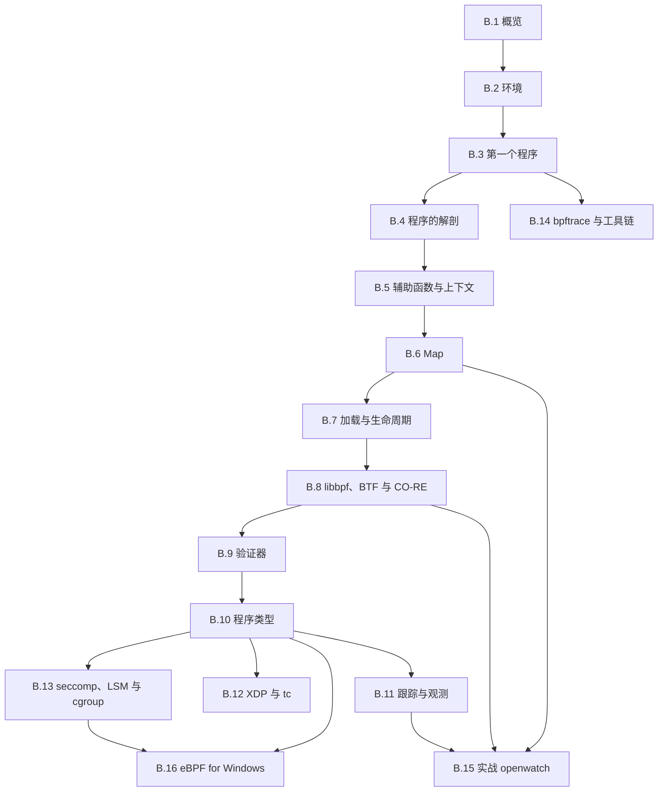

# 拓展B：eBPF

在日常排查系统故障时，总会遇到一些让人无从下手的“幽灵现象”。比如某个服务每隔几秒就会悄悄读取一次 `/etc/myapp/limits.conf`，只要配置文件一改动就立刻生效，但翻遍应用自身的业务日志，也找不出到底是哪个子进程在读、解析的真实路径究竟是什么。另一种情况在运维中更加棘手：某个特定端口的连通性偶尔被拒绝，安全组、防火墙、`iptables` 以及应用内部的访问控制列表都逐项比对过，没有任何一条规则显式拦截，数据包到底是在哪一个网络协议栈环节被悄然丢弃的，外部很难看清。这类深层行为都沉睡在内核空间中。此时我们手边的常规工具往往陷入两难：业务日志根本没有埋点，想要看清就无从谈起；若是借由 `strace` 强行跟踪系统调用，其底层依赖的 `ptrace` 机制会在每次系统调用出入口引发多次上下文切换，导致被跟踪的高并发服务吞吐骤降，甚至在生产环境中引发雪崩。

eBPF（extended Berkeley Packet Filter）正是为了打破这种困境而生的一项革命性技术。它允许工程师编写一小段经过严格验证的代码，将其动态挂载到内核预先暴露的各种钩子（hook）上。一旦特定的内核事件触发，这段小程序就会在内核上下文中就地执行，完成指标采集或逻辑判定后，再将结构化数据借由 BPF 映射（map）高效回传给用户态。与传统的内核模块开发相比，eBPF 程序在加载阶段必须通过内核内置验证器（verifier）的严格静态审查，确保不存在越界访问、死循环或悬垂指针风险，从而免去了重新编译内核的漫长周期，也规避了因一行偶发空指针导致整机内核崩溃（Kernel Panic）的灾难。内核与用户态之间，由此建立起了一条既安全可控、又能随用随拆的动态观测与控制通道。

本拓展教程以现代工业界标准的 libbpf 配合 CO-RE（一次编译、到处运行，Compile Once – Run Everywhere）为主线体系展开。我们将使用 C 语言编写内核态的观测逻辑，借助 clang 编译为标准 eBPF 字节码，并通过 libbpf 封装的生命周期接口完成装载，依托内核 BTF（BPF 类型格式，BPF Type Format）所提供的类型自省能力，在运行时抹平不同发行版内核间的结构体布局差异。如此构建出的二进制工具，具备了如同普通用户态程序般的良好移植性，可以直接在不同内核版本的机器间分发运行。针对偶发的临时性线上排查，我们也会引入 bpftrace 工具，利用其极具表达力的一行脚本快速求得诊断结果，无需劳师动众搭建完整的工程项目。在拓展的尾声，我们还将视线延展至微软主导的 eBPF for Windows 生态。此前系统编程主线第四部分带领大家在用户态熟练运用各类 POSIX 系统调用，而本拓展则带领读者完成一次视角的大转换——深入内核腹地，反客为主地审视、度量乃至干预这些调用的全生命周期。它与前面的跨平台移植拓展并肩而立：一个立足于横向拓宽运行平台，一个专注于纵向深挖内核视角。

## 1. 前置内容与环境

eBPF 程序在执行时紧贴着内核上下文运行，它所解引用并观察的数据，几乎都是诸如 `task_struct`、网络套接字（socket）、文件结构体（file）这类核心内核对象。因此，在正式动手编写 eBPF 程序之前，读者应当建立起主线教程中若干核心知识的坚实认知：首先是系统调用的边界划分与 `strace` 的观测技巧（参见[第 1 章](/教程/正文/系统编程/1_平台边界_POSIX与系统调用)）；其次是文件描述符的底层组织与 `openat` 路径解析机制（参见[第 2 章](/教程/正文/系统编程/2_文件描述符与非缓冲IO)）；虚拟内存机制、页表结构与内存映射（参见[第 4 章](/教程/正文/系统编程/4_虚拟内存与内存映射)）则是理解内核地址空间隔离的基础；同时，由于后续大量追踪案例都紧密围绕进程的生命周期展开，进程的创建、执行与回收机制必不可少（参见[第 5 章](/教程/正文/系统编程/5_进程的创建_执行与回收)）；此外，信号派发与定时器机制（参见[第 6 章](/教程/正文/系统编程/6_信号_时间与定时器)）、套接字通信与 I/O 多路复用模型（网络与安全方向的程序深度依托[第 10 章](/教程/正文/系统编程/10_套接字编程)与[第 11 章](/教程/正文/系统编程/11_非阻塞IO与IO多路复用)），以及系统特权管理、`no_new_privs` 标志与 seccomp 严格沙箱（参见[第 14 章](/教程/正文/系统编程/14_系统程序的健壮性与安全边界)），都是理解后续内容的关键拼图。

在工程实践层面，这套技术栈同样要求熟练掌握基本的 Makefile 编写、ELF 编译产物剖析以及调试器的配合使用。从普通 C 源文件编译汇编为目标文件的完整过程在[第二部分第 3 章](/教程/正文/开发与工程基础/3_从源文件到可执行文件)中有过深入剖析，依赖关系推演与构建图梳理可参考[第 8 章](/教程/正文/开发与工程基础/8_构建图与Make)，库链接机制详见[第 10 章](/教程/正文/开发与工程基础/10_库与第三方依赖)，动态调试手法可参考[第 12 章](/教程/正文/开发与工程基础/12_调试器)。这是因为每个 eBPF 工具的构建产物都至少包含两部分：一个编译为 BPF 字节码的 ELF 目标文件，以及一份由工具链根据该目标文件逆向提炼出的 C 语言骨架头文件。若对编译产物的内部节区缺乏清晰认知，在遭遇编译或加载故障时，往往难以快速推断问题究竟发生在 clang 字节码生成阶段还是 libbpf 装载校验阶段。

本拓展推荐的运行环境为 x86-64 架构下的 Linux 系统，要求内核版本不低于 6.6，并具备系统的 root 管理权限。书中所有的命令示例、软件版本以及命令行输出均以 Debian 13（开发代号 trixie）环境为基准：其默认内核版本为 6.12，配合 clang 与 LLVM 19、libbpf 1.5、bpftool 7.5 以及 bpftrace 0.23.2。之所以将内核底限定在 6.6，是因为 B.12 节中涉及的现代网络流量控制（tcx）机制需要该版本及以上的内核支持；在版本略低的内核上，虽然其余绝大多数章节的代码依然可以平稳运行，但网络部分的挂载写法必须回退到 libbpf 已经逐步弃用的传统接口。使用 Ubuntu 24.04 的读者可以直接使用相同的包名与命令进行配置，其系统自带的 libbpf-dev 版本为 1.3.0。若使用 Windows 平台，建议在 Hyper-V 虚拟机或 WSL2 环境中开展实验：现代 WSL2 发行版的定制内核已经默认编译启用了 BTF、BPF LSM、kprobe 以及 uprobe 等关键内核配置项，我们在 B.2 节中会给出详细的核验步骤。

在敲下第一行程序之前，可以先在终端中执行两条简单的指令来快速确认基础环境。前一条指令用于确认宿主机正在运行的内核版本，后一条指令则用于核实 bpftool 工具本身及其所动态链接的 libbpf 库版本。如果终端回显的版本号与本书给出的参考输出存在较大出入，后续生成骨架代码的格式细节以及命令行工具的参数行为可能会略有差异，阅读时可以稍加留心。

::: terminal title="bash - 检查环境"

```console
$ uname -r
6.12.86+deb13-amd64
$ bpftool version
bpftool v7.5.0
using libbpf v1.5
features: llvm, skeletons
```

:::

`uname -r` 输出的后缀表明当前正处于 Debian 13（trixie）对应的内核版本之下。在紧随其后的 bpftool 输出中，`features` 这一行特别值得留意，它反映了当前二进制工具在编译打包时所开启的全部特性集。其中，`skeletons` 标志着该版本的 bpftool 具备从 ELF 目标文件中自动提取元数据并生成 C 语言骨架头文件的能力，这正是我们在 B.3 节及后续所有示例中要频繁依赖的核心特性。假如此处缺失了该标志，后续构建流程在第一阶段就会中断。如果检测到的工具链版本与上述基准存在代差，建议先移步 [B.2 节](/教程/正文/系统编程/拓展B_eBPF/B_2_环境准备与工具链) 完成基础工具的升级与对齐，再继续展开实验。

在实验环境的选择上，强烈建议读者在独立的个人开发机、本地虚拟机或容器实验环境中进行探索，切忌直接在承载关键业务的生产服务器上加载试写代码。由于 eBPF 程序的加载通常需要 root 级别的系统特权，一旦在观测过滤条件中出现逻辑缺陷，不仅可能因捕获频率过高拖慢关键系统进程，若是在网络钩子上误写了过滤规则，甚至可能导致特定网卡的流量被整段误丢弃。在掌握其安全边界之前，保持防御性探索的习惯大有裨益。

## 2. 本章内容

16 页按侧栏顺序排列。

1. [B.1 eBPF 概览：历史、架构与应用场景](/教程/正文/系统编程/拓展B_eBPF/B_1_eBPF概览)：给内核加逻辑的三条路各有什么代价，从经典 BPF 到 eBPF 的演变，从源码到运行的完整流程，以及观测、网络、安全三个方向各自的用途。
2. [B.2 环境准备与工具链](/教程/正文/系统编程/拓展B_eBPF/B_2_环境准备与工具链)：在 Debian 13 上确认内核带 BTF，装好 clang、libbpf-dev 与 bpftool，生成 `vmlinux.h`，并弄清每条命令前的 `sudo` 是从哪里来的。
3. [B.3 第一个 eBPF 程序](/教程/正文/系统编程/拓展B_eBPF/B_3_第一个eBPF程序)：写一个只认自己进程的 `write()` 观测程序，用三条命令构建，在 `trace_pipe` 里看到输出，把内核态与用户态两半程序的路走通。
4. [B.4 程序的解剖：受限的 C](/教程/正文/系统编程/拓展B_eBPF/B_4_程序的解剖_受限的C)：拆开 `.bpf.o`，看清节、指令编码与虚拟机，用一个百来行的解释器亲手执行字节码，并整理出 C 语言在 BPF 里不能用的写法及其原因。
5. [B.5 辅助函数与上下文](/教程/正文/系统编程/拓展B_eBPF/B_5_辅助函数与上下文)：辅助函数按编号调用的机制，tracepoint、kprobe、fentry 三种上下文的形态，哪些内核内存能直接读、哪些要经辅助函数，以及 kfunc。
6. [B.6 Map：内核态与用户态的数据交换](/教程/正文/系统编程/拓展B_eBPF/B_6_Map与数据交换)：哈希、数组、每 CPU 等 map 类型怎么选，内核态的查找与更新，用户态的读取与遍历，全局对象为什么也是 map，以及用环形缓冲区送出事件。
7. [B.7 加载与附加：bpf() 系统调用与程序生命周期](/教程/正文/系统编程/拓展B_eBPF/B_7_加载与附加_bpf系统调用与程序生命周期)：`bpf()` 的命令与参数，不用 libbpf 手写加载程序，骨架的四个调用对应到哪些系统调用，引用计数、BPF link 与 bpffs 固定。
8. [B.8 libbpf、BTF 与 CO-RE](/教程/正文/系统编程/拓展B_eBPF/B_8_libbpf_BTF与CO_RE)：BTF 记录了什么，`vmlinux.h` 从哪来，CO-RE 的重定位由编译器、libbpf 与内核各做哪一段，字段改名之后代码为什么还能用。
9. [B.9 验证器](/教程/正文/系统编程/拓展B_eBPF/B_9_验证器)：验证器要证明哪些性质、怎样证明，日志怎么读，最常见的几类拒绝分别对应源码里的哪一处修改。
10. [B.10 程序类型与附加类型](/教程/正文/系统编程/拓展B_eBPF/B_10_程序类型与附加类型)：程序类型决定了哪几件事，附加类型怎样区分同一类型下的挂载位置，SEC 名称与程序类型的对应关系，以及怎样查询当前内核支持什么。
11. [B.11 跟踪与观测：kprobe、uprobe 与 tracepoint](/教程/正文/系统编程/拓展B_eBPF/B_11_跟踪与观测_kprobe_uprobe与tracepoint)：拿到一个观测需求时该选哪类钩子，tracepoint、kprobe、fentry、uprobe、USDT 与 perf 采样各自能看到什么、稳定性与开销如何。
12. [B.12 网络应用：XDP 与 tc](/教程/正文/系统编程/拓展B_eBPF/B_12_网络应用_XDP与tc)：XDP 与 tc 在收发包路径上的位置，写一个带边界检查的报文解析器，在 `lo` 上按协议计数并丢弃指定端口的 UDP 报文，再用 tcx 做入口记录。
13. [B.13 安全应用：seccomp、LSM 与 cgroup](/教程/正文/系统编程/拓展B_eBPF/B_13_安全应用_seccomp_LSM与cgroup)：三种策略机制分别拦在哪一步、能看到什么信息、返回值怎样决定结果，以及什么时候该把哪两个组合起来。
14. [B.14 bpftrace 与编程工具链](/教程/正文/系统编程/拓展B_eBPF/B_14_bpftrace与编程工具链)：bpftrace 的一行命令与脚本语言，随发行版附带的现成工具，BCC 与 libbpf-tools 的来历与取舍，bpftool 的调试用法，以及 Go、Rust 的库和持续集成里的检查。
15. [B.15 实战：编写一个系统观测工具](/教程/正文/系统编程/拓展B_eBPF/B_15_实战_系统观测工具)：把前面各节拼成一个能用的 openwatch，入口出口配对、命令行选项、环形缓冲区、丢失计数与 Ctrl-C 之后干净退出，最后用 `strace` 逐条核对。
16. [B.16 eBPF for Windows 与跨平台前景](/教程/正文/系统编程/拓展B_eBPF/B_16_eBPF_for_Windows与跨平台)：eBPF for Windows 放在 Windows 的哪一层，与 Linux 的差异在哪里，写一个两个平台都能编译的 `connect` 拒绝程序，并说明哪些部分能共用。

## 3. 学习顺序建议

B.1～B.3 应当作为第一阶段按部就班通读，目标非常聚焦：亲手搭建起编译管线，把第一个 eBPF 程序完整加载并跑通。在完成 B.3 的动手实践后，回过头来重新审视 B.1 描摹的系统架构图，先前停留在抽象名词层面的概念就会与终端里的真实步骤一一呼应。随后的 B.4 到 B.9 构成了深入这套技术的坚实基石，建议依序循序渐进：剖析字节码的微观组成、理清内核辅助函数的调用制约、掌握 Map 在两界之间的数据摆渡、探究加载与生命周期的系统调用支撑、理解 BTF 与 CO-RE 跨版本重定位的核心机理，最后直面验证器的审查法则。这几节层层递进，其中 B.7 涉及较多底层系统调用原语，初次阅读时可以作为机制铺垫快速浏览，待后续在 B.15 中需要精确掌控内核对象生命周期时再做深入对照。

从 B.10 开始，读者可以将其作为全景索引查阅。该节梳理了现代内核中丰富的程序类型体系，其后的几节则分别沿着不同工业领域横向展开：专注于故障排查与性能剖析的读者可以直奔 B.11 探索各类追踪探针；深耕网络数据面高性能转发的读者可以移步 B.12 研究 XDP 与 tcx；而关注容器安全防线与系统调用的读者则可在 B.13 深入了解 LSM 与 cgroup 钩子。B.14 介绍的 bpftrace 工具由于其高度独立的单行交互特性，在读完 B.3 后便可随时翻阅上手；B.15 的综合实战串联了 Map 共享、CO-RE 移植与事件探针，适合在掌握前面基础后统揽全篇；最后 B.16 则将视角拓展至 Windows 平台，帮助读者建立起跨平台的抽象认知。



全书的所有示例代码均归档在 `code/系统编程/拓展B_eBPF/` 目录下与各节同名的子文件夹中，每个样例通常由内核态的 `x.bpf.c` 与用户态的 `x.c` 协同组成，部分项目附带了跨态共享的头文件与即插即用的 `Makefile`。内核态程序统一采用 `clang -g -O2 -target bpf -mcpu=v3 -D__TARGET_ARCH_x86 -I. -c` 进行编译，用户态程序则依托 `bpftool gen skeleton` 导出的骨架文件，配合标准编译器 `cc -std=c17 -Wall -Wextra` 与 `pkg-config --cflags --libs libbpf` 完成链接。此处显式指定 `-mcpu=v3`，是为了在不同版本的 clang 编译器之间统一指令集生成策略，避免因编译器默认配置变迁导致字节码差异，其底层考量将在 B.4 节深入剖析。

由于向内核注册探针与加载程序涉及到敏感特权，各节终端命令均在开头显式保留了 `sudo` 前缀。从现代 Linux 安全模型的细粒度视角来看，实际执行加载所依赖的核心权限涵盖了 `CAP_BPF`、`CAP_PERFMON` 以及网络栈所需的 `CAP_NET_ADMIN`。关于这些特权的具体归属、权限授予策略以及在 WSL2 和非特权容器环境中的降权实践，将在 B.2 节中一次性梳理清楚，后续章节便不再赘述。

## 4. 习题

这一页是索引，题目围绕「把各节串起来」出的：产物在哪个环节生成、哪些失败是故意的、不加载程序能验证到哪一步、一个真实问题该从哪一页入手。前四题不需要 root，第五题要在一台能装工具链的机器上做。

<Exercise id="47001" :d="1" :w="1">

把从源码到一个运行中的工具拆成五样东西，填一张表，每行写出：由哪个工具产生、是不是文本、能不能提交进仓库。

1. `x.bpf.c`
2. `x.bpf.o`
3. `x.skel.h`
4. 程序里的 `const volatile` 对象（加载前由用户态写入的那一份）
5. 内核里那个 `struct bpf_link`

然后在本机核对三件事：`bpftool version` 的 `features` 行有没有 `skeletons`；`/sys/kernel/btf/vmlinux` 是否存在、多少字节；`pkg-config --modversion libbpf` 的数字。三者记下来，与书上的 v7.5、内核 6.12、libbpf 1.5 对照。

</Exercise>

<Exercise id="47002" :d="3" :w="3">

写一个 `sweep.sh`，把 `code/系统编程/拓展B_eBPF/` 下每一节的 `*.bpf.c` 用统一的命令编译一遍，输出三列：文件、结果、失败原因首行。

要求：

1. 编译命令与各节一致：`-target bpf -O2 -g -mcpu=v3 -D__TARGET_ARCH_x86`，头文件路径同时给 `vmlinux.h` 所在目录和源文件所在目录（有的源文件 `#include` 同目录的头文件）；
2. 结果分三类：`ok`、`expected`、`missing`。`expected` 指题目故意写坏的源文件，`missing` 指本机缺头文件或工具；
3. 在脚本里写死一张 `expected` 名单，只允许名单上的文件失败，名单外的失败一律让脚本以非零状态退出；
4. 运行后打印统计：通过、预期失败、缺环境各几个。

验收（在带 BPF 后端的 clang 上实测）：全部源文件里只有 `stack_too_big.bpf.c`（编译期就报 BPF 栈超限）与 `bad_name.bpf.c`（报 `symbol 'license' is already defined`）属于 `expected`；`usdt_setjmp.bpf.c` 在头文件不齐的机器上归 `missing`（缺 `bpf/usdt.bpf.h` 或它引用的 `linux/errno.h`），把 libbpf 的头文件目录与系统的 Linux 头文件都加进 `-I` 之后转为 `ok`。`bad_section.bpf.c` 能编译通过，因为节名要到加载时才由 libbpf 检查，把它放进 `ok`。

</Exercise>

<Exercise id="47003" :d="3" :w="3">

不加载任何程序，走通「本机编译、Linux 上生成骨架」这条离线流水线，并回答三个「到底在哪一步发生」的问题。

1. 写一个 `mini.bpf.c`，放两个程序：`SEC("tp/syscalls/sys_enter_getpid")` 与 `SEC("kprobe/do_unlinkat")`（后者用 `BPF_KPROBE` 接两个参数），许可证写 `Dual BSD/GPL`。在本机用 zig 的 clang 编成 `mini.bpf.o`，记下文件大小与 `readelf -h`（MSYS/MinGW 下也有，或用 `llvm-readelf -h`）里的 `Machine` 字段。
2. 把 `.o` 传到 Linux，`bpftool gen skeleton mini.bpf.o > mini.skel.h`，列出骨架里 `progs`、`links` 两个结构体各有几个成员、叫什么。
3. 去掉 `-g` 再编一版，重复第 2 步，再用 `bpftool btf dump file` 读它。哪个命令还能用，哪个失败，报错原文是什么？
4. 用 `bpftool gen object` 把第 1 步的 `mini.bpf.o` 与 B.3 编出的 `hello.bpf.o` 合并；再把同一个 `mini.bpf.o` 传两次，读出报错并解释 `non-weak symbol` 指的是什么（错误里的编号取决于符号表，每次可能不同）。
5. 用 `strace -f -e trace=bpf` 包住 `bpftool gen skeleton`，统计 `bpf()` 系统调用的次数。

验收（在带 BPF 后端的 clang 与一台 Linux 上实测）：`Machine` 为 `Linux BPF`，`e_machine` 的数值是 247；骨架里 `progs` 与 `links` 各有 `on_getpid`、`on_unlink` 两个成员；去掉 `-g` 后骨架照常生成（`rc=0`），`btf dump` 报 `libbpf: failed to find '.BTF' ELF section`；两个不同的目标文件能合并成功，重复传同一个文件报 `conflicting non-weak symbol` 并指出冲突的符号名；`gen skeleton` 全程 `bpf()` 调用次数为 0。

回答：一个不加载程序的 `.o`，为什么骨架里要把它整段按字节嵌进去？`gen skeleton` 不需要 root 与第 5 问的计数是否一致？

</Exercise>

<Exercise id="47004" :d="5" :w="4">

下面六个问题都是「内核里看不见的事」。为每个问题选定一页作为入口、一种钩子、一个返回值或数据结构，并写清它看不到什么。

1. 某个服务每隔几秒读一次 `/etc/myapp/limits.conf`，想知道是哪个进程在读；
2. 某个端口的连接被拒绝，防火墙、应用日志都查过了；
3. 容器里的进程尝试执行 `execve("/bin/sh")`，要在它发生之前拦下来；
4. 一台机器的 CPU 有一半耗在系统调用里，想知道是哪些调用、各占多少；
5. 一个反复重启的进程，想知道它由谁拉起、参数是什么；
6. 想统计某个函数在内核里被调用的次数与耗时分布，但那个函数没有 tracepoint。

要求：

1. 做一个六行的表：问题、入口页、钩子或机制、能拿到的关键字段、看不到的信息；
2. 第 1、6 两题各写一条能直接运行的 `bpftrace` 一行命令（第 6 题用 `kprobe` 与 `kretprobe` 配对，用 `nsecs` 求差）；
3. 第 3 题写出对应 `SEC` 名称与返回值，并说明为什么不能用第 1 题那种钩子来做。

第 4、5 题要落到具体接口：第 4 题说明按调用号聚合与按命令名聚合各要写什么键，数据在哪一层汇总；第 5 题写出能拿到父进程 PID 与完整命令行（而不只是 16 字节的命令名）的钩子和字段。每题都标明依据来自哪一页，答案在本拓展各节里都能找到。

</Exercise>

<Exercise id="47005" :d="6" :w="5" scope="*">

写一个「本章例子在本机能不能用」的检查器 `featuremap`，在加载之前给出结论。它要结合环境检查、BTF 与程序类型三块内容，不向内核加载任何程序。

要求：

1. 命令行接受一组探针名（例如 `tp/syscalls/sys_enter_openat`、`kprobe/do_unlinkat`、`fentry/do_unlinkat`），对每个名字判断：`/sys/kernel/tracing/events/<类>/<名>` 是否存在（tracepoint 类）；内核符号是否存在于 `/proc/kallsyms`（kprobe、fentry 类）；
2. 用 libbpf 的 BTF 接口（`btf__parse()` 加 `btf__find_by_name_kind()`、`btf__type_by_id()`，见 [B.8](/教程/正文/系统编程/拓展B_eBPF/B_8_libbpf_BTF与CO_RE) 的同一组调用）打开 `/sys/kernel/btf/vmlinux`，对一组「例子用到的字段」逐个判断是否存在，输出字段名、类型 ID 与成员偏移；字段路径至少覆盖一层指针，例如 `task_struct.real_parent` 与 `sockaddr_in.sin_port`；
3. 输出一张表：探针或字段、可用性、依据（文件路径或 BTF 类型 ID）；
4. 最后打印一行汇总：可用几项、不可用几项，有任何不可用时以 1 退出，全部可用以 0 退出；
5. 在两种内核上各跑一次（例如 WSL2 与一台普通发行版虚拟机），把两张表贴出来对比。

编译命令与用户态程序一致：`cc -std=c17 -Wall -Wextra featuremap.c -o featuremap $(pkg-config --cflags --libs libbpf)`。验收：对 `/proc/kallsyms` 里存在的 `do_unlinkat`，kprobe 与 fentry 两行都判为可用；对不存在的符号判为不可用且不崩溃；汇总行与退出码一致。

做完后回答：`featuremap` 说「可用」与「能加载成功」之间还差哪几道检查？至少列出两项，并指出它们分别由本章哪一页负责。

</Exercise>

## 5. 参考资料

- eBPF 项目主页，What is eBPF：<https://ebpf.io/what-is-ebpf/>
- Linux 内核文档，BPF Documentation：<https://docs.kernel.org/bpf/>
- bpf(2) 手册页：<https://man7.org/linux/man-pages/man2/bpf.2.html>
- libbpf 项目与 libbpf-bootstrap：<https://github.com/libbpf/libbpf-bootstrap>
- eBPF for Windows：<https://github.com/microsoft/ebpf-for-windows>
- bpftrace 文档与教程：<https://bpftrace.org/>
- Liz Rice，**_Learning eBPF_**，O'Reilly，2023，ISBN 978-1-098-13512-6（各节的划分参照此书章序）
- 本拓展的环境与工具版本以 Debian 13（内核 6.12、clang 19、libbpf 1.5、bpftool 7.5、bpftrace 0.23.2）为准；内核版本与特性对应关系见 <https://www.kernelnewbies.org/>
