# B.10 程序类型与附加类型

[B.3](/教程/正文/系统编程/拓展B_eBPF/B_3_第一个eBPF程序) 的 hello 程序如果把 `SEC("tp/syscalls/sys_enter_write")` 改成 `SEC("xdp")`，编译照样通过，`bpftool gen skeleton` 也不报错；函数体不碰 ctx 的话，单独加载甚至可能成功。它只是再也不会在 `write()` 被调用时运行，因为 XDP 的钩子在网卡收包时触发。要是函数体像 [B.5](/教程/正文/系统编程/拓展B_eBPF/B_5_辅助函数与上下文) 那样去读 `ctx->args[1]`，验证器会直接拒绝：XDP 的 ctx 是 `struct xdp_md`，它按这个结构检查每一次 ctx 访问。决定这些的，是程序类型（program type）。

这一页把程序类型和附加类型（attach type）这两个概念拆开：先看程序类型决定了哪六件事，再看附加类型怎样在同一种程序类型下区分挂载位置，然后整理 SEC 名称到程序类型的对应关系、哪些程序能由骨架自动附加，最后给出整个程序类型的版图、各类型返回值的含义，以及查询当前内核支持哪些类型和辅助函数的方法。读完应该能做到：拿到一个 SEC 名称，说出 libbpf 会把程序设成什么类型、能不能自动附加、ctx 长什么样、返回值该怎么写。

本页的例子是一个空函数体的文件 `code/系统编程/拓展B_eBPF/B_10_程序类型与附加类型/many_types.bpf.c`，它在同一个目标文件里放了七种程序。编译命令与 B.3 相同；下面的 `readelf`、`bpftool gen skeleton` 和 `bpftool -d` 输出取自一次实际运行（目标文件由 clang 18 生成，`readelf` 与 `bpftool` 来自 Debian 13，bpftool 7.5、libbpf 1.5）。

## 1. 程序类型决定了什么

程序类型是加载时提交给内核的一个整数，取自 `enum bpf_prog_type`。同一个 C 函数，换一个程序类型，它看到的世界就完全变了。

| 由程序类型决定 | tracepoint 程序（B.3） | XDP 程序（B.12） |
| --- | --- | --- |
| 上下文 ctx 的结构 | `struct trace_event_raw_sys_enter` | `struct xdp_md` |
| 可调用的辅助函数与 kfunc | 跟踪类：`bpf_get_current_comm`、`bpf_get_stack` 等 | 网络类：`bpf_xdp_adjust_head`、`bpf_redirect_map` 等 |
| 返回值的含义 | 没有含义，按惯例返回 0 | `XDP_PASS`、`XDP_DROP`、`XDP_TX`、`XDP_REDIRECT`、`XDP_ABORTED` |
| 附加方式 | `perf_event_open` 加 `BPF_LINK_CREATE` | 把程序挂到某块网卡上 |
| 加载所需权限 | `CAP_BPF` 与 `CAP_PERFMON` | `CAP_BPF` 与 `CAP_NET_ADMIN` |
| 能否睡眠 | 否 | 否 |

「能否睡眠」一栏不是所有类型都一样。可睡眠的版本只出现在跟踪类和安全类里：`fentry`、`fexit`、`fmod_ret`、`iter`、`struct_ops`、`lsm` 和 uprobe 有对应的可睡眠写法，`syscall` 类型则要求必须睡眠；libbpf 用 SEC 名称里的 `.s` 后缀表示，例如 `fentry.s/do_unlinkat`、`lsm.s/file_open`。可睡眠程序在挂载点允许睡眠时才能加载，也只能调用允许睡眠的辅助函数。

::: concept ebpf-progtype-determines title="程序类型决定的东西"

程序类型在 `BPF_PROG_LOAD` 时随程序一起提交，它决定上下文的结构、可调用的辅助函数与 kfunc、返回值的含义、允许的附加方式，以及加载所需的权限和能否睡眠。验证器按程序类型和附加类型检查程序，不按 SEC 名称检查；SEC 名称只是 libbpf 用来推断这两者的文本。

:::

判断一个辅助函数能不能用，看内核里这个类型的函数表，不看头文件。`bpf_get_current_comm` 只出现在跟踪类程序的函数表里，XDP 程序调用它会得到 `program of this type cannot use helper bpf_get_current_comm#16`；反过来，`bpf_skb_load_bytes` 只给处理 sk_buff 的类型用，tracepoint 程序里没有它。头文件 `bpf_helper_defs.h` 把所有辅助函数都声明了一遍，所以编译期发现不了这类错误，要等验证器拒绝。

<Quiz
  type="single"
  :options="[
    { label: '程序类型与附加类型', value: 'A' },
    { label: 'SEC 名称', value: 'B' },
    { label: '程序函数的名字', value: 'C' },
    { label: 'license 节的内容', value: 'D' }
  ]"
  answer="A"
>

<template #question>

加载后，一个 eBPF 程序拿到的 ctx 是什么结构，由什么决定？

</template>

正确答案是 **A**。验证器按程序类型和附加类型确定 ctx 的布局，SEC 名称只是 libbpf 推断这两者的依据；名字写得再像，类型不对，ctx 就不对。

</Quiz>

::: generate ebpf-progtype-what-it-decides kind=explanation concepts=ebpf-progtype-determines

面向刚开始写 eBPF 的读者，用「同一个函数体分别用 SEC("tp/syscalls/sys_enter_write") 和 SEC("xdp") 编译」这一个例子，说明程序类型是在哪一步、以什么形式交给内核的，并逐个解释上下文、辅助函数、返回值、附加方式为什么会随类型改变，不要展开各类型的具体写法。

:::

## 2. 附加类型：同一类型，不同挂载位置

`BPF_PROG_TYPE_CGROUP_SKB` 既可以过滤从 cgroup 里发出的报文，也可以过滤送进来的报文。两者的 ctx 都是 `struct __sk_buff`，但挂载点是两个不同的钩子，返回值的允许范围也不同。区分它们的不是程序类型，而是附加类型。

### 2.1 三个常见的例子

| 程序类型 | 附加类型 | SEC 名称 | 区别 |
| --- | --- | --- | --- |
| `CGROUP_SKB` | `BPF_CGROUP_INET_INGRESS` | `cgroup_skb/ingress` | 进入 cgroup 的报文 |
| `CGROUP_SKB` | `BPF_CGROUP_INET_EGRESS` | `cgroup_skb/egress` | 从 cgroup 发出的报文 |
| `CGROUP_SOCK_ADDR` | `BPF_CGROUP_INET4_CONNECT` | `cgroup/connect4` | `connect()` 之前调用 |
| `CGROUP_SOCK_ADDR` | `BPF_CGROUP_INET4_BIND` | `cgroup/bind4` | `bind()` 之前调用 |
| `CGROUP_SOCK_ADDR` | `BPF_CGROUP_UDP4_SENDMSG` | `cgroup/sendmsg4` | `sendmsg()` 之前调用 |
| `TRACING` | `BPF_TRACE_FENTRY` | `fentry/函数名` | 函数入口 |
| `TRACING` | `BPF_TRACE_FEXIT` | `fexit/函数名` | 函数出口 |
| `TRACING` | `BPF_TRACE_RAW_TP` | `tp_btf/事件名` | 带类型的跟踪点 |
| `TRACING` | `BPF_TRACE_ITER` | `iter/task` | 迭代器 |

`BPF_PROG_TYPE_CGROUP_SOCK_ADDR` 这一个类型下面就有二十来种附加类型：IPv4 与 IPv6 各一套，`bind`、`connect`、`sendmsg`、`recvmsg`、`getpeername`、`getsockname` 各一个，加上 Unix 域套接字的一套。它们的回调时机不同，ctx 里的字段含义也略有差别。`BPF_PROG_TYPE_TRACING` 也一样，fentry、fexit、fmod_ret、tp_btf、iter 共用同一个程序类型，全靠附加类型分开。

### 2.2 为什么必须在加载前定下来

验证器在加载时就要检查程序对 ctx 的访问是否合法、调用的辅助函数是否允许。cgroup/connect4 的 ctx 是 `struct bpf_sock_addr`，能读写 `user_port`；cgroup/sendmsg4 的 ctx 也是这个结构，但可用的辅助函数和字段限制不同。如果等到附加时才知道挂在哪个钩子上，这些检查就没法做。内核头文件里对 `expected_attach_type` 字段的注释说得很直接：

```c
/* For some prog types expected attach type must be known at
 * load time to verify attach type specific parts of prog
 * (context accesses, allowed helpers, etc).
 */
__u32 expected_attach_type;
```

所以附加类型写在 `bpf_attr` 的 `expected_attach_type` 里，与程序类型一起提交。用 libbpf 时不用手填：SEC 名称里的斜杠后面那一段决定了它，`bpf_program__expected_attach_type()` 可以读回推算的结果。只有在只用 `bpf()` 系统调用、或者要覆盖 SEC 名称的推断时，才需要手动设置（`bpf_program__set_expected_attach_type()`）。

::: concept ebpf-attach-type title="附加类型的作用"

附加类型是程序类型之下的二级分类，指出程序挂在同一种程序类型下的哪一个钩子上。它必须在加载时提交，因为上下文访问的合法性、可用的辅助函数和返回值的允许范围都要按具体钩子来检查。同一个程序类型下，附加类型不同，程序看到的 ctx 字段和能做的事就不同。

:::

<Quiz
  type="single"
  :options="[
    { label: 'SCHED_CLS，附加类型 BPF_TCX_INGRESS', value: 'A' },
    { label: 'XDP，附加类型 BPF_XDP', value: 'B' },
    { label: 'CGROUP_SKB，附加类型 BPF_CGROUP_INET_INGRESS', value: 'C' },
    { label: 'TRACING，附加类型 BPF_TRACE_FENTRY', value: 'D' }
  ]"
  answer="A"
>

<template #question>

`SEC("tcx/ingress")` 对应的程序类型和附加类型是什么？

</template>

正确答案是 **A**。tcx 是 tc 的新挂载方式，程序类型仍是 `SCHED_CLS`，附加类型是 `BPF_TCX_INGRESS`；两者都能在 libbpf 的 `section_defs` 表里查到。

</Quiz>

## 3. SEC 名称与 libbpf

### 3.1 SEC 名称的组成

libbpf 用 SEC 名称推断程序类型、附加类型和附加目标。名称有两种写法：

- 精确匹配：`xdp`、`socket`、`cgroup/connect4` 这类，与表项完全一致才算匹配。
- 前缀加斜杠：表项写成 `type+`，名称可以是 `type` 本身，也可以是 `type/后面一段`。斜杠后面的部分叫附加目标，`kprobe/do_unlinkat` 里的 `do_unlinkat`、`uprobe//bin/ls:main` 里的路径与函数名都属于这一类。

同一个前缀表项既可以精确匹配也可以带目标，这个区别决定了能不能自动附加：`fentry/do_unlinkat` 里的目标会在加载前被解析成内核 BTF 里的函数 ID，附加时直接可用；只写 `SEC("fentry")` 则找不到目标，必须在用户态调用 `bpf_program__set_attach_target()` 指定。

### 3.2 常用 SEC 名称

下表按 libbpf 1.5 的 `section_defs` 整理，只列常用的部分。「自动附加」一栏表示 `many_types_bpf__attach()` 或 `bpf_program__attach()` 能否直接处理。

| 类别 | SEC 名称 | 程序类型 | 附加类型 | 自动附加 |
| --- | --- | --- | --- | --- |
| 跟踪 | `kprobe/函数`、`kretprobe/函数` | `KPROBE` | — | 是 |
| 跟踪 | `uprobe/路径:函数`、`uretprobe/路径:函数` | `KPROBE` | — | 是 |
| 跟踪 | `ksyscall/系统调用名`、`kretsyscall/系统调用名` | `KPROBE` | — | 是 |
| 跟踪 | `usdt/路径:提供者:名称` | `KPROBE` | — | 是 |
| 跟踪 | `tp/类别/事件`、`tracepoint/类别/事件` | `TRACEPOINT` | — | 是 |
| 跟踪 | `raw_tp/事件` | `RAW_TRACEPOINT` | — | 是 |
| 跟踪 | `tp_btf/事件名` | `TRACING` | `BPF_TRACE_RAW_TP` | 是 |
| 跟踪 | `fentry/函数`、`fexit/函数`、`fmod_ret/函数` | `TRACING` | `BPF_TRACE_FENTRY` 等 | 是 |
| 跟踪 | `perf_event` | `PERF_EVENT` | — | 否 |
| 跟踪 | `iter/类型` | `TRACING` | `BPF_TRACE_ITER` | 是 |
| 网络 | `socket` | `SOCKET_FILTER` | — | 否 |
| 网络 | `xdp` | `XDP` | `BPF_XDP` | 否 |
| 网络 | `tcx/ingress`、`tcx/egress` | `SCHED_CLS` | `BPF_TCX_INGRESS` 等 | 否 |
| 网络 | `tc`、`classifier` | `SCHED_CLS` | 无（值为 0） | 否 |
| 网络 | `cgroup_skb/ingress`、`cgroup_skb/egress` | `CGROUP_SKB` | `BPF_CGROUP_INET_INGRESS` 等 | 否 |
| 网络 | `sk_skb/stream_parser`、`sk_msg` | `SK_SKB`、`SK_MSG` | 对应附加类型 | 否 |
| 网络 | `sockops`、`sk_lookup`、`flow_dissector`、`netfilter` | 各自类型 | 对应附加类型 | 否 |
| cgroup | `cgroup/sock`、`cgroup/sock_create` | `CGROUP_SOCK` | 对应附加类型 | 否 |
| cgroup | `cgroup/connect4`、`cgroup/bind4`、`cgroup/sendmsg4` | `CGROUP_SOCK_ADDR` | 对应附加类型 | 否 |
| cgroup | `cgroup/dev`、`cgroup/sysctl`、`cgroup/getsockopt` | 各自类型 | 对应附加类型 | 否 |
| 其他 | `lsm/钩子名`、`lsm.s/钩子名` | `LSM` | `BPF_LSM_MAC` | 是 |
| 其他 | `lsm_cgroup/钩子名` | `LSM` | `BPF_LSM_CGROUP` | 否 |
| 其他 | `struct_ops`、`struct_ops.s` | `STRUCT_OPS` | — | 特殊 |
| 其他 | `syscall` | `SYSCALL` | — | 否 |
| 其他 | `freplace/函数` | `EXT` | — | 需先指定目标程序 |

`tc` 和 `classifier` 在 libbpf 源码里带着一行注释：`/* deprecated / legacy, use tcx */`。新代码写 `tcx/ingress`，读旧代码时知道 `tc` 是什么就行。

### 3.3 哪些程序能自动附加

骨架的 `attach` 函数不是万能的。它遍历每个程序，只对 SEC 表里登记了附加函数的项调用对应的附加例程，其余的静默跳过。libbpf 里对应的判断是：

```c
/* auto-attaching not supported for this program */
if (!prog->sec_def || !prog->sec_def->prog_attach_fn)
    continue;
```

能不能自动附加，取决于 SEC 名称里有没有足够的信息，以及附加这个动作需不需要额外的内核对象：

- 跟踪类大多可以。`kprobe/函数`、`tp/类别/事件`、`fentry/函数` 的目标都能从名称里解析出来。
- `xdp` 和 `tcx/ingress` 不行。附加它们需要一块网卡的 `ifindex`，SEC 名称里没有这个信息。用户态要先找到程序，再调用 `bpf_program__attach_xdp(prog, ifindex)` 或 `bpf_program__attach_tcx(prog, ifindex, NULL)`。`ifindex` 可以由 `if_nametoindex("lo")` 得到；`tcx` 的第三个参数是可选配置，不要顺序控制时传 `NULL` 即可。
- cgroup 类不行。附加需要 cgroup 目录的文件描述符，用户态用 `open()` 打开那个目录，再调用 `bpf_program__attach_cgroup(prog, cgroup_fd)`。
- `socket`、`sockops`、`sk_msg` 等需要套接字或 map 的，同理要手动附加。

::: tip 用 `bpftool -d` 看 libbpf 的判断

`bpftool -d gen skeleton` 会把 libbpf 的调试日志打到标准错误。日志里每个程序一行 `sec '...': found program ...`，SEC 名称不认识时会有 `unrecognized ELF section name`。这条命令不需要 root，也不加载程序，适合在写完 `.bpf.c` 之后先跑一遍。

:::

<Quiz
  type="single"
  :options="[
    { label: '附加需要指定网卡，SEC 名称里没有这个信息', value: 'A' },
    { label: 'XDP 程序不能放进骨架', value: 'B' },
    { label: '加载 XDP 程序需要 CAP_NET_ADMIN', value: 'C' },
    { label: 'XDP 程序只能用 ip 命令附加', value: 'D' }
  ]"
  answer="A"
>

<template #question>

骨架的 `attach()` 为什么不会自动附加 `SEC("xdp")` 的程序？

</template>

正确答案是 **A**。骨架的附加逻辑只处理 SEC 名称里能解析出全部附加信息的程序；XDP 的挂载点是网卡，得由用户态传 `ifindex` 进去。C 说的是加载权限，与附加无关。

</Quiz>

### 3.4 示例：一个文件里放七种程序

`many_types.bpf.c` 在一个文件里放了七个程序，函数体都是空的，只为让每个节里有一段指令：

```c
#include "vmlinux.h"
#include <bpf/bpf_helpers.h>
#include <bpf/bpf_tracing.h>

char LICENSE[] SEC("license") = "Dual BSD/GPL";

SEC("tp/syscalls/sys_enter_write")
int tp_write(void *ctx)
{
    (void)ctx;
    return 0;
}

SEC("kprobe/do_unlinkat")
int kp_unlink(void *ctx)
{
    (void)ctx;
    return 0;
}

SEC("fentry/do_unlinkat")
int BPF_PROG(fe_unlink, struct filename *name)
{
    (void)ctx;
    (void)name;
    return 0;
}

SEC("xdp")
int xdp_pass(struct xdp_md *ctx)
{
    (void)ctx;
    return XDP_PASS;
}

SEC("tcx/ingress")
int tcx_ingress(struct __sk_buff *skb)
{
    (void)skb;
    return TCX_PASS;
}

SEC("cgroup_skb/egress")
int cg_egress(struct __sk_buff *skb)
{
    (void)skb;
    return 1;
}

SEC("lsm/file_mprotect")
int BPF_PROG(lsm_mprotect, struct vm_area_struct *vma, unsigned long reqprot,
             unsigned long prot, int ret)
{
    (void)ctx;
    (void)vma;
    (void)reqprot;
    (void)prot;
    (void)ret;
    return 0;
}
```

编译用 B.3 的统一命令：

```bash
clang -g -O2 -target bpf -mcpu=v3 -D__TARGET_ARCH_x86 -I. -c many_types.bpf.c -o many_types.bpf.o
```

每个 SEC 名称都会变成一个可执行节。`readelf -SW` 列出来是这样：

::: terminal title="bash - readelf"

```text
$ readelf -SW many_types.bpf.o
There are 27 section headers, starting at offset 0xd81e8:

Section Headers:
  [Nr] Name              Type            Address          Off    Size   ES Flg Lk Inf Al
  [ 0]                   NULL            0000000000000000 000000 000000 00      0   0  0
  [ 1] .strtab           STRTAB          0000000000000000 0d8070 000177 00      0   0  1
  [ 2] .text             PROGBITS        0000000000000000 000040 000000 00  AX  0   0  4
  [ 3] tp/syscalls/sys_enter_write PROGBITS        0000000000000000 000040 000010 00  AX  0   0  8
  [ 4] kprobe/do_unlinkat PROGBITS        0000000000000000 000050 000010 00  AX  0   0  8
  [ 5] fentry/do_unlinkat PROGBITS        0000000000000000 000060 000010 00  AX  0   0  8
  [ 6] xdp               PROGBITS        0000000000000000 000070 000010 00  AX  0   0  8
  [ 7] tcx/ingress       PROGBITS        0000000000000000 000080 000010 00  AX  0   0  8
  [ 8] cgroup_skb/egress PROGBITS        0000000000000000 000090 000010 00  AX  0   0  8
  [ 9] lsm/file_mprotect PROGBITS        0000000000000000 0000a0 000010 00  AX  0   0  8
  [10] license           PROGBITS        0000000000000000 0000b0 00000d 00  WA  0   0  1
...
```

:::

节号 3 到 9 就是七个程序，每个 16 字节，也就是两条指令（写入 R0 再退出）。11 到 16 与 21 到 24 是调试信息，17 是 `.BTF`，19 是 `.BTF.ext`，最后是符号表；`license` 节里存的是许可证字符串，长度 13 字节，正好是 `Dual BSD/GPL` 加结尾的零字节。去掉 `-g` 之后节的总数从 27 降到 13，`.BTF` 和 `.BTF.ext` 一起消失，`gen skeleton` 照样能生成骨架，但 BTF 相关的信息就没有了。

`bpftool gen skeleton` 生成的骨架把七个程序都收进 `progs`，并为它们各留一个 `link` 指针：

::: terminal title="bash - gen skeleton"

```text
$ bpftool gen skeleton many_types.bpf.o > many_types.skel.h
$ wc -l many_types.skel.h
37039 many_types.skel.h
$ grep -n -A 20 '^struct many_types_bpf {' many_types.skel.h
13:struct many_types_bpf {
14-	struct bpf_object_skeleton *skeleton;
15-	struct bpf_object *obj;
16-	struct {
17-		struct bpf_program *tp_write;
18-		struct bpf_program *kp_unlink;
19-		struct bpf_program *fe_unlink;
20-		struct bpf_program *xdp_pass;
21-		struct bpf_program *tcx_ingress;
22-		struct bpf_program *cg_egress;
23-		struct bpf_program *lsm_mprotect;
24-	} progs;
25-	struct {
26-		struct bpf_link *tp_write;
27-		struct bpf_link *kp_unlink;
28-		struct bpf_link *fe_unlink;
29-		struct bpf_link *xdp_pass;
30-		struct bpf_link *tcx_ingress;
31-		struct bpf_link *cg_egress;
32-		struct bpf_link *lsm_mprotect;
33-	} links;
```

:::

骨架文件有三万多行，绝大部分是内嵌的目标文件字节和反汇编注释。程序名取自函数名，`links` 里的指针在附加成功后才被填上。

### 3.5 SEC 写错与 license 写错

SEC 名称拼错（比如把 `xdp` 写成 `xpd`）时，编译不会报错，`bpftool gen skeleton` 也不会报错，它照常退出并生成一个含该程序的骨架：

::: terminal title="bash - SEC 名称拼错"

```text
$ bpftool gen skeleton many_types_bad_sec.bpf.o > many_types_bad_sec.skel.h
$ echo $?
0
$ bpftool -d gen skeleton many_types_bad_sec.bpf.o > /dev/null
libbpf: loading object 'many_types_bad_sec_bpf' from buffer
libbpf: elf: section(3) xpd, size 16, link 0, flags 6, type=1
libbpf: sec 'xpd': found program 'xdp_pass' at insn offset 0 (0 bytes), code size 2 insns (16 bytes)
libbpf: elf: section(4) license, size 13, link 0, flags 3, type=1
libbpf: license of many_types_bad_sec_bpf is Dual BSD/GPL
libbpf: looking for externs among 9 symbols...
libbpf: collected 0 externs total
libbpf: prog 'xdp_pass': unrecognized ELF section name 'xpd'
```

:::

`unrecognized ELF section name` 出现在调试日志里，程序类型没有被设置，停在 `BPF_PROG_TYPE_UNSPEC`。这时骨架的 `open()` 能成功，失败推迟到 `load()`：libbpf 的 `bpf_object_load_prog()` 在调用 `bpf()` 之前先检查类型，遇到 `UNSPEC` 就打印下面这行并返回 `EINVAL`：

```text
prog 'xdp_pass': missing BPF prog type, check ELF section name 'xpd'
```

也就是说，`gen skeleton` 不是 SEC 名称的校验器：拼错的前缀只会让程序“没有类型”，并不会让生成骨架这一步失败。检查 SEC 名称要么靠 `bpftool -d` 的日志，要么靠真正加载一次。

另一处容易写错的是许可证那一行。如果符号名与节名相同，写成 `char license[] SEC("license")`，clang 和 GNU 汇编器都会报错：

```text
error: license changed binding to STB_GLOBAL
error: symbol 'license' is already defined
```

```text
Assembler messages:
Error: symbol `license' is already defined
```

原因不在 eBPF，而在 ELF 的汇编环节：符号 `license` 要放进同名的节 `license`，两者撞在一起。换成 `LICENSE`、`__license`、`my_license` 都可以，libbpf 只认节名 `license`，不认符号名。libbpf-bootstrap 和本章的示例用大写 `LICENSE`，有的项目写 `__license`，效果相同。

::: compare left-title="符号名与节名相同" right-title="符号名换一个"

```c
char license[] SEC("license") = "Dual BSD/GPL";
```

---

```c
char LICENSE[] SEC("license") = "Dual BSD/GPL";
```

:::

## 4. 程序类型版图

把已知的程序类型按用途分组，可以得到下面这张图。图中每个分支对应一大类钩子，具体写法分别在 [B.11](/教程/正文/系统编程/拓展B_eBPF/B_11_跟踪与观测_kprobe_uprobe与tracepoint)、[B.12](/教程/正文/系统编程/拓展B_eBPF/B_12_网络应用_XDP与tc)、[B.13](/教程/正文/系统编程/拓展B_eBPF/B_13_安全应用_seccomp_LSM与cgroup) 展开。

```mermaid
flowchart TB
    R["程序类型"]
    R --> T["跟踪"]
    R --> N["网络"]
    R --> C["cgroup"]
    R --> S["安全"]
    R --> X["扩展内核接口"]
    R --> O["其他"]
    T --> T1["kprobe / kretprobe / uprobe / uretprobe / USDT"]
    T --> T2["tracepoint / raw_tp / tp_btf"]
    T --> T3["fentry / fexit / fmod_ret"]
    T --> T4["perf_event"]
    T --> T5["iter"]
    N --> N1["socket 套接字过滤器"]
    N --> N2["XDP"]
    N --> N3["tc / tcx / netkit"]
    N --> N4["sk_skb / sk_msg"]
    N --> N5["sockops / sk_lookup / flow_dissector / netfilter"]
    C --> C1["cgroup_skb / cgroup_sock"]
    C --> C2["cgroup/sock_addr"]
    C --> C3["cgroup/dev / sysctl / sockopt"]
    S --> S1["lsm / lsm_cgroup"]
    X --> X1["struct_ops：TCP 拥塞控制、sched_ext"]
    O --> O1["syscall"]
    O --> O2["freplace"]
```



跟踪类覆盖 [B.11](/教程/正文/系统编程/拓展B_eBPF/B_11_跟踪与观测_kprobe_uprobe与tracepoint) 的全部内容：kprobe 与 uprobe 挂在内核函数和用户函数上，tracepoint 与 raw_tp 挂在预先埋好的静态点上，fentry 与 fexit 经由 BPF 蹦床挂在函数入口和出口，perf_event 按频率采样。它们的共同点是 ctx 直接描述被观测的那次调用。

网络类覆盖 [B.12](/教程/正文/系统编程/拓展B_eBPF/B_12_网络应用_XDP与tc)。XDP 在网卡驱动刚收到包时运行，看到的是原始以太网帧；tc 与 tcx 在协议栈的入口和出口运行，看到的是 `struct __sk_buff`；`sk_skb`、`sk_msg`、`sockops` 和 `sk_lookup` 与套接字层配合，做重定向和查找；`netfilter` 用来替代或补充 iptables 的钩子。

cgroup 类覆盖 [B.13](/教程/正文/系统编程/拓展B_eBPF/B_13_安全应用_seccomp_LSM与cgroup) 的后半部分。程序附加到一个 cgroup 之后，对组里的所有进程生效：`cgroup_skb` 过滤进出的报文，`cgroup/sock_addr` 在 `connect`、`bind`、`sendmsg` 等调用发生前决定放行或拒绝，`cgroup/dev` 控制设备访问，`cgroup/sysctl` 拦截对 sysctl 的读写。

安全类只有 LSM 一族。`lsm/钩子名` 挂在 Linux 安全模块的钩子上，`lsm_cgroup/钩子名` 把范围缩小到某个 cgroup。BPF LSM 的启用条件写在 [B.13](/教程/正文/系统编程/拓展B_eBPF/B_13_安全应用_seccomp_LSM与cgroup)。

扩展内核接口这一类，目前主要是 `struct_ops`：程序不是挂在一个事件上，而是把自己的函数填进内核的一张操作表里，替换 TCP 拥塞控制算法或者调度器（sched_ext）。这类程序的写法与前面几类差别很大，本拓展只点名，不展开。

其他一类里，`syscall` 类型的程序不挂在任何事件上，由用户态通过 `BPF_PROG_TEST_RUN` 主动运行，程序里可以调用 `bpf_sys_bpf` 和 `bpf_sys_close` 这两个辅助函数，相当于替用户态执行 `bpf()` 和 `close()`，运行完即返回；这个类型必须写成可睡眠的。`freplace` 用来替换另一个已加载程序的某个函数，用于热修复，或者给没有源码的 BPF 程序追加逻辑。

还有一类不是事件驱动的：BPF 迭代器（BPF iterator）。`SEC("iter/task")` 的程序在内核遍历任务列表时被逐个调用。用户态用 `bpf_program__attach_iter()` 得到 BPF link，再用 `bpf_iter_create()` 换成可读的文件描述符，`read()` 出来的就是程序写进 `seq_file` 的内容；用 `bpftool iter` 创建并固定到 bpffs 的 link 同样可以这样读。libbpf-bootstrap 的 `task_iter` 示例遍历系统里的所有任务：

::: terminal title="bash - task_iter（输出类似，取自 libbpf-bootstrap README）"

```text
$ sudo ./task_iter
Task Info. Pid: 3647645. Process Name: TTLSFWorker59. Kernel Stack Len: 3. State: INTERRUPTIBLE
Task Info. Pid: 1600495. Process Name: tmux: client. Kernel Stack Len: 6. State: INTERRUPTIBLE
Task Info. Pid: 1600497. Process Name: tmux: server. Kernel Stack Len: 0. State: RUNNING
Task Info. Pid: 1600498. Process Name: bash. Kernel Stack Len: 5. State: INTERRUPTIBLE
```

:::

迭代器的 ctx 是 `struct bpf_iter__task`，里面只有 `meta` 和 `task` 两个指针；程序返回 0 表示继续遍历，返回非 0 结束。它不适合观测“某个调用发生了”，适合回答“现在系统里有什么”。

## 5. 返回值的含义

返回值的含义完全由程序类型决定，同一个 `return 0` 在 tracepoint 里是“什么都不做”，在 `cgroup/connect4` 里是“拒绝连接”。

| 程序类型（SEC 名称） | 返回值 |
| --- | --- |
| tracepoint、kprobe（`tp/`、`kprobe/`） | 不影响被观测的代码，按惯例返回 0 |
| fentry、fexit（`fentry/`、`fexit/`） | 必须是 0 |
| XDP（`xdp`） | `XDP_ABORTED` 0、`XDP_DROP` 1、`XDP_PASS` 2、`XDP_TX` 3、`XDP_REDIRECT` 4 |
| tcx（`tcx/ingress`、`tcx/egress`） | `TCX_NEXT` -1、`TCX_PASS` 0、`TCX_DROP` 2、`TCX_REDIRECT` 7 |
| cgroup_skb（`cgroup_skb/ingress`） | 1 放行、0 丢弃 |
| cgroup_skb（`cgroup_skb/egress`） | 1 放行、0 丢弃；2 丢弃并通知拥塞、3 放行并通知拥塞 |
| cgroup/connect4、sendmsg4 等 sock_addr | 1 放行、0 拒绝，`connect()` 返回 `EPERM` |
| LSM（`lsm/钩子`） | 0 放行，负的 errno 拒绝（如 `-EPERM`） |
| lsm_cgroup | 1 放行、0 拒绝 |
| iter（`iter/task`） | 0 继续遍历，1 结束；验证器只允许这两个值 |

XDP 的五个动作在 `enum xdp_action` 里，`XDP_ABORTED` 表示程序自身出错，`XDP_DROP` 丢弃，`XDP_PASS` 交给协议栈，`XDP_TX` 从同一块网卡发回，`XDP_REDIRECT` 送到别的网卡或 CPU。tcx 的四个动作在 `enum tcx_action_base` 里，`TCX_NEXT` 表示交给同一挂载点上的下一个程序。

验证器会检查一部分类型的返回值范围：fentry 与 fexit 必须返回 0；cgroup_skb 的 ingress 接受 0 和 1，egress 接受 0～3；cgroup 的 sock_addr 程序默认接受 0 和 1，其中 bind 放宽到 0～3（高位用来携带标志），recvmsg、getpeername、getsockname 则必须是 1；LSM 按钩子的返回值类型限定范围（布尔钩子 0 或 1，其余 0 或负 errno）。超出范围时加载失败，日志形如：

```text
At program exit the register R0 has smin=... smax=... should have been in [0, 1]
```

XDP 和 tcx 的返回值不做范围检查。运行时遇到不认识的动作，XDP 会丢弃报文并打印一次 `Illegal XDP return value ... expect packet loss!`，tcx 则把它当作 `TCX_NEXT`。靠验证器兜底不如照着枚举写。

## 6. 查询当前内核支持什么

同一个内核镜像编进了哪些程序类型、每个类型能用哪些辅助函数，取决于内核配置和版本。查这些信息用 `bpftool feature probe`：

```bash
sudo bpftool feature probe
sudo bpftool feature probe kernel macros prefix BPF_
```

输出按节分组，每节以 `Scanning ...` 开头，每一项一行。程序类型那一节的行形如 `eBPF program_type xdp is available`，不支持时写成 `is NOT available`；辅助函数那节先打印 `eBPF helpers supported for program type <名称>:`，随后逐行列出可用的辅助函数。默认情况下 `bpf_probe_write_user()` 和 `bpf_trace_printk()` 这两个会产生内核日志的探测不运行，加上 `full` 才全测。以非 root 身份运行时要加 `unprivileged`，否则探测结果会因为权限不足而失真。

只想看 bpftool 自己认识哪些名字，用 `list_builtins`。它不探测系统，直接列出编译时从 libbpf 和 UAPI 头文件里带进来的清单：

::: terminal title="bash - list_builtins prog_types"

```text
$ bpftool feature list_builtins prog_types
unspec
socket_filter
kprobe
sched_cls
sched_act
tracepoint
xdp
perf_event
cgroup_skb
cgroup_sock
lwt_in
lwt_out
lwt_xmit
sock_ops
sk_skb
cgroup_device
sk_msg
raw_tracepoint
cgroup_sock_addr
lwt_seg6local
lirc_mode2
sk_reuseport
flow_dissector
cgroup_sysctl
raw_tracepoint_writable
cgroup_sockopt
tracing
struct_ops
ext
lsm
sk_lookup
syscall
netfilter
```

:::

一共 33 项，第一项 `unspec` 是无效值，其余 32 项是这一版内核头文件里的全部程序类型。同一个子命令还接受 `map_types`、`attach_types`、`link_types`、`helpers` 四组名字，写脚本时可以用它遍历。

在 C 程序里查同样的信息，用 libbpf 的两个探测函数：

```c
int libbpf_probe_bpf_prog_type(enum bpf_prog_type prog_type, const void *opts);
int libbpf_probe_bpf_helper(enum bpf_prog_type prog_type,
                            enum bpf_func_id helper_id, const void *opts);
```

两者都返回 1 表示支持、0 表示不支持，参数不合法时返回负值；`opts` 目前传 `NULL`。它们的做法是构造一个最小的程序并尝试加载，用完即弃，所以需要与加载真实程序相同的权限。权限不够时加载失败，函数把这些失败一并算作“不支持”，于是 `libbpf_probe_bpf_prog_type(BPF_PROG_TYPE_XDP, NULL)` 在缺少 `CAP_NET_ADMIN` 的进程里返回 0；libbpf 头文件里的说明也是“探测时确保进程具有所需的 `CAP_*` 权限”。这也是 `bpftool feature probe` 在非 root 下要加 `unprivileged` 的原因。

::: tip 查一个辅助函数能不能用

想知道某个辅助函数在哪些程序类型里可用，先用 `bpftool feature list_builtins helpers` 拿到名字和编号，再用 `libbpf_probe_bpf_helper()` 逐个类型试。这比翻内核源码快，也不依赖手边的内核版本。

:::

## 7. 习题

### 7.1 巩固

<Exercise id="48001" :d="1" :w="1">

写出下面五个 SEC 名称对应的程序类型和附加类型，并判断骨架的 `attach()` 能否直接附加：

1. `SEC("fentry/do_unlinkat")`
2. `SEC("cgroup/connect4")`
3. `SEC("tp/sched/sched_process_exec")`
4. `SEC("xdp")`
5. `SEC("lsm/file_mprotect")`

可以用本页 3.2 的表核对。

</Exercise>

<Exercise id="48002" :d="2" :w="1">

下面四个程序片段都只写了返回语句，判断哪些会在加载时被验证器拒绝，哪些能通过；能通过的，说明返回值在运行时意味着什么。

```c
/* A：SEC("cgroup/connect4") */      return 2;
/* B：SEC("cgroup_skb/egress") */   return 4;
/* C：SEC("xdp") */                 return 7;
/* D：SEC("fentry/do_unlinkat") */  return 1;
```

</Exercise>

<Exercise id="48003" :d="2" :w="2">

`code/系统编程/拓展B_eBPF/B_10_程序类型与附加类型/many_types.bpf.c` 里的许可证写成 `char LICENSE[] SEC("license")`。把它改成小写的 `license`，用本页的统一命令编译，观察报错；然后分别用 `__license`、`my_license`、`lic` 三种符号名编译，确认三种都能通过，并用 `readelf -SW` 确认节名仍然是 `license`。说明为什么节名不能跟着改。

</Exercise>

### 7.2 编程

<Exercise id="48004" :d="3" :w="3">

写一个 `one_xdp.bpf.c`，只含一个 `SEC("xdp")` 程序，返回 `XDP_PASS`。

1. 编译后运行 `readelf -SW`，列出程序节、`license`、`.BTF`、`.BTF.ext` 的名字。
2. 用 `bpftool gen skeleton` 生成骨架，指出 `progs` 和 `links` 里各有几个成员。
3. 把 SEC 改成 `xpd`，重复上面的步骤，比较 `bpftool gen skeleton` 两次的输出，再用 `bpftool -d gen skeleton` 找出哪一行日志指出了问题。

验收标准：能说出“生成骨架成功”和“程序类型被正确识别”是两件事。

</Exercise>

<Exercise id="48005" :d="4" :w="3">

写一个命令行工具 `prog_types`，接受一个 `.bpf.o` 路径，打印其中每个程序的 SEC 名称、程序类型名、附加类型名和函数名。在 `many_types.bpf.o` 上应当得到七行，例如：

```text
SEC                          TYPE           ATTACH              FUNC
tp/syscalls/sys_enter_write  tracepoint     cgroup_inet_ingress tp_write
kprobe/do_unlinkat           kprobe         cgroup_inet_ingress kp_unlink
fentry/do_unlinkat           tracing        trace_fentry        fe_unlink
xdp                          xdp            xdp                 xdp_pass
tcx/ingress                  sched_cls      tcx_ingress         tcx_ingress
cgroup_skb/egress            cgroup_skb     cgroup_inet_egress  cg_egress
lsm/file_mprotect            lsm            lsm_mac             lsm_mprotect
```

提示：用 `bpf_object__open_file()` 打开目标文件，用 `bpf_object__for_each_program()` 遍历，用 `bpf_program__section_name()`、`bpf_program__type()`、`bpf_program__expected_attach_type()` 读取属性，用 `libbpf_bpf_prog_type_str()` 和 `libbpf_bpf_attach_type_str()` 转成名字。

注意前两行的附加类型一栏：这两个程序没有专门的附加类型，`bpf_program__expected_attach_type()` 返回 0，而 0 恰好是 `BPF_CGROUP_INET_INGRESS` 的枚举值，`libbpf_bpf_attach_type_str(0)` 会老实地给出 `cgroup_inet_ingress`。所以“没有附加类型”在 API 里表现为 0，要结合程序类型判断这一栏是否有意义，不要指望拿到 `NULL`。

验收：与自己用 `bpftool -d gen skeleton` 观察到的 section 列表逐行对上。

</Exercise>

<Exercise id="48006" :d="4" :w="3">

写一个 `mixed.bpf.c`，里面放三个程序：`SEC("tp/syscalls/sys_enter_openat")`、`SEC("cgroup/connect4")`、`SEC("xdp")`。再写一个用户态加载程序，完成下面的流程：

1. 打开并加载骨架；
2. 用 `bpf_object__find_program_by_name()` 找到 XDP 程序，用 `bpf_program__attach_xdp(prog, if_nametoindex("lo"))` 附加到回环网卡；
3. 打开 `/sys/fs/cgroup` 目录，用 `bpf_program__attach_cgroup()` 附加 connect4 程序；
4. 让 tracepoint 程序由骨架的 `attach()` 自动附加；
5. 按 Ctrl-C 退出时依次销毁 link 和骨架。

只要求编译通过、能说清每一步为什么要手动做。真正的加载与附加需要 root，按 [B.2](/教程/正文/系统编程/拓展B_eBPF/B_2_环境准备与工具链) 的提醒在自己的虚拟机里做。

</Exercise>

### 7.3 综合与挑战

<Exercise id="48007" :d="5" :w="4">

要拒绝某个服务进程连接 `127.0.0.1:20002`，同时记录每次被拒绝的进程名。设计一个方案：

1. 从程序类型版图里选出两个候选类型，说明各自的挂载点和能力；
2. 说明为什么不能用 `tracepoint/syscalls/sys_enter_connect` 实现“拒绝”（提示：跟踪类程序的返回值没有意义）；
3. 写出最终方案的程序骨架和用户态附加步骤；
4. 说明这个程序需要哪些权限，以及附加到哪个 cgroup 才能只影响目标进程。

</Exercise>

<Exercise id="48008" :d="6" :w="5">

写一个工具 `probe_matrix`，用 `libbpf_probe_bpf_prog_type()` 遍历 `bpf_prog_type` 直到 `__MAX_BPF_PROG_TYPE`，对每个支持的类型再用 `libbpf_probe_bpf_helper()` 检查 `bpf_get_current_comm`、`bpf_skb_load_bytes`、`bpf_xdp_adjust_head`、`bpf_ringbuf_output` 四个辅助函数是否可用，输出一张表。

要求：

- 类型名用 `libbpf_bpf_prog_type_str()` 转换；辅助函数名 libbpf 没有提供转换函数，是自己写一张只有四个名字的表，还是从 `bpftool feature list_builtins helpers` 的输出里取，任选一种；
- 在支持 KPROBE、XDP、CGROUP_SKB 的内核上运行，核对结果与本节“辅助函数取决于程序类型”的说法一致；
- 用 `bpftool feature probe` 的输出交叉验证其中三项。

这个工具会加载探测程序，必须在自己的机器上以 root 运行。

</Exercise>

<Exercise id="48009" :d="7" :w="6" scope="*">

`libbpf` 允许注册自定义的 SEC 前缀。阅读 `libbpf_register_prog_handler()` 和 `struct libbpf_prog_handler_opts` 的文档，写一个用户态程序，为 `myprog/` 前缀注册一个处理函数：把匹配到的程序设成 `BPF_PROG_TYPE_XDP`，并从 SEC 名称里取出网卡名，附加时自动找到对应的 `ifindex`。

1. 写一个 `.bpf.c`，程序写成 `SEC("myprog/lo")`；
2. 在用户态注册处理函数，用 `bpf_object__open_file()` 打开后检查 `bpf_program__type()` 是否已经是 `xdp`；
3. 用 `bpf_object__attach_skeleton()` 或自己遍历程序完成附加；
4. 说明自定义前缀会不会影响 `bpftool gen skeleton` 生成的骨架，以及为什么。

</Exercise>

## 8. 参考资料

- [BPF program types and ELF sections](https://docs.kernel.org/bpf/libbpf/program_types.html)，libbpf 文档中的 SEC 名称与程序类型对照表。
- [Program types](https://docs.ebpf.io/linux/program-type/)，ebpf.io 对各程序类型的上下文、附加方式和返回值的说明。
- [bpf(2) man page](https://man7.org/linux/man-pages/man2/bpf.2.html)，`BPF_PROG_LOAD` 的 `prog_type` 与 `expected_attach_type` 字段。
- [bpftool-feature(8)](https://github.com/libbpf/bpftool/blob/main/docs/bpftool-feature.rst)，`feature probe` 与 `list_builtins` 的用法。
- [libbpf-bootstrap](https://github.com/libbpf/libbpf-bootstrap)，`task_iter` 示例及其 README 中的输出。
- [Linux 内核源码](https://git.kernel.org/pub/scm/linux/kernel/git/torvalds/linux.git/tree/kernel/bpf/verifier.c)，`check_return_code()`、`can_be_sleepable()` 与加载权限检查。
- [include/linux/bpf.h](https://git.kernel.org/pub/scm/linux/kernel/git/torvalds/linux.git/tree/include/linux/bpf.h)，`enum bpf_prog_type` 与 `enum bpf_attach_type`。
