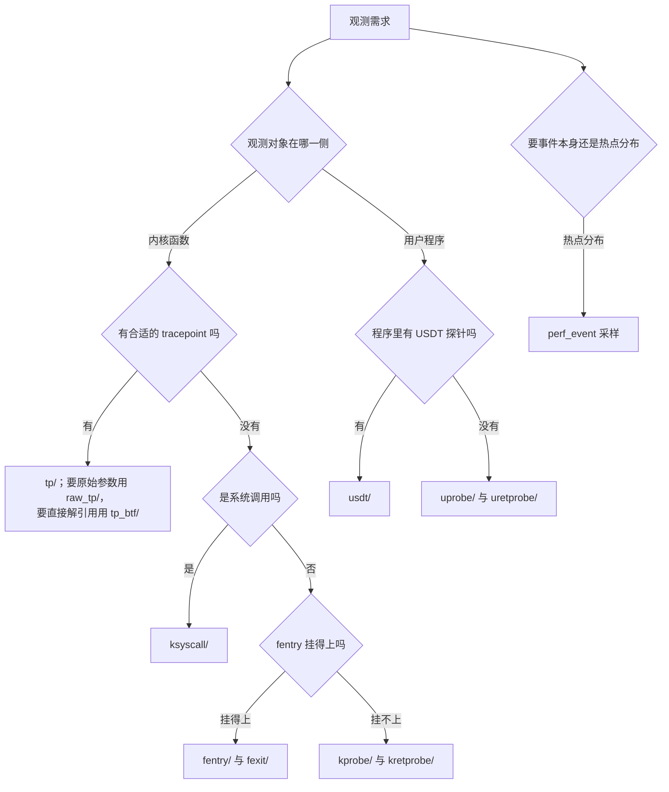

# B.11 跟踪与观测：kprobe、uprobe 与 tracepoint

在前面的章节中，我们曾先后实现过挂载在 `do_unlinkat` 内核函数上的 kprobe 程序，以及挂载在 `sys_enter_write` 跟踪点上的 tracepoint 程序。当时为了迅速建立感性认识，采用了「先给出具体代码、再反推挂载机制」的路径。然而在面对实际工程中的观测与排障需求时，思维流程往往是反向展开的：首先需要准确评估观测目标所处的系统层次，进而权衡稳定性、侵入开销与数据丰富度，挑选最为适宜的探针技术。

以最为典型的「监控系统中特定进程删除文件」为例：若选择挂载至预定义的 tracepoint，程序拿到的是内核开发者精心维护的标准化字段，其跨内核版本兼容性最好；若挂载至 `kprobe/do_unlinkat`，程序直接面对底层寄存器快照 `struct pt_regs`，需要依靠 ABI 调用惯例手工解析入参，一旦内核函数签名重构便面临失效风险；而若依托现代的 `fentry` 蹦床机制，不仅能够直接获取带有强类型定义的入参，甚至能以接近普通函数调用的极低开销完成拦截。从内核侧的静态跟踪点到动态符号注入，再到跨越用户态边界的 uprobe 与 USDT，这套丰富的探针生态各自拥有明确的适用边界。

文中的配套示例均收录于 `code/系统编程/拓展B_eBPF/B_11_跟踪与观测_kprobe_uprobe与tracepoint/` 目录。演示涉及的内核态探针使用 clang 18 编译并由 bpftool 7.5 生成骨架；涉及用户态符号解析的 `calc.c` 及相关 ELF 检查指令均在真实环境（基于 Linux 6.12）下实测运行并采纳输出。

## 1. 钩子的分类

面对纷繁多样的观测机制，首先可以从「安置来源」与「执行边界」两个核心维度建立清晰的坐标系。

第一个维度是静态钩子（static hook）与动态钩子（dynamic hook）的对立与互补。静态钩子由被观测代码的原作者在源码阶段显式埋设，其探针位置、暴露字段以及触发语义均构成了软件向外承诺的稳定可观测性契约的一部分；内核中的各类 tracepoint 即为此类典范。动态钩子则完全由外部观测者在运行时按需指定目标函数或物理指令地址，内核通过动态修改机器指令（如插入断点或改写指令头）来强行拦截执行流；kprobe 与 uprobe 便是动态介入的典型代表。

第二个维度是钩子所锚定的执行特权域，即内核侧（kernel space）与用户侧（user space）的划分。运行在内核地址空间中的常规例程隶属于内核侧，kprobe、kretprobe、fentry 以及 fexit 均在此处驻留；而在普通应用程序或动态链接库中执行的函数则属于用户侧，uprobe 与 uretprobe 专门用于拦截用户进程的符号执行，而 USDT 则是应用程序开发者主动在用户态二进制中埋设的静态标记。

| 钩子 | 静态/动态 | 在哪一侧 | 能取到的数据 | 稳定性 |
| --- | --- | --- | --- | --- |
| tracepoint（`tp/`） | 静态 | 内核 | 事件定义好的一组字段 | 由内核开发者有意维护 |
| raw tracepoint（`raw_tp/`） | 静态 | 内核 | 原始参数的 `__u64` 数组 | 同 tracepoint，少了字段转换 |
| tp_btf | 静态 | 内核 | 带 BTF 类型的参数 | 同 tracepoint，可直接解引用 |
| kprobe/kretprobe | 动态 | 内核 | `struct pt_regs`，参数按 ABI 取 | 函数名、签名、语义都可能变 |
| ksyscall | 动态 | 内核 | 按系统调用原型给出的参数 | 跟随系统调用，跨架构由 libbpf 处理 |
| fentry/fexit | 动态 | 内核 | 带类型的参数，fexit 还有返回值 | 函数签名变了就挂不上 |
| uprobe/uretprobe | 动态 | 用户 | `struct pt_regs`，参数按用户态 ABI 取 | 取决于被观测二进制的符号 |
| USDT | 静态 | 用户 | 程序作者定义的参数 | 探针是程序接口的一部分 |
| perf_event | 采样 | 两侧 | 采样时刻的调用栈 | 与性能计数器接口绑定 |

::: concept ebpf-b11-static-vs-dynamic title="静态钩子与动态钩子的稳定性"

静态钩子的名字、参数和含义由代码作者定义，属于对外接口的一部分，改动时要照顾已有的使用者。动态钩子只是一个地址：内核里函数的名字、参数个数和参数含义都可以在版本之间变化。用 kprobe 读一个 `struct filename *` 之所以能工作，靠的是这个内核此刻恰好这样实现。所以同一个需求既能用 tracepoint 也能用 kprobe 时，优先用 tracepoint；只有 tracepoint 覆盖不到的地方才用动态钩子。

:::

各机制在运行时造成的性能开销悬殊，主要根源于底层指令拦截机制的技术实现方式：

kprobe 的工作原理依托于软中断异常。它将目标指令的起始字节动态替换为断点指令（如 x86 架构下的 `INT 3`）；一旦 CPU 执行至该处，便会触发断点异常，系统必须完整保存当前 CPU 的通用寄存器现场，跳转至异常处理例程，调度 BPF 程序执行，随后以单步调试（single-step）模式执行被替换的原指令，最后恢复寄存器现场并返回原流程。这一连串异常陷入与上下文切换带来了不容忽视的 CPU 开销。

与之相对，`fentry` 充分利用了现代编译器在函数入口预留的 `NOP` 间隙。当探针生效时，内核直接将该处 `NOP` 指令动态改写为跳转到专门合成的 BPF 蹦床（trampoline）；蹦床内部仅负责轻量级压栈以保护参数，随后以常规 C 函数调用的方式执行 BPF 程序并返回原函数。整个流程完全避免了软中断异常与单步执行，其性能损耗仅仅等同于若干条指令的常规函数跳转。

而在用户态场景中，uprobe 的拦截机制与 kprobe 如出一辙，但其代价更为高昂：每当断点触发，被监控的用户态进程都必须从用户态陷入内核空间，执行完内核中的 BPF 观测逻辑后，再穿越上下文屏障恢复回用户态继续运行。

静态 tracepoint 则最为轻量：在探针未启用时，其在内核代码路径中仅表现为一条预测大概率不跳转的静态跳转指令（依托静态分支 jump label 优化，几乎等同于空操作）；一旦动态开启，其执行本质上也仅仅是一次直接的函数调用，堪称各类方案中侵入性与性能开销最为理想的选择。

### 1.1 kprobe 与 fentry 的写法差别

同一个函数、同一件事，两种写法放在一起最能看出区别。下面两个程序都挂在 `do_unlinkat` 的入口，都打印调用者的 PID 和要删除的文件名。`do_unlinkat` 位于 `unlinkat` 系统调用的处理路径上，`rm` 删除文件的动作能被它捕捉到。

::: compare vertical left-title="kprobe：从 pt_regs 取参数" right-title="fentry：直接写函数签名"

```c
SEC("kprobe/do_unlinkat")
int BPF_KPROBE(do_unlinkat, int dfd, struct filename *name)
{
    pid_t pid;
    const char *filename;

    pid = bpf_get_current_pid_tgid() >> 32;
    filename = BPF_CORE_READ(name, name);
    bpf_printk("KPROBE ENTRY pid = %d, filename = %s\n", pid, filename);
    return 0;
}
```

---

```c
SEC("fentry/do_unlinkat")
int BPF_PROG(do_unlinkat, int dfd, struct filename *name)
{
    pid_t pid;

    pid = bpf_get_current_pid_tgid() >> 32;
    bpf_printk("fentry: pid = %d, filename = %s\n", pid, name->name);
    return 0;
}
```

:::

两边看起来差不多，差别在下面几处。

`BPF_KPROBE` 内部按 x86-64 的调用约定从 `pt_regs` 里取出第 1、2 个参数。这个约定属于内核 ABI，位置稳定，但参数的类型信息编译器完全不知道：`name` 在宏展开后只是一个整数，解引用之前必须走 `BPF_CORE_READ`，由它生成 CO-RE 重定位并调用 `bpf_probe_read_kernel`。`BPF_PROG` 拿到的参数带类型，`name->name` 就是普通的成员访问，clang 直接生成带重定位的读指令。

`BPF_CORE_READ(name, name)` 里两个 `name` 含义不同：前一个是要读的指针对象，后一个是 `struct filename` 里的成员名。`struct filename` 的第一个成员恰好就叫 `name`，所以这一行读的是 `name->name`，即路径字符串。B.8 讲过 `BPF_CORE_READ` 的展开方式。

`BPF_KPROBE` 还要求编译时指定目标架构，`-D__TARGET_ARCH_x86` 就是为它准备的。不写这一项，编译直接报错：

::: terminal title="zsh - clang"

```text
$ clang -g -O2 -target bpf -mcpu=v3 -I. -c unlink_kprobe.bpf.c -o unlink_kprobe.bpf.o
unlink_kprobe.bpf.c:9:5: error: Must specify a BPF target arch via __TARGET_ARCH_xxx
    9 | int BPF_KPROBE(do_unlinkat, int dfd, struct filename *name)
      |     ^
```

:::

`fentry` 不需要这个宏：参数来自 BTF 里的函数原型，带完整类型。

## 2. tracepoint

### 2.1 找到可用的 tracepoint

内核里所有 tracepoint 都在 tracefs 下按「类别/事件」组织，类别是子系统名，事件是具体的事件：

::: terminal title="zsh - tracefs"

```text
$ ls /sys/kernel/tracing/events/ | head -20
alarmtimer
amd_cpu
avc
block
bpf_test_run
bpf_trace
bridge
cgroup
clk
compaction
context_tracking
cpuhp
cros_ec
csd
cxl
damon
dev
devfreq
devlink
dma
```

:::

`sched` 类别下面是调度相关的事件，`syscalls` 下面是每个系统调用的入口和出口各一个事件：

::: terminal title="zsh - events"

```text
$ ls /sys/kernel/tracing/events/sched/ | head -12
enable
filter
sched_kthread_stop
sched_kthread_stop_ret
sched_kthread_work_execute_end
sched_kthread_work_execute_start
sched_kthread_work_queue_work
sched_migrate_task
sched_move_numa
sched_pi_setprio
sched_prepare_exec
sched_process_exec

$ ls /sys/kernel/tracing/events/syscalls/ | head -8
enable
filter
sys_enter_accept
sys_enter_accept4
sys_enter_access
sys_enter_acct
sys_enter_add_key
sys_enter_adjtimex
```

:::

每个事件目录下有一个 `format` 文件，写明这个事件所有字段的名字、类型、字节偏移和大小。内核文档 *Event Tracing* 第 4 节给出的 `sched_wakeup` 是一个完整的例子，实际输出与此类似：

::: terminal title="zsh - format（引自内核文档，偏移随版本变化）"

```text
$ cat /sys/kernel/tracing/events/sched/sched_wakeup/format
name: sched_wakeup
ID: 60
format:
	field:unsigned short common_type;	offset:0;	size:2;
	field:unsigned char common_flags;	offset:2;	size:1;
	field:unsigned char common_preempt_count;	offset:3;	size:1;
	field:int common_pid;	offset:4;	size:4;
	field:int common_tgid;	offset:8;	size:4;

	field:char comm[TASK_COMM_LEN];	offset:12;	size:16;
	field:pid_t pid;	offset:28;	size:4;
	field:int prio;	offset:32;	size:4;
	field:int success;	offset:36;	size:4;
	field:int cpu;	offset:40;	size:4;

print fmt: "task %s:%d [%d] success=%d [%03d]", REC->comm, REC->pid,
	   REC->prio, REC->success, REC->cpu
```

:::

`common_` 前缀的字段是所有事件共有的，后面跟着的是这个事件自己的字段。写 BPF 程序时不用手工算偏移，`bpftool btf dump` 生成的 `vmlinux.h` 里已经有对应的结构体。系统调用这一类事件的形状是统一的：

::: terminal title="zsh - vmlinux.h"

```text
$ grep -A 5 'struct trace_event_raw_sys_enter {' vmlinux.h
struct trace_event_raw_sys_enter {
	struct trace_entry ent;
	long int id;
	long unsigned int args[6];
	char __data[0];
};
```

:::

注意这里没有 `dfd`、`filename` 这类具名成员，只有 `id`（系统调用号）和 `args[6]`。`format` 文件里那些具名字段是跟踪子系统在启动时按系统调用原型动态生成的，BTF 里只有这一个统一的结构体。所以读 `openat` 的路径要写 `ctx->args[1]`，不能写 `ctx->filename`。两者的对应关系可以借 `bpftrace -lv` 看清，它把 `format` 文件里的字段连同类型一起列出来：

::: terminal title="zsh - bpftrace（引自 bpftrace 手册）"

```text
# bpftrace -l 'tracepoint:syscalls:sys_enter_openat' -v
tracepoint:syscalls:sys_enter_openat
    int __syscall_nr
    int dfd
    const char * filename
    int flags
    umode_t mode
```

:::

::: tip 三类钩子的查找命令

- tracepoint：`ls /sys/kernel/tracing/events/<类别>/`，或者 `bpftrace -l 'tracepoint:<类别>:*'`，后者支持 `*` 和 `?` 通配；
- kprobe：`grep do_unlinkat /proc/kallsyms` 找符号，`grep do_unlinkat /sys/kernel/tracing/available_filter_functions` 找可以被 ftrace 探测的函数。后一份列表不包括内联函数，比 kprobe 的实际可挂集合窄一些，但可以用来快速排除；
- uprobe：`nm -S 可执行文件`、`readelf -sW 可执行文件`、`objdump -d 可执行文件` 查符号和偏移；程序里有没有 USDT 探针，用 `readelf -n 可执行文件` 看有没有 `.note.stapsdt` 段。

本机上普通用户读 `/proc/kallsyms` 时地址一列全是 0，读 `available_filter_functions` 直接得到 `Permission denied`，这两条命令都要 root。

:::

### 2.2 用 tracepoint 读 openat 的路径

下面这个程序把每次 `openat` 的文件名打印出来。完整文件在 `tp_openat.bpf.c`：

```c
#include "vmlinux.h"
#include <bpf/bpf_helpers.h>

char LICENSE[] SEC("license") = "Dual BSD/GPL";

/* 系统调用类事件共用 trace_event_raw_sys_enter：
 * id 是系统调用号，args[6] 是六个参数。 */
SEC("tp/syscalls/sys_enter_openat")
int handle_openat(struct trace_event_raw_sys_enter *ctx)
{
    char filename[64];
    const char *user_ptr = (const char *)ctx->args[1];
    pid_t pid = bpf_get_current_pid_tgid() >> 32;

    /* args[1] 指向用户空间内存，只能用辅助函数读 */
    if (bpf_probe_read_user_str(filename, sizeof(filename), user_ptr) < 0) {
        return 0;
    }
    bpf_printk("openat: pid = %d, filename = %s\n", pid, filename);
    return 0;
}
```

`SEC("tp/syscalls/sys_enter_openat")` 里斜杠前面是程序类型的简称（`tp` 是 `tracepoint` 的简写），后面是「类别/事件」。libbpf 读这个节名就知道要设成 `BPF_PROG_TYPE_TRACEPOINT`，也知道该附加到哪个事件，所以骨架的 `__attach` 一步就能完成。

`ctx` 指向内核已经填好的一条跟踪记录，就是 `format` 文件描述的那块内存，字段按 `offset` 排好。读 `args[1]` 不需要任何辅助函数，直接访问即可。但 `args[1]` 的内容是一个用户空间地址，在 `openat` 入口处路径还没有被拷进内核，直接解引用会被验证器拒绝，必须用 `bpf_probe_read_user_str`。这次读的是路径字符串，用带 `_str` 后缀的版本，它在遇到 `\0` 时停止并返回读到的长度。

加载程序与 B.5 的 execlog 结构相同，只有三句实质性代码：

```c
skel = tp_openat_bpf__open_and_load();
...
err = tp_openat_bpf__attach(skel);
...
tp_openat_bpf__destroy(skel);
```

编译、生成骨架、运行：

::: terminal title="zsh - build and run"

```text
$ clang -g -O2 -target bpf -mcpu=v3 -D__TARGET_ARCH_x86 -I. -c tp_openat.bpf.c -o tp_openat.bpf.o
$ bpftool gen skeleton tp_openat.bpf.o > tp_openat.skel.h
$ cc -std=c17 -Wall -Wextra tp_openat.c -o tp_openat $(pkg-config --cflags --libs libbpf)
$ sudo ./tp_openat
已启动，另开一个终端执行 sudo cat /sys/kernel/tracing/trace_pipe
```

:::

另开一个终端读取 `trace_pipe`，输出内容与下述展示类似（格式字符串取自配套程序，输出各列字段的具体语义可参阅 B.3 节的解析）：

::: terminal title="zsh - trace_pipe"

```text
$ sudo cat /sys/kernel/tracing/trace_pipe
            bash-4321    [002] .....  8934.120847: bpf_trace_printk: openat: pid = 4321, filename = /etc/ld.so.cache
            bash-4321    [002] .....  8934.120912: bpf_trace_printk: openat: pid = 4321, filename = /etc/localtime
```

:::

### 2.3 raw_tp 与 tp_btf

tracepoint 程序拿到的 `ctx` 是内核拷贝过的一份记录：内核把要记录的字段按 `format` 文件的布局拷进缓冲区，BPF 程序再读这份拷贝。这个拷贝对大多数用途都够用，但每次事件都要多做一次转换。

raw tracepoint 跳过这一步，直接把原始参数以 `__u64` 数组交过来：

```c
#include "vmlinux.h"
#include <bpf/bpf_helpers.h>

char LICENSE[] SEC("license") = "Dual BSD/GPL";

SEC("raw_tp/sched_process_exec")
int handle_exec(struct bpf_raw_tracepoint_args *ctx)
{
    /* args[0] 是 task_struct 指针，args[1] 是旧的 PID */
    __u64 task = ctx->args[0];
    __u64 old_pid = ctx->args[1];

    bpf_printk("exec: task = %llu, old_pid = %llu\n", task, old_pid);
    return 0;
}
```

`struct bpf_raw_tracepoint_args` 只有一个 `args[0]` 的柔性数组成员。每个槽位存一个参数，槽位的含义由具体的 tracepoint 决定，`sched_process_exec` 的槽位 0 是 `task_struct *`、槽位 1 是旧的 PID。这个结构体里全是裸的 64 位整数，想用得自己转换；`tp/` 那种按字段名读的便利没有了。

tp_btf 是第三种写法。它属于 `BPF_PROG_TYPE_TRACING` 程序类型，通过 BTF 拿到 tracepoint 的参数原型，所以可以写成普通的函数签名：

```c
#include "vmlinux.h"
#include <bpf/bpf_helpers.h>
#include <bpf/bpf_tracing.h>

char LICENSE[] SEC("license") = "Dual BSD/GPL";

SEC("tp_btf/sched_process_exec")
int BPF_PROG(handle_exec, struct task_struct *p, pid_t old_pid, struct linux_binprm *bprm)
{
    bpf_printk("exec: comm = %s, old_pid = %d\n", p->comm, old_pid);
    return 0;
}
```

`sched_process_exec` 在 `vmlinux.h` 里的原型是 `btf_trace_sched_process_exec(void *, struct task_struct *, pid_t, struct linux_binprm *)`。第一个 `void *` 是 tracepoint 自己的 `__data`，`BPF_PROG` 从签名映射时会跳过它，所以参数从 `struct task_struct *p` 开始写。`p->comm` 可以直接解引用，和 fentry 一样靠 BTF 与 CO-RE。

三种写法如何选：

- 只关心 `format` 文件里已经定义好的字段，用 `tp/`，代码最短；
- 事件量很大、想省掉字段拷贝，用 `raw_tp/`；
- 想直接解引用指针参数、又不想放弃 tracepoint 的稳定性，用 `tp_btf/`。

::: tip 有 tracepoint 就先用 tracepoint

tracepoint 由内核开发者有意维护，字段改名时一般会保留兼容，事件本身也有文档。kprobe 能挂上任何函数，代价是没有任何保证：升级内核之后函数可能被内联掉、改了名字、或者参数含义变了，程序照样加载成功，只是永远不触发或读到垃圾。先用 `bpftrace -l 'tracepoint:*:<关键字>*'` 找一遍，找不到再退到 kprobe。

:::

<Quiz
  type="single"
  :options="[
    { label: 'kprobe，可以挂的函数更多', value: 'A' },
    { label: 'tracepoint，事件名与字段由内核维护', value: 'B' },
    { label: 'tp_btf，可以直接解引用指针', value: 'C' },
    { label: '两者完全等价，随便选', value: 'D' }
  ]"
  answer="B"
>

<template #question>

要观测的事件既有对应的 tracepoint，也能用 kprobe 挂在实现它的内核函数上。同一个需求应该优先选哪个？

</template>

正确答案是 **B**。tracepoint 的名字和字段由内核开发者维护，升级内核时一般不会让已有的程序失效；kprobe 挂在实现细节上，函数改名、被内联、参数变化都会让程序悄悄失效而不报错。C 的 tp_btf 也是 tracepoint 的一种写法，不如 B 概括，而且它只在需要解引用指针参数时才比 `tp/` 更有优势。A 的「可以挂的函数更多」是事实，但覆盖面大不等于该选它。

</Quiz>

## 3. kprobe 与 kretprobe

### 3.1 挂在 do_unlinkat 上

两个程序，一个挂在函数入口，一个挂在函数返回。完整文件在 `unlink_kprobe.bpf.c`：

```c
#include "vmlinux.h"
#include <bpf/bpf_helpers.h>
#include <bpf/bpf_tracing.h>
#include <bpf/bpf_core_read.h>

char LICENSE[] SEC("license") = "Dual BSD/GPL";

SEC("kprobe/do_unlinkat")
int BPF_KPROBE(do_unlinkat, int dfd, struct filename *name)
{
    pid_t pid;
    const char *filename;

    pid = bpf_get_current_pid_tgid() >> 32;
    filename = BPF_CORE_READ(name, name);
    bpf_printk("KPROBE ENTRY pid = %d, filename = %s\n", pid, filename);
    return 0;
}

SEC("kretprobe/do_unlinkat")
int BPF_KRETPROBE(do_unlinkat_exit, long ret)
{
    pid_t pid;

    pid = bpf_get_current_pid_tgid() >> 32;
    bpf_printk("KPROBE EXIT: pid = %d, ret = %ld\n", pid, ret);
    return 0;
}
```

`BPF_KRETPROBE` 只能取返回值，不能取参数。原因在实现上：kretprobe 在函数入口把返回地址换成自己的蹦床，等函数返回时才执行 BPF 程序，这时参数占用的寄存器早已被函数体覆盖。libbpf 的 `bpf_tracing.h` 在 `BPF_KRETPROBE` 的注释里写得很直白：input arguments will be clobbered by the time probed function returns。

### 3.2 生成骨架与加载程序

BPF 目标文件的节名证实了 libbpf 是靠节名判断程序类型的：

::: terminal title="zsh - readelf"

```text
$ readelf -SW unlink_kprobe.bpf.o | grep -E 'kprobe|license'
  [ 3] kprobe/do_unlinkat PROGBITS        0000000000000000 000040 000098 00  AX  0   0  8
  [ 5] kretprobe/do_unlinkat PROGBITS        0000000000000000 0000d8 000038 00  AX  0   0  8
  [ 7] license           PROGBITS        0000000000000000 000110 00000d 00  WA  0   0  1
```

:::

`bpftool gen skeleton` 读这些节名生成骨架，`progs` 结构里每个程序一个成员，成员名就是 BPF 函数名：

::: terminal title="zsh - bpftool"

```text
$ bpftool gen skeleton unlink_kprobe.bpf.o | sed -n '13,30p'
struct unlink_kprobe_bpf {
	struct bpf_object_skeleton *skeleton;
	struct bpf_object *obj;
	struct {
		struct bpf_map *rodata;
	} maps;
	struct {
		struct bpf_program *do_unlinkat;
		struct bpf_program *do_unlinkat_exit;
	} progs;
	struct {
		struct bpf_link *do_unlinkat;
		struct bpf_link *do_unlinkat_exit;
	} links;
...
```

:::

加载程序与第 2 节的骨架一样，区别只是这里有两个程序，`__attach` 会依次处理；其中任何一个失败，整个 `__attach` 返回错误。

### 3.3 运行

::: terminal title="zsh - kprobe"

```text
$ clang -g -O2 -target bpf -mcpu=v3 -D__TARGET_ARCH_x86 -I. -c unlink_kprobe.bpf.c -o unlink_kprobe.bpf.o
$ bpftool gen skeleton unlink_kprobe.bpf.o > unlink_kprobe.skel.h
$ cc -std=c17 -Wall -Wextra unlink_kprobe.c -o unlink_kprobe $(pkg-config --cflags --libs libbpf)
$ sudo ./unlink_kprobe
libbpf: loading object 'unlink_kprobe_bpf' from buffer
...
已启动，另开一个终端执行 sudo cat /sys/kernel/tracing/trace_pipe
```

:::

另开一个终端删两个文件。`trace_pipe` 里出现的内容类似 libbpf-bootstrap README 的 kprobe 一节：

::: terminal title="zsh - trace_pipe"

```text
$ sudo cat /sys/kernel/tracing/trace_pipe
              rm-9346    [005] d..3  4710.951696: bpf_trace_printk: KPROBE ENTRY pid = 9346, filename = test1
              rm-9346    [005] d..4  4710.951819: bpf_trace_printk: KPROBE EXIT: ret = 0
              rm-9346    [005] d..3  4710.951852: bpf_trace_printk: KPROBE ENTRY pid = 9346, filename = test2
              rm-9346    [005] d..4  4710.951895: bpf_trace_printk: KPROBE EXIT: ret = 0
```

:::

README 早期文档展示的 EXIT 日志行未输出 pid 字段，那是旧版驱动留下的遗迹；当前 libbpf 官方格式串与本文示例一致，均已补齐 pid（`"KPROBE EXIT: pid = %d, ret = %ld\n"`），实际运行时该行会多出 pid 标识。

### 3.4 挂不上的情况

kprobe 能挂上去的前提是那个地址上有一条可以替换的指令。三种情况会失败：

- 函数被编译器内联了。kprobe 只在函数本身的代码里下断点，不会追着在调用点展开的副本一起下，所以给一个被内联的函数下探针，可能一次都不触发。函数如果只有几个语句，很可能已经被内联进调用者。
- 函数在 kprobe 的黑名单上。实现 kprobe 自身的代码，以及 `do_page_fault`、`notifier_call_chain` 这类在异常路径上被调用的函数，注册时直接返回 `-EINVAL`。内核文档把这份名单称为 blacklist，用 `NOKPROBE_SYMBOL()` 标记。
- 函数名在当前内核里不存在。整个 `kprobe/xxx` 会在 `__attach` 时报错，错误码通常是 `ENOENT`。

函数签名变化是另一个层面的问题。`do_unlinkat` 在某个版本上第一个参数是 `int dfd`，在另一个版本上可能多一个参数或者换了顺序。BPF 程序照样加载成功，但 `BPF_KPROBE` 按写死的顺序从寄存器取值，读到的就不是想要的东西。这种错误没有任何提示，只有对着结果觉得不对劲才发现。

确认一个函数在不在：

::: terminal title="zsh - kallsyms"

```text
$ grep -w do_unlinkat /proc/kallsyms
0000000000000000 T do_unlinkat
$ grep -w do_unlinkat /sys/kernel/tracing/available_filter_functions
grep: /sys/kernel/tracing/available_filter_functions: Permission denied
```

:::

这是普通用户的输出：`/proc/kallsyms` 里地址被换成了 0，`available_filter_functions` 直接读不了。换成 root 就能看到真实地址和完整的可探测函数列表。

### 3.5 ksyscall

系统调用在内核里的入口函数名带架构前缀，x86-64 上是 `__x64_sys_kill`，ARM64 上是 `__arm64_sys_kill`。直接写 kprobe 就得把前缀写死，换一个架构就要改代码。libbpf 提供了 `ksyscall` 这种 SEC 名称，附加时按当前架构自动补上前缀：

```c
#include "vmlinux.h"
#include <bpf/bpf_helpers.h>
#include <bpf/bpf_tracing.h>
#include <bpf/bpf_core_read.h>

char LICENSE[] SEC("license") = "Dual BSD/GPL";

SEC("ksyscall/kill")
int BPF_KSYSCALL(kill_enter, pid_t pid, int sig)
{
    bpf_printk("kill: pid = %d, sig = %d\n", pid, sig);
    return 0;
}
```

`BPF_KSYSCALL` 还处理了另一层差异：有的架构在内核里包了一层 `syscall_wrapper`，参数实际放在 `pt_regs` 指向的另一个 `pt_regs` 里。它通过 `LINUX_HAS_SYSCALL_WRAPPER` 这个 `__kconfig` 外部对象在加载时判断，两个分支各自生成读参数的代码。`BPF_KSYSCALL` 依赖 CO-RE，所以必须包含 `bpf_core_read.h`。把上面这段代码里的这一行去掉，编译时报：

::: terminal title="zsh - clang"

```text
$ clang -g -O2 -target bpf -mcpu=v3 -D__TARGET_ARCH_x86 -I. -c ksyscall_kill.bpf.c -o ksyscall_kill.bpf.o
ksyscall_kill.bpf.c:8:5: error: call to undeclared function 'BPF_CORE_READ'; ISO C99 and later do not support implicit function declarations [-Wimplicit-function-declaration]
    8 | int BPF_KSYSCALL(kill_enter, pid_t pid, int sig)
      |     ^
```

:::

libbpf 的注释列出了它还不能透明处理的几种系统调用：`mmap`（旧式 `__ARCH_WANT_SYS_OLD_MMAP`）、`clone`（`CONFIG_CLONE_BACKWARDS` 系列）、套接字相关的 `__ARCH_WANT_SYS_SOCKETCALL`，以及 compat 系统调用。碰到这些要自己按架构处理。

## 4. fentry 与 fexit

### 4.1 用 BPF 蹦床

fentry 和 fexit 利用函数开头编译器预留的 NOP 空间。内核附加时把这段空间改成跳转到 BPF 蹦床的指令，蹦床保存参数、调用 fentry 程序、调用原函数、再调用 fexit 程序。多个程序可以共用同一个蹦床。

`unlink_fentry.bpf.c` 是同一件事的 fentry 版本：

```c
#include "vmlinux.h"
#include <bpf/bpf_helpers.h>
#include <bpf/bpf_tracing.h>

char LICENSE[] SEC("license") = "Dual BSD/GPL";

SEC("fentry/do_unlinkat")
int BPF_PROG(do_unlinkat, int dfd, struct filename *name)
{
    pid_t pid;

    pid = bpf_get_current_pid_tgid() >> 32;
    bpf_printk("fentry: pid = %d, filename = %s\n", pid, name->name);
    return 0;
}

SEC("fexit/do_unlinkat")
int BPF_PROG(do_unlinkat_exit, int dfd, struct filename *name, long ret)
{
    pid_t pid;

    pid = bpf_get_current_pid_tgid() >> 32;
    bpf_printk("fexit: pid = %d, filename = %s, ret = %ld\n", pid, name->name, ret);
    return 0;
}
```

fexit 的参数是「原函数的全部参数，再加一个返回值」，返回值固定放在最后。这是 fexit 相对 kretprobe 最大的优点：kretprobe 只能拿到返回值，因为返回时参数已经被覆盖；fexit 由蹦床在入口处把参数保存下来，返回时一起交给程序。要算「删一个文件用了多久」这类需要入口出口配对的任务，用 kretprobe 必须借一张以线程 ID 为键的 map 存入口时间，用 fexit 就直接拿得到参数。

### 4.2 编译与输出

fentry 程序不需要 `-D__TARGET_ARCH_x86`，因为它的参数类型记录在 BTF 里：

::: terminal title="zsh - build"

```text
$ clang -g -O2 -target bpf -mcpu=v3 -I. -c unlink_fentry.bpf.c -o unlink_fentry.bpf.o
$ bpftool gen skeleton unlink_fentry.bpf.o > unlink_fentry.skel.h
$ cc -std=c17 -Wall -Wextra unlink_fentry.c -o unlink_fentry $(pkg-config --cflags --libs libbpf)
$ sudo ./unlink_fentry
libbpf: loading object 'unlink_fentry_bpf' from buffer
...
已启动，另开一个终端执行 sudo cat /sys/kernel/tracing/trace_pipe
```

:::

删除两个文件后的 `trace_pipe`（输出类似 libbpf-bootstrap README 的 fentry 一节）：

::: terminal title="zsh - trace_pipe"

```text
$ sudo cat /sys/kernel/tracing/trace_pipe
              rm-9290    [004] d..2  4637.798698: bpf_trace_printk: fentry: pid = 9290, filename = test_file
              rm-9290    [004] d..2  4637.798843: bpf_trace_printk: fexit: pid = 9290, filename = test_file, ret = 0
              rm-9290    [004] d..2  4637.798698: bpf_trace_printk: fentry: pid = 9290, filename = test_file2
              rm-9290    [004] d..2  4637.798843: bpf_trace_printk: fexit: pid = 9290, filename = test_file2, ret = 0
```

:::

fexit 的两行里 `filename` 都还在，这就是它比 kretprobe 多拿到的信息。

### 4.3 kprobe 与 fentry 怎么选

::: compare vertical left-title="kprobe 版：要 BPF_CORE_READ，要架构宏" right-title="fentry 版：直接解引用，不要架构宏"

```c
SEC("kprobe/do_unlinkat")
int BPF_KPROBE(do_unlinkat, int dfd, struct filename *name)
{
    const char *filename = BPF_CORE_READ(name, name);

    bpf_printk("KPROBE ENTRY pid = %d, filename = %s\n",
               bpf_get_current_pid_tgid() >> 32, filename);
    return 0;
}

SEC("kretprobe/do_unlinkat")
int BPF_KRETPROBE(do_unlinkat_exit, long ret)
{
    /* 拿不到 dfd 和 name，只能拿到 ret */
    bpf_printk("KPROBE EXIT: ret = %ld\n", ret);
    return 0;
}
```

---

```c
SEC("fentry/do_unlinkat")
int BPF_PROG(do_unlinkat, int dfd, struct filename *name)
{
    bpf_printk("fentry: pid = %d, filename = %s\n",
               bpf_get_current_pid_tgid() >> 32, name->name);
    return 0;
}

SEC("fexit/do_unlinkat")
int BPF_PROG(do_unlinkat_exit, int dfd, struct filename *name, long ret)
{
    /* 参数和返回值都还在 */
    bpf_printk("fexit: pid = %d, filename = %s, ret = %ld\n",
               bpf_get_current_pid_tgid() >> 32, name->name, ret);
    return 0;
}
```

:::

除了写法上的差别，两者运行时的开销也不一样。kprobe 命中时要触发一次断点异常，保存现场、单步、恢复，再走 kprobe 的处理流程；fentry 只是函数调用外加蹦床里几条保存寄存器的指令。事件量大时这个差别很显著，libbpf-bootstrap 的 README 把 fentry 的第一条好处就写成 improved performance。

::: tip 优先选 fentry/fexit

想挂内核函数时先看能不能用 fentry。它要求内核编译时带了 BTF（`/sys/kernel/btf/vmlinux` 存在即可），常见的发行版内核都带。fentry 挂不上时通常有两个原因：函数被内联掉了，或者函数在另一个模块里而那个模块的 BTF 没有加载。这时再退回 kprobe——kprobe 对函数位置的要求更宽松，只要那里有一条可以替换的指令就行。

:::

<Quiz
  type="single"
  :options="[
    { label: '只有返回值', value: 'A' },
    { label: '只有参数', value: 'B' },
    { label: '参数和返回值都有', value: 'C' },
    { label: '只有调用者的 PID', value: 'D' }
  ]"
  answer="C"
>

<template #question>

fexit 程序能拿到被观测函数的什么？

</template>

正确答案是 **C**。蹦床在函数入口处把参数保存下来，函数返回时把参数和返回值一起交给 fexit 程序。kretprobe 只能拿到返回值（A），因为函数返回时参数占用的寄存器已经被函数体覆盖；这也是 fexit 相对 kretprobe 的主要优势。

</Quiz>

## 5. uprobe 与 uretprobe

### 5.1 被观测的程序

uprobe 面向普通用户程序。观测对象 `calc.c` 里有三个函数：`main`，以及两个加了 `noinline` 的 `uprobed_add` 和 `uprobed_sub`：

```c
#define _POSIX_C_SOURCE 200809L

#include <stdio.h>
#include <unistd.h>

/* noinline 与空汇编配合，保证函数在目标文件里有一个真实的符号，
 * 不会被编译器内联进 main。附加 uprobe 需要这样一个符号。 */
__attribute__((noinline)) int uprobed_add(int a, int b)
{
    __asm__ volatile("");
    return a + b;
}

__attribute__((noinline)) int uprobed_sub(int a, int b)
{
    __asm__ volatile("");
    return a - b;
}

int main(void)
{
    int i;

    for (i = 0; i < 3; i++) {
        printf("uprobed_add(%d, %d) = %d\n", i, i + 1, uprobed_add(i, i + 1));
        printf("uprobed_sub(%d, %d) = %d\n", i, i, uprobed_sub(i, i));
        sleep(1);
    }
    return 0;
}
```

`noinline` 是关键。uprobe 靠符号找到函数的入口偏移，函数被内联掉之后符号还在，但代码已经不在那个地址，附加照样成功，却一次也不触发。空汇编 `__asm__ volatile("")` 是 libbpf-bootstrap 的做法，用来防止编译器把这个只有一行计算的函数优化成别名。

在 SignalX 上编译并运行：

::: terminal title="zsh - calc"

```text
$ gcc -std=c17 -Wall -Wextra -O2 -g calc.c -o calc
$ ./calc
uprobed_add(0, 1) = 1
uprobed_sub(0, 0) = 0
uprobed_add(1, 2) = 3
uprobed_sub(1, 1) = 0
uprobed_add(2, 3) = 5
uprobed_sub(2, 2) = 0
```

:::

### 5.2 查符号

附加 uprobe 需要一个「函数在文件里的偏移」。`nm` 能看到符号和它所在的地址：

::: terminal title="zsh - nm"

```text
$ nm -S calc | grep -E 'uprobed|main'
0000000000001060 000000000000006b T main
00000000000011c0 0000000000000004 T uprobed_add
00000000000011d0 0000000000000005 T uprobed_sub
```

:::

第一列是地址，第二列是大小，第三列 `T` 表示这是 `.text` 段里的全局符号。`readelf -sW` 给出同一批信息的另一种排布：

::: terminal title="zsh - readelf"

```text
$ readelf -sW calc | grep uprobed
    25: 00000000000011c0     4 FUNC    GLOBAL DEFAULT   14 uprobed_add
    29: 00000000000011d0     5 FUNC    GLOBAL DEFAULT   14 uprobed_sub
```

:::

两者都显示 `uprobed_add` 在 `0x11c0`，`uprobed_sub` 在 `0x11d0`。这两个地址就是能写进 uprobe 定义的偏移。它们是虚拟地址，在普通可执行文件里通常等于文件偏移（第一个 `PT_LOAD` 段的虚拟地址和文件偏移都是 0），共享库要另算，所以 libbpf 提供了按函数名查找的接口，不用手工做减法。

`objdump -d` 更能说明 `noinline` 起了什么作用：

::: terminal title="zsh - objdump"

```text
$ objdump -d --no-show-raw-insn calc | sed -n '/<uprobed_add>:/,/^$/p'
00000000000011c0 <uprobed_add>:
    11c0:	lea    (%rdi,%rsi,1),%eax
    11c3:	ret
```

:::

函数体只有两条指令，`lea` 把两个参数相加，`ret` 返回。如果没有 `noinline`，编译器会把这个函数直接折叠进 `main`，`uprobed_add` 这个符号多半会消失。

### 5.3 两种附加方式

第一种写法把路径和函数名写进 SEC 名称，由骨架自动附加：

```c
#include "vmlinux.h"
#include <bpf/bpf_helpers.h>
#include <bpf/bpf_tracing.h>

char LICENSE[] SEC("license") = "Dual BSD/GPL";

/* 节名里写全路径与函数名，骨架的 __attach 会自动附加。
 * 路径中带斜杠，libbpf 不再去 PATH 里查找，直接交给内核按当前目录解析。 */
SEC("uprobe/./calc:uprobed_sub")
int BPF_UPROBE(uprobe_sub, int a, int b)
{
    bpf_printk("uprobed_sub ENTRY: a = %d, b = %d", a, b);
    return 0;
}

SEC("uretprobe/./calc:uprobed_sub")
int BPF_URETPROBE(uretprobe_sub, int ret)
{
    bpf_printk("uprobed_sub EXIT: return = %d", ret);
    return 0;
}
```

`uprobe[.s]/<路径>:<函数名>[+<偏移>]` 是 libbpf 规定的格式。路径里带斜杠时按字面处理；不带斜杠时 libbpf 会去 `PATH` 或 `LD_LIBRARY_PATH` 里找——附加 `libc.so.6` 这类库就依赖这个行为。

第二种写法只写 `SEC("uprobe")`，把路径和函数名留到用户态指定：

```c
SEC("uprobe")
int BPF_UPROBE(uprobe_add, int a, int b)
{
    bpf_printk("uprobed_add ENTRY: a = %d, b = %d", a, b);
    return 0;
}

SEC("uretprobe")
int BPF_URETPROBE(uretprobe_add, int ret)
{
    bpf_printk("uprobed_add EXIT: return = %d", ret);
    return 0;
}
```

加载程序里用 `bpf_program__attach_uprobe_opts` 补上这些信息：

```c
LIBBPF_OPTS(bpf_uprobe_opts, opts);
...
opts.func_name = "uprobed_add";
opts.retprobe = false;
skel->links.uprobe_add = bpf_program__attach_uprobe_opts(
    skel->progs.uprobe_add, -1, "./calc", 0, &opts);
...
opts.func_name = "uprobed_add";
opts.retprobe = true;
skel->links.uretprobe_add = bpf_program__attach_uprobe_opts(
    skel->progs.uretprobe_add, -1, "./calc", 0, &opts);
```

第三个参数是二进制路径。第二个参数是 PID：`-1` 表示所有使用这个二进制的进程，`0` 表示只附加到自己，正数表示只附加到那个进程。`func_name` 给了之后，`func_offset` 表示函数内的偏移，给 0 就是函数入口。

`calc_uprobe.c` 把两种方式放在一起用：两个 `uprobed_add` 程序手动附加，两个 `uprobed_sub` 程序留给 `__attach`。骨架的 `__attach` 发现某个程序的 link 已经手动设置过就会跳过它，所以两种方式不会冲突。

### 5.4 运行

::: terminal title="zsh - uprobe"

```text
$ clang -g -O2 -target bpf -mcpu=v3 -D__TARGET_ARCH_x86 -I. -c calc_uprobe.bpf.c -o calc_uprobe.bpf.o
$ bpftool gen skeleton calc_uprobe.bpf.o > calc_uprobe.skel.h
$ cc -std=c17 -Wall -Wextra calc_uprobe.c -o calc_uprobe $(pkg-config --cflags --libs libbpf)
$ sudo ./calc_uprobe
libbpf: loading object 'calc_uprobe_bpf' from buffer
...
已启动，另开一个终端执行 ./calc
```

另开一个终端执行 `./calc`，`trace_pipe` 里的内容是（输出类似 libbpf-bootstrap README 的 uprobe 一节）：

::: terminal title="zsh - trace_pipe"

```text
$ sudo cat /sys/kernel/tracing/trace_pipe
          uprobe-1809291 [007] .... 4017233.106596: 0: uprobed_add ENTRY: a = 0, b = 1
          uprobe-1809291 [007] .... 4017233.106605: 0: uprobed_add EXIT: return = 1
          uprobe-1809291 [007] .... 4017233.106606: 0: uprobed_sub ENTRY: a = 0, b = 0
          uprobe-1809291 [007] .... 4017233.106607: 0: uprobed_sub EXIT: return = 0
          uprobe-1809291 [007] .... 4017234.106694: 0: uprobed_add ENTRY: a = 1, b = 2
          uprobe-1809291 [007] .... 4017234.106697: 0: uprobed_add EXIT: return = 3
          uprobe-1809291 [007] .... 4017234.106700: 0: uprobed_sub ENTRY: a = 1, b = 1
          uprobe-1809291 [007] .... 4017234.106701: 0: uprobed_sub EXIT: return = 0
```

:::

此处有两点运行层面的细节值得说明。首先，上述引用的历史测试日志产生于较早的内核版本，事件名称列呈现为 `0:`；在更新的内核中，其输出标签已标准化为与 kprobe、fentry 一致的 `bpf_trace_printk:`。其次，输出日志第一列记录的是触发探针执行的具体进程名：官方示例将探针直接附加至加载器自身的内部函数（`/proc/self/exe`），因此进程名为 `uprobe`；而本文示例则将探针显式挂载到目标外部程序 `./calc` 上，实际运行中该列会准确显示为 `calc`。若需要从内核层精确限定仅观测某个特定的进程实例，在 BPF 程序内部借助 `bpf_get_current_pid_tgid` 获取当前触发者的 PID 进行分支过滤即可。

### 5.5 开销

每次 uprobe 命中都要让被观测进程从用户态陷入内核，执行完 BPF 程序再返回，这一来一回是微秒级的。观测一个每秒调用几次的函数没有影响；观测一个每秒调用几百万次的函数（例如 `malloc` 或 `memcpy`）会显著拖慢被观测程序，甚至改变它的行为，因为原本快速完成的操作现在要经过中断和返回。

::: warning uprobe 不要挂在热路径上

`readline` 这样每秒调用几十次的地方没问题，`strlen` 这样每秒调用几百万次的地方不行。事件量大的场景先考虑采样（第 7 节），或者改用内核侧的 tracepoint。

:::

顺带一提，`bash` 的命令行编辑用的就是 `readline` 库。想观测「用户输入了什么命令」，可以给 `/bin/bash` 里的 readline 函数附加 uprobe，这是几个现成工具的做法。

<Quiz
  type="single"
  :options="[
    { label: '只需要函数名', value: 'A' },
    { label: '只需要二进制文件路径', value: 'B' },
    { label: '二进制文件路径，以及函数名或文件内的偏移', value: 'C' },
    { label: '只需要进程的 PID', value: 'D' }
  ]"
  answer="C"
>

<template #question>

附加一个 uprobe 需要提供哪些信息？

</template>

正确答案是 **C**。uprobe 是在某个文件里的某个位置下断点，所以既要知道是哪个文件（可执行文件或共享库），也要知道位置。位置有两种给法：函数名（libbpf 会去符号表里查偏移），或者直接给文件内的偏移。给出函数名时还可以再加一个函数内的偏移，用来探测函数中间的位置。PID 是可选的附加条件（`-1` 表示所有进程），不是必需信息。

</Quiz>

## 6. USDT

### 6.1 预埋的探针

USDT（User Statically-Defined Tracing，用户态静态定义跟踪）是用户程序作者预埋的静态钩子。写法是在 C 源码里插入 `DTRACE_PROBE` 一类的宏（来自 `sys/sdt.h`）。编译之后，宏在 `.note.stapsdt` 段里留下一条记录，写清提供者（provider）、探针名和参数位置；同时在代码的位置插入一条 NOP。附加时内核把 NOP 换成断点，与 uprobe 用的是同一套机制，所以 USDT 常被说成「uprobe 的马甲」。

名字里带「静态」是因为这些探针由程序作者定义，不会随编译优化消失，参数含义也由作者规定。和 tracepoint 相比，它是可选功能：程序里可以不埋，也可以只埋几个。

常见的 USDT 提供者：

- `libc` 里的 `setjmp`、`longjmp`、`memory`（`malloc` 相关）；
- Python 的 `python` 提供者；
- JVM 的 `hotspot` 提供者；
- PostgreSQL 的 `postgresql` 提供者。

`readelf -n` 可以看到一个程序里有哪些 USDT 探针。下面是 SignalX 上 `/usr/bin/python3` 的前几条：

::: terminal title="zsh - readelf"

```text
$ readelf -n /usr/bin/python3 | sed -n '/.note.stapsdt/,+8p'
Displaying notes found in: .note.stapsdt
  Owner                Data size 	Description
  stapsdt              0x00000033	NT_STAPSDT (SystemTap probe descriptors)
    Provider: python
    Name: audit
    Location: 0x000000000042fd90, Base: 0x0000000000961520, Semaphore: 0x0000000000a7f726
    Arguments: 8@%rbp 8@%r13
  stapsdt              0x00000030	NT_STAPSDT (SystemTap probe descriptors)
    Provider: python
    Name: gc__done
    Location: 0x0000000000438efb, Base: 0x0000000000961520, Semaphore: 0x0000000000a7f720
    Arguments: -8@%r12
```

:::

`Arguments:` 这一行就是参数位置规格，格式是 `大小@位置`。`@` 前面是字节数（1、2、4、8），负数表示有符号：`8@%rbp` 是从 `%rbp` 取一个无符号 8 字节整数，`-8@%r12` 是从 `%r12` 取一个有符号 8 字节整数，`-4@56(%rsp)` 是从 `%rsp+56` 处取一个有符号 4 字节整数。`@` 后面的位置还可以写成内存解引用或带索引寄存器的形式。这些规格没法用普通的函数签名表达，所以 USDT 程序要用专门的宏。

### 6.2 写一个监听 setjmp 的程序

`usdt_setjmp.bpf.c` 监听 `libc` 的 `setjmp` 探针，被观测程序每次调用 `setjmp` 时触发：

```c
#include "vmlinux.h"
#include <bpf/bpf_helpers.h>
#include <bpf/bpf_tracing.h>
#include <bpf/usdt.bpf.h>

char LICENSE[] SEC("license") = "Dual BSD/GPL";

/* 由用户态程序在 load 之前写入，自动附加没有限定进程，靠它做过滤 */
int target_pid = 0;

/* 节名写全了二进制、提供者和探针名，骨架的 __attach 会自动附加。
 * libc.so.6 不含斜杠，libbpf 会按动态库的搜索路径找到它。 */
SEC("usdt/libc.so.6:libc:setjmp")
int BPF_USDT(usdt_auto_attach, void *arg1, int arg2, void *arg3)
{
    pid_t pid = bpf_get_current_pid_tgid() >> 32;

    if (pid != target_pid) {
        return 0;
    }
    bpf_printk("USDT auto attach to libc:setjmp: arg1 = %lx, arg2 = %d, arg3 = %lx", arg1, arg2,
               arg3);
    return 0;
}

/* 只有 "usdt" 的节不能自动附加，由用户态用 bpf_program__attach_usdt 指定
 * 路径、提供者和探针名，并可以把 pid 一并传进去。 */
SEC("usdt")
int BPF_USDT(usdt_manual_attach, void *arg1, int arg2, void *arg3)
{
    bpf_printk("USDT manual attach to libc:setjmp: arg1 = %lx, arg2 = %d, arg3 = %lx", arg1,
               arg2, arg3);
    return 0;
}
```

`BPF_USDT` 与 `BPF_UPROBE` 的区别在参数解析。USDT 的参数位置写在 `.note.stapsdt` 段里，格式因平台而异（寄存器、栈偏移、内存解引用），`BPF_USDT` 展开后对每个参数调用 `bpf_usdt_arg()`：它先用当前指令地址在 libbpf 于加载时填好的规格表里查到规格编号，再按规格从 `pt_regs` 或用户空间内存取到值。直接用 `BPF_KPROBE` 读寄存器是不对的，参数可能在栈上或者需要解引用。

`usdt.bpf.h` 需要 `<linux/errno.h>`。本机没有 Linux 的系统头文件，编译时在临时目录放一个只写了 `ENOENT`、`ESRCH`、`EINVAL` 三个宏的替身头文件即可，它不进入仓库，也不影响程序的语义——这三个值只用于 `bpf_usdt_arg()` 的返回码。

用户态程序与 B.5 的 execlog 结构相似，只是要额外在加载前写出 `target_pid`，并在附加时补上手动的那一个：

```c
skel = usdt_setjmp_bpf__open();
...
skel->bss->target_pid = getpid();
err = usdt_setjmp_bpf__load(skel);
...
skel->links.usdt_manual_attach =
    bpf_program__attach_usdt(skel->progs.usdt_manual_attach, getpid(), "libc.so.6", "libc",
                             "setjmp", NULL);
...
err = usdt_setjmp_bpf__attach(skel);
```

`bpf_program__attach_usdt` 的第二个参数是 PID：`getpid()` 表示只观测自己这个进程，`-1` 表示观测所有进程。这里给了 PID，所以 `usdt_manual_attach` 里不需要再过滤；自动附加的那个没有 PID 参数，只能在 BPF 程序里比较 `target_pid`。

### 6.3 运行

程序里每秒调用一次 `setjmp` 触发探针：

```c
while (!stop) {
    /* 每秒调用一次 setjmp，触发 libc 里预埋的 USDT 探针 */
    setjmp(env);
    sleep(1);
}
```

::: terminal title="zsh - usdt"

```text
$ clang -g -O2 -target bpf -mcpu=v3 -D__TARGET_ARCH_x86 -I. -c usdt_setjmp.bpf.c -o usdt_setjmp.bpf.o
$ bpftool gen skeleton usdt_setjmp.bpf.o > usdt_setjmp.skel.h
$ cc -std=c17 -Wall -Wextra usdt_setjmp.c -o usdt_setjmp $(pkg-config --cflags --libs libbpf)
$ sudo ./usdt_setjmp
libbpf: loading object 'usdt_setjmp_bpf' from buffer
...
已启动，另开一个终端执行 sudo cat /sys/kernel/tracing/trace_pipe
```

`trace_pipe` 里的内容（输出类似 libbpf-bootstrap README 的 usdt 一节）：

::: terminal title="zsh - trace_pipe"

```text
$ sudo cat /sys/kernel/tracing/trace_pipe
            usdt-1919077 [005] d..21 537310.886092: bpf_trace_printk: USDT auto attach to libc:setjmp: arg1 = 55d03d6a42a0, arg2 = 0, arg3 = 55d03d65e54e
            usdt-1919077 [005] d..21 537310.886105: bpf_trace_printk: USDT manual attach to libc:setjmp: arg1 = 55d03d6a42a0, arg2 = 0, arg3 = 55d03d65e54e
            usdt-1919077 [005] d..21 537311.886214: bpf_trace_printk: USDT auto attach to libc:setjmp: arg1 = 55d03d6a42a0, arg2 = 0, arg3 = 55d03d65e54e
            usdt-1919077 [005] d..21 537311.886227: bpf_trace_printk: USDT manual attach to libc:setjmp: arg1 = 55d03d6a42a0, arg2 = 0, arg3 = 55d03d65e54e
```

:::

自动附加和手动附加各产生一行，所以每秒出现两行；两行的参数完全相同，说明两条路径取到的是同一组值。

::: tip 什么时候轮得到 USDT

tracepoint 是内核侧的静态钩子，USDT 是用户侧的。想在用户程序里放一个比函数边界更有语义的观测点（例如「事务提交前」「查询解析完」），USDT 是唯一的选择。现成的库和运行时（libc、Python、JVM、PostgreSQL）已经埋了不少探针，观测第三方程序时先查查它有没有；没有就放弃 USDT，改用 uprobe 挂函数。

:::

## 7. perf_event 采样

### 7.1 按频率采样

前面几种钩子都是「事件发生就触发」。perf_event 是采样：按固定频率在 CPU 上打点，每次打点看一下正在执行什么。它不关心事件总数，只给出一个统计上足够接近的抽样结果。

采样频率取 99 Hz。100 Hz 这样的整频率容易和系统里其他周期性活动对齐，导致每次采样都落在同一个函数里，得到有偏的样本；99 与常见的周期不整除。

`perf_sample.bpf.c` 定义了一个环形缓冲区和采样程序：

```c
#include "vmlinux.h"
#include <bpf/bpf_helpers.h>
#include <bpf/bpf_tracing.h>

#include "perf_sample.h"

char LICENSE[] SEC("license") = "Dual BSD/GPL";

struct {
    __uint(type, BPF_MAP_TYPE_RINGBUF);
    __uint(max_entries, 256 * 1024);
} events SEC(".maps");

/* 每次采样触发一次：取当前进程、CPU、命令名和内核调用栈，
 * 装进样本后送进环形缓冲区。 */
SEC("perf_event")
int profile(void *ctx)
{
    struct stack_sample *e;

    e = bpf_ringbuf_reserve(&events, sizeof(*e), 0);
    if (!e) {
        return 0;
    }
    e->pid = bpf_get_current_pid_tgid() >> 32;
    e->cpu = bpf_get_smp_processor_id();
    bpf_get_current_comm(e->comm, sizeof(e->comm));
    e->kstack_sz = bpf_get_stack(ctx, e->kstack, sizeof(e->kstack), 0);
    bpf_ringbuf_submit(e, 0);
    return 0;
}
```

`perf_sample.h` 是内核态和用户态共享的结构：

```c
#ifndef PERF_SAMPLE_H
#define PERF_SAMPLE_H

/* 内核态与用户态共用的样本结构。只使用定长类型，
 * 两边看到的内存布局一致。栈深度取 8 层就够画一张火焰图的骨架。 */
#define MAX_STACK_DEPTH 8

struct stack_sample {
    __u32 pid;
    __u32 cpu;
    __s32 kstack_sz;
    __u8 comm[16];
    __u64 kstack[MAX_STACK_DEPTH];
};

#endif
```

`bpf_get_stack` 的第三个参数是缓冲区大小，第四个参数给 `BPF_F_USER_STACK` 时取用户空间调用栈，给 0 时取内核栈。返回值是写进去的字节数，除以 8 就是帧数。

用户态程序要自己打开 perf 事件，因为 `SEC("perf_event")` 的自动附加没有意义——附加到哪里取决于你打开的是哪个事件：

```c
static long perf_event_open(struct perf_event_attr *attr, pid_t pid, int cpu, int group_fd,
                            unsigned long flags)
{
    return syscall(__NR_perf_event_open, attr, pid, cpu, group_fd, flags);
}

...
memset(&attr, 0, sizeof(attr));
attr.type = PERF_TYPE_SOFTWARE;
attr.size = sizeof(attr);
attr.config = PERF_COUNT_SW_CPU_CLOCK;
attr.sample_freq = (unsigned long)freq;
attr.freq = 1;

for (cpu = 0; cpu < ncpu; cpu++) {
    int pefd = (int)perf_event_open(&attr, -1, cpu, -1, PERF_FLAG_FD_CLOEXEC);

    if (pefd < 0) {
        continue;
    }
    /* 附加成功后，perf 事件描述符交给 link 管理，bpf_link__destroy 会关闭它；
     * 失败时 link 不接管，由这里关掉。 */
    links[cpu] = bpf_program__attach_perf_event(skel->progs.profile, pefd);
    if (links[cpu] == NULL) {
        fprintf(stderr, "附加到 CPU %d 失败：%s\n", cpu, strerror(errno));
        close(pefd);
    }
}
```

三个字段的作用：`type` 是事件来源，`PERF_TYPE_HARDWARE` 用硬件性能计数器（指令数、缓存缺失），`PERF_TYPE_SOFTWARE` 用软件事件（CPU 时钟、上下文切换）；`config` 指定具体事件，`PERF_COUNT_SW_CPU_CLOCK` 表示 CPU 时钟；`freq = 1` 加上 `sample_freq` 表示按频率采样；`freq` 为 0 时该字段表示采样周期，即每发生多少次事件采样一次。每个 CPU 单独开一个，`-1` 表示进程维度不限定。

`perf_event_open` 没有 glibc 的包装函数，要用 `syscall()` 调系统调用，而 `syscall` 的声明只在 `_GNU_SOURCE` 下可见，所以这个文件用 `_GNU_SOURCE`。`perf_sample.h` 里的 `__u32`、`__u64` 来自 `<linux/perf_event.h>` 带进来的 `<linux/types.h>`。

`bpf_program__attach_perf_event` 成功后接管 perf 事件的描述符，销毁 link 时会一并关闭；附加失败时 link 不接管，需要自己 `close`。

### 7.2 与 perf 工具的关系

开发与工程基础第 15 章用 `perf record`、`perf report`、`perf stat` 看过程序的性能。`perf_event_open` 就是 `perf` 命令底层的系统调用；`perf record -F 99` 做的事与本节的程序一样：在每个 CPU 上开一个按 99 Hz 采样的 perf 事件，把采样点写进文件。这一节只是把采样到的数据换成自己的 BPF 程序来接收，于是可以过滤、聚合、扩充字段，也可以把样本送到别的进程或存进数据库。

对 CPU 剖析来说，99 Hz 采到的几千个样本足够看出热点，不需要逐次记录。libbpf-bootstrap 的 `profile` 示例用的是同一套思路，再加一个 `blazesym` 库把地址翻译成函数名和行号：

::: terminal title="zsh - profile（引自 libbpf-bootstrap README）"

```text
$ sudo ./target/release/profile
COMM: swapper/2 (pid=0) @ CPU 2
Kernel:
0xffffffffb59141f8: mwait_idle_with_hints.constprop.0 @ 0xffffffffb59141b0+0x48
0xffffffffb5f731ce: intel_idle @ 0xffffffffb5f731b0+0x1e
0xffffffffb5c7bf09: cpuidle_enter_state @ 0xffffffffb5c7be80+0x89
0xffffffffb5c7c309: cpuidle_enter @ 0xffffffffb5c7c2e0+0x29
0xffffffffb516f57c: do_idle @ 0xffffffffb516f370+0x20c
0xffffffffb516f829: cpu_startup_entry @ 0xffffffffb516f810+0x19
0xffffffffb5075bfa: start_secondary @ 0xffffffffb5075ae0+0x11a
0xffffffffb500015a: secondary_startup_64_no_verify @ 0xffffffffb5000075+0xe5
No Userspace Stack
```

:::

本节构建的 `perf_sample` 示例侧重于打通数据采集链路，仅将采集到的调用栈以帧数和物理地址呈现。若要将其转化为直观的性能分析热点，需要进一步在用户态将物理指令地址符号化为具体的函数名与源码行号。这一环节通常交由 `blazesym` 等专门的符号解析库处理，已超出本文针对 BPF 内核机制的讨论范围；但其底层的采样架构与工业级工具 `profile` 别无二致，开发者可直接在此骨架基础上接入符号化组件。

## 8. 怎样选择

把上面的内容收成一张图。先判断观测对象在哪一侧，再判断有没有静态钩子，最后才落到动态钩子上：



从左往右走，每一步都在放弃一点稳定性、换来一点覆盖面。tracepoint 最稳定，但可用的位置有限；kprobe 覆盖全部函数，代价是与内核实现绑定；uprobe 把同样的能力带到用户程序，代价是每次命中都要进出内核。

::: tip 选钩子的判断顺序

1. 先看有没有 tracepoint（`bpftrace -l 'tracepoint:*:<关键字>*'`），有就用它；
2. tracepoint 拿到的是原始数据、需要自己转换时，改用 `raw_tp` 或 `tp_btf`；
3. 没有 tracepoint 但要挂内核函数时，用 fentry/fexit；
4. fentry 挂不上（函数被内联、模块的 BTF 没加载）时退回 kprobe；
5. 观测对象是用户程序时，先查 USDT，没有就挂 uprobe；
6. 问题从「发生了什么」变成「时间花在哪里」时，改用 perf_event 采样。

:::

## 9. 习题

题面用到的程序都在 `code/系统编程/拓展B_eBPF/B_11_跟踪与观测_kprobe_uprobe与tracepoint/` 下。需要 root 的步骤请在自己的虚拟机或测试机上做，不在生产机器上加载程序。

### 9.1 巩固

<Exercise id="48101" :d="1" :w="1">

`tp_openat.bpf.c` 打印的是 `ctx->args[1]`。改成同时打印目录描述符 `args[0]` 和标志 `args[2]`，并说明为什么 `openat` 的第一个参数正好落在 `args[0]`、而不是从 `args[1]` 开始。

</Exercise>

<Exercise id="48102" :d="2" :w="2">

尝试把 `unlink_kprobe.bpf.c` 的 kretprobe 版改成和入口版一样的两个参数：`BPF_KRETPROBE(do_unlinkat_exit, int dfd, long ret)`。先看编译器报什么，再改用 `PT_REGS_PARM1(ctx)` 取出 `dfd`，让程序编译通过。回答两个问题：

- 为什么 `BPF_KRETPROBE` 只接受返回值一个参数，多写一个就编译不过；
- 用 `PT_REGS_PARM1` 硬取出来的 `dfd` 为什么不可靠，而 fexit 版没有这个问题。

</Exercise>

### 9.2 编程

<Exercise id="48103" :d="3" :w="3">

用 `SEC("kretsyscall/unlinkat")` 加 `BPF_KSYSCALL` 写一个程序，在 `unlinkat` 系统调用返回时打印调用者的命令名（`bpf_get_current_comm`）和返回值。要求：

- 编译时带 `-D__TARGET_ARCH_x86`，说明这一项是不是必需的；
- 用 `readelf -SW` 确认目标文件里的节名，再用 `bpftool gen skeleton` 确认 `progs` 里的成员名；
- 说明 `kretsyscall` 的目标函数在内核里叫什么名字。

</Exercise>

<Exercise id="48104" :d="4" :w="3">

给 `calc.c` 加上第三个函数 `uprobed_mul`（同样加 `noinline` 和空汇编），在 `calc_uprobe.bpf.c` 里为它写一组 uprobe 与 uretprobe 程序，打印两个参数和返回值。要求两种附加方式各用一次：一组写全 SEC 名称交给 `__attach`，一组只写 `uprobe`/`uretprobe` 交给 `bpf_program__attach_uprobe_opts`。改完后用 `nm -S calc` 核对新符号确实存在，并说明如果忘了写 `noinline` 会发生什么。

</Exercise>

<Exercise id="48105" :d="4" :w="3">

把 `perf_sample` 改成按命令名聚合：在 BPF 侧用一张哈希 map，以 `comm` 为键累计样本数；用户态每 2 秒打印一次样本最多的前 5 个命令名和次数，按 Ctrl-C 退出时再打印一次。要求：

- 采样频率改成 49 Hz，说明这个值和 99 在统计上有什么不同；
- 用 `yes > /dev/null` 制造一个占满单核的进程，确认它出现在结果里；
- 统计所有命令的样本数之和，与运行时长乘以频率乘以 CPU 数比较，解释差值来自哪里。

</Exercise>

<Exercise id="48106" :d="4" :w="4">

用 fexit 统计一次 `do_unlinkat` 的耗时。要求：

- 入口程序以线程 ID 为键，把 `bpf_ktime_get_ns()` 存进哈希 map；
- 出口程序取出时间算出纳秒差，只在超过某个阈值时打印；
- 用 `const volatile` 全局对象把阈值做成可在加载前设置；
- 跑 `rm` 删几个文件，确认打印的耗时在微秒量级。

答完以后说明：能不能只用 fexit 一个程序完成这件事，为什么。

提示：`SEC("fentry/xxx")` 和 `SEC("fexit/xxx")` 是两个独立的程序，`fentry` 负责存时间，`fexit` 负责算差值；键用 `bpf_get_current_pid_tgid()` 的低 32 位（线程 ID），因为同一进程的多个线程可能同时删除文件。

</Exercise>

### 9.3 综合与挑战

<Exercise id="48107" :d="5" :w="4">

写一个同时用 tracepoint 和 kprobe 观测 `openat` 的工具：tracepoint 版挂在 `sys_enter_openat`，kprobe 版挂在 `do_sys_openat2`。两边都打印 PID 和路径，运行 `cat /etc/hostname` 之类的命令，对照两份输出。

要求：

- 说明两边看到的路径是否一致，不一致时差在哪里（提示：一个在系统调用入口，一个在 VFS 层）；
- 用 `bpftool prog show` 确认两个程序都挂在系统里；
- 在报告里给出你在自己的机器上实测的结果和结论。

</Exercise>

<Exercise id="48108" :d="6" :w="4" scope="*">

把 `usdt_setjmp` 改成观测 `python3` 的 `python:gc__start` 探针。要求：

- 先用 `readelf -n` 找到这个探针，记下 `Arguments:` 那一行；
- 按规格写 `BPF_USDT` 的参数列表，说明为什么这个探针的参数个数和类型不能靠猜；
- 用 `bpf_program__attach_usdt` 手动附加到 `python3` 的进程，运行一段会触发垃圾回收的 Python 代码，确认探针被触发。

</Exercise>

<Exercise id="48109" :d="7" :w="5" scope="*">

写一个「钩子可用性检查器」：给定一组函数名（例如 `do_unlinkat`、`vfs_read`、`schedule`、`do_sys_openat2`、`__x64_sys_kill`），对每个名字依次尝试 `fentry` 与 `kprobe` 两种附加方式，把结果整理成一张表：能挂、挂不上（附错误码）。

要求：

- 用 `bpf_program__set_autoattach` 或每次重新打开骨架的方式实现，不要为每个函数写一份单独的 .bpf.c；
- 对能挂上的函数，用 `perf_event` 采样或 `bpftool prog show` 的统计信息粗略比较 fentry 与 kprobe 的开销差异，给出你观察到的数量级；
- 说明检查器本身需要什么权限，以及在 CI 里能不能跑。

</Exercise>

## 10. 参考资料

- libbpf-bootstrap 的 [kprobe](https://github.com/libbpf/libbpf-bootstrap#kprobe)、[fentry](https://github.com/libbpf/libbpf-bootstrap#fentry)、[uprobe](https://github.com/libbpf/libbpf-bootstrap#uprobe)、[usdt](https://github.com/libbpf/libbpf-bootstrap#usdt)、[profile](https://github.com/libbpf/libbpf-bootstrap#profile) 各节：示例代码与 `trace_pipe` 输出均引自这里。https://github.com/libbpf/libbpf-bootstrap
- 内核文档 *Kernel Probes (Kprobes)*：黑名单、内联限制、`NOKPROBE_SYMBOL()` 与 `-EINVAL` 的行为。https://docs.kernel.org/trace/kprobes.html
- 内核文档 *Using the Linux Kernel Tracepoints*：tracepoint 的用途与关闭时的开销。https://docs.kernel.org/trace/tracepoints.html
- 内核文档 *Event Tracing*：`events` 目录、`format` 文件的字段格式、`sched_wakeup` 的完整样例。https://docs.kernel.org/trace/events.html
- 内核文档 *Uprobe-tracer*：uprobe 的定义语法、`PATH:OFFSET` 形式与 `format` 文件示例。https://docs.kernel.org/trace/uprobetracer.html
- docs.ebpf.io：[BPF_PROG_TYPE_TRACING](https://docs.ebpf.io/linux/program-type/BPF_PROG_TYPE_TRACING/)、[BPF_PROG_TYPE_RAW_TRACEPOINT](https://docs.ebpf.io/linux/program-type/BPF_PROG_TYPE_RAW_TRACEPOINT/)、[BPF_PROG_TYPE_TRACEPOINT](https://docs.ebpf.io/linux/program-type/BPF_PROG_TYPE_TRACEPOINT/)、[BPF_PROG_TYPE_KPROBE](https://docs.ebpf.io/linux/program-type/BPF_PROG_TYPE_KPROBE/)、[BPF trampolines](https://docs.ebpf.io/linux/concepts/trampolines/)。fentry 与 kprobe 的开销对比、fexit 取参数的原理、raw tracepoint 的上下文结构均据此。
- 内核文档 *libbpf 程序类型与 SEC 名称*：`kprobe`、`ksyscall`、`uprobe`、`usdt`、`tp`、`raw_tp`、`tp_btf`、`fentry`、`fexit` 各自的附加格式。https://docs.kernel.org/bpf/libbpf/program_types.html
- bpftrace 一行命令教程：tracepoint 与 kprobe 的稳定性对比、`profile:hz:99` 的用法与 99 这个频率的解释。https://github.com/bpftrace/bpftrace/blob/master/docs/tutorial_one_liners.md
- bpftrace 手册：`bpftrace -l` 的列出方式与 `-lv` 查看探针参数。https://github.com/bpftrace/bpftrace/blob/master/man/adoc/bpftrace.adoc
- Liz Rice，*Learning eBPF*（ISBN 978-1-098-13512-6），第 4、5 章：kprobe、uprobe、tracepoint、USDT 的分类与选用。
- 文中 `calc.c` 运行输出、`nm`、`readelf`、`objdump` 的结果，以及 tracefs 目录列表和 `/proc/kallsyms` 的符号，在 Debian 13（内核 6.12）上实际执行；BPF 程序用 clang 18 编译，骨架由 `bpftool` 7.5 生成。
