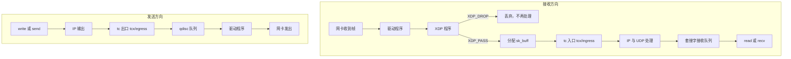

# B.12 网络应用：XDP 与 tc

在面向高并发或公网暴露的服务架构中，网络层面的异常流量冲击是极为普遍的挑战。假设某个对外服务的 UDP 端口正遭受恶意扫描或垃圾报文的洪水灌包，若仅仅在用户态应用程序中通过套接字进行报文过滤，防护效率往往已经大打折扣：物理网卡接收到以太网帧后触发硬中断，驱动程序为其分配内核内存并封装为重量级的 `sk_buff` 结构体，随后报文穿越内核协议栈的 IP 校验、路由决策、UDP 端口解复用等一系列复杂流程，最终被塞入目标套接字的接收队列。直到应用程序调用 `recvfrom()` 或 `read()` 将其拷入用户空间，才判定该数据无用并直接抛弃。整条链路中消耗的大量内存分配、CPU 缓存与中断调度开销全部化为泡影；当突发流量达到百万包每秒（Mpps）量级时，往往尚未抵达用户态，操作系统内核自身就已因处理协议栈开销而陷入死锁或严重丢包。

eBPF 在 Linux 网络子系统中构建了两道前置防线：XDP（eXpress Data Path，快速数据路径）与 tc（Traffic Control，流量控制）。XDP 紧贴网卡驱动层，在物理网卡刚接收到以太网帧、内核尚未为其分配 `sk_buff` 的极早阶段便切入执行；tc 则驻守在内核网络协议栈的边缘（涵盖 ingress 入站与 egress 出站两端），处理已经封装完备的 `sk_buff`。本章将系统解析两类探针在收发包流水线上的位置，从最基础的放行动作入手，探讨严格受验证器约束的数据包边界指针推导、以太网与 IPv4/UDP 协议头的多级解包逻辑，继而实现基于回环网卡的按协议统计与动态端口丢弃工具，最后介绍基于新版 BPF link 机制的 tcx 编程范式以及摆脱物理网卡依赖的 `BPF_PROG_TEST_RUN` 自动化测试方案。

阅读本篇内容建议结合 [B.10 程序类型与附加类型](/教程/正文/系统编程/拓展B_eBPF/B_10_程序类型与附加类型) 中对 SEC 节名称映射的梳理，以及 [B.9 验证器](/教程/正文/系统编程/拓展B_eBPF/B_9_验证器) 中关于指针类型收窄的规则。文中涉及的基础帧格式已在 [9.1 ISO 七层模型](/教程/正文/系统编程/9_网络基础/9_1_ISO七层模型)、[9.2 TCP](/教程/正文/系统编程/9_网络基础/9_2_TCP) 与 [9.3 UDP](/教程/正文/系统编程/9_网络基础/9_3_UDP) 中建立，套接字层面的收发原理可参考[第 10 章 套接字编程](/教程/正文/系统编程/10_套接字编程)。

## 1. 报文经过哪里

一个帧从网线进来，到应用调 `read` 读走，中间要过几道关卡，XDP 和 tc 各占其中一道。



XDP 的位置最早。驱动模式下，它在驱动收到完整帧之后、内核为这个帧分配 `sk_buff` 之前运行，程序手里只有一个指向帧缓冲区的指针和它的结束位置。丢包在这里最便宜：内存没有分配，协议栈没有走，套接字也不存在。代价是 XDP 只处理接收方向，看到的是链路层原始帧，没有 `sk_buff` 里那些已经解析好的元数据。

tc 的入口钩子在协议栈处理之前，出口钩子在报文交给 qdisc 之前。tc 程序拿到的是 `sk_buff`：里面有报文本身，还有协议类型、`mark`、优先级、收发网卡这些字段。它两个方向都能工作，能改报文，也能给报文打上标记交给后面的规则。

| | XDP | tc |
| --- | --- | --- |
| 位置 | 驱动收到帧之后、分配 `sk_buff` 之前 | 协议栈之前（入口）或交给 qdisc 之前（出口） |
| 方向 | 只有接收 | 接收与发送 |
| 上下文 | `struct xdp_md`，指向帧首字节 | `struct __sk_buff`，报文加元数据 |
| 主要动作 | 丢弃、回送、重定向、改报文头 | 丢弃、重定向、改报文、设置 `mark` 与优先级 |
| 开销 | 最低 | 低于协议栈，高于 XDP |

::: concept sys-ebpf-xdp-tc-position title="两个钩子各看到什么"

驱动模式的 XDP 程序在 `sk_buff` 分配之前运行，只处理接收方向，看到的是从以太网头开始的原始帧。tc 程序在 `sk_buff` 上运行，接收和发送两个方向都能挂，可以看到并修改 `sk_buff` 里的元数据。

:::

在架构设计与技术选型中，两者的分工边界极为清晰：凡是纯粹的无状态丢包、DDoS 防御或极早期的四层直接路由转发，应当尽可能下沉至 XDP，处理时机越早，系统所节省的协议栈开销便越显著；而若业务需要修改数据包的元数据标签（如标记 `mark` 或修改服务质量 `priority`）、需要将报文重组后交由上层连接跟踪（conntrack）处理、或者需要精细调控出站（egress）流量，则应当依托 tc 框架。两者的根本裁决基准，在于业务逻辑是否依赖于 `sk_buff` 结构体中所承载的高阶协议栈元数据。

### 1.1 三种 XDP 模式

XDP 程序可以以三种方式运行，差别在于挂在哪一层。

驱动模式（native mode，也叫 DRV 模式）由网卡驱动在收到帧之后直接调用程序，要求驱动实现 `ndo_bpf`。这是通常说的 XDP，开销最低。

通用模式（generic mode，也叫 SKB 模式）在协议栈入口、已经分配好 `sk_buff` 之后运行。任何网卡都能用，但省不掉内存分配，也就失去了 XDP 的主要优势。`lo` 就是这种情况：环回设备没有实现 `ndo_bpf`，只能以通用模式附加。

卸载模式（offload mode，HW 模式）把程序编译进网卡固件，在网卡上运行，需要驱动和硬件同时支持，能用的功能是三者中最少的。

附加时如果既不指定模式，内核会按设备能力选一个：有 `ndo_bpf` 用驱动模式，没有就用通用模式。所以后面在 `lo` 上附加时不需要额外指定 `xdpgeneric`，内核自然会选通用模式。

## 2. 第一个 XDP 程序

XDP 程序的上下文是 `struct xdp_md`，在 `vmlinux.h` 里定义如下：

```c
struct xdp_md {
    __u32 data;
    __u32 data_end;
    __u32 data_meta;
    __u32 ingress_ifindex;
    __u32 rx_queue_index;
    __u32 egress_ifindex;
};
```

前三个字段在结构体里声明成 `__u32`，它们存的却是地址，只是 32 位放不下，验证器在加载时把对这些字段的访问改写成 64 位指针，并标记成数据包指针类型。所以程序里统一写成 `(void *)(long)ctx->data`，先转成 `long` 再转指针，让编译器不做有符号扩展。

`data` 指向帧的第一个字节，也就是以太网头；`data_end` 指向帧尾之后的第一个字节；`data_meta` 默认等于 `data`，用 `bpf_xdp_adjust_meta` 可以往前扩出一段元数据区。`ingress_ifindex` 是收到这个帧的网卡索引。

XDP 程序的返回值决定内核对这个帧做什么。

| 返回值 | 数值 | 含义 |
| --- | --- | --- |
| `XDP_ABORTED` | 0 | 程序出错，丢弃并记录一次异常，只用于调试 |
| `XDP_DROP` | 1 | 立即丢弃 |
| `XDP_PASS` | 2 | 交给协议栈继续处理 |
| `XDP_TX` | 3 | 从收到这个帧的网卡原路发回去 |
| `XDP_REDIRECT` | 4 | 重定向到别的网卡或 map，需要配合重定向辅助函数 |

数值来自 `vmlinux.h` 里的 `enum xdp_action`。返回值超出这个范围时，内核打出警告并按丢弃处理。

最小的 XDP 程序什么也不做，只放行：

```c
#include "vmlinux.h"

#include <bpf/bpf_helpers.h>

char __license[] SEC("license") = "Dual BSD/GPL";

SEC("xdp")
int xdp_pass(struct xdp_md *ctx) {
    return XDP_PASS;
}
```

用本章统一的命令编译，再看它的字节码：

::: terminal title="bash - xdp_pass"

```text
$ clang -g -O2 -target bpf -mcpu=v3 -D__TARGET_ARCH_x86 -I. -c xdp_pass.bpf.c -o xdp_pass.bpf.o
$ llvm-objdump -d xdp_pass.bpf.o

xdp_pass.bpf.o:	file format elf64-bpf

Disassembly of section xdp:

0000000000000000 <xdp_pass>:
       0:	b4 00 00 00 02 00 00 00	w0 = 0x2
       1:	95 00 00 00 00 00 00 00	exit
```

:::

两条指令：把 2 放进返回值寄存器 R0，然后退出。`XDP_PASS` 的数值就是 2，`ctx` 一次都没用到。xdp-tutorial 的 basic01 里有一份同样的程序，反汇编也是这两行。

::: tip `-mcpu=v3` 不能省

LLVM 20 起默认按 v3 生成指令，clang 19 默认还是 v1。显式写出 `-mcpu=v3`，不同版本的编译器才会生成相同的指令。理由见 [B.4 程序的解剖：受限的 C](/教程/正文/系统编程/拓展B_eBPF/B_4_程序的解剖_受限的C)。

:::

<Quiz
  type="single"
  :options="[
    { label: '从以太网头开始', value: 'A' },
    { label: '从 IP 头开始', value: 'B' },
    { label: '从 UDP 头开始', value: 'C' },
    { label: '从套接字缓冲区里已经解析好的元数据开始', value: 'D' }
  ]"
  answer="A"
>

<template #question>

XDP 程序拿到的 `data` 指向哪里？

</template>

正确答案是 **A**。`ctx->data` 指向帧的第一个字节，即以太网头的起始位置。IP 头与 UDP 头均需程序根据各层头部长度逐步向后寻址，因此在读取每一层协议头之前，都必须显式比对当前指针是否超出了 `data_end` 的安全范围。

</Quiz>

## 3. 解析报文

要按端口丢弃 UDP 报文，得先从帧里找到 IP 头，再从 IP 头找到 UDP 头。这两步都有陷阱：帧可能比期望的短，IP 头也可能比 20 字节长。

### 3.1 逐层解析

Linux 的 `struct ethhdr`、`struct iphdr`、`struct udphdr` 在 `vmlinux.h` 里都有定义，字段顺序和网络传输顺序一致：

```c
struct ethhdr {
    unsigned char h_dest[6];
    unsigned char h_source[6];
    __be16 h_proto;
};

struct iphdr {
    __u8 ihl : 4;
    __u8 version : 4;
    __u8 tos;
    __be16 tot_len;
    __be16 id;
    __be16 frag_off;
    __u8 ttl;
    __u8 protocol;
    __sum16 check;
    __be32 saddr;
    __be32 daddr;
};
```

`ethhdr` 占 14 字节。`iphdr` 的固定部分占 20 字节，首字节低 4 位是首部长度 `ihl`，单位是 4 字节；`ihl` 为 5 表示首部就是 20 字节，大于 5 表示后面还有选项。所以传输层头的偏移是 `14 + ihl * 4`，不能用 `sizeof(struct iphdr)` 算。

每访问一层之前，都要先确认这一层完整地落在帧里。写法是拿「这一层结束的位置」和 `data_end` 比：

```c
struct ethhdr *eth = data;

if ((void *)(eth + 1) > data_end) {
    return XDP_PASS;
}
```

`eth + 1` 是指针算术，结果是 `eth` 往后一个 `ethhdr`，也就是帧的第 14 字节。把它和 `data_end` 比较，验证器据此知道后面的 `eth->h_proto` 读取在界内。IP 头同理。

::: concept sys-ebpf-xdp-bounds title="访问报文前必须与 data_end 比较"

XDP 与 tc 程序可以直接读写 `data` 到 `data_end` 之间的报文，验证器不会在运行时替每一次访问做检查。它要求程序自己做边界检查：对某个指针先与 `data_end` 比较，验证器才把这段范围记为可访问。比较的方向和写法决定了范围信息往哪个分支传递，没被证明的分支里访问报文会让加载失败。

:::

::: generate sys-ebpf-xdp-bounds-walkthrough kind=explanation concepts=sys-ebpf-xdp-bounds

面向第一次写报文解析的读者，以以太网头和 IP 头为例逐步解释 `(void *)(eth + 1) > data_end` 这个比较为什么能证明后面的读取安全：先说明指针算术加的是整块结构体的大小，再说明验证器如何在真分支与假分支上分别记录可访问范围，最后说明为什么比较必须写成大于，写成大于等于会怎样。

:::

### 3.2 写错了会怎样

把边界检查去掉，编译不会报错，验证器会拒绝加载。下面这份程序只是想读 IP 头的 `protocol` 字段：

```c
SEC("xdp")
int xdp_no_check(struct xdp_md *ctx) {
    void *data = (void *)(long)ctx->data;
    struct iphdr *ip = (struct iphdr *)((char *)data + 14);

    if (ip->protocol == 17) {
        return XDP_DROP;
    }
    return XDP_PASS;
}
```

编译成目标文件只有几条指令，看不出问题：

::: terminal title="bash - llvm-objdump -d"

```text
xdp_no_check.bpf.o:	file format elf64-bpf

Disassembly of section xdp:

0000000000000000 <xdp_no_check>:
       0:	61 11 00 00 00 00 00 00	r1 = *(u32 *)(r1 + 0x0)
       1:	b7 02 00 00 09 00 00 00	r2 = 0x9
       2:	0f 21 00 00 00 00 00 00	r1 += r2
       3:	71 11 0e 00 00 00 00 00	r1 = *(u8 *)(r1 + 0xe)
       4:	b4 00 00 00 01 00 00 00	w0 = 0x1
       5:	16 01 01 00 11 00 00 00	if w1 == 0x11 goto +0x1 <LBB0_2>
       6:	b4 00 00 00 02 00 00 00	w0 = 0x2

0000000000000038 <LBB0_2>:
       7:	95 00 00 00 00 00 00 00	exit
```

:::

`r1` 拿到 `ctx->data` 之后，先加到偏移 23（`0x9 + 0xe`），再从那里读一个字节。这两步合起来就是从帧首偏移 23 处读 IP 头的 `protocol` 字段（14 + 9）。验证器看到这条读取时，`r1` 虽然还是 `PTR_TO_PACKET` 类型，可访问范围却是零，于是拒绝加载。

::: compare left-title="缺边界检查（验证器拒绝）" right-title="先比较再访问"

```c
struct iphdr *ip = (struct iphdr *)((char *)data + 14);

if (ip->protocol == 17) {
    return XDP_DROP;
}
```

---

```c
struct ethhdr *eth = data;
struct iphdr *ip;

if ((void *)(eth + 1) > data_end) {
    return XDP_PASS;
}
ip = (struct iphdr *)(eth + 1);

if ((void *)(ip + 1) > data_end) {
    return XDP_PASS;
}
if (ip->protocol == 17) {
    return XDP_DROP;
}
```

:::

被拒绝时的日志里会出现 `invalid access to packet` 这一句。内核文档 `Documentation/bpf/verifier.rst` 在「直连数据包访问」一节说明，对报文指针做比较之后才能读取；内核源码 `kernel/bpf/verifier.c` 里这条报错的格式串是：

```c
"invalid access to packet, off=%d size=%d, R%d(id=%d,off=%d,r=%d)\n"
```

最后一项 `r` 是可访问范围的字节数。这里一次边界检查都没做，`r` 为 0，报错里就会写成 `r=0`。日志的完整读法见 B.9。

### 3.3 在用户态验证偏移计算

内核里的偏移算错了，程序要么被验证器拒绝，要么在真机上表现成「报文被莫名丢弃」，两种都难查。把同一套解析逻辑抄到普通 C 程序里，用手工构造的帧跑一遍，偏移对不对一眼就能看出来。`code/系统编程/拓展B_eBPF/B_12_网络应用_XDP与tc/parse_test.c` 就是这样一份程序：它拼出两帧，第一帧的 IP 头 20 字节，第二帧带 4 字节选项，分别打印每一层的偏移和最终的返回值。

程序不打开套接字，不碰网络，只用 `printf`。核心的解析函数和内核态程序结构一样：

```c
static int parse_frame(const uint8_t *buf, size_t len, uint16_t drop_port) {
    const void *data = buf;
    const void *data_end = buf + len;
    const struct ethhdr *eth = data;
    const struct iphdr *ip;
    const struct udphdr *udp;

    if ((const void *)(eth + 1) > data_end) {
        return 2; /* XDP_PASS */
    }
    /* 打印各层信息，省略 */
    if (get_be16((const uint8_t *)&eth->h_proto) != ETH_P_IP) {
        return 2;
    }

    ip = (const struct iphdr *)(eth + 1);
    if ((const void *)(ip + 1) > data_end) {
        return 2;
    }
    /* ... */
    udp = (const struct udphdr *)((const uint8_t *)ip + ip->ihl * 4);
    if ((const void *)udp + sizeof(*udp) > data_end) {
        return 2;
    }
    if (get_be16((const uint8_t *)&udp->dest) == drop_port) {
        return 1; /* XDP_DROP */
    }
    return 2;
}
```

在 SignalX 上编译运行，输出如下：

::: terminal title="bash - parse_test"

```text
$ gcc -std=c17 -Wall -Wextra -O2 parse_test.c -o parse_test
$ ./parse_test
第一帧：20 字节的 IPv4 头，目的端口 20001
  帧长 46 字节
  以太网：h_proto = 0x0800
  以太网头长度 14 字节，IPv4 头从偏移 14 开始
  IPv4：version = 4，ihl = 5，头长 20 字节，protocol = 17，tot_len = 32
  传输层头从偏移 34 开始（14 + 5 × 4）
  UDP：源端口 40000，目的端口 20001，长度 12
  目的端口等于 20001，返回 XDP_DROP
  返回值：1

第二帧：带 4 字节选项的 IPv4 头（ihl = 6），目的端口 20002
  帧长 50 字节
  以太网：h_proto = 0x0800
  以太网头长度 14 字节，IPv4 头从偏移 14 开始
  IPv4：version = 4，ihl = 6，头长 24 字节，protocol = 17，tot_len = 36
  传输层头从偏移 38 开始（14 + 6 × 4）
  UDP：源端口 40000，目的端口 20002，长度 12
  目的端口不等于 20001，返回 XDP_PASS
  返回值：2
```

:::

第二帧说明了为什么不能用固定的 34。带选项时 UDP 头从 38 开始，按 34 去读会读进选项字段，把选项里的字节当成端口号。

端口字段是网络字节序，内核态程序里不能直接和 20001 这样的整数比较，要用 `bpf_ntohs` 先转成主机字节序：

```c
if (bpf_ntohs(udp->dest) == drop_port) {
    return XDP_DROP;
}
```

`bpf_ntohs` 定义在 `bpf/bpf_endian.h`，在 BPF 目标下编译成一条 `be16` 转换指令。少了这一步，比较的是字节交换过的值：20001 是 `0x4E21`，报文里按高字节在前存放，小端机器上按 `uint16_t` 读出来是 `0x214E`，和 20001 不相等。

`parse_test.c` 跑在用户态，用的是自己的 `get_be16`，做的事和 `bpf_ntohs` 一样，只是用户态没有 `bpf_endian.h`。

<Quiz
  type="single"
  :options="[
    { label: '32', value: 'A' },
    { label: '34', value: 'B' },
    { label: '14 + ihl × 4', value: 'C' },
    { label: '14 + sizeof(struct iphdr)', value: 'D' }
  ]"
  answer="C"
>

<template #question>

IPv4 帧里，UDP 头从帧首算起的偏移是多少？

</template>

正确答案是 **C**。以太网头固定 14 字节，IP 头长度由 `ihl` 决定，单位是 4 字节。直接写 34 只在 `ihl` 为 5 时成立，带选项的报文会解析错误；`sizeof(struct iphdr)` 永远是 20，同样不对。

</Quiz>

## 4. 示例：按协议计数并丢弃指定端口

把前面的部分拼起来，做一个能用的工具：在网卡上统计各协议的报文数，把目的端口等于指定值的 UDP 报文丢掉。完整的两个文件都在 `code/系统编程/拓展B_eBPF/B_12_网络应用_XDP与tc/`，内核态是 `xdp_count.bpf.c`，用户态是 `xdp_count.c`。同目录还有 `Makefile`，`make` 会依次生成 `vmlinux.h`、编译 `.bpf.o`、用 bpftool 生成骨架、再链接三个用户态程序；只想编译内核态时用 `make objects`。

### 4.1 内核态程序

计数用每 CPU 数组 map（per-CPU array map），键是 IP 协议号。每个 CPU 有自己的一份值，不需要原子操作，用户态汇总时再把各 CPU 的值加起来。

```c
struct {
    __uint(type, BPF_MAP_TYPE_PERCPU_ARRAY);
    __uint(max_entries, 256);
    __type(key, __u32);
    __type(value, __u64);
} proto_count SEC(".maps");

const volatile __u32 drop_port = 20001;
```

协议号是 8 位，所以 `max_entries` 取 256。`const volatile` 让 `drop_port` 在加载前由用户态写进 `.rodata`，加载后验证器把它当常量，能据此消掉死代码；全局对象的用法见 [B.6 Map：内核态与用户态的数据交换](/教程/正文/系统编程/拓展B_eBPF/B_6_Map与数据交换)。默认值 20001 是本文示例约定的测试端口。文件顶上的 `#define ETH_P_IP 0x0800` 也是必需的：`vmlinux.h` 里有 `IPPROTO_UDP`，却没有以太网类型常量。

主程序按顺序做四件事：检查以太网头、检查 IPv4、按协议号计数、检查 UDP 端口：

```c
SEC("xdp")
int xdp_count_proto(struct xdp_md *ctx) {
    void *data_end = (void *)(long)ctx->data_end;
    void *data = (void *)(long)ctx->data;
    struct ethhdr *eth = data;
    struct iphdr *ip;
    struct udphdr *udp;
    __u32 key;
    __u64 *count;

    if ((void *)(eth + 1) > data_end) {
        return XDP_PASS;
    }
    if (eth->h_proto != bpf_htons(ETH_P_IP)) {
        return XDP_PASS;
    }

    ip = (struct iphdr *)(eth + 1);
    if ((void *)(ip + 1) > data_end) {
        return XDP_PASS;
    }
    if (ip->ihl < 5) {
        return XDP_PASS;
    }

    key = ip->protocol;
    count = bpf_map_lookup_elem(&proto_count, &key);
    if (count != NULL) {
        *count += 1;
    }

    if (ip->protocol != IPPROTO_UDP) {
        return XDP_PASS;
    }

    udp = (struct udphdr *)((char *)ip + ip->ihl * 4);
    if ((void *)(udp + 1) > data_end) {
        return XDP_PASS;
    }
    if (bpf_ntohs(udp->dest) == drop_port) {
        return XDP_DROP;
    }
    return XDP_PASS;
}
```

`ihl < 5` 的检查不能省。`ihl` 是 4 位字段，最小可以为 0，这时 `ip + ihl * 4` 会退回 IP 头内部，`udp` 指向的是 IP 头自己的字节，边界检查照样能通过，读出来的端口毫无意义。加上这个下限，`ihl * 4` 至少是 20，UDP 头一定在 IP 头之后。

::: tip 为什么每 CPU 计数不写成 `atomic_add`

每 CPU 数组 map 为每个 CPU 准备一份独立的存储，同一个键在不同 CPU 上的值互不相干。程序运行时不会被同一 CPU 上的其他实例打断，所以 `*count += 1` 在本 CPU 上是安全的。用户态一次读回所有 CPU 的值求和即可，汇总代码放在下面。

:::

`bpf_map_lookup_elem` 的返回值仍然要判空。数组 map 的键小于 `max_entries` 时，运行时查找不会失败，但验证器不知道键一定在范围内，返回类型仍是「值指针或空」（`PTR_TO_MAP_VALUE_OR_NULL`），不判空就解引用会被拒绝，见 B.9。反汇编里 `call 0x1` 之后的 `if r0 == 0x0` 就是这个判空。

编译后看反汇编，能确认边界检查都变成了真实的比较指令：

::: terminal title="bash - llvm-objdump -S"

```text
$ llvm-objdump -S xdp_count.bpf.o    # 节选

xdp_count.bpf.o:	file format elf64-bpf

Disassembly of section xdp:

0000000000000000 <xdp_count_proto>:
; int xdp_count_proto(struct xdp_md *ctx) {
       0:	b4 00 00 00 02 00 00 00	w0 = 0x2
;     void *data_end = (void *)(long)ctx->data_end;
       1:	61 16 04 00 00 00 00 00	r6 = *(u32 *)(r1 + 0x4)
;     void *data = (void *)(long)ctx->data;
       2:	61 11 00 00 00 00 00 00	r1 = *(u32 *)(r1 + 0x0)
;     if ((void *)(eth + 1) > data_end) {
       3:	bf 17 00 00 00 00 00 00	r7 = r1
       4:	07 07 00 00 0e 00 00 00	r7 += 0xe
       5:	2d 67 24 00 00 00 00 00	if r7 > r6 goto +0x24 <LBB0_10>
;     if (eth->h_proto != bpf_htons(ETH_P_IP)) {
       6:	69 12 0c 00 00 00 00 00	r2 = *(u16 *)(r1 + 0xc)
       7:	56 02 22 00 08 00 00 00	if w2 != 0x8 goto +0x22 <LBB0_10>
       8:	07 01 00 00 22 00 00 00	r1 += 0x22
;     if (eth->h_proto != bpf_htons(ETH_P_IP)) {
       9:	2d 61 20 00 00 00 00 00	if r1 > r6 goto +0x20 <LBB0_10>
;     if (ip->ihl < 5) {
      10:	71 71 00 00 00 00 00 00	r1 = *(u8 *)(r7 + 0x0)
      11:	54 01 00 00 0f 00 00 00	w1 &= 0xf
      12:	a6 01 1d 00 05 00 00 00	if w1 < 0x5 goto +0x1d <LBB0_10>
```

:::

第 4 条 `r7 += 0xe` 就是以太网头的 14 字节，第 5 条比较的是「帧首 + 14」和 `data_end`。第 8 条的 `r1 += 0x22` 是「帧首 + 34」，正好是 14 + 20，对应 `ip + 1`。第 11 条 `w1 &= 0xf` 取出 `ihl` 的低 4 位，第 12 条与 5 比较。

LLVM 给第 9 条标的源码行是上一行的 `eth->h_proto` 检查，实际对应的是 `(ip + 1) > data_end`。源码注释和指令对不上，读反汇编时以指令为准。

::: details 完整的反汇编

```text
$ llvm-objdump -d xdp_count.bpf.o

Disassembly of section xdp:

0000000000000000 <xdp_count_proto>:
       0:	b4 00 00 00 02 00 00 00	w0 = 0x2
       1:	61 16 04 00 00 00 00 00	r6 = *(u32 *)(r1 + 0x4)
       2:	61 11 00 00 00 00 00 00	r1 = *(u32 *)(r1 + 0x0)
       3:	bf 17 00 00 00 00 00 00	r7 = r1
       4:	07 07 00 00 0e 00 00 00	r7 += 0xe
       5:	2d 67 24 00 00 00 00 00	if r7 > r6 goto +0x24 <LBB0_10>
       6:	69 12 0c 00 00 00 00 00	r2 = *(u16 *)(r1 + 0xc)
       7:	56 02 22 00 08 00 00 00	if w2 != 0x8 goto +0x22 <LBB0_10>
       8:	07 01 00 00 22 00 00 00	r1 += 0x22
       9:	2d 61 20 00 00 00 00 00	if r1 > r6 goto +0x20 <LBB0_10>
      10:	71 71 00 00 00 00 00 00	r1 = *(u8 *)(r7 + 0x0)
      11:	54 01 00 00 0f 00 00 00	w1 &= 0xf
      12:	a6 01 1d 00 05 00 00 00	if w1 < 0x5 goto +0x1d <LBB0_10>
      13:	71 71 09 00 00 00 00 00	r1 = *(u8 *)(r7 + 0x9)
      14:	63 1a fc ff 00 00 00 00	*(u32 *)(r10 - 0x4) = r1
      15:	bf a2 00 00 00 00 00 00	r2 = r10
      16:	07 02 00 00 fc ff ff ff	r2 += -0x4
      17:	18 01 00 00 00 00 00 00 00 00 00 00 00 00 00 00	r1 = 0x0 ll
      19:	85 00 00 00 01 00 00 00	call 0x1
      20:	15 00 03 00 00 00 00 00	if r0 == 0x0 goto +0x3 <LBB0_6>
      21:	79 01 00 00 00 00 00 00	r1 = *(u64 *)(r0 + 0x0)
      22:	07 01 00 00 01 00 00 00	r1 += 0x1
      23:	7b 10 00 00 00 00 00 00	*(u64 *)(r0 + 0x0) = r1

00000000000000c0 <LBB0_6>:
      24:	71 71 09 00 00 00 00 00	r1 = *(u8 *)(r7 + 0x9)
      25:	b4 00 00 00 02 00 00 00	w0 = 0x2
      26:	56 01 0f 00 11 00 00 00	if w1 != 0x11 goto +0xf <LBB0_10>
      27:	71 71 00 00 00 00 00 00	r1 = *(u8 *)(r7 + 0x0)
      28:	64 01 00 00 02 00 00 00	w1 <<= 0x2
      29:	57 01 00 00 3c 00 00 00	r1 &= 0x3c
      30:	0f 17 00 00 00 00 00 00	r7 += r1
      31:	bf 71 00 00 00 00 00 00	r1 = r7
      32:	07 01 00 00 08 00 00 00	r1 += 0x8
      33:	2d 61 08 00 00 00 00 00	if r1 > r6 goto +0x8 <LBB0_10>
      34:	69 71 02 00 00 00 00 00	r1 = *(u16 *)(r7 + 0x2)
      35:	dc 01 00 00 10 00 00 00	r1 = be16 r1
      36:	18 02 00 00 00 00 00 00 00 00 00 00 00 00 00 00	r2 = 0x0 ll
      38:	61 22 00 00 00 00 00 00	r2 = *(u32 *)(r2 + 0x0)
      39:	b4 00 00 00 01 00 00 00	w0 = 0x1
      40:	1e 12 01 00 00 00 00 00	if w2 == w1 goto +0x1 <LBB0_10>
      41:	b4 00 00 00 02 00 00 00	w0 = 0x2

0000000000000150 <LBB0_10>:
      42:	95 00 00 00 00 00 00 00	exit
```

:::

第 19 条 `call 0x1` 是 `bpf_map_lookup_elem`，辅助函数编号 1。第 28～30 条把 `ihl` 左移 2 位（即乘 4）并掩掉高 4 位，然后加到 `r7`（IP 头地址）上得到 UDP 头地址。第 35 条的 `be16` 就是 `bpf_ntohs`。第 36、38 条加载的是 `.rodata` 里的 `drop_port`，重定位后在加载时填入实际值。

### 4.2 用户态加载程序

用户态用骨架的四步，附加时把网卡索引交给 `bpf_program__attach_xdp`。它创建一个 XDP 类型的 BPF link，返回的 link 句柄在销毁时自动卸载：

```c
skel = xdp_count_bpf__open();
skel->rodata->drop_port = drop_port;
err = xdp_count_bpf__load(skel);
/* ... */
int ifindex = (int)if_nametoindex(ifname);
link = bpf_program__attach_xdp(skel->progs.xdp_count_proto, ifindex);
```

`SEC("xdp")` 在 libbpf 里标成「可附加」但没带附加函数，骨架的 `attach` 会跳过它，因为目标网卡不在程序里。这一点在 [B.10](/教程/正文/系统编程/拓展B_eBPF/B_10_程序类型与附加类型) 讲过，这里的 `bpf_program__attach_xdp` 就是补上目标的那一步。函数原型是：

```c
struct bpf_link *bpf_program__attach_xdp(const struct bpf_program *prog,
                                         int ifindex);
```

不指定模式标志时，内核按设备能力决定：`lo` 没有 `ndo_bpf`，自动落到通用模式。

计数 map 是每 CPU 的，用户态查找时缓冲区的大小必须是「CPU 数 × 值大小」，libbpf 提供 `libbpf_num_possible_cpus()` 取这个数。汇总时把每个 CPU 的值加起来：

```c
static void print_counts(struct xdp_count_bpf *skel,
                         unsigned long long *values, int nr_cpus) {
    int fd = bpf_map__fd(skel->maps.proto_count);

    for (unsigned int proto = 0; proto < 256; proto++) {
        unsigned long long total = 0;

        if (bpf_map_lookup_elem(fd, &proto, values) != 0) {
            continue;
        }
        for (int i = 0; i < nr_cpus; i++) {
            total += values[i];
        }
        if (total != 0) {
            printf("  协议 %u（%s）：%llu 个报文\n", proto, proto_name(proto),
                   total);
        }
    }
    fflush(stdout);
}
```

退出用 `sigaction` 加 `volatile sig_atomic_t` 标志，与[第 6 章](/教程/正文/系统编程/6_信号_时间与定时器)的做法一致。主循环每秒调一次 `print_counts`，标志置位后跳出循环，`bpf_link__destroy` 关闭 link，程序随之从网卡上卸下。

用户态程序做过语法检查：在 SignalX 上用 bpftool 生成骨架，再用 `gcc -fsyntax-only` 编译，没有警告：

::: terminal title="bash - SignalX"

```text
$ bpftool gen skeleton xdp_count.bpf.o > xdp_count.skel.h
$ gcc -std=c17 -Wall -Wextra -fsyntax-only -I inc \
      -I /home/minsecrus/tutorial/tools/libbpf/include/uapi -I . xdp_count.c
$ echo $?
0
```

:::

骨架里生成的 `struct xdp_count_bpf` 会带上 map、程序和 rodata 三组成员，`skel->rodata->drop_port` 就来自最后一组：

```c
struct xdp_count_bpf {
    struct bpf_object_skeleton *skeleton;
    struct bpf_object *obj;
    struct {
        struct bpf_map *proto_count;
        struct bpf_map *rodata;
    } maps;
    struct {
        struct bpf_program *xdp_count_proto;
    } progs;
    struct {
        struct bpf_link *xdp_count_proto;
    } links;
    struct xdp_count_bpf__rodata {
        __u32 drop_port;
    } *rodata;
    /* ... */
};
```

### 4.3 运行与观察

在 `lo` 上附加，程序会打印一行确认信息，然后每秒把非零的协议计数打出来。计数的具体数值取决于测试时机器上跑了什么，这里不贴固定输出；能确定的是三条：

1. `ping 127.0.0.1` 产生的 ICMP 报文计入协议 1，一个请求加一个应答各算一次；
2. `nc -u` 往 20001 端口发的 UDP 报文计入协议 17，然后返回 `XDP_DROP`，报文在协议栈看到之前就消失了，接收端什么也收不到；
3. 换到 20002 端口，报文放行，协议 17 的计数继续增加。

用 `nc` 验证两个端口的差别：

::: terminal title="bash - 两个端口"

```text
$ ping -c 2 127.0.0.1
PING 127.0.0.1 (127.0.0.1) 56(84) bytes of data.
64 bytes from 127.0.0.1: icmp_seq=1 ttl=64 time=0.036 ms
64 bytes from 127.0.0.1: icmp_seq=2 ttl=64 time=0.037 ms

$ echo hello | nc -u -w1 127.0.0.1 20002
$ echo hello | nc -u -w1 127.0.0.1 20001
```

:::

20002 那一行发出去之后，接收端的套接字队列里会多一条数据报；20001 那一行发出去之后队列不变，因为报文在 XDP 里就被丢掉了。要看到队列长度的变化，可以在接收端用 `ss -uan` 或 `netstat -uan` 观察 `Recv-Q` 一列。

另一个终端用 `ip link show` 可以看到附加状态。输出类似（摘自 xdp-tutorial basic01 的 README，程序名与 ID 是那份文档里的示例值）：

::: terminal title="bash - ip link show lo"

```text
$ ip link show dev lo
1: lo: <LOOPBACK,UP,LOWER_UP> mtu 65536 xdpgeneric qdisc noqueue state UNKNOWN mode DEFAULT group default qlen 1000
    link/loopback 00:00:00:00:00:00 brd 00:00:00:00:00:00
    prog/xdp id 408 name xdp_prog_simple tag 3b185187f1855c4c jited
```

:::

`xdpgeneric` 表明是通用模式，后面的 `prog/xdp` 一行给出程序 ID 和名字。不加 `sudo` 只能看到 `prog/xdp id 408`，看不到程序名和 tag。

不用自己写加载程序时，也可以用 iproute2 或 xdp-tools 直接附加。`ip` 的命令是：

::: terminal title="bash - ip link set"

```text
$ sudo ip link set dev lo xdpgeneric obj xdp_count.bpf.o sec xdp
$ sudo ip link set dev lo xdpgeneric off
```

:::

`xdpgeneric` 显式指定通用模式，最后一条命令卸载。`xdp-loader` 的写法是（下面的状态输出摘自 xdp-tutorial basic01，它加载的是那份教程自己的程序，所以名字是 `xdp_prog_simple`）：

::: terminal title="bash - xdp-loader"

```text
$ sudo xdp-loader load -m skb lo xdp_count.bpf.o
$ sudo xdp-loader status lo
CURRENT XDP PROGRAM STATUS:

Interface        Prio  Program name      Mode     ID   Tag               Chain actions

lo                     xdp_dispatcher    skb      486  94d5f00c20184d17
 =>              50     xdp_prog_simple           493  3b185187f1855c4c  XDP_PASS
```

:::

`xdp-loader` 默认用多程序分发（multi-dispatch），所以列表里先有一个 `xdp_dispatcher`，自己的程序挂在它下面。iproute2 没有实现多程序分发，直接附加到网卡上，两者不要混用。

::: warning 加载前确认网卡上没有别的 XDP 程序

同一张网卡、同一个模式下只能附加一个 XDP link 或一个程序。已经有一个用 netlink 附加的程序时，再附加 BPF link 会返回 `EBUSY`，内核给出的说明是「Can't replace active XDP program with BPF link」。练习时先在 `ip link show` 里确认没有残留的 `prog/xdp`，卸载干净再附加。

:::

<Quiz
  type="multi"
  :options="[
    { label: 'XDP 在接收路径上比 tc 更早', value: 'A' },
    { label: 'XDP 只能处理接收方向，tc 两个方向都能挂', value: 'B' },
    { label: 'XDP 能直接修改 __sk_buff 里的 mark 字段', value: 'C' },
    { label: 'tc 拿到的是 sk_buff，能看到协议类型和元数据', value: 'D' }
  ]"
  :answer="['A', 'B', 'D']"
>

<template #question>

关于 XDP 与 tc 的区别，下列说法正确的是哪些？

</template>

正确答案是 **A、B、D**。C 错在 XDP 的上下文是 `struct xdp_md`，里面没有 `mark` 字段；那是 `struct __sk_buff` 才有的。要在报文上打标记，得用 tc。

</Quiz>

## 5. tc 与 tcx

tc 是比 XDP 更早进入内核的网络钩子，原本负责队列调度和分类。把 eBPF 挂到 tc 上有两种方式：旧的方式经 netlink 附加到 clsact qdisc 的过滤器上，新的方式叫 tcx，通过 BPF link 附加，内核 6.6 起提供。

### 5.1 clsact 与 direct-action

旧写法要先给网卡建一个 `clsact` qdisc，再在这个 qdisc 上挂过滤器。`clsact` 同时提供入口和出口两个挂载点，分别用 `ffff:fff2` 和 `ffff:fff3` 表示。挂在 qdisc 上的程序用的是另一套节名和返回值，逻辑与 `tcx_log` 相同，只是外壳不同：

```c
#define TC_ACT_OK 0

SEC("tc")
int tc_ingress(struct __sk_buff *ctx) {
    /* 解析部分与 tcx_log_ingress 相同 */
    return TC_ACT_OK;
}
```

给它配上对应的用户态，或者直接用 iproute2 附加：

::: terminal title="bash - tc qdisc 与 filter"

```text
$ sudo tc qdisc add dev lo clsact
$ sudo tc filter add dev lo ingress bpf da obj tc_legacy.bpf.o sec tc
$ sudo tc filter del dev lo ingress
$ sudo tc qdisc del dev lo clsact
```

:::

`sec tc` 指的是目标文件里叫 `tc` 的节。用 `tcx/ingress` 编译出来的目标文件不能走这条路，它要用 BPF link 附加。

`da` 是 `direct-action` 的缩写，意思是 eBPF 程序的返回值直接决定报文的命运，不再交给后面的 tc action 处理。没有 `da` 时，程序返回值只表示分类结果，报文还要走一遍 action 链。挂 eBPF 时几乎总是加 `da`。

这种方式的问题是程序挂在 qdisc 的过滤器上，而 qdisc 这种对象的生命周期、优先级和替换语义都是为队列调度设计的，对「挂一个 BPF 程序」来说太重，也没法像 BPF link 那样原子替换、按 ID 查询。另外，用 netlink 附加的 tc 程序不随加载程序退出而卸载，qdisc 还在，程序就还在。

### 5.2 tcx：基于 BPF link 的 tc

tcx 把「tc 程序挂在这张网卡的入口或出口」做成一个 BPF link。它在内核 6.6 引入，写法是 `SEC("tcx/ingress")` 或 `SEC("tcx/egress")`，附加用 `bpf_program__attach_tcx`：

```c
struct bpf_link *bpf_program__attach_tcx(const struct bpf_program *prog,
                                         int ifindex,
                                         const struct bpf_tcx_opts *opts);
```

第三个参数可以为空。内核里的 `tcx_action_base` 枚举定义了这类程序可以返回的值：

| 返回值 | 数值 | 含义 |
| --- | --- | --- |
| `TCX_NEXT` | -1 | 交给同一挂载点的下一个程序 |
| `TCX_PASS` | 0 | 放行，继续协议栈 |
| `TCX_DROP` | 2 | 丢弃 |
| `TCX_REDIRECT` | 7 | 重定向，需要配合重定向辅助函数 |

数值来自 `vmlinux.h` 里的 `enum tcx_action_base`，与旧的 `TC_ACT_*` 常量一一对应。返回 `TCX_NEXT` 时程序链会继续往后走，这正是 tcx 的设计目的：一张网卡的一个方向上可以挂多个程序，按顺序执行，每个程序返回 `TCX_NEXT` 就把决定权交给下一个。

`tcx/ingress` 与 `tcx/egress` 的附加类型分别是 `BPF_TCX_INGRESS` 和 `BPF_TCX_EGRESS`，`SEC("tc/ingress")` 是它们的别名。另一种写法 `SEC("tc")` 用的是旧附加类型，libbpf 的源码里标着「已弃用」，新代码不要再用。

### 5.3 示例：在入口记录 IP 报文

`code/系统编程/拓展B_eBPF/B_12_网络应用_XDP与tc/tcx_log.bpf.c` 在入口打印每个 IPv4 报文的长度和 TTL：

```c
SEC("tcx/ingress")
int tcx_log_ingress(struct __sk_buff *ctx) {
    void *data_end = (void *)(long)ctx->data_end;
    void *data = (void *)(long)ctx->data;
    struct ethhdr *eth = data;
    struct iphdr *ip;

    if (ctx->protocol != bpf_htons(ETH_P_IP)) {
        return TCX_PASS;
    }

    if ((void *)(eth + 1) > data_end) {
        return TCX_PASS;
    }

    ip = (struct iphdr *)(eth + 1);
    if ((void *)(ip + 1) > data_end) {
        return TCX_PASS;
    }

    bpf_printk("Got IP packet: tot_len: %d, ttl: %d", bpf_ntohs(ip->tot_len),
               ip->ttl);
    return TCX_PASS;
}
```

和 XDP 版相比有两处不同。上下文换成了 `struct __sk_buff`，`data` 和 `data_end` 一样是伪装成 `__u32` 的地址；另外可以直接读 `ctx->protocol`，tc 在调用程序之前已经把以太网类型解析好了，不必自己从帧里取。

`__sk_buff` 的字段比 `xdp_md` 多得多：`len` 是报文长度，`mark` 是可以自由使用的 32 位标记，`priority` 影响队列选择，`ingress_ifindex` 和 `ifindex` 分别给出收包和发包的网卡，`cb` 是留给程序之间传递信息的 20 字节。内核只允许访问白名单里的字段，写别的字段验证器会拒绝。

用户态加载程序 `tcx_log.c` 与 XDP 版结构一样，附加那一行换成：

```c
link = bpf_program__attach_tcx(skel->progs.tcx_log_ingress, ifindex, NULL);
```

`tcx_log.c` 在 SignalX 上同样通过了语法检查。名称和输出格式与 libbpf-bootstrap 的 tc 示例保持一致，方便对照。运行后另一个终端看跟踪输出，输出类似（摘自 libbpf-bootstrap 的 README）：

::: terminal title="bash - trace_pipe"

```text
$ sudo cat /sys/kernel/tracing/trace_pipe
            node-1254811 [007] ..s1 8737831.671074: 0: Got IP packet: tot_len: 79, ttl: 64
            sshd-1254728 [006] ..s1 8737831.674334: 0: Got IP packet: tot_len: 79, ttl: 64
            sshd-1254728 [006] ..s1 8737831.674349: 0: Got IP packet: tot_len: 72, ttl: 64
            node-1254811 [007] ..s1 8737831.674550: 0: Got IP packet: tot_len: 71, ttl: 64
```

:::

旧路径 `/sys/kernel/debug/tracing/trace_pipe` 也能用，见 B.3 的提示。

### 5.4 旧代码里会遇到的 libbpf API

在旧项目里还会看到用 libbpf 的 TC API 附加的写法。它不直接操作 netlink 消息，但操作的仍然是 qdisc 和过滤器：

```c
LIBBPF_OPTS(bpf_tc_hook, hook, .ifindex = ifindex,
            .attach_point = BPF_TC_INGRESS);
LIBBPF_OPTS(bpf_tc_opts, opts, .prog_fd = bpf_program__fd(prog));

bpf_tc_hook_create(&hook);
bpf_tc_attach(&hook, &opts);
/* ... */
bpf_tc_detach(&hook, &opts);
bpf_tc_hook_destroy(&hook);
```

`bpf_tc_hook_create` 对应 `tc qdisc add ... clsact`，`bpf_tc_attach` 对应 `tc filter add`。libbpf-bootstrap 的 tc 示例就是这种写法，它用的程序节名是 `SEC("tc")`，返回 `TC_ACT_OK`。读这类代码时注意两点：`bpf_tc_attach` 返回错误码，不给出 link，卸载要显式调用 `bpf_tc_detach`；程序的生命周期绑在 qdisc 上，加载程序退出后程序仍然留在网卡上，直到 qdisc 被删除。

新代码用 tcx。tcx 的附加走 BPF link，加载程序退出时随 fd 关闭自动卸载，行为与 XDP、kprobe 的 link 一致；能按顺序叠加多个程序；能用 `bpf_link__update_program` 原子替换程序，不用先拆后装。写法也比旧 API 短。

<Quiz
  type="single"
  :options="[
    { label: 'TCX_PASS', value: 'A' },
    { label: 'TCX_DROP', value: 'B' },
    { label: 'TCX_NEXT', value: 'C' },
    { label: 'TCX_REDIRECT', value: 'D' }
  ]"
  answer="C"
>

<template #question>

tcx 程序想把自己没兴趣处理的报文交给同一挂载点上的下一个程序，应当返回什么？

</template>

正确答案是 **C**。`TCX_NEXT` 的数值是 -1，表示链上继续。返回 `TCX_PASS` 会直接放行到协议栈，后面的程序不再执行；返回 `TCX_DROP` 直接丢弃；`TCX_REDIRECT` 要求配合重定向辅助函数，单独返回没有意义。

</Quiz>

## 6. 测试网络程序

网络程序最难测的一点是要有流量。XDP 和 tc 程序挂在网卡上，测试得先构造报文、再把报文送进网卡，中间任何一环配错都看不出来是程序的问题还是环境的问题。

### 6.1 用 `BPF_PROG_TEST_RUN` 直接跑程序

`BPF_PROG_TEST_RUN` 命令（在新文档里叫 `BPF_PROG_RUN`，两个常量是别名）让一个已经加载、但不需要附加的程序直接在指定输入上跑一次，返回程序的返回值。对 XDP 和 tc 这类报文程序，输入就是一串字节，正好可以拿拼好的帧去喂。

libbpf 把它封装成 `bpf_prog_test_run_opts`：

```c
struct bpf_test_run_opts {
    size_t sz;
    const void *data_in;
    void *data_out;
    __u32 data_size_in;
    __u32 data_size_out;
    /* ... */
    __u32 retval;        /* 输出：程序的返回值 */
    int repeat;
    /* ... */
};
```

`data_in` 和 `data_size_in` 给出输入报文，`retval` 拿回返回值。`repeat` 是重复次数，用来平均掉单次执行的抖动，测功能时填 1 就够了。对 XDP 程序，`data_in` 的第一个字节就是以太网头，与附加到网卡时程序看到的完全一致。

`code/系统编程/拓展B_eBPF/B_12_网络应用_XDP与tc/test_run.c` 用同一个 `xdp_count.bpf.c` 验证丢弃逻辑。它加载骨架、不附加，然后拼两帧分别喂进去：

```c
static int run_one(struct bpf_program *prog, unsigned short port) {
    unsigned char frame[128];
    LIBBPF_OPTS(bpf_test_run_opts, opts, .data_in = frame, .repeat = 1);
    int err;

    opts.data_size_in = (unsigned int)build_frame(frame, sizeof frame, port);
    err = bpf_prog_test_run_opts(bpf_program__fd(prog), &opts);
    if (err != 0) {
        fprintf(stderr, "bpf_prog_test_run_opts：%s\n", strerror(-err));
        return -1;
    }
    printf("目的端口 %u：返回值 %u\n", port, opts.retval);
    return 0;
}
```

`build_frame` 用 `<linux/if_ether.h>`、`<linux/ip.h>`、`<linux/udp.h>` 里的结构体拼帧，端口用 `htons` 转成网络字节序。运行后应当看到目的端口 20001 的帧返回 1（`XDP_DROP`），20002 的帧返回 2（`XDP_PASS`）：

::: terminal title="bash - test_run（输出类似）"

```text
$ sudo ./test_run
目的端口 20001：返回值 1
目的端口 20002：返回值 2
```

:::

这两个返回值与程序里的常量一一对应，测试断言直接写数字或写 `XDP_DROP`、`XDP_PASS` 都行。`test_run.c` 已在 SignalX 上通过 `gcc -fsyntax-only`。

用 `bpftool` 也能做同样的事，适合手工排查。先把程序加载并固定到 bpffs，再用 `bpftool prog run` 喂文件：

::: terminal title="bash - bpftool prog run（输出类似）"

```text
$ sudo bpftool prog load xdp_count.bpf.o /sys/fs/bpf/mdr_xdp_count type xdp
$ sudo bpftool prog run pinned /sys/fs/bpf/mdr_xdp_count data_in frame.bin repeat 1
Return value: 1, duration: 1234ns
```

:::

`bpftool prog run` 的参数与 libbpf 的选项一一对应，`frame.bin` 是刚才拼好的帧写成的二进制文件。`Return value` 就是 `retval`，后面跟着一次运行的平均耗时。命令的完整选项见 `bpftool prog help` 的输出。

::: tip 测试用例应当覆盖哪几种帧

至少四种：正常的 IPv4/UDP 帧，端口分别命中与不命中；带 IP 选项的帧（`ihl` 大于 5），用来验证偏移计算；被截断的帧，只给以太网头加半个 IP 头；非 IPv4 的帧，比如 ARP。前两种验证业务逻辑，后两种验证边界检查没有被优化掉。这些帧都能在普通 C 程序里拼出来，与 `test_run.c` 的 `build_frame` 一样，不需要任何网络配置。

:::

### 6.2 隔离的测试环境

`BPF_PROG_TEST_RUN` 覆盖不了的是真实附加之后的行为：程序与协议栈的交互、多个程序链的顺序、通用模式和驱动模式的差别。这些要在一个能随便改网络配置的环境里测。

xdp-tutorial 的做法是用网络命名空间加 veth 对：建一个被测命名空间，把 veth 的一端放进去，另一端留在宿主机，在 veth 上附加 XDP 程序，从另一端发包。命名空间里的流量不会出去，也不影响宿主机的网络配置。veth 驱动实现了 `ndo_bpf`，因此可以用驱动模式测试，这是 `lo` 做不到的。

::: terminal title="bash - 命名空间与 veth（命令示意）"

```text
$ sudo ip netns add xdp_test
$ sudo ip link add veth0 type veth peer name veth1
$ sudo ip link set veth1 netns xdp_test
$ sudo ip link set veth0 up
$ sudo ip netns exec xdp_test ip link set lo up
$ sudo ip netns exec xdp_test ip link set veth1 up
$ sudo ip netns exec xdp_test ./xdp_count -i veth1
```

:::

附加与加载都在命名空间里进行，退出时删掉命名空间，veth 对随之消失。xdp-tutorial 的 `testenv` 目录提供了这样一套脚本，还负责分配命名空间和 veth 的名字，避免并行测试时冲突。

配套代码 `code/系统编程/拓展B_eBPF/B_12_网络应用_XDP与tc/test_run.c` 演示了这种无需真实附加的测试方案：将手工构造好的二进制数据包直接提交给已载入内核的程序进行仿真测试。它和 `xdp_count.bpf.c` 共用骨架，`build_frame` 就是构造报文的模板，改编成其他用例只改这个函数。

## 7. 习题

### 7.1 巩固

<Exercise id="47201" :d="1" :w="2">

把第 2 节最小的 XDP 程序改成 `return XDP_DROP;`，编译后用 `llvm-objdump -d` 看反汇编。改动前后指令数是否相同？返回值的数值是多少？

</Exercise>

<Exercise id="47202" :d="2" :w="3">

`parse_test.c` 的 `build_frame` 只覆盖了 `ihl` 为 5 和 6 两种情况。把 `with_options` 改成接收任意 `ihl`（5～15），按 `ihl * 4 - 20` 填选项字段，并打印 `udp_off`。用 5、6、15 各跑一次，对照打印出来的偏移。再解释：`ihl` 最大是 15，`ihl * 4` 最大 60，为什么程序里仍然要检查 `ihl < 5`？

</Exercise>

<Exercise id="47203" :d="2" :w="3">

tcx 示例只检查了 `ctx->protocol` 和两个头的边界，没有检查 `ihl`。给它加上 `ihl < 5` 的检查，并说明不加这个检查时，`bpf_ntohs(ip->tot_len)` 读到的值仍然可信、而一旦要按 `ihl` 找传输层头就不可信的原因。

</Exercise>

<Exercise id="47204" :d="3" :w="3">

给 `xdp_count.bpf.c` 的计数 map 换一个键：不用 IP 协议号，改成「协议号 × 2 + 方向」，其中方向由 UDP 目的端口是否命中决定（命中记 1，未命中记 0）。写出新的键计算代码，并说明 `max_entries` 至少要多少。

</Exercise>

### 7.2 编程

<Exercise id="47205" :d="4" :w="4">

写一个 XDP 程序，按源 IP 地址统计 IPv4 报文数，只保留前 16 个不同来源，超出的不计数。要求：

1. 用哈希 map，键是 `__u32` 源地址（网络字节序），值是 `__u64` 计数；
2. 键不存在时插入，插入失败就跳过，不返回错误；
3. 用户态每秒按计数从大到小打印前 5 条，源地址用 `inet_ntop` 转成点分十进制；
4. 给出验收方法：在 `lo` 上附加后 `ping 127.0.0.1`，应当只出现 `127.0.0.1` 一条。

</Exercise>

<Exercise id="47206" :d="4" :w="5">

把 `xdp_count` 改造成一个可配置的端口过滤器：命令行接受多个端口（`-p 20001 -p 20002`），内核态用一个数组 map 存放这些端口，程序里查表判断。要求：

1. 端口表在加载前由用户态写入，最多 16 个；
2. 内核态不写死任何端口，`const volatile` 只用来保存表的大小；
3. 补上 `ihl` 检查和 UDP 长度检查（`udp->len` 是否覆盖了 UDP 头本身）。

</Exercise>

<Exercise id="47207" :d="5" :w="4">

为 `tcx_log.bpf.c` 写一个 `BPF_PROG_TEST_RUN` 测试程序，输入三帧：IPv4/UDP、IPv4/ICMP、ARP。要求程序对三帧都返回 `TCX_PASS`，其中前两帧应当触发 `bpf_printk`、ARP 帧不触发。用 `bpf_prog_test_run_opts` 取回返回值并断言。完成后回答：这个测试能验证返回值，那 `bpf_printk` 到底有没有执行，该用什么办法确认？

</Exercise>

<Exercise id="47208" :d="5" :w="5">

写一个工具，同时附加一个 XDP 程序和一个 tcx 入口程序到同一张网卡，统计同一条报文在两个钩子上各被看到几次。要求：

1. 两个程序共用一个 map，键区分钩子；
2. 用户态每秒打印两个计数，差值说明报文在哪一层被丢掉；
3. 用一条 `nc -u` 发往被丢弃端口的报文验证：XDP 计数加一，tcx 计数不变。

</Exercise>

### 7.3 综合与挑战

<Exercise id="47209" :d="7" :w="6" scope="*">

设计一个基于 XDP 的简单限速器：按源 IP 在 1 秒窗口内限制 UDP 报文数，超过阈值的报文丢弃。要求：

1. 用哈希 map 记录每个源 IP 的时间戳与计数，窗口用 `bpf_ktime_get_ns` 判断；
2. 表项数量有上限，写满时新来源直接放行，并单独计数；
3. 阈值用 `const volatile` 配置；
4. 在命名空间加 veth 的环境里用两个发送端验证：一个不超限、一个超限；
5. 说明这个实现在多 CPU 并发下计数可能不准的原因，给出两种修正方向（每 CPU map 加重叠窗口、或用 `bpf_spin_lock`）。

</Exercise>

## 8. 参考资料

- xdp-project. _xdp-tutorial_（basic01-xdp-pass、packet01-parsing、testenv）[https://github.com/xdp-project/xdp-tutorial](https://github.com/xdp-project/xdp-tutorial)
- libbpf. _libbpf-bootstrap_（tc 示例）[https://github.com/libbpf/libbpf-bootstrap](https://github.com/libbpf/libbpf-bootstrap)
- Linux 内核文档. _Program Types and ELF Sections_ [https://docs.kernel.org/bpf/libbpf/program_types.html](https://docs.kernel.org/bpf/libbpf/program_types.html)
- Linux 内核文档. _BPF verifier_（`Documentation/bpf/verifier.rst`，直连数据包访问一节）[https://docs.kernel.org/bpf/verifier.html](https://docs.kernel.org/bpf/verifier.html)
- Linux 内核 6.6 变更摘要（BPF 一节，tcx）[https://kernelnewbies.org/Linux_6.6](https://kernelnewbies.org/Linux_6.6)
- Daniel Borkmann. _Add bpf_link support for BPF TC/XDP_（补丁系列）[https://lore.kernel.org/bpf/20230714141545.26904-1-daniel@iogearbox.net/T/](https://lore.kernel.org/bpf/20230714141545.26904-1-daniel@iogearbox.net/T/)
- tc-bpf(8) 手册页 [https://man7.org/linux/man-pages/man8/tc-bpf.8.html](https://man7.org/linux/man-pages/man8/tc-bpf.8.html)
- Linux 内核文档. _BPF_PROG_RUN_ [https://docs.kernel.org/bpf/bpf_prog_run.html](https://docs.kernel.org/bpf/bpf_prog_run.html)
- docs.ebpf.io. _Program Type 'BPF_PROG_TYPE_XDP'_ [https://docs.ebpf.io/linux/program-type/BPF_PROG_TYPE_XDP/](https://docs.ebpf.io/linux/program-type/BPF_PROG_TYPE_XDP/)
- Linux 内核源码. `kernel/bpf/verifier.c` 与 `net/core/dev.c`（v6.12）[https://git.kernel.org/pub/scm/linux/kernel/git/torvalds/linux.git/tree/kernel/bpf/verifier.c?h=v6.12](https://git.kernel.org/pub/scm/linux/kernel/git/torvalds/linux.git/tree/kernel/bpf/verifier.c?h=v6.12)
