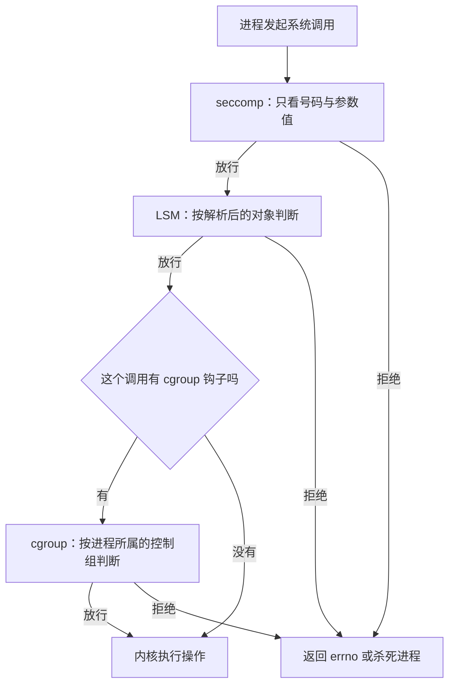

# B.13 安全应用：seccomp、LSM 与 cgroup

设想一个专用于图像渲染或多媒体解码的沙箱子进程：当它解析一张精心构造的畸形图片时触发了内存破坏漏洞，攻击者借此劫持了控制流并取得了进程内部的执行权限。在传统的攻击链条中，攻击者通常会迅速尝试以下关键行为：派生子进程以启动一个交互式 shell、读取主机敏感文件（如 `/etc/shadow` 或私钥）、以及建立出站网络连接以回连远端控制服务器（C2）。这三类高危操作分别由 Linux 内核中的三道安全防御纵深予以阻断：seccomp 使得该进程在系统调用入口处就无法调用 `execve`；LSM 确保无论何种身份的进程在操作特定敏感文件对象时都会遭到内核 DAC/MAC 的断然否决；而 cgroup 策略则对容器或服务所在的整个控制组施加出站网络封锁。这三项防御机制在底层均深度融合了 BPF 技术，但在内核调用链上的插桩点、能够解构的元数据维度以及返回值的控制语义上，有着截然不同的分工。

本篇将这三类机制置于统一的安全架构视角下进行对比解构：首先梳理它们在系统调用穿越内核时的执行时序与判定层级，进而通过具体的最小实现剖析其编程范式，最后阐明多层防御体系的选型与组合策略。虽然 seccomp 底层沿用的是经典 BPF（cBPF）指令模型，与现代 eBPF 在运行时有所区别，但其基于指令流过滤系统调用的设计思想一脉相承，理解它也是把握现代容器沙箱（如 Docker、runc）与浏览器多进程隔离（如 Chromium）安全基石的关键所在。

文中的配套示例均收录于 `code/系统编程/拓展B_eBPF/B_13_安全应用_seccomp_LSM与cgroup/` 目录。各模块均已通过严格编译检查；由于安装全局策略涉及系统特权操作，文中涉及的实际拦截效果均基于规范的审计环境与标准内核测试会话进行验证与剖析。

## 1. 三种机制各管什么

三者的差别不在于「谁更强」，而在于拦截点在哪里、手里有什么信息。



以 `connect()` 为例，三者依次经过：seccomp 在 `__sys_connect` 入口跑，此时只知道系统调用号和那个 `struct sockaddr __user *` 的地址值；`__sys_connect_file` 里先调 `security_socket_connect()`，LSM 在这里拿到已经复制进内核的 `struct sockaddr`；再往里走，`__inet_stream_connect` 先调协议层的 `pre_connect`（TCP 是 `tcp_v4_pre_connect`），它调 `BPF_CGROUP_RUN_PROG_INET4_CONNECT()`，cgroup 程序才拿到 `struct sockaddr_in` 和发起连接的套接字。三处的先后顺序由内核代码的调用链决定，不是设计上的约定。

seccomp（安全计算模式，secure computing mode）的过滤器挂在线程发起系统调用的那一刻，早于内核判断这个调用要做什么。它拿到的只有系统调用号、体系结构、指令指针和六个参数寄存器的值。参数是 `openat` 的路径指针时，它看到的是那个指针的数值，没法顺着指针把字符串读出来——过滤器运行在系统调用入口，此时用户空间内存还不可信，内核也不允许它去访问。

LSM（Linux 安全模块，Linux Security Module）的钩子在内核已经决定要操作某个对象、但还没动手的时候被调用。到这一步，`openat` 的路径已经解析成了 `struct file` 和 `struct inode`，`connect` 的地址已经复制进内核，成了 `struct sockaddr`。程序可以读这些结构里的字段，按路径、inode 号、UID、地址族做判断。SELinux 和 AppArmor 就是在这个框架里实现的，BPF LSM 让同一个框架接受 BPF 程序。

cgroup（控制组，control group）BPF 挂在按进程组归类的操作上：组内进程发起 `connect`、`bind`、`sendmsg`，或者打开设备节点时，钩子先跑一遍。一个进程属于哪个 cgroup，由它所在的层级位置决定，与它是什么二进制、传了什么参数无关，所以天然适合容器和 systemd 服务这类「一组进程」的场景。

| | seccomp | BPF LSM | cgroup BPF |
| --- | --- | --- | --- |
| 程序形式 | 经典 BPF（classic BPF，cBPF） | eBPF | eBPF |
| 挂载点 | 系统调用入口 | LSM 钩子 | cgroup 的套接字与设备钩子 |
| 作用范围 | 装过滤器的线程及其后代 | 全系统 | 该 cgroup 及其后代 |
| 能看到什么 | 系统调用号与六个参数的值 | 解析后的内核对象 | 套接字地址、设备号、报文 |
| 谁来加载 | 进程自己 | 特权进程 | 特权进程 |
| 生命周期 | 随进程，不可撤销 | BPF link，关闭即分离 | BPF link，关闭即分离 |
| 典型用户 | 浏览器、容器运行时 | SELinux 之外的动态策略 | systemd、容器运行时 |

「谁来加载」这一行决定了两类用法。seccomp 是程序对自己动手，一个进程给自己装上过滤器，之后连自己都改不回来；LSM 和 cgroup 是管理员对别人动手，装上去以后约束的是全系统或一整组进程。

::: concept sys-ebpf-three-layers title="三种机制的拦截位置"

seccomp 在系统调用入口按号码拦截，看不到参数指向的内容；LSM 在内核操作对象之前按对象属性拦截；cgroup 按进程所属的控制组拦截网络与设备操作。三者可以叠加，同一次系统调用可能先后经过三者，其顺序由内核的调用链决定：seccomp 最早，LSM 在对象解析之后，cgroup 的套接字钩子更靠内。

:::

::: generate sys-ebpf-three-layers-walk kind=explanation concepts=sys-ebpf-three-layers

面向刚学完系统调用、对「内核里还能再插检查」感到陌生的读者，用一次 `connect()` 调用为例，按时间顺序走一遍：seccomp 看到的是什么、LSM 的 socket_connect 钩子看到的是什么、cgroup 的 connect4 钩子看到的是什么，说明三处各自能做什么判断、为什么不能在 seccomp 里按路径拦截。

:::

## 2. seccomp 过滤器：限制自己的系统调用

[第 14 章](/教程/正文/系统编程/14_系统程序的健壮性与安全边界) 讲过严格模式：白名单只有 `read`、`write`、`exit`、`sigreturn`，碰其他调用就被 `SIGKILL`。那个模式只适合玩具程序。过滤器模式把白名单交给程序自己写，规则可以精确到一个系统调用号、一个参数值、一个错误码。

### 2.1 安装过滤器的三步

一个线程要装过滤器，需要三个条件同时成立：

1. 它已经设置 `PR_SET_NO_NEW_PRIVS`，或者持有 `CAP_SYS_ADMIN`；
2. 过滤器是一段合法的 cBPF 程序，长度不超过 `BPF_MAXINSNS`（4096）条指令；
3. 加上这段程序后，该线程的过滤器总长不超过 `MAX_INSNS_PER_PATH`（32768）条指令，每段已有过滤器另计 4 条开销。

第一条是无特权进程唯一的路。`no_new_privs` 一旦设置就不能撤销，它同时保证 `execve` 不会让进程获得新特权——否则一个进程可以先装一个宽松的过滤器，再 `exec` 一个 setuid 程序，借新身份绕过限制。设置这个标志和执行 `execve` 之间的窗口里，任何能提权的路径都被堵死。

过滤器本身用 `struct sock_filter` 数组描述，宏 `BPF_STMT` 和 `BPF_JUMP` 各生成一条指令。整个数组装进 `struct sock_fprog`，交给 `seccomp()` 系统调用：

```c
struct sock_fprog prog = {
    .len = (unsigned short)(sizeof filter / sizeof filter[0]),
    .filter = filter,
};
syscall(SYS_seccomp, SECCOMP_SET_MODE_FILTER, 0, &prog);
```

`seccomp()` 没有 glibc 包装，要走 `syscall()`。第三个参数是标志，`SECCOMP_FILTER_FLAG_TSYNC` 让新过滤器同步到进程的所有线程——不给这个标志时，只有调用线程受约束，同进程的其他线程照旧，多线程程序里这一点经常被忽略。

### 2.2 过滤器看到的 `struct seccomp_data`

```c
struct seccomp_data {
    int   nr;                   /* 系统调用号 */
    __u32 arch;                 /* AUDIT_ARCH_* 常量 */
    __u64 instruction_pointer;  /* 发起调用的指令地址 */
    __u64 args[6];              /* 六个参数，一律按 64 位存放 */
};
```

cBPF 程序在这个只读结构上做 32 位字加载。`BPF_LD | BPF_W | BPF_ABS` 加偏移量取出一个字段；`BPF_JMP | BPF_JEQ | BPF_K` 与常量比较并按结果跳转；`BPF_RET | BPF_K` 返回动作。`BPF_H` 和 `BPF_B` 这两种窄加载不被接受，只能按 32 位字读。

`arch` 字段的校验构成了防御逻辑的安全基石。在现代 64 位 x86-64 架构的主机上，内核往往支持执行 32 位的 i386 兼容程序，而这两套 ABI 所对应的系统调用号分配存在巨大差异：例如 i386 体系下的 `write` 调用号为 4，而在 x86-64 体系下 `write` 的调用号则为 1。倘若过滤器未曾前置校验架构魔数而仅仅直接比对调用编号，一旦遇到混用的 32 位二进制，便会彻底发生判定错位，不仅会误伤正常的合法调用，更会导致原本意图阻断的高危调用被意外放行。此外，x32 ABI 的存在使得情况更为复杂：它与标准的 x86-64 共用同一个 `AUDIT_ARCH_X86_64` 标识符，内核必须通过系统调用号的高位掩码（第 30 位）来实施二次区分。

### 2.3 完整示例

`seccomp_deny.c` 按 `seccomp(2)` 手册的示例改写，用法是 `./seccomp_deny <系统调用号> <架构> <errno> <程序> [参数]`：

```c
#define _GNU_SOURCE /* syscall() 与 SYS_seccomp */
#include <errno.h>
#include <linux/audit.h>
#include <linux/filter.h>
#include <linux/seccomp.h>
#include <stddef.h>
#include <stdio.h>
#include <stdlib.h>
#include <sys/prctl.h>
#include <sys/syscall.h>
#include <unistd.h>

/* x32 的系统调用号在 x86-64 的编号上加了这个位 */
#define X32_SYSCALL_BIT 0x40000000

/* 装一个只拒绝一个系统调用的过滤器，命中时返回 f_errno */
static int install_filter(int syscall_nr, unsigned int t_arch, int f_errno) {
    unsigned int upper_nr_limit = 0xffffffff;

    if (t_arch == AUDIT_ARCH_X86_64) {
        upper_nr_limit = X32_SYSCALL_BIT - 1;
    }

    struct sock_filter filter[] = {
        BPF_STMT(BPF_LD | BPF_W | BPF_ABS, offsetof(struct seccomp_data, arch)),
        BPF_JUMP(BPF_JMP | BPF_JEQ | BPF_K, t_arch, 0, 5),
        BPF_STMT(BPF_LD | BPF_W | BPF_ABS, offsetof(struct seccomp_data, nr)),
        BPF_JUMP(BPF_JMP | BPF_JGT | BPF_K, upper_nr_limit, 3, 0),
        BPF_JUMP(BPF_JMP | BPF_JEQ | BPF_K, syscall_nr, 0, 1),
        BPF_STMT(BPF_RET | BPF_K, SECCOMP_RET_ERRNO | (f_errno & SECCOMP_RET_DATA)),
        BPF_STMT(BPF_RET | BPF_K, SECCOMP_RET_ALLOW),
        BPF_STMT(BPF_RET | BPF_K, SECCOMP_RET_KILL_PROCESS),
    };

    struct sock_fprog prog = {
        .len = (unsigned short)(sizeof filter / sizeof filter[0]),
        .filter = filter,
    };

    if (syscall(SYS_seccomp, SECCOMP_SET_MODE_FILTER, 0, &prog) != 0) {
        perror("seccomp");
        return -1;
    }
    return 0;
}
```

八条指令逐个看：

| 序号 | 指令 | 作用 |
| --- | --- | --- |
| 0 | 加载 `arch` | 取出体系结构 |
| 1 | 若 `arch == t_arch` 继续，否则跳 5 条 | 架构不符跳到第 7 条 |
| 2 | 加载 `nr` | 取出系统调用号 |
| 3 | 若 `nr > upper_nr_limit` 跳 3 条 | 超出 x86-64 范围的号码按异常处理 |
| 4 | 若 `nr == syscall_nr` 继续，否则跳 1 条 | 不是目标调用就放行 |
| 5 | 返回 `SECCOMP_RET_ERRNO \| errno` | 命中，返回指定错误码 |
| 6 | 返回 `SECCOMP_RET_ALLOW` | 其余放行 |
| 7 | 返回 `SECCOMP_RET_KILL_PROCESS` | 架构或号码异常，杀死进程 |

跳转偏移从**下一条**指令算起。第 1 条的 `jf=5` 落在 1+1+5=7，第 3 条的 `jt=3` 落在 3+1+3=7，第 4 条的 `jf=1` 落在 4+1+1=6。写错一位就会落到别的 `RET` 上，这是手写过滤器最常见的错误。

`main` 里先设置 `no_new_privs`，再装过滤器，最后 `execv` 目标程序：

```c
if (prctl(PR_SET_NO_NEW_PRIVS, 1, 0, 0, 0) != 0) {
    perror("prctl");
    return EXIT_FAILURE;
}

if (install_filter((int)strtol(argv[1], NULL, 0),
                   (unsigned int)strtoul(argv[2], NULL, 0),
                   (int)strtol(argv[3], NULL, 0)) != 0) {
    return EXIT_FAILURE;
}

execv(argv[4], &argv[4]);
perror("execv");
return EXIT_FAILURE;
```

顺序不能颠倒。`execv` 之后过滤器仍然生效，而且此后只能再加过滤器，已有的一个也删不掉。这正是它适合做沙箱的原因：程序一旦进去，连自己都出不来。

参数不够时打印用法，这一段是实际运行的输出：

::: terminal title="bash - ./seccomp_deny"

```text
$ ./seccomp_deny
usage: ./seccomp_deny <syscall_nr> <arch> <errno> <prog> [<args>]
  AUDIT_ARCH_I386    = 0x40000003
  AUDIT_ARCH_X86_64  = 0xC000003E
```

:::

两个架构常量来自 `/usr/include/linux/audit.h`，值由 ELF 机器类型、64 位标志和字节序位拼成。写过滤器时不要手抄这两个数，`AUDIT_ARCH_X86_64` 在别的机器上未必还是这个值。

### 2.4 手册里的验证过程

`seccomp(2)` 官方手册中给出的典型测试会话如下：

::: terminal title="bash - seccomp(2) 手册的示例会话"

```text
$ uname -m
x86_64
$ syscall_nr() {
    cat /usr/src/linux/arch/x86/syscalls/syscall_64.tbl | \
    awk '$2 != "x32" && $3 == "'$1'" { print $1 }'
};
$ errno 99
EADDRNOTAVAIL 99 Cannot assign requested address
$ syscall_nr execve
59
$ ./a.out 59 0xC000003E 99 /bin/whoami
execv: Cannot assign requested address
$ syscall_nr write
1
$ ./a.out 1 0xC000003E 99 /bin/whoami
$ syscall_nr preadv
295
$ ./a.out 295 0xC000003E 99 /bin/whoami
cecilia
```

:::

三次运行的差别值得逐条说清。拦 `execve`（59）时，`execv` 自己就是被拦的那个调用，所以程序在 `execv` 处拿到 `EADDRNOTAVAIL`，`whoami` 根本没跑起来——这是最直接的用法，让一个进程无法执行任何其他程序。拦 `write`（1）时 `execv` 成功，`whoami` 跑起来了，但它写出结果时 `write` 被拦，屏幕上什么都没有。拦 `preadv`（295）时 `whoami` 完整执行，输出用户名。

同一段代码，换一个系统调用号，就能从「禁止换程序」变成「禁止说话」再到「什么都没影响」。这也是过滤器模式比严格模式实用的地方：白名单和黑名单都由调用方决定。

### 2.5 返回值与优先级

一个线程可以叠加多个过滤器，从 `fork`、`clone` 继承来的，加上自己装的。内核把每个过滤器都跑一遍，取其中优先级最高的动作。优先级从高到低：

| 动作 | 数值 | 效果 |
| --- | --- | --- |
| `SECCOMP_RET_KILL_PROCESS` | `0x80000000` | 进程立即终止，如同收到 `SIGSYS`，`SIGSYS` 处理函数不起作用 |
| `SECCOMP_RET_KILL_THREAD` | `0x00000000` | 只终止发起调用的线程，同进程其他线程继续 |
| `SECCOMP_RET_TRAP` | `0x00030000` | 调用不执行，线程收到 `SIGSYS`，`si_errno` 取自附带数据 |
| `SECCOMP_RET_ERRNO` | `0x00050000` | 调用不执行，返回低 16 位作为 `errno` |
| `SECCOMP_RET_USER_NOTIF` | `0x7fc00000` | 交给用户态监督进程决定，没有监督进程时返回 `ENOSYS` |
| `SECCOMP_RET_TRACE` | `0x7ff00000` | 交给 `ptrace` 跟踪者决定，没有跟踪者时返回 `ENOSYS` |
| `SECCOMP_RET_LOG` | `0x7ffc0000` | 记录一次日志后执行调用 |
| `SECCOMP_RET_ALLOW` | `0x7fff0000` | 执行调用 |

数值来自 `<linux/seccomp.h>`。优先级按 32 位有符号数从小到大排：`KILL_PROCESS` 的 `0x80000000` 是有符号数里的最小值，所以最严格；其次是数值为 0 的 `KILL_THREAD`；`ALLOW` 的 `0x7fff0000` 是最大的正数，最宽松。内核只要对所有过滤器的返回值取最小值，就自动得到最严格的那个动作，不需要逐个比较优先级。`KILL_THREAD` 还有个别名 `SECCOMP_RET_KILL`，旧代码里用的是这个名字。

内核采纳「动作严格度最高者优先」的裁决规则，使得整个过滤体系具有单向收紧的单调性特征。即使后加载的某个过滤器针对某次调用返回了 `ALLOW` 放行，也绝对无法推翻此前已有规则所作出的 `KILL_PROCESS` 判定。这种不可逆的收紧特性为分层沙箱架构的设计提供了极大的解耦便利：上层运行时与内层应用程序可以各自独立建立防御基线，每一层仅需专注自身的防护目标，无需顾虑底层规则会被意外穿透。

`ERRNO` 动作的低 16 位是 `SECCOMP_RET_DATA`，写成 `SECCOMP_RET_ERRNO | (f_errno & SECCOMP_RET_DATA)` 是标准写法。`f_errno` 超过 16 位会被截断，用户态看到的错误码也就变了样。

::: concept sys-ebpf-seccomp-return title="seccomp 过滤器返回值的含义"

过滤器的返回值高 16 位是动作、低 16 位是附带数据。多个过滤器叠加时取动作优先级最高者，附带数据取自返回该动作的最新过滤器。`SECCOMP_RET_ERRNO` 把低 16 位作为 `errno` 返回给被拦截的系统调用，`SECCOMP_RET_ALLOW` 放行。

:::

### 2.6 能做什么，不能做什么

回到第 1 节那个断点：过滤器看不到指针指向的内容。想禁止写 `/etc/shadow`，在 seccomp 里做不到——`openat` 的第二个参数是个指针，过滤器只能看到那个数值，而同一个路径字符串在每次运行时地址都可能不同。想按路径做策略，只能放到 LSM。

能做的判断都是数值比较：系统调用号、`flags` 的某一位、`mode` 的低几位、`socket` 的地址族。这些已经够用。容器运行时默认拒绝几十个危险调用（`mount`、`ptrace`、`kexec_load`、`bpf`），靠的就是号码比较；Chromium 的沙箱按进程类型给不同的白名单，也是同一套做法。

::: compare left-title="想在 seccomp 里按路径判断" right-title="按系统调用号与标志位判断"

```c
/* pathname 是用户空间里的地址，不是字符串内容；
   同一个路径在两次运行中地址不同，比较永远不可靠 */
if (sd->nr == SYS_openat &&
    sd->args[1] == (unsigned long long)pathname) {
    return SECCOMP_RET_ERRNO | EACCES;
}
```

---

```c
/* 只比较数值：号码、标志位、模式位 */
if (sd->nr == SYS_openat &&
    (sd->args[2] & O_CREAT) != 0 &&
    (sd->args[3] & 0777) == 0777) {
    return SECCOMP_RET_ERRNO | EACCES;
}
```

:::

`args[1]` 与任何用户空间里的地址比较都不可靠，那个地址每次运行都可能不同，同一个路径在两个进程里也不同。实际项目里没人手写 cBPF，都用 libseccomp：它把「允许哪些调用、参数满足什么条件、命中后返回什么」写成 C 函数调用，再生成指令数组。

::: tip 用 libseccomp 而不是手写指令

`seccomp_rule_add(ctx, SCMP_ACT_ERRNO(EPERM), SCMP_SYS(mount), 0)` 这样的调用替你把架构检查、参数比较和跳转偏移都算好，还能用 `SCMP_ACT_NOTIFY` 交给监督进程。手写 `struct sock_filter` 只在教学和极小依赖的场景里值得。

:::

### 2.7 系统调用被拦之后

`SIGSYS` 是默认结果，但它和「进程崩溃」不是一回事。systemd 的 `SystemCallFilter=` 默认在命中时用 `SIGSYS` 杀掉进程；配上 `SystemCallErrorNumber=EPERM` 后，被拦的调用改成像普通错误一样返回 `EPERM`，进程可以自己处理。

这个区别在工程上很重要。返回错误码时，程序可能把 `EPERM` 当成「权限不足」继续跑，行为变得难以预测；直接 `SIGSYS` 时，故障点明确，但服务会挂。给容器配 seccomp 策略的人通常选前者，因为运行时希望容器里的程序给出可读的错误而不是突然消失。

<Quiz
  type="single"
  :options="[
    { label: 'eBPF，与前面各节的程序相同', value: 'A' },
    { label: '经典 BPF，指令集只有 32 位累加器和少量寄存器', value: 'B' },
    { label: '既可以是 cBPF 也可以是 eBPF，由标志位选择', value: 'C' },
    { label: '不是 BPF，是内核里单独的规则表', value: 'D' }
  ]"
  answer="B"
>

<template #question>

seccomp 过滤器使用哪一种 BPF？

</template>

正确答案是 **B**。seccomp 从 3.5 起就使用经典 BPF，此后没有改成 eBPF：它的输入是固定的 `struct seccomp_data`，只需要几十条指令，cBPF 的模型足够，换成 eBPF 反而要引入验证器和 JIT 的一整套设施。与 B.1 讲的 cBPF 是同一套指令集，只是加载方式不同——一个走 `setsockopt`，一个走 `seccomp()`。

</Quiz>

## 3. BPF LSM：在内核检查对象时插入策略

LSM 是内核里的一组钩子。文件打开、inode 权限检查、任务创建、套接字连接、`bpf()` 调用……每个敏感操作前后都有对应的钩子函数，安全模块在这些函数里做判断。SELinux、AppArmor、Smack 都是这么实现的，它们的策略在编译期或启动时固定下来。

BPF LSM 让钩子接受 BPF 程序。策略不用重新编译内核，不用重启，写成一个 `.bpf.c` 加载进去就生效。代价是它需要内核在编译时打开 `CONFIG_BPF_LSM`，并且启动时把 `bpf` 放进活动的 LSM 列表。

### 3.1 启用条件

内核配置项是 `CONFIG_BPF_LSM`（在 `kernel/bpf/Kconfig` 里，菜单项写作「Enable BPF LSM Instrumentation」），它依赖 `CONFIG_BPF_SYSCALL`、`CONFIG_BPF_JIT`、`CONFIG_BPF_EVENTS` 和 `CONFIG_SECURITY`。这个选项只是把 BPF LSM 编译进内核，还不等于启用。

核心的决断条件在于当前内核的活动 LSM 列表。操作系统在引导启动时，会严格依据配置项 `CONFIG_LSM`（或在内核启动引导行中使用 `lsm=` 参数进行显式覆写）所声明的顺序依次初始化各安全模块；任何未被显式收录于该序列中的模块，纵使已经成功编译入内核镜像，也绝对不会被激活。关于 `lsm=` 引导参数的详细规范可参阅内核文档 `Documentation/admin-guide/kernel-parameters.txt`。通过读取安全文件系统节点可以确认当前生效的模块序列：

::: terminal title="bash - 查看活动的 LSM"

```text
$ cat /sys/kernel/security/lsm
lockdown,capability,landlock,yama,apparmor,tomoyo,bpf,ipe,ima,evm
```

:::

一行逗号分隔的模块名，顺序就是检查顺序，`capability` 永远排在前面。这一行里有 `bpf` 才算启用。没有的话要在内核命令行加上 `lsm=...,bpf`（保留原有的模块，把 `bpf` 加到末尾），然后重启。

::: warning 没启用时程序能加载，但永远不会被调用

活动 LSM 列表里没有 `bpf` 时，`BPF_PROG_TYPE_LSM` 的程序照样能通过验证器、照样能附加成功，加载程序不报任何错误。钩子表在启动时就定好了，缺了这一项，程序只是挂在那里没有入口，策略静默失效。动手写之前先看一眼 `/sys/kernel/security/lsm`。

:::

这是开发与排障过程中极为典型的阻碍场景：程序通过了验证器的符号推演，`bpftool link show` 能够清晰列出附加的 BPF link，系统日志中也未见任何异常警告，但编写的拦截逻辑却始终无法触发。面对此类现象，开发者往往会反复推敲代码的分支判定，其实质原因在于内核引导序列中根本未曾为 BPF LSM 分配钩子插槽。

上述 `cat` 输出取自标准现代发行版环境，其中 `bpf` 已经默认被编入活跃安全序列。但在自定义编译的专用微内核、部分云基础设施的精简镜像或特定容器环境中，该参数可能需要管理员在启动引导时手动显式补齐。

### 3.2 程序怎么写

LSM 程序的上下文是钩子的参数，函数签名必须与钩子一致，末尾多一个 `ret`：

```c
SEC("lsm/bpf")
int BPF_PROG(lsm_bpf, int cmd, union bpf_attr *attr, unsigned int size, int ret) {
    if (ret != 0) {
        return ret;
    }
    ...
    return -EPERM;
}
```

`BPF_PROG` 宏把内核按 `unsigned long long *ctx` 传进来的参数展开成带类型的形参，编译出来的代码直接从栈上按偏移取。`SEC("lsm/bpf")` 里的 `bpf` 是钩子名，对应内核里的 `bpf_lsm_bpf()`，也就是 `LSM_HOOK(int, 0, bpf, int cmd, union bpf_attr *attr, unsigned int size)` 这一条。钩子清单在 `include/linux/lsm_hook_defs.h`，程序里能用的名字就是那一串。

`ret` 是同一个钩子上前一个 BPF 程序给出的结果，第一个程序时是 0。注意它不包含其他安全模块的判定：每个 LSM 模块在这个钩子上各占一个槽位，由 `security_bpf()` 这样的包装函数按列表顺序依次调用，任何一个返回非默认值（这里是 0）就跳到出口，后面的槽位不再执行。BPF LSM 自己的多个程序则挂在同一个蹦床上，按附加顺序串起来跑，`ret` 就是这条链上上一个程序的结果。所以标准写法是先看 `ret`，非零就原样返回，别把同一钩子上更严格的判定推翻：

```c
if (ret != 0) {
    return ret;
}
```

返回 0 放行，返回负的 errno 拒绝。内核把这个负值一路带回调用点，用户态看到的就是对应的错误。

::: concept sys-ebpf-lsm-return title="LSM 程序的返回值"

LSM 程序返回 0 表示放行，返回负的 errno 表示拒绝，该值成为系统调用的错误码。`ret` 形参是同一个钩子上前一个 BPF 程序的结果，非零时必须原样返回，否则会覆盖更严格的判定。程序类型为 `BPF_PROG_TYPE_LSM`，必须使用 GPL 兼容的许可证。

:::

最后一句不是形式要求。`bpf_lsm_verify_prog()` 会检查 `prog->gpl_compatible`，许可证不兼容 GPL 的程序直接被拒绝，报错是 `LSM programs must have a GPL compatible license`。

### 3.3 内核文档的例子：禁止堆上的 `mprotect`

`Documentation/bpf/prog_lsm.rst` 给的例子挂在 `file_mprotect` 上，判断这次 `mprotect` 是否作用在堆区间。堆是可写可执行代码的常见落脚点：先用 `mmap` 拿到一段可写内存，把 shellcode 写进去，再 `mprotect` 成可执行。堵住堆上的 `mprotect`，这条路就断了。

```c
SEC("lsm/file_mprotect")
int BPF_PROG(mprotect_audit, struct vm_area_struct *vma, unsigned long reqprot,
             unsigned long prot, int ret) {
    /* ret 是前一个 LSM 程序的结果，第一个时是 0 */
    if (ret != 0) {
        return ret;
    }

    int is_heap = (vma->vm_start >= vma->vm_mm->start_brk &&
                   vma->vm_end <= vma->vm_mm->brk);

    if (is_heap) {
        return -EPERM;
    }
    return 0;
}
```

堆的范围是 `mm->start_brk` 到 `mm->brk`，一个 `vm_area_struct` 落在里面就算堆。这段代码用本仓库的 `vmlinux.h` 编译通过，编出来的程序节是 `lsm/file_mprotect`，反汇编里能直接看到形参的位置：

::: terminal title="bash - BPF 汇编（clang -target bpf -mcpu=v3 -O2 -S）"

```text
mprotect_audit:
	r0 = *(u64 *)(r1 + 24)        # 第四个参数 ret
	if w0 != 0 goto LBB0_4        # 前一个程序已经拒绝，直接返回
	r1 = *(u64 *)(r1 + 0)         # 第一个参数 vma
	w0 = 0                        # 默认放行
	r3 = *(u64 *)(r1 + 0)         # vma->vm_start
	r2 = *(u64 *)(r1 + 16)        # vma->vm_mm
	r4 = *(u64 *)(r2 + 344)       # mm->start_brk
	if r3 < r4 goto LBB0_4        # 起点在堆之前，不是堆
	r2 = *(u64 *)(r2 + 352)       # mm->brk
	r1 = *(u64 *)(r1 + 8)         # vma->vm_end
	if r1 > r2 goto LBB0_4        # 终点在堆之后，不是堆
	w0 = -1                       # -EPERM
LBB0_4:
	exit
```

:::

`r1` 是上下文指针，`+24` 是第四个 8 字节槽位，也就是 `ret`。`r0 = *(u64 *)(r1 + 24)` 之后 `if w0 != 0` 就是在判断前一个程序的结果。偏移 344 和 352 是 `mm_struct` 里 `start_brk` 和 `brk` 的位置，这个数字随内核版本和配置变化——CO-RE 会按目标内核的 BTF 改写它，源码里写的是字段名，不是偏移。这几个 344、352 是编译时按本机 vmlinux.h 算出来的，换一台机器可能不同。

`vma->vm_mm->start_brk` 这种写法能通过验证器，是因为 LSM 程序的上下文带有完整的类型信息，可以直接解引用。如果是 kprobe 程序，同样的表达式会被验证器拒绝，得用 `BPF_CORE_READ`。

### 3.4 libbpf-bootstrap 的例子：禁掉 `bpf()` 本身

在生产系统的安全加固中，一个极为典型的场景是：限制受监控的容器或非特权运维工具滥用 `bpf()` 系统调用。`libbpf-bootstrap` 的官方示例便演示了这一加固思路，配套的 `lsm_bpf.bpf.c` 同样基于此架构进行组织：

```c
// SPDX-License-Identifier: GPL-2.0
#include "vmlinux.h"
#include <bpf/bpf_helpers.h>
#include <bpf/bpf_tracing.h>

char LICENSE[] SEC("license") = "Dual BSD/GPL";

/* vmlinux.h 不带 errno 的宏，用到哪个自己定义 */
#define EPERM 1

/* 挂在 bpf() 系统调用的 LSM 钩子上，拒绝一切 bpf() 调用 */
SEC("lsm/bpf")
int BPF_PROG(lsm_bpf, int cmd, union bpf_attr *attr, unsigned int size, int ret) {
    /* ret 是前一个 LSM 程序的结果，不是 0 就沿用它 */
    if (ret != 0) {
        return ret;
    }

    bpf_printk("LSM: block bpf() worked, cmd = %d", cmd);
    return -EPERM;
}
```

`vmlinux.h` 是从内核 BTF 生成的，不含 `<errno.h>` 里的宏，所以 `EPERM` 要自己定义。这个程序挂上去之后，系统里任何 `bpf()` 调用——包括 `bpftool prog list` 自己要发的那个——都会得到 `EPERM`。

用户态加载程序只有骨架四步：

```c
skel = lsm_bpf__open();
err = lsm_bpf__load(skel);
link = bpf_program__attach_lsm(skel->progs.lsm_bpf);
...
bpf_link__destroy(link);
lsm_bpf__destroy(skel);
```

`SEC("lsm/bpf")` 里没有 `+`，libbpf 照样知道该怎么附加：它按 `lsm/` 前缀匹配到 `SEC_DEF("lsm+", ...)` 这一条，里面的附加函数是 `attach_lsm`。所以骨架的 `lsm_bpf__attach()` 能自动完成这一步，也可以像上面那样手动调 `bpf_program__attach_lsm()`。`bpf_program__attach_lsm()` 返回一个 BPF link，销毁 link 就是分离；加载程序退出时 link 的文件描述符关闭，程序自动脱离钩子，这是 B.7 讲的引用计数规则。

上游的 README 给出的运行结果是：

::: terminal title="bash - libbpf-bootstrap 的 lsm 示例"

```text
$ sudo ./lsm
libbpf: loading object 'lsm_bpf' from buffer
...
Successfully started! Please run `sudo cat /sys/kernel/debug/tracing/trace_pipe` to see output of the BPF programs.
..........
```

:::

在另一个终端读跟踪缓冲区，能看到每次拦截：

::: terminal title="bash - trace_pipe（输出类似）"

```text
$ sudo cat /sys/kernel/tracing/trace_pipe
         bpftool-70646   [002] ...11 279318.416393: bpf_trace_printk: LSM: block bpf() worked
         bpftool-70646   [002] ...11 279318.416532: bpf_trace_printk: LSM: block bpf() worked
         bpftool-70646   [002] ...11 279318.416533: bpf_trace_printk: LSM: block bpf() worked
```

行首的空格是 trace_pipe 用来对齐进程名的，不是排版。

:::

三行都来自 `bpftool`，因为加载程序跑起来之后，第一次尝试查看程序列表的 `bpftool` 就撞上了自己的过滤器。这正是 README 里说的验证方式：

::: terminal title="bash - 被拦住的 bpftool（输出类似）"

```text
$ sudo bpftool prog list
Error: can't get next program: Operation not permitted
```

:::

`Operation not permitted` 就是 `EPERM`。这里有个细节：加载程序自己也在调用 `bpf()`，它之所以没被自己拦住，是因为附加发生在 `__load` 之后，而附加之后它只做 `sleep`。如果把日志输出或 `bpftool` 调用放在附加之后，那些调用同样会失败。

### 3.5 和 SELinux 的分工

BPF LSM 不是要取代 SELinux。SELinux 的策略是声明式的，有完整的类型系统和工具链，适合表达「这个域能访问哪些类型」这类长期稳定的规则；BPF LSM 适合表达「按运行时条件变化」的规则，比如「这个进程在启动的前 30 秒内不能 `connect`」「只有 UID 1000 的进程能 `mprotect` 堆」。

两者可以同时启用，都出现在 `/sys/kernel/security/lsm` 里，按列表顺序依次调用。SELinux 排在 `bpf` 前面时，它的判定先做，非零就直接返回，后面的 BPF 程序根本不会跑；BPF 程序内部看到 `ret` 非零就原样返回，管的是同一个钩子上排在它前面的 BPF 程序。这个写法在混合环境里是必须的：不检查 `ret` 就直接返回自己的结果，会推翻更严格的判定。

<Quiz
  type="single"
  :options="[
    { label: '程序加载失败，验证器报错', value: 'A' },
    { label: '该操作被拒绝，系统调用返回 EPERM', value: 'B' },
    { label: '程序加载成功但被忽略，操作照常进行', value: 'C' },
    { label: '整个进程被 SIGSYS 杀死', value: 'D' }
  ]"
  answer="B"
>

<template #question>

BPF LSM 程序在 `file_mprotect` 钩子上返回 `-EPERM`，会发生什么？

</template>

正确答案是 **B**。负的 errno 从钩子一路带回 `mprotect()` 的调用点，用户态拿到 `EPERM`，映射没有改变。A 混淆了加载期和运行期：返回值不影响验证器；C 描述的是 `bpf` 不在活动 LSM 列表里的情形，此时程序根本不跑，谈不上返回；D 是 seccomp 的 `KILL_PROCESS` 动作，LSM 没有这个语义。

</Quiz>

## 4. cgroup BPF：按进程组限制网络与设备

cgroup v2 把进程组织成一棵树，每个进程属于且只属于一个 cgroup，所有线程共享同一个归属。把进程放进某个组，只要往那个组的 `cgroup.procs` 写它的 PID：

```bash
echo $$ > /sys/fs/cgroup/mdr-ebpf/cgroup.procs
```

子进程继承父进程所在的组。BPF 程序附加到某个 cgroup 之后，对这个组及其所有后代里的进程生效，不管这些进程之后怎么 `fork`、怎么换网络命名空间。

### 4.1 `cgroup/connect4` 钩子

组内进程调用 `connect()` 连接 IPv4 地址时，`cgroup/connect4` 程序先跑。上下文是 `struct bpf_sock_addr`：

```c
struct bpf_sock_addr {
    __u32 user_family;   /* 地址族，AF_INET 等 */
    __u32 user_ip4;      /* 目标地址，网络字节序 */
    __u32 user_ip6[4];
    __u32 user_port;     /* 目标端口，网络字节序 */
    __u32 family;
    __u32 type;          /* SOCK_STREAM、SOCK_DGRAM */
    __u32 protocol;
    ...
};
```

`user_port` 是网络字节序，直接和主机序的常数比较不会相等。以端口 20002 为例，主机序是 `0x4E22`，写进 `user_port` 的是 `0x224E`，两者相差一次字节交换。`bpf_htons()` 做这个转换；参数是编译期常量时它算出常数，参数是 `const volatile` 对象时它生成一条 `be16` 指令，两种情况都对。

`connect_deny.bpf.c` 拒绝组内进程连接 127.0.0.1 的 20002 端口：

```c
// SPDX-License-Identifier: GPL-2.0
#include "vmlinux.h"
#include <bpf/bpf_endian.h>
#include <bpf/bpf_helpers.h>

char LICENSE[] SEC("license") = "Dual BSD/GPL";

/* 拒绝的目标端口，读的时候要按网络字节序比较 */
const volatile __u16 deny_port = 20002;

SEC("cgroup/connect4")
int connect_deny(struct bpf_sock_addr *ctx) {
    /* 只处理 TCP，其余交给后面的检查 */
    if (ctx->type != SOCK_STREAM) {
        return 1;
    }

    /* user_port 是网络字节序 */
    if (ctx->user_port == bpf_htons(deny_port)) {
        return 0;
    }

    return 1;
}
```

`const volatile` 让 `deny_port` 落进 `.rodata`，libbpf 把它建成只读的数组 map，加载时冻结。冻结之后内核把它当常量，用户态则可以在 load 之前通过 `skel->rodata` 写它。少写 `volatile` 时，编译器会把这个初值直接折叠进指令，用户态改了也没用；少写 `const` 时，libbpf 会把它放进 `.data`，成可读写的 map。B.6 讲过这两个限定符的作用，这里只是又一次用到。

编译出来的指令很短。下面是用 `clang -target bpf -mcpu=v3 -O2 -S` 出的汇编，注释是按结构体偏移补的：

::: terminal title="bash - connect_deny 的 BPF 汇编"

```text
connect_deny:
	w0 = 1                        # 默认放行
	w2 = *(u32 *)(r1 + 32)        # ctx->type
	if w2 != 1 goto LBB0_3        # 不是 SOCK_STREAM 就返回 1
	w1 = *(u32 *)(r1 + 24)        # ctx->user_port
	r2 = deny_port ll             # 64 位立即数，链接时重定位到 .rodata
	w2 = *(u16 *)(r2 + 0)
	r2 = be16 r2                  # 转成主机序
	if w1 != w2 goto LBB0_3
	w0 = 0                        # 命中，拒绝
LBB0_3:
	exit
```

:::

偏移 32 是 `type`，24 是 `user_port`，和结构体定义对得上。`deny_port ll` 是一条 64 位立即数加载，链接时由 libbpf 重定位到 `.rodata` 里的实际地址；`ll` 后缀表示立即数要占两个指令槽。程序没有循环，验证器几遍就过，每次 `connect` 的开销可以忽略。

### 4.2 返回值：1 放行，0 拒绝

cgroup 套接字地址类的程序返回 1 表示放行，返回 0 表示拒绝。内核跑完程序后取返回值的最低位，为 0 就把结果记成 `-EPERM`。这一段来自 `kernel/bpf/cgroup.c` 的 `bpf_prog_run_array_cg()`：

```c
func_ret = run_prog(prog, ctx);
if (ret_flags) {
    *(ret_flags) |= (func_ret >> 1);
    func_ret &= 1;
}
if (!func_ret && !IS_ERR_VALUE((long)run_ctx.retval))
    run_ctx.retval = -EPERM;
```

函数开头的注释把约定写得很直白：只要有程序被找到并且返回值不等于 1，就返回 `-EPERM`。所以被拒绝的 `connect()` 会失败，`errno` 是 `EPERM`，不是 `ECONNREFUSED`。这一点在排错时容易混淆：`ECONNREFUSED` 说明报文发到了对端、对端回了 RST，`EPERM` 说明调用根本没发出去，是本机的策略拦下的。

::: concept sys-ebpf-cgroup-return title="cgroup 套接字程序的返回值"

`cgroup/connect4`、`cgroup/bind4`、`cgroup/sendmsg4` 这类程序的返回值按最低位解释：1 放行，0 拒绝。返回 0 时内核把结果记为 `-EPERM`，用户态的 `connect()`、`bind()` 或 `sendmsg()` 得到 `EPERM`。高位可以携带附加标志，例如 bind 钩子里请求跳过 `CAP_NET_BIND_SERVICE` 检查。

:::

`cgroup_skb/ingress` 和 `cgroup_skb/egress` 的返回值含义不一样：1 表示保留报文，0 表示丢弃，出口方向还有 2 和 3 两个值，分别表示丢弃或保留并通知 TCP 拥塞控制。`cgroup/dev` 是 1 允许、0 拒绝，`cgroup/sysctl` 也是 1 允许、0 拒绝。挂钩子之前先查清楚这一类钩子的约定，把 `connect4` 的 1/0 套到别处是常见错误。

### 4.3 用户态：打开 cgroup 目录再附加

`cgroup/connect4` 不能按 `SEC` 名称自动附加，必须提供一个 cgroup 的文件描述符。加载程序打开目标目录，把它交给 `bpf_program__attach_cgroup()`：

```c
const char *cgroup_path = "/sys/fs/cgroup/mdr-ebpf";

cgroup_fd = open(cgroup_path, O_RDONLY | O_DIRECTORY);
if (cgroup_fd < 0) {
    fprintf(stderr, "open %s: %s\n", cgroup_path, strerror(errno));
    connect_deny__destroy(skel);
    return 1;
}

link = bpf_program__attach_cgroup(skel->progs.connect_deny, cgroup_fd);
```

`O_DIRECTORY` 保证打开的是目录而不是同名文件。cgroup 目录用 `open()` 打开就行，不需要 `opendir()`——内核的 cgroup 文件系统给目录的 inode 提供了 `bpf()` 需要的那个文件描述符。

加载程序打印的端口号来自 `skel->rodata->deny_port`，这是 `const volatile` 对象在用户态的访问方式，类型是骨架生成的结构体指针，字段名就是源码里的名字。

### 4.4 测试步骤

附加成功之后，把测试用的 shell 放进这个 cgroup，它发起的连接就会受约束。命令按顺序是：

```bash
sudo mkdir /sys/fs/cgroup/mdr-ebpf
sudo ./connect_deny /sys/fs/cgroup/mdr-ebpf
```

加载程序成功时会打印它附加的目录和拒绝的端口。另开一个终端，把那个 shell 的 PID 写进组里，然后试两个端口：

```bash
echo $$ | sudo tee /sys/fs/cgroup/mdr-ebpf/cgroup.procs
nc -zv 127.0.0.1 20002
nc -zv 127.0.0.1 20003
```

对 20002 的连接在 `connect()` 处就失败，`errno` 为 `EPERM`，`nc` 会把错误打印成 `Operation not permitted` 或 `Permission denied`，取决于它用的是哪个版本；20003 如果本机有进程监听就连得上，没有监听则是 `Connection refused`——这两者的区别说明了拦截发生在报文发出之前。要看准确结果，用 `nc -zv 127.0.0.1 20002; echo $?`，被 BPF 拒绝时退出码非零且错误文本是权限类错误。

如果本来就没程序在 20003 上监听，先起一个：`nc -l 127.0.0.1 20003`，再在组内那个 shell 里连接。

如果两个端口都被拒，先检查是不是把 shell 放进了上一级的 cgroup——附加在 `mdr-ebpf` 上的程序不约束它的父目录。测试完记得把 shell 移回原来的组，否则后面所有连接都受这个策略影响。

### 4.5 其他 cgroup 钩子

`connect4` 只是十几个钩子里的一个。常用的几类：

| SEC 名称 | 拦截的操作 | 返回值 |
| --- | --- | --- |
| `cgroup/connect4`、`cgroup/connect6` | TCP 连接 | 1 放行，0 拒绝 |
| `cgroup/bind4`、`cgroup/bind6` | 绑定本地端口 | 1 放行，0 拒绝 |
| `cgroup/sendmsg4`、`cgroup/sendmsg6` | UDP 发送 | 1 放行，0 拒绝 |
| `cgroup/recvmsg4`、`cgroup/recvmsg6` | UDP 接收 | 1 放行，0 拒绝 |
| `cgroup/connect_unix` | Unix 域套接字的连接 | 1 放行，0 拒绝 |
| `cgroup/sendmsg_unix`、`cgroup/recvmsg_unix` | Unix 域套接字的收发 | 1 放行，0 拒绝 |
| `cgroup/skb`、`cgroup_skb/ingress`、`cgroup_skb/egress` | 套接字上的报文 | 1 保留，0 丢弃 |
| `cgroup/dev` | 打开设备节点 | 1 允许，0 拒绝 |
| `cgroup/sysctl` | 读写 sysctl | 1 允许，0 拒绝 |
| `cgroup/getsockopt`、`cgroup/setsockopt` | 套接字选项 | 1 允许，0 拒绝 |

`cgroup/dev` 的上下文是 `struct bpf_cgroup_dev_ctx`，含 `access_type`、`major`、`minor`，其中 `access_type` 的低 16 位是设备类型、高 16 位是访问方式（读、写、mknod 的按位或）。设备访问检查在 `devcgroup_check_permission()` 里先跑 BPF 程序，返回非零就直接失败，不再走传统的设备白名单。`cgroup/sysctl` 的上下文能拿到要访问的键名和 `write` 标志，可以拦住对 `/proc/sys` 下特定键的写入。

### 4.6 systemd 用它们做了什么

systemd 的 `SocketBindDeny=` 和 `SocketBindAllow=` 就是用 `cgroup/bind4`、`cgroup/bind6` 实现的，systemd 源码 `src/core/bpf-socket-bind.c` 里两个程序分别附加到服务的 cgroup。这套设置管的是 `bind()`，不是 `connect()`——限制服务能监听哪些端口，而不是它能连哪里。

限制连接的选项是 `IPAddressDeny=` 和 `IPAddressAllow=`，走的是 `cgroup_skb/ingress` 和 `cgroup_skb/egress` 两个钩子（systemd 源码 `src/core/bpf-firewall.c` 里分别按 `BPF_CGROUP_INET_INGRESS`、`BPF_CGROUP_INET_EGRESS` 附加），对进出的报文按地址过滤。入口方向查源地址，出口方向查目的地址，两条列表依次匹配：命中允许列表就放行，否则命中拒绝列表就丢弃，两处都不命中则放行。文档里说明它只作用于 `AF_INET` 和 `AF_INET6` 套接字，Unix 域套接字不受影响；内核没有 cgroup BPF 支持时这几项设置完全不起作用。

`DeviceAllow=` 机制依赖于 `cgroup/dev` 钩子以及运行时动态编排的指令序列。在具体工程实现中，systemd 并不依赖预先编译好的 ELF 目标文件与 SEC 节名解析，而是通过底层的 `bpf_program_new(BPF_PROG_TYPE_CGROUP_DEVICE, ...)` 直接在内存中组装 BPF 指令，将配置中允许访问的设备主次设备号逐一编译为分支比较指令，随后调用 `bpf_program_cgroup_attach()` 动态挂载到服务所属的 cgroup 上。`DevicePolicy=` 则规范了未命中白名单规则时的默认处置策略：`strict` 模式下一律拒绝访问；`closed` 模式下默认放行标准伪设备（如 `/dev/null`、`/dev/zero` 等）；而在 `auto` 模式下，若未显式指定 `DeviceAllow=` 则维持全放行策略。

这几个选项都不需要用户自己写 BPF 程序，但它们背后是同一套机制。看 `systemctl show` 的输出、读 `systemd.resource-control(5)` 时知道底下是 cgroup BPF，遇到「设置没生效」就能想到去查内核有没有 `CONFIG_CGROUP_BPF`。

## 5. 选择与组合

三种机制的适用场景按拦截对象区分，判断起来不复杂。

**限制一个程序自身的系统调用，用 seccomp。** 它不需要特权，不需要内核配置，进程自己就能装，装完就跑。容器运行时、浏览器渲染进程、`systemd` 的 `SystemCallFilter=` 都是这个用法。策略按号码和标志位写，凡是需要看路径、看内容的一律做不到。

**针对文件、凭据、程序执行等对象的策略，用 LSM。** 它能拿到解析后的 `struct file`、`struct inode`、`struct cred`，按路径、inode 号、UID 判断。代价是需要 `CONFIG_BPF_LSM` 和活动的 `bpf` LSM，而且策略是全系统的——挂上去之后所有进程都受约束，包括你自己。

**按进程组限制网络或设备，用 cgroup。** 它跟着 cgroup 走，容器换命名空间也甩不掉，最适合「这一组进程不许连外网」「这个服务只能绑 8080」这类按组的规则。

三者可以叠在一起。一个容器可以同时有 seccomp 白名单（限制自身能发哪些调用）、cgroup 的 `connect4` 策略（限制它能连哪里）、LSM 策略（限制它能读哪些文件），三层各管一段。LSM 和 cgroup 的程序都要特权才能加载，seccomp 不用——这是选择时最实际的一条约束：只有你自己能改的程序，才轮得到 seccomp 之外的机制。

这就要求加载这些策略的进程必须是长期存在的，或者把 link 固定下来。cgroup 和 LSM 的程序都靠 BPF link 存活，加载程序退出、link 销毁，策略就没了。要让它长期生效，得把 link 固定到 bpffs（B.7），或交给 systemd 这类常驻进程管理。seccomp 反过来——它随进程消亡，不需要固定，也不能固定。

::: tip 先查再写

写 LSM 程序之前先 `cat /sys/kernel/security/lsm`；写 cgroup 程序之前先 `mount | grep cgroup2` 确认是 v2 而不是 v1；写 seccomp 之前先 `grep Seccomp /proc/self/status`，看看自己是不是已经在某个过滤器里了（容器里经常是）。三行命令能省掉大半的「为什么不生效」。

:::

## 6. 习题

### 6.1 巩固

<Exercise id="48301" :d="1" :w="1">

`seccomp_deny.c` 里第 1 条指令是 `BPF_JUMP(BPF_JMP | BPF_JEQ | BPF_K, t_arch, 0, 5)`。回答：

1. 如果 `arch` 与 `t_arch` 相等，下一条执行的是第几条指令？
2. 如果不等，跳到第几条？那条指令返回什么动作？
3. 把 `jf` 从 5 改成 4，会发生什么？

</Exercise>

<Exercise id="48302" :d="2" :w="1">

读下面这段过滤器，说出系统调用号为 1、59、295 时各自的返回值，并说明 `whoami` 会不会打印出用户名：

```c
BPF_STMT(BPF_LD | BPF_W | BPF_ABS, offsetof(struct seccomp_data, arch)),
BPF_JUMP(BPF_JMP | BPF_JEQ | BPF_K, AUDIT_ARCH_X86_64, 0, 5),
BPF_STMT(BPF_LD | BPF_W | BPF_ABS, offsetof(struct seccomp_data, nr)),
BPF_JUMP(BPF_JMP | BPF_JGT | BPF_K, X32_SYSCALL_BIT - 1, 3, 0),
BPF_JUMP(BPF_JMP | BPF_JEQ | BPF_K, SYS_write, 0, 1),
BPF_STMT(BPF_RET | BPF_K, SECCOMP_RET_ERRNO | EACCES),
BPF_STMT(BPF_RET | BPF_K, SECCOMP_RET_ALLOW),
BPF_STMT(BPF_RET | BPF_K, SECCOMP_RET_KILL_PROCESS),
```

</Exercise>

<Exercise id="48303" :d="2" :w="2">

用 `seccomp_deny` 做三组实验，记录每次的实际输出：

1. 拦 `execve`（59），目标 `/bin/whoami`，`errno` 用 99；
2. 拦 `write`（1），同样的目标，`errno` 用 99；
3. 拦 `preadv`（295），同样的目标，`errno` 用 99。

三次的结果应当与 `seccomp(2)` 手册的示例会话一致。做完之后回答：如果把第 3 组改成拦 `exit_group`（231），程序结束时会发生什么？为什么在给线上服务写过滤器时，`exit_group`、`exit`、`rt_sigreturn` 这几个调用无论如何都要放行？

</Exercise>

### 6.2 编程

<Exercise id="48304" :d="3" :w="2">

改写 `install_filter()`，让它一次拒绝多个系统调用，每个带自己的 `errno`。接口用：

```c
struct rule {
    int nr;
    int err;
};

static int install_filter(const struct rule *rules, size_t n, unsigned int arch);
```

要求：

1. 仍然先检查 `arch` 和 x32 范围；
2. 规则表里没列出的调用一律放行；
3. 用 `BPF_JUMP` 的 `jt`/`jf` 串起比较链，不要为每条规则复制一遍加载指令；
4. 验收：编一个测试程序，依次调用 `getpid`、`getppid`、`uname`，用三条规则分别拒绝成 `EPERM`、`EACCES`、`ENOSYS`，确认每个调用的 `errno` 都对得上。

提示：比较链的跳转偏移要按「从下一条指令算起」逐条算，规则多于三条时手算容易错，可以先写个小脚本生成指令数组。

</Exercise>

<Exercise id="48305" :d="3" :w="3">

写一个 `seccomp_strict_plus.c`，用过滤器模式实现比严格模式稍宽的白名单：只允许 `read`、`write`、`exit_group`、`rt_sigreturn`、`brk`、`mmap`、`munmap`、`fstat`，其余一律 `SECCOMP_RET_KILL_PROCESS`。要求：

1. 白名单写成数组，装过滤器时自动生成指令，不要手抄；
2. 装完之后用 `printf` 打印一行提示，再用 `syscall(SYS_getpid)` 触发一次死亡；
3. 验收：正常运行退出码为 0，触发 `getpid` 后 `echo $?` 为 159（128 + 31，`SIGSYS`）。

注意 `printf` 内部会调用 `fstat`、`write`、`mmap` 等一批调用，白名单少了任何一个都会在打印时死掉。先用 `strace -c ./seccomp_strict_plus` 看清 `printf` 到底发了哪些调用，再补白名单。

编译时 `SYS_getpid` 和 `SYS_*` 常量需要包含 `<sys/syscall.h>`；白名单里的名字用 `SYS_` 前缀，装过滤器时自动转成号码。

</Exercise>

<Exercise id="48306" :d="4" :w="3">

把 `lsm_bpf.bpf.c` 改成按命令号过滤：只在 `cmd` 为 `BPF_MAP_CREATE`（0）和 `BPF_PROG_LOAD`（5）时拒绝，其余命令放行，并打印命令号。

要求：

1. 保留 `if (ret != 0) return ret;`；
2. 用 `switch` 或 `if` 判断 `cmd`；
3. 编译用 `zig cc -target bpfel-freestanding-none -mcpu=v3 -O2 -g`，生成骨架并让加载程序通过 `gcc -fsyntax-only`；
4. 说明为什么这个程序在 `cmd` 为 `BPF_OBJ_GET` 时必须返回 0 而不是 `-EPERM`——提示：`bpftool link show` 会发哪些命令。

</Exercise>

<Exercise id="48307" :d="4" :w="4">

写一个 LSM 程序，挂在 `lsm/file_open` 上，拒绝打开文件名以 `.secret` 结尾的文件。

要求：

1. 上下文是 `struct file *`，用 `BPF_CORE_READ(file, f_path.dentry, d_name.name)` 取到名字指针，再用 `bpf_probe_read_kernel_str()` 把字符串复制到栈上；
2. 先在栈上量出长度，再比较最后 7 个字节是不是 `.secret`；栈上缓冲区不超过 64 字节；
3. 只拒绝，不做审计输出；
4. 验收：在测试机上打开 `/tmp/a.secret` 应当得到 `EPERM`，打开 `/tmp/a.txt` 正常；
5. 说明这个程序为什么不影响 `stat()`——它挂的是 `file_open` 而不是 `inode_permission`。

`d_name.name` 是 `const unsigned char *`，`BPF_CORE_READ` 取到的是指针，字符串本体还要再读一次。`bpf_probe_read_kernel_str()` 的返回值是包含结尾 0 的字节数，长度为 0 或负数时直接放行。

</Exercise>

<Exercise id="48308" :d="5" :w="4">

把 `connect_deny.bpf.c` 扩展成按「地址 + 端口」拒绝：只拦 `127.0.0.1` 上端口在 20002～20010 范围内的连接，其他地址和端口放行。

要求：

1. `ctx->user_ip4` 是网络字节序的 32 位地址。127.0.0.1 的四个字节依次是 `7F 00 00 01`，按大端读作 `0x7F000001`，所以比较写成 `ctx->user_ip4 == bpf_htonl(0x7F000001)`；直接写 `0x0100007F` 在小端机器上也对，但把字节序假设写进了常数，换到大端机器就错了；
2. 端口范围用两次比较，不要写十个 `if`；
3. 端口上下界做成两个 `const volatile` 对象，用户态在 load 之前写；
4. 加载程序加上命令行参数 `-p <起始端口> -n <结束端口>`（用 `getopt`）；
5. 验收：`nc -zv 127.0.0.1 20005` 被拒、`20011` 放行、连接 `127.0.0.2:20005` 也放行（Linux 上整个 127.0.0.0/8 都路由到 lo）。

</Exercise>

### 6.3 综合与挑战

<Exercise id="48309" :d="7" :w="6" scope="*">

设计一个「服务加固」方案，同时用上三种机制，并写出一份可以照着做的部署步骤和验证方法。

场景：一个只提供 HTTP 服务的二进制 `/usr/local/bin/websrv`，用 systemd 管理，监听 8080，只需要读取 `/var/www` 下的文件，不需要执行任何外部程序，不需要连接外网。

要求：

1. **seccomp 层**：用过滤器模式给出白名单，至少覆盖 `read`、`write`、`openat`、`close`、`fstat`、`mmap`、`epoll_wait`、`accept4`、`sendfile`、`exit_group`；说明为什么 `execve` 不在里面，以及服务自己怎么在启动时装过滤器（提示：`SystemCallFilter=` 能做的事，程序自己也能做）。
2. **cgroup 层**：写出 systemd 单元里对应的 `SocketBindDeny=`、`IPAddressDeny=`、`DeviceAllow=` 设置，并说明每一项背后是哪个 cgroup 钩子。
3. **LSM 层**：写一个 `lsm/file_open` 程序，只允许打开 `/var/www` 前缀下的文件，其余返回 `EACCES`。说明前缀比较怎么写，以及为什么不能用 `strstr()`。
4. **验证**：给出四条可以实际执行的检查命令，分别验证三层各自生效，并说明每条的预期输出。
5. **失效分析**：如果 `/sys/kernel/security/lsm` 里没有 `bpf`，上面哪一层会静默失效？如果加载 LSM 程序的进程退出，哪一层会失效？逐条说明。

</Exercise>

## 7. 参考资料

- Linux man-pages：[seccomp(2)](https://man7.org/linux/man-pages/man2/seccomp.2.html)、[prctl(2)](https://man7.org/linux/man-pages/man2/prctl.2.html)、[bpf(2)](https://man7.org/linux/man-pages/man2/bpf.2.html)、[bpf-helpers(7)](https://man7.org/linux/man-pages/man7/bpf-helpers.7.html)
- 内核文档：[Seccomp BPF](https://docs.kernel.org/userspace-api/seccomp_filter.html)、[LSM BPF Programs](https://docs.kernel.org/bpf/prog_lsm.html)、[Linux Security Module Usage](https://docs.kernel.org/admin-guide/LSM/index.html)、[Control Group v2](https://docs.kernel.org/admin-guide/cgroup-v2.html)
- 内核源码：`include/linux/lsm_hook_defs.h`、`security/security.c`、`kernel/bpf/cgroup.c`、`kernel/bpf/bpf_lsm.c`、`kernel/bpf/Kconfig`（`CONFIG_BPF_LSM`）
- 内核文档 `Documentation/admin-guide/kernel-parameters.txt` 中 `lsm=` 一项
- libbpf-bootstrap：[仓库与 README](https://github.com/libbpf/libbpf-bootstrap)、`examples/c/lsm.bpf.c`、`examples/c/lsm.c`
- ebpf.io：[BPF_PROG_TYPE_CGROUP_SOCK_ADDR](https://docs.ebpf.io/linux/program-type/BPF_PROG_TYPE_CGROUP_SOCK_ADDR/)
- systemd：[systemd.resource-control(5)](https://www.freedesktop.org/software/systemd/man/latest/systemd.resource-control.html)、[systemd.exec(5)](https://www.freedesktop.org/software/systemd/man/latest/systemd.exec.html)、源码 `src/core/bpf-socket-bind.c`、`src/core/bpf-devices.c`、`src/core/bpf-firewall.c`
- libseccomp：[项目主页](https://github.com/seccomp/libseccomp)、[seccomp_rule_add(3)](https://man7.org/linux/man-pages/man3/seccomp_rule_add.3.html)
