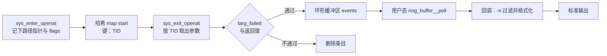

# B.15 实战：编写一个系统观测工具

服务起不来，日志里只有一句「配置文件读取失败」，却不说是哪个文件。想看那段时间里它打开过哪些路径，`strace -p` 能挂到一个正在跑的进程上，但它让每次系统调用进出都停两次，被追的服务明显变慢，几万行输出也翻不过来。这一页把前面各节拼成一个能用的工具：盯住全系统的 `openat`，按进程名或 PID 筛出关心的那几个，逐行看到路径、结果和文件描述符，随时挂上、随时摘下。

工具叫 openwatch，功能与 bcc 的 opensnoop 对应，输出列也保持一致。读完这一页，读者能写出内核态与用户态两半程序，能配好只读参数、接上环形缓冲区、在 Ctrl-C 之后干净地退出，还会用 `strace` 核对工具报出来的每一条结果。

## 1. 需求

要回答的问题是：某个进程打开了哪些文件，每次都成功了吗。一条记录需要五样东西：进程号、进程名、拿到的文件描述符、出错时的 errno、路径。加 `-T` 时再多一列时间。

| 列 | 含义 |
| --- | --- |
| `PID` | 发起调用的进程号 |
| `COMM` | 进程名，取自内核里的 comm 字段，最长 15 个字符 |
| `FD` | `openat` 的返回值；成功时是文件描述符，失败时为 `-1` |
| `ERR` | 失败时 errno 的数值，成功时为 `0` |
| `PATH` | 调用时传入的路径，原样显示，不做绝对路径补全 |
| `TIME(s)` | 只有 `-T` 时出现，从第一条记录起算的秒数，保留 9 位小数 |

命令行选项按 opensnoop 的习惯来：

| 选项 | 作用 |
| --- | --- |
| `-p PID` | 只看这个进程 |
| `-n 名称` | 只看进程名里含该子串的记录 |
| `-x` | 只看失败的打开 |
| `-T` | 每行前加时间戳 |
| `-d 秒数` | 运行这么多秒后自行退出 |
| `-v` | 打开 libbpf 的调试日志 |

把 FD 和 ERR 分成两列，是因为一次 `openat` 的结果只有两种形态：要么返回一个非负的文件描述符，要么返回 -1 并把原因放进 errno。工具把这两种情况摊平成同一行的两列，用眼睛扫一遍就知道哪些调用失败了。

## 2. 设计

一次 `openat` 在内核里要经过入口和出口两个跟踪点。入口处能拿到参数，拿不到返回值；出口处能拿到返回值，参数却已经不在上下文里了。所以工具必须配对：入口把参数存进一个 map，出口按同一个键取回来，补上返回值，再决定是否发事件。



### 2.1 以 TID 为键

入口写到 map 里的键是线程 ID，不是进程号。这两者在 `bpf_get_current_pid_tgid()` 的返回值里各占一半：高 32 位是用户态所说的 PID（内核里叫 tgid），低 32 位是线程 ID（内核里叫 pid，见 [B.5](/教程/正文/系统编程/拓展B_eBPF/B_5_辅助函数与上下文) 的说明）。

用 TID 的理由很简单：一个线程在任一时刻只可能待在一个系统调用里，所以 TID 在一次 `openat` 的入口与出口之间是唯一的；而同一个进程的多个线程完全可能同时在 `openat` 里，用 PID 作键，后进入的线程会覆盖先进入的线程存下的参数，出口处两个线程取到同一份路径，结果张冠李戴。

<Quiz
  type="single"
  :options="[
    { label: '线程 ID 比进程号小，查询更快', value: 'A' },
    { label: '同一进程的多个线程可能同时处在 openat 中，用进程号作键会互相覆盖', value: 'B' },
    { label: '内核只允许用线程 ID 作 map 的键', value: 'C' },
    { label: '用进程号作键时验证器会拒绝加载', value: 'D' }
  ]"
  answer="B"
>

正确答案是 **B**。

`start` map 保存的是一份「正在进行的调用」的现场，它必须和发起调用的那个执行流一一对应。线程是内核调度的单位，一次系统调用属于某个线程；用 tgid 作键时，同进程的两个线程会争用同一个键。验证器不检查键的含义，C 和 D 都不成立。

</Quiz>

### 2.2 在出口读路径

入口只保存路径指针，字符串留到出口再读。原因有两层。

第一层是省内存。路径最长 256 字节，如果入口就把字符串复制进 map，每一次正在进行中的 `openat` 都要在 map 里占一个 256 多字节的值；只存指针，一个值 16 字节。`openat` 的频率很高，这个差别在忙的机器上会变成 map 的容量压力和复制开销。

第二层与用户空间内存的可读性有关。`bpf_probe_read_user_str` 读取时不能触发缺页，页不在内存里就返回失败。入口处这段内存还没被这次系统调用碰过，能不能读到取决于页当时在不在；到了出口，内核刚刚用 `getname` 把路径复制进来，这段内存一定刚被访问过，读取几乎不会失败。bcc 的 opensnoop 与 libbpf-tools 里的对应实现都是这个结构：入口存指针，出口读字符串。本工具照此办理。

::: compare left-title="入口就把字符串复制进 map" right-title="入口只存指针，出口再读"

```c
/* 每个正在进行的调用都占 256 多字节 */
struct open_args {
    char filename[256];
    __s64 flags;
};
bpf_probe_read_user_str(args.filename, sizeof(args.filename),
                        ctx->args[1]);
```

---

```c
/* 每个正在进行的调用只占 16 字节 */
struct open_args {
    const char *filename;
    __s64 flags;
};
args.filename = (const char *)ctx->args[1];
/* 出口处才调用 bpf_probe_read_user_str */
```

:::

读不到时不能让 256 字节的缓冲区带着旧内容发出去。出口处检查 `bpf_probe_read_user_str` 的返回值，失败就把第一个字节写成 0，路径显示为空串。bcc 的示例输出里就有这种行：`2679   sed                -1   2` 后面没有路径，那是读失败或者路径本身为空。

<Quiz
  type="single"
  :options="[
    { label: '入口处 ctx 里没有 args 字段', value: 'A' },
    { label: '出口处才能拿到返回值，而入口处内核还没有访问过这段用户空间内存', value: 'B' },
    { label: '系统调用出口的上下文不允许调用辅助函数', value: 'C' },
    { label: '路径字符串在出口处会被内核改写', value: 'D' }
  ]"
  answer="B"
>

正确答案是 **B**。

入口的上下文里同样有 `args`，出口的上下文同样可以调用辅助函数，A 和 C 都不成立。路径字符串属于调用者，内核不会去改它。选 B 的两条理由：返回值只在出口有；出口时内核刚复制过这段内存，不会再因为缺页而读失败。

</Quiz>

### 2.3 过滤放在哪一侧

三类过滤条件，放在两处。

`-p` 的比较对象是 tgid，`-x` 的比较对象是返回值，两者都是数字，判断一条指令就够，放在内核态。过滤掉的事件根本不进环形缓冲区，用户态也不用为它们醒来。`-n` 的比较对象是进程名，要读 comm 字段再逐字符比较子串，在内核态写起来别扭，放到用户态的回调里做。

这不是随便分配的。环形缓冲区按事件数消耗空间，每个事件 304 字节，缓冲区只有 256 KB，装得下 862 个事件；事件一多，缓冲区会满，`bpf_ringbuf_reserve` 返回空，事件就丢了。能被一个整数比较挡掉的事件，没有理由让它占掉一个槽位。

::: compare left-title="全部在用户态过滤" right-title="数字比较放在内核态"

```c
/* 内核态把每个事件都发出来，三类判断全在回调里做 */
if (name_filter != NULL && strstr(e->comm, name_filter) == NULL)
    return 0;
if (only_failed && e->ret >= 0)
    return 0;
if (pid != 0 && e->pid != pid)
    return 0;
```

---

```c
/* 内核态先挡掉不关心的调用 */
if (targ_tgid != 0 && targ_tgid != (__u32)(id >> 32))
    return 0;
/* 出口处 */
if (targ_failed && ctx->ret >= 0)
    goto cleanup;
```

:::

::: concept ebpf-openwatch-pairing title="入口与出口配对"

同一线程的一次系统调用在入口与出口之间只可能有一条记录，因此可以用线程 ID 作键：入口把参数放进 map，出口按键取出、补上返回值，再删除该条目。删除必须发生在每一条路径上，否则条目会一直留在 map 里，等到这个 TID 被新线程复用时，出口会读到上一次调用留下的旧参数。

:::

## 3. 共享头文件

两半程序要就事件的内存布局达成一致：内核态按这个布局写，用户态按同一个布局读。放在一个头文件里，两边各包含一次，就不会出现改了这边忘了那边的情况。

`code/系统编程/拓展B_eBPF/B_15_实战_系统观测工具/openwatch.h`：

```c
#ifndef OPENWATCH_H
#define OPENWATCH_H

#define TASK_COMM_LEN 16
#define PATH_LEN 256

/* 入口程序记下、出口程序取回的参数 */
struct open_args {
    const char *filename;
    __s64 flags;
};

/* 送到用户态的事件 */
struct event {
    __u64 ts;
    __u32 pid;
    __u32 tid;
    __u32 uid;
    __s32 ret;
    __s64 flags;
    char comm[TASK_COMM_LEN];
    char path[PATH_LEN];
};

#endif
```

这个头文件自己不包含任何头文件。内核态那一半在 `vmlinux.h` 之后包含它，用户态那一半在 `<bpf/libbpf.h>` 之后包含它，`__u32`、`__s64` 这类类型由这两处提供。

成员的类型都用固定宽度：`__u32`、`__u64`、`__s32`、`__s64`。`long` 在 32 位与 64 位机器上宽度不同，用在两边共享的结构里迟早出事。`const char *` 只在 map 的值里出现，不进入事件，两侧都是 8 字节的地址，没有这个问题，不过它在内核里只是调用者用户空间的一个地址，用户态拿到它没有意义，所以事件里存的是读出来的字符串。

布局的细节值得算一遍。按 x86-64 的对齐规则，`ts` 占 0～7 字节，三个 `__u32` 占 8～19，`ret` 占 20～23，`flags` 从 24 开始，`comm` 从 32 开始，`path` 从 48 开始，合计 304 字节。这个数字决定了 256 KB 的环形缓冲区能装 862 个事件。若在中间插入一个 `char` 成员，编译器会补上填充字节，两半程序只要包含同一个头文件，就都不会算错。

## 4. 内核态程序

`code/系统编程/拓展B_eBPF/B_15_实战_系统观测工具/openwatch.bpf.c` 的完整内容如下。

```c
#include "vmlinux.h"
#include <bpf/bpf_helpers.h>

#include "openwatch.h"

char LICENSE[] SEC("license") = "Dual BSD/GPL";

const volatile __u32 targ_tgid = 0;
const volatile bool targ_failed = false;

struct {
    __uint(type, BPF_MAP_TYPE_HASH);
    __uint(max_entries, 10240);
    __type(key, __u32);
    __type(value, struct open_args);
} start SEC(".maps");

struct {
    __uint(type, BPF_MAP_TYPE_RINGBUF);
    __uint(max_entries, 256 * 1024);
} events SEC(".maps");

struct {
    __uint(type, BPF_MAP_TYPE_PERCPU_ARRAY);
    __uint(max_entries, 1);
    __type(key, __u32);
    __type(value, __u64);
} dropped SEC(".maps");

static __always_inline void count_dropped(void) {
    __u32 zero = 0;
    __u64 *cnt = bpf_map_lookup_elem(&dropped, &zero);

    if (cnt != NULL) {
        (*cnt) += 1;
    }
}

SEC("tracepoint/syscalls/sys_enter_openat")
int handle_enter(struct trace_event_raw_sys_enter *ctx) {
    __u64 id = bpf_get_current_pid_tgid();
    __u32 tid = (__u32)id;
    struct open_args args = {};

    if (targ_tgid != 0 && targ_tgid != (__u32)(id >> 32)) {
        return 0;
    }

    args.filename = (const char *)ctx->args[1];
    args.flags = ctx->args[2];
    bpf_map_update_elem(&start, &tid, &args, BPF_ANY);
    return 0;
}

SEC("tracepoint/syscalls/sys_exit_openat")
int handle_exit(struct trace_event_raw_sys_exit *ctx) {
    __u64 id = bpf_get_current_pid_tgid();
    __u32 tid = (__u32)id;
    struct open_args *args;
    struct event *e;

    args = bpf_map_lookup_elem(&start, &tid);
    if (args == NULL) {
        return 0;
    }

    if (targ_failed && ctx->ret >= 0) {
        goto cleanup;
    }

    e = bpf_ringbuf_reserve(&events, sizeof(*e), 0);
    if (e == NULL) {
        count_dropped();
        goto cleanup;
    }

    e->ts = bpf_ktime_get_ns();
    e->pid = (__u32)(id >> 32);
    e->tid = tid;
    e->uid = (__u32)bpf_get_current_uid_gid();
    e->ret = (__s32)ctx->ret;
    e->flags = args->flags;
    bpf_get_current_comm(&e->comm, sizeof(e->comm));
    if (bpf_probe_read_user_str(&e->path, sizeof(e->path), args->filename) < 0) {
        e->path[0] = '\0';
    }
    bpf_ringbuf_submit(e, 0);

cleanup:
    bpf_map_delete_elem(&start, &tid);
    return 0;
}
```

### 4.1 只读参数与三张 map

`targ_tgid` 和 `targ_failed` 声明成 `const volatile`，libbpf 会把它们放进 `.rodata` 节，变成一个单元素数组 map。用户态在 open 之后、load 之前写进去，验证器在加载时把它们当作常量。`targ_tgid` 为 0 时，`targ_tgid != 0` 恒为假，整个条件连同里面的返回一起被删掉；`targ_failed` 为 0 时同理。这个机制在 [B.6](/教程/正文/系统编程/拓展B_eBPF/B_6_Map与数据交换) 已经讲过，这里只是用上它。

`start` 的容量取 10240。这个数字是「同时处在 `openat` 里的线程数」的上限，普通系统上远小于它。表满之后 `bpf_map_update_elem` 会失败，这次调用在出口查不到条目，不会产生事件。代码不检查这个返回值，是有意的：丢一条记录不影响其余记录，也不值得为此在热路径上加一个分支。

`events` 是环形缓冲区，`max_entries` 取 256 KB。这个参数必须是 2 的幂，也必须是页大小的整数倍，否则创建 map 时就报错。256 KB 除以 304 字节是 862，缓冲区的容量就是这个数量级。

`dropped` 是每 CPU 数组，只有一个元素，用来看丢了几个事件。一次程序运行期间不会被抢占，同一个 CPU 上不会有两段代码同时改这份计数；不同 CPU 又各写自己那一份，所以 `(*cnt) += 1` 不需要原子操作。用户态把每份加起来就是总数。这也是 [B.6](/教程/正文/系统编程/拓展B_eBPF/B_6_Map与数据交换) 里「多个 CPU 同时更新同一元素」那一段的具体应用。

### 4.2 入口：只记参数

`sys_enter_openat` 的上下文是 `struct trace_event_raw_sys_enter`，六个参数按顺序放在 `args[6]` 里，类型是 `long unsigned int`。`openat` 的原型是 `int openat(int dfd, const char *pathname, int flags, ...)`，所以路径在 `args[1]`，flags 在 `args[2]`，`args[0]` 是目录描述符。

先按 tgid 过滤。`bpf_get_current_pid_tgid()` 只调一次，高 32 位和低 32 位各取所需。然后填一个临时结构、更新 map。

### 4.3 出口：补返回值并发事件

出口的上下文是 `struct trace_event_raw_sys_exit`，返回值在 `ctx->ret` 里，类型是 `long int`。

先按 TID 查 `start`。查不到有三种可能：入口处被 `-p` 过滤掉了，map 满了没写进去，或者这一次出口对应的入口根本不在这台机器上发生（比如程序是中途附加的）。三种情况都直接返回，不做任何事。

接着用 `-x` 判断。`targ_failed` 为真而返回值非负时，跳到最后一步删除条目。这个删除不能漏，否则 map 里会留下一堆只有入口没有出口的条目。

`bpf_ringbuf_reserve` 分配一个事件槽。返回空说明缓冲区满了，这时给 `dropped` 加一，然后同样跳去删除条目。这里用的是 reserve 加 submit 的写法：内存由内核直接分配在环形缓冲区里，填好内容再提交，中间没有额外的复制。失败路径上一定要走到 submit 或 discard 之一，否则验证器会报「未释放的引用」，这一点 [B.9](/教程/正文/系统编程/拓展B_eBPF/B_9_验证器) 会讲。

填内容时几个细节值得说。`e->pid = (__u32)(id >> 32)` 把 tgid 截成 32 位，用户态的 PID 就是这个值。`e->ret = (__s32)ctx->ret` 把 64 位的返回值收窄：`openat` 的返回值要么是非负的 int，要么是负的 errno，放进 32 位不会丢信息。`bpf_get_current_comm` 写 comm，最多 16 字节，内核保证以 0 结尾。路径用 `bpf_probe_read_user_str` 读，它在读到 0 或者写满 `size - 1` 字节时停止，成功时返回包括结尾 0 在内的长度。

::: generate ebpf-openwatch-walkthrough kind=explanation concepts=ebpf-openwatch-pairing

面向刚读完 B.6 与 B.9、第一次把入口与出口拼成一个工具的读者，按执行顺序走读上面的内核态程序：先说明入口为什么只存指针、map 的键为什么是 TID，再说明出口处查不到条目意味着什么、为什么每条路径都要删除条目，最后说明 reserve 失败时为什么先记一笔丢失再删除。走读时指出 `-p` 与 `-x` 是加载时就定下来的常量判断，`-n` 在这里不出现。不要总结，不要复述全部代码。

:::

## 5. 用户态程序

用户态这一半负责三件事：把命令行变成 `.rodata` 里的值，把内核发来的事件变成一行文本，把 Ctrl-C 变成一个干净的退出。

### 5.1 命令行、信号与日志

```c
static void usage(const char *prog) {
    /* 用法行与各选项说明，见下面的完整源码 */
    fprintf(stderr, "用法: %s [选项]\n", prog);
}

static void on_signal(int sig) {
    (void)sig;
    exiting = 1;
}

int main(int argc, char *argv[]) {
    /* ... */
    while ((opt = getopt(argc, argv, "p:n:xd:Tvh")) != -1) {
        switch (opt) {
        case 'p':
            pid = (__u32)strtoul(optarg, NULL, 10);
            break;
        case 'n':
            name_filter = optarg;
            break;
        case 'x':
            only_failed = true;
            break;
        /* ... */
        }
    }
    if (optind < argc) {
        usage(argv[0]);
        return 1;
    }
    /* ... */
}
```

`getopt` 的第三个参数里，带冒号的字母表示它需要一个参数，`p:`、`n:`、`d:` 都是。解析完之后 `optind` 指向第一个非选项参数，本工具不接受位置参数，多出来就打印用法。

信号处理函数只做一件事：把 `exiting` 置 1。`exiting` 的类型是 `volatile sig_atomic_t`，这是信号处理函数里能安全读写的少数几种整型之一。真正的清理放在主循环退出之后，信号处理函数里不调用 `printf`，也不释放任何东西。`sigaction` 与这个标志的用法在[信号、时间与定时器](/教程/正文/系统编程/6_信号_时间与定时器)里讲过。

`libbpf_set_print(libbpf_log)` 换掉 libbpf 默认的日志函数。这层包装在 `-v` 没给的时候把 `LIBBPF_DEBUG` 级别的行丢掉，其余原样转到 stderr。`-v` 时打开调试级别，能看到 libbpf 创建了哪些 map、加载了哪个程序，加不上钩子时也是从这些行里找原因。

### 5.2 打开、配置、加载、附加

```c
skel = openwatch_bpf__open();
if (skel == NULL) {
    fprintf(stderr, "打开 BPF 对象失败\n");
    return 1;
}

/* 只读参数必须在 open 之后、load 之前写入 */
skel->rodata->targ_tgid = pid;
skel->rodata->targ_failed = only_failed;

err = openwatch_bpf__load(skel);
if (err != 0) {
    fprintf(stderr, "加载 BPF 对象失败: %s\n", strerror(-err));
    goto cleanup;
}

err = openwatch_bpf__attach(skel);
if (err != 0) {
    fprintf(stderr, "附加 BPF 程序失败: %s\n", strerror(-err));
    goto cleanup;
}
```

这四步就是 [B.3](/教程/正文/系统编程/拓展B_eBPF/B_3_第一个eBPF程序) 里的骨架流程，到了 B.15 只是多了往 `.rodata` 里写值这一步。顺序不能颠倒：`open` 只把 ELF 解析成用户态的 `bpf_object`，内核里还没有任何 map 和程序；`load` 才创建它们，并在重定位之后把 `.rodata` 冻结成只读。写在 `load` 之后的值不会被内核看到，写在 `open` 之前的更无处可写。

libbpf 的调用返回负的 errno。`strerror(-err)` 把 `-EINVAL` 这类值翻成文字。中途失败不用手工回滚：最后的 `openwatch_bpf__destroy` 会关掉已经建立的 fd、卸载已经加载的程序，所以失败路径统一跳到 cleanup。

<Quiz
  type="single"
  :options="[
    { label: 'open 之后、load 之前', value: 'A' },
    { label: 'load 之后、attach 之前', value: 'B' },
    { label: 'attach 之后、进入主循环之前', value: 'C' },
    { label: '任何时候都可以，内核每次运行程序时重新读取', value: 'D' }
  ]"
  answer="A"
>

正确答案是 **A**。

`load` 之前，`.rodata` 还只是用户态的一块内存，可以随便写；`load` 时 libbpf 把它作为 map 交给内核并冻结，验证器按当时的值做常量折叠，此后写不进去。D 错在「每次运行都重新读取」：验证器在加载时就把 `targ_tgid != 0` 这类判断裁掉了，运行时的代码里根本没有这条分支。

</Quiz>

### 5.3 回调：把事件变成一行

```c
static int handle_event(void *ctx, void *data, size_t size) {
    const struct event *e = data;
    int fd;
    int err;

    (void)ctx;
    if (size < sizeof(*e)) {
        return 0;
    }
    if (name_filter != NULL && strstr(e->comm, name_filter) == NULL) {
        return 0;
    }

    if (e->ret >= 0) {
        fd = e->ret;
        err = 0;
    } else {
        fd = -1;
        err = -e->ret;
    }

    if (show_time) {
        if (first_ts == 0) {
            first_ts = e->ts;
        }
        printf("%-14.9f", (double)(e->ts - first_ts) / 1e9);
    }
    printf("%-6u %-16s %4d %3d %s\n", e->pid, e->comm, fd, err, e->path);
    return 0;
}
```

`data` 指向环形缓冲区里的那条记录，`size` 是它的长度。先比一次大小，防止读到不该读的地方。

`-n` 的过滤在这里做：`strstr` 在 comm 里找子串。这也是 `-n ed` 会把 `sed` 也带出来的原因，子串匹配本来就是这个行为。

FD 与 ERR 的拆分只有三行，却是整个工具的输出约定：成功时 FD 是返回值、ERR 为 0；失败时 FD 写 `-1`、ERR 写 errno 的绝对值。errno 是正数，`openat` 返回的是它的负数。

时间戳以第一条记录为基准，而不是开机以来的纳秒数，这样输出里的数字小、看起来直观。`%-14.9f` 和表头的 `%-14s` 对齐，格式与 opensnoop 相同。

### 5.4 主循环、超时与丢失计数

```c
rb = ring_buffer__new(bpf_map__fd(skel->maps.events), handle_event, NULL,
                      NULL);
if (rb == NULL) {
    fprintf(stderr, "创建环形缓冲区失败: %s\n", strerror(errno));
    err = 1;
    goto cleanup;
}

/* ... */

err = 0;
while (!exiting) {
    int n = ring_buffer__poll(rb, 100);
    if (n == -EINTR) {
        continue;
    }
    if (n < 0) {
        fprintf(stderr, "轮询环形缓冲区失败: %s\n", strerror(-n));
        err = 1;
        break;
    }
    if (has_deadline) {
        struct timespec now;
        clock_gettime(CLOCK_MONOTONIC, &now);
        if (now.tv_sec > deadline.tv_sec ||
            (now.tv_sec == deadline.tv_sec &&
             now.tv_nsec >= deadline.tv_nsec)) {
            break;
        }
    }
}

cleanup:
    print_dropped(skel);
    ring_buffer__free(rb);
    openwatch_bpf__destroy(skel);
    return err != 0;
```

`ring_buffer__new` 接收事件 map 的 fd 和回调。libbpf 在内部用 epoll 监听这个 fd，所以 `ring_buffer__poll` 的第二参数是超时毫秒数，不是忙等。100 毫秒的超时让主循环有机会检查 `exiting` 和截止时间，即使一条事件也没有。

Ctrl-C 到达时 `epoll_wait` 被中断，`ring_buffer__poll` 返回 `-EINTR`。这里不能把它当成错误，`continue` 之后 while 的条件会看到 `exiting`，循环自然结束。

`-d` 的截止时间用 `CLOCK_MONOTONIC` 算，不用 `time()`：

```c
if (duration > 0) {
    clock_gettime(CLOCK_MONOTONIC, &deadline);
    deadline.tv_sec += duration;
    has_deadline = true;
}
```

`CLOCK_MONOTONIC` 不受系统时间调整影响。`-d 10` 就是实打实的 10 秒，中间有人改过系统时钟也不会让它提前或推迟结束。比较时先比秒再比纳秒，避免浮点。

退出前打印丢失的事件数。`dropped` 是每 CPU 数组，一次查找取回每个 CPU 一份：

```c
static void print_dropped(struct openwatch_bpf *skel) {
    int ncpus = libbpf_num_possible_cpus();
    int fd = bpf_map__fd(skel->maps.dropped);
    __u64 *values;
    __u32 key = 0;
    __u64 total = 0;

    /* ... 按 ncpus 分配 values ... */
    if (bpf_map_lookup_elem(fd, &key, values) == 0) {
        for (int i = 0; i < ncpus; i++) {
            total += values[i];
        }
    }
    if (total != 0) {
        fprintf(stderr, "环形缓冲区满，丢弃了 %llu 个事件\n",
                (unsigned long long)total);
    }
    free(values);
}
```

缓冲区大小按 `libbpf_num_possible_cpus()` 个元素准备，这是每 CPU map 在用户态必须遵守的读法。一个事件都没丢时不打印，免得正常退出也刷一行。

::: details 完整的 openwatch.c

```c
#define _POSIX_C_SOURCE 200809L

#include <errno.h>
#include <getopt.h>
#include <signal.h>
#include <stdbool.h>
#include <stdio.h>
#include <stdlib.h>
#include <string.h>
#include <time.h>

#include <bpf/bpf.h>
#include <bpf/libbpf.h>

#include "openwatch.h"
#include "openwatch.skel.h"

static volatile sig_atomic_t exiting;
static bool verbose_log;

static bool show_time;
static const char *name_filter;
static __u64 first_ts;

static void usage(const char *prog) {
    fprintf(stderr,
            "用法: %s [-p PID] [-n 名称] [-x] [-T] [-d 秒数] [-v]\n"
            "\n"
            "  -p PID   只跟踪这个进程\n"
            "  -n 名称  只显示进程名含该子串的事件\n"
            "  -x       只显示失败的打开\n"
            "  -T       每行前加时间戳\n"
            "  -d 秒数  运行指定时间后退出\n"
            "  -v       输出 libbpf 的调试日志\n",
            prog);
}

static void on_signal(int sig) {
    (void)sig;
    exiting = 1;
}

static int libbpf_log(enum libbpf_print_level level, const char *fmt,
                      va_list args) {
    if (level == LIBBPF_DEBUG && !verbose_log) {
        return 0;
    }
    return vfprintf(stderr, fmt, args);
}

/* 每 CPU 数组 map：一次取回每个 CPU 一份计数，再在用户态求和 */
static void print_dropped(struct openwatch_bpf *skel) {
    int ncpus = libbpf_num_possible_cpus();
    int fd = bpf_map__fd(skel->maps.dropped);
    __u64 *values;
    __u32 key = 0;
    __u64 total = 0;

    if (ncpus <= 0) {
        return;
    }
    values = calloc((size_t)ncpus, sizeof(*values));
    if (values == NULL) {
        return;
    }
    if (bpf_map_lookup_elem(fd, &key, values) == 0) {
        for (int i = 0; i < ncpus; i++) {
            total += values[i];
        }
    }
    if (total != 0) {
        fprintf(stderr, "环形缓冲区满，丢弃了 %llu 个事件\n",
                (unsigned long long)total);
    }
    free(values);
}

static int handle_event(void *ctx, void *data, size_t size) {
    const struct event *e = data;
    int fd;
    int err;

    (void)ctx;
    if (size < sizeof(*e)) {
        return 0;
    }
    if (name_filter != NULL && strstr(e->comm, name_filter) == NULL) {
        return 0;
    }

    if (e->ret >= 0) {
        fd = e->ret;
        err = 0;
    } else {
        fd = -1;
        err = -e->ret;
    }

    if (show_time) {
        if (first_ts == 0) {
            first_ts = e->ts;
        }
        printf("%-14.9f", (double)(e->ts - first_ts) / 1e9);
    }
    printf("%-6u %-16s %4d %3d %s\n", e->pid, e->comm, fd, err, e->path);
    return 0;
}

int main(int argc, char *argv[]) {
    struct openwatch_bpf *skel;
    struct ring_buffer *rb = NULL;
    struct sigaction sa = { .sa_handler = on_signal };
    struct timespec deadline;
    bool has_deadline = false;
    __u32 pid = 0;
    int duration = 0;
    bool only_failed = false;
    int err;
    int opt;

    while ((opt = getopt(argc, argv, "p:n:xd:Tvh")) != -1) {
        switch (opt) {
        case 'p':
            pid = (__u32)strtoul(optarg, NULL, 10);
            break;
        case 'n':
            name_filter = optarg;
            break;
        case 'x':
            only_failed = true;
            break;
        case 'T':
            show_time = true;
            break;
        case 'd':
            duration = atoi(optarg);
            break;
        case 'v':
            verbose_log = true;
            break;
        case 'h':
            usage(argv[0]);
            return 0;
        default:
            usage(argv[0]);
            return 1;
        }
    }
    if (optind < argc) {
        usage(argv[0]);
        return 1;
    }

    libbpf_set_print(libbpf_log);

    skel = openwatch_bpf__open();
    if (skel == NULL) {
        fprintf(stderr, "打开 BPF 对象失败\n");
        return 1;
    }

    /* 只读参数必须在 open 之后、load 之前写入 */
    skel->rodata->targ_tgid = pid;
    skel->rodata->targ_failed = only_failed;

    err = openwatch_bpf__load(skel);
    if (err != 0) {
        fprintf(stderr, "加载 BPF 对象失败: %s\n", strerror(-err));
        goto cleanup;
    }

    err = openwatch_bpf__attach(skel);
    if (err != 0) {
        fprintf(stderr, "附加 BPF 程序失败: %s\n", strerror(-err));
        goto cleanup;
    }

    rb = ring_buffer__new(bpf_map__fd(skel->maps.events), handle_event, NULL,
                          NULL);
    if (rb == NULL) {
        fprintf(stderr, "创建环形缓冲区失败: %s\n", strerror(errno));
        err = 1;
        goto cleanup;
    }

    sigemptyset(&sa.sa_mask);
    if (sigaction(SIGINT, &sa, NULL) != 0 ||
        sigaction(SIGTERM, &sa, NULL) != 0) {
        fprintf(stderr, "设置信号处理函数失败: %s\n", strerror(errno));
        err = 1;
        goto cleanup;
    }

    if (show_time) {
        printf("%-14s", "TIME(s)");
    }
    printf("%-6s %-16s %4s %3s %s\n", "PID", "COMM", "FD", "ERR", "PATH");

    if (duration > 0) {
        clock_gettime(CLOCK_MONOTONIC, &deadline);
        deadline.tv_sec += duration;
        has_deadline = true;
    }

    err = 0;
    while (!exiting) {
        int n = ring_buffer__poll(rb, 100);
        if (n == -EINTR) {
            continue;
        }
        if (n < 0) {
            fprintf(stderr, "轮询环形缓冲区失败: %s\n", strerror(-n));
            err = 1;
            break;
        }
        if (has_deadline) {
            struct timespec now;
            clock_gettime(CLOCK_MONOTONIC, &now);
            if (now.tv_sec > deadline.tv_sec ||
                (now.tv_sec == deadline.tv_sec &&
                 now.tv_nsec >= deadline.tv_nsec)) {
                break;
            }
        }
    }

cleanup:
    print_dropped(skel);
    ring_buffer__free(rb);
    openwatch_bpf__destroy(skel);
    return err != 0;
}
```

:::

## 6. 构建

三样东西要按顺序生成：`vmlinux.h`、`openwatch.bpf.o`、`openwatch.skel.h`，最后才是链接。Makefile 把这条依赖链写清楚，改一个文件就只重做下游。

`code/系统编程/拓展B_eBPF/B_15_实战_系统观测工具/Makefile`：

```makefile
# openwatch：监视 openat 的 eBPF 工具
#
#   make          生成 vmlinux.h、编译内核态程序、生成骨架、链接用户态程序
#   make clean    删除生成的文件

CLANG ?= clang
BPFTOOL ?= bpftool
CC ?= cc

.PHONY: all clean
.DELETE_ON_ERROR:

all: openwatch

# 目标机器的内核 BTF 转成 C 头文件；不入库
vmlinux.h:
	$(BPFTOOL) btf dump file /sys/kernel/btf/vmlinux format c > $@

openwatch.bpf.o: openwatch.bpf.c openwatch.h vmlinux.h
	$(CLANG) -g -O2 -target bpf -mcpu=v3 -D__TARGET_ARCH_x86 -I. -c $< -o $@

# 骨架把目标文件嵌进 C 数组，生成 openwatch_bpf__open 等函数
openwatch.skel.h: openwatch.bpf.o
	$(BPFTOOL) gen skeleton $< > $@

openwatch: openwatch.c openwatch.h openwatch.skel.h
	$(CC) -std=c17 -Wall -Wextra -g openwatch.c -o $@ $$(pkg-config --cflags --libs libbpf)

clean:
	rm -f openwatch openwatch.bpf.o openwatch.skel.h vmlinux.h
```

`make -n` 按依赖顺序打印出四条命令：

::: terminal title="zsh - make -n"

```text
$ make -n
bpftool btf dump file /sys/kernel/btf/vmlinux format c > vmlinux.h
clang -g -O2 -target bpf -mcpu=v3 -D__TARGET_ARCH_x86 -I. -c openwatch.bpf.c -o openwatch.bpf.o
bpftool gen skeleton openwatch.bpf.o > openwatch.skel.h
cc -std=c17 -Wall -Wextra -g openwatch.c -o openwatch $(pkg-config --cflags --libs libbpf)
```

:::

第一条命令把目标机器内核的 BTF 转成 `vmlinux.h`。这个文件有两百多万字节，由本地内核生成，不放进仓库，`clean` 里也一并删掉。

第二条是内核态程序的编译。`-g` 生成 BTF，骨架和 CO-RE 都依赖它；`-O2` 必需，`-O0` 生成的代码验证器很难通过；`-target bpf` 指定目标；`-mcpu=v3` 固定指令集版本，让不同版本的 clang 生成相同的指令。`-D__TARGET_ARCH_x86` 是 `bpf_tracing.h` 用来判断寄存器布局的，本程序没有用 `BPF_KPROBE` 这类宏取参数，写上只是为了与其他示例保持一致。

第三条生成骨架。生成的 `openwatch.skel.h` 里，目标文件以字节数组的形式内嵌，外面包一层结构体：

```c
struct openwatch_bpf {
	struct bpf_object_skeleton *skeleton;
	struct bpf_object *obj;
	struct {
		struct bpf_map *start;
		struct bpf_map *events;
		struct bpf_map *dropped;
		struct bpf_map *rodata;
	} maps;
	struct {
		struct bpf_program *handle_enter;
		struct bpf_program *handle_exit;
	} progs;
	struct {
		struct bpf_link *handle_enter;
		struct bpf_link *handle_exit;
	} links;
	struct openwatch_bpf__rodata {
		__u32 targ_tgid;
		bool targ_failed;
	} *rodata;
};
```

程序里的 `handle_enter`、`handle_exit` 两个函数名、`start`、`events`、`dropped` 三张 map，在这里都有了对应的成员，名字一一对应。`rodata` 里的两个成员也来自那两个 `const volatile` 对象。

第四条链接用户态程序。`pkg-config --libs libbpf` 展开成 `-lbpf`；libbpf 自己要用的 libelf、zlib 写在它 `.pc` 文件的私有依赖里，动态链接时由 libbpf 的共享库带着，命令行上不必再写。要发布给别的机器，把 libbpf 静态链接进去更省事，目标机器上只要有内核和 BTF 就能跑，不必再装 libbpf 的运行库，做法见[库与第三方依赖](/教程/正文/开发与工程基础/10_库与第三方依赖)。

## 7. 运行与核对

### 7.1 基本用法

加载 BPF 程序和附加跟踪点都需要特权，命令前面加 `sudo`。

::: terminal title="zsh - openwatch"

```text
$ sudo ./openwatch -T -p 1956
TIME(s)       PID    COMM               FD ERR PATH
0.000000000   1956   supervise           9   0 supervise/status.new
0.000289999   1956   supervise           9   0 supervise/status.new
1.023068000   1956   supervise           9   0 supervise/status.new
1.023381997   1956   supervise           9   0 supervise/status.new
2.046030000   1956   supervise           9   0 supervise/status.new
^C
```

:::

输出类似，摘自 bcc 仓库的 `tools/opensnoop_example.txt`（原输出共 8 行，这里摘了 5 行）。本工具的列宽和格式与它一致，`-T -p` 的组合也一样。这几行说明 `supervise` 每秒打开两次 `status.new`，PID 被限制在 1956，窗口里只有这一个进程。

不带 `-T` 时头部是 `PID COMM FD ERR PATH`，行里没有时间列。加 `-n` 时进程名做子串匹配：

::: terminal title="zsh - openwatch -n"

```text
$ sudo ./openwatch -n ed
PID    COMM               FD ERR PATH
2679   sed                 3   0 /etc/ld.so.cache
2679   sed                 3   0 /lib/x86_64-linux-gnu/libselinux.so.1
2679   sed                 3   0 /lib/x86_64-linux-gnu/libc.so.6
2679   sed                 3   0 /lib/x86_64-linux-gnu/libpcre.so.3
2679   sed                -1   2
2679   sed                 3   0 /usr/lib/x86_64-linux-gnu/gconv/gconv-modules.cache
^C
```

:::

这段同样摘自 opensnoop 的示例输出，中间省略了几行。`-n ed` 想筛的是名字含 `ed` 的进程，`sed` 也被带了进来，这就是子串匹配的效果。倒数第二行是失败的一次打开：FD 为 `-1`，ERR 为 `2`，路径为空，因为那一段用户空间内存没有读到。

`-x` 只保留失败的行，输出里每一行都是 `-1` 加一个非零的 ERR；`-d 5` 让工具运行 5 秒后自己退出，适合放在脚本里；`-v` 打出来的日志走 stderr，不会混进结果。

### 7.2 用已知的负载核对

拿一句确定的命令来验：读一个存在的文件，再读一个不存在的文件。

```bash
sudo ./openwatch -d 3 &
cat /etc/hostname
cat /nonexistent-file
wait
```

`cat /etc/hostname` 那一行应当出现 `FD 3`、`ERR 0` 和路径 `/etc/hostname`；`cat /nonexistent-file` 那一行应当是 `FD -1`、`ERR 2`。`2` 是 `ENOENT`，意思是文件不存在。这两条就是判据：一条成功、一条失败，ERR 的数值与 `errno.h` 里的宏对得上，工具的行为就正常。下面的 strace 输出就是同一台机器上对第二条命令的记录，`openat` 返回 `-1 ENOENT` 的那一行与它对应。

`cat` 还会打开动态库和 locale 文件，所以窗口里不止这两行。想看得更干净，用 `-p` 锁住 `cat` 的 PID，或者用下一节的办法逐行对照。

### 7.3 与 strace 对照

`strace` 用 ptrace 跟踪系统调用，不需要加载任何 BPF 程序，适合用来核对。下面是同一台机器上的真实输出：

::: terminal title="zsh - strace"

```text
$ strace -f -e trace=openat cat /nonexistent-file
123996 openat(AT_FDCWD, "/etc/ld.so.cache", O_RDONLY|O_CLOEXEC) = 3
123996 openat(AT_FDCWD, "/lib/x86_64-linux-gnu/libc.so.6", O_RDONLY|O_CLOEXEC) = 3
123996 openat(AT_FDCWD, "/usr/lib/locale/locale-archive", O_RDONLY|O_CLOEXEC) = 3
123996 openat(AT_FDCWD, "/nonexistent-file", O_RDONLY) = -1 ENOENT (No such file or directory)
123996 openat(AT_FDCWD, "/usr/share/locale/locale.alias", O_RDONLY|O_CLOEXEC) = 3
123996 openat(AT_FDCWD, "/usr/share/locale/en_US/LC_MESSAGES/libc.mo", O_RDONLY) = -1 ENOENT (No such file or directory)
123996 openat(AT_FDCWD, "/usr/share/locale/en/LC_MESSAGES/libc.mo", O_RDONLY) = -1 ENOENT (No such file or directory)
123996 +++ exited with 1 +++
```

:::

把每一行翻成 openwatch 的一行，规则只有两条：`= 3` 对应 `FD 3 ERR 0`，`= -1 ENOENT` 对应 `FD -1 ERR 2`。行首的数字是 PID，openwatch 的 `PID` 列与它一致。`-f` 让 strace 连目标进程创建的子进程和线程一起跟踪；如果被观测的命令自己 `fork` 之后再干活，不加 `-f` 就会漏掉后半段的调用。

两条命令同时跑，一边看 openwatch 的窗口、一边看 strace 的输出，同一时刻的记录应当对得上。对不上的那几行通常有三种来源：openwatch 看到的是全系统，strace 只看到这一条命令，别的进程的调用不会出现在 strace 里；给 strace 少加了 `-f`，被观测程序创建的子进程与线程就漏了；openwatch 加了 `-p` 而 strace 那边没有对应的限制，或者反过来。逐行比的时候把 openwatch 的输出重定向到文件，再用 grep 按路径筛，比肉眼扫要可靠。

`strace` 的代价也能从这次对照里看出来。它让目标进程每发起一次系统调用就停下来两次，被跟踪的进程会明显变慢；openwatch 的探针在内核里执行，被观测的进程不进入任何额外的等待，只是多了一次函数调用和一条记录的开销。要在生产环境里观察，用后者。

### 7.4 开销与丢失

`openat` 是很频繁的调用，编译、启动服务、`find` 遍历目录时每秒可能几万次。工具的主要开销不在内核态，而在用户态：每一条事件都要格式化并输出一次，写终端比写文件慢得多。

真丢了事件时，退出前的那行 `环形缓冲区满，丢弃了 N 个事件` 会打出来。看到它，先加 `-p` 或 `-x` 缩小范围，再考虑把输出重定向到文件。`-n` 的过滤发生在用户态，被它挡掉的记录已经占过缓冲区，不解决丢失问题。

## 8. 扩展方向

要覆盖 `openat2`，加一对 `sys_enter_openat2` / `sys_exit_openat2` 跟踪点，从第三个参数的 `struct open_how` 里读出 flags 和 mode，其余逻辑不变。

要加 UID 列，事件结构里已经有 `uid`，只需在 `-U` 打开时多打一列，并在内核态加一个 `-u` 的只读参数做数值比较。

要把结果交给别的程序处理，把回调里的 `printf` 换成 JSON 输出，一行一个对象，再用管道接给 `jq` 之类的工具。

要加 PPID 列，在出口处用 `bpf_get_current_task_btf()` 拿到当前任务的 `task_struct`，再用 `BPF_CORE_READ` 沿 `real_parent` 读出父进程的 tgid，这是 [B.8](/教程/正文/系统编程/拓展B_eBPF/B_8_libbpf_BTF与CO_RE) 的写法。

## 9. 习题

### 9.1 巩固

<Exercise id="48501" :d="2" :w="2">

回答两个问题，各用两三句话。

(1) 把 `start` map 的键从 TID 改成 `bpf_get_current_pid_tgid() >> 32`（也就是 tgid），在什么负载下会出错？出错时用户在屏幕上看到的现象是什么样的？

(2) 假设有人把 `handle_exit` 里 `cleanup` 处的 `bpf_map_delete_elem` 删掉了。工具还能正常出结果吗？运行一整天后，`bpftool map show` 里 `start` 的 `max_entries` 和当前元素数会呈现什么关系？

</Exercise>

<Exercise id="48502" :d="3" :w="2">

Makefile 里 `openwatch.skel.h` 依赖 `openwatch.bpf.o`，`openwatch.bpf.o` 依赖 `openwatch.bpf.c` 和 `vmlinux.h`。

(1) 如果删掉 `openwatch.skel.h: openwatch.bpf.o` 这条依赖，只保留 `openwatch.skel.h: openwatch.bpf.c`，改了 `openwatch.bpf.c` 之后连续两次 `make` 会发生什么？写出你预期看到的输出。

(2) `vmlinux.h` 为什么要放在 `clean` 里删掉，而 `openwatch.h` 不进 `clean`？

(3) 用 `make -n` 验证你对 (1) 的判断，把输出贴出来。

</Exercise>

<Exercise id="48503" :d="3" :w="2">

给用户态程序加一个 `-U` 选项：打开时在 PID 列之前多打一列 UID，表头写 `UID`。

要求：

1. 只改 `openwatch.c`，不改内核态程序和头文件，`uid` 已经在事件结构里；
2. 列宽与 opensnoop 一致，UID 列宽 6、左对齐；
3. `-T` 与 `-U` 同时给出时，顺序是 `TIME(s)`、`UID`、`PID`、`COMM`、`FD`、`ERR`、`PATH`；
4. 用 `-U` 跑一次 `-d 2`，确认 UID 一列的数字与 `id -u` 对得上（`sudo` 之后运行的进程 UID 是 0）。

</Exercise>

### 9.2 编程

<Exercise id="48504" :d="3" :w="3">

给 openwatch 加 `-u UID`：只显示这个用户发起的打开。

要求：

1. 内核态加一个 `const volatile __u32 targ_uid`，在入口处用 `bpf_get_current_uid_gid()` 的低 32 位比较，不匹配直接返回；
2. 用户态用 `getopt` 解析 `-u`，在 open 之后、load 之前写进 `.rodata`；
3. 验收：用 `sudo ./openwatch -u 1000 -d 3` 观察，同时用另一个普通用户终端执行 `cat /etc/hostname`，结果里应当只有该用户的进程；再用 `-u 0` 跑一次，对比两次输出里 PID 的分布；
4. 说明为什么这个过滤放在入口而不是出口，放在入口与放在出口对 `start` map 的占用有什么不同。

</Exercise>

<Exercise id="48505" :d="4" :w="3">

给工具加退出汇总：在 `-d` 到期或按 Ctrl-C 之后，向 stderr 打印三行，分别是事件总数、失败次数、以及出现最多的三个 errno 及其次数。

要求：

1. 统计在用户态的回调里做，用一张 `errno` 到计数的表（数组即可，errno 的常见取值在 1～133 之间）；
2. 排序时次数相同的按 errno 升序，格式写成 `ENOENT(2) 12`；
3. 验收：造一个含三次不存在的文件的负载，例如

```bash
sudo ./openwatch -n cat -d 3 &
cat /no1 /no2 /no3
wait
```

   汇总里的失败次数应当不小于 3，ENOENT 的计数与 `strace -c -e trace=openat cat /no1 /no2 /no3` 里 `openat` 的 `errors` 列对照；
4. 汇总只在事件总数大于 0 时打印。

</Exercise>

<Exercise id="48506" :d="4" :w="4">

给 openwatch 加 `openat2` 支持。

要求：

1. 新增一对程序，节名 `tracepoint/syscalls/sys_enter_openat2` 和 `tracepoint/syscalls/sys_exit_openat2`；
2. `openat2` 的第三个参数是指向 `struct open_how` 的用户空间指针，入口用一个局部对象加 `bpf_probe_read_user` 把 flags 读出来，路径仍在 `args[1]`；
3. 四个程序共用同一个 `start` map 和同一个 `events` 环形缓冲区，说明为什么不会串：同一线程不可能同时在两个系统调用里，而每个出口只匹配同名的入口；
4. 验收：先用 `strace -e trace=openat2` 看看手边的命令走不走这个系统调用；不走的话，用 `syscall(SYS_openat2, AT_FDCWD, "/etc/hostname", &how, sizeof how)` 写一个小程序触发，其中 `how.flags` 填 `O_RDONLY`，确认 openwatch 记录到了这条路径；
5. 说明为什么 `openat2` 的 flags 不能像 `openat` 那样直接从 `ctx->args[2]` 取。

</Exercise>

<Exercise id="48507" :d="5" :w="4">

下面是一个学生的版本，编译能过、加载也能过，但结果不对。找出全部缺陷并修复。

```c
SEC("tracepoint/syscalls/sys_enter_openat")
int handle_enter(struct trace_event_raw_sys_enter *ctx) {
    __u32 pid = bpf_get_current_pid_tgid() >> 32;
    struct open_args args = {};

    args.filename = (const char *)ctx->args[0];
    bpf_map_update_elem(&start, &pid, &args, BPF_ANY);
    return 0;
}

SEC("tracepoint/syscalls/sys_exit_openat")
int handle_exit(struct trace_event_raw_sys_exit *ctx) {
    __u32 pid = bpf_get_current_pid_tgid() >> 32;
    struct open_args *args = bpf_map_lookup_elem(&start, &pid);
    struct event *e;

    if (args == NULL) {
        return 0;
    }
    e = bpf_ringbuf_reserve(&events, sizeof(*e), 0);
    if (e == NULL) {
        return 0;
    }
    bpf_probe_read_user_str(&e->path, sizeof(e->path), args->filename);
    bpf_ringbuf_submit(e, 0);
    return 0;
}
```

要求：

1. 逐条列出缺陷，说明每一条在屏幕上造成的现象，而不是只说「应该改」；
2. 修复后写一个能稳定复现原缺陷的负载：给出一个多线程同时 `openat` 的程序，让错误版本至少一次把路径配错；
3. 说明 `e` 里 `comm`、`ret`、`ts` 三个成员在这个版本里是什么值，以及为什么输出里会看到它们异常。

</Exercise>

<Exercise id="48508" :d="6" :w="5">

把 `-n` 的子串过滤从用户态移到内核态，并测量两边的差别。

要求：

1. 内核态加 `const volatile char targ_comm[16]`，在出口再用 `bpf_get_current_comm` 取当前进程名，用 `__builtin_memcmp` 按 16 字节比较前缀（注意内核态没有 libc 的 `strstr`，前缀比较与子串匹配的含义不同，要在答案里说明这个取舍）；
2. 用户态的 `-n` 写进 `.rodata`，回调里不再过滤；
3. 测量方法：在两个版本下跑同一条固定负载（例如 `for i in $(seq 200); do cat /etc/hostname; done`），记录 `sudo bpftool prog show` 里该程序的 `run_time_ns` 与 `calls`，再记录用户态进程的 `utime`（`/proc/PID/stat` 的第 14 个字段），各取三次；
4. 用一张表对比四种组合（过滤在内核/用户态 × 命中率高/低）的开销，说明什么情况下值得把过滤移进内核；
5. 说明为什么本页的代码最终把 `-n` 留在用户态。

</Exercise>

### 9.3 综合与挑战

<Exercise id="48509" :d="7" :w="5" scope="*">

给 openwatch 加一个 `--summary` 模式：不逐条打印事件，而是在退出时按进程打印打开次数与失败次数，按打开次数降序取前 10。

要求：

1. 内核态用一张哈希 map，键是 tgid，值是「打开次数、失败次数」两个计数，在出口处更新；`open_args` 与 `start` 的配对逻辑不变；
2. 用户态在退出时用 `bpf_map_get_next_key` 遍历整张 map，排序后打印 `PID COMM OPEN FAIL` 四列，进程名从事件里取或者另外用 `/proc/PID/comm` 读；
3. 与逐条输出对比：同一条负载（`for i in $(seq 2000); do cat /etc/hostname; done`）下，两种模式的用户态 CPU 时间差多少，用 `/usr/bin/time -v` 或 `perf stat` 测；
4. 说明两种模式各自适合什么场景：什么时候需要每一条记录，什么时候只需要计数；
5. 说明这张汇总 map 的容量该取多大，表满之后计数会怎样丢失，以及怎样让丢失可见。

</Exercise>

## 10. 参考资料

- bcc 的 opensnoop 示例输出，本页引用的运行输出取自这里：<https://github.com/iovisor/bcc/blob/master/tools/opensnoop_example.txt>
- bcc 的 opensnoop Python 实现，入口存指针、出口读路径的写法出自这里：<https://github.com/iovisor/bcc/blob/master/tools/opensnoop.py>
- libbpf-tools 的 opensnoop 内核态程序，CO-RE 版本的结构与本页的 `start`、`events` 两张 map 相同：<https://github.com/iovisor/bcc/blob/master/libbpf-tools/opensnoop.bpf.c>
- libbpf-bootstrap，骨架的 open、load、attach 三步与 Makefile 的写法参照这里：<https://github.com/libbpf/libbpf-bootstrap>
- Andrii Nakryiko，**_BPF ring buffer_**，环形缓冲区的 reserve/submit 语义与丢失统计：<https://nakryiko.com/posts/bpf-ringbuf/>
- Andrii Nakryiko，**_Building BPF applications with libbpf-bootstrap_**：<https://nakryiko.com/posts/libbpf-bootstrap/>
- Brendan Gregg，**_BPF CO-RE Reference Guide_**：<https://nakryiko.com/posts/bpf-core-reference-guide/>
- 内核文档中 BPF map 与环形缓冲区的说明：<https://docs.kernel.org/bpf/maps.html>、<https://docs.kernel.org/bpf/ringbuf.html>
- bpftool 的 gen skeleton 子命令：<https://github.com/libbpf/bpftool/blob/main/docs/bpftool-gen.rst>
- `openat(2)`、`openat2(2)`，参数顺序与 `struct open_how` 的字段：<https://man7.org/linux/man-pages/man2/openat.2.html>、<https://man7.org/linux/man-pages/man2/openat2.2.html>
- `getopt(3)`，选项字符串与 `optind` 的语义：<https://man7.org/linux/man-pages/man3/getopt.3.html>
- `sigaction(2)`，`volatile sig_atomic_t` 的用法：<https://man7.org/linux/man-pages/man2/sigaction.2.html>
- `bpf-helpers(7)` 中 `bpf_probe_read_user_str`、`bpf_ringbuf_reserve`、`bpf_get_current_comm` 的说明：<https://man7.org/linux/man-pages/man7/bpf-helpers.7.html>
- **_Learning eBPF_**，Liz Rice，O'Reilly，ISBN 978-1-098-13512-6，其中讲 opensnoop 与入口出口配对的一章
