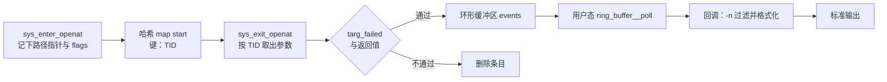

# B.15 实战：编写一个系统观测工具

服务启动失败时，日志里往往只留下一句模糊的「配置文件读取失败」，究竟尝试载入了哪个路径却语焉不详。如果试图用 `strace -p` 临时附着到正在运转的进程上，系统调用的每一次进出都会触发断点停顿，被跟踪的服务很容易出现肉眼可见的卡顿甚至超时，面对排山倒海而来的数万行系统调用输出也难以快速定位。这里我们要综合前面各节积累的技术组件，组装出一个实用的生产级观测小工具：在内核态静默监听全系统的 `openat`，按进程名或 PID 筛选出目标进程，逐行展示其访问的文件路径、操作结果以及获取的文件描述符，做到随挂随停且对被测服务几无扰动。

这个工具被命名为 openwatch，在功能形态与输出列排布上均向 bcc 经典的 opensnoop 看齐。在具体的工程实现中，内核态的拦截探针与用户态的处理程序协同工作：通过只读配置区传入动态过滤规则，经由无锁环形缓冲区投递事件流，并由信号处理机制实现优雅的资源回收，最终借助 `strace` 作为基准手段核实工具输出的每一条诊断记录。

## 1. 需求

工具的核心目标，是清晰刻画指定进程打开了哪些文件、每次系统调用的执行成败以及错误成因。在输出终端呈现的单条记录中，包含五项核心度量指标：发起调用的进程号、进程名、系统调用返回的文件描述符、出错时的 errno 错误码以及传入的文件路径；当指定 `-T` 选项时，还会在行首附带高精度相对时间戳。

| 列 | 含义 |
| --- | --- |
| `PID` | 发起调用的进程号 |
| `COMM` | 进程名，取自内核里的 comm 字段，最长 15 个字符 |
| `FD` | `openat` 的返回值；成功时是文件描述符，失败时为 `-1` |
| `ERR` | 失败时 errno 的数值，成功时为 `0` |
| `PATH` | 调用时传入的路径，原样显示，不做绝对路径补全 |
| `TIME(s)` | 只有 `-T` 时出现，从第一条记录起算的秒数，保留 9 位小数 |

命令行参数的设计沿用系统运维工具的通用约定：

| 选项 | 作用 |
| --- | --- |
| `-p PID` | 只看这个进程 |
| `-n 名称` | 只看进程名里含该子串的记录 |
| `-x` | 只看失败的打开 |
| `-T` | 每行前加时间戳 |
| `-d 秒数` | 运行这么多秒后自行退出 |
| `-v` | 打开 libbpf 的调试日志 |

将 FD 与 ERR 分离为独立的输出列，源于 `openat` 返回语义的两种分化状态：系统调用要么成功分配一个非负的文件描述符，要么返回 -1 并将具体的失败原因沉淀于全局 errno 中。工具将这两种状态展平成并列的两列，排查人员只需快速扫视表格，即可直观定位异常失败的系统调用。

## 2. 设计

一次 `openat` 完整的系统调用过程，在内核内部跨越了入口与出口两个独立的跟踪点。在入口阶段，内核栈帧完整保留了用户传入的文件名指针与打开标志位等参数，但此刻系统调用尚未执行，无法预知最终成败；而当代码流转至出口时，虽然系统调用的最终返回值已就绪，但入口处的参数寄存器早已被后续逻辑复用或覆盖，退出跟踪点的上下文内已寻觅不到原始路径的踪迹。这种时空割裂决定了观测工具必须采用「前后配对」的设计架构：入口探针截获参数后先将其寄存到哈希 map 中，出口探针再凭借同一执行流的标识将其取回，补全执行结果后判定是否将整条事件推入事件流。



### 2.1 以 TID 为键

入口探针存入 map 的检索键必须使用线程 ID（TID），而绝非进程号。在调用 `bpf_get_current_pid_tgid()` 辅助函数时，内核返回的 64 位整数精巧地组合了这两项标识：高 32 位对应用户空间常说的进程号（内核内部称为 tgid，即线程组 ID），低 32 位才是当前正在执行的线程 ID（内核语境下的 task_struct->pid，具体语义辨析见 [B.5](/教程/正文/系统编程/拓展B_eBPF/B_5_辅助函数与上下文)）。

选择 TID 作为唯一标识的机理在于执行流的时空约束：在单线程的生命周期中，任一时刻它至多只能陷入一个系统调用内部，因此在该线程跨越 `openat` 入口与出口的极短时间窗口内，TID 具备严格的时序唯一性。相反，对于由多线程构成的现代服务端进程，完全可能出现多个线程几乎在同一瞬间同时调用 `openat` 的情形。若盲目以进程 ID 作为键值，后进入系统调用的线程便会毫无察觉地覆盖先进入线程存入 map 的路径与标志位；待到先前的线程完成调用准备在出口提取参数时，取出的却是另一个线程刚刚覆写的指针，导致输出日志中的路径与返回码张冠李戴。

<Quiz
  type="single"
  :options="[
    { label: '线程 ID 比进程号小，查询更快', value: 'A' },
    { label: '同一进程的多个线程可能同时处在 openat 中，用进程号作键会互相覆盖', value: 'B' },
    { label: '内核只允许用线程 ID 作 map 的键', value: 'C' },
    { label: '用进程号作键时验证器会拒绝加载', value: 'D' }
  ]"
  answer="B"
>

正确答案是 **B**。

`start` map 保存的是一份「正在进行的调用」的现场，它必须和发起调用的那个执行流一一对应。线程是内核调度的单位，一次系统调用属于某个线程；用 tgid 作键时，同进程的两个线程会争用同一个键。验证器不检查键的含义，C 和 D 都不成立。

</Quiz>

### 2.2 在出口读路径

在入口探针截获现场时，程序仅仅暂存指向路径的用户空间内存指针，路径字符串本身的解引用拷贝则推迟至系统调用出口执行。这种架构抉择背后蕴含着双重考量。

其首要考量在于内存空间与拷贝开销的精简。系统路径长度上限可达 256 字节，若在入口阶段就将完整字符串深拷贝至 map 中，每一个处于执行中的并发 `openat` 都须在哈希表内部吞吐占用 256 字节以上的内存空间；而若仅保存指针地址，单个哈希节点的值结构体仅占用 16 字节。在高并发调用密集的生产主机上，这一体积缩减能极大幅度减轻内核 map 的内存驻留压力与入队开销。

第二重考量则直接关联用户空间虚拟内存的缺页异常机制。eBPF 辅助函数 `bpf_probe_read_user_str` 在内核上下文读取用户虚拟内存时，由于探针运行环境的安全限制，禁止触发缺页异常中断；如果目标内存页尚未完成物理映射或已被置换出内存，读取操作将直接宣告失败返回错误。在入口阶段，用户传入的路径缓冲区尚未被当次系统调用访问，物理页极有可能尚未载入；而到了系统调用出口时刻，内核底层的文件系统逻辑（如 `getname`）必然已将该用户空间路径完整读取并载入物理页，此时借助辅助函数读取该区域，几乎绝不会因缺页而遭遇静默读取失败。从 bcc 官方的 opensnoop 到现代 libbpf-tools 的实现，均恪守着「入口存地址、出口读内容」这一典范范式。

::: compare left-title="入口就把字符串复制进 map" right-title="入口只存指针，出口再读"

```c
/* 每个正在进行的调用都占 256 多字节 */
struct open_args {
    char filename[256];
    __s64 flags;
};
bpf_probe_read_user_str(args.filename, sizeof(args.filename),
                        ctx->args[1]);
```

---

```c
/* 每个正在进行的调用只占 16 字节 */
struct open_args {
    const char *filename;
    __s64 flags;
};
args.filename = (const char *)ctx->args[1];
/* 出口处才调用 bpf_probe_read_user_str */
```

:::

在异常边界条件下，若读取失败，绝不能允许未初始化的 256 字节脏数据流入事件通道。因此在出口处必须对 `bpf_probe_read_user_str` 的返回值进行校验，若遭遇负数错误码，则主动将路径缓冲区的首字节归零截断，使上层展现为空字符串。这也是在实战中偶见某些异常调用后路径为空的成因所在。

<Quiz
  type="single"
  :options="[
    { label: '入口处 ctx 里没有 args 字段', value: 'A' },
    { label: '出口处才能拿到返回值，而入口处内核还没有访问过这段用户空间内存', value: 'B' },
    { label: '系统调用出口的上下文不允许调用辅助函数', value: 'C' },
    { label: '路径字符串在出口处会被内核改写', value: 'D' }
  ]"
  answer="B"
>

正确答案是 **B**。

入口的上下文里同样有 `args`，出口的上下文同样可以调用辅助函数，A 和 C 都不成立。路径字符串属于调用者，内核不会去改它。选 B 的两条理由：返回值只在出口有；出口时内核刚复制过这段内存，不会再因为缺页而读失败。

</Quiz>

### 2.3 过滤策略与两态划分

在设计过滤规则时，根据计算特征将其解耦至内核态与用户态两处执行。

针对 `-p` 指定的目标进程号以及 `-x` 指定的仅关注失败调用的过滤项，其判定对象分别为数字类型的 tgid 与返回整型值，只需一两条最基础的整数比较指令即可定夺，故而最为契合内核态探针直接过滤。被这些规则裁撤的事件将被立刻丢弃，既不触发环形缓冲区的槽位预留，也不会令用户态从轮询睡眠中无谓惊醒。而针对 `-n` 指定的进程名子串过滤，由于需要在内核中抓取 comm 字段并展开昂贵的多字节子串遍历比对，在 BPF 汇编指令集下实现复杂度过高且收益递减，因而更为适宜交由用户态的事件轮询回调做轻量匹配。

这一权衡的底层逻辑在于环形缓冲区容量的物理制约。环形缓冲区严格按事件数量消耗预分配内存，单个事件结构体占用 304 字节，默认 256 KB 大小的缓冲区最多容纳约 862 条并发事件；一旦突发事件激增，未能及时消费的缓冲区便会填满并迫使 `bpf_ringbuf_reserve` 返回空指针，触发事件丢弃。对于那些仅凭单条整数指令即可阻绝的不相关系统调用，将其阻断在内核入口阶段，避免无端挤占宝贵的缓冲区槽位。

::: compare left-title="全部在用户态过滤" right-title="数字比较放在内核态"

```c
/* 内核态把每个事件都发出来，三类判断全在回调里做 */
if (name_filter != NULL && strstr(e->comm, name_filter) == NULL)
    return 0;
if (only_failed && e->ret >= 0)
    return 0;
if (pid != 0 && e->pid != pid)
    return 0;
```

---

```c
/* 内核态先挡掉不关心的调用 */
if (targ_tgid != 0 && targ_tgid != (__u32)(id >> 32))
    return 0;
/* 出口处 */
if (targ_failed && ctx->ret >= 0)
    goto cleanup;
```

:::

::: concept ebpf-openwatch-pairing title="入口与出口配对"

同一线程的一次系统调用在入口与出口之间只可能有一条记录，因此可以用线程 ID 作键：入口把参数放进 map，出口按键取出、补上返回值，再删除该条目。删除必须发生在每一条路径上，否则条目会一直留在 map 里，等到这个 TID 被新线程复用时，出口会读到上一次调用留下的旧参数。

:::

## 3. 共享头文件

内核态与用户态两半程序必须在底层事件的物理内存布局上严格对齐：内核探针按照约定的字节偏移写入结构体成员，用户态解析程序则按照完全相同的字段排布读取。将这一接口定义抽取到独立的公共头文件中，两端源码在编译期各自包含一次，能够杜绝由于人工在两边分别维护数据结构而滋生的对齐与长度脱节隐患。

`code/系统编程/拓展B_eBPF/B_15_实战_系统观测工具/openwatch.h`：

```c
#ifndef OPENWATCH_H
#define OPENWATCH_H

#define TASK_COMM_LEN 16
#define PATH_LEN 256

/* 入口程序记下、出口程序取回的参数 */
struct open_args {
    const char *filename;
    __s64 flags;
};

/* 送到用户态的事件 */
struct event {
    __u64 ts;
    __u32 pid;
    __u32 tid;
    __u32 uid;
    __s32 ret;
    __s64 flags;
    char comm[TASK_COMM_LEN];
    char path[PATH_LEN];
};

#endif
```

该头文件自身完全解耦，不引入任何系统或运行库头文件。内核态探针源码将其置于 `vmlinux.h` 之后包含，用户态程序则将其安排在 `<bpf/libbpf.h>` 之后引入，其中的 `__u32`、`__s64` 等固定位宽类型分别由这两套独立的前置环境注入。

在结构体的定义中，所有整型成员一律采用固定位宽的标量类型（如 `__u32`、`__u64`、`__s32`、`__s64`）。通用标量类型（如 `long`）在不同体系架构（如 32 位与 64 位）下的位宽存在差异，在跨越内核与用户空间的二进制交互中极易引入对齐灾难。结构体 `open_args` 中的 `const char *` 仅作为内核哈希 map 的内部值存在，并不会随事件打包向用户态传递；由于内核态与现代主流 64 位用户态拥有相同的指针位宽，此处直接保存地址指针十分自然，而在推向用户态的 `event` 结构体中，则必须原汁原味地承载拷贝完成的字符数组。

结构体的物理内存排布同样经过精细对齐。在 x86-64 体系的 ABI 规则下，`ts` 占第 0～7 字节，后续三个 4 字节的 `__u32` 占第 8～19 字节，`ret` 占第 20～23 字节，8 字节的 `flags` 严丝合缝地从第 24 字节开始，紧接着字符数组 `comm` 与 `path` 分别自第 32 字节与第 48 字节展开，整个结构体自然对齐为 304 字节，不产生隐式尾部填充空洞。这一确定尺寸意味着 256 KB 容量的环形缓冲区在物理极限下可稳固承载约 862 条并发事件。只要两侧编译流引入相同的头文件定义，便能确保内存解读的完全一致。

## 4. 内核态程序

`code/系统编程/拓展B_eBPF/B_15_实战_系统观测工具/openwatch.bpf.c` 的完整内容如下。

```c
#include "vmlinux.h"
#include <bpf/bpf_helpers.h>

#include "openwatch.h"

char LICENSE[] SEC("license") = "Dual BSD/GPL";

const volatile __u32 targ_tgid = 0;
const volatile bool targ_failed = false;

struct {
    __uint(type, BPF_MAP_TYPE_HASH);
    __uint(max_entries, 10240);
    __type(key, __u32);
    __type(value, struct open_args);
} start SEC(".maps");

struct {
    __uint(type, BPF_MAP_TYPE_RINGBUF);
    __uint(max_entries, 256 * 1024);
} events SEC(".maps");

struct {
    __uint(type, BPF_MAP_TYPE_PERCPU_ARRAY);
    __uint(max_entries, 1);
    __type(key, __u32);
    __type(value, __u64);
} dropped SEC(".maps");

static __always_inline void count_dropped(void) {
    __u32 zero = 0;
    __u64 *cnt = bpf_map_lookup_elem(&dropped, &zero);

    if (cnt != NULL) {
        (*cnt) += 1;
    }
}

SEC("tracepoint/syscalls/sys_enter_openat")
int handle_enter(struct trace_event_raw_sys_enter *ctx) {
    __u64 id = bpf_get_current_pid_tgid();
    __u32 tid = (__u32)id;
    struct open_args args = {};

    if (targ_tgid != 0 && targ_tgid != (__u32)(id >> 32)) {
        return 0;
    }

    args.filename = (const char *)ctx->args[1];
    args.flags = ctx->args[2];
    bpf_map_update_elem(&start, &tid, &args, BPF_ANY);
    return 0;
}

SEC("tracepoint/syscalls/sys_exit_openat")
int handle_exit(struct trace_event_raw_sys_exit *ctx) {
    __u64 id = bpf_get_current_pid_tgid();
    __u32 tid = (__u32)id;
    struct open_args *args;
    struct event *e;

    args = bpf_map_lookup_elem(&start, &tid);
    if (args == NULL) {
        return 0;
    }

    if (targ_failed && ctx->ret >= 0) {
        goto cleanup;
    }

    e = bpf_ringbuf_reserve(&events, sizeof(*e), 0);
    if (e == NULL) {
        count_dropped();
        goto cleanup;
    }

    e->ts = bpf_ktime_get_ns();
    e->pid = (__u32)(id >> 32);
    e->tid = tid;
    e->uid = (__u32)bpf_get_current_uid_gid();
    e->ret = (__s32)ctx->ret;
    e->flags = args->flags;
    bpf_get_current_comm(&e->comm, sizeof(e->comm));
    if (bpf_probe_read_user_str(&e->path, sizeof(e->path), args->filename) < 0) {
        e->path[0] = '\0';
    }
    bpf_ringbuf_submit(e, 0);

cleanup:
    bpf_map_delete_elem(&start, &tid);
    return 0;
}
```

### 4.1 只读参数与三张 map

`targ_tgid` 与 `targ_failed` 两个全局对象被显式修饰为 `const volatile`。在编译阶段，libbpf 会自动将它们映射至 ELF 的 `.rodata` 节区，在内核内部具象化为一个单元素的数组型只读 map。用户态控制进程在完成骨架 `open` 之后、执行 `load` 之前，有且仅有一次机会改写其内存数值；一旦进入加载阶段，验证器会将这两个全局配置当作不可变常量对待。若用户未指定 `-p`（即 `targ_tgid` 保持默认值 0），验证器在静态分析时便能直接判定表达式 `targ_tgid != 0` 恒为假，进而在死代码消除阶段将整段过滤分支指令彻底剥离，达成零分支开销；若开启失败过滤，`targ_failed` 亦依循相同机制消除冗余指令路径。这一范式充分展现了常量折叠在 eBPF 性能敏感路径上的威力。

名为 `start` 的哈希 map 容量被配置为 10240。该阈值代表系统在同一微秒级时间窗口内能够同时并发处于 `openat` 系统调用栈内部的最大活跃线程数，对于绝大多数生产主机而言，这一上限具备极充裕的安全裕量。一旦系统遭遇突发高并发调用导致哈希桶耗尽，`bpf_map_update_elem` 会返回负数错误码，该次调用在出口探针处将因键值缺失而直接早退，不生成观测事件。代码在此处故意略去对更新返回值的检查，其工程考量在于：单条事件因容量饱和而丢失并不会破坏其余条目的独立性与生命周期，完全没有必要在系统调用的核心热路径上追加多余的分支开销。

名为 `events` 的对象为环形缓冲区，其配置项 `max_entries` 设定为 256 KB。该值在底层受到严格约束：必须是 2 的幂次，且必须是底层操作系统页面大小的整数倍，否则内核在创建 map 阶段将直接驳回。用 256 KB 除以单条事件的 304 字节尺寸，得出缓冲区在填满前大约可容纳 862 条就绪事件。

名为 `dropped` 的对象则定义为 Per-CPU 数组，其容量仅设为 1，专门用于统计因缓冲区饱和而溢出丢弃的事件量。因为每个 CPU 核心在运行其本地探针时拥有专属的存储槽位，不存在多个 CPU 核心跨核并发抢占写入单一点位的可能；探针在内核上下文执行期间也不会被其他上下文抢占，因而局部累加表达式 `(*cnt) += 1` 完全免除了昂贵的总线原子锁指令。当程序终止时，用户态只需统一遍历各个 CPU 槽位并将计数值累加，即可获取全系统丢失事件的总和。

### 4.2 入口：只记参数

跟踪点 `sys_enter_openat` 所承载的上下文类型为 `struct trace_event_raw_sys_enter`，其内部的 `args[6]` 数组按顺序列出该系统调用的全部输入参数，类型为 `long unsigned int`。结合标准系统调用原型 `int openat(int dfd, const char *pathname, int flags, ...)`，可知 `args[0]` 代表基准目录描述符，目标路径指针位于 `args[1]`，而各类打开标志位则位于 `args[2]`。

探针进入后首先触发针对 tgid 的准入拦截。辅助函数 `bpf_get_current_pid_tgid()` 仅需调用一次，通过位移运算与低位截断即可同时提取高 32 位的进程号与低 32 位的线程号。若当前执行流未命中监控目标，探针立刻退出；若命中，则构造一个临时的参数结构体暂存文件名指针与标志位，并以当前 TID 为键插入哈希 map。

### 4.3 出口：补返回值并发事件

跟踪点 `sys_exit_openat` 暴露的上下文类型为 `struct trace_event_raw_sys_exit`，其实际的系统调用返回状态存储在 `ctx->ret` 字段中，类型为 `long int`。

探针首要动作是以当前线程的 TID 为检索键查询 `start` 表。在实际运行中，查询落空（返回空指针）可能源自三种典型场景：该线程在系统调用入口处因未命中 `-p` 规则已被提前截断；入口阶段由于哈希表短暂饱和未能成功存入；或者 openwatch 工具本身是在该线程陷入系统调用之后才被动态挂载的。对于这三类情况，探针无需执行任何后续补救措施，直接返回 0。

如果命中已暂存的入口参数，接着根据用户是否启用了 `-x`（仅排查失败调用）展开判断。若 `targ_failed` 被置位且当前调用返回值大于等于 0（代表调用成功），探针立即跳转至清理标签。特别需要注意，清理标签处的 `bpf_map_delete_elem` 是整条执行链路的绝对汇聚点，任何已成功入表的条目都必须在此被彻底摘除，否则这些死条目将永久滞留在内核内存中，直到该 TID 被操作系统复用给全新线程时诱发严重的状态污染。

在确定需要向上层报告事件后，程序调用 `bpf_ringbuf_reserve` 向环形缓冲区申请写入空间。若返回空指针说明缓冲区遭遇阶段性拥塞，探针随即递增丢失计数器，而后同样跳转至清理分支释放哈希节点。这种采用预留（reserve）配合最终提交（submit）的操作模式，直接将内核分配的无锁内存指针暴露给探针进行原地字段填充，彻底省去了中间临时对象的二次栈拷贝开销；而在资源管理语义上，一旦 reserve 成功，后续路径必须保证严格配对调用 submit 或 discard，否则验证器的引用计数分析器将判定存在泄漏并拒绝加载。

在事件字段填充阶段，涉及数项关键的数据宽度截断技巧：`e->pid = (__u32)(id >> 32)` 将 64 位的符合标识转换为用户空间熟悉的 32 位 PID；`e->ret = (__s32)ctx->ret` 则将 64 位的返回值收窄为 32 位整数，因为 Linux 系统调用返回的非负文件描述符或负数错误码均能无损映射至 32 位整型空间；`bpf_get_current_comm` 负责填充进程名并由内核自动保障末位截断符；最后由 `bpf_probe_read_user_str` 尝试向目标缓冲区深拷贝路径字符串。

::: generate ebpf-openwatch-walkthrough kind=explanation concepts=ebpf-openwatch-pairing

面向刚读完 B.6 与 B.9、第一次把入口与出口拼成一个工具的读者，按执行顺序走读上面的内核态程序：先说明入口为什么只存指针、map 的键为什么是 TID，再说明出口处查不到条目意味着什么、为什么每条路径都要删除条目，最后说明 reserve 失败时为什么先记一笔丢失再删除。走读时指出 `-p` 与 `-x` 是加载时就定下来的常量判断，`-n` 在这里不出现。不要总结，不要复述全部代码。

:::

## 5. 用户态程序

用户态应用程序承担着整个工具链的编排与呈现任务：解析命令行入参并注入 ELF 的只读配置区、轮询内核事件流并展开格式化终端输出，以及捕获中断信号并驱动底层的平滑退出。

### 5.1 命令行、信号与日志

```c
static void usage(const char *prog) {
    /* 用法行与各选项说明，见下面的完整源码 */
    fprintf(stderr, "用法: %s [选项]\n", prog);
}

static void on_signal(int sig) {
    (void)sig;
    exiting = 1;
}

int main(int argc, char *argv[]) {
    /* ... */
    while ((opt = getopt(argc, argv, "p:n:xd:Tvh")) != -1) {
        switch (opt) {
        case 'p':
            pid = (__u32)strtoul(optarg, NULL, 10);
            break;
        case 'n':
            name_filter = optarg;
            break;
        case 'x':
            only_failed = true;
            break;
        /* ... */
        }
    }
    if (optind < argc) {
        usage(argv[0]);
        return 1;
    }
    /* ... */
}
```

`getopt` 的第三个参数里，带冒号的字母表示它需要一个参数，`p:`、`n:`、`d:` 都是。解析完之后 `optind` 指向第一个非选项参数，本工具不接受位置参数，多出来就打印用法。

信号处理函数只做一件事：把 `exiting` 置 1。`exiting` 的类型是 `volatile sig_atomic_t`，这是信号处理函数里能安全读写的少数几种整型之一。真正的清理放在主循环退出之后，信号处理函数里不调用 `printf`，也不释放任何东西。`sigaction` 与这个标志的用法在[信号、时间与定时器](/教程/正文/系统编程/6_信号_时间与定时器)里讲过。

`libbpf_set_print(libbpf_log)` 换掉 libbpf 默认的日志函数。这层包装在 `-v` 没给的时候把 `LIBBPF_DEBUG` 级别的行丢掉，其余原样转到 stderr。`-v` 时打开调试级别，能看到 libbpf 创建了哪些 map、加载了哪个程序，加不上钩子时也是从这些行里找原因。

### 5.2 打开、配置、加载、附加

```c
skel = openwatch_bpf__open();
if (skel == NULL) {
    fprintf(stderr, "打开 BPF 对象失败\n");
    return 1;
}

/* 只读参数必须在 open 之后、load 之前写入 */
skel->rodata->targ_tgid = pid;
skel->rodata->targ_failed = only_failed;

err = openwatch_bpf__load(skel);
if (err != 0) {
    fprintf(stderr, "加载 BPF 对象失败: %s\n", strerror(-err));
    goto cleanup;
}

err = openwatch_bpf__attach(skel);
if (err != 0) {
    fprintf(stderr, "附加 BPF 程序失败: %s\n", strerror(-err));
    goto cleanup;
}
```

这四步生命周期流转延续了 [B.3](/教程/正文/系统编程/拓展B_eBPF/B_3_第一个eBPF程序) 中确立的核心骨架，在此处额外增加了向 `.rodata` 映射区注入运行时配置的关键一环。这一顺序存在严格的因果前置约束：`open` 阶段仅负责将磁盘上的 ELF 文件解析至用户空间的 `bpf_object` 抽象实体中，内核中尚未派生任何真实的 map 或校验程序；而随后的 `load` 阶段不仅负责完成底层内核对象与程序指令的创建与验证，还会驱动重定位机制并将只读数据段冻结为不可变状态。若在 `load` 完成后再尝试改写该区域，改动将根本无法同步至已被内核封存的常量段中；反之若在 `open` 之前写入，则甚至连宿主结构体都尚未完成初始化。

libbpf 的绝大多数底层 API 在失败时均直接返回负数的错误码（如 `-EINVAL` 或 `-EPERM`）。在错误报告分支中通过取负操作 `strerror(-err)`，即可平滑转化为人类可读的系统标准错误描述。在资源管理上，这类骨架工具借助析构函数 `openwatch_bpf__destroy` 集中接管已打开的文件描述符与内核程序引用，即便在流程中途遭遇失败，也无需编写冗长易错的阶梯式逆向回滚代码，统一跳转至 cleanup 标签即可安全释放全量申请的资源。

<Quiz
  type="single"
  :options="[
    { label: 'open 之后、load 之前', value: 'A' },
    { label: 'load 之后、attach 之前', value: 'B' },
    { label: 'attach 之后、进入主循环之前', value: 'C' },
    { label: '任何时候都可以，内核每次运行程序时重新读取', value: 'D' }
  ]"
  answer="A"
>

正确答案是 **A**。

`load` 之前，`.rodata` 还只是用户态的一块内存，可以随便写；`load` 时 libbpf 把它作为 map 交给内核并冻结，验证器按当时的值做常量折叠，此后写不进去。D 错在「每次运行都重新读取」：验证器在加载时就把 `targ_tgid != 0` 这类判断裁掉了，运行时的代码里根本没有这条分支。

</Quiz>

### 5.3 回调：把事件变成一行

```c
static int handle_event(void *ctx, void *data, size_t size) {
    const struct event *e = data;
    int fd;
    int err;

    (void)ctx;
    if (size < sizeof(*e)) {
        return 0;
    }
    if (name_filter != NULL && strstr(e->comm, name_filter) == NULL) {
        return 0;
    }

    if (e->ret >= 0) {
        fd = e->ret;
        err = 0;
    } else {
        fd = -1;
        err = -e->ret;
    }

    if (show_time) {
        if (first_ts == 0) {
            first_ts = e->ts;
        }
        printf("%-14.9f", (double)(e->ts - first_ts) / 1e9);
    }
    printf("%-6u %-16s %4d %3d %s\n", e->pid, e->comm, fd, err, e->path);
    return 0;
}
```

回调函数的入参中，`data` 指针直接映射环形缓冲区内部当条事件的头部内存，`size` 则指示内核实际投递的有效字节长度。在进行任何强转解引用前，首先校验 `size` 是否达到事件结构体的最小物理尺寸，构建坚实的内存边界防护。

`-n` 进程名过滤之所以安排在此处执行，是因为在用户态使用标准 C 库的 `strstr` 可以在进程名缓冲区中自如搜索任意子串。这也是使用 `-n ed` 时会将 `sed` 一并检索出的原因，基于子串的包含匹配完全契合这一行为特征。

对于返回状态，FD 与 ERR 的分流呈现确立了整个工具的核心展示规范：调用成功时 FD 直接反映内核返回的文件描述符，ERR 保持为 0；调用失败时 FD 强制规范化为 `-1`，ERR 则提取内核负数返回值的相反数以还原标准正整数 errno。

高精度时间戳的基准锚定在程序观测到的首条记录上，而非宿主机自开机以来的原始绝对纳秒计数值，这使得终端打印的时间序列数值规模保持紧凑清晰，极大提升了排障人员对事件时延间隔的直观体感。格式化串 `%-14.9f` 严格保证了纳秒级精度与表头字段的视觉对齐。

### 5.4 主循环、超时与丢失计数

```c
rb = ring_buffer__new(bpf_map__fd(skel->maps.events), handle_event, NULL,
                      NULL);
if (rb == NULL) {
    fprintf(stderr, "创建环形缓冲区失败: %s\n", strerror(errno));
    err = 1;
    goto cleanup;
}

/* ... */

err = 0;
while (!exiting) {
    int n = ring_buffer__poll(rb, 100);
    if (n == -EINTR) {
        continue;
    }
    if (n < 0) {
        fprintf(stderr, "轮询环形缓冲区失败: %s\n", strerror(-n));
        err = 1;
        break;
    }
    if (has_deadline) {
        struct timespec now;
        clock_gettime(CLOCK_MONOTONIC, &now);
        if (now.tv_sec > deadline.tv_sec ||
            (now.tv_sec == deadline.tv_sec &&
             now.tv_nsec >= deadline.tv_nsec)) {
            break;
        }
    }
}

cleanup:
    print_dropped(skel);
    ring_buffer__free(rb);
    openwatch_bpf__destroy(skel);
    return err != 0;
```

API `ring_buffer__new` 接收事件 map 的文件描述符及消费回调指针。libbpf 底层封装了基于 Linux epoll 的就绪通知机制，因此 `ring_buffer__poll` 的第二参数定义的是阻塞等待的超时毫秒数，绝非 CPU 忙等待轮询。设定 100 毫秒的适度超时，能够赋予主循环周期性苏醒并检查退出信号标志位与截止时间的机会，即便是全系统处于调用静默期亦能平稳受控。

当终端输入 Ctrl-C 发送中断信号时，底层的 `epoll_wait` 系统调用将被立即打断并使 `ring_buffer__poll` 抛出负向的 `-EINTR` 错误码。应用层绝不能将其误判为致命异常而崩溃；通过 `continue` 让执行流回转，循环判定条件在下一刻即可敏锐捕捉到信号处理函数改写的 `exiting` 状态，驱动主循环优雅平稳地收尾。

针对 `-d` 参数指定的自退出逻辑，时间计算应当采用单调时钟 `CLOCK_MONOTONIC`，而非依赖系统挂钟时间的 `time()` 或 `gettimeofday()`。单调时钟从开机起严格向前线性流淌，完全不受 NTP 时间同步或管理员手动修改系统时间的影响；指定 10 秒即是坚固确定的 10 秒真实物理跨度。时间比对时优先判断秒数、再核验纳秒部分，免除了浮点转换引入的微小舍入误差。

在程序彻底注销退出前，工具会主动核验并报告可能发生的事件丢失状况。`dropped` 采用 Per-CPU 数组 map 存储，用户空间必须借助专用逻辑批量按核抓取：

```c
static void print_dropped(struct openwatch_bpf *skel) {
    int ncpus = libbpf_num_possible_cpus();
    int fd = bpf_map__fd(skel->maps.dropped);
    __u64 *values;
    __u32 key = 0;
    __u64 total = 0;

    /* ... 按 ncpus 分配 values ... */
    if (bpf_map_lookup_elem(fd, &key, values) == 0) {
        for (int i = 0; i < ncpus; i++) {
            total += values[i];
        }
    }
    if (total != 0) {
        fprintf(stderr, "环形缓冲区满，丢弃了 %llu 个事件\n",
                (unsigned long long)total);
    }
    free(values);
}
```

为用户态缓冲区预分配的内存块必须覆盖 `libbpf_num_possible_cpus()` 所声明的全部可用 CPU 槽位，这是遍历 Per-CPU 结构必须遵循的系统编程规范。当系统在观测窗口期内完全没有发生丢包时，静默跳过此段提示，避免向终端吐出冗余的干扰信息。

::: details 完整的 openwatch.c

```c
#define _POSIX_C_SOURCE 200809L

#include <errno.h>
#include <getopt.h>
#include <signal.h>
#include <stdbool.h>
#include <stdio.h>
#include <stdlib.h>
#include <string.h>
#include <time.h>

#include <bpf/bpf.h>
#include <bpf/libbpf.h>

#include "openwatch.h"
#include "openwatch.skel.h"

static volatile sig_atomic_t exiting;
static bool verbose_log;

static bool show_time;
static const char *name_filter;
static __u64 first_ts;

static void usage(const char *prog) {
    fprintf(stderr,
            "用法: %s [-p PID] [-n 名称] [-x] [-T] [-d 秒数] [-v]\n"
            "\n"
            "  -p PID   只跟踪这个进程\n"
            "  -n 名称  只显示进程名含该子串的事件\n"
            "  -x       只显示失败的打开\n"
            "  -T       每行前加时间戳\n"
            "  -d 秒数  运行指定时间后退出\n"
            "  -v       输出 libbpf 的调试日志\n",
            prog);
}

static void on_signal(int sig) {
    (void)sig;
    exiting = 1;
}

static int libbpf_log(enum libbpf_print_level level, const char *fmt,
                      va_list args) {
    if (level == LIBBPF_DEBUG && !verbose_log) {
        return 0;
    }
    return vfprintf(stderr, fmt, args);
}

/* 每 CPU 数组 map：一次取回每个 CPU 一份计数，再在用户态求和 */
static void print_dropped(struct openwatch_bpf *skel) {
    int ncpus = libbpf_num_possible_cpus();
    int fd = bpf_map__fd(skel->maps.dropped);
    __u64 *values;
    __u32 key = 0;
    __u64 total = 0;

    if (ncpus <= 0) {
        return;
    }
    values = calloc((size_t)ncpus, sizeof(*values));
    if (values == NULL) {
        return;
    }
    if (bpf_map_lookup_elem(fd, &key, values) == 0) {
        for (int i = 0; i < ncpus; i++) {
            total += values[i];
        }
    }
    if (total != 0) {
        fprintf(stderr, "环形缓冲区满，丢弃了 %llu 个事件\n",
                (unsigned long long)total);
    }
    free(values);
}

static int handle_event(void *ctx, void *data, size_t size) {
    const struct event *e = data;
    int fd;
    int err;

    (void)ctx;
    if (size < sizeof(*e)) {
        return 0;
    }
    if (name_filter != NULL && strstr(e->comm, name_filter) == NULL) {
        return 0;
    }

    if (e->ret >= 0) {
        fd = e->ret;
        err = 0;
    } else {
        fd = -1;
        err = -e->ret;
    }

    if (show_time) {
        if (first_ts == 0) {
            first_ts = e->ts;
        }
        printf("%-14.9f", (double)(e->ts - first_ts) / 1e9);
    }
    printf("%-6u %-16s %4d %3d %s\n", e->pid, e->comm, fd, err, e->path);
    return 0;
}

int main(int argc, char *argv[]) {
    struct openwatch_bpf *skel;
    struct ring_buffer *rb = NULL;
    struct sigaction sa = { .sa_handler = on_signal };
    struct timespec deadline;
    bool has_deadline = false;
    __u32 pid = 0;
    int duration = 0;
    bool only_failed = false;
    int err;
    int opt;

    while ((opt = getopt(argc, argv, "p:n:xd:Tvh")) != -1) {
        switch (opt) {
        case 'p':
            pid = (__u32)strtoul(optarg, NULL, 10);
            break;
        case 'n':
            name_filter = optarg;
            break;
        case 'x':
            only_failed = true;
            break;
        case 'T':
            show_time = true;
            break;
        case 'd':
            duration = atoi(optarg);
            break;
        case 'v':
            verbose_log = true;
            break;
        case 'h':
            usage(argv[0]);
            return 0;
        default:
            usage(argv[0]);
            return 1;
        }
    }
    if (optind < argc) {
        usage(argv[0]);
        return 1;
    }

    libbpf_set_print(libbpf_log);

    skel = openwatch_bpf__open();
    if (skel == NULL) {
        fprintf(stderr, "打开 BPF 对象失败\n");
        return 1;
    }

    /* 只读参数必须在 open 之后、load 之前写入 */
    skel->rodata->targ_tgid = pid;
    skel->rodata->targ_failed = only_failed;

    err = openwatch_bpf__load(skel);
    if (err != 0) {
        fprintf(stderr, "加载 BPF 对象失败: %s\n", strerror(-err));
        goto cleanup;
    }

    err = openwatch_bpf__attach(skel);
    if (err != 0) {
        fprintf(stderr, "附加 BPF 程序失败: %s\n", strerror(-err));
        goto cleanup;
    }

    rb = ring_buffer__new(bpf_map__fd(skel->maps.events), handle_event, NULL,
                          NULL);
    if (rb == NULL) {
        fprintf(stderr, "创建环形缓冲区失败: %s\n", strerror(errno));
        err = 1;
        goto cleanup;
    }

    sigemptyset(&sa.sa_mask);
    if (sigaction(SIGINT, &sa, NULL) != 0 ||
        sigaction(SIGTERM, &sa, NULL) != 0) {
        fprintf(stderr, "设置信号处理函数失败: %s\n", strerror(errno));
        err = 1;
        goto cleanup;
    }

    if (show_time) {
        printf("%-14s", "TIME(s)");
    }
    printf("%-6s %-16s %4s %3s %s\n", "PID", "COMM", "FD", "ERR", "PATH");

    if (duration > 0) {
        clock_gettime(CLOCK_MONOTONIC, &deadline);
        deadline.tv_sec += duration;
        has_deadline = true;
    }

    err = 0;
    while (!exiting) {
        int n = ring_buffer__poll(rb, 100);
        if (n == -EINTR) {
            continue;
        }
        if (n < 0) {
            fprintf(stderr, "轮询环形缓冲区失败: %s\n", strerror(-n));
            err = 1;
            break;
        }
        if (has_deadline) {
            struct timespec now;
            clock_gettime(CLOCK_MONOTONIC, &now);
            if (now.tv_sec > deadline.tv_sec ||
                (now.tv_sec == deadline.tv_sec &&
                 now.tv_nsec >= deadline.tv_nsec)) {
                break;
            }
        }
    }

cleanup:
    print_dropped(skel);
    ring_buffer__free(rb);
    openwatch_bpf__destroy(skel);
    return err != 0;
}
```

:::

## 6. 构建

三样东西要按顺序生成：`vmlinux.h`、`openwatch.bpf.o`、`openwatch.skel.h`，最后才是链接。Makefile 把这条依赖链写清楚，改一个文件就只重做下游。

`code/系统编程/拓展B_eBPF/B_15_实战_系统观测工具/Makefile`：

```makefile
# openwatch：监视 openat 的 eBPF 工具
#
#   make          生成 vmlinux.h、编译内核态程序、生成骨架、链接用户态程序
#   make clean    删除生成的文件

CLANG ?= clang
BPFTOOL ?= bpftool
CC ?= cc

.PHONY: all clean
.DELETE_ON_ERROR:

all: openwatch

# 目标机器的内核 BTF 转成 C 头文件；不入库
vmlinux.h:
	$(BPFTOOL) btf dump file /sys/kernel/btf/vmlinux format c > $@

openwatch.bpf.o: openwatch.bpf.c openwatch.h vmlinux.h
	$(CLANG) -g -O2 -target bpf -mcpu=v3 -D__TARGET_ARCH_x86 -I. -c $< -o $@

# 骨架把目标文件嵌进 C 数组，生成 openwatch_bpf__open 等函数
openwatch.skel.h: openwatch.bpf.o
	$(BPFTOOL) gen skeleton $< > $@

openwatch: openwatch.c openwatch.h openwatch.skel.h
	$(CC) -std=c17 -Wall -Wextra -g openwatch.c -o $@ $$(pkg-config --cflags --libs libbpf)

clean:
	rm -f openwatch openwatch.bpf.o openwatch.skel.h vmlinux.h
```

`make -n` 按依赖顺序打印出四条命令：

::: terminal title="zsh - make -n"

```text
$ make -n
bpftool btf dump file /sys/kernel/btf/vmlinux format c > vmlinux.h
clang -g -O2 -target bpf -mcpu=v3 -D__TARGET_ARCH_x86 -I. -c openwatch.bpf.c -o openwatch.bpf.o
bpftool gen skeleton openwatch.bpf.o > openwatch.skel.h
cc -std=c17 -Wall -Wextra -g openwatch.c -o openwatch $(pkg-config --cflags --libs libbpf)
```

:::

第一阶段执行的命令将目标物理主机内核的 BTF 二进制描述逆向转译为 C 语言头文件 `vmlinux.h`。该文件包含了宿主内核中数以万计的类型与结构体定义，体积通常达到数兆字节；它完全脱胎于当前机器的运行时环境，不应纳入版本控制系统，在工程清理目标 `clean` 中予以一并清除。

第二阶段负责内核端探针字节码的编译构建。参数 `-g` 指示编译器保留 BTF 调试类型符号，这是后续骨架自动生成机制以及运行时 CO-RE 重定位的核心支撑；优化级别 `-O2` 为强制要求，若使用 `-O0` 生成的未优化指令流会产生大量深层栈帧调用与松散跳转，极易突破验证器的复杂度与安全约束；`-target bpf` 明确指定底层目标架构为 BPF 虚拟机；`-mcpu=v3` 将指令集版本固定，避免因不同工具链版本的隐式规则变化导致生成的汇编序列发生漂移。定义宏 `-D__TARGET_ARCH_x86` 则用于辅助 `bpf_tracing.h` 内部辨析特定处理器的寄存器排布规则。

第三阶段驱动骨架自动生成。bpftool 扫描编译出的目标文件，将其二进制机器码打包内嵌为一个静态 C 数组，并在外层封装出一组结构清晰的类型化实体：

```c
struct openwatch_bpf {
	struct bpf_object_skeleton *skeleton;
	struct bpf_object *obj;
	struct {
		struct bpf_map *start;
		struct bpf_map *events;
		struct bpf_map *dropped;
		struct bpf_map *rodata;
	} maps;
	struct {
		struct bpf_program *handle_enter;
		struct bpf_program *handle_exit;
	} progs;
	struct {
		struct bpf_link *handle_enter;
		struct bpf_link *handle_exit;
	} links;
	struct openwatch_bpf__rodata {
		__u32 targ_tgid;
		bool targ_failed;
	} *rodata;
};
```

源码中声明的 `handle_enter` 与 `handle_exit` 两个探针函数、`start`、`events`、`dropped` 三张内核 map，均在骨架中自动派生出了同名字段。只读数据段映射结构体中的两个配置项，亦严整对应源码中修饰为 `const volatile` 的只读全局对象。

第四阶段负责用户空间主程序的编译与最终链接。利用 `pkg-config --libs libbpf` 能够自动展开底层依赖参数 `-lbpf`；而 libbpf 内部所需要的 libelf 与 zlib 等附属依赖已在其 `.pc` 元数据中妥善声明，在动态链接机制下由动态链接器自动跟随解析，无需在编译指令中反复罗列。在面向生产环境分发自研观测工具时，更为稳妥的工程实践是将 libbpf 静态编译入二进制文件中，目标机器仅需具备标准内核与运行时 BTF 支持即可直接无依赖运行，具体配置思路参见[库与第三方依赖](/教程/正文/开发与工程基础/10_库与第三方依赖)。

## 7. 运行与核对

### 7.1 基本用法

加载 BPF 程序和附加跟踪点都需要特权，命令前面加 `sudo`。

::: terminal title="zsh - openwatch"

```text
$ sudo ./openwatch -T -p 1956
TIME(s)       PID    COMM               FD ERR PATH
0.000000000   1956   supervise           9   0 supervise/status.new
0.000289999   1956   supervise           9   0 supervise/status.new
1.023068000   1956   supervise           9   0 supervise/status.new
1.023381997   1956   supervise           9   0 supervise/status.new
2.046030000   1956   supervise           9   0 supervise/status.new
^C
```

:::

输出类似，摘自 bcc 仓库的 `tools/opensnoop_example.txt`（原输出共 8 行，这里摘了 5 行）。本工具的列宽和格式与它一致，`-T -p` 的组合也一样。这几行说明 `supervise` 每秒打开两次 `status.new`，PID 被限制在 1956，窗口里只有这一个进程。

不带 `-T` 时头部是 `PID COMM FD ERR PATH`，行里没有时间列。加 `-n` 时进程名做子串匹配：

::: terminal title="zsh - openwatch -n"

```text
$ sudo ./openwatch -n ed
PID    COMM               FD ERR PATH
2679   sed                 3   0 /etc/ld.so.cache
2679   sed                 3   0 /lib/x86_64-linux-gnu/libselinux.so.1
2679   sed                 3   0 /lib/x86_64-linux-gnu/libc.so.6
2679   sed                 3   0 /lib/x86_64-linux-gnu/libpcre.so.3
2679   sed                -1   2
2679   sed                 3   0 /usr/lib/x86_64-linux-gnu/gconv/gconv-modules.cache
^C
```

:::

这段同样摘自 opensnoop 的示例输出，中间省略了几行。`-n ed` 想筛的是名字含 `ed` 的进程，`sed` 也被带了进来，这就是子串匹配的效果。倒数第二行是失败的一次打开：FD 为 `-1`，ERR 为 `2`，路径为空，因为那一段用户空间内存没有读到。

`-x` 只保留失败的行，输出里每一行都是 `-1` 加一个非零的 ERR；`-d 5` 让工具运行 5 秒后自己退出，适合放在脚本里；`-v` 打出来的日志走 stderr，不会混进结果。

### 7.2 用已知的负载核对

拿一句确定的命令来验：读一个存在的文件，再读一个不存在的文件。

```bash
sudo ./openwatch -d 3 &
cat /etc/hostname
cat /nonexistent-file
wait
```

`cat /etc/hostname` 那一行应当出现 `FD 3`、`ERR 0` 和路径 `/etc/hostname`；`cat /nonexistent-file` 那一行应当是 `FD -1`、`ERR 2`。`2` 是 `ENOENT`，意思是文件不存在。这两条就是判据：一条成功、一条失败，ERR 的数值与 `errno.h` 里的宏对得上，工具的行为就正常。下面的 strace 输出就是同一台机器上对第二条命令的记录，`openat` 返回 `-1 ENOENT` 的那一行与它对应。

`cat` 还会打开动态库和 locale 文件，所以窗口里不止这两行。想看得更干净，用 `-p` 锁住 `cat` 的 PID，或者用下一节的办法逐行对照。

### 7.3 与 strace 对照

`strace` 用 ptrace 跟踪系统调用，不需要加载任何 BPF 程序，适合用来核对。下面是同一台机器上的真实输出：

::: terminal title="zsh - strace"

```text
$ strace -f -e trace=openat cat /nonexistent-file
123996 openat(AT_FDCWD, "/etc/ld.so.cache", O_RDONLY|O_CLOEXEC) = 3
123996 openat(AT_FDCWD, "/lib/x86_64-linux-gnu/libc.so.6", O_RDONLY|O_CLOEXEC) = 3
123996 openat(AT_FDCWD, "/usr/lib/locale/locale-archive", O_RDONLY|O_CLOEXEC) = 3
123996 openat(AT_FDCWD, "/nonexistent-file", O_RDONLY) = -1 ENOENT (No such file or directory)
123996 openat(AT_FDCWD, "/usr/share/locale/locale.alias", O_RDONLY|O_CLOEXEC) = 3
123996 openat(AT_FDCWD, "/usr/share/locale/en_US/LC_MESSAGES/libc.mo", O_RDONLY) = -1 ENOENT (No such file or directory)
123996 openat(AT_FDCWD, "/usr/share/locale/en/LC_MESSAGES/libc.mo", O_RDONLY) = -1 ENOENT (No such file or directory)
123996 +++ exited with 1 +++
```

:::

将 strace 的原始追踪轨迹转译为 openwatch 的输出行，其语义转换规则高度严谨：返回值 `= 3` 精确映射为 `FD 3 ERR 0`；而错误返回 `= -1 ENOENT` 则无缝映射至 `FD -1 ERR 2`。行首打印的十进制数字为操作系统进程号，openwatch 的 `PID` 字段与之完全吻合。在 strace 端追加 `-f` 参数，能够指示调试器连同目标进程通过 `fork` 或 `clone` 派生的所有子进程与子线程一同拦截；若被诊断的目标程序采用多进程工作模型，缺少 `-f` 便会导致后半程业务逻辑发起的系统调用完全隐形。

在双终端并排运行对比时，左侧观察 openwatch 的实时流，右侧运行附带 strace 的对照命令，两者捕获的时序轨迹应当保持严格镜像。如果出现未对齐的偏差行，通常可归结为三类经典根因：openwatch 处于全系统广播监听状态，未加过滤时会自然捕获后台 cron 作业或系统守护进程的并发调用；strace 端遗漏了 `-f` 选项导致子进程脱靶；抑或在 openwatch 端通过 `-p` 锁定了特定 PID，而此时目标程序恰好派生了具有全新进程号的工作子进程。在精密核对时，建议将两端输出各自重定向为文本文件，并用文本处理工具比对相同路径的调用序列。

这两组工具在性能扰动上的鸿沟亦展露无遗。基于传统 ptrace 机制的 strace 每当遇到目标系统调用的入口与出口，均会触发两次昂贵的上下文陷入并导致被测进程挂起等待调试器唤醒；高频调用下被测服务往往出现肉眼可见的严重降速。而 openwatch 依托内核内部的无锁探针与共享环形缓冲区，被测进程的执行流中仅仅追加了纳秒级的探针跳转与数据填报，完全不存在跨进程调度阻塞。对于严苛的生产环境连续观测，基于 eBPF 的方案展现出压倒性的工程实用价值。

### 7.4 开销与丢失

`openat` 属于操作系统中最频繁被触发的系统调用之一。在源码编译、微服务批量拉起或利用 `find` 递归遍历大型目录树时，调用速率极易突破数万次每秒。在这一极端压力下，工具的核心瓶颈往往不在内核态探针的处理消耗，而是用户态消费者对终端标准输出的字符排版与写入刷新开销。

如果遭遇由于事件生成速率超过用户态消费能力而引发的缓冲区溢出，工具在终止退出前会主动向标准错误流打印格式为 `环形缓冲区满，丢弃了 N 个事件` 的告警提示。一旦观测到该提示，应当优先借助 `-p` 或 `-x` 参数将无谓的健康调用或不相关进程拦截在内核入口端，避免挤占缓冲区；或将输出直接重定向至本地持久化文件以规避终端模拟器的滚动渲染阻尼。需要再次强调，`-n` 进程名过滤由于发生在用户态回调内部，已被其阻绝的事件依然在内核环形缓冲区中实打实地占位过，无法缓解瞬时流量过大导致的丢弃现象。

## 8. 扩展方向

要覆盖 `openat2`，加一对 `sys_enter_openat2` / `sys_exit_openat2` 跟踪点，从第三个参数的 `struct open_how` 里读出 flags 和 mode，其余逻辑不变。

要加 UID 列，事件结构里已经有 `uid`，只需在 `-U` 打开时多打一列，并在内核态加一个 `-u` 的只读参数做数值比较。

要把结果交给别的程序处理，把回调里的 `printf` 换成 JSON 输出，一行一个对象，再用管道接给 `jq` 之类的工具。

要加 PPID 列，在出口处用 `bpf_get_current_task_btf()` 拿到当前任务的 `task_struct`，再用 `BPF_CORE_READ` 沿 `real_parent` 读出父进程的 tgid，这是 [B.8](/教程/正文/系统编程/拓展B_eBPF/B_8_libbpf_BTF与CO_RE) 的写法。

## 9. 习题

### 9.1 巩固

<Exercise id="47501" :d="2" :w="2">

回答两个问题，各用两三句话。

(1) 把 `start` map 的键从 TID 改成 `bpf_get_current_pid_tgid() >> 32`（也就是 tgid），在什么负载下会出错？出错时用户在屏幕上看到的现象是什么样的？

(2) 假设有人把 `handle_exit` 里 `cleanup` 处的 `bpf_map_delete_elem` 删掉了。工具还能正常出结果吗？运行一整天后，`bpftool map show` 里 `start` 的 `max_entries` 和当前元素数会呈现什么关系？

</Exercise>

<Exercise id="47502" :d="3" :w="2">

Makefile 里 `openwatch.skel.h` 依赖 `openwatch.bpf.o`，`openwatch.bpf.o` 依赖 `openwatch.bpf.c` 和 `vmlinux.h`。

(1) 如果删掉 `openwatch.skel.h: openwatch.bpf.o` 这条依赖，只保留 `openwatch.skel.h: openwatch.bpf.c`，改了 `openwatch.bpf.c` 之后连续两次 `make` 会发生什么？写出你预期看到的输出。

(2) `vmlinux.h` 为什么要放在 `clean` 里删掉，而 `openwatch.h` 不进 `clean`？

(3) 用 `make -n` 验证你对 (1) 的判断，把输出贴出来。

</Exercise>

<Exercise id="47503" :d="3" :w="2">

给用户态程序加一个 `-U` 选项：打开时在 PID 列之前多打一列 UID，表头写 `UID`。

要求：

1. 只改 `openwatch.c`，不改内核态程序和头文件，`uid` 已经在事件结构里；
2. 列宽与 opensnoop 一致，UID 列宽 6、左对齐；
3. `-T` 与 `-U` 同时给出时，顺序是 `TIME(s)`、`UID`、`PID`、`COMM`、`FD`、`ERR`、`PATH`；
4. 用 `-U` 跑一次 `-d 2`，确认 UID 一列的数字与 `id -u` 对得上（`sudo` 之后运行的进程 UID 是 0）。

</Exercise>

### 9.2 编程

<Exercise id="47504" :d="3" :w="3">

给 openwatch 加 `-u UID`：只显示这个用户发起的打开。

要求：

1. 内核态加一个 `const volatile __u32 targ_uid`，在入口处用 `bpf_get_current_uid_gid()` 的低 32 位比较，不匹配直接返回；
2. 用户态用 `getopt` 解析 `-u`，在 open 之后、load 之前写进 `.rodata`；
3. 验收：用 `sudo ./openwatch -u 1000 -d 3` 观察，同时用另一个普通用户终端执行 `cat /etc/hostname`，结果里应当只有该用户的进程；再用 `-u 0` 跑一次，对比两次输出里 PID 的分布；
4. 说明为什么这个过滤放在入口而不是出口，放在入口与放在出口对 `start` map 的占用有什么不同。

</Exercise>

<Exercise id="47505" :d="4" :w="3">

给工具加退出汇总：在 `-d` 到期或按 Ctrl-C 之后，向 stderr 打印三行，分别是事件总数、失败次数、以及出现最多的三个 errno 及其次数。

要求：

1. 统计在用户态的回调里做，用一张 `errno` 到计数的表（数组即可，errno 的常见取值在 1～133 之间）；
2. 排序时次数相同的按 errno 升序，格式写成 `ENOENT(2) 12`；
3. 验收：造一个含三次不存在的文件的负载，例如

```bash
sudo ./openwatch -n cat -d 3 &
cat /no1 /no2 /no3
wait
```

   汇总里的失败次数应当不小于 3，ENOENT 的计数与 `strace -c -e trace=openat cat /no1 /no2 /no3` 里 `openat` 的 `errors` 列对照；
4. 汇总只在事件总数大于 0 时打印。

</Exercise>

<Exercise id="47506" :d="4" :w="4">

给 openwatch 加 `openat2` 支持。

要求：

1. 新增一对程序，节名 `tracepoint/syscalls/sys_enter_openat2` 和 `tracepoint/syscalls/sys_exit_openat2`；
2. `openat2` 的第三个参数是指向 `struct open_how` 的用户空间指针，入口用一个局部对象加 `bpf_probe_read_user` 把 flags 读出来，路径仍在 `args[1]`；
3. 四个程序共用同一个 `start` map 和同一个 `events` 环形缓冲区，说明为什么不会串：同一线程不可能同时在两个系统调用里，而每个出口只匹配同名的入口；
4. 验收：先用 `strace -e trace=openat2` 看看手边的命令走不走这个系统调用；不走的话，用 `syscall(SYS_openat2, AT_FDCWD, "/etc/hostname", &how, sizeof how)` 写一个小程序触发，其中 `how.flags` 填 `O_RDONLY`，确认 openwatch 记录到了这条路径；
5. 说明为什么 `openat2` 的 flags 不能像 `openat` 那样直接从 `ctx->args[2]` 取。

</Exercise>

<Exercise id="47507" :d="5" :w="4">

下面是一个学生的版本，编译能过、加载也能过，但结果不对。找出全部缺陷并修复。

```c
SEC("tracepoint/syscalls/sys_enter_openat")
int handle_enter(struct trace_event_raw_sys_enter *ctx) {
    __u32 pid = bpf_get_current_pid_tgid() >> 32;
    struct open_args args = {};

    args.filename = (const char *)ctx->args[0];
    bpf_map_update_elem(&start, &pid, &args, BPF_ANY);
    return 0;
}

SEC("tracepoint/syscalls/sys_exit_openat")
int handle_exit(struct trace_event_raw_sys_exit *ctx) {
    __u32 pid = bpf_get_current_pid_tgid() >> 32;
    struct open_args *args = bpf_map_lookup_elem(&start, &pid);
    struct event *e;

    if (args == NULL) {
        return 0;
    }
    e = bpf_ringbuf_reserve(&events, sizeof(*e), 0);
    if (e == NULL) {
        return 0;
    }
    bpf_probe_read_user_str(&e->path, sizeof(e->path), args->filename);
    bpf_ringbuf_submit(e, 0);
    return 0;
}
```

要求：

1. 逐条列出缺陷，说明每一条在屏幕上造成的现象，而不是只说「应该改」；
2. 修复后写一个能稳定复现原缺陷的负载：给出一个多线程同时 `openat` 的程序，让错误版本至少一次把路径配错；
3. 说明 `e` 里 `comm`、`ret`、`ts` 三个成员在这个版本里是什么值，以及为什么输出里会看到它们异常。

</Exercise>

<Exercise id="47508" :d="6" :w="5">

把 `-n` 的子串过滤从用户态移到内核态，并测量两边的差别。

要求：

1. 内核态加 `const volatile char targ_comm[16]`，在出口再用 `bpf_get_current_comm` 取当前进程名，用 `__builtin_memcmp` 按 16 字节比较前缀（注意内核态没有 libc 的 `strstr`，前缀比较与子串匹配的含义不同，要在答案里说明这个取舍）；
2. 用户态的 `-n` 写进 `.rodata`，回调里不再过滤；
3. 测量方法：在两个版本下跑同一条固定负载（例如 `for i in $(seq 200); do cat /etc/hostname; done`），记录 `sudo bpftool prog show` 里该程序的 `run_time_ns` 与 `calls`，再记录用户态进程的 `utime`（`/proc/PID/stat` 的第 14 个字段），各取三次；
4. 用一张表对比四种组合（过滤在内核/用户态 × 命中率高/低）的开销，说明什么情况下值得把过滤移进内核；
5. 说明为什么本页的代码最终把 `-n` 留在用户态。

</Exercise>

### 9.3 综合与挑战

<Exercise id="47509" :d="7" :w="5" scope="*">

给 openwatch 加一个 `--summary` 模式：不逐条打印事件，而是在退出时按进程打印打开次数与失败次数，按打开次数降序取前 10。

要求：

1. 内核态用一张哈希 map，键是 tgid，值是「打开次数、失败次数」两个计数，在出口处更新；`open_args` 与 `start` 的配对逻辑不变；
2. 用户态在退出时用 `bpf_map_get_next_key` 遍历整张 map，排序后打印 `PID COMM OPEN FAIL` 四列，进程名从事件里取或者另外用 `/proc/PID/comm` 读；
3. 与逐条输出对比：同一条负载（`for i in $(seq 2000); do cat /etc/hostname; done`）下，两种模式的用户态 CPU 时间差多少，用 `/usr/bin/time -v` 或 `perf stat` 测；
4. 说明两种模式各自适合什么场景：什么时候需要每一条记录，什么时候只需要计数；
5. 说明这张汇总 map 的容量该取多大，表满之后计数会怎样丢失，以及怎样让丢失可见。

</Exercise>

## 10. 参考资料

- bcc 的 opensnoop 示例输出，本页引用的运行输出取自这里：<https://github.com/iovisor/bcc/blob/master/tools/opensnoop_example.txt>
- bcc 的 opensnoop Python 实现，入口存指针、出口读路径的写法出自这里：<https://github.com/iovisor/bcc/blob/master/tools/opensnoop.py>
- libbpf-tools 的 opensnoop 内核态程序，CO-RE 版本的结构与本页的 `start`、`events` 两张 map 相同：<https://github.com/iovisor/bcc/blob/master/libbpf-tools/opensnoop.bpf.c>
- libbpf-bootstrap，骨架的 open、load、attach 三步与 Makefile 的写法参照这里：<https://github.com/libbpf/libbpf-bootstrap>
- Andrii Nakryiko，**_BPF ring buffer_**，环形缓冲区的 reserve/submit 语义与丢失统计：<https://nakryiko.com/posts/bpf-ringbuf/>
- Andrii Nakryiko，**_Building BPF applications with libbpf-bootstrap_**：<https://nakryiko.com/posts/libbpf-bootstrap/>
- Brendan Gregg，**_BPF CO-RE Reference Guide_**：<https://nakryiko.com/posts/bpf-core-reference-guide/>
- 内核文档中 BPF map 与环形缓冲区的说明：<https://docs.kernel.org/bpf/maps.html>、<https://docs.kernel.org/bpf/ringbuf.html>
- bpftool 的 gen skeleton 子命令：<https://github.com/libbpf/bpftool/blob/main/docs/bpftool-gen.rst>
- `openat(2)`、`openat2(2)`，参数顺序与 `struct open_how` 的字段：<https://man7.org/linux/man-pages/man2/openat.2.html>、<https://man7.org/linux/man-pages/man2/openat2.2.html>
- `getopt(3)`，选项字符串与 `optind` 的语义：<https://man7.org/linux/man-pages/man3/getopt.3.html>
- `sigaction(2)`，`volatile sig_atomic_t` 的用法：<https://man7.org/linux/man-pages/man2/sigaction.2.html>
- `bpf-helpers(7)` 中 `bpf_probe_read_user_str`、`bpf_ringbuf_reserve`、`bpf_get_current_comm` 的说明：<https://man7.org/linux/man-pages/man7/bpf-helpers.7.html>
- **_Learning eBPF_**，Liz Rice，O'Reilly，ISBN 978-1-098-13512-6，其中讲 opensnoop 与入口出口配对的一章
