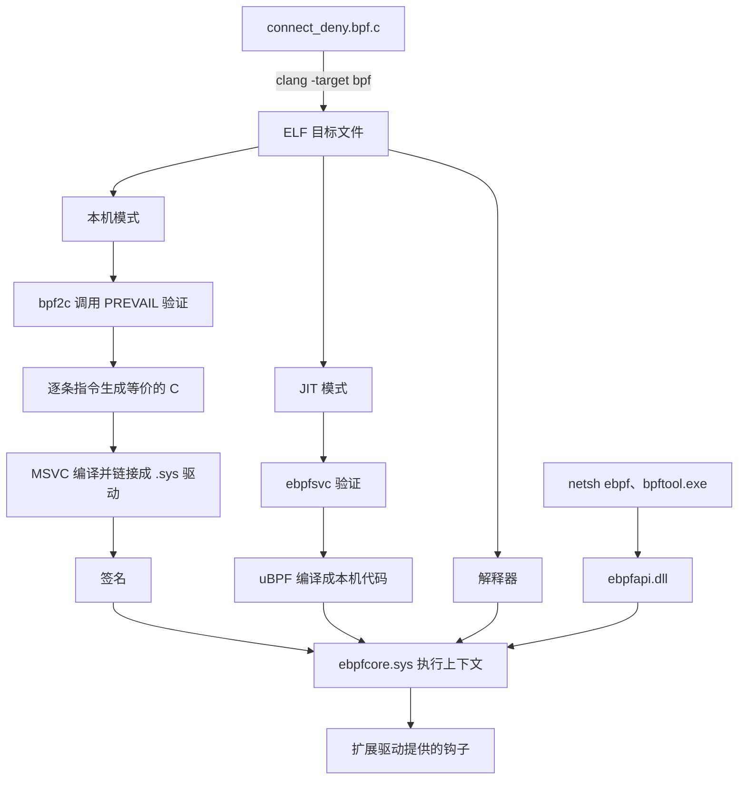

# B.16 eBPF for Windows 与跨平台前景

一个团队在 Linux 上用 eBPF 做网络访问策略，服务器换成 Windows 之后，同一份 `.bpf.c` 还能不能用？把源文件拷过去，`clang -target bpf` 照样能编译出目标文件；把 Linux 上编好的 `.o` 直接拷过去，就加载不了。这两句话概括了 eBPF 跨平台的现状：源码层面已经能共用，二进制层面还差得远。

这一页讲三件事。第一，eBPF for Windows 这个项目把 eBPF 放在了 Windows 的哪一层，用什么验证、用什么执行、钩子从哪里来。第二，它和 Linux 的 eBPF 在哪些地方不一样，为什么同样的 C 语句在两份头文件下编译出的指令不同。第三，写一个两个平台都能编译的 `connect` 拒绝程序，并说明哪些部分能共用、哪些必须各写一份。Windows 侧的编译在本机完成，需要加载驱动才能看到的 `netsh` 输出引用官方教程，标成「输出类似」。

## 1. 为什么要在 Windows 上运行 eBPF

### 1.1 项目的目标

2021 年 5 月 10 日，微软在开源博客上公布了 eBPF for Windows。它不是把 Linux 内核里的那套代码移植过来，而是把已有的开源组件拼起来，再加上 Windows 特有的宿主环境：字节码由 clang 生成，验证器用 [PREVAIL](https://github.com/vbpf/ebpf-verifier)，JIT 和解释器来自 [uBPF](https://github.com/iovisor/ubpf)，对外的 API 仿照 libbpf。项目的 README 自称 work-in-progress，做的是「把 Linux 生态里熟悉的工具链和 API 放到 Windows 上」这件事。

目标写成了「源码兼容」（source code compatibility）：使用两个系统共有的钩子和辅助函数的源码，可以分别编译到两个平台。Linux 特有的东西不在兼容范围内，例如按内核内部结构体写成的观测程序。项目支持 Windows 11 和 Windows Server 2022 及以上。写作时的最新版本是 1.7.0（2026 年 10 月 16 日发布），仍然标为预发布（Pre-release）。

### 1.2 源码兼容不等于二进制兼容

「源码兼容」这四个字容易被读成「编一次，两边都能跑」，实际不是。ebpf-go 的 Windows 支持文档写得很清楚：eBPF for Windows 只提供源码兼容，不与 Linux 二进制兼容，在 Linux 上编译出的 eBPF 程序不能拿到 Windows 上使用；按两边头文件编出的 ELF 也互不通用。

::: concept win-ebpf-source-compat title="源码兼容的含义"

同一份使用通用钩子与辅助函数的 C 源码，可以分别用两个平台的头文件编译成目标文件，并各自加载运行。两个平台的目标文件不能互换：辅助函数编号、程序类型编号、map 类型编号、钩子名称和上下文布局都是各自定义的，加载器按这些编号解释字节码，换一个平台就会解释成另一件事。

:::

原因在下一节展开，这里先记住结论：能共用的是源文件，不是 `.o`。

<Quiz
  type="single"
  :options="[
    { label: '可以，只要用 clang -target bpf 编译过就行', value: 'A' },
    { label: '可以，但要先用 bpf2c 转成 C 再编译', value: 'B' },
    { label: '不可以，两个平台只是源码兼容，目标文件不能互换', value: 'C' },
    { label: '可以，但只能加载到 JIT 模式', value: 'D' }
  ]"
  answer="C"
>

<template #question>

在 Linux 上用 clang 编好的 `.bpf.o`，能不能直接拿到安装了 eBPF for Windows 的机器上加载？

</template>

正确答案是 **C**。两个平台的辅助函数编号、程序类型编号和上下文布局都不同，加载器无从解释另一个平台的目标文件。第 3 节给出具体的编号和偏移。

</Quiz>

::: generate win-ebpf-source-compat-walk kind=explanation concepts=win-ebpf-source-compat

面向已经会用 Linux 上 libbpf 工具链、但对跨平台移植没有概念的读者。用一个具体例子说明「源码兼容」与「二进制兼容」的区别：同一份 `connect4` 程序在两边都能编译通过，但其中的辅助函数调用编号、上下文里字段的偏移、返回值的取值都不一样。不要总结，只把三处差异逐一讲清楚，并说明为什么这些事情发生在编译期而不是加载期。

:::

## 2. 架构

### 2.1 三条执行路径

eBPF 程序从 C 源码到在 Windows 内核里运行，中间的路和 Linux 不一样。Linux 上验证与 JIT 都在加载时由内核完成；Windows 上没有可以随时接受字节码的内核设施，于是分成三条路。



三条路径的处理方式如下。

**本机模式（native）** 是官方推荐的一条。`bpf2c` 先把目标文件交给 PREVAIL 验证，验证通过后把每条 eBPF 指令翻译成等价的 C 语句，交给 MSVC 编译、链接成一个 `.sys` 驱动，再签名。驱动里的代码是普通的本机指令，Windows 的代码完整性机制愿意接受它。

**JIT 模式** 由用户态服务 `ebpfsvc.exe` 验证字节码，再用 uBPF 的 JIT 编译成本机代码，交给内核里的执行上下文。

**解释器** 逐条执行字节码，只存在于调试版，发布版里没有。

::: concept win-ebpf-native-mode title="本机模式"

本机模式把验证放在编译期，而不是加载期：`bpf2c` 先用 PREVAIL 证明程序安全，再把每条指令翻译成等价的 C，最终产物是一个签过名的 Windows 驱动。因为产物是签名的 PE 文件，它在启用了虚拟机监控程序保护的代码完整性（Hypervisor-protected Code Integrity，HVCI）的系统上也能加载，而 JIT 出来的代码页没有可信签名，在 HVCI 下会被拒绝。官方文档因此把本机模式称为部署 eBPF 程序的首选方式。

:::

HVCI 这一条是三条路径并存的主要原因。HVCI 让虚拟机监控程序负责内核代码的完整性校验，只接受由可信密钥签名的代码页；JIT 编译器的产物拿不到这样的签名，所以 JIT 模式在 HVCI 打开的生产系统上不能用，而解释器又不在发布版里。把 eBPF 程序变成签名的驱动，才能绕开这个限制。

JIT 模式正在被移除。2026 年 2 月 9 日开的 issue（编号 4997）标题是 Deprecate JIT code，正文写的是「JIT / interpret is not supported in runtime for any scenarios」，要求删掉 JIT、uBPF 及其全部依赖；到 1.7.0 为止这个 issue 还开着。同一时期的变化已经落到安装程序上：JIT 是一个可选的子组件，只装运行时组件时「only native code generation is enabled」。

<Quiz
  type="multi"
  :options="[
    { label: '产物是一个签名的 .sys 驱动', value: 'A' },
    { label: '验证在生成驱动时完成，不在加载时完成', value: 'B' },
    { label: '可以在启用了 HVCI 的系统上加载', value: 'C' },
    { label: '需要内核里有一个常驻的 JIT 编译器', value: 'D' }
  ]"
  :answer="['A', 'B', 'C']"
>

<template #question>

关于本机模式，下列说法哪些正确？

</template>

正确答案是 **A、B、C**。D 说的是 JIT 模式：JIT 需要 `ebpfsvc.exe` 和内核侧的编译产物，本机模式不需要。

</Quiz>

### 2.2 组件分工

Windows 上的 eBPF 由几个二进制组成，各自的位置如下。

| 组件 | 位置 | 作用 |
| --- | --- | --- |
| `ebpfapi.dll` | 用户态 | 对外的共享库，暴露与 libbpf 同名的 API，加载程序、操作 map 都经过它 |
| `ebpfnetsh.dll` | 用户态 | `netsh.exe` 的插件，提供 `netsh ebpf` 系列命令 |
| `ebpfsvc.exe` | 用户态 | 服务进程，负责 JIT 模式下的验证与编译 |
| `ebpfcore.sys` | 内核态 | 执行上下文，提供 map、辅助函数和程序的运行环境 |
| `netebpfext.sys` | 内核态 | 扩展驱动，用 Windows 过滤平台（Windows Filtering Platform，WFP）实现网络类钩子 |
| `bpftool.exe` | 用户态 | bpftool 的移植版本，基于 `ebpfapi.dll` |

内核里的执行上下文只负责「跑程序」和「管 map」，钩子由扩展驱动提供。这个划分和 Linux 不同：Linux 的钩子点分散在 kprobe、tracepoint、cgroup、XDP、LSM 各处，由内核本身实现；Windows 上每类钩子对应一个扩展驱动，要加新的钩子就加一个驱动，不动 `ebpfcore.sys`。网络钩子在 `netebpfext.sys`，进程创建与删除事件由另一个仓库 `ntosebpfext` 提供的扩展负责。

程序类型与 SEC 名称的对应关系放在注册表里，位置是 `HKCU:\Software\eBPF\Providers\SectionData`。每一个前缀对应一组 GUID 和编号，例如 `cgroup/connect4`、`sockops`、`xdp`、`sample_ext`。这解释了第 4 节里 `netsh ebpf show verification bpf.o type=sample_ext` 中那个 `type=` 参数：程序放在 `.text` 里，没有 SEC 名称可循，验证器不知道该按哪种上下文检查，只能在命令行上告诉它。

<Quiz
  type="single"
  :options="[
    { label: '内核里的验证器，与 Linux 相同', value: 'A' },
    { label: '用户态的 PREVAIL 验证器', value: 'B' },
    { label: '硬件虚拟化层', value: 'C' },
    { label: '不需要验证，靠签名保证安全', value: 'D' }
  ]"
  answer="B"
>

<template #question>

在 eBPF for Windows 中，由谁验证 eBPF 程序？

</template>

正确答案是 **B**。PREVAIL 是一个用抽象解释实现的静态分析器，跑在用户态。本机模式下它在 `bpf2c` 生成 C 之前运行，验证与生成在构建阶段完成；JIT 模式下由 `ebpfsvc.exe` 调用它。签名只说明这段二进制来自谁，不说明它安全，所以签名不能替代验证。

</Quiz>

::: generate win-ebpf-arch-walk kind=explanation concepts=win-ebpf-native-mode

面向熟悉 Linux 上 libbpf 加载流程、第一次接触 Windows 执行环境的读者。按「源码编译成目标文件之后发生了什么」的顺序，把本机模式的六步走一遍：验证、生成 C、编译 COFF、链接 PE、签名、由执行上下文加载。说明每一步由哪个组件完成、为什么要放在用户态或编译期，并对比 Linux 上「验证与 JIT 都在内核加载时完成」的做法。

:::

### 2.3 和 Linux 的架构图对照

把 [B.1](/教程/正文/系统编程/拓展B_eBPF/B_1_eBPF概览) 里那张 Linux 的架构图放在一起看，差别集中在三处。

第一处是验证的位置。Linux 的验证器在内核里，程序加载时逐条路径模拟寄存器状态；Windows 的验证器在用户态，而且可以提前到构建阶段。验证器本身的设计也不同：Linux 的验证器从入口开始展开所有可达路径，遇到分支就分裂状态，代价是路径数量可能爆炸；PREVAIL 用抽象解释，在控制流汇合处把状态合并，因此能处理循环。2021 年 LWN 的报道指出了这套做法的代价：接受一个程序时更慢、占用内存更多，当时还缺少一部分检查，例如 eBPF 之间的函数调用、数据包重分配和 32 位子寄存器的跟踪；它也会接受一些 Linux 拒绝的程序，反过来也有 Linux 收而它拒的情况。同一份源码在两个平台上能通过验证与否，要各自试过才知道。

第二处是执行的位置。Linux 上 `bpf()` 系统调用完成加载、验证和 JIT，程序随后挂到钩子上；Windows 上没有这样一条系统调用，本机模式的程序在编译期就变成驱动，加载时只是驱动加载。

第三处是钩子的来源。Linux 的钩子由内核提供；Windows 的钩子由扩展驱动提供，加一类钩子就是加一个驱动。

## 3. 与 Linux eBPF 的差异

### 3.1 一张对照表

| 项目 | Linux | eBPF for Windows |
| --- | --- | --- |
| 验证 | 内核中的验证器，逐条路径模拟寄存器状态 | 用户态 PREVAIL，抽象解释，可提前到构建期 |
| 执行 | 加载时 JIT 成本机代码 | 预编译成签名的 `.sys` 驱动；JIT 模式可选，正在被移除 |
| 辅助函数编号 | `bpf_ktime_get_ns` 为 5，`bpf_get_current_pid_tgid` 为 14 | 分别为 9 和 19 |
| 程序类型编号 | `BPF_PROG_TYPE_XDP` 为 6，`BPF_PROG_TYPE_CGROUP_SOCK_ADDR` 为 18 | 分别为 1 和 3 |
| map 类型编号 | `BPF_MAP_TYPE_PERF_EVENT_ARRAY` 为 4，`RINGBUF` 为 27 | 分别为 14 和 13 |
| 钩子 | kprobe、tracepoint、fentry、LSM、cgroup、XDP、tc 等 | XDP、bind（已弃用）、cgroup sock_addr、sock_ops、进程事件；没有 kprobe 与 tracepoint |
| 上下文 | `struct bpf_sock_addr`，`user_ip4` 在偏移 4 | `bpf_sock_addr_t`，`user_ip4` 在偏移 24 |
| BTF 与 CO-RE | 内核 BTF 加加载期重定位 | 对象文件里有 BTF 节，但没有内核 BTF，没有 CO-RE |
| 许可证 | 部分辅助函数只对 GPL 兼容的程序开放 | 加载时忽略，`bpf_prog_load` 把许可证参数标为未使用 |
| 部署 | root 或相应能力 | 驱动必须签名；开发时开测试签名 |
| 系统要求 | 内核 6.6 以上（本章的 tcx 需要） | Windows 11、Windows Server 2022 及以上 |

表里的编号取自两个平台的头文件，不是估计值。下面两小节说明这些编号是怎么产生的，以及它们为什么会直接改变编译结果。

### 3.2 编号不同

两个平台的辅助函数都按编号调用，但编号表是各自维护的。Linux 的 `bpf_helper_defs.h` 由脚本从内核源码生成，`bpf_ktime_get_ns` 排在第五；eBPF for Windows 的 `bpf_helper_defs.h` 是手写的，把用得到的辅助函数重新排了一遍，同一个函数排到了第九。程序类型和 map 类型同样如此，有的编号碰巧相同（`BPF_MAP_TYPE_HASH` 在两边都是 1），有的差得远（`RINGBUF` 在 Linux 是 27，在 Windows 是 13）。

下面这个程序只调用两个辅助函数，用两套头文件各编译一次，看反汇编里的 `call` 编号。完整文件在 `code/系统编程/拓展B_eBPF/B_16_eBPF_for_Windows与跨平台/helper_id.c`：

```c
#if defined(MDR_PLATFORM_WINDOWS)
#include "bpf_helpers.h"
#else
typedef unsigned long long __u64;
typedef unsigned int __u32;
static __u64 (*const bpf_ktime_get_ns)(void) = (void *)5;
static __u64 (*const bpf_get_current_pid_tgid)(void) = (void *)14;
#define SEC(NAME) __attribute__((section(NAME), used))
#endif

SEC("cgroup/connect4")
int probe_helpers(void *ctx) {
    __u64 t = bpf_ktime_get_ns();
    __u64 p = bpf_get_current_pid_tgid();

    (void)ctx;
    if (p == 0) {
        return (int)t;
    }
    return 0;
}
```

Linux 侧的两个函数指针故意按 `bpf_helper_defs.h` 里的编号写成 5 和 14，这样这个文件不依赖 `vmlinux.h` 也能编译。两次编译的反汇编如下。

::: terminal title="PowerShell - helper_id"

<span class="prompt">PS&gt;</span> clang -target bpf -Wall -Wextra -Werror -O2 -c helper_id.c -o helper_linux.o

<span class="prompt">PS&gt;</span> llvm-objdump --triple=bpf -S --no-print-imm-hex helper_linux.o

```text
helper_linux.o:  file format elf64-bpf

Disassembly of section cgroup/connect4:

0000000000000000 <probe_helpers>:
       0:      85 00 00 00 05 00 00 00     call 5
       1:      bf 06 00 00 00 00 00 00     r6 = r0
       2:      85 00 00 00 0e 00 00 00     call 14
       3:      15 00 01 00 00 00 00 00     if r0 == 0 goto +1 <probe_helpers+0x28>
       4:      b4 06 00 00 00 00 00 00     w6 = 0
       5:      bc 60 00 00 00 00 00 00     w0 = w6
       6:      95 00 00 00 00 00 00 00     exit
```

<span class="prompt">PS&gt;</span> clang -target bpf -Wall -Wextra -Werror -O2 -DMDR_PLATFORM_WINDOWS -I&lt;ebpf-for-windows&gt;\include -c helper_id.c -o helper_windows.o

<span class="prompt">PS&gt;</span> llvm-objdump --triple=bpf -S --no-print-imm-hex helper_windows.o

```text
helper_windows.o:  file format elf64-bpf

Disassembly of section cgroup/connect4:

0000000000000000 <probe_helpers>:
       0:      85 00 00 00 09 00 00 00     call 9
       1:      bf 06 00 00 00 00 00 00     r6 = r0
       2:      85 00 00 00 13 00 00 00     call 19
       3:      15 00 01 00 00 00 00 00     if r0 == 0 goto +1 <probe_helpers+0x28>
       4:      b4 06 00 00 00 00 00 00     w6 = 0
       5:      bc 60 00 00 00 00 00 00     w0 = w6
       6:      95 00 00 00 00 00 00 00     exit
```

:::

同一句 `bpf_ktime_get_ns()`，一边是 `call 5`，一边是 `call 9`；`bpf_get_current_pid_tgid()` 一边是 `call 14`，一边是 `call 19`。把 Linux 编出的目标文件交给 Windows 的执行上下文，第 0 条指令会去调用编号 5 的辅助函数，而在 Windows 的编号表里 5 号是 `bpf_tail_call`。这不是「能不能跑」的问题，而是「跑出什么」的问题——所以加载器干脆不接受别的平台的目标文件。

同样的道理适用于 map 类型：`SEC(".maps")` 里 `__uint(type, BPF_MAP_TYPE_RINGBUF)` 被翻译成一个数字写进 `maps` 节，Linux 写 27，Windows 写 13，内核按自己的表去建对象。

::: warning 两边的头文件不能混用

编译 Windows 目标文件时必须用 eBPF for Windows 的 `include` 目录，不能拿 Linux 的 `bpf_helpers.h` 顶替，也不能让两套头文件同时出现在 `-I` 路径里。混用不会报错，编译器只会采用先找到的那一份，编出的目标文件编号全错，直到加载时才暴露出来。

:::

<Quiz
  type="multi"
  :options="[
    { label: '同一份源码用两套头文件编译，辅助函数调用编号不同', value: 'A' },
    { label: '同一个 ctx 字段在两套头文件里偏移不同', value: 'B' },
    { label: 'map 类型编号在两边不同', value: 'C' },
    { label: 'Windows 上的目标文件仍是 ELF 格式', value: 'D' }
  ]"
  :answer="['A', 'B', 'C', 'D']"
>

<template #question>

关于两个平台的差异，下列说法哪些正确？

</template>

正确答案是 **A、B、C、D**。D 容易被忽略：Windows 的加载器读的仍然是 ELF 目标文件，产物变成 `.sys` 是后面 `bpf2c` 的事；目标文件的格式一样，里面的编号和布局不一样。

</Quiz>

### 3.3 同一个 ctx，两套布局

上下文结构体的差异比编号更隐蔽，因为它影响的是每一条访存指令的偏移。Linux 的 `struct bpf_sock_addr` 在 `vmlinux.h` 里，Windows 的 `bpf_sock_addr_t` 在 `ebpf_nethooks.h` 里，两者同名不同构。

下面这个程序把两边定义的关键字段偏移打出来。完整文件在 `code/系统编程/拓展B_eBPF/B_16_eBPF_for_Windows与跨平台/ctx_layout.c`：

```c
#include <stddef.h>
#include <stdint.h>
#include <stdio.h>

#include "ebpf_nethooks.h"

/* Linux 侧：vmlinux.h 中 struct bpf_sock_addr 的字段，按原样抄录。 */
struct bpf_sock_addr_linux {
    uint32_t user_family;
    uint32_t user_ip4;
    uint32_t user_ip6[4];
    uint32_t user_port;
    uint32_t family;
    uint32_t type;
    uint32_t protocol;
    uint32_t msg_src_ip4;
    uint32_t msg_src_ip6[4];
    void *sk;
};

#define SHOW(label, type)                                                                                          \
    printf("%-8s %-16s size %2lu  user_ip4 @ %2lu  user_port @ %2lu  protocol @ %2lu\n", label, #type,              \
           (unsigned long)sizeof(type), (unsigned long)offsetof(type, user_ip4),                                   \
           (unsigned long)offsetof(type, user_port), (unsigned long)offsetof(type, protocol))

int main(void) {
    SHOW("Linux", struct bpf_sock_addr_linux);
    SHOW("Windows", bpf_sock_addr_t);
    return 0;
}
```

这个程序在 Windows 上用 MinGW 编译运行，输出如下。

::: terminal title="PowerShell - ctx_layout"

<span class="prompt">PS&gt;</span> gcc -std=c17 -Wall -Wextra -I&lt;ebpf-for-windows&gt;\include ctx_layout.c -o ctx_layout.exe

<span class="prompt">PS&gt;</span> ./ctx_layout.exe

```text
Linux    struct bpf_sock_addr_linux size 72  user_ip4 @  4  user_port @ 24  protocol @ 36
Windows  bpf_sock_addr_t  size 64  user_ip4 @ 24  user_port @ 40  protocol @ 44
```

:::

两个结构体都只有十来个数组成员，为什么偏移差这么多？Linux 的定义把 `user_family`、`user_ip4`、`user_ip6`、`user_port` 放在最前面，所以 `user_ip4` 在第 4 个字节。Windows 的定义把 `family` 放第一个，然后是一个匿名结构体：

```c
typedef struct bpf_sock_addr
{
    uint32_t family;
    struct
    {
        union { uint32_t msg_src_ip4; uint32_t msg_src_ip6[4]; };
        uint16_t msg_src_port;
    };
    struct
    {
        union { uint32_t user_ip4; uint32_t user_ip6[4]; };
        uint16_t user_port;
    };
    uint32_t protocol;
    uint32_t compartment_id;
    uint64_t interface_luid;
} bpf_sock_addr_t;
```

匿名结构体里的联合体占 16 字节，端口占 2 字节，整个结构体按 4 字节对齐，于是每个匿名结构体占 20 字节。`family` 4 字节加上第一个匿名结构体的 20 字节，`user_ip4` 落在 24；再加 20 字节，第二个匿名结构体的 `user_port` 落在 40。

这个差别直接体现在汇编里。下一节的两个版本的 `connect4` 程序，Linux 版读 `user_ip4` 用的是 `*(u32 *)(r1 + 4)`，Windows 版用的是 `*(u32 *)(r1 + 24)`。同一个字段，两套偏移。

还有一处更细的差别：`user_port` 在 Linux 的 `vmlinux.h` 里是 `__u32`，在 `ebpf_nethooks.h` 里是 `uint16_t`。所以 Linux 版读 4 个字节再与 `0xffff` 取掩码，Windows 版直接读 2 个字节。

两个结构体里还有一处不能靠 sizeof 看出来的差别：字段的语义。`bpf_sock_addr_t` 的注释写明，`user_ip4` 在出方向（connect）时是远端地址、在入方向（recv_accept）时是本地地址；`msg_src_ip4` 则相反。Linux 的 `vmlinux.h` 没有这些注释，得去查 `bpf_sock_addr_kern` 和 cgroup 钩子的文档。写跨平台程序时，字段名的相似会掩盖这层差别。

### 3.4 没有 BTF 就没有 CO-RE

[B.8](/教程/正文/系统编程/拓展B_eBPF/B_8_libbpf_BTF与CO_RE) 讲过 CO-RE 的三方分工：clang 在编译时记录每一次结构体成员访问，libbpf 在加载时读取目标内核的 BTF，按字段名重新算出偏移，把指令里的偏移改掉。这一套要成立，必须有一份描述目标内核类型布局的 BTF。

Windows 没有这样一份 BTF。Windows 内核的类型信息不以 BTF 的形式公开，eBPF for Windows 也不提供。加载接口里的 `core_relos` 字段注释直接写着「Not supported, must be zero」。对象文件里的 `.BTF` 节照常有，那是 clang 为程序自身的类型生成的，`bpf2c` 用它解析 `.maps` 节里的 map 定义、辅助函数原型和全局对象，和 CO-RE 是两回事。

结果是：在 Windows 上，程序里的结构体偏移就是编译时算好的偏移，没有任何东西会在加载时修正它。所以 `connect_deny.bpf.c` 里的 `ctx->user_ip4` 必须对着 `ebpf_nethooks.h` 编译，偏移才对得上；如果拿 Linux 的 `vmlinux.h` 编，偏移差了 20 字节，程序读到的是另一个字段。

::: tip Windows 上的「可移植」指什么

没有 CO-RE，不代表 eBPF for Windows 的程序只能在一种 Windows 版本上跑：`ebpf_nethooks.h` 里的上下文结构由项目自己维护，跨 Windows 版本是稳定的。不能移植的是「为 Linux 内核结构体写的观测程序」——`task_struct`、`file`、`sock` 这些结构在 Windows 上根本不存在，也没有 BTF 可供修正。

:::

### 3.5 安装与签名

在 Linux 上加载 eBPF 程序只需要 root 或几个能力位。在 Windows 上，本机模式的产物是内核驱动，加载它要满足下面三条之一：

1. 驱动由微软的代码签名根签发；
2. 机器上挂了内核调试器；
3. 系统开启了测试签名模式，驱动带测试签名，测试证书已安装。

项目自己的二进制目前还没有微软的生产签名，所以只能按后两条来。官方文档的建议是：准备一台虚拟机，打开测试签名，在其中安装。这也是本页不在本机安装 eBPF for Windows 的原因。

安装走 MSI，安装目录默认是 `C:\Program Files\ebpf-for-windows`。装完之后要把 `netsh` 的插件挂上，命令是 `netsh add helper <path>\ebpfnetsh.dll`，路径必须是绝对路径。之后 `netsh ebpf` 系列子命令才可用。

## 4. 在 Windows 上编译与检查

这一节跟随官方教程的第二部分：写一个只有一句 `return 0` 的程序，编译、反汇编、看节表，再用 `pragma` 把两个函数分到不同的节。命令与官方教程一致，没有加 `-mcpu`——教程没写这个选项，加上反而不好对照。

本机用的是 LLVM 22.1.3 的 `clang` 与 `llvm-objdump`，比教程要求的 18.1.8 新，指令层面没有差别，显示上有三处不同：函数名前面多打一行地址（`0000000000000000 <func>:`，教程里是 `func:`）；立即数默认按十六进制打印，所以下面的命令都加了 `--no-print-imm-hex`，不加会把 `r0 = 0` 显示成 `r0 = 0x0`；`int` 返回值用 32 位子寄存器 `w0` 承载，指令字节 `b4` 与教程的 `b7` 同属立即数移动（`b4` 是 32 位，`b7` 是 64 位），返回 0 时两者等价。

### 4.1 最小程序

文件 `bpf.c` 只有三行：

```c
int func()
{
    return 0;
}
```

编译并反汇编：

::: terminal title="PowerShell - bpf"

<span class="prompt">PS&gt;</span> clang -target bpf -Werror -O2 -c bpf.c -o bpf.o

<span class="prompt">PS&gt;</span> llvm-objdump --triple=bpf -S --no-print-imm-hex bpf.o

```text
bpf.o:  file format elf64-bpf

Disassembly of section .text:

0000000000000000 <func>:
       0:      b4 00 00 00 00 00 00 00     w0 = 0
       1:      95 00 00 00 00 00 00 00     exit
```

:::

两条指令。`w0` 是返回值寄存器 `r0` 的低 32 位，先置 0，再 `exit`。这和 [B.4](/教程/正文/系统编程/拓展B_eBPF/B_4_程序的解剖_受限的C) 讲的寄存器约定一致：R0 放返回值，R10 是帧指针。

### 4.2 加调试信息

加 `-g` 再编一份，反汇编里就能看到源码行：

::: terminal title="PowerShell - bpf-d"

<span class="prompt">PS&gt;</span> clang -target bpf -Werror -g -O2 -c bpf.c -o bpf-d.o

<span class="prompt">PS&gt;</span> llvm-objdump --triple=bpf -S --no-print-imm-hex bpf-d.o

```text
bpf-d.o:  file format elf64-bpf

Disassembly of section .text:

0000000000000000 <func>:
;     return 0;
       0:      b4 00 00 00 00 00 00 00     w0 = 0
       1:      95 00 00 00 00 00 00 00     exit
```

:::

再加 `-l` 会多打文件与行号。默认写的是编译时的绝对路径；编译时加 `-fdebug-compilation-dir=.`，输出里就是相对路径：

::: terminal title="PowerShell - 带行号的反汇编"

<span class="prompt">PS&gt;</span> clang -target bpf -Werror -g -O2 -fdebug-compilation-dir=. -c bpf.c -o bpf-dl.o

<span class="prompt">PS&gt;</span> llvm-objdump --triple=bpf -S -l bpf-dl.o

```text
bpf-dl.o:  file format elf64-bpf

Disassembly of section .text:

0000000000000000 <func>:
; func():
; .\bpf.c:3
;     return 0;
       0:      b4 00 00 00 00 00 00 00     w0 = 0x0
       1:      95 00 00 00 00 00 00 00     exit
```

:::

加 `-g` 的代价是目标文件里多出一批节。用 `-h` 看两个文件的节表：

::: terminal title="PowerShell - llvm-objdump -h"

<span class="prompt">PS&gt;</span> llvm-objdump --triple=bpf -h bpf.o

```text
bpf.o:  file format elf64-bpf

Sections:
Idx Name          Size     VMA              Type
  0               00000000 0000000000000000
  1 .strtab       00000030 0000000000000000
  2 .text         00000010 0000000000000000 TEXT
  3 .llvm_addrsig 00000000 0000000000000000
  4 .symtab       00000048 0000000000000000
```

<span class="prompt">PS&gt;</span> llvm-objdump --triple=bpf -h bpf-d.o

```text
bpf-d.o:  file format elf64-bpf

Sections:
Idx Name                   Size     VMA              Type
  0                        00000000 0000000000000000
  1 .strtab                000000c3 0000000000000000
  2 .text                  00000010 0000000000000000 TEXT
  3 .debug_abbrev          0000003a 0000000000000000 DEBUG
  4 .debug_info            00000037 0000000000000000 DEBUG
  5 .rel.debug_info        00000040 0000000000000000
  6 .debug_str_offsets     0000001c 0000000000000000 DEBUG
  7 .rel.debug_str_offsets 00000050 0000000000000000
  8 .debug_str             000000a9 0000000000000000 DEBUG
  9 .debug_addr            00000010 0000000000000000 DEBUG
 10 .rel.debug_addr        00000010 0000000000000000
 11 .BTF                   00000099 0000000000000000
 12 .BTF.ext               00000050 0000000000000000
 13 .rel.BTF.ext           00000020 0000000000000000
 14 .debug_frame           00000028 0000000000000000 DEBUG
 15 .rel.debug_frame       00000020 0000000000000000
 16 .debug_line            00000059 0000000000000000 DEBUG
 17 .rel.debug_line        00000030 0000000000000000
 18 .debug_line_str        0000003b 0000000000000000 DEBUG
 19 .llvm_addrsig          00000000 0000000000000000
 20 .symtab                00000108 0000000000000000
```

:::

只有 `.text` 带 `TEXT` 标记。这一点在 Windows 上有实际意义：`netsh ebpf show sections` 只列出非空且带 `TEXT` 的节，因为它找的是程序。

`.BTF` 与 `.BTF.ext` 两节值得记下来。前者是程序自身的类型信息，后者是函数与行号信息，以及 CO-RE 的重定位记录。第 3.4 节会说明，Windows 上有这两节并不等于有 CO-RE。

### 4.3 用 pragma 分节

一个源文件可以放多个程序，办法是把函数分到不同的节。`SEC` 宏是一种写法，`#pragma clang section` 是另一种：pragma 之后的函数都进指定的节，直到下一个 pragma。

```c
#pragma clang section text="myprog"

int func()
{
    return 0;
}

#pragma clang section text="another"

int anotherfunc()
{
    return 1;
}
```

编译后看节表：

::: terminal title="PowerShell - bpf2"

<span class="prompt">PS&gt;</span> clang -target bpf -Werror -O2 -c bpf2.c -o bpf2.o

<span class="prompt">PS&gt;</span> llvm-objdump --triple=bpf -h bpf2.o

```text
bpf2.o:  file format elf64-bpf

Sections:
Idx Name          Size     VMA              Type
  0               00000000 0000000000000000
  1 .strtab       00000047 0000000000000000
  2 .text         00000000 0000000000000000 TEXT
  3 myprog        00000010 0000000000000000 TEXT
  4 another       00000010 0000000000000000 TEXT
  5 .llvm_addrsig 00000000 0000000000000000
  6 .symtab       00000060 0000000000000000
```

<span class="prompt">PS&gt;</span> llvm-objdump --triple=bpf -S --section=myprog --no-print-imm-hex bpf2.o

```text
bpf2.o:  file format elf64-bpf

Disassembly of section myprog:

0000000000000000 <func>:
       0:      b4 00 00 00 00 00 00 00     w0 = 0
       1:      95 00 00 00 00 00 00 00     exit
```

<span class="prompt">PS&gt;</span> llvm-objdump --triple=bpf -S --section=another --no-print-imm-hex bpf2.o

```text
bpf2.o:  file format elf64-bpf

Disassembly of section another:

0000000000000000 <anotherfunc>:
       0:      b4 00 00 00 01 00 00 00     w0 = 1
       1:      95 00 00 00 00 00 00 00     exit
```

:::

`.text` 还在，但大小是 0——两个函数都搬走了。`myprog` 返回 0，`another` 返回 1。

### 4.4 用 netsh 验证与查看

下面这几条命令要把程序加载进驱动，本机没有安装 eBPF for Windows，输出照抄官方教程的示例，标为「输出类似」。

`netsh ebpf show sections` 列举文件里的程序节：

::: terminal title="netsh - show sections"

```text
netsh> ebpf show sections bpf2.o

             Section    Type  # Maps    Size
====================  ======  ======  ======
              myprog  unspec       0       2
             another  unspec       0       2
```

:::

和 `llvm-objdump -h` 的结果对照，`netsh` 少列了 `.text`（大小 0）和所有非代码节，只留下两个有内容的程序节。`Size` 的单位是指令条数，两条指令显示为 2。

验证一个程序：

::: terminal title="netsh - show verification"

```text
netsh> ebpf show verification bpf.o type=sample_ext

Verification succeeded
Program terminates within 6 instructions
```

:::

文件里只有一个非空程序节时，验证器直接用那一个；有多个时用第一个，`bpf2.o` 里就是 `myprog`。要指定节名，把名字写在文件名后面：`netsh ebpf show verification bpf2.o another type=sample_ext`。

`type=sample_ext` 是必须的。`bpf.c` 的程序在 `.text` 里，没有 SEC 名称，验证器无法从名字推出程序类型，只能从命令行拿。`sample_ext` 是示例扩展驱动提供的测试类型，在注册表里编号 999。

加 `level=verbose` 能看到 PREVAIL 逐步分析的过程。这段输出是理解抽象解释的好材料：每条指令前后各打印一组「不变量」（invariant），列出寄存器类型和取值范围。

::: details PREVAIL 的逐步输出（摘自官方教程）

```text
netsh> ebpf show verification bpf.o type=sample_ext level=verbose

Pre-invariant : [
    instruction_count=0,
    meta_offset=[-4098, 0],
    packet_size=[0, 65534],
    r1.ctx_offset=0, r1.type=ctx, r1.value=[1, 2147418112],
    r10.numeric_size=0, r10.stack_offset=512, r10.type=stack, r10.value=[512, 2147418112]]
Stack: Numbers -> {}
entry:
  goto 0;

Post-invariant: [
    instruction_count=1,
    ...
0:
  r0 = 0;
  goto 1;
...
Verification succeeded
Program terminates within 6 instructions
```

`r10.type=stack, r10.stack_offset=512` 表示 R10 指向栈顶，栈有 512 字节；`r1.type=ctx` 表示第一个参数是上下文指针。每执行一条指令，分析器就把新的状态写进后置不变量，遇到分支时在两条路径上分别收窄取值范围，汇合时合并。这正是 Linux 验证器用另一种方式做的事。

:::

装载程序用 `add program`，查看用 `show programs`：

::: terminal title="netsh - add program"

```text
netsh> ebpf add program .\myxdp.o xdp_test
netsh> ebpf show programs

    ID  Pins  Links  Mode       Type           Name
======  ====  =====  =========  =============  ====================
 65568     1      1  JIT        xdp_test       my_xdp_parser
```

:::

`Mode` 一列会显示 `JIT`、`INTERPRET` 或 `NATIVE`。本机模式装进去的程序显示 `NATIVE`，因为它在编译期就已经是本机代码。`Pins` 是从命名空间里引用它的路径数，`Links` 是附加点数量。

## 5. 一份源码，两个平台

### 5.1 按平台切换的头文件

[B.13](/教程/正文/系统编程/拓展B_eBPF/B_13_安全应用_seccomp_LSM与cgroup) 写过一个 `connect_deny.bpf.c`，挂在 `cgroup/connect4` 上拒绝连接 `127.0.0.1:20002`。那一版是 Linux 专用的。要让它同时能编到 Windows，需要改三处：上下文类型名、两个返回值的取值、头文件的包含方式。

共用策略放在一个小头文件里，它不包含任何平台头。完整文件在 `code/系统编程/拓展B_eBPF/B_16_eBPF_for_Windows与跨平台/connect_deny.h`：

```c
/* 两个平台共用的部分：策略常量。
 *
 * 头文件不包含任何平台头，两边都能直接包含。
 */
#ifndef CONNECT_DENY_H
#define CONNECT_DENY_H

/* 拒绝的目标，地址按主机字节序写，端口按主机字节序写 */
#define DENY_ADDR 0x7f000001u /* 127.0.0.1 */
#define DENY_PORT 20002

#endif
```

主体用条件编译切换平台差异。完整文件在 `code/系统编程/拓展B_eBPF/B_16_eBPF_for_Windows与跨平台/connect_deny.bpf.c`：

```c
#if defined(MDR_PLATFORM_WINDOWS)
#include "bpf_endian.h"
#include "bpf_helpers.h"
typedef bpf_sock_addr_t connect_ctx_t;
#define VERDICT_ALLOW BPF_SOCK_ADDR_VERDICT_PROCEED_SOFT
#define VERDICT_DENY BPF_SOCK_ADDR_VERDICT_REJECT
#else
#include "vmlinux.h"
#include <bpf/bpf_endian.h>
#include <bpf/bpf_helpers.h>
typedef struct bpf_sock_addr connect_ctx_t;
#define VERDICT_ALLOW 1
#define VERDICT_DENY 0
#endif

#include "connect_deny.h"

struct {
    __uint(type, BPF_MAP_TYPE_ARRAY);
    __uint(max_entries, 1);
    __type(key, __u32);
    __type(value, __u64);
} blocked SEC(".maps");

SEC("cgroup/connect4")
int connect4(connect_ctx_t *ctx) {
    if (bpf_ntohl(ctx->user_ip4) == DENY_ADDR && bpf_ntohs(ctx->user_port) == DENY_PORT) {
        __u32 key = 0;
        __u64 *count = bpf_map_lookup_elem(&blocked, &key);

        if (count != 0) {
            __sync_fetch_and_add(count, 1);
        }
        return VERDICT_DENY;
    }
    return VERDICT_ALLOW;
}

char LICENSE[] SEC("license") = "Dual BSD/GPL";
```

条件编译只覆盖三类差异，其余部分两边完全一样：许可证、map 定义、判断条件、计数和返回值的选择。这就是「源码兼容」在实际代码里的样子。

::: compare left-title="Linux：1 放行、0 拒绝" right-title="Windows：枚举值决定放行还是拒绝"

```c
typedef struct bpf_sock_addr connect_ctx_t;
#define VERDICT_ALLOW 1
#define VERDICT_DENY 0
```

---

```c
typedef bpf_sock_addr_t connect_ctx_t;
#define VERDICT_ALLOW BPF_SOCK_ADDR_VERDICT_PROCEED_SOFT
#define VERDICT_DENY BPF_SOCK_ADDR_VERDICT_REJECT
```

:::

左栏是 Linux 的约定：`cgroup/connect4` 的返回值按最低位解释，1 放行，0 拒绝，拒绝时 `connect()` 得到 `EPERM`。右栏是 Windows 的约定：`ebpf_sock_addr_verdict_t` 有三个取值，`REJECT` 硬拒绝，`PROCEED_SOFT` 软放行，`PROCEED_HARD` 硬放行；`PROCEED_SOFT` 在 WFP 里对应软允许，后面的策略层还能否掉它。

这里有一处巧合值得说清楚。枚举值从 0 起编号，`REJECT` 是 0、`PROCEED_SOFT` 是 1，与 Linux 的「0 拒绝、1 放行」正好对上。本机的程序打印出来是（完整文件在 `code/系统编程/拓展B_eBPF/B_16_eBPF_for_Windows与跨平台/verdict.c`）：

::: terminal title="PowerShell - verdict"

<span class="prompt">PS&gt;</span> gcc -std=c17 -Wall -Wextra -I&lt;ebpf-for-windows&gt;\include verdict.c -o verdict.exe

<span class="prompt">PS&gt;</span> ./verdict.exe

```text
REJECT        = 0
PROCEED_SOFT  = 1
PROCEED_HARD  = 2
```

:::

也就是说，把 Windows 版的 `VERDICT_*` 换成 1 和 0，编译出的字节码与原来一模一样，行为也正确。那为什么还要按平台写宏？因为两个理由。其一，数值相同是枚举声明顺序的偶然结果，不是两个平台约定的接口；枚举哪天调整顺序，硬编码 1 和 0 的程序就静默改变了语义。其二，`PROCEED_HARD` 在 Linux 的「1 放行」里没有对应物，需要硬放行时必须用 Windows 的名字。用枚举写，读代码的人知道返回值不是「随便一个非零数」，而是三种判定之一。

第二个理由同时也是一处容易出错的地方：在 Windows 上返回 `2` 是硬放行，在 Linux 上返回 `2` 仍然是「最低位为 0，拒绝」。这类差别编译器发现不了，只有在目标机上跑才看得出来。

### 5.2 两个版本的目标文件

Linux 版用本章统一的命令编译，这里为了和 Windows 版对照，去掉了 `-mcpu`：

::: terminal title="bash - 编译 Linux 版"

```text
$ clang -target bpf -Wall -Wextra -Werror -g -O2 -I. -c connect_deny.bpf.c -o connect_deny.bpf.o
$ llvm-objdump --triple=bpf -S --no-print-imm-hex connect_deny.bpf.o

connect_deny.bpf.o:     file format elf64-bpf

Disassembly of section cgroup/connect4:

0000000000000000 <connect4>:
; int connect4(connect_ctx_t *ctx) {
       0:      b4 00 00 00 01 00 00 00     w0 = 1
;     if (bpf_ntohl(ctx->user_ip4) == DENY_ADDR && bpf_ntohs(ctx->user_port) == DENY_PORT) {
       1:      61 12 04 00 00 00 00 00     w2 = *(u32 *)(r1 + 4)
       2:      56 02 0e 00 7f 00 00 01     if w2 != 16777343 goto +14 <connect4+0x88>
       3:      61 11 18 00 00 00 00 00     w1 = *(u32 *)(r1 + 24)
       4:      54 01 00 00 ff ff 00 00     w1 &= 65535
       5:      56 01 0b 00 4e 22 00 00     if w1 != 8782 goto +11 <connect4+0x88>
       6:      b4 01 00 00 00 00 00 00     w1 = 0
;         __u32 key = 0;
       7:      63 1a fc ff 00 00 00 00     *(u32 *)(r10 - 4) = w1
       8:      bf a2 00 00 00 00 00 00     r2 = r10
       9:      07 02 00 00 fc ff ff ff     r2 += -4
;         __u64 *count = bpf_map_lookup_elem(&blocked, &key);
      10:      18 01 00 00 00 00 00 00 00 00 00 00 00 00 00 00     r1 = 0 ll
      12:      85 00 00 00 01 00 00 00     call 1
;         if (count != 0) {
      13:      15 00 02 00 00 00 00 00     if r0 == 0 goto +2 <connect4+0x80>
      14:      b7 01 00 00 01 00 00 00     r1 = 1
;             __sync_fetch_and_add(count, 1);
      15:      db 10 00 00 01 00 00 00     r1 = atomic_fetch_add((u64 *)(r0 + 0), r1)
      16:      b4 00 00 00 00 00 00 00     w0 = 0
; }
      17:      95 00 00 00 00 00 00 00     exit
```

:::

Windows 版用同一份源文件、加上宏、换一组头文件：

::: terminal title="PowerShell - 编译 Windows 版"

<span class="prompt">PS&gt;</span> clang -target bpf -Wall -Wextra -Werror -O2 -g -DMDR_PLATFORM_WINDOWS -I&lt;ebpf-for-windows&gt;\include -I. -c connect_deny.bpf.c -o connect_deny_win.bpf.o

<span class="prompt">PS&gt;</span> llvm-objdump --triple=bpf -S --no-print-imm-hex connect_deny_win.bpf.o

```text
connect_deny_win.bpf.o:     file format elf64-bpf

Disassembly of section cgroup/connect4:

0000000000000000 <connect4>:
; int connect4(connect_ctx_t *ctx) {
       0:      b4 00 00 00 01 00 00 00     w0 = 1
;     if (bpf_ntohl(ctx->user_ip4) == DENY_ADDR && bpf_ntohs(ctx->user_port) == DENY_PORT) {
       1:      61 12 18 00 00 00 00 00     w2 = *(u32 *)(r1 + 24)
       2:      56 02 0d 00 7f 00 00 01     if w2 != 16777343 goto +13 <connect4+0x80>
       3:      69 11 28 00 00 00 00 00     w1 = *(u16 *)(r1 + 40)
       4:      56 01 0b 00 4e 22 00 00     if w1 != 8782 goto +11 <connect4+0x80>
       5:      b4 01 00 00 00 00 00 00     w1 = 0
;         __u32 key = 0;
       6:      63 1a fc ff 00 00 00 00     *(u32 *)(r10 - 4) = w1
       7:      bf a2 00 00 00 00 00 00     r2 = r10
       8:      07 02 00 00 fc ff ff ff     r2 += -4
;         __u64 *count = bpf_map_lookup_elem(&blocked, &key);
       9:      18 01 00 00 00 00 00 00 00 00 00 00 00 00 00 00     r1 = 0 ll
      11:      85 00 00 00 01 00 00 00     call 1
;         if (count != 0) {
      12:      15 00 02 00 00 00 00 00     if r0 == 0 goto +2 <connect4+0x78>
      13:      b7 01 00 00 01 00 00 00     r1 = 1
;             __sync_fetch_and_add(count, 1);
      14:      db 10 00 00 01 00 00 00     r1 = atomic_fetch_add((u64 *)(r0 + 0), r1)
      15:      b4 00 00 00 00 00 00 00     w0 = 0
; }
      16:      95 00 00 00 00 00 00 00     exit
```

:::

两段反汇编并排看，得到四个具体结论。

第一，`user_ip4` 的偏移是 `+4` 和 `+24`，`user_port` 是 `+24` 和 `+40`，与 3.3 节量出来的布局一致。同一个字段名，编译成了两个不同的偏移。

第二，`user_port` 的宽度不同：Linux 版读 `u32` 再取低 16 位，Windows 版直接读 `u16`。这是两份头文件里字段类型不同造成的，不是优化。

第三，字节序转换没有出现在指令里。源码写的是 `bpf_ntohs(ctx->user_port) == DENY_PORT`，反汇编里却只有一个常数比较，常数是 `8782`。8782 是 `0x224E`，正好是 `20002`（`0x4E22`）的高低字节互换。clang 把「取反字节序再和常数比」改写成「直接和字节序相反的常数比」，省掉了一条 `bswap`。同理，`0x7f000001` 在指令里写作 `16777343`，即 `0x0100007F`。读反汇编时看到这种数，先按字节序换算一遍再判断是不是 bug。

第四，`__sync_fetch_and_add` 两边都生成 `db` 开头的 64 位原子指令。这一条是版本差异而不是平台差异：clang 22 生成的是 `db 10 00 00 01 …`，立即数字节为 `01`，带 `BPF_FETCH` 位，所以显示成 `atomic_fetch_add`；clang 18 生成 `db 10 00 00 00 …`，不带 FETCH 位，显示成 `lock +=`。两者语义相同——这里不关心旧值，省掉 FETCH 位少一次寄存器写入。判断原子操作是否生成了，看首字节 `db` 比看助记符可靠。

::: tip 读反汇编时先看字节

`llvm-objdump` 给 eBPF 打印的助记符在不同版本之间改过几次，同一份字节可能显示成 `r0 = 1` 或 `w0 = 1`，`lock *(u64 *)(r0 + 0) += r1` 或 `atomic_fetch_add((u64 *)(r0 + 0), r1)`。字节那一列是权威的，助记符只是它的解释。对照 RFC 9669 的指令表，`0xb7` 是 64 位立即数移动，`0xb4` 是 32 位立即数移动，`0xdb` 是 64 位原子操作，第 5 个字节的低 4 位是原子操作的子操作码。

:::

两个目标文件的节表还有一处差别：

::: terminal title="PowerShell - 两个版本的节表"

<span class="prompt">PS&gt;</span> llvm-objdump --triple=bpf -h connect_deny_win.bpf.o

```text
Sections:
Idx Name                   Size     VMA              Type
  0                        00000000 0000000000000000
  1 .strtab                0000013a 0000000000000000
  2 .text                  00000000 0000000000000000 TEXT
  3 cgroup/connect4        00000088 0000000000000000 TEXT
  4 .relcgroup/connect4    00000010 0000000000000000
  5 .ebpf_for_windows      00000001 0000000000000000 DATA
  6 .maps                  00000020 0000000000000000 DATA
  7 license                0000000d 0000000000000000 DATA
```

:::

第 5 行那个 `.ebpf_for_windows` 节只在 Windows 版里有，内容是 1 个字节的 `true`。它来自 `bpf_helpers_platform.h` 里的一行：

```c
const bool __ebpf_for_windows_tag __attribute__((section(".ebpf_for_windows"))) = true;
```

只要包含了 Windows 的头文件，这一行就会被编进目标文件，给加载器留一个「这是按 Windows 头文件编的」的标记。ebpf-go 的文档把它当作识别 Windows 目标文件的办法。这个标记不能保证编号正确，它只说明编的时候用的是哪套头文件。

### 5.3 哪些能移植，哪些必须重写

能共用的是判断逻辑和 map。上面那份程序里，`if` 的条件、计数用的数组 map、`__sync_fetch_and_add` 的写法、许可证声明，两边逐字相同。策略本身是一组「地址 + 端口 + 动作」的规则时，把这组规则抽成头文件或 map，两个平台可以共用同一份数据。

必须各写一份的是三样东西：钩子名称、上下文类型、返回值约定。钩子名称背后是两套完全不同的实现——Linux 的 `cgroup/connect4` 走控制组，Windows 的同名 SEC 挂在 WFP 的 `ALE_AUTH_CONNECT` 层上；上下文类型决定字段偏移；返回值约定决定程序说什么。这三样东西没法靠宏完全抹平，只能在薄薄的一层适配里各写一遍，主体逻辑保持一份。

作者判断：跨平台移植的成本集中在适配层，不在策略代码。要移植一个已有工具，先看它用了哪些辅助函数和哪些钩子。Windows 的 `bpf_helper_defs.h` 只声明了 35 个全局辅助函数（Linux 的头文件有 211 个），`ebpf_structs.h` 里的程序类型不到 10 种，而 Linux 有几十种。用到的辅助函数和钩子落在这个交集里，移植是几天的工作；一旦用到 kprobe 抓内核函数参数，就没有对应物，只能重写成别的机制。

## 6. 跨平台的前景

### 6.1 指令集的标准化

2024 年 10 月，IETF 发布了 RFC 9669《BPF Instruction Set Architecture (ISA)》，状态是 Proposed Standard，编辑是 D. Thaler。这份文档规定了 BPF 指令的编码、各指令类的语义、一致性组（conformance group）和 IANA 注册表。它管的是指令集本身，不管钩子、辅助函数和上下文——也就是说，标准化的是一份字节码怎么解释，不是一份程序能在哪些系统上跑。

IETF 的 BPF 工作组的工作范围写得很明确：只做跨平台的部分，不做操作系统或平台专属的工作，先记录现有生态、建立扩展流程，再发展通用的扩展。按工作组列出的计划，除了已经发布的指令集，还有验证器期望与安全执行基础（信息类）、BTF（标准类）、可移植目标文件的约定（信息类）、跨平台 map 类型、跨平台辅助函数、跨平台程序类型，以及一份架构文档。这些做完之后，「一份目标文件到处加载」才有格式上的依据；在此之前，各家只能各自约定。

### 6.2 基金会与用户态运行时

eBPF 基金会 2021 年成立，创始成员是 Meta、Google、Isovalent、Microsoft 和 Netflix，职能是推动上游开发、推广这项技术、改进其安全性和可靠性。基金会和工作组的分工不同：基金会管项目和生态，工作组管标准文本。

另一个方向是把 eBPF 的运行环境搬到用户态。uBPF 是一个小型的 eBPF 虚拟机，eBPF for Windows 的 JIT 就是它。bpftime 走得更远：它是一个用户态运行时，用动态二进制改写和用户态钩子把 eBPF 程序挂到 uprobe、USDT、系统调用跟踪点上，不需要内核支持，也不需要 root；map 放在共享内存里，进程之间可以共用；程序仍然用 clang、libbpf、bpftrace 编译和加载，支持 CO-RE 和 BTF；用户态模式下用 PREVAIL 做验证。

用户态运行时的限制也很清楚：内核辅助函数和 kfunc 大多没有对应物，直接读 `task_struct` 这类内核结构也不行。它能替代的是「在用户态进程里挂钩子」这一类用法，不能替代内核里的 XDP 和 cgroup 策略。

### 6.3 哪些方向能通用

按现在的进展看，跨平台能通用的是网络与安全策略。这类程序的钩子语义相对独立（连接、绑定、收包），上下文结构小且由平台自己定义，判断逻辑是纯数值比较，不依赖内核内部结构。上面那份 `connect_deny` 就是典型：去掉适配层之后只剩两个比较和一个计数。

观测类程序难以通用。它们要读 `task_struct`、`file`、`sock` 这些结构，这些结构是各系统内核的私事，连 Linux 自己都要靠 CO-RE 才能跨版本，换一个操作系统就无从谈起。Windows 上最接近观测的钩子是 `ntosebpfext` 提供的进程创建与删除事件，它给的是平台定义的一组字段，不是 Linux 的 task 结构。

所以对「跨平台 eBPF」的预期应当是：策略逻辑写一份，适配层各写一份；指令集有标准可依，钩子和上下文没有。指望一份 `.bpf.o` 在 Linux、Windows 和用户态运行时之间直接搬，短期内不会实现。

## 7. 习题

### 7.1 巩固

<Exercise id="48601" :d="1" :w="1">

编译第 4 节的 `bpf.c` 和 `bpf2.c`，用 `llvm-objdump --triple=bpf -h` 看节表，回答：

1. `bpf.o` 里有几个节带 `TEXT` 标记？哪个节里有指令？
2. `bpf2.o` 的 `.text` 大小为什么是 0？
3. `bpf2.o` 里 `myprog` 和 `another` 各有多少字节？换成指令条数是几条？

</Exercise>

<Exercise id="48602" :d="2" :w="2">

用 `helper_id.c` 做一组对照实验：

1. 按 Linux 的编号（5 和 14）编译出 `helper_linux.o`，按 Windows 的编号（9 和 19）编译出 `helper_windows.o`，贴出两个反汇编里 `call` 后面的数字。
2. 把 Windows 那次的编号改回 5 和 14，再编一次，反汇编有变化吗？为什么？
3. 假设把 Linux 编出的目标文件交给 Windows 执行，第 0 条指令会调用 Windows 编号表里的哪个辅助函数？查 `include/ebpf_structs.h` 的 `bpf_func_id` 枚举回答。

</Exercise>

<Exercise id="48603" :d="2" :w="2">

`ctx_layout.c` 只打印了三个字段。把它扩展成打印 `family`、`protocol`、`compartment_id` 三个字段在两边结构体里的偏移，然后回答：

1. 哪几个字段在两边恰好同偏移，哪几个不同？
2. 两个结构体的 `sizeof` 差多少？差的这 8 个字节来自哪里？
3. 在 `connect_deny.bpf.c` 里把 `ctx->user_port` 换成 `ctx->protocol`，两边的反汇编偏移各是多少？和第 1 问的答案对得上吗？

</Exercise>

### 7.2 编程

<Exercise id="48604" :d="3" :w="3">

把 `connect_deny.bpf.c` 扩展成 IPv4 和 IPv6 两个版本，同一份源文件，两个平台都能编：

1. 加一个 `SEC("cgroup/connect6")` 的程序，判断 `ctx->user_ip6` 是不是 `::1`（`0x00...01`）且端口是 `DENY_PORT`；
2. 两个程序共用同一个 `blocked` map；
3. 用第 5 节的两条命令分别编译，要求 `-Wall -Wextra -Werror` 下无警告；
4. 在 SignalX 上用 `bpftool gen skeleton` 生成骨架，确认骨架里 `progs` 和 `links` 各有 `connect4`、`connect6` 两个成员。

提示：`user_ip6` 是 4 个 32 位字的数组，第一个字的高位在前。比较 `::1` 只需比较前三个字为 0、最后一个字为 `bpf_htonl(1)`。

</Exercise>

<Exercise id="48605" :d="4" :w="4">

把策略从「写死的常数」改成「从 map 里查」，两个平台共用同一份逻辑：

1. 定义一个哈希 map，键是 `{ __u32 addr; __u16 port; }` 结构体，值是 `__u32`，0 表示拒绝、1 表示放行；
2. 内核态程序先按 `ctx->user_ip4` 和 `ctx->user_port` 查表，查到就按值返回，查不到返回默认动作；
3. 默认动作做成一个 `const volatile __u32` 对象，用户态在 load 之前写；
4. 在 Linux 上写一个用户态程序，用 `bpf_map__update_elem` 往表里塞三条规则再附加到测试 cgroup；在 Windows 上给出对应的 `netsh` 或 `bpf_map_update_elem` 调用序列（只需写出命令或函数名，不必运行）；
5. 分别编译两个目标文件，确认逻辑部分的指令序列一致，只有偏移和返回值常量不同。

</Exercise>

<Exercise id="48606" :d="4" :w="3">

写一份 `Makefile`，一条命令产出两个平台的目标文件：

1. 目标 `linux` 用 `cc`/`clang -target bpf` 加 `vmlinux.h`；目标 `windows` 用 `clang -target bpf -DMDR_PLATFORM_WINDOWS`，头文件路径从 make 的 `EBPFW_INCLUDE` 取，未设置时报错退出；
2. 两个目标编完后各跑一次 `llvm-objdump -h`，把节表打印出来；
3. 加一个 `check` 目标，验证两个目标文件里 `cgroup/connect4` 节都存在，且 Windows 版里多一个 `.ebpf_for_windows` 节；
4. 验收：`make linux`、`make windows`、`make check` 三条命令的退出码都是 0，`make windows` 在未设置 `EBPFW_INCLUDE` 时给出明确的错误信息。

Windows 的头文件可以从 eBPF for Windows 仓库的 `include` 目录取，也可以从 NuGet 包 `eBPF-for-Windows` 解出。

</Exercise>

<Exercise id="48607" :d="4" :w="3">

第 4 节用 `netsh ebpf show sections` 看到了程序节列表。用自己编出的目标文件走一遍同样的检查流程，把能做的部分做掉：

1. 写出三条命令：列举节、验证、反汇编，并用本机的 `llvm-objdump` 完成第三条；
2. 说明 `netsh ebpf show verification` 为什么需要 `type=` 参数，而 `show disassembly` 不需要；
3. 如果程序放在 `cgroup/connect4` 节里而不是 `.text` 里，`type=` 还要不要写？从注册表的 `SectionData` 说明理由。

</Exercise>

<Exercise id="48608" :d="6" :w="5">

给两个平台的 `bpf_sock_addr` 写一个编译期校验头文件 `ctx_check.h`：

1. 用 `_Static_assert` 校验 `user_ip4`、`user_port`、`protocol` 三个字段在各自平台上的偏移，值分别用本页量出来的数字；
2. 头文件要能被 `clang -target bpf` 编译，因此不能包含 `<assert.h>` 或运行时代码，只用 `_Static_assert` 和 `offsetof`；
3. 在 `connect_deny.bpf.c` 里包含它，两个平台各编译一次，要求通过；
4. 故意把 Windows 那组数字改成 Linux 的偏移，确认编译失败，贴出错误信息；
5. 说明这个头文件在什么情况下会失效——提示：它校验的是头文件版本，不是运行时的实际布局。

</Exercise>

### 7.3 综合与挑战

<Exercise id="48609" :d="7" :w="6" scope="*">

设计一个跨平台的连接策略组件，要求同一份策略源码同时服务 Linux 与 Windows，并给出可执行的项目骨架：

1. **目录结构**：分出 `policy/`（纯逻辑）、`adapters/`（平台钩子与 ctx）、`loaders/`（两个平台的加载程序）、`tests/`，说明每个目录的职责与依赖方向；
2. **接口**：给 `policy/` 设计一个只依赖整数和定长数组的接口，例如 `int policy_decide(__u32 addr, __u16 port, __u8 proto)`，说明为什么接口里不能出现指针和平台结构体；
3. **适配层**：写出 Linux 和 Windows 两个适配文件的骨架，说明每个需要填哪几样东西（钩子名、ctx 类型、返回值转换）；
4. **构建**：写出一份能同时产出两个目标文件的构建脚本，并说明如何在不安装 eBPF for Windows 的情况下做编译期检查；
5. **验证**：设计三层验证，分别覆盖纯逻辑（主机上跑单元测试）、目标文件（节表与反汇编检查）、运行行为（在检测机上按什么步骤验证），每层给出可执行的命令或判定标准；
6. **风险评估**：列出三处你认为最容易在移植时出错的地方，并说明各自的发现手段。

</Exercise>

## 8. 参考资料

- microsoft/ebpf-for-windows：[仓库与 README](https://github.com/microsoft/ebpf-for-windows)、[docs/tutorial.md](https://github.com/microsoft/ebpf-for-windows/blob/main/docs/tutorial.md)、[docs/GettingStarted.md](https://github.com/microsoft/ebpf-for-windows/blob/main/docs/GettingStarted.md)、[docs/NativeCodeGeneration.md](https://github.com/microsoft/ebpf-for-windows/blob/main/docs/NativeCodeGeneration.md)、[docs/InstallEbpf.md](https://github.com/microsoft/ebpf-for-windows/blob/main/docs/InstallEbpf.md)、[docs/isa-support.rst](https://github.com/microsoft/ebpf-for-windows/blob/main/docs/isa-support.rst)
- 头文件：[include/ebpf_nethooks.h](https://github.com/microsoft/ebpf-for-windows/blob/main/include/ebpf_nethooks.h)、[include/ebpf_structs.h](https://github.com/microsoft/ebpf-for-windows/blob/main/include/ebpf_structs.h)、[include/bpf_helpers_platform.h](https://github.com/microsoft/ebpf-for-windows/blob/main/include/bpf_helpers_platform.h)、[include/linux/bpf.h](https://github.com/microsoft/ebpf-for-windows/blob/main/include/linux/bpf.h)
- [eBPF for Windows 发布页](https://github.com/microsoft/ebpf-for-windows/releases)；[issue 4997：Deprecate JIT code](https://github.com/microsoft/ebpf-for-windows/issues/4997)
- 微软开源博客：[Making eBPF work on Windows](https://opensource.microsoft.com/blog/2021/05/10/making-ebpf-work-on-windows/)（2021 年 5 月 10 日）
- LWN：[eBPF for Windows](https://lwn.net/Articles/857215/)（Quentin Monnet，2021 年 6 月 10 日）
- ebpf-go：[Windows support](https://ebpf-go.dev/guides/windows-support/)
- PREVAIL 验证器：[vbpf/ebpf-verifier](https://github.com/vbpf/ebpf-verifier)；论文 [Simple and Precise Static Analysis of Untrusted Linux Kernel Extensions](https://dl.acm.org/doi/10.1145/3314221.3314590)（PLDI 2019）
- uBPF：[iovisor/ubpf](https://github.com/iovisor/ubpf)；用户态运行时：[eunomia-bpf/bpftime](https://github.com/eunomia-bpf/bpftime)
- XDP for Windows：[microsoft/xdp-for-windows](https://github.com/microsoft/xdp-for-windows)；进程事件扩展：[microsoft/ntosebpfext](https://github.com/microsoft/ntosebpfext)
- IETF：[RFC 9669 BPF Instruction Set Architecture (ISA)](https://www.rfc-editor.org/rfc/rfc9669)、[BPF 工作组文档](https://datatracker.ietf.org/wg/bpf/documents/)、[工作组章程](https://datatracker.ietf.org/wg/bpf/about/)
- eBPF 基金会：[ebpf.foundation](https://ebpf.foundation/)；成立时间与创始成员见 [Wikipedia: eBPF](https://en.wikipedia.org/wiki/EBPF)
- 本页配套代码：`code/系统编程/拓展B_eBPF/B_16_eBPF_for_Windows与跨平台/`
