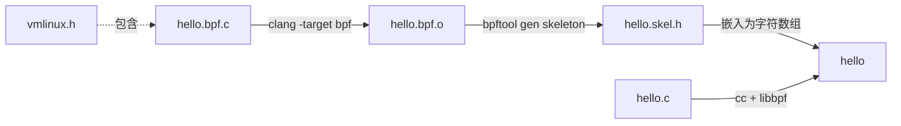
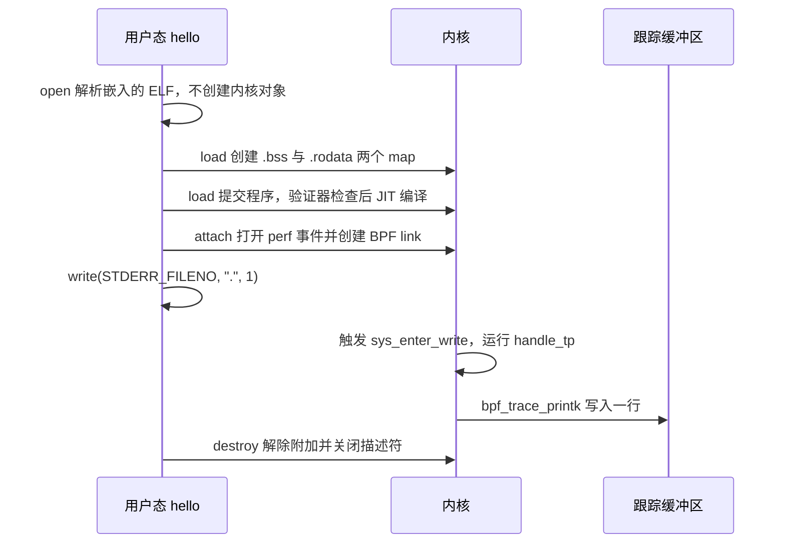

# B.3 第一个 eBPF 程序

一个每秒往标准错误写一个点的程序，在用户态看来不过是屏幕上多了一个点。可这一个点在内核里对应一次 `write()` 系统调用，而 eBPF 可以把一段小程序挂到这次调用的入口上，在调用发生的瞬间记下一笔。本页要做的就是这样一件事：写一个只认自己进程的 `write()` 观测程序，让它在每次写点时往内核的跟踪缓冲区里留一行，再用 `cat` 把那行读出来。

从观测自己的进程开始，是因为触发时机和次数都握在自己手里：程序每写一个点，跟踪缓冲区里就该多一行，对不上就是哪里写错了。读完这一页，应当能写出内核态与用户态两个源文件、用三条命令构建出可执行文件、在 `trace_pipe` 里看到自己的输出，并说清从源码到运行经过了哪几步。每一步的细节分散在 B.4 到 B.10，本页只求把整条路走通。

加载程序需要 root，原因和权限的细节在 [B.2](/教程/正文/系统编程/拓展B_eBPF/B_2_环境准备与工具链) 已经讲过，这里统一在命令前加 `sudo`。

## 1. 目标：本进程每调用一次 write() 就打印一行

程序的用户态部分很简单：装好信号处理，挂上 BPF 程序，然后每秒向标准错误写一个点，直到按下 Ctrl-C。真正的观测发生在内核里：每次有进程调用 `write()`，内核都会经过 `syscalls/sys_enter_write` 这个跟踪点（tracepoint），挂在那里的 BPF 程序就会被调用一次。程序里先取当前进程号，与用户态事先写进去的进程号比较，不等就直接返回，相等才打印一行。

过滤这一步是必要的。`sys_enter_write` 是全系统共享的：终端刷新、日志落盘、每个守护进程的输出都会触发它，一秒里可能有上万次。只留下本进程的那几次，输出才能和每秒一个点对上。这也顺带说明了 eBPF 程序的运行方式：它随事件被调用，事件不发生就不运行。

最终要看到的是这样的两行，每行对应一个点：

```text
           <...>-3840345 [010] d... 3220701.101143: bpf_trace_printk: BPF triggered from PID 3840345.
           <...>-3840345 [010] d... 3220702.101265: bpf_trace_printk: BPF triggered from PID 3840345.
```

这是 libbpf-bootstrap 的 `minimal` 示例在它自己的 README 里给出的输出，本页的格式串与它一致，所以输出形状相同。

## 2. 内核态程序 hello.bpf.c

内核态程序就是一个受限的 C 文件。完整代码在 `code/系统编程/拓展B_eBPF/B_3_第一个eBPF程序/hello.bpf.c`：

```c
// SPDX-License-Identifier: GPL-2.0 OR BSD-3-Clause
#include "vmlinux.h"

#include <bpf/bpf_helpers.h>

char LICENSE[] SEC("license") = "Dual BSD/GPL";

/* 要被观测的进程号，由用户态程序在加载之前写入 */
int my_pid = 0;

SEC("tp/syscalls/sys_enter_write")
int handle_tp(void *ctx)
{
    int pid = bpf_get_current_pid_tgid() >> 32;

    (void)ctx;
    if (pid != my_pid) {
        return 0;
    }

    bpf_printk("BPF triggered from PID %d.\n", pid);

    return 0;
}
```

逐段说明。

`vmlinux.h` 不是系统自带的头文件，而是 B.2 用 `bpftool btf dump` 从正在运行的内核里导出的类型声明。BPF 程序不能用 `<linux/sched.h>` 这类内核头文件，因为那些头文件会一路包含进大量用户态无法编译的内容；`vmlinux.h` 把内核里的结构体定义单独抽了出来，代价是文件很大，而且内容随内核而变。原理在 B.8。

`bpf_helpers.h` 提供三样东西：`SEC` 宏、`bpf_printk` 宏，以及所有辅助函数（helper function）的声明。辅助函数是内核提供给 BPF 程序调用的固定接口，BPF 程序自己不能调用任意的内核函数。完整的辅助函数列表和用法在 B.5。

`char LICENSE[] SEC("license") = "Dual BSD/GPL";` 把许可证字符串放进一个名为 `license` 的节。libbpf 打开目标文件时读出这个字符串，加载程序时把它一并交给内核，内核据此判断程序是不是 GPL 兼容。这不是形式上的声明：一部分辅助函数只对 GPL 兼容的程序开放，`bpf_trace_printk` 正是其中之一，它的函数原型里 `gpl_only` 为真。许可证改成不兼容的字符串，程序会在加载时被拒绝，报错原文见 B.9。符号名用大写 `LICENSE` 而不是 `license`，是为了避开与节名重名；写成小写时编译器直接报错，原因见 [B.10](/教程/正文/系统编程/拓展B_eBPF/B_10_程序类型与附加类型)。

`int my_pid = 0;` 是一个全局对象。在内核态 BPF 程序里，全局对象不是普通的 `static` 存储，libbpf 会把它放进一个只有单个元素的数组 map，用户态通过内存映射读写它。用户态要写、内核态要读的数据，这是最省事的一种传递方式。为什么能这样、什么时候把值写进去，[B.6](/教程/正文/系统编程/拓展B_eBPF/B_6_Map与数据交换) 讲。

`SEC("tp/syscalls/sys_enter_write")` 是程序与内核之间的约定。节名的前缀 `tp/` 告诉 libbpf 这是一个 tracepoint 类型的程序，后面两段是事件所在的类别和事件名，与 tracefs 目录 `/sys/kernel/tracing/events/syscalls/sys_enter_write` 一一对应。libbpf 读节名就能决定程序类型，并在骨架的 `attach` 一步自动挂到正确的位置，所以用户态不用手写事件名。节名与程序类型的完整对应表在 [B.10](/教程/正文/系统编程/拓展B_eBPF/B_10_程序类型与附加类型)，钩子的选择在 [B.11](/教程/正文/系统编程/拓展B_eBPF/B_11_跟踪与观测_kprobe_uprobe与tracepoint)。

`int handle_tp(void *ctx)` 是程序的入口，函数名是任意的，骨架会以它命名成员。`ctx` 是内核传进来的上下文（context），指向这次事件的跟踪记录。本例不看记录内容，只用到进程号；`(void)ctx` 是为了在开 `-Wextra` 时不报未使用参数。

`bpf_get_current_pid_tgid()` 返回一个 64 位整数，高 32 位是线程组号，低 32 位是线程号。右移 32 位取到的是线程组号，也就是用户态说的 PID。这个函数名容易让人以为它返回两个 PID，其实内核里 `pid` 指线程、`tgid` 才是进程，[B.5](/教程/正文/系统编程/拓展B_eBPF/B_5_辅助函数与上下文) 有一节专门澄清这件事。

`if (pid != my_pid)` 做过滤，不匹配就返回 0。tracepoint 程序的返回值被内核忽略，返回 0 只是习惯写法。

`bpf_printk("BPF triggered from PID %d.\n", pid)` 把一行写进内核的跟踪缓冲区。它最终调用的辅助函数是 `bpf_trace_printk`，只支持 `%d`、`%u`、`%s` 等少数几个格式符，而且每次调用都相对昂贵，只适合调试。格式串末尾的 `\n` 是有意保留的：上游示例的格式串就带它，输出才能一行一条。

<Quiz
  :options="[
    { label: '本进程的线程 ID，即内核里的 pid', value: 'A' },
    { label: '用户态的 PID，即内核里的 tgid', value: 'B' },
    { label: '进程组号', value: 'C' },
    { label: '本次系统调用的编号', value: 'D' }
  ]"
  answer="B"
>

<template #question>

`bpf_get_current_pid_tgid() >> 32` 得到的是什么？

</template>

正确答案是 **B**。返回值的高 32 位是 tgid，低 32 位才是线程 ID。用户态 `getpid()` 返回的就是 tgid，所以两边能直接比较。

</Quiz>

::: generate ebpf-b3-bpf-walkthrough kind=explanation

面向第一次读 BPF 内核态代码的读者，以本节的 `hello.bpf.c` 为例逐行讲解：为什么不能包含普通内核头文件而要用 `vmlinux.h`，`SEC` 宏把函数放进特殊的节有什么作用，`my_pid` 为什么是一个全局对象而不是普通局部对象，以及 `bpf_get_current_pid_tgid()` 的返回值如何拆成 tgid 和 pid。不要展开验证器和 map 的实现细节。

:::

## 3. 用户态加载程序 hello.c

内核态程序编成一个目标文件之后，还需要一个普通进程把它打开、加载、附加到内核，这个进程叫加载程序（loader）。完整代码在 `code/系统编程/拓展B_eBPF/B_3_第一个eBPF程序/hello.c`，关键部分如下：

```c
int main(void)
{
    struct hello_bpf *skel;
    struct sigaction sa;
    int err;

    libbpf_set_print(print_libbpf);

    skel = hello_bpf__open();
    if (skel == NULL) {
        fprintf(stderr, "打开骨架失败\n");
        return 1;
    }

    /* 先写入进程号再加载，第一次事件到达时过滤条件已经就位 */
    skel->bss->my_pid = getpid();

    err = hello_bpf__load(skel);
    if (err != 0) {
        fprintf(stderr, "加载失败：%s\n", strerror(-err));
        goto cleanup;
    }

    err = hello_bpf__attach(skel);
    if (err != 0) {
        fprintf(stderr, "附加失败：%s\n", strerror(-err));
        goto cleanup;
    }

    memset(&sa, 0, sizeof(sa));
    sa.sa_handler = on_signal;
    sigemptyset(&sa.sa_mask);
    sigaction(SIGINT, &sa, NULL);
    sigaction(SIGTERM, &sa, NULL);

    printf("已启动，PID 为 %d。另开一个终端执行 sudo cat "
           "/sys/kernel/tracing/trace_pipe。\n", getpid());
    fflush(stdout);

    while (!stop) {
        write(STDERR_FILENO, ".", 1);
        sleep(1);
    }

    write(STDERR_FILENO, "\n", 1);

cleanup:
    hello_bpf__destroy(skel);
    return err != 0;
}
```

`hello_bpf__open()` 只做用户态的工作：把嵌在头文件里的 ELF 目标文件解析出来，找到里面的程序、map 和全局对象，不创建任何内核对象。返回值是骨架结构体的指针，其中的 `bss` 成员指向 `.bss` 节对应的一块内存。

`skel->bss->my_pid = getpid();` 把本进程号写进全局对象。这一句必须排在 `load` 之前：map 的初始内容是在加载时从这块内存复制进去的。`open` 之后、`load` 之前这段时间，正是留给用户态填参数的窗口。

`hello_bpf__load()` 才真正进入内核：创建 `.bss` 和 `.rodata` 对应的 map，把程序交给验证器（verifier）检查，通过后由即时编译器（JIT）翻译成本机指令。失败时返回负的错误码，用 `strerror(-err)` 能取到可读的原因。

`hello_bpf__attach()` 把程序挂到 `SEC` 名指定的位置。对这个程序来说，libbpf 打开 `syscalls/sys_enter_write` 对应的 perf 事件，再用 BPF link 把程序绑上去；两者合成的 link 对象由骨架保管，`destroy` 时自动解除。

`libbpf_set_print` 换掉 libbpf 的日志输出函数。不装回调时 libbpf 用自带的打印函数，默认只显示警告和提示，设 `LIBBPF_LOG_LEVEL=debug` 才加上调试信息；一旦装上自己的回调，级别过滤就由回调决定。本例的回调把 `LIBBPF_DEBUG` 直接丢掉，启动时不会满屏都是加载细节。要看详细日志，把回调里那两行判断删掉即可，`LIBBPF_LOG_LEVEL` 这时已经不起作用。

`sigaction` 装的是 `SIGINT` 和 `SIGTERM`，处理函数只做一件事：把 `volatile sig_atomic_t` 标志置 1。主循环每秒检查一次，退出循环后先换行，再调用 `hello_bpf__destroy()`。`destroy` 会依次解除附加、关闭描述符、释放用户态内存，内核里的程序和 map 也随之消失。信号处理的写法与[第 6 章](/教程/正文/系统编程/6_信号_时间与定时器)一致，那里讲过为什么处理函数里只能碰这类标志。

`write(STDERR_FILENO, ".", 1)` 就是我们要观测的那次系统调用。换成 `fprintf(stderr, ".")` 再加 `fflush` 效果相同，直接用 `write` 少一层缓冲，意图也更清楚。

::: concept ebpf-b3-skeleton-steps title="骨架的四步"

骨架把一个 BPF 应用拆成四步：`open` 解析目标文件，不产生内核对象；`load` 创建 map、验证并加载程序；`attach` 把已加载的程序挂到附加点；`destroy` 解除附加并释放全部资源。全局对象的值必须在 `open` 之后、`load` 之前写好，`attach` 必须在 `load` 之后。

:::

<Quiz
  :options="[
    { label: 'open → 写全局对象 → load → attach → destroy', value: 'A' },
    { label: 'open → load → 写全局对象 → attach → destroy', value: 'B' },
    { label: 'load → open → attach → destroy', value: 'C' },
    { label: 'open → attach → load → destroy', value: 'D' }
  ]"
  answer="A"
>

<template #question>

用骨架加载程序时，下面哪种调用顺序是正确的？

</template>

正确答案是 **A**。全局对象的值要赶在 `load` 把初始内容复制进 map 之前写入；程序没有加载就没有描述符，`attach` 无从谈起；`destroy` 放在最后收尾。

</Quiz>

::: generate ebpf-b3-loader-walkthrough kind=explanation concepts=ebpf-b3-skeleton-steps

面向第一次写 libbpf 加载程序的读者，以本节的 `hello.c` 为例逐段讲解：`libbpf_set_print` 为什么放在最前面，`skel->bss->my_pid` 这一句为什么必须排在 `load` 之前，`load` 返回负值时怎么读懂错误，`attach` 对 tracepoint 程序在背后做了什么，以及 Ctrl-C 之后 `destroy` 清理了哪些东西。讲清这四步各自负责什么，不要展开内核对象生命周期。

:::

## 4. 构建

内核态程序和用户态程序用两个不同的编译器前端处理，中间还要插一步生成骨架。三条命令，在源码目录里依次执行：

::: terminal title="zsh - build"

```text
$ clang -g -O2 -target bpf -mcpu=v3 -D__TARGET_ARCH_x86 -I. -c hello.bpf.c -o hello.bpf.o
$ bpftool gen skeleton hello.bpf.o > hello.skel.h
$ cc -std=c17 -Wall -Wextra hello.c -o hello $(pkg-config --cflags --libs libbpf)
```

:::

第一条命令把 C 编成 BPF 目标文件。`-target bpf` 选择 BPF 后端，产物是 ELF 格式的 `.bpf.o`，不是本机代码。`-g` 生成调试信息，其中最重要的是 BTF（BPF 类型格式，BPF Type Format）：没有它，后面的骨架不知道 `.bss` 里有哪些对象。`-O2` 不只是为了性能，同一份源码用 `-O0` 编译，反汇编里的指令从 11 条涨到 23 条，多出来的几乎都是往返栈的存取，验证器要模拟的状态随之变多，更容易判定程序过于复杂。`-mcpu=v3` 明确指定指令集版本，LLVM 20 起默认就是 v3，而更早的版本默认还是 v1，写出来能让不同版本的 clang 生成相同的指令。`-D__TARGET_ARCH_x86` 给 `bpf_tracing.h` 里的宏用，本例其实没有包含它，留着是为了和后面几节的命令保持一致。`-I.` 让编译器找到当前目录下的 `vmlinux.h`。

第二条命令生成骨架。骨架是一个 C 头文件，里面既有把目标文件逐字节嵌进去的字符数组，也有一组代为调用 libbpf 的 `static inline` 函数，还有与 map、程序同名的结构体成员。用头文件而不是在运行时读 `.bpf.o` 的好处是两者永远同步：目标文件一改，骨架必须重新生成。

第三条命令编译用户态程序，用 `pkg-config` 取 libbpf 的头文件路径和链接参数。`pkg-config` 读的是 libbpf 安装时写下的 `.pc` 文件，不同发行版的路径不一样，所以不写死 `-lbpf` 之外的路径。

整个构建过程是一条流水线：



骨架还管着全局对象的接口：`.bss` 和 `.rodata` 里的每个对象都在骨架结构体里有一个同名字段，类型直接取自 BTF。

### 4.1 目标文件里有什么

`llvm-objdump -h hello.bpf.o` 列出各节。这个目标文件的节表很长，只看与本页有关的那几节：

::: terminal title="zsh - llvm-objdump"

```text
$ llvm-objdump -h hello.bpf.o | grep -E 'tp/|license|\.bss|\.rodata|\.BTF '
  3 tp/syscalls/sys_enter_write     00000068 0000000000000000 TEXT
  4 .reltp/syscalls/sys_enter_write 00000020 0000000000000000
  5 license                         0000000d 0000000000000000 DATA
  6 .bss                            00000004 0000000000000000 BSS
  7 .rodata                         0000001c 0000000000000000 DATA
 17 .BTF                            00000268 0000000000000000
 18 .rel.BTF                        00000030 0000000000000000
```

:::

`tp/syscalls/sys_enter_write` 是程序本体，名字来自 `SEC` 宏。`license` 节长 13 字节，正好是 `Dual BSD/GPL` 加结尾的 `\0`。`.bss` 节 4 字节，就是 `my_pid`。`.rodata` 节 28 字节，是 `bpf_printk` 展开后放进去的格式串，长度也可以用反汇编印证：`BPF triggered from PID %d.\n` 共 27 个字符，加结尾的 `\0` 是 28 字节。`.BTF` 和 `.BTF.ext` 是 `-g` 的产物，前者登记类型，后者登记指令与源码的对应关系以及 CO-RE 重定位信息；上面用 `grep` 过滤时只列到 `.rel.BTF`，`.BTF.ext` 与它的重定位节在表的后半段。最左边的节号取决于调试信息的多少，换一个 clang 版本可能整体平移几位，看节名就好。

### 4.2 反汇编

`llvm-objdump -dr` 把程序反汇编成 BPF 指令，`-r` 同时显示重定位：

::: terminal title="zsh - llvm-objdump -dr"

```text
$ llvm-objdump -dr hello.bpf.o

hello.bpf.o:	file format elf64-bpf

Disassembly of section tp/syscalls/sys_enter_write:

0000000000000000 <handle_tp>:
       0:	85 00 00 00 0e 00 00 00	call 0xe
       1:	77 00 00 00 20 00 00 00	r0 >>= 0x20
       2:	18 01 00 00 00 00 00 00 00 00 00 00 00 00 00 00	r1 = 0x0 ll
		0000000000000010:  R_BPF_64_64	my_pid
       4:	61 11 00 00 00 00 00 00	r1 = *(u32 *)(r1 + 0x0)
       5:	5e 01 05 00 00 00 00 00	if w1 != w0 goto +0x5 <LBB0_2>
       6:	18 01 00 00 00 00 00 00 00 00 00 00 00 00 00 00	r1 = 0x0 ll
		0000000000000030:  R_BPF_64_64	.rodata
       8:	b4 02 00 00 1c 00 00 00	w2 = 0x1c
       9:	bc 03 00 00 00 00 00 00	w3 = w0
      10:	85 00 00 00 06 00 00 00	call 0x6

0000000000000058 <LBB0_2>:
      11:	b4 00 00 00 00 00 00 00	w0 = 0x0
      12:	95 00 00 00 00 00 00 00	exit
```

:::

这段程序占 13 个指令槽，其中两条 64 位立即数加载各占两格，所以反汇编里只显示 11 行。指令里几乎没有冗余。第 0 条 `call 0xe` 调用辅助函数编号 14，即 `bpf_get_current_pid_tgid`。第 1 条右移 32 位。第 2 条（占两格）把 64 位立即数 0 装进 `r1`，第 4 条以它为基础解引用——这个 0 不是真的地址，加载时由 libbpf 按重定位 `my_pid` 填成 map 的值地址。第 5 条的跳转条件用的是 32 位比较指令 `w1 != w0`，这是 `-mcpu=v3` 启用的 ALU32 指令；换成默认的 v1，同一条会写成 `r1 != r0`，指令数一样，只是操作宽度不同。第 6 条（占两格）把格式串的地址装进 `r1`，重定位目标是 `.rodata`；第 8 条写入长度 0x1c，即 28，第 9 条把进程号放进 `r3`，凑齐 `bpf_trace_printk` 的三个参数。第 10 条 `call 0x6` 调用编号 6，即 `bpf_trace_printk`。`LBB0_2` 是不匹配时的出口，把 0 放进返回值再退出。

这份反汇编是理解后面各节的底本：B.4 讲指令编码与寄存器约定，B.5 讲 `call` 后面那些编号从哪来，B.8 讲重定位怎样在不同内核上变成正确的偏移。

### 4.3 骨架里的结构体

`hello.skel.h` 的前几十行是骨架对外的接口：

::: terminal title="zsh - hello.skel.h"

```text
$ sed -n '13,28p' hello.skel.h
struct hello_bpf {
	struct bpf_object_skeleton *skeleton;
	struct bpf_object *obj;
	struct {
		struct bpf_map *bss;
		struct bpf_map *rodata;
	} maps;
	struct {
		struct bpf_program *handle_tp;
	} progs;
	struct {
		struct bpf_link *handle_tp;
	} links;
	struct hello_bpf__bss {
		int my_pid;
	} *bss;
```

:::

结构体名由目标文件名决定：`hello.bpf.o` 去掉扩展名、把点换成下划线，得到 `hello_bpf`，所以函数叫 `hello_bpf__open`，用户态代码里的类型叫 `struct hello_bpf`。`maps` 里每个内部 map 一个成员，`.bss` 和 `.rodata` 都在；`progs` 和 `links` 里每个程序一个成员，名字就是 BPF 函数的函数名。`bss` 成员指向的结构体按 BTF 里的类型生成，`my_pid` 的类型 `int` 被原样保留，文件末尾还有一句 `_Static_assert` 检查它的大小是不是 4 字节。用户态能写出 `skel->bss->my_pid`，靠的就是这一层生成。

### 4.4 Makefile

三条命令可以写进 Makefile，把 `vmlinux.h` 的生成也纳进来：

```makefile
# 第一个 eBPF 程序的构建文件。
#
#   make        生成 vmlinux.h，编译内核态程序，生成骨架，链接用户态程序
#   make clean  删除生成的目标文件、骨架和可执行文件
#
# 需要 clang、bpftool、libbpf 开发包和 pkg-config。

CLANG ?= clang
BPFTOOL ?= bpftool
CC ?= cc

BPF_CFLAGS := -g -O2 -target bpf -mcpu=v3 -D__TARGET_ARCH_x86 -I.
CFLAGS := -std=c17 -Wall -Wextra
LIBBPF_CFLAGS := $(shell pkg-config --cflags libbpf)
LIBBPF_LIBS := $(shell pkg-config --libs libbpf)

all: hello

# 内核的 BTF 导出成 C 头文件。只在第一次构建时生成，之后一直复用。
vmlinux.h:
	$(BPFTOOL) btf dump file /sys/kernel/btf/vmlinux format c > $@

hello.bpf.o: hello.bpf.c vmlinux.h
	$(CLANG) $(BPF_CFLAGS) -c $< -o $@

# 骨架把 hello.bpf.o 嵌进头文件，所以两者必须一起更新
hello.skel.h: hello.bpf.o
	$(BPFTOOL) gen skeleton $< > $@

hello: hello.c hello.skel.h
	$(CC) $(CFLAGS) $(LIBBPF_CFLAGS) $< -o $@ $(LIBBPF_LIBS)

clean:
	rm -f hello hello.bpf.o hello.skel.h

.PHONY: all clean
```

依赖关系是这份 Makefile 的关键。`hello.bpf.o` 依赖 `hello.bpf.c` 和 `vmlinux.h`，改了源码或换了内核都得重编；`hello.skel.h` 依赖 `hello.bpf.o`，目标文件一变就重新生成，否则头文件里嵌的还是旧字节码；可执行文件依赖 `hello.c` 和骨架。`vmlinux.h` 没有依赖，只在内核 BTF 更新、手动删掉它的时候才重新生成。构建图与 Make 的通用规则在[第 8 章](/教程/正文/开发与工程基础/8_构建图与Make)讲过。

把 `-g` 漏掉会怎样，值得单独说一句。`hello.bpf.o` 仍然能编出来，`bpftool gen skeleton` 也照样成功，但骨架里没有 BTF 描述 `.bss`，生成的头文件里就没有 `__bss` 结构体，也没有 `bss` 成员。用户态编译时得到的是：

::: terminal title="zsh - gcc"

```text
$ cc -std=c17 -Wall -Wextra hello.c -o hello $(pkg-config --cflags --libs libbpf)
hello.c: In function ‘main’:
hello.c:45:9: error: ‘struct hello_bpf’ has no member named ‘bss’
   45 |     skel->bss->my_pid = getpid();
      |         ^~
```

:::

报错出现在用户态文件里，根子却在内核态的编译选项上。看到「骨架里少了成员」，先回头检查 `clang` 那一行有没有 `-g`。

## 5. 运行与查看输出

加载程序要 root，运行时加 `sudo`：

::: terminal title="zsh - run"

```text
$ sudo ./hello
已启动，PID 为 48211。另开一个终端执行 sudo cat /sys/kernel/tracing/trace_pipe。
.
```

:::

（程序的提示语按源码原样给出，PID 是示意值。）

标准错误上每秒多一个点。另一个终端读跟踪缓冲区，就能看到内核里那半边的输出。`trace_pipe` 是一个流式文件：读走的内容就没了，而且会阻塞等待新内容，用 `cat` 正好。

::: terminal title="zsh - trace_pipe"

```text
$ sudo cat /sys/kernel/tracing/trace_pipe
           <...>-3840345 [010] d... 3220701.101143: bpf_trace_printk: BPF triggered from PID 3840345.
           <...>-3840345 [010] d... 3220702.101265: bpf_trace_printk: BPF triggered from PID 3840345.
```

:::

（输出类似 libbpf-bootstrap README 的 `minimal` 一节；PID、CPU 编号和时间戳随运行而变。）

每行由几部分组成，从左边看起：

- `<...>-3840345` 是任务名加 PID。任务名显示成 `<...>`，是因为 ftrace 的进程名缓存里没有这个 PID 的记录；换一个有记录的任务，这里会显示可执行文件名。
- `[010]` 是执行这条指令的 CPU 编号。
- `d...` 是四个标志位：是否关中断、是否有待调度的任务、处于哪种中断上下文、抢占被禁止的嵌套层数。`d` 表示关中断，其余三个点表示没有特殊情况。
- `3220701.101143` 是时间戳，单位是秒，来自内核启动后的单调时钟。
- `bpf_trace_printk:` 是事件名，后面才是 `bpf_printk` 写进去的内容。

同一个程序写两个点，两行的时间戳相差一秒左右，与循环里的 `sleep(1)` 对得上。中间那一串别的进程的 `write()` 没有出现在这里，因为内核态程序在 PID 比较那一步就把它们挡掉了。

过滤只看 PID，所以本程序自己的每一次 `write()` 都会留下一行，不只是循环里的点：启动时那句提示是一行，退出时补的那个换行又是一行。第一次运行时在 `trace_pipe` 里先看到提示语对应的那一行，不要以为是自己哪里写错了。

按 Ctrl-C 后，加载程序打印一个换行，`destroy` 解除附加，`trace_pipe` 不再有新行。程序为什么随加载程序退出而消失，[B.7](/教程/正文/系统编程/拓展B_eBPF/B_7_加载与附加_bpf系统调用与程序生命周期) 讲对象生命周期时会说明白。

::: tip trace_pipe 的两个位置和另一个读法

新版内核把 tracefs 挂在 `/sys/kernel/tracing`，旧资料里的路径是 `/sys/kernel/debug/tracing`，两者指向同一个文件系统，读到的是同一份内容。不想记路径时可以用 `sudo bpftool prog tracelog`，它做的就是把 `trace_pipe` 的内容打到标准输出。

:::

<Quiz
  :options="[
    { label: '加载程序的标准错误', value: 'A' },
    { label: '内核日志缓冲区，用 dmesg 读取', value: 'B' },
    { label: 'tracefs 的跟踪缓冲区，从 trace_pipe 或 bpftool prog tracelog 读取', value: 'C' },
    { label: 'libbpf 的调试日志', value: 'D' }
  ]"
  answer="C"
>

<template #question>

`bpf_printk` 写出的内容到哪里去了？

</template>

正确答案是 **C**。`bpf_printk` 调用 `bpf_trace_printk`，写入的是 ftrace 的跟踪缓冲区，不经过 printk，也不会出现在 `dmesg` 里。也正因为它是全系统共享的调试通道，只适合调试，正式工具应当把事件送进环形缓冲区，见 B.6。

</Quiz>

## 6. 刚才发生了什么

把从源码到输出的一整条路画成时序图，每一步都标出对应的系统调用或节：



对照着看，几个容易混淆的地方就清楚了。

编译期的两件事都发生在用户态：`clang` 把 C 翻成 BPF 指令，`bpftool` 把指令和 BTF 一起塞进头文件。后者不接触内核，只读目标文件。

`open` 解析嵌入的 ELF，建立用户态的内存表示，不创建内核对象。`load` 才开始创建对象：先建 map，再把程序交给 `bpf()` 系统调用，验证器逐条检查，通过后 JIT 生成本机指令。这两步的差别是 B.7 的主题。

`attach` 对 tracepoint 程序来说要两步：先用 `perf_event_open` 按事件 ID 打开一个 perf 事件，再用 `BPF_LINK_CREATE` 把程序绑到这个事件上。所以附加不是「往内核里塞一个函数指针」，而是产生了一个新的内核对象。

程序真正运行是在 `write()` 发生的那一刻。内核执行到 `sys_enter_write` 跟踪点，把注册在这上面的程序挨个调用一遍，传进去的上下文就是跟踪记录。程序运行完返回，系统调用继续执行，用户态对这一切没有感知。

`bpf_trace_printk` 把一行写进跟踪缓冲区，`cat trace_pipe` 的人看到它。这个缓冲区不是为本程序准备的，内核和别的工具也在往里写，所以读到的内容需要自己辨认。

`destroy` 关闭 link 与程序描述符，内核回收对应对象，程序从跟踪点上消失。

每一块的细节分布在后面各节：[B.4](/教程/正文/系统编程/拓展B_eBPF/B_4_程序的解剖_受限的C) 讲字节码与指令格式，[B.5](/教程/正文/系统编程/拓展B_eBPF/B_5_辅助函数与上下文) 讲辅助函数与上下文，[B.6](/教程/正文/系统编程/拓展B_eBPF/B_6_Map与数据交换) 讲全局对象与 map，[B.7](/教程/正文/系统编程/拓展B_eBPF/B_7_加载与附加_bpf系统调用与程序生命周期) 讲 `bpf()` 与对象生命周期，[B.8](/教程/正文/系统编程/拓展B_eBPF/B_8_libbpf_BTF与CO_RE) 讲骨架与 CO-RE，[B.9](/教程/正文/系统编程/拓展B_eBPF/B_9_验证器) 讲验证器，[B.10](/教程/正文/系统编程/拓展B_eBPF/B_10_程序类型与附加类型) 讲程序类型与附加类型。

## 7. 两个容易踩的点

第一个是 PID 命名空间。程序在 WSL2 或容器里运行时，`getpid()` 返回的是命名空间里的 PID，而 `bpf_get_current_pid_tgid()` 返回的是宿主机的 PID，两者不相等，过滤条件永远不成立，`trace_pipe` 里一行都没有。libbpf-bootstrap 专门有一个 `minimal_ns` 版本处理这件事：用户态读 `/proc/self/ns/pid` 的设备号和 inode 号写进全局对象，内核态用 `bpf_get_ns_current_pid_tgid` 按命名空间取 PID。

::: compare left-title="只比较 PID，在命名空间里失效" right-title="先取命名空间里的 PID"

```c
SEC("tp/syscalls/sys_enter_write")
int handle_tp(void *ctx)
{
    int pid = bpf_get_current_pid_tgid() >> 32;

    (void)ctx;
    if (pid != my_pid) {
        return 0;
    }
    bpf_printk("BPF triggered from PID %d.\n", pid);
    return 0;
}
```

---

```c
SEC("tp/syscalls/sys_enter_write")
int handle_tp(void *ctx)
{
    struct bpf_pidns_info ns;

    (void)ctx;
    if (bpf_get_ns_current_pid_tgid(dev, ino, &ns, sizeof(ns)) != 0) {
        return 0;
    }
    if (ns.pid != my_pid) {
        return 0;
    }
    bpf_printk("BPF triggered from PID %d.\n", ns.pid);
    return 0;
}
```

:::

右边版本多出两个全局对象 `dev` 和 `ino`，加载程序要先 `stat("/proc/self/ns/pid", &sb)`，把 `sb.st_dev` 和 `sb.st_ino` 写进去。`bpf_pidns_info` 是 `vmlinux.h` 里已有的类型，两个成员分别是命名空间里的 pid 和 tgid。在普通虚拟机或物理机上跑，两个版本效果一样；分不清自己处在哪种环境时，用右边这个更保险。

第二个是 `trace_pipe` 的公共性。它是全系统共用的调试通道，内核里所有用 `bpf_trace_printk` 的程序都会往这里写，一段时间不看，内容就被后来的覆盖或读走。`bpf_printk` 每次调用的开销也不小，内核第一次使用时还会往内核日志里打一段提醒，说明它不适用于生产。要长期运行、要区分事件来源，就该用环形缓冲区把结构化的事件送到用户态，B.6 会写一个完整例子。

## 8. 习题

### 8.1 巩固

<Exercise id="47301" :d="2" :w="3">

本页 4.2 节的反汇编里，`call 0xe` 和 `call 0x6` 各调用哪个辅助函数？两处 `r1 = 0x0 ll` 的重定位目标分别是什么？`LBB0_2` 这个标号对应的 C 代码是哪一条语句？

再用 `bpftool btf dump file hello.bpf.o format raw` 找到 `my_pid` 与格式串的 VAR 记录，抄出它所在的 DATASEC，说明这几行与反汇编里的两个重定位怎样对应。

</Exercise>

<Exercise id="47302" :d="2" :w="2">

把 `hello.bpf.c` 的格式串改成同时打印进程名和 PID：用 `bpf_get_current_comm` 取进程名，用 `bpf_printk("comm=%s pid=%d\n", comm, pid)` 输出。要求：

1. 内核态程序用 `clang -g -O2 -target bpf -mcpu=v3 -D__TARGET_ARCH_x86 -I. -c` 编译无警告；
2. 生成骨架后，在 `hello.skel.h` 里找到 `.bss` 和 `.rodata` 两个 map，说明进程名用了栈上数组还是全局对象，为什么；
3. 用户态程序不改也能跑，说明原因。

</Exercise>

### 8.2 编程

<Exercise id="47303" :d="3" :w="3">

在 `hello.bpf.c` 里再加一个程序，挂在 `syscalls/sys_exit_write` 上，打印这次 `write()` 的返回值。要求：

1. 两个程序共用一个 `my_pid` 全局对象，出口程序同样先过滤 PID；
2. 出口程序的上下文类型是 `struct trace_event_raw_sys_exit`，用 `ctx->ret` 取返回值；
3. 一次 `hello_bpf__attach` 就能把两个程序都挂上，说明骨架怎样知道第二个程序挂在哪里；
4. 预期在 `trace_pipe` 里每次写点看到两行，一行入口、一行出口。

</Exercise>

<Exercise id="47304" :d="4" :w="3">

把程序改成计数器：内核态每命中一次本进程的 `write()` 就把一个全局对象加 1，不再调用 `bpf_printk`；用户态每秒读一次这个全局对象，打印累计次数。

验收：运行 5 秒后打印的次数与标准错误上的点数相差不超过 2（启动和退出时各可能少算一次）。回答：为什么这个全局对象在用户态读到的总是最新的值，而不是加载时的快照？

</Exercise>

<Exercise id="47305" :d="4" :w="4">

改成按进程名过滤。内核态用 `const volatile char target_comm[16]` 保存目标进程名，用 `bpf_get_current_comm` 取当前进程名，再用 `bpf_strncmp` 比较；用户态在 `load` 之前把 `argv[1]` 复制进 `skel->rodata->target_comm`。

要求：

1. 不传参数时默认观测 `hello` 自己；
2. 说明 `rodata` 与 `bss` 的两个差别：写入时机，以及加载之后还能不能从用户态改；
3. 生成骨架后指出 `target_comm` 落在哪个成员里。

提示：`target_comm` 是 `const volatile` 限定过的，传给 `bpf_strncmp` 时可能要写成 `(const char *)target_comm` 才能消掉限定符警告。

</Exercise>

<Exercise id="47306" :d="5" :w="4">

用本页 4.4 节的 Makefile 做实验，回答并验证：

1. 只改 `hello.bpf.c`，`make` 会依次执行哪几条命令？
2. 只改 `hello.c`，`make` 会执行哪几条？
3. 手动删掉 `hello.skel.h` 再 `make`，会发生什么？
4. 把 `hello.skel.h` 规则里的 `hello.bpf.o` 依赖删掉，改成类似 `hello.skel.h: hello.c` 的写法。改完 `hello.bpf.c` 之后 `make`，会出现什么错误的现象？解释为什么骨架必须依赖目标文件。

前两问用 `make -n` 观察，后两问实际执行。

</Exercise>

<Exercise id="47307" :d="6" :w="4">

写一份排查清单：程序启动成功、`trace_pipe` 也打开了，但是一行输出都没有。按可能性从高到低列出至少五条原因，每条给出一个可以当场执行的检查命令或判断方法。然后故意制造其中一种情形（例如把 `my_pid` 写成 1），打开 libbpf 的调试日志运行一次，从日志里找出能指向问题的那几行，抄下来并解释。

</Exercise>

<Exercise id="47308" :d="6" :w="5">

把 `hello.bpf.c` 分别用 `-O2` 和 `-O0` 编译，用 `llvm-objdump -d` 对比两份反汇编：

1. 数一数两条路径各有多少条指令；
2. 指出 `-O0` 版本里多出来的栈访问，说明编译器为什么在 `-O0` 下把中间结果都放进栈；
3. 结合验证器的检查方式，说明指令数增加为什么会让加载更困难；
4. 得出结论：发布用的 BPF 目标文件该用哪个优化级别。

</Exercise>

### 8.3 综合与挑战

<Exercise id="47309" :d="7" :w="5" scope="*">

不用骨架，改用 libbpf 的对象级 API 重写加载程序：`bpf_object__open_file`、`bpf_object__load`、`bpf_object__find_program_by_name`、`bpf_program__attach`、`bpf_object__close`，全局对象用 `bpf_object__find_map_by_name` 取到 `.bss` map，再用 `bpf_map__initial_value` 拿到那块内存的地址写入进程号。

要求：

1. 编译命令不再需要 `bpftool gen skeleton`，但运行时需要磁盘上的 `hello.bpf.o`，说明这一取舍；
2. 打印每个 libbpf 调用的返回值，失败时输出 `strerror(-err)`；
3. 对比两版代码的行数和出错时的表现，说明骨架替你做了哪些事（提示：看 B.7 里 `open`、`load`、`attach` 对应的系统调用）。

</Exercise>

## 9. 参考资料

- libbpf-bootstrap 的 `minimal` 与 `minimal_ns` 示例及其 README 输出：<https://github.com/libbpf/libbpf-bootstrap>
- Andrii Nakryiko，*Building BPF applications with libbpf-bootstrap*：<https://nakryiko.com/posts/libbpf-bootstrap/>
- bpftool 文档，`gen skeleton`：<https://github.com/libbpf/bpftool/blob/main/docs/bpftool-gen.rst>
- bpftool 文档，`prog tracelog`：<https://github.com/libbpf/bpftool/blob/main/docs/bpftool-prog.rst>
- 内核文档，libbpf 概览：<https://docs.kernel.org/bpf/libbpf/libbpf_overview.html>
- 内核文档，ftrace 与 `trace_pipe` 的输出格式：<https://docs.kernel.org/trace/ftrace.html>
- 内核文档，BPF 开发问答（`-mcpu` 与 LLVM 默认值的变化）：<https://docs.kernel.org/bpf/bpf_devel_QA.html>
- 内核源码，`bpf_trace_printk` 的函数原型与 `gpl_only` 标志：<https://git.kernel.org/pub/scm/linux/kernel/git/torvalds/linux.git/tree/kernel/trace/bpf_trace.c>
- 内核源码，`bpf_trace_printk` 接受的格式符：<https://git.kernel.org/pub/scm/linux/kernel/git/torvalds/linux.git/tree/kernel/bpf/helpers.c>
- `bpf-helpers(7)`，`bpf_trace_printk`、`bpf_get_current_pid_tgid`、`bpf_get_ns_current_pid_tgid`：<https://man7.org/linux/man-pages/man7/bpf-helpers.7.html>
- 内核源码，`license_is_gpl_compatible` 接受的许可证字符串：<https://git.kernel.org/pub/scm/linux/kernel/git/torvalds/linux.git/tree/include/linux/license.h>
- Liz Rice，***Learning eBPF***，第 2 章「Hello World」
