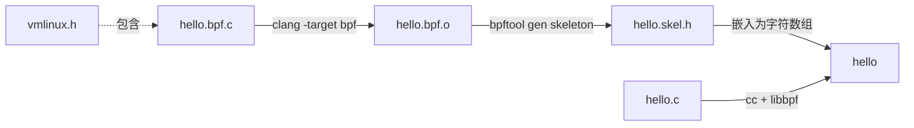
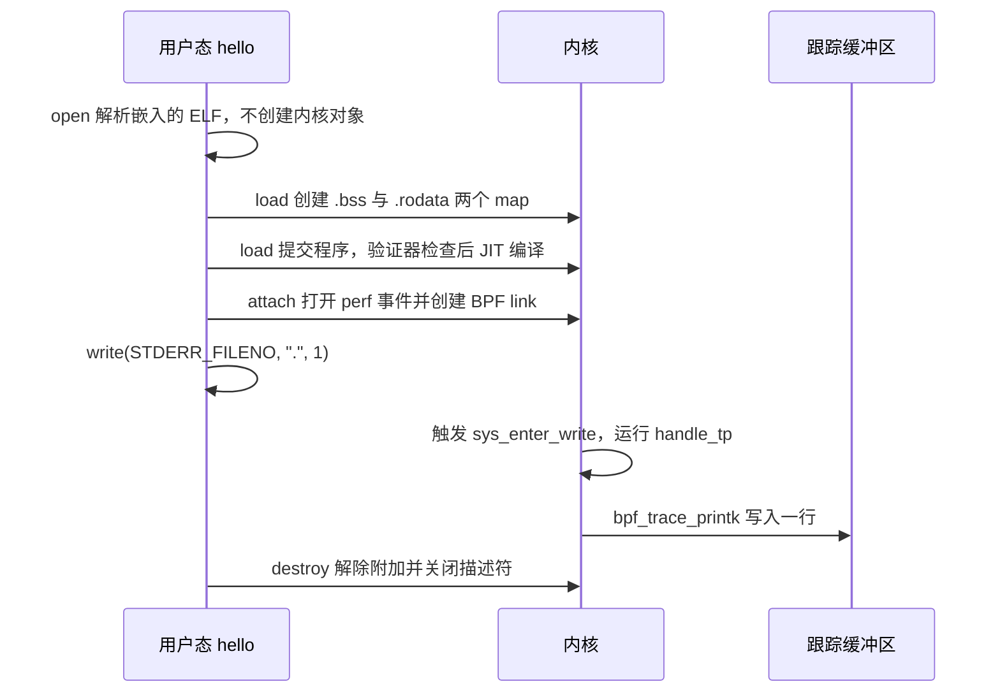

# B.3 第一个 eBPF 程序

在一个看似寻常的终端交互程序中，每隔一秒向标准错误输出一个句点字符，在用户态视角下，不过是显示屏上随光标跳动而逐个增加的可见字符。然而，在操作系统内核的执行轨迹中，每一个被输出到终端屏幕上的点，背后都对应着一次严谨穿透用户与内核边界的 `write()` 系统调用。借助 eBPF 机制，我们得以在完全不侵入应用程序源码、亦无须停滞其执行流的前提下，将一段紧凑的安全代码动态锚定在这项系统调用的入口处，在每一次底层触发的纳秒瞬间留下可信的观测印记。在这一节中，我们将完整搭建起人生第一个具备双向交互能力的系统观测工具：编写一个精准识别并仅针对自身进程生效的 `write()` 监测逻辑，让内核在每次打点时向全局跟踪缓冲区中沉淀一行结构化日志，再通过简单的用户态流读取将其捕获呈现。

之所以选择以「观测自我」作为进入内核态可编程世界的起点，是因为这赋予了我们对事件触发时机与调用频率绝对可控的因果验证能力。程序在控制台中输出了多少个字符，内核的追踪通道中就应当严格呈现出等量的日志条目；一旦两者的数量无法吻合，便能立即排除外部干扰，将精力精准收拢在过滤条件或数据重定位的排查上。通过亲历这一实战流程，读者将完整书写内核态受限 C 与用户态宿主管理 C 两套源文件，熟练运用标准工具链完成代码骨架的自动提炼，并直观洞悉一个 eBPF 程序从高级源码编译为字节码、通过内核静态验证、即时编译为本机指令并最终完成探针挂载的全生命周期轨迹。

向内核注入并激活探针依然依托于前述的系统特权支撑，相关 Capabilities 特权模型的演化细节已在 [B.2 节](/教程/正文/系统编程/拓展B_eBPF/B_2_环境准备与工具链) 展开剖析，文中的所有加载与观察命令在此统一显式保留 `sudo` 前缀。

## 1. 目标：本进程每调用一次 write() 就打印一行

该实验在设计上被清晰地划分为两部分。运行在用户空间的前端程序非常直观：它配置好系统的信号捕获机制，完成 BPF 程序对象的装载与钩子附加，随后进入一个每秒向标准错误输出单一字符的周期性工作循环，直至捕获到中断信号平稳退出。而在内核态腹地展开的观测则完全是响应式的：在整个 Linux 操作系统的宏观运转中，任何进程发起 `write()` 系统调用，内核执行流都会途经静态插桩点 `syscalls/sys_enter_write`，挂接在该 tracepoint 上的 BPF 处理函数便会被就地激活一次。在执行期间，BPF 程序首先提取当前正在触发系统调用的进程号，并将其与用户态在装载阶段预先注入的宿主进程号展开等值比对；若两者并不一致，代码便立刻无害返回，唯有确认是当前受测进程发起的调用时，才在内核日志中打印一行追踪记录。

这种前置过滤的防线是至关重要的。`sys_enter_write` tracepoint 属于操作系统内核中最繁忙的热点路径之一：当前桌面环境的终端渲染、系统守护进程的后台日志轮转、数据库的页面刷盘以及各类网络服务的报文输出，都在以每秒数千乃至上万次的极高频度疯狂穿透这个接口。如果缺乏精准的进程凭据初筛，任何探针代码都将在瞬间被海量的无关系统事件所淹没。通过将过滤范围收缩在自身进程内，内核日志的输出节奏便能够与前端打点的物理时钟形成绝对严密的因果对应，这同时也淋漓尽致地展现了 eBPF 的根本运行哲学：代码严格受内核事件驱动，事件未至则分毫不动。

在实验顺利走通后，我们在终端中将观察到如下由内核跟踪器有序吐出的日志记录，每一条记录在时间轴上都精准对应着一次物理字符的打印：

```text
           <...>-3840345 [010] d... 3220701.101143: bpf_trace_printk: BPF triggered from PID 3840345.
           <...>-3840345 [010] d... 3220702.101265: bpf_trace_printk: BPF triggered from PID 3840345.
```

上述输出片段直接印证了官方标准脚手架 libbpf-bootstrap 中 `minimal` 示例在基准环境中的运行特征，由于我们采用了完全一致的格式串与类型规范，终端回显在结构形态上保持了高度统一。

## 2. 内核态程序 hello.bpf.c

内核态源码本质上是一段受到内核沙箱高度约束的 C 语言实现。完整的源文件妥善归档在 `code/系统编程/拓展B_eBPF/B_3_第一个eBPF程序/hello.bpf.c`：

```c
// SPDX-License-Identifier: GPL-2.0 OR BSD-3-Clause
#include "vmlinux.h"

#include <bpf/bpf_helpers.h>

char LICENSE[] SEC("license") = "Dual BSD/GPL";

/* 要被观测的进程号，由用户态程序在加载之前写入 */
int my_pid = 0;

SEC("tp/syscalls/sys_enter_write")
int handle_tp(void *ctx)
{
    int pid = bpf_get_current_pid_tgid() >> 32;

    (void)ctx;
    if (pid != my_pid) {
        return 0;
    }

    bpf_printk("BPF triggered from PID %d.\n", pid);

    return 0;
}
```

我们对其中的关键设计与语法细节逐段展开细致剖析。

开头的 `#include "vmlinux.h"` 引入了前文使用 `bpftool btf dump` 自动化逆向生成的全局类型自省头文件。普通的内核源码头文件（如 `<linux/sched.h>`）内部嵌套了大量深嵌架构专有宏和内联汇编的代码分支，直接在非内核源码树的编译环境中引入必定导致编译器崩溃；而 `vmlinux.h` 提炼出了纯净的结构体与数据类型定义，其唯一的工程权衡在于该文件行数规模庞大，且内部字段排布精确映射了编译生成该文件时特定内核的静态特征。

紧随其后的 `<bpf/bpf_helpers.h>` 头文件由 libbpf-dev 规范提供，它向我们交付了三项至关重要的基石设施：用于引导符号节区排布的 `SEC` 编译器宏、便于快速输出内核调试日志的 `bpf_printk` 宏，以及 Linux 内核向 BPF 虚拟机官方暴露的全部标准辅助函数（Helper Function）的外部符号声明。在 eBPF 的沙箱世界中，程序被绝对严禁直接调用内核中任意的非导出 C 语言符号，一切系统级操作必须严格受敛在这些预先开放的辅助函数通道内。

代码中的 `char LICENSE[] SEC("license") = "Dual BSD/GPL";` 负责将遵循开源协议的许可证字符串安置在专属的 `license` 目标节区中。当用户态管理程序利用 libbpf 解析该目标文件时，该字符串会被自动抽取并连同字节码一起呈递给内核验证器，验证器据此审查当前程序是否具备调用特定专有 GPL-only 内核能力的合法资格。这一声明绝非形式主义的摆设：许多直接触及内核核心追踪机制的高阶辅助函数（例如此处调用的 `bpf_trace_printk`），在内核源码树的原型定义中均显式打上了 `gpl_only = true` 的强硬约束；若将此处的许可证修改为非 GPL 兼容的文本，内核验证器在装载期便会毫不留情地驳回请求。同时注意符号名刻意采用了全大写的 `LICENSE`，这是为了严格防止与编译器内置的目标节区名 `license` 产生命名遮蔽与符号重定义冲突。

`int my_pid = 0;` 声明了一个在内核态全局可见的整型对象。在 libbpf 的现代编译与装载管线中，位于内核态代码中的全局对象并不会像传统程序那样被孤立存放在平面的未初始化数据段，而是会被工具链自动化映射并打包为一个单元素容量的专用内部 Array Map 对象。用户态程序能够在加载阶段直接通过虚拟内存映射机制（mmap）对这个全局对象进行毫秒级的并发读写，这构成了用户态向内核态探针动态下发配置参数最为敏捷、低耗的标准通路。关于该全局对象在内核底层的映射机制与存取时机，将在 [B.6 节](/教程/正文/系统编程/拓展B_eBPF/B_6_Map与数据交换) 展开深层溯源。

`SEC("tp/syscalls/sys_enter_write")` 确立了当前函数与内核探针锚点之间的契约绑定。节名前缀 `tp/` 明确指示 libbpf 应当将当前函数作为静态跟踪点（Tracepoint）类型的程序进行验证处理；而随后的两段子路径则与 Linux 跟踪文件系统路径 `/sys/kernel/tracing/events/syscalls/sys_enter_write` 形成了严丝合缝的一对一映射。libbpf 凭借解析该节区字符串，即可自动推导出合法的内核挂载类型，进而在后续骨架的 `attach` 阶段自动将程序精准附着在预定事件之上，彻底免除了用户态手动解析并传递深层事件 ID 的繁琐负担。

函数签名 `int handle_tp(void *ctx)` 构成了该事件探针的标准入口点。函数名称本身在语法上可以任意定义，代码骨架工具后续将直接以该函数名为基础提炼生成强类型的结构体访问成员。入参 `ctx` 代表由内核分发层就地传入的事件上下文指针，指向当前系统调用进入时内核捕获的现场寄存器快照与事件追踪结构体；在当前这个简单的入门程序中，我们暂不需要深究调用参数的微观内容，仅利用上下文的存在印证调用的发生，因此显式书写 `(void)ctx;` 以便在开启编译器严苛告警 `-Wextra` 时消除未引用参数的构建警告。

在函数体内部，`bpf_get_current_pid_tgid()` 是一个经典的内核内置辅助函数。它以原子方式返回一个 64 位宽度的复合无符号整数，其内存组织规约为：高 32 位承载当前任务的线程组标识符（TGID），低 32 位则承载具体的内核底层线程标识符（PID）。在 Linux 进程调度的真实语境中，用户态通常认知中的「进程号（PID）」在内核内部实际上被定义为线程组 ID（TGID），而内核中的 PID 在语义上则对应于具体调度实体的线程 ID（TID）。因此，代码通过直接执行 `>> 32` 算术右移，精准截取出了与用户态 `getpid()` 严格对齐的真实进程标识。

紧随其后的 `if (pid != my_pid)` 执行防御性事件过滤：一旦发现当前触发系统调用的主体并非我们预设的目标进程，便立刻返回 0 提前终结执行流。对于 Tracepoint 类型的 BPF 程序而言，其函数返回值在绝大多数情况下会被内核调用点直接忽略，在此规范返回 0 属于系统编程的行业通行规约。

当代码安全穿透这道过滤防线后，`bpf_printk("BPF triggered from PID %d.\n", pid)` 会将一行格式化的调试信息正式打入内核专有的追踪环形缓冲区中。该宏在底层直接展开为对系统辅助函数 `bpf_trace_printk` 的调用，它仅允许支持有限的常用格式化占位符，且内部伴随着内核字符串格式化与全局锁竞争的非轻量开销，因此在工程实践中它被严格限定为开发调试阶段的临时探针，正式的生产工具则应当借由高性能环形缓冲区实现结构化数据的定向外发。

<Quiz
  :options="[
    { label: '本进程的线程 ID，即内核里的 pid', value: 'A' },
    { label: '用户态的 PID，即内核里的 tgid', value: 'B' },
    { label: '进程组号', value: 'C' },
    { label: '本次系统调用的编号', value: 'D' }
  ]"
  answer="B"
>

<template #question>

`bpf_get_current_pid_tgid() >> 32` 得到的是什么？

</template>

正确答案是 **B**。在 `bpf_get_current_pid_tgid` 返回的 64 位无符号整数中，高 32 位严谨编码了任务所在的线程组标识符（tgid），低 32 位才编码具体的内核底层线程标识符（pid）。在用户空间通过 POSIX API 调用 `getpid()` 获取到的进程凭证，其本质正是内核内部维护的 tgid，因此经过高位右移后的数值能够与用户态获取的进程号直接展开等值校验。

</Quiz>

::: generate ebpf-b3-bpf-walkthrough kind=explanation

面向第一次读 BPF 内核态代码的读者，以本节的 `hello.bpf.c` 为例逐行讲解：为什么不能包含普通内核头文件而要用 `vmlinux.h`，`SEC` 宏把函数放进特殊的节有什么作用，`my_pid` 为什么写成全局对象，写成普通局部对象会怎样，以及 `bpf_get_current_pid_tgid()` 的返回值如何拆成 tgid 和 pid。不要展开验证器和 map 的实现细节。

:::

## 3. 用户态加载程序 hello.c

内核态源码在完成编译后产出一个 ELF 格式的字节码目标文件，但这段代码绝不可能自发驻留内核并生效。必须有一个普通的系统用户态进程充当宿主，负责读取目标文件、向内核申请创建 Map 存储、发起系统调用将其递交验证，并最终完成钩子的动态锚定，这一角色在系统编程中被称为加载程序（Loader）。完整的宿主代码归档在 `code/系统编程/拓展B_eBPF/B_3_第一个eBPF程序/hello.c`，其核心主干实现如下：

```c
int main(void)
{
    struct hello_bpf *skel;
    struct sigaction sa;
    int err;

    libbpf_set_print(print_libbpf);

    skel = hello_bpf__open();
    if (skel == NULL) {
        fprintf(stderr, "打开骨架失败\n");
        return 1;
    }

    /* 先写入进程号再加载，第一次事件到达时过滤条件已经就位 */
    skel->bss->my_pid = getpid();

    err = hello_bpf__load(skel);
    if (err != 0) {
        fprintf(stderr, "加载失败：%s\n", strerror(-err));
        goto cleanup;
    }

    err = hello_bpf__attach(skel);
    if (err != 0) {
        fprintf(stderr, "附加失败：%s\n", strerror(-err));
        goto cleanup;
    }

    memset(&sa, 0, sizeof(sa));
    sa.sa_handler = on_signal;
    sigemptyset(&sa.sa_mask);
    sigaction(SIGINT, &sa, NULL);
    sigaction(SIGTERM, &sa, NULL);

    printf("已启动，PID 为 %d。另开一个终端执行 sudo cat "
           "/sys/kernel/tracing/trace_pipe。\n", getpid());
    fflush(stdout);

    while (!stop) {
        write(STDERR_FILENO, ".", 1);
        sleep(1);
    }

    write(STDERR_FILENO, "\n", 1);

cleanup:
    hello_bpf__destroy(skel);
    return err != 0;
}
```

我们对宿主进程的核心生命周期管理步骤展开深度拆解。

`hello_bpf__open()` 的执行完全局限在用户空间：它负责将以静态字节数组形式内嵌在头文件中的 ELF 二进制进行词法解构，在用户内存中建立起映射数据结构，精准抽取出程序指令段、内部 Map 声明与全局对象排布，在此阶段绝不会在内核中产生任何实体对象。函数返回一个类型高度安全的骨架结构体指针，其中的 `bss` 成员被严格绑定指向用户空间中对应 `.bss` 节区的数据内存映射。

紧随其后的 `skel->bss->my_pid = getpid();` 将当前用户态进程的真实 PID 写入该全局对象。这一赋值操作的物理时序具有严苛的工程考量，它必须且只能发生在 `open` 之后与 `load` 之前的时间窗口内。因为当宿主程序稍后调用 `load` 时，内核在初始化 Map 对象期间，会直接将用户态当前内存缓冲区中的内容作为 Map 的初始数据深拷贝至内核内存中；若错过这一时钟窗口在加载后再行赋值，第一次事件触发时探针读到的将依旧是初始零值，造成过滤逻辑的前置误判。

随后调用的 `hello_bpf__load()` 标志着程序正式迈入内核的大门：libbpf 借由系统调用在内核中正式创建承载 `.bss` 与 `.rodata` 的 Map 实体，将字节码全面提交给内核静态验证器推演审查，并在通过后促成 JIT 即时编译生成机器码。若在此阶段被内核拒绝，函数会返回一个负的整型错误码，通过调用标准的 `strerror(-err)` 即可将底层的错误代号转换为具有自解释性的错误文本。

`hello_bpf__attach()` 则负责将已完成验证的原生指令稳固锚定在目标内核探针上。在本例中，libbpf 会自动定位内核中 `syscalls/sys_enter_write` 对应的 Perf 事件，并在内核中申请建立一个专有的 BPF Link 链路对象将两者强力绑定；该 Link 对象的生存期交由骨架集中托管，在进程生命周期终结时会自动随结构体释放而安全脱钩。

在配置阶段，`libbpf_set_print(print_libbpf)` 负责重定向库底层的日志分发通道。若不显式注册自定义打印函数，libbpf 默认仅输出告警与异常信息；而在排查复杂问题时，通常需要在回调中按需放行包含字节码审查轨迹的 `LIBBPF_DEBUG` 级深层日志。

在主控制流中，我们利用标准的 `sigaction` 对终端中断信号 `SIGINT` 与终止信号 `SIGTERM` 进行了安全捕获。信号处理函数严格恪守[第 6 章](/教程/正文/系统编程/6_信号_时间与定时器)的安全准则，仅对原子标志 `volatile sig_atomic_t stop` 实施位反转；主事件循环据此每隔一秒有序拉起一次系统调用，退出循环后主动触发 `hello_bpf__destroy()`。该销毁函数会在内核中逐级关闭相关文件描述符、注销 BPF Link 并回收全部 Map 内存，从而确保宿主进程在退出时不在内核留下任何垃圾残留。

循环体中的 `write(STDERR_FILENO, ".", 1)` 则是我们刻意构造的观测靶标。相较于经过标准 I/O 库多层缓冲封装的高级打印函数，直接发起最底层的 `write()` 系统调用不仅剥离了用户态缓冲刷盘的不可控时延，更使得观测目标与系统调用的物理调用点形成了绝对严密的一对一映射。

::: concept ebpf-b3-skeleton-steps title="骨架的四步"

代码骨架将现代 BPF 应用程序的完整生命周期清晰抽象为四个确定性的阶段：`open` 负责纯用户态的 ELF 二进制逆向解析，绝不创建任何内核对象；`load` 正式在内核中申请 Map 资源并提交字节码完成安全验证与机器码编译；`attach` 负责将编译就绪的原生探针挂接到预设的系统触发点上；`destroy` 则统揽全局清理，负责安全注销探针、回收内核描述符并释放全部宿主资源。向内核注入运行参数的全局对象赋值操作，必须且只能安排在 `open` 之后与 `load` 之前的窄小时间窗口内完成。

:::

<Quiz
  :options="[
    { label: 'open → 写全局对象 → load → attach → destroy', value: 'A' },
    { label: 'open → load → 写全局对象 → attach → destroy', value: 'B' },
    { label: 'load → open → attach → destroy', value: 'C' },
    { label: 'open → attach → load → destroy', value: 'D' }
  ]"
  answer="A"
>

<template #question>

用骨架加载程序时，下面哪种调用顺序是正确的？

</template>

正确答案是 **A**。向全局对象写入初始参数必须赶在 `load` 之前完成，因为 Map 的内核初始状态是在加载时从该内存区域进行拷贝的；如果程序尚未完成加载验证，内核中尚不存在有效的文件描述符，探针附加 `attach` 根本无从谈起；而全局资源清理 `destroy` 必然作为生命周期的终点执行收尾。

</Quiz>

::: generate ebpf-b3-loader-walkthrough kind=explanation concepts=ebpf-b3-skeleton-steps

面向第一次写 libbpf 加载程序的读者，以本节的 `hello.c` 为例逐段讲解：`libbpf_set_print` 为什么放在最前面，`skel->bss->my_pid` 这一句为什么必须排在 `load` 之前，`load` 返回负值时怎么读懂错误，`attach` 对 tracepoint 程序在背后做了什么，以及 Ctrl-C 之后 `destroy` 清理了哪些东西。讲清这四步各自负责什么，不要展开内核对象生命周期。

:::

## 4. 构建

在构建现代 eBPF 工程时，内核态逻辑与用户态管理程序分别采用两套截然不同的编译器前端进行处理，而在两者之间则需要插入一道利用 bpftool 动态萃取 C 语言骨架的关键流水线。在项目的源码根目录下，构建工作由三条严密的指令依次推进：

::: terminal title="zsh - build"

```text
$ clang -g -O2 -target bpf -mcpu=v3 -D__TARGET_ARCH_x86 -I. -c hello.bpf.c -o hello.bpf.o
$ bpftool gen skeleton hello.bpf.o > hello.skel.h
$ cc -std=c17 -Wall -Wextra hello.c -o hello $(pkg-config --cflags --libs libbpf)
```

:::

首条命令利用 clang 将内核态 C 源码编译为独立的 BPF 目标二进制。参数 `-target bpf` 明确指示编译器启用 LLVM 的专属 BPF 目标后端，最终输出符合 ELF64 规范的 `.bpf.o` 目标文件。编译选项中的 `-g` 至关重要，它指示编译器提取丰富的 BTF 类型元数据；若缺失该标志，后续生成的代码骨架便无法感知到诸如 `my_pid` 这类全局对象的类型特征。`-O2` 优化同样对内核验证器产生直接影响：在未开启优化的 `-O0` 模式下，编译器会生成大量冗余的栈空间暂存与回写指令，导致指令数从常规的 11 条膨胀至 20 余条，这不仅极大增加了验证器穷举状态图的计算负担，甚至可能直接触碰验证器的单程序指令复杂度上限。参数 `-mcpu=v3` 规范了指令集的演进代际，确保在不同版本的编译器之间保持指令输出的一致性。`-D__TARGET_ARCH_x86` 为内核探针宏提供架构指示，而 `-I.` 则确保编译器能够在当前工作目录准确检索到基础的 `vmlinux.h` 类型定义。

第二条指令由 bpftool 负责将目标文件转化为专属的代码骨架。生成的头文件内部不仅以结构化的十六进制压缩字节数组直接内嵌了目标文件本身，还生成了一整套强类型的辅助结构体与内联函数，使得用户态程序在运行时彻底告别了对外部磁盘物理 `.bpf.o` 文件的动态寻址依赖，并在编译期达成了跨态符号的强类型同步。

第三条命令使用标准主机编译器对用户态宿主程序进行常规编译，并通过标准的 `pkg-config` 动态引入宿主机上 `libbpf` 的必要头文件搜索路径与动态链接参数。

整个工程构建流水线的依赖与数据流动拓扑呈现出清晰的链式结构：



这种架构巧妙地通过骨架头文件实现了跨态的强类型安全保证：内核态源码中声明在 `.bss` 或 `.rodata` 中的每一个全局对象，都会在骨架中被投影为一个同名字段，其数据类型直接从 BTF 类型库中严密提取，保证了编译期类型检查的绝对可靠。

### 4.1 目标文件里有什么

利用工具 `llvm-objdump -h hello.bpf.o` 审视生成的 ELF 节区头部，我们可以清晰地观测到各个逻辑块在目标二进制中的物理布局：

::: terminal title="zsh - llvm-objdump"

```text
$ llvm-objdump -h hello.bpf.o | grep -E 'tp/|license|\.bss|\.rodata|\.BTF '
  3 tp/syscalls/sys_enter_write     00000068 0000000000000000 TEXT
  4 .reltp/syscalls/sys_enter_write 00000020 0000000000000000
  5 license                         0000000d 0000000000000000 DATA
  6 .bss                            00000004 0000000000000000 BSS
  7 .rodata                         0000001c 0000000000000000 DATA
 17 .BTF                            00000268 0000000000000000
 18 .rel.BTF                        00000030 0000000000000000
```

:::

节区 `tp/syscalls/sys_enter_write` 承载了我们的探针代码主体；`license` 节区大小为 13 字节，恰好容纳带有空字符结尾的许可证声明字符串；长度为 4 字节的 `.bss` 节区精准映射了整型全局对象 `my_pid` 的存储；而长度为 28 字节的 `.rodata` 则完整容纳了由 `bpf_printk` 宏所展开的格式化字符串常量。随后的 `.BTF` 与 `.BTF.ext` 节区则系统地封装了全量的类型定义自省与跨版本重定位表。

### 4.2 反汇编

通过执行带有重定位提示的反汇编命令 `llvm-objdump -dr hello.bpf.o`，我们可以将字节码反解为微观的虚拟机汇编指令序列：

::: terminal title="zsh - llvm-objdump -dr"

```text
$ llvm-objdump -dr hello.bpf.o

hello.bpf.o:	file format elf64-bpf

Disassembly of section tp/syscalls/sys_enter_write:

0000000000000000 <handle_tp>:
       0:	85 00 00 00 0e 00 00 00	call 0xe
       1:	77 00 00 00 20 00 00 00	r0 >>= 0x20
       2:	18 01 00 00 00 00 00 00 00 00 00 00 00 00 00 00	r1 = 0x0 ll
		0000000000000010:  R_BPF_64_64	my_pid
       4:	61 11 00 00 00 00 00 00	r1 = *(u32 *)(r1 + 0x0)
       5:	5e 01 05 00 00 00 00 00	if w1 != w0 goto +0x5 <LBB0_2>
       6:	18 01 00 00 00 00 00 00 00 00 00 00 00 00 00 00	r1 = 0x0 ll
		0000000000000030:  R_BPF_64_64	.rodata
       8:	b4 02 00 00 1c 00 00 00	w2 = 0x1c
       9:	bc 03 00 00 00 00 00 00	w3 = w0
      10:	85 00 00 00 06 00 00 00	call 0x6

0000000000000058 <LBB0_2>:
      11:	b4 00 00 00 00 00 00 00	w0 = 0x0
      12:	95 00 00 00 00 00 00 00	exit
```

:::

整段内核逻辑被精炼地组织在 13 个指令槽位中（由于两条 64 位宽立即数载入指令分别占用两个槽位，反汇编文本呈现为 11 行代码）。第 0 条指令中的 `call 0xe` 精准调用了内核辅助函数编号 14（十六进制 0xe，对应 `bpf_get_current_pid_tgid`）；第 1 条指令将其执行结果在 R0 寄存器内就地右移 32 位以剥离高位 TGID；第 2 条双宽指令中的立即数 0 仅充当静态占位符，其下方标注的 `R_BPF_64_64 my_pid` 明确指示 libbpf 在加载时刻需将其原位动态替换为 `.bss` Map 中存储该对象的真实内核内存地址；第 5 条指令利用 32 位子寄存器执行高效的等值比较与分支跳转；第 6 条指令同样依托重定位载入只读格式串常量地址，并依次填补参数寄存器；第 10 条指令通过 `call 0x6` 调用系统辅助函数编号 6（即 `bpf_trace_printk`）；末尾的 `LBB0_2` 标号则构成了统一的安全退出出口，向 R0 返回 0 并执行 `exit` 返回内核控制流。

### 4.3 骨架里的结构体

审视自动化生成的 `hello.skel.h` 头文件，可以看到 bpftool 为该工具建立的严谨 C 语言接口契约：

::: terminal title="zsh - hello.skel.h"

```text
$ sed -n '13,28p' hello.skel.h
struct hello_bpf {
	struct bpf_object_skeleton *skeleton;
	struct bpf_object *obj;
	struct {
		struct bpf_map *bss;
		struct bpf_map *rodata;
	} maps;
	struct {
		struct bpf_program *handle_tp;
	} progs;
	struct {
		struct bpf_link *handle_tp;
	} links;
	struct hello_bpf__bss {
		int my_pid;
	} *bss;
```

:::

结构体命名直接脱胎于输入的目标文件名：`hello.bpf.o` 自动衍生出前缀 `struct hello_bpf`；内部的 `progs` 与 `links` 字段精准对应着内核态代码中命名的各个函数，而 `bss` 结构体指针则依据 BTF 反射信息严谨投影出类型安全的全局字段 `my_pid`，并在头文件尾部伴随静态断言 `_Static_assert` 核查其 4 字节的内存对齐约束。我们在用户态中书写的 `skel->bss->my_pid = getpid();`，其底层支撑正是这套由编译器与工具链严密联动的反射体系。

### 4.4 Makefile

将上述分散的编译步骤固化为自动化的工程 Makefile，便构成了标准的构建流水线：

```makefile
# 第一个 eBPF 程序的构建文件。
#
#   make        生成 vmlinux.h，编译内核态程序，生成骨架，链接用户态程序
#   make clean  删除生成的目标文件、骨架和可执行文件
#
# 需要 clang、bpftool、libbpf 开发包和 pkg-config。

CLANG ?= clang
BPFTOOL ?= bpftool
CC ?= cc

BPF_CFLAGS := -g -O2 -target bpf -mcpu=v3 -D__TARGET_ARCH_x86 -I.
CFLAGS := -std=c17 -Wall -Wextra
LIBBPF_CFLAGS := $(shell pkg-config --cflags libbpf)
LIBBPF_LIBS := $(shell pkg-config --libs libbpf)

all: hello

# 内核的 BTF 导出成 C 头文件。只在第一次构建时生成，之后一直复用。
vmlinux.h:
	$(BPFTOOL) btf dump file /sys/kernel/btf/vmlinux format c > $@

hello.bpf.o: hello.bpf.c vmlinux.h
	$(CLANG) $(BPF_CFLAGS) -c $< -o $@

# 骨架把 hello.bpf.o 嵌进头文件，所以两者必须一起更新
hello.skel.h: hello.bpf.o
	$(BPFTOOL) gen skeleton $< > $@

hello: hello.c hello.skel.h
	$(CC) $(CFLAGS) $(LIBBPF_CFLAGS) $< -o $@ $(LIBBPF_LIBS)

clean:
	rm -f hello hello.bpf.o hello.skel.h

.PHONY: all clean
```

整份 Makefile 的核心灵魂在于严密的拓扑依赖关系编排：`hello.bpf.o` 严格依赖于底层内核类型定义 `vmlinux.h` 与 C 源码；`hello.skel.h` 严格依赖于目标二进制的即时产出；而最终的宿主可执行程序则同时依赖于自身源码与骨架头文件。若在构建配置中不慎遗漏了编译选项 `-g`，虽然目标文件与骨架代码均能“看似正常”地顺利生成，然而由于骨架在缺乏 BTF 类型反射的情况下无法合成 `__bss` 结构体，用户态代码在编译阶段便会抛出结构体成员缺失的致命报错：

::: terminal title="zsh - gcc"

```text
$ cc -std=c17 -Wall -Wextra hello.c -o hello $(pkg-config --cflags --libs libbpf)
hello.c: In function ‘main’:
hello.c:45:9: error: ‘struct hello_bpf’ has no member named ‘bss’
   45 |     skel->bss->my_pid = getpid();
      |         ^~
```

:::

这种报错表象虽然浮现在用户态宿主代码的编译阶段，但其病根却深植于内核态 clang 字节码生成期调试信息的缺席。在面对骨架成员缺失时，第一时间倒查内核态编译参数是否包含 `-g`，是极为有效的排查经验。

## 5. 运行与查看输出

将程序注入内核并激活探针需要持有系统的管理能力，因此在终端中以特权启动宿主进程：

::: terminal title="zsh - run"

```text
$ sudo ./hello
已启动，PID 为 48211。另开一个终端执行 sudo cat /sys/kernel/tracing/trace_pipe。
.
```

:::

（终端中打印的启动提示语严格遵循源码逻辑，PID 数值反映了当前操作系统分配的真实进程号。）

在当前终端中，标准错误输出每隔一秒便会规律地跳出一个新的句点字符。此时，我们需要在另一个独立的终端会话中实时读取内核的跟踪管道，以便捕捉发生在内核地址空间内的镜像输出。`/sys/kernel/tracing/trace_pipe` 是 Linux 内核暴露出的一个单向流式文件接口：一旦缓冲区中的特定数据行被读取进程消费，该内容便会从内核缓冲区中立刻出队清除；若当前没有新事件产生，读取该文件的进程则会自然进入阻塞挂起状态，这种流式语义与常规的 `cat` 命令配合得天衣无缝：

::: terminal title="zsh - trace_pipe"

```text
$ sudo cat /sys/kernel/tracing/trace_pipe
           <...>-3840345 [010] d... 3220701.101143: bpf_trace_printk: BPF triggered from PID 3840345.
           <...>-3840345 [010] d... 3220702.101265: bpf_trace_printk: BPF triggered from PID 3840345.
```

:::

（参考输出与 libbpf-bootstrap 官方仓库中 `minimal` 示例的结构保持一致；实际运行中的进程号、运行 CPU 核心索引以及高精度时间戳由宿主机实时调度决定。）

细致审视终端回显的每一行输出，其内部结构严格遵循着 Linux ftrace 框架的标准协议格式，从左至右依次解构如下：

- `<...>-3840345` 记录了触发事件的任务名称与其对应的系统 PID。此处名称暂时呈现为 `<...>`，是因为内核 ftrace 内部维护的短进程名缓存在该进程初创时尚未完成异步刷新，若换作一个长期常驻的已知服务，此处会直接显示其可执行文件名。
- `[010]` 标识了本次事件被调度捕获时，代码实际正在哪一颗物理或逻辑 CPU 核心上执行。
- `d...` 是一组精密的内核执行上下文状态标志位：第一位 `d`（Interrupts-disabled）表明探针触发时当前核心处于关中断状态；其余三位分别编码了调度就绪状态、硬软中断嵌套类型以及抢占禁止（Preemption-disabled）的调用深度。
- `3220701.101143` 是高精度事件时间戳，单位为秒，基准锚定在宿主机冷启动后的单调递增硬件时钟源上。
- `bpf_trace_printk:` 是产生该条日志的内核事件源名称，其后紧随的内容正是我们在内核态代码中通过 `bpf_printk` 所输出的格式化文本。

对比连续输出的两行日志，其时间戳差值极其精准地稳定在 1.000 秒上下，这与宿主程序主事件循环中设定的 `sleep(1)` 形成了完美的因果呼应。而在整个操作系统层面由其他后台进程所并发发起的数以万计的 `write()` 系统调用，均被我们设立在内核态函数首部的进程号比较防线就地阻断，未在此处产生任何冗余噪音。

需要说明的是，由于内核态探针设置在系统调用的入口处，且过滤条件严格锚定进程号本身，因此只要是由当前宿主进程所发起的**任意** `write()` 操作，都会在内核管道中留下一条合法的记录。这其中不仅包含了主循环中每秒吐出的字符，甚至包括了宿主程序在初始化就绪时向标准输出打印的那条长提示语，以及在按下 Ctrl-C 退出时为了终端排版规整而补发的回车换行。初次实验时如果在终端中率先看到一行由启动提示所催生的日志，绝非逻辑缺陷，而是因果对应的必然体现。

当在宿主终端中按下快捷键 Ctrl-C 触发中断信号时，主循环平稳破出，`hello_bpf__destroy()` 随即执行注销，内核跟踪管道的输出也随之戛然而止。

::: tip trace_pipe 的两个位置和另一个读法

在现代 Linux 发行版中，跟踪文件系统通常标准化独立挂载在 `/sys/kernel/tracing` 下，而部分较早的系统资料则习惯指向传统路径 `/sys/kernel/debug/tracing`。两者在底层映射的是完全相同的内核跟踪接口，消费的数据流毫无二致。如果在排障过程中不想繁琐记忆该路径，也可以直接在终端中调用官方工具指令 `sudo bpftool prog tracelog`，该命令在底层会自动寻址跟踪管道并将实时事件平稳重定向输出至标准终端。

:::

<Quiz
  :options="[
    { label: '加载程序的标准错误', value: 'A' },
    { label: '内核日志缓冲区，用 dmesg 读取', value: 'B' },
    { label: 'tracefs 的跟踪缓冲区，从 trace_pipe 或 bpftool prog tracelog 读取', value: 'C' },
    { label: 'libbpf 的调试日志', value: 'D' }
  ]"
  answer="C"
>

<template #question>

`bpf_printk` 写出的内容到哪里去了？

</template>

正确答案是 **C**。宏 `bpf_printk` 在底层展开为对系统辅助函数 `bpf_trace_printk` 的调用，其输出内容被直接推入 Linux ftrace 子系统所维系的全局跟踪环形缓冲区中，并不经过常规的内核打印系统，因此在 `dmesg` 控制台日志中无法检索到它。由于该管道是全系统所有调试探针共享的公共通道，极易引发吞吐瓶颈与输出混杂，因此在正式的生产级工具中，通常坚决采用基于专属内存池的环形缓冲区（Ring Buffer）实现事件回传。

</Quiz>

## 6. 刚才发生了什么

为了将上述各个离散步骤在操作系统空间内的因果脉络全景串联起来，我们可以将其抽象为一张严密的端到端调用时序图：



对照这张全景图展开复盘，几个在早期极易引起认知混淆的关键节点便会彻底豁然开朗。

在离线构建期，所有的计算操作均纯粹发生在用户空间：clang 负责将高级语言表述编译为微观指令图，bpftool 则负责将 ELF 二进制及其反射数据严密编织进 C 语言骨架中。此阶段没有任何内核对象被提前分配。

当宿主程序启动并调用 `open` 时，它仅仅是在用户空间内存中反序列化该结构体，构建出内存中的程序与 Map 映射表达。直至调用 `load` 时，代码才首次跨越系统调用边界直面内核：内核驱动首先为 `.bss` 与 `.rodata` 开辟 Map 内存实体，随后验证器在虚拟指令图上穷推每一条路径，确信无害后促成 JIT 机器码生成。

随后的 `attach` 动作在内核中经历了两级装配：它首先借由 `perf_event_open` 系统调用获取 `syscalls/sys_enter_write` 追踪点的事件描述符，随后发起 `BPF_LINK_CREATE` 指令在内核中正式申请建立一条受引用的 BPF Link 对象，将探针与底层事件紧密铰接。

探针真正的就地激活，完全发生在目标系统调用的物理触发时刻。当宿主进程发起 `write()`，内核控制流步入该静态挂载点，调度器便会以原生机器码的高速就地调用我们注册的 `handle_tp` 函数。探针在内核栈内完成进程号过滤后，将格式化文本安全注入跟踪管道，随即交还控制权，整个系统调用流程如常推进，发起调用的用户态业务对此底层观测毫无感知。

最后，当宿主进程触发退出时，`destroy` 函数会依次有序关闭 Link 链路描述符与程序文件描述符。内核垃圾回收机制在引用计数归零后自动注销探针、回收 Map 内存，使得系统回归到绝对纯净的初始状态。

## 7. 两个容易踩的点

在初涉真实环境排障时，有两个极其普遍但隐蔽性极强的工程陷阱值得特别关注。

第一个陷阱是 PID 命名空间引发的视界错位。当我们的测试程序运行在 WSL2、Docker 容器或使用了轻量级沙箱隔离的环境中时，用户态 `getpid()` 获取到的往往是当前命名空间内部映射的局部 PID（通常是一个较小的整数，如 1 或数十），然而内核态的 `bpf_get_current_pid_tgid()` 默认返回的却是从操作系统根命名空间（Init PID Namespace）自顶向下观察到的全局真实 PID。此时，两者在数值上永远无法相等，探针首部的 `if (pid != my_pid)` 会无情地将每一次事件全部作为非目标调用而默默丢弃，导致跟踪管道中始终一片死寂。官方脚手架 libbpf-bootstrap 专门为此设计了 `minimal_ns` 变体范式：用户态首先读取 `/proc/self/ns/pid` 节点的物理设备号与 Inode 索引并写入全局对象，内核态则改用专属辅助函数 `bpf_get_ns_current_pid_tgid`，在指定的命名空间拓扑中反查其局部 PID 进行校验：

::: compare left-title="只比较 PID，在命名空间里失效" right-title="先取命名空间里的 PID"

```c
SEC("tp/syscalls/sys_enter_write")
int handle_tp(void *ctx)
{
    int pid = bpf_get_current_pid_tgid() >> 32;

    (void)ctx;
    if (pid != my_pid) {
        return 0;
    }
    bpf_printk("BPF triggered from PID %d.\n", pid);
    return 0;
}
```

---

```c
SEC("tp/syscalls/sys_enter_write")
int handle_tp(void *ctx)
{
    struct bpf_pidns_info ns;

    (void)ctx;
    if (bpf_get_ns_current_pid_tgid(dev, ino, &ns, sizeof(ns)) != 0) {
        return 0;
    }
    if (ns.pid != my_pid) {
        return 0;
    }
    bpf_printk("BPF triggered from PID %d.\n", ns.pid);
    return 0;
}
```

:::

在右侧的鲁棒实现中，代码额外引入了 `dev` 与 `ino` 两个全局配置对象，宿主程序在初始化阶段通过 `stat("/proc/self/ns/pid", &sb)` 提取系统属性并完成注入。当运行在常规的独立虚拟机或原生宿主机上时，两套方案的执行表现完全一致；而在面对容器化部署时，右侧方案能够提供坚固的命名空间穿透能力。

第二个陷阱是跟踪管道 `trace_pipe` 的全局公共性与调用损耗。该管道本质上是一个全系统进程与内核调试器共享的单一输出环，不仅容易发生多工具并发读取时的数据争抢，且 `bpf_printk` 在内核热路径上频繁引发文本解析带来的 CPU 损耗不可忽视，内核甚至会在初次调用时在控制台输出警告信息提示该接口仅供开发评估。在构建需长期高频服役的生产级系统工具时，务必全面转向基于环形缓冲区的强类型二进制事件分发通道，这部分标准范式将在后续 [B.6 节](/教程/正文/系统编程/拓展B_eBPF/B_6_Map与数据交换) 详细落地。

## 8. 习题

### 8.1 巩固

<Exercise id="47301" :d="2" :w="3">

本页 4.2 节的反汇编里，`call 0xe` 和 `call 0x6` 各调用哪个辅助函数？两处 `r1 = 0x0 ll` 的重定位目标分别是什么？`LBB0_2` 这个标号对应的 C 代码是哪一条语句？

再用 `bpftool btf dump file hello.bpf.o format raw` 找到 `my_pid` 与格式串的 VAR 记录，抄出它所在的 DATASEC，说明这几行与反汇编里的两个重定位怎样对应。

</Exercise>

<Exercise id="47302" :d="2" :w="2">

把 `hello.bpf.c` 的格式串改成同时打印进程名和 PID：用 `bpf_get_current_comm` 取进程名，用 `bpf_printk("comm=%s pid=%d\n", comm, pid)` 输出。要求：

1. 内核态程序用 `clang -g -O2 -target bpf -mcpu=v3 -D__TARGET_ARCH_x86 -I. -c` 编译无警告；
2. 生成骨架后，在 `hello.skel.h` 里找到 `.bss` 和 `.rodata` 两个 map，说明进程名用了栈上数组还是全局对象，为什么；
3. 用户态程序不改也能跑，说明原因。

</Exercise>

### 8.2 编程

<Exercise id="47303" :d="3" :w="3">

在 `hello.bpf.c` 里再加一个程序，挂在 `syscalls/sys_exit_write` 上，打印这次 `write()` 的返回值。要求：

1. 两个程序共用一个 `my_pid` 全局对象，出口程序同样先过滤 PID；
2. 出口程序的上下文类型是 `struct trace_event_raw_sys_exit`，用 `ctx->ret` 取返回值；
3. 一次 `hello_bpf__attach` 就能把两个程序都挂上，说明骨架怎样知道第二个程序挂在哪里；
4. 预期在 `trace_pipe` 里每次写点看到两行，一行入口、一行出口。

</Exercise>

<Exercise id="47304" :d="4" :w="3">

把程序改成计数器：内核态每命中一次本进程的 `write()` 就把一个全局对象加 1，不再调用 `bpf_printk`；用户态每秒读一次这个全局对象，打印累计次数。

验收：运行 5 秒后打印的次数与标准错误上的点数相差不超过 2（启动和退出时各可能少算一次）。回答：为什么这个全局对象在用户态读到的总是最新的值，而不是加载时的快照？

</Exercise>

<Exercise id="47305" :d="4" :w="4">

改成按进程名过滤。内核态用 `const volatile char target_comm[16]` 保存目标进程名，用 `bpf_get_current_comm` 取当前进程名，再用 `bpf_strncmp` 比较；用户态在 `load` 之前把 `argv[1]` 复制进 `skel->rodata->target_comm`。

要求：

1. 不传参数时默认观测 `hello` 自己；
2. 说明 `rodata` 与 `bss` 的两个差别：写入时机，以及加载之后还能不能从用户态改；
3. 生成骨架后指出 `target_comm` 落在哪个成员里。

提示：`target_comm` 是 `const volatile` 限定过的，传给 `bpf_strncmp` 时可能要写成 `(const char *)target_comm` 才能消掉限定符警告。

</Exercise>

<Exercise id="47306" :d="5" :w="4">

用本页 4.4 节的 Makefile 做实验，回答并验证：

1. 只改 `hello.bpf.c`，`make` 会依次执行哪几条命令？
2. 只改 `hello.c`，`make` 会执行哪几条？
3. 手动删掉 `hello.skel.h` 再 `make`，会发生什么？
4. 把 `hello.skel.h` 规则里的 `hello.bpf.o` 依赖删掉，改成类似 `hello.skel.h: hello.c` 的写法。改完 `hello.bpf.c` 之后 `make`，会出现什么错误的现象？解释为什么骨架必须依赖目标文件。

前两问用 `make -n` 观察，后两问实际执行。

</Exercise>

<Exercise id="47307" :d="6" :w="4">

写一份排查清单：程序启动成功、`trace_pipe` 也打开了，但是一行输出都没有。按可能性从高到低列出至少五条原因，每条给出一个可以当场执行的检查命令或判断方法。然后故意制造其中一种情形（例如把 `my_pid` 写成 1），打开 libbpf 的调试日志运行一次，从日志里找出能指向问题的那几行，抄下来并解释。

</Exercise>

<Exercise id="47308" :d="6" :w="5">

把 `hello.bpf.c` 分别用 `-O2` 和 `-O0` 编译，用 `llvm-objdump -d` 对比两份反汇编：

1. 数一数两条路径各有多少条指令；
2. 指出 `-O0` 版本里多出来的栈访问，说明编译器为什么在 `-O0` 下把中间结果都放进栈；
3. 结合验证器的检查方式，说明指令数增加为什么会让加载更困难；
4. 得出结论：发布用的 BPF 目标文件该用哪个优化级别。

</Exercise>

### 8.3 综合与挑战

<Exercise id="47309" :d="7" :w="5" scope="*">

不用骨架，改用 libbpf 的对象级 API 重写加载程序：`bpf_object__open_file`、`bpf_object__load`、`bpf_object__find_program_by_name`、`bpf_program__attach`、`bpf_object__close`，全局对象用 `bpf_object__find_map_by_name` 取到 `.bss` map，再用 `bpf_map__initial_value` 拿到那块内存的地址写入进程号。

要求：

1. 编译命令不再需要 `bpftool gen skeleton`，但运行时需要磁盘上的 `hello.bpf.o`，说明这一取舍；
2. 打印每个 libbpf 调用的返回值，失败时输出 `strerror(-err)`；
3. 对比两版代码的行数和出错时的表现，说明骨架替你做了哪些事（提示：看 B.7 里 `open`、`load`、`attach` 对应的系统调用）。

</Exercise>

## 9. 参考资料

- libbpf-bootstrap 的 `minimal` 与 `minimal_ns` 示例及其 README 输出：<https://github.com/libbpf/libbpf-bootstrap>
- Andrii Nakryiko，*Building BPF applications with libbpf-bootstrap*：<https://nakryiko.com/posts/libbpf-bootstrap/>
- bpftool 文档，`gen skeleton`：<https://github.com/libbpf/bpftool/blob/main/docs/bpftool-gen.rst>
- bpftool 文档，`prog tracelog`：<https://github.com/libbpf/bpftool/blob/main/docs/bpftool-prog.rst>
- 内核文档，libbpf 概览：<https://docs.kernel.org/bpf/libbpf/libbpf_overview.html>
- 内核文档，ftrace 与 `trace_pipe` 的输出格式：<https://docs.kernel.org/trace/ftrace.html>
- 内核文档，BPF 开发问答（`-mcpu` 与 LLVM 默认值的变化）：<https://docs.kernel.org/bpf/bpf_devel_QA.html>
- 内核源码，`bpf_trace_printk` 的函数原型与 `gpl_only` 标志：<https://git.kernel.org/pub/scm/linux/kernel/git/torvalds/linux.git/tree/kernel/trace/bpf_trace.c>
- 内核源码，`bpf_trace_printk` 接受的格式符：<https://git.kernel.org/pub/scm/linux/kernel/git/torvalds/linux.git/tree/kernel/bpf/helpers.c>
- `bpf-helpers(7)`，`bpf_trace_printk`、`bpf_get_current_pid_tgid`、`bpf_get_ns_current_pid_tgid`：<https://man7.org/linux/man-pages/man7/bpf-helpers.7.html>
- 内核源码，`license_is_gpl_compatible` 接受的许可证字符串：<https://git.kernel.org/pub/scm/linux/kernel/git/torvalds/linux.git/tree/include/linux/license.h>
- Liz Rice，***Learning eBPF***，第 2 章「Hello World」
