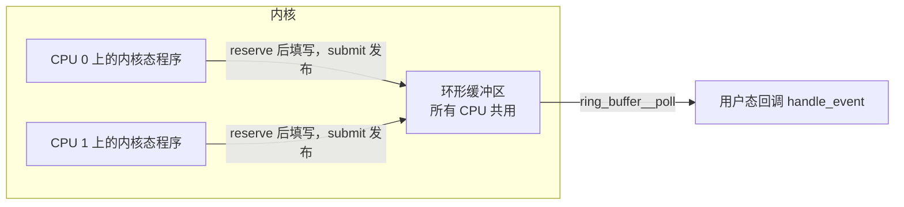
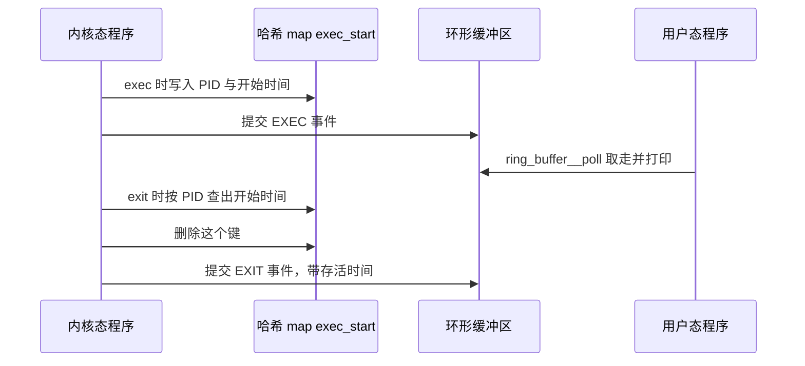

# B.6 Map：内核态与用户态的数据交换

[B.3 第一个 eBPF 程序](/教程/正文/系统编程/拓展B_eBPF/B_3_第一个eBPF程序) 里的 hello，每被调用一次，只往跟踪缓冲区写一行字，事件处理完就返回，什么也不留下。要回答「哪个进程系统调用最多」「一个进程从 exec 到退出活了多久」，程序必须在两次运行之间记住东西，用户态还得能把它取出来。eBPF 提供的机制叫 BPF 映射（map）：一块由内核管理、内核态程序和用户态程序都能访问的键值存储。

这一页从声明一个 map 讲到用环形缓冲区把事件送到用户态。读完应当能按需求选对 map 类型，在内核态做查找、更新与删除，把并发更新写对，在用户态用骨架和 libbpf 的接口读取与遍历，知道 `.bss`、`.rodata` 这些全局对象背后也是 map，并能写出哈希 map 与环形缓冲区配合的完整工具。

读这一页需要 [B.5 辅助函数与上下文](/教程/正文/系统编程/拓展B_eBPF/B_5_辅助函数与上下文) 里讲过的进程身份与 `BPF_CORE_READ`，以及 tracepoint 的 `__data_loc` 字段。本页的 BPF 程序用 zig 自带的 clang 编译，在 SignalX 上用 `bpftool gen skeleton` 生成骨架、`bpftool btf dump` 查看 BTF，用户态程序用 `gcc -fsyntax-only` 检查；凡是要加载进内核才有的运行输出，都照 libbpf-bootstrap 的 README 引用，写成「输出类似」。完整程序在 `code/系统编程/拓展B_eBPF/B_6_Map与数据交换/` 下。

## 1. 程序之间没有状态

eBPF 程序由事件触发，命中一次跑一遍。这次运行与下一次之间没有可以留东西的地方：栈在返回时就不存在了，寄存器同理。要把「这个进程已经调用过多少次」带到下一次事件里，只能放进 map。

::: concept ebpf-map-kernel-object title="map 是独立于程序的内核对象"

map 由内核创建和维护，不被某一个程序独占。内核态程序通过辅助函数访问它，用户态程序通过文件描述符访问它。程序被卸载后，只要还有引用，map 和里面的数据就还在。

:::

文件描述符和引用计数决定 map 何时消失，那是 [B.7 加载与附加](/教程/正文/系统编程/拓展B_eBPF/B_7_加载与附加_bpf系统调用与程序生命周期) 的内容。这里只记住一件事：map 的生命周期比一次程序运行长，也可能比程序本身更长。正因为如此，用户态才能在一个长期运行的加载程序里反复读取内核态程序写下的数据。

## 2. 声明 map

libbpf 推荐的写法叫 BTF 风格：用一个匿名结构体描述 map 的参数，每个成员的类型里带着参数的值，再把整个结构体放进 `.maps` 节。

```c
struct {
    __uint(type, BPF_MAP_TYPE_HASH);
    __uint(max_entries, 10240);
    __type(key, char[TASK_COMM_LEN]);
    __type(value, __u64);
} counts SEC(".maps");
```

`__uint(name, val)` 展开成 `int (*name)[val]`，`__type(name, val)` 展开成 `typeof(val) *name`。这样写不是为了好看：clang 会把成员的名字和类型写进 BTF（BPF 类型格式，BPF Type Format），libbpf 加载时从 BTF 中读出 type、max_entries、key、value 四项，再用它们调用 `bpf()` 创建 map。整个过程没有代码被执行，宏只是让参数以类型的形式留在目标文件里。

::: details 预处理之后的声明

上面那段声明在预处理后的真实结果是：

```c
struct {
    int (*type)[BPF_MAP_TYPE_HASH];
    int (*max_entries)[10240];
    typeof(char[TASK_COMM_LEN]) *key;
    typeof(__u64) *value;
} counts
#pragma GCC diagnostic push
#pragma GCC diagnostic ignored "-Wignored-attributes"
             __attribute__((section(".maps"), used))
#pragma GCC diagnostic pop
                         ;
```

每个成员都是「指向数组或类型的指针」，方括号里的值或 `typeof` 里的类型就是参数。`SEC` 展开成 `section(".maps")` 加 `used`，后者防止编译器把没人引用的结构体删掉。`pragma` 两行只是压掉「属性被忽略」的警告，与参数无关。

:::

常用类型按用途列在下表。

| 类型 | 键 | 值 | 用途与特点 |
| --- | --- | --- | --- |
| `BPF_MAP_TYPE_HASH` | 任意定长 | 任意定长 | 元素预分配，键不存在时查找返回空指针。按 PID、进程名这类稀疏键计数 |
| `BPF_MAP_TYPE_ARRAY` | 4 字节下标 | 任意定长 | 创建时全部预分配并清零，下标 0 到 `max_entries - 1`，不支持删除 |
| `BPF_MAP_TYPE_PERCPU_HASH` | 同 HASH | 每个 CPU 一份 | 各 CPU 改自己的副本，不必用原子操作；用户态一次取回全部 CPU 的值 |
| `BPF_MAP_TYPE_PERCPU_ARRAY` | 4 字节下标 | 每个 CPU 一份 | 计数首选：没有锁争用，下标在范围内也不会查找失败 |
| `BPF_MAP_TYPE_LRU_HASH` | 同 HASH | 同 HASH | 满了淘汰最久未使用的元素，内存有上界，计数可能丢键 |
| `BPF_MAP_TYPE_RINGBUF` | 无 | 无 | 事件通道，`max_entries` 是缓冲区字节数 |
| `BPF_MAP_TYPE_PERF_EVENT_ARRAY` | 4 字节下标 | 文件描述符 | 旧的 perf 缓冲区，用法见第 6 节 |
| `BPF_MAP_TYPE_PROG_ARRAY` | 4 字节下标 | 程序描述符 | 尾调用用，[B.10](/教程/正文/系统编程/拓展B_eBPF/B_10_程序类型与附加类型) 再提 |

作者的选择很直接：计数用每 CPU（per-CPU）数组；键稀疏、需要按名字查的用哈希；只关心最近若干条的用 LRU 哈希；要把事件交给用户态用环形缓冲区；进程的存活期这类「入口记下、出口取回」的配对状态，用按 PID 索引的哈希。

## 3. 在内核态读写 map

内核态对 map 里键值元素的读写只经过三个辅助函数：

```c
void *bpf_map_lookup_elem(void *map, const void *key);
long bpf_map_update_elem(void *map, const void *key, const void *value, __u64 flags);
long bpf_map_delete_elem(void *map, const void *key);
```

查找返回的是 map 内部元素的地址，不是副本，改它就等于改 map 里的值。键不存在时返回空指针；数组 map 是例外，下标在范围内时元素总是存在。

::: compare left-title="直接使用查找结果" right-title="先判空再使用"

```c
__u64 *val = bpf_map_lookup_elem(&counts, key);

__sync_fetch_and_add(val, 1);
```

---

```c
__u64 *val = bpf_map_lookup_elem(&counts, key);

if (val != NULL) {
    __sync_fetch_and_add(val, 1);
}
```

:::

验证器会跟踪每个寄存器的类型，查找结果一开始是「指向 map 值的指针或空指针」这个联合类型。不解引用之前先证明非空，验证器就拒绝加载，日志里写着 `R0 invalid mem access 'map_value_or_null'`。这条规则背后的推理在 [B.9 验证器](/教程/正文/系统编程/拓展B_eBPF/B_9_验证器)。

更新用第四个参数控制语义：

- `BPF_ANY`：键不存在就建立，存在就覆盖。
- `BPF_NOEXIST`：只在键不存在时建立，已存在返回 `-EEXIST`。
- `BPF_EXIST`：只在键存在时更新，不存在返回 `-ENOENT`。

删除只对哈希类 map 有意义，数组 map 的元素固定存在，`bpf_map_delete_elem` 会返回错误。

同一个元素可能被多个 CPU 同时更新。`(*val) += 1` 在 BPF 里是三条指令：读、加、写，两个 CPU 的指令交错就会丢掉一次。`__sync_fetch_and_add(val, 1)` 则编译成一条带 `lock` 前缀的原子指令：

::: compare left-title="普通的自增" right-title="原子加"

```text
r1 = *(u64 *)(r0 + 0)
r1 += 1
*(u64 *)(r0 + 0) = r1
```

---

```text
lock *(u64 *)(r0 + 0) += r7
```

:::

能用每 CPU map 时优先用它，连原子指令都省了。只有多个 CPU 必须改同一份计数时，才需要 `__sync_fetch_and_add`；要设置某一位时用 `__sync_fetch_and_or`，它们编译出来都是带 `lock` 前缀的原子读改写。

下面是按进程名统计系统调用次数的内核态程序，完整文件在 `code/系统编程/拓展B_eBPF/B_6_Map与数据交换/syscount.bpf.c`：

```c
#include "vmlinux.h"
#include <bpf/bpf_helpers.h>

char LICENSE[] SEC("license") = "Dual BSD/GPL";

struct {
    __uint(type, BPF_MAP_TYPE_HASH);
    __uint(max_entries, 10240);
    __type(key, char[TASK_COMM_LEN]);
    __type(value, __u64);
} counts SEC(".maps");

SEC("tp/raw_syscalls/sys_enter")
int count_syscalls(void *ctx)
{
    char key[TASK_COMM_LEN] = {};
    __u64 one = 1;
    __u64 *val;

    (void)ctx;
    bpf_get_current_comm(key, sizeof(key));
    val = bpf_map_lookup_elem(&counts, key);
    if (val != NULL) {
        __sync_fetch_and_add(val, 1);
        return 0;
    }

    /* 键还不存在：只在没有别人抢先建立时插入 */
    if (bpf_map_update_elem(&counts, key, &one, BPF_NOEXIST) == 0) {
        return 0;
    }

    /* 别的 CPU 刚建立了同一个键，回到它上面加 */
    val = bpf_map_lookup_elem(&counts, key);
    if (val != NULL) {
        __sync_fetch_and_add(val, 1);
    }
    return 0;
}
```

`raw_syscalls/sys_enter` 每发生一次系统调用就命中一次，`bpf_get_current_comm` 把进程名写进 16 字节的数组，数组本身作为键。第一次见到某个进程名时查找失败，用 `BPF_NOEXIST` 插入 1；如果两个 CPU 同时第一次见到它，只有一个插入成功，另一个得到 `-EEXIST`，于是重新查找一次再原子加。少了这步重试，那次系统调用就漏计了。

选 `raw_syscalls/sys_enter` 而不选 `syscalls/sys_enter_*`，是因为后者每个系统调用一个事件，事件名要写死；前者只有一个入口，用 `ctx->id` 还能区分系统调用号。这里不区分，统计的是总数。

同样按进程名计数，bpftrace 一行就够：`@[comm] = count()`。它背后生成的也是一张哈希 map，只是类型和更新方式由工具替你选。临时排查用那一行，要做成带参数、能长期运行的工具，就写成这里这样。[B.14 bpftrace 与编程工具链](/教程/正文/系统编程/拓展B_eBPF/B_14_bpftrace与编程工具链) 有那一行的完整说明。

<Quiz
  type="single"
  :options="[
    { label: '键可能不存在，查找会返回空指针', value: 'A' },
    { label: '查找返回的是副本，可能越界', value: 'B' },
    { label: '辅助函数可能失败并返回负数', value: 'C' },
    { label: 'map 可能被用户态删除', value: 'D' }
  ]"
  answer="A"
>

<template #question>

`bpf_map_lookup_elem` 的结果为什么必须判空？

</template>

正确答案是 **A**。哈希 map 里找不到键时返回空指针，验证器要求程序在解引用之前证明这个指针非空。B 错在返回值指向 map 内部元素而不是副本；C 把指针和返回 `long` 的更新函数混为一谈。

</Quiz>

## 4. 在用户态读 map

骨架把每个 map 暴露成 `skel->maps.<名字>`，类型是 `struct bpf_map *`。要拿到文件描述符用 `bpf_map__fd`，要读写元素用 libbpf 的包装函数：

```c
int bpf_map__lookup_elem(const struct bpf_map *map,
                         const void *key, size_t key_sz,
                         void *value, size_t value_sz, __u64 flags);
int bpf_map__get_next_key(const struct bpf_map *map,
                          const void *cur_key, void *next_key, size_t key_sz);
int bpf_map__delete_elem(const struct bpf_map *map,
                         const void *key, size_t key_sz, __u64 flags);
```

它们比直接调用 `bpf_map_*` 多了一层参数检查，键或值的大小和目标文件里的声明不一致时返回 `-EINVAL`，不必等到内核报一个含糊的错误。`bpf_map__get_next_key` 用来遍历：`cur_key` 传 `NULL` 取第一个键，取到最后一个键之后再调用返回 `-ENOENT`。

每 2 秒打印次数最多的前 N 个进程，然后把计数清零，用户态程序这样写（完整文件 `syscount.c`，`COMM_LEN` 取 16，与内核态键的大小一致；`MAX_ENTRIES`、`TOP_N` 分别是 10240 和 10）：

```c
/* 逐个取出最前面的键，读出计数值后删掉它，顺带把 map 清零 */
static size_t drain(const struct bpf_map *map, struct entry *all)
{
    char key[COMM_LEN];
    size_t n = 0;

    while (n < MAX_ENTRIES &&
           bpf_map__get_next_key(map, NULL, key, sizeof(key)) == 0) {
        all[n].count = 0;
        if (bpf_map__lookup_elem(map, key, sizeof(key), &all[n].count,
                                 sizeof(all[n].count), 0) != 0) {
            all[n].count = 0;
        }
        memcpy(all[n].comm, key, sizeof(key));
        n++;
        bpf_map__delete_elem(map, key, sizeof(key), 0);
    }
    return n;
}

static void print_top(const struct bpf_map *map, struct entry *all)
{
    size_t n;
    size_t i;

    n = drain(map, all);
    qsort(all, n, sizeof(all[0]), compare_count);
    for (i = 0; i < n && i < TOP_N; i++) {
        printf("%-16s %llu\n", all[i].comm, (unsigned long long)all[i].count);
    }
    fflush(stdout);
}
```

遍历的同时删除元素，写法上有个小技巧：每次都传 `NULL` 取「当前的第一个键」，读出来、删掉，下一轮的第一个键就换成了下一个元素。不能按常规记下上一个键再取它的后继：`bpf_map_get_next_key` 在传入的键不存在时不是报错，而是返回第一个键，删掉当前键之后再拿它求后继会绕回开头。这样遍历的顺序不固定，计数本来也不需要顺序。

主循环只是每两秒调用一次：

```c
while (!stop) {
    sleep(2);
    printf("%-16s %s\n", "COMM", "SYSCALLS");
    print_top(skel->maps.counts, all);
}
```

每 CPU map 在用户态读取时要用另一套尺寸。内核为每个可能的 CPU 存一份值，libbpf 要求缓冲区大小等于「值大小按 8 字节向上对齐后，乘以 `libbpf_num_possible_cpus()` 的返回值」：

```c
int ncpus = libbpf_num_possible_cpus();
/* 每个 CPU 的槽按 8 字节对齐，4 字节的值也占 8 字节 */
size_t slot = (sizeof(__u32) + 7) / 8 * 8;
__u32 *values = calloc(ncpus, slot);
```

函数名里的 possible 是准确的：它读 `/sys/devices/system/cpu/possible`，返回的是这台机器可能存在的 CPU 数，不是当前在线的个数。按 `sysconf(_SC_NPROCESSORS_ONLN)` 分配会在部分 CPU 离线时短一截，libbpf 直接拒绝这次调用。取回之后按 CPU 累加就是总和。

用 `bpftool` 可以直接看 map 里的内容，不必写程序。输出类似（来自 bpftool 文档的示例）：

::: terminal title="bash - bpftool map dump"

```text
$ sudo bpftool map dump id 10
key: 00 01 02 03  value: 00 01 02 03 04 05 06 07
key: 0d 00 07 00  value: 02 00 00 00 01 02 03 04
Found 2 elements
```

:::

键和值按字节打印。map 带 BTF 类型信息时，新版 bpftool 会按类型解码，打印成结构体字段，比一串十六进制好读。

<Quiz
  type="single"
  :options="[
    { label: '一个值，就是当前 CPU 那一份', value: 'A' },
    { label: '每个可能的 CPU 一个值，共 libbpf_num_possible_cpus() 个', value: 'B' },
    { label: '每个在线的 CPU 一个值，个数随时可变', value: 'C' },
    { label: '所有 CPU 的值已经由内核加好', value: 'D' }
  ]"
  answer="B"
>

<template #question>

用户态用 `bpf_map__lookup_elem` 读一个每 CPU map 的元素，拿到的是什么？

</template>

正确答案是 **B**。内核按「可能的 CPU」预留槽位，离线 CPU 的槽位照样存在，值为 0。C 混淆了 possible 与 online；D 错在求和这一步没有任何接口替你做，取回之后要自己按 CPU 累加。

</Quiz>

## 5. 全局对象也是 map

[B.3](/教程/正文/系统编程/拓展B_eBPF/B_3_第一个eBPF程序) 里写过 `skel->bss->my_pid = getpid();`，当时只说「用户态在这里设置一个值」。现在可以说明它的来历：libbpf 把目标文件里的 `.bss`、`.data`、`.rodata` 各建成一个单元素数组 map，再用 `mmap` 把 map 映射到用户空间。`skel->bss` 就是映射后的地址，写它等于写 map 的第 0 个元素，内核态程序读同一个元素。

::: concept ebpf-map-globals-are-maps title="全局对象是 libbpf 建的单元素数组 map"

定义在函数外的对象按是否带初值落进 `.bss` 或 `.data`，带 `const volatile` 的落进 `.rodata`。libbpf 为每个节建一个 `BPF_MAP_TYPE_ARRAY`：键大小 4 字节，值大小等于节的大小，只有一个元素；节里有非 `static` 的对象时再加上 `BPF_F_MMAPABLE`，用户态通过骨架里的 `skel->bss`、`skel->data`、`skel->rodata` 直接读写。这些 map 与手写的 map 没有本质区别，`bpftool map show` 里同样列得出来。

:::

下面这个程序里有三个全局对象：可读写的 `target_pid`、只读参数 `threshold_ns`、只在程序内部用的 `hits`。

```c
#include "vmlinux.h"
#include <bpf/bpf_helpers.h>

char LICENSE[] SEC("license") = "Dual BSD/GPL";

/* 用户态可以读写的全局对象，落在 .bss */
int target_pid = 0;

/* 只读参数，落在 .rodata；用户态在 load 之前写入 */
const volatile __u64 threshold_ns = 1000000;

/* 只在程序内部使用，用户态看不到 */
static int hits = 0;

SEC("tp/sched/sched_process_exec")
int handle_exec(void *ctx)
{
    __u32 pid = bpf_get_current_pid_tgid() >> 32;

    (void)ctx;
    if (target_pid != 0 && pid != (__u32)target_pid) {
        return 0;
    }
    hits += 1;
    return 0;
}
```

用 `bpftool btf dump` 看它的 BTF，能看到 `.bss` 和 `.rodata` 两个数据节。下面是在 SignalX 上对 `globals.bpf.o` 运行的真实输出（节选）：

::: terminal title="bash - bpftool btf dump（节选）"

```text
$ bpftool btf dump file globals.bpf.o
[8] VAR 'LICENSE' type_id=6, linkage=global
[9] VAR 'target_pid' type_id=3, linkage=global
[10] CONST '(anon)' type_id=11
[11] VOLATILE '(anon)' type_id=12
[12] TYPEDEF '__u64' type_id=13
[13] INT 'unsigned long long' size=8 bits_offset=0 nr_bits=64 encoding=(none)
[14] VAR 'threshold_ns' type_id=10, linkage=global
[15] VAR 'hits' type_id=3, linkage=static
[16] DATASEC '.bss' size=0 vlen=2
	type_id=9 offset=0 size=4 (VAR 'target_pid')
	type_id=15 offset=4 size=4 (VAR 'hits')
[17] DATASEC '.rodata' size=0 vlen=1
	type_id=14 offset=0 size=8 (VAR 'threshold_ns')
[18] DATASEC 'license' size=0 vlen=1
	type_id=8 offset=0 size=13 (VAR 'LICENSE')
```

:::

`const volatile` 在 BTF 里是一层 `CONST` 套一层 `VOLATILE`，libbpf 靠这个识别只读参数。`hits` 的 linkage 是 `static`，它仍然占着 `.bss` 的一个位置（偏移 4，大小 4），但骨架的结构体里不包含它。`bpftool gen skeleton` 生成的头文件里，`target_pid` 出现在 `struct globals_bpf__bss` 中，`hits` 不出现，用户态改不到它：

```c
struct globals_bpf {
    /* … */
    struct {
        struct bpf_map *bss;
        struct bpf_map *rodata;
    } maps;
    /* … */
    struct globals_bpf__bss {
        int target_pid;
    } *bss;
    struct globals_bpf__rodata {
        __u64 threshold_ns;
    } *rodata;
};
```

只读参数的意义在于验证器的优化。`const volatile` 的值在验证时已知，libbpf 用 `BPF_F_RDONLY_PROG` 创建 `.rodata` 对应的 map，并在写入初值之后冻结它。验证器据此把 `if (min_duration_ns != 0)` 这类分支按实际取值剪掉，走不到的分支连同里面的辅助函数调用一起消失，既省指令也让不可能成立的路径不必通过检查。把过滤条件做成只读参数，等于让验证器替你删代码。

::: warning `const volatile` 参数要在 open 之后、load 之前写入

加载时 `.rodata` 被冻结并重新映射为只读，`load` 之后再写 `skel->rodata->…` 会触发段错误。正确顺序是 `open`、写 `skel->rodata`、`load`。

:::

`skel->bss` 没有这个限制。`.bss` 映射过来就是可读写的，加载后随时能改，内核态程序下一次运行就会看到新值；代价是编译器不会为它做常量折叠。[B.3](/教程/正文/系统编程/拓展B_eBPF/B_3_第一个eBPF程序) 里把 `my_pid` 写在 `load` 之前，是常规写法：值随初始内容一起进 map，加载和运行分成两步看更清楚。

::: generate ebpf-map-globals-walkthrough kind=explanation concepts=ebpf-map-globals-are-maps

面向刚接触 libbpf 骨架的读者，以 `target_pid` 与 `threshold_ns` 为例，逐步说明从 C 源文件里的定义到 `skel->bss`、`skel->rodata` 指针的每一步：落在哪个节、libbpf 怎样按节建 map、mmap 之后用户态读写的到底是哪块内存。重点解释为什么 `const volatile` 要在 load 之前写、为什么 `static` 的对象不出现在骨架里，不要展开 BTF 的二进制编码。

:::

## 6. 环形缓冲区

把事件送到用户态，过去的标准做法是 perf 缓冲区（perf buffer）：每个 CPU 一个缓冲区，用户态给每个 CPU 打开一个 perf 事件，程序用 `bpf_perf_event_output` 往里写。它能用，但内存随 CPU 数增长，不同 CPU 上的事件到达用户态的顺序也无法保证，而进程的 exec 和 exit 恰恰最怕乱序。

环形缓冲区（ring buffer，代码里叫 ringbuf）是后来加入的 map 类型：所有 CPU 共用一段环形内存，记录按预留的先后交给消费者，后面的记录要等前面的记录提交之后才读得到。

```c
struct {
    __uint(type, BPF_MAP_TYPE_RINGBUF);
    __uint(max_entries, 256 * 1024);
} events SEC(".maps");
```

`max_entries` 是缓冲区字节数，必须是 2 的幂；libbpf 在加载前还会把它规整成页大小的整数倍。`256 * 1024` 两个条件都满足。

内核态写入有两条路。第一条是预留加提交：

```c
e = bpf_ringbuf_reserve(&events, sizeof(*e), 0);
if (e == NULL) {
    return 0;
}
/* 直接往 e 指向的内存里填字段 */
bpf_ringbuf_submit(e, 0);
```

`bpf_ringbuf_reserve` 在环里划出空间，返回可直接写的指针，填充过程不经过任何额外复制，`submit` 把记录发布出去。大小必须是编译期常量，验证器要提前知道预留多少。预留失败通常是环满了，此时这条记录丢失；如果中途发现不该发这条事件，用 `bpf_ringbuf_discard` 归还空间。

第二条是 `bpf_ringbuf_output(&events, &sample, sizeof(sample), 0)`：先在一块结构体里把数据填好，再整体复制进去。大小可以在运行时决定，代价是多一次复制。数据本来就现成时，第二种写法更短。



用户态用 `ring_buffer__new` 建消费者，用 `ring_buffer__poll` 取事件：

```c
rb = ring_buffer__new(bpf_map__fd(skel->maps.events), handle_event, NULL, NULL);

while (!stop) {
    err = ring_buffer__poll(rb, 100);
}
```

回调签名是 `int (*)(void *ctx, void *data, size_t size)`，没有 CPU 号。需要 CPU 号的程序要自己把它写进事件。perf 缓冲区的回调有 CPU 号，也有一个专门的丢失回调；环形缓冲区没有丢失回调，丢了哪些要自己在程序里用每 CPU 数组计数。

`ring_buffer__poll` 的底层就是 epoll，`ring_buffer__epoll_fd` 能把内部那个 epoll 描述符取出来。事件循环里已经有别的描述符时，把它并进同一个 epoll 就行，[第 12 章 事件循环](/教程/正文/系统编程/12_事件循环) 讲的那种结构可以直接用。

| | perf 缓冲区 | 环形缓冲区 |
| --- | --- | --- |
| 结构 | 每个 CPU 一个环 | 所有 CPU 共用一个环 |
| 内存 | 随 CPU 数增长 | 一份，大小固定 |
| 到达顺序 | 不同 CPU 的事件可能乱序 | 按预留顺序被消费 |
| 内核态写入 | 先准备好再整体复制 | `reserve` 直接写，`submit` 发布 |
| 用户态接口 | `perf_buffer__new`、`perf_buffer__poll`，回调带 CPU 号 | `ring_buffer__new`、`ring_buffer__poll`，回调不带 CPU 号 |
| 丢失通知 | 有 lost 回调 | 没有，需要自己计数 |

环形缓冲区在极端吞吐下不如每 CPU 一个缓冲区，那是每个 CPU 各写各的、完全没有共享的开销；除此之外它在内存占用、顺序和接口上都更好。新代码用环形缓冲区，perf 缓冲区只在需要照顾老内核时出现。

<Quiz
  type="multi"
  :options="[
    { label: '所有 CPU 共用同一个缓冲区', value: 'A' },
    { label: '记录按预留的先后被用户态消费', value: 'B' },
    { label: 'reserve 得到的记录不需要额外复制', value: 'C' },
    { label: '用户态回调能直接拿到产生事件的 CPU 号', value: 'D' }
  ]"
  :answer="['A', 'B', 'C']"
>

<template #question>

关于环形缓冲区，下列说法正确的是哪些？

</template>

正确答案是 **A、B、C**。D 错在回调签名只有上下文、数据和长度三个参数，CPU 号要由程序自己写进事件。

</Quiz>

## 7. 完整示例：进程生命周期跟踪

把前面的东西合起来：exec 时在哈希 map 里记下进程的开始时间并发出一个 EXEC 事件，exit 时按 PID 查出开始时间、算出存活多久、删掉这一项并发出 EXIT 事件。这个工具叫 proclife，结构上与 libbpf-bootstrap 的 bootstrap 示例相同。

数据流是这样：



三个数据结构的用途各不相同：`exec_start` 保存「正在运行、还没退出」的进程，键是 PID；`events` 是事件通道；`min_duration_ns` 是只读参数，用来只看活得够久的进程。

```c
#include "vmlinux.h"
#include <bpf/bpf_core_read.h>
#include <bpf/bpf_helpers.h>

#include "proclife.h"

char LICENSE[] SEC("license") = "Dual BSD/GPL";

const volatile __u64 min_duration_ns = 0;

struct {
    __uint(type, BPF_MAP_TYPE_HASH);
    __uint(max_entries, 8192);
    __type(key, pid_t);
    __type(value, __u64);
} exec_start SEC(".maps");

struct {
    __uint(type, BPF_MAP_TYPE_RINGBUF);
    __uint(max_entries, 256 * 1024);
} events SEC(".maps");

SEC("tp/sched/sched_process_exec")
int handle_exec(struct trace_event_raw_sched_process_exec *ctx)
{
    struct task_struct *task;
    struct event *e;
    unsigned int fname_off;
    pid_t pid;
    __u64 ts;

    pid = bpf_get_current_pid_tgid() >> 32;
    ts = bpf_ktime_get_ns();
    bpf_map_update_elem(&exec_start, &pid, &ts, BPF_ANY);

    if (min_duration_ns != 0) {
        return 0;
    }

    e = bpf_ringbuf_reserve(&events, sizeof(*e), 0);
    if (e == NULL) {
        return 0;
    }

    task = (struct task_struct *)bpf_get_current_task();
    e->pid = pid;
    e->ppid = BPF_CORE_READ(task, real_parent, tgid);
    e->exit_code = 0;
    e->duration_ns = 0;
    e->exit_event = 0;
    bpf_get_current_comm(e->comm, sizeof(e->comm));
    fname_off = ctx->__data_loc_filename & 0xFFFF;
    bpf_probe_read_kernel_str(e->filename, sizeof(e->filename),
                              (char *)ctx + fname_off);

    bpf_ringbuf_submit(e, 0);
    return 0;
}

SEC("tp/sched/sched_process_exit")
int handle_exit(struct trace_event_raw_sched_process_template *ctx)
{
    struct task_struct *task;
    struct event *e;
    pid_t pid;
    pid_t tid;
    __u64 *start_ts;
    __u64 id;
    __u64 duration_ns = 0;

    (void)ctx;
    id = bpf_get_current_pid_tgid();
    pid = id >> 32;
    tid = (__u32)id;

    /* 线程退出时 pid 与 tid 不同，只看进程的退出 */
    if (pid != tid) {
        return 0;
    }

    start_ts = bpf_map_lookup_elem(&exec_start, &pid);
    if (start_ts != NULL) {
        duration_ns = bpf_ktime_get_ns() - *start_ts;
        bpf_map_delete_elem(&exec_start, &pid);
    } else if (min_duration_ns != 0) {
        /* 没有记录到 exec，算不出存活时间，指定了最短时长时就不报告 */
        return 0;
    }

    if (min_duration_ns != 0 && duration_ns < min_duration_ns) {
        return 0;
    }

    e = bpf_ringbuf_reserve(&events, sizeof(*e), 0);
    if (e == NULL) {
        return 0;
    }

    task = (struct task_struct *)bpf_get_current_task();
    e->pid = pid;
    e->ppid = BPF_CORE_READ(task, real_parent, tgid);
    e->exit_code = (BPF_CORE_READ(task, exit_code) >> 8) & 0xFF;
    e->duration_ns = duration_ns;
    e->exit_event = 1;
    bpf_get_current_comm(e->comm, sizeof(e->comm));
    e->filename[0] = '\0';

    bpf_ringbuf_submit(e, 0);
    return 0;
}
```

事件结构放在共享头文件 `proclife.h` 里，两半程序包含同一份定义，布局才不会对不上：

```c
#define TASK_COMM_LEN 16
#define MAX_FILENAME_LEN 127

struct event {
    __u32 pid;
    __u32 ppid;
    __u32 exit_code;
    __u32 exit_event;
    __u64 duration_ns;
    char comm[TASK_COMM_LEN];
    char filename[MAX_FILENAME_LEN];
};
```

用户态的关键是回调与主循环：

```c
static int handle_event(void *ctx, void *data, size_t len)
{
    const struct event *e = data;
    struct tm tm;
    char ts[16];
    time_t now;

    (void)ctx;
    (void)len;

    now = time(NULL);
    localtime_r(&now, &tm);
    strftime(ts, sizeof(ts), "%H:%M:%S", &tm);

    if (e->exit_event != 0) {
        printf("%-8s %-5s %-16s %-7u %-7u [%u]", ts, "EXIT", e->comm, e->pid,
               e->ppid, e->exit_code);
        if (e->duration_ns != 0) {
            printf(" (%llums)", e->duration_ns / 1000000);
        }
        putchar('\n');
    } else {
        printf("%-8s %-5s %-16s %-7u %-7u %s\n", ts, "EXEC", e->comm, e->pid,
               e->ppid, e->filename);
    }
    fflush(stdout);
    return 0;
}
```

`main` 里的顺序是本章反复强调的那一套：`proclife_bpf__open()`，写 `skel->rodata->min_duration_ns`，`proclife_bpf__load()`，`proclife_bpf__attach()`，然后用 `ring_buffer__new` 建消费者、用 `ring_buffer__poll(rb, 100)` 循环取事件。`-d` 选项的毫秒数乘 1000000 之后写进只读参数。完整源码在 `code/系统编程/拓展B_eBPF/B_6_Map与数据交换/proclife.c`。

构建仍是三条命令：

```bash
clang -g -O2 -target bpf -mcpu=v3 -D__TARGET_ARCH_x86 -I. -c proclife.bpf.c -o proclife.bpf.o
bpftool gen skeleton proclife.bpf.o > proclife.skel.h
cc -std=c17 -Wall -Wextra proclife.c -o proclife $(pkg-config --cflags --libs libbpf)
```

`bpftool gen skeleton` 生成的骨架里，三个 map 和两个程序都出现在结构体中，只读参数出现在 `rodata` 子结构里：

```c
struct proclife_bpf {
    /* … */
    struct {
        struct bpf_map *exec_start;
        struct bpf_map *events;
        struct bpf_map *rodata;
    } maps;
    struct {
        struct bpf_program *handle_exec;
        struct bpf_program *handle_exit;
    } progs;
    /* … */
    struct proclife_bpf__rodata {
        __u64 min_duration_ns;
    } *rodata;
};
```

目标文件里，两个程序对 map 的引用都是重定位记录，加载时由 libbpf 换成真正的 map 描述符。在 SignalX 上用 `readelf -r proclife.bpf.o` 看到的真实输出（节选）：

::: terminal title="bash - readelf（节选）"

```text
$ readelf -r proclife.bpf.o
Relocation section '.reltp/sched/sched_process_exec' at offset 0x8d678 contains 3 entries:
  Offset          Info           Type           Sym. Value    Sym. Name
000000000050  001000000001 R_BPF_64_64       0000000000000000 exec_start
000000000070  001100000001 R_BPF_64_64       0000000000000000 min_duration_ns
000000000098  001200000001 R_BPF_64_64       0000000000000020 events

Relocation section '.reltp/sched/sched_process_exit' at offset 0x8d6a8 contains 5 entries:
  Offset          Info           Type           Sym. Value    Sym. Name
000000000038  001000000001 R_BPF_64_64       0000000000000000 exec_start
000000000088  001000000001 R_BPF_64_64       0000000000000000 exec_start
0000000000b8  001100000001 R_BPF_64_64       0000000000000000 min_duration_ns
0000000000d8  001100000001 R_BPF_64_64       0000000000000000 min_duration_ns
000000000108  001200000001 R_BPF_64_64       0000000000000020 events
```

:::

`events` 那一行的 Sym. Value 是 `0x20`，因为它是 `.maps` 节里的第二个对象，前面还有 32 字节的 `exec_start`。这些数字由编译器算好，改 map 声明就会变，读的时候不必记。

运行 `sudo ./proclife`，输出类似（来自 libbpf-bootstrap README 的 bootstrap 一节，列名与格式和本程序一致）：

::: terminal title="bash - ./proclife"

```text
$ sudo ./proclife
TIME     EVENT COMM             PID     PPID    FILENAME/EXIT CODE
00:21:22 EXIT  python3.8        4032353 4032352 [0] (123ms)
00:21:22 EXEC  mkdir            4032379 4032337 /usr/bin/mkdir
00:21:22 EXIT  mkdir            4032379 4032337 [0] (1ms)
00:21:22 EXEC  basename         4032382 4032381 /usr/bin/basename
00:21:22 EXIT  basename         4032382 4032381 [0] (0ms)
00:21:22 EXEC  sh               4032381 4032380 /bin/sh
00:21:22 EXEC  dirname          4032384 4032381 /usr/bin/dirname
00:21:22 EXIT  dirname          4032384 4032381 [0] (1ms)
^C
```

:::

同一个程序加 `-d 50` 只报告活过 50 毫秒的进程，输出类似（同一来源的 `-d 50` 一节）：

::: terminal title="bash - ./proclife -d 50"

```text
$ sudo ./proclife -d 50
TIME     EVENT COMM             PID     PPID    FILENAME/EXIT CODE
19:18:32 EXIT  timeout          3817109 402466  [0] (126ms)
19:18:32 EXIT  sudo             3817117 3817111 [0] (259ms)
19:18:33 EXIT  python3.7        3817083 1       [0] (1026ms)
19:18:38 EXIT  python3          3817429 3817424 [1] (60ms)
19:18:44 EXIT  iostat           3817585 3817531 [0] (3006ms)
...
```

:::

读 `task->real_parent->tgid` 用的 `BPF_CORE_READ` 和取文件名用的 `__data_loc_filename`，都是 [B.5](/教程/正文/系统编程/拓展B_eBPF/B_5_辅助函数与上下文) 讲过的写法：前者展开成一串 `bpf_core_read`，后者低 16 位是文件名在事件记录里的偏移。这里不再重复。

三处容易写错的地方。

第一，exit 的 tracepoint 对线程也触发。一个多线程进程每退出一个线程就命中一次，`bpf_get_current_pid_tgid()` 的高 32 位（tgid，也就是用户态的 PID）与低 32 位（tid）相等时才是整个进程退出，否则这条事件会把同一个进程报告好几遍。判断写成 `pid != tid` 就直接返回。

第二，`exec_start` 里的条目必须在 exit 时删掉，否则 map 只涨不消，跑够 8192 个进程之后新进程就记不进去了。删除放在查出开始时间之后，查不到就不删。

第三，`min_duration_ns` 不为零时，exec 事件不再发出。这是有意的：过滤掉短命进程时，每个新进程的 EXEC 都没有意义，只留 EXIT，用户态的输出才干净。过滤条件放在内核态的另一个好处是事件量小，环形缓冲区不容易满。

<Quiz
  type="single"
  :options="[
    { label: '线程退出时会命中同一个 tracepoint，必须按 tgid 与 pid 区分', value: 'A' },
    { label: 'exit 事件里读不到进程名', value: 'B' },
    { label: '环形缓冲区只能存一个事件', value: 'C' },
    { label: '哈希 map 的键必须是字符串', value: 'D' }
  ]"
  answer="A"
>

<template #question>

`handle_exit` 为什么要在最前面判断 `pid != tid`？

</template>

正确答案是 **A**。`sched_process_exit` 对每个线程都触发，只有主线程退出才代表整个进程结束。

</Quiz>

## 8. 习题

### 8.1 巩固

<Exercise id="47601" :d="1" :w="1" multi>

本页出现了三个 map 声明和三个全局对象，填一张表回答：

(1) _[1.1]_ 对 `syscount.bpf.c` 的 `counts`、`proclife.bpf.c` 的 `exec_start` 与 `events`，分别写出 map 类型、键类型、值类型、`max_entries`。

(2) _[1.1]_ 对 `globals.bpf.c` 的 `target_pid`、`threshold_ns`、`hits`，写出各落在哪个节、骨架是否暴露给用户态、用户态能否在 `load` 之后修改。

(3) _[2.1]_ 说明其中哪些 map 的查找结果可能为空指针，哪些不会。

</Exercise>

<Exercise id="47602" :d="2" :w="1">

下面这段程序有三处错误，指出它们分别属于哪一类（空指针、并发更新、只读参数的设置时机），并给出改正后的完整代码。

```c
struct {
    __uint(type, BPF_MAP_TYPE_HASH);
    __uint(max_entries, 1024);
    __type(key, __u32);
    __type(value, __u64);
} counts SEC(".maps");

const volatile __u32 targ_pid = 0;

SEC("tp/sched/sched_process_exec")
int on_exec(void *ctx)
{
    __u32 pid = bpf_get_current_pid_tgid() >> 32;
    __u64 *n = bpf_map_lookup_elem(&counts, &pid);

    (*n) += 1;
    return 0;
}
```

```c
skel = probe_bpf__open();
probe_bpf__load(skel);
skel->rodata->targ_pid = getpid();
```

</Exercise>

<Exercise id="47603" :d="2" :w="2">

用 `BPF_MAP_TYPE_PERCPU_ARRAY` 重写 `syscount.bpf.c`：不再按进程名，而是按 CPU 统计系统调用总数。map 只有一项，键固定为 0；每个 CPU 的普通自增落到自己那份副本上，所以不需要原子操作，也不需要原来的 `BPF_NOEXIST` 插入逻辑。用户态按本页讲的尺寸取回 `libbpf_num_possible_cpus()` 份值，求和后打印。

计数器的值类型用 `__u32`。验收：程序跑起来后，在另一个终端用 `yes > /dev/null` 制造负载，两秒一次的输出应当明显增长；把 `yes` 停掉，增长变慢。再把用户态缓冲区的分配改成 `sizeof(__u32) * ncpus`（不按 8 字节对齐），记录 libbpf 返回的错误，并从 libbpf 的头文件里找出这条尺寸检查的原文。

</Exercise>

<Exercise id="47604" :d="3" :w="2">

写一个带采样率的 exec 计数器：内核态用 `const volatile __u32 sample_every`，只在第 `sample_every` 次命中时更新哈希 map 里的计数（用另一个每 CPU 数组做计数器）。用户态用 `getopt` 接受 `-n` 设置采样率，按本页讲的顺序在 `open` 之后、`load` 之前写入。

验收：`bpftool btf dump file x.bpf.o` 的输出中能找到 `.rodata` 与 `sample_every`；`bpftool gen skeleton` 生成的头文件里有对应的 `rodata` 子结构。故意把赋值挪到 `load` 之后，记录程序的退出状态与终端上的错误。

</Exercise>

### 8.2 编程

<Exercise id="47605" :d="3" :w="2">

把 `proclife.bpf.c` 的 exec 事件改用 `bpf_ringbuf_output` 发送：在栈上填一个 `struct event`，再整体复制进环形缓冲区。用 `clang -S` 生成汇编或反汇编目标文件，确认调用的辅助函数编号变了；在 `bpf_helper_defs.h` 里查出 `bpf_ringbuf_output`、`bpf_ringbuf_reserve`、`bpf_ringbuf_submit` 各自的编号，与程序里的 `call` 对上。

改动后内核态程序在栈上要多放一个 168 字节的结构，说明这对 512 字节栈的限制意味着什么。两种写法各适合什么场合，写三句话。

</Exercise>

<Exercise id="47606" :d="4" :w="3">

用 `BPF_MAP_TYPE_LRU_HASH` 写一个「最近活跃进程」跟踪器：键是 PID，值是最后一次 exec 的时间戳（`bpf_ktime_get_ns`），`max_entries` 取 1024。用户态每 5 秒遍历一次，找出时间戳最早的 5 个条目，打印 PID 与「多少秒前活动」。

验收：先运行程序，再连续执行几十条短命令（`ls`、`true`、`date`），输出里应当出现这些进程名对应的 PID，且最久未活动的排在最前。把 `max_entries` 改成 4 再运行，确认旧条目被淘汰而不是程序报错。

</Exercise>

<Exercise id="47607" :d="5" :w="4">

给 proclife 加两样东西：`--json` 选项，把每个事件打印成一行 JSON；一份丢失计数，`bpf_ringbuf_reserve` 返回空指针时用每 CPU 数组累加，退出时打印丢失的事件数。

要求：

- JSON 里的字段名与普通输出一致，字符串字段要转义引号和反斜杠。
- 丢失计数用 `BPF_MAP_TYPE_PERCPU_ARRAY`，用户态按本页讲的尺寸求和。
- 帮助信息写清楚用法，未知选项返回非零。

验收：构造一段 200 行的 JSON 输出，用 `python3 -c 'import json,sys; [json.loads(l) for l in sys.stdin]'` 全部解析通过；把环形缓冲区改成 4096 字节、对一个编译任务做跟踪，观察丢失计数。若仍为 0，说明负载没有压满缓冲区，换更重的任务或更小的缓冲区再试。

</Exercise>

<Exercise id="47608" :d="6" :w="4">

在同一台机器上实现三种计数方案，对同一个 tracepoint（`raw_syscalls/sys_enter`）计数：

1. 哈希 map 加 `__sync_fetch_and_add`。
2. 每 CPU 哈希 map，程序里普通自增。
3. 每 CPU 数组 map，下标 0。

比较三者的内核态指令（用 `-S` 或反汇编看有没有 `lock` 前缀）、map 查找的开销，以及用户态汇总的复杂度。在多核机器上各跑 10 秒，让若干进程同时制造系统调用，记录三种方案得到的计数与 `perf stat` 测得的系统调用数之间的偏差，给出你的选择标准。

</Exercise>

### 8.3 综合与挑战

<Exercise id="47609" :d="7" :w="5" scope="*">

给 proclife 加一个存活时间直方图：进程 exit 时按存活时间落进对数桶（小于 1 毫秒、1～2 毫秒、2～4 毫秒，依此类推，共 20 个桶），用 `BPF_MAP_TYPE_PERCPU_ARRAY` 保存，用户态按桶打印成横条图。

要求：

- 桶的下标由存活时间算出，写清楚算法，相邻桶的分界值归入哪一侧要一致。
- 说明这里为什么不需要原子更新：每个 CPU 只写自己那份副本，读改写的交错只可能发生在同一 CPU 上，而同一 CPU 上的事件是串行处理的。
- 与 proclife 原有的输出并存，用 `-H` 关闭直方图、`-h` 打开。

验收：跑一批 `sleep 0.001`、`sleep 0.01`、`sleep 0.1`，直方图的峰值应当在对应的桶附近；总计数等于同一时段内 EXIT 事件的行数。

</Exercise>

## 9. 参考资料

- BPF 映射总览：<https://docs.kernel.org/bpf/maps.html>
- 哈希 map 与每 CPU 哈希、LRU 变体：<https://docs.kernel.org/bpf/map_hash.html>
- 数组 map 与每 CPU 数组：<https://docs.kernel.org/bpf/map_array.html>
- 环形缓冲区：<https://docs.kernel.org/bpf/ringbuf.html>
- Andrii Nakryiko, *BPF ring buffer*：<https://nakryiko.com/posts/bpf-ringbuf/>
- Andrii Nakryiko, *Building BPF applications with libbpf-bootstrap*：<https://nakryiko.com/posts/libbpf-bootstrap/>
- libbpf-bootstrap 仓库与 bootstrap 示例：<https://github.com/libbpf/libbpf-bootstrap>
- bpftool map 子命令文档：<https://github.com/libbpf/bpftool/blob/main/docs/bpftool-map.rst>
- libbpf 头文件 `libbpf.h` 与源码 `libbpf.c`（全局对象、每 CPU 尺寸、冻结 `.rodata` 的实现）：<https://github.com/libbpf/libbpf>
- **_Learning eBPF_**（Liz Rice），第 3 章「Maps」
