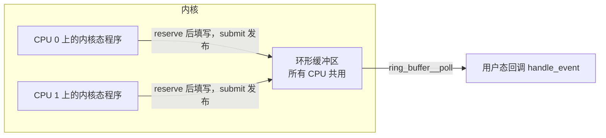
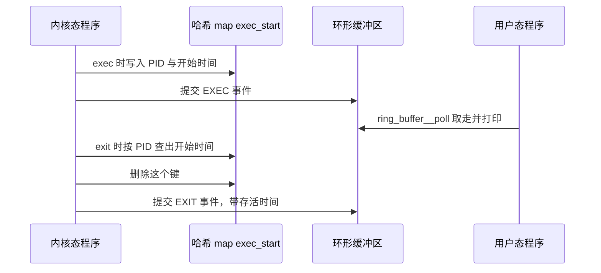

# B.6 Map：内核态与用户态的数据交换

在 [B.3 第一个 eBPF 程序](/教程/正文/系统编程/拓展B_eBPF/B_3_第一个eBPF程序) 编写的 `hello` 示例中，探针每次被事件唤醒后，仅向内核跟踪管道输出一行文本便即刻返回，不会在系统中留下任何持久化状态。然而在实际工程观测中，若要回答“哪个进程发起的系统调用最为频繁”或是“某个进程从 `exec` 载入到最终退出一共存活了多长时间”这类问题，探针就必须在先后两次甚至数万次触发之间保存中间状态，同时还需要提供一种高效通道，让运行在用户空间的监控进程能够随时提取这些聚合结果。eBPF 子系统为此打造的核心基础设施便是 BPF 映射（Map）——一块由内核统一托管、支持内核态探针与用户态进程双向并发访问的通用键值存储机制。

从在目标文件中声明一个基础 Map 出发，到借助高性能环形缓冲区（Ring Buffer）向用户空间实时推送事件流，Map 机制贯穿了几乎所有复杂 eBPF 应用的数据面设计。在编写探针与控制面代码时，开发者需要根据业务访问模式选取契合的 Map 类型，在内核态通过辅助函数完成查找、更新与删除操作并妥善处理多核并发竞争，在用户态依托骨架（Skeleton）与 libbpf 接口实现键值遍历与批量采集，同时理解 `.bss`、`.rodata` 等 C 语言全局对象在底层转化为单元素数组 Map 的映射原理。

本节内容承接 [B.5 辅助函数与上下文](/教程/正文/系统编程/拓展B_eBPF/B_5_辅助函数与上下文) 中探讨的进程身份标识提取、`BPF_CORE_READ` 跨指针读取以及 tracepoint 上下文中的 `__data_loc` 动态字段解析规则。文中涉及的 BPF 程序均通过 Clang 编译校验，并在实验环境 SignalX 上利用 `bpftool gen skeleton` 生成骨架、通过 `bpftool btf dump` 检视 BTF 元数据，用户态控制面代码均经过 `gcc -fsyntax-only` 语法核验；涉及内核运行时输出的终端结果均对照 libbpf-bootstrap 官方示例给出。完整示例源码归档于 `code/系统编程/拓展B_eBPF/B_6_Map与数据交换/` 目录下。

## 1. 程序之间没有状态

eBPF 程序遵循典型的事件驱动执行模型：每当挂载点上的内核事件被触发，虚拟机便将探针函数从头至尾执行一遍。在前后两次触发之间，程序自身并不持有任何能够延续数据的局部存储空间——512 字节的运行栈会在函数返回瞬间被销毁，通用寄存器也会在退出时悉数归还。倘若希望将“当前进程已累计触发了多少次系统调用”这类状态传递到下一次事件触发时刻，唯一的途径便是将数据寄存在独立于函数栈之外的 Map 对象中。

::: concept ebpf-map-kernel-object title="map 是独立于程序的内核对象"

Map 是由 Linux 内核直接分配并维护的独立内核对象，并不归属于某一个特定的 eBPF 程序私有。内核态探针通过专用辅助函数读写其中的条目，用户态进程则持有指向该对象的文件描述符发起系统调用交互。即使挂载的探针程序已被卸载，只要系统中仍存在未关闭的文件描述符或文件系统钉住（Pinning）引用，Map 实例及其内部承载的数据就会完好保留在内核内存中。

:::

关于文件描述符与内核引用计数如何共同决定 Map 对象的销毁时机，将在 [B.7 加载与附加](/教程/正文/系统编程/拓展B_eBPF/B_7_加载与附加_bpf系统调用与程序生命周期) 中展开剖析。此处只需确立一个核心认知：Map 的生命周期远长于单次探针函数的执行过程，甚至可以超越探针程序本身的驻留期。得益于这种解耦设计，多个挂载在不同内核路径上的 eBPF 程序能够共享同一个 Map 协同工作，用户态守护进程也得以在一个持续运行的事件循环中反复轮询或消费内核探针写入的最新数据。

## 2. 声明 map

现代 libbpf 体系广泛采用基于 BTF（BPF Type Format，BPF 类型格式）的声明语法来定义 Map。这种写法借助一个匿名结构体描述 Map 的各项创建属性，将具体配置数值巧妙地编码进结构体成员的 C 类型签名中，并通过 `SEC(".maps")` 宏将该结构体对象放置在 ELF 目标文件的 `.maps` 专用节区内：

```c
struct {
    __uint(type, BPF_MAP_TYPE_HASH);
    __uint(max_entries, 10240);
    __type(key, char[TASK_COMM_LEN]);
    __type(value, __u64);
} counts SEC(".maps");
```

在头文件定义中，`__uint(name, val)` 宏会被展开为指向定长数组的指针声明 `int (*name)[val]`，而 `__type(name, val)` 则展开为指向特定类型的指针 `typeof(val) *name`。这种语法构造的核心目的在于引导 Clang 编译器在生成调试与类型信息时，将成员字段的名称、数组维度以及目标类型完整记录到目标文件的 `.BTF` 节区中。当用户态的 libbpf 加载器解析该 ELF 文件时，会直接读取 `.BTF` 节中的类型元数据，提取出 `type`、`max_entries`、`key` 与 `value` 四项配置参数，并据此组装参数结构向内核发起 `bpf(BPF_MAP_CREATE, ...)` 系统调用。整个声明过程不产生任何运行时可执行指令，宏机制只是把建表参数以类型系统的形态静态封存在目标文件内部。

::: details 预处理之后的声明

将上述声明交由 C 预处理器完全展开后，可以得到如下原始 C 代码形态：

```c
struct {
    int (*type)[BPF_MAP_TYPE_HASH];
    int (*max_entries)[10240];
    typeof(char[TASK_COMM_LEN]) *key;
    typeof(__u64) *value;
} counts
#pragma GCC diagnostic push
#pragma GCC diagnostic ignored "-Wignored-attributes"
             __attribute__((section(".maps"), used))
#pragma GCC diagnostic pop
                         ;
```

可以看到，结构体内部的每个成员都是一个指向特定维度数组或数据类型的指针，方括号内的常量长度以及 `typeof` 捕获的具体类型正好完整承载了建表参数。外层的 `SEC` 宏展开为 `__attribute__((section(".maps"), used))`，其中 `used` 属性用于告知编译器：即便当前源文件中没有任何函数显式引用该结构体，也必须在生成的目标文件中保留其符号与类型信息。前后的 `#pragma` 指令则用于临时屏蔽编译器针对属性修饰产生的冗余警告。

:::

内核针对不同的数据结构特征与并发读写诉求，提供了丰富的 Map 类型。下表归纳了工程中最常使用的几种代表性类型：

| 类型 | 键 | 值 | 用途与特点 |
| --- | --- | --- | --- |
| `BPF_MAP_TYPE_HASH` | 任意定长 | 任意定长 | 元素默认预分配，目标键不存在时查找返回空指针。常用于按 PID、进程名等稀疏键进行聚合计数 |
| `BPF_MAP_TYPE_ARRAY` | 4 字节下标 | 任意定长 | 创建时一次性预分配全部槽位并清零，合法下标范围为 `0` 至 `max_entries - 1`，不支持删除单条元素 |
| `BPF_MAP_TYPE_PERCPU_HASH` | 同 HASH | 每个 CPU 一份 | 每个逻辑 CPU 各自维护独立的数据副本，更新时无需原子锁；用户态读取时会一次性取回所有 CPU 的副本数组 |
| `BPF_MAP_TYPE_PERCPU_ARRAY` | 4 字节下标 | 每个 CPU 一份 | 高频计数的理想选择：既消除了跨核锁争用，又保证合法下标范围内的查找永远不会失败 |
| `BPF_MAP_TYPE_LRU_HASH` | 同 HASH | 同 HASH | 容量达到上限时自动按最近最少使用（LRU）策略淘汰旧元素，内存占用恒定有界，但高频写入下可能挤出活跃键 |
| `BPF_MAP_TYPE_RINGBUF` | 无 | 无 | 面向事件流推送的单向环形通道，`max_entries` 用于指定环形缓冲区的总字节容量 |
| `BPF_MAP_TYPE_PERF_EVENT_ARRAY` | 4 字节下标 | 文件描述符 | 早期内核广泛使用的每 CPU 性能事件缓冲区，具体对比见第 6 节 |
| `BPF_MAP_TYPE_PROG_ARRAY` | 4 字节下标 | 程序描述符 | 专用于存放 eBPF 程序句柄以实现尾调用（Tail Call）跳转，将在 [B.10](/教程/正文/系统编程/拓展B_eBPF/B_10_程序类型与附加类型) 详细探讨 |

在实际架构选型中，可以遵循清晰的场景映射原则：若是全局或固定维度的纯数值统计，优先选用每 CPU（per-CPU）数组以获取最高吞吐量；若是按进程名、网络五元组等稀疏标识进行索引，则选用哈希表；若观测目标持续动态产生且需要严格限制内核内存开销，可采用 LRU 哈希表自动淘汰陈旧条目；若是将单次触发的完整明细事件实时上报给用户态消费，则使用环形缓冲区；而对于类似进程生命周期追踪这种“在入口处记录时间戳、在出口处取出并核销”的配对状态暂存场景，以 PID 为键的常规哈希表最为契合。

## 3. 在内核态读写 map

在内核态探针代码中，针对键值类 Map 元素的查询、写入与移除操作，统一收敛于三个基础辅助函数：

```c
void *bpf_map_lookup_elem(void *map, const void *key);
long bpf_map_update_elem(void *map, const void *key, const void *value, __u64 flags);
long bpf_map_delete_elem(void *map, const void *key);
```

需要特别留意的是，`bpf_map_lookup_elem` 返回的并非目标数据的拷贝副本，它直接返回指向 Map 内部存储槽位的内核内存指针。探针通过该指针直接修改内存内容，便等同于原地更新了 Map 中保存的值。当所查询的键在哈希表中尚不存在时，该函数会返回 `NULL` 空指针（唯一的例外是数组类 Map，只要传入的下标处于合法边界之内，其对应的槽位在创建时便已存在）。

::: compare left-title="直接使用查找结果" right-title="先判空再使用"

```c
__u64 *val = bpf_map_lookup_elem(&counts, key);

__sync_fetch_and_add(val, 1);
```

---

```c
__u64 *val = bpf_map_lookup_elem(&counts, key);

if (val != NULL) {
    __sync_fetch_and_add(val, 1);
}
```

:::

内核验证器在静态推演阶段会精密追踪每一个寄存器的类型状态。当 `bpf_map_lookup_elem` 调用返回时，承载返回值的寄存器 R0 会被标记为 `map_value_or_null`（指向 Map 值的有效指针或空指针）这一联合类型。如果代码未经过显式的非空分支判断便直接对该指针发起解引用或将其传递给后续内存操作，验证器会立即阻断加载流程，并在审计日志中抛出 `R0 invalid mem access 'map_value_or_null'` 错误。唯有通过条件跳转指令证明当前分支下指针非空后，寄存器状态才会转化为可安全读写的 `map_value`。这一类型状态机的推演细节将在 [B.9 验证器](/教程/正文/系统编程/拓展B_eBPF/B_9_验证器) 中深入展开。

向 Map 写入数据时，`bpf_map_update_elem` 的第四个参数 `flags` 用于精确控制键冲突时的更新语义：

- `BPF_ANY`：无论目标键此前是否存在，一律执行写入（不存在则新建条目，已存在则覆盖原值）。
- `BPF_NOEXIST`：仅当目标键尚不存在时才允许插入新条目，若键已存在则拒绝修改并返回 `-EEXIST`。
- `BPF_EXIST`：仅当目标键已经存在时才允许原地更新，若键不存在则返回 `-ENOENT`。

至于删除接口 `bpf_map_delete_elem`，则仅对哈希表等动态管理条目的 Map 类型生效；数组类 Map 的槽位自创建起便静态固化，对其调用删除操作只会返回错误码。

由于内核事件可能在多个物理 CPU 核心上同时触发同一个 eBPF 探针，当多个核心通过 `bpf_map_lookup_elem` 拿到指向同一个哈希表槽位的指针并试图累加计数时，便会产生典型的并发数据竞争。普通的 C 语言自增表达式 `(*val) += 1` 在底层 BPF 指令集中会被拆解为“内存加载、寄存器加一、内存回写”三条独立指令；一旦两个 CPU 的执行流在此期间发生交错，其中一次累加结果便会被覆盖丢失。为了保证跨核计数的准确性，需要使用编译器内建的原子操作原语 `__sync_fetch_and_add(val, 1)`，将其编译为单条带有硬件 `lock` 前缀的原子内存累加指令：

::: compare left-title="普通的自增" right-title="原子加"

```text
r1 = *(u64 *)(r0 + 0)
r1 += 1
*(u64 *)(r0 + 0) = r1
```

---

```text
lock *(u64 *)(r0 + 0) += r7
```

:::

在实际性能调优中，如果业务场景允许使用每 CPU（per-CPU）Map，应当优先采用每 CPU 类型——因为每个核心只读写专属于自己的独立内存槽位，既消除了跨核缓存行同步的硬件开销，也无需使用带 `lock` 前缀的原子指令。唯有当多个 CPU 必须共享并修改同一份状态数据时，才需要引入 `__sync_fetch_and_add`（或使用 `__sync_fetch_and_or` 执行原子位设置），它们在编译后均对应带 `lock` 前缀的原子读改写指令。

下面展示一个按进程名称统计系统调用触发总数的完整内核态探针程序，源码位于 `code/系统编程/拓展B_eBPF/B_6_Map与数据交换/syscount.bpf.c`：

```c
#include "vmlinux.h"
#include <bpf/bpf_helpers.h>

char LICENSE[] SEC("license") = "Dual BSD/GPL";

struct {
    __uint(type, BPF_MAP_TYPE_HASH);
    __uint(max_entries, 10240);
    __type(key, char[TASK_COMM_LEN]);
    __type(value, __u64);
} counts SEC(".maps");

SEC("tp/raw_syscalls/sys_enter")
int count_syscalls(void *ctx)
{
    char key[TASK_COMM_LEN] = {};
    __u64 one = 1;
    __u64 *val;

    (void)ctx;
    bpf_get_current_comm(key, sizeof(key));
    val = bpf_map_lookup_elem(&counts, key);
    if (val != NULL) {
        __sync_fetch_and_add(val, 1);
        return 0;
    }

    /* 键还不存在：只在没有别人抢先建立时插入 */
    if (bpf_map_update_elem(&counts, key, &one, BPF_NOEXIST) == 0) {
        return 0;
    }

    /* 别的 CPU 刚建立了同一个键，回到它上面加 */
    val = bpf_map_lookup_elem(&counts, key);
    if (val != NULL) {
        __sync_fetch_and_add(val, 1);
    }
    return 0;
}
```

在这段代码中，探针挂载于 `raw_syscalls/sys_enter` 跟踪点，系统中每发生一次系统调用便会触发一次执行。探针首先通过 `bpf_get_current_comm` 将当前进程的简短名称填入栈上 16 字节的字符数组 `key` 中，并以此数组作为键值在哈希表 `counts` 中发起查找。对于已经记录在册的常驻进程，首次查找即可命中，随后直接执行原子加一并返回。而当某个新进程首次发起系统调用时，查找会返回 `NULL`；此时代码选用了 `BPF_NOEXIST` 标志尝试插入初值 `1`。这样设计的考量在于：倘若两个 CPU 核心上属于同名进程的线程恰好在同一瞬间首次触发系统调用，两者都会在第一次查找中得到 `NULL`；使用 `BPF_NOEXIST` 能够确保只有一个核心成功插入初值 `1`，另一个抢占失败的核心会收到 `-EEXIST` 返回值，进而顺畅地回退到第二次查找并在对方刚刚建立的槽位上完成原子累加。如果省去这一步重试机制，高并发下的首次调用就会发生计数遗漏。

此外，这里之所以选择挂载 `raw_syscalls/sys_enter` 而非具体系统调用的 `syscalls/sys_enter_*`，是因为后者为每一个系统调用单独设立了跟踪点，必须在代码中写死具体的事件名；而 `raw_syscalls/sys_enter` 提供了全系统统一的入口拦截点，即使后续需要按系统调用号做细分统计，也只需直接读取上下文中的 `ctx->id` 字段即可完成分流。此处无需区分具体调用种类，直接统计全局总数。

值得一提的是，如果仅仅是为了在命令行下临时完成相同的按进程名计数排查，使用高级动态追踪工具 bpftrace 仅需一行单命令脚本：`@[comm] = count()`。在这行简短声明的背后，bpftrace 编译器同样会自动生成一张内核哈希 Map 并注入相应的更新字节码，只是底层的数据结构选型与并发同步细节被工具链透明接管了。在日常工程中，临时线上诊断往往直接借助单行脚本快速定界，而当需要将观测逻辑固化为支持命令行参数、具备长期守护能力的独立系统工具时，则会采用本节介绍的 libbpf C 语言模式编写。关于 bpftrace 与底层字节码之间的对应关系，将在 [B.14 bpftrace 与编程工具链](/教程/正文/系统编程/拓展B_eBPF/B_14_bpftrace与编程工具链) 中进一步对照解析。

<Quiz
  type="single"
  :options="[
    { label: '键可能不存在，查找会返回空指针', value: 'A' },
    { label: '查找返回的是副本，可能越界', value: 'B' },
    { label: '辅助函数可能失败并返回负数', value: 'C' },
    { label: 'map 可能被用户态删除', value: 'D' }
  ]"
  answer="A"
>

<template #question>

`bpf_map_lookup_elem` 的结果为什么必须判空？

</template>

正确答案是 **A**。当哈希 Map 中不存在目标键时，查找辅助函数会返回 `NULL` 空指针；内核验证器强制要求探针在解引用该返回值之前，必须在控制流上证明该指针非空。选项 B 误将返回的内部槽位指针当成了数据副本；选项 C 则混淆了返回指针的查找函数与返回 `long` 错误码的更新函数。

</Quiz>

## 4. 在用户态读 map

在用户态生成的控制面骨架中，目标文件里定义的每一个 Map 都被暴露为 `skel->maps.<名字>` 成员，其指针类型为 `struct bpf_map *`。若需获取底层的文件描述符，可调用 `bpf_map__fd`；若要在用户空间直接读取、遍历或删除其中的键值元素，则推荐使用 libbpf 提供的面向对象封装接口：

```c
int bpf_map__lookup_elem(const struct bpf_map *map,
                         const void *key, size_t key_sz,
                         void *value, size_t value_sz, __u64 flags);
int bpf_map__get_next_key(const struct bpf_map *map,
                          const void *cur_key, void *next_key, size_t key_sz);
int bpf_map__delete_elem(const struct bpf_map *map,
                         const void *key, size_t key_sz, __u64 flags);
```

相比于仅接受文件描述符的底层 `bpf_map_*` 函数族，这组双下划线接口在用户态额外引入了一层静态尺寸核验：一旦调用方传入的 `key_sz` 或 `value_sz` 与 ELF 目标文件中声明的类型尺寸不吻合，libbpf 会立即在用户空间拦截并返回 `-EINVAL`，从而避免将错位的缓冲区直接递交内核引发难以排查的数据截断或越界故障。其中 `bpf_map__get_next_key` 专用于全表迭代遍历：首次调用时将 `cur_key` 设为 `NULL` 即可获取表中的首个键；此后每次将上一轮取得的键作为 `cur_key` 传入，直至遍历完所有元素后函数返回 `-ENOENT`。

若需要每隔 2 秒统计并打印系统调用次数排名前 N 位的活跃进程，随后将当前周期的计数值清空重置，用户态采集逻辑可以按如下方式组织（完整实现见 `syscount.c`，其中 `COMM_LEN` 定为 16 以匹配内核态键长度，`MAX_ENTRIES` 与 `TOP_N` 分别设为 10240 与 10）：

```c
/* 逐个取出最前面的键，读出计数值后删掉它，顺带把 map 清零 */
static size_t drain(const struct bpf_map *map, struct entry *all)
{
    char key[COMM_LEN];
    size_t n = 0;

    while (n < MAX_ENTRIES &&
           bpf_map__get_next_key(map, NULL, key, sizeof(key)) == 0) {
        all[n].count = 0;
        if (bpf_map__lookup_elem(map, key, sizeof(key), &all[n].count,
                                 sizeof(all[n].count), 0) != 0) {
            all[n].count = 0;
        }
        memcpy(all[n].comm, key, sizeof(key));
        n++;
        bpf_map__delete_elem(map, key, sizeof(key), 0);
    }
    return n;
}

static void print_top(const struct bpf_map *map, struct entry *all)
{
    size_t n;
    size_t i;

    n = drain(map, all);
    qsort(all, n, sizeof(all[0]), compare_count);
    for (i = 0; i < n && i < TOP_N; i++) {
        printf("%-16s %llu\n", all[i].comm, (unsigned long long)all[i].count);
    }
    fflush(stdout);
}
```

在遍历哈希表的同时原地删除元素，在编码实现上有一处值得留意的细节：循环条件中的 `bpf_map__get_next_key` 每次都将第二个参数固定传为 `NULL`，即每一轮迭代都始终索取“当前哈希表中的第一个键”，读取完计数值后立即调用 `bpf_map__delete_elem` 将该键移除，如此一来下一轮调用 `NULL` 时自然就会推进到原本排在第二位的元素。这里之所以不能按照常规遍历习惯先记住当前键、删除后再拿它去求取后继键，是因为内核的 `get_next_key` 操作在发现传入的 `cur_key` 已被删除（不存在于表中）时，并不会报错停止，而是会退化为重新返回表中的第一个键，从而导致遍历循环不断从头绕圈。由于系统调用计数汇总本身不依赖键的哈希桶存储顺序，这种“始终取首元素并随即抹除”的排空写法既简练又规避了游标失效问题。

主事件循环只需每隔两秒唤醒一次并触发排空打印：

```c
while (!stop) {
    sleep(2);
    printf("%-16s %s\n", "COMM", "SYSCALLS");
    print_top(skel->maps.counts, all);
}
```

当在用户空间读取每 CPU（per-CPU）类型的 Map 时，接收缓冲区的内存布局与常规 Map 存在显著区别。由于内核为系统中每一个可能存在的 CPU 核心都独立维护了一份值副本，libbpf 在执行读取时，会严格要求传入的缓冲区总字节数等于“单份值大小按 8 字节向上对齐后的跨度，再乘以 `libbpf_num_possible_cpus()` 返回的核心总数”：

```c
int ncpus = libbpf_num_possible_cpus();
/* 每个 CPU 的槽按 8 字节对齐，4 字节的值也占 8 字节 */
size_t slot = (sizeof(__u32) + 7) / 8 * 8;
__u32 *values = calloc(ncpus, slot);
```

此处的 `possible` 对应着内核 `/sys/devices/system/cpu/possible` 接口所报告的硬件拓扑上限，涵盖了当前处于离线（offline）状态的处理器核心。如果误用 `sysconf(_SC_NPROCESSORS_ONLN)` 仅按当前在线的 CPU 数量分配内存，一旦宿主机上存在被热插拔关闭的核心，传入的缓冲区长度就会小于 libbpf 预期的总跨度，进而导致读取调用被直接拒绝。数组读取完毕后，在用户态遍历各个核心的槽位并累加，即可得到全局汇总计数。

在日常调试过程中，无需专门编写用户态读取程序，直接借助 `bpftool` 命令行工具即可随时检视内核中任意活跃 Map 的内部数据。其输出形态通常如下所示（引自 bpftool 官方文档示例）：

::: terminal title="bash - bpftool map dump"

```text
$ sudo bpftool map dump id 10
key: 00 01 02 03  value: 00 01 02 03 04 05 06 07
key: 0d 00 07 00  value: 02 00 00 00 01 02 03 04
Found 2 elements
```

:::

在缺乏类型元数据的情况下，键与值均按原始十六进制字节流逐一转储；而当目标 Map 附带了完整的 BTF 类型描述信息时，现代版本的 `bpftool` 会自动依据结构体定义反序列化每个字段的名称与数值，呈现出高度可读的结构化输出。

<Quiz
  type="single"
  :options="[
    { label: '一个值，就是当前 CPU 那一份', value: 'A' },
    { label: '每个可能的 CPU 一个值，共 libbpf_num_possible_cpus() 个', value: 'B' },
    { label: '每个在线的 CPU 一个值，个数随时可变', value: 'C' },
    { label: '所有 CPU 的值已经由内核加好', value: 'D' }
  ]"
  answer="B"
>

<template #question>

用户态用 `bpf_map__lookup_elem` 读一个每 CPU map 的元素，拿到的是什么？

</template>

正确答案是 **B**。内核按照宿主机硬件拓扑中“可能存在的 CPU 总数”预先划分存储槽位，即便某个核心当前处于离线状态，其对应的槽位依然保留在返回数组中（数值为 0）。选项 C 混淆了硬件可能核心数（possible）与运行时在线核心数（online）；选项 D 忽略了内核与 libbpf 均不会自动代劳跨核归并，用户态程序取出数组后需自行循环累加。

</Quiz>

## 5. 全局对象也是 map

回顾 [B.3](/教程/正文/系统编程/拓展B_eBPF/B_3_第一个eBPF程序) 中的入门示例，我们在用户态写下了 `skel->bss->my_pid = getpid();` 向内核探针传递过滤进程号。现在结合 Map 的底层架构，便能够彻底厘清这一语法背后的实现机理：libbpf 在解析 ELF 目标文件时，会自动将 `.bss`、`.data` 与 `.rodata` 等数据节区分别创建为单元素的内核数组 Map，并利用 `mmap()` 系统调用将这些内核 Map 的物理内存页直接映射至用户态进程的虚拟地址空间。骨架中的 `skel->bss` 指针正是指向这片共享映射区的起始地址——用户态通过该指针写入数据，实质上就是直接修改了对应单元素数组 Map 的第 0 号槽位，而运行在内核空间的探针则在同一块物理内存页上读取该槽位的内容。

::: concept ebpf-map-globals-are-maps title="全局对象是 libbpf 建的单元素数组 map"

在 eBPF C 源码中定义在函数体外部的全局对象，编译器会根据其是否携带非零初值将其分别归入 `.bss` 或 `.data` 节区，而带有 `const volatile` 修饰的只读对象则被归入 `.rodata` 节区。libbpf 在加载阶段会为每一个非空数据节区单独创建一个 `BPF_MAP_TYPE_ARRAY` 类型的内核 Map：其键大小固定为 4 字节，值大小精确等于整个数据节区的字节总长度，`max_entries` 设为 1；当节区内包含非 `static` 外部可见对象时，libbpf 还会在建表时附加 `BPF_F_MMAPABLE` 标志，从而允许用户态通过骨架中的 `skel->bss`、`skel->data` 与 `skel->rodata` 指针直接发起内存读写。在内核视角下，这些由数据节转化而来的 Map 与开发者显式声明的常规 Map 并无二致，执行 `bpftool map show` 同样能够观察到它们的存在。

:::

下面的示例程序同时声明了三个不同属性的全局对象：支持用户态与内核态双向读写的 `target_pid`、在加载前注入的只读阈值参数 `threshold_ns`，以及仅限探针内部私有的静态计数对象 `hits`。

```c
#include "vmlinux.h"
#include <bpf/bpf_helpers.h>

char LICENSE[] SEC("license") = "Dual BSD/GPL";

/* 用户态可以读写的全局对象，落在 .bss */
int target_pid = 0;

/* 只读参数，落在 .rodata；用户态在 load 之前写入 */
const volatile __u64 threshold_ns = 1000000;

/* 只在程序内部使用，用户态看不到 */
static int hits = 0;

SEC("tp/sched/sched_process_exec")
int handle_exec(void *ctx)
{
    __u32 pid = bpf_get_current_pid_tgid() >> 32;

    (void)ctx;
    if (target_pid != 0 && pid != (__u32)target_pid) {
        return 0;
    }
    hits += 1;
    return 0;
}
```

编译后使用 `bpftool btf dump` 检视目标文件的 BTF 类型表，可以清晰观察到 `.bss` 与 `.rodata` 两个数据节区（`DATASEC`）的内部成员排布。以下是在实验环境 SignalX 上针对 `globals.bpf.o` 实测导出的类型记录（节选）：

::: terminal title="bash - bpftool btf dump（节选）"

```text
$ bpftool btf dump file globals.bpf.o
[8] VAR 'LICENSE' type_id=6, linkage=global
[9] VAR 'target_pid' type_id=3, linkage=global
[10] CONST '(anon)' type_id=11
[11] VOLATILE '(anon)' type_id=12
[12] TYPEDEF '__u64' type_id=13
[13] INT 'unsigned long long' size=8 bits_offset=0 nr_bits=64 encoding=(none)
[14] VAR 'threshold_ns' type_id=10, linkage=global
[15] VAR 'hits' type_id=3, linkage=static
[16] DATASEC '.bss' size=0 vlen=2
	type_id=9 offset=0 size=4 (VAR 'target_pid')
	type_id=15 offset=4 size=4 (VAR 'hits')
[17] DATASEC '.rodata' size=0 vlen=1
	type_id=14 offset=0 size=8 (VAR 'threshold_ns')
[18] DATASEC 'license' size=0 vlen=1
	type_id=8 offset=0 size=13 (VAR 'LICENSE')
```

:::

在 BTF 类型链中，`const volatile` 修饰被表达为一层 `CONST` 类型节点嵌套一层 `VOLATILE` 类型节点（见编号 `[10]` 与 `[11]`），同时加入 `volatile` 正是为了阻止 Clang 在编译期直接把初始默认值当作字面常量内联折叠进指令中，迫使编译器保留从 `.rodata` Map 加载数据的重定位指令。至于声明为 `static` 的 `hits` 对象，其链接属性在 BTF 中被标记为 `linkage=static`；尽管它依然在 `.bss` 数据节区内占据着偏移 4 处的 4 个字节空间，但 `bpftool gen skeleton` 在生成用户态骨架头文件时会自动过滤掉静态内部符号。因此，在生成的 `struct globals_bpf__bss` 结构体中仅暴露了 `target_pid` 成员，从C语言类型层面阻断了用户态意外篡改探针内部私有状态的可能：

```c
struct globals_bpf {
    /* … */
    struct {
        struct bpf_map *bss;
        struct bpf_map *rodata;
    } maps;
    /* … */
    struct globals_bpf__bss {
        int target_pid;
    } *bss;
    struct globals_bpf__rodata {
        __u64 threshold_ns;
    } *rodata;
};
```

将配置参数声明为 `const volatile` 只读对象的深层价值，在于赋能内核验证器实施静态死代码消除（Dead Code Elimination）。在 `load` 阶段，libbpf 会攜带 `BPF_F_RDONLY_PROG` 属性创建 `.rodata` 对应的数组 Map，并在将用户态设定的参数值拷入内核后，立即调用 `BPF_MAP_FREEZE` 将该 Map 永久冻结为不可变状态。验证器在进行指令流推演时，一旦发现某条加载指令指向已冻结的只读 Map，便会直接提取其中的确切运行期常数值参与分支判定——诸如 `if (min_duration_ns != 0)` 这类条件判断若在当前配置下恒不成立，验证器会直接将整条死分支及其内部包含的辅助函数调用从执行图中裁剪剔除。这既消除了运行时的分支跳转开销，也使得那些仅在特定高版本内核下才受支持的备选分支得以在低版本内核上被安全略过而免遭验证器拒绝。

::: warning `const volatile` 参数要在 open 之后、load 之前写入

在执行 `load` 阶段期间，`.rodata` 对应的内核 Map 会被正式冻结，其关联的用户态 `mmap` 内存映射区也会随之收敛为只读权限；倘若在 `load` 完成之后再尝试向 `skel->rodata->...` 写入数据，进程将立即触发内存访问违例并导致段错误（Segmentation Fault）。因此，设置只读参数必须严格遵循“先执行 `open`、接着修改 `skel->rodata`、最后调用 `load`”的生命周期顺序。

:::

相比之下，`skel->bss` 与 `skel->data` 则不受冻结机制的约束。它们对应的共享内存映射区在整个程序运行周期内始终维持可读写状态，用户态守护进程可以在探针挂载运行后随时动态改写其中的字段，内核态探针在下一次被事件触发时便会立即感知到更新后的数值；相应的折中在于，验证器在静态检查时会将 `.bss` 中的内容视为随时可能变化的未知标量，无法对其实施常量折叠与死分支裁剪。在 [B.3](/教程/正文/系统编程/拓展B_eBPF/B_3_第一个eBPF程序) 中之所以将 `my_pid` 的赋值同样安排在 `load` 之前，是为了让初始过滤条件随 Map 初始化一并就位，使配置阶段与运行阶段的职责划分更加清晰。

::: generate ebpf-map-globals-walkthrough kind=explanation concepts=ebpf-map-globals-are-maps

面向刚接触 libbpf 骨架的读者，以 `target_pid` 与 `threshold_ns` 为例，逐步说明从 C 源文件里的定义到 `skel->bss`、`skel->rodata` 指针的每一步：落在哪个节、libbpf 怎样按节建 map、mmap 之后用户态读写的到底是哪块内存。重点解释为什么 `const volatile` 要在 load 之前写、为什么 `static` 的对象不出现在骨架里，不要展开 BTF 的二进制编码。

:::

## 6. 环形缓冲区

当需要将内核中捕获的明细事件流实时推送至用户空间时，早期 eBPF 程序普遍采用 perf 缓冲区（`BPF_MAP_TYPE_PERF_EVENT_ARRAY`）：它在底层为每个 CPU 核心分别建立独立的环形缓冲队列，用户态则针对每个核心打开一个 perf 事件文件描述符，并由内核探针调用 `bpf_perf_event_output` 写入样本。这种架构虽然能够胜任基础传输，但存在两项明显短板：一是内存开销随宿主机核心数线性膨胀，二是不同 CPU 通道上的事件在向用户态汇聚时缺乏全局统一的先后序保证——而对于追踪进程的 `exec` 启动与 `exit` 退出来说，跨核调度引发的事件乱序往往会直接打乱状态机的因果关系。

为了解决上述痛点，Linux 5.8 引入了专用的 BPF 环形缓冲区（Ring Buffer，代码中常简称为 `ringbuf`）：所有 CPU 核心共同写入同一段跨核共享的环形内存区，记录严格按照空间预留（reserve）的先后次序交付给用户态消费者，且后续记录必须等待前序已预留记录完成提交（submit）后才会对消费者可见，从而在内核层面保证了全局事件流的严格有序。

```c
struct {
    __uint(type, BPF_MAP_TYPE_RINGBUF);
    __uint(max_entries, 256 * 1024);
} events SEC(".maps");
```

在环形缓冲区的声明中，不需要指定键与值的类型，唯一的 `max_entries` 属性直接代表整个缓冲区的总字节容量。内核要求该数值必须是 2 的整数次幂，同时也是宿主机内存页大小的整数倍（libbpf 在加载前会自动对其进行页对齐规整），此处设定的 `256 * 1024`（256 KB）同时满足这两项约束。

在内核态向环形缓冲区投递数据共有两种编程模式。第一种是“原地预留并提交”（Reserve / Submit）两阶段模式：

```c
e = bpf_ringbuf_reserve(&events, sizeof(*e), 0);
if (e == NULL) {
    return 0;
}
/* 直接往 e 指向的内存里填字段 */
bpf_ringbuf_submit(e, 0);
```

调用 `bpf_ringbuf_reserve` 会在环形缓冲区内部直接划出指定长度的槽位，并返回指向该槽位的内存指针。探针随后的字段赋值操作全部直接在环形缓冲区内部原地完成，既省去了在 512 字节有限栈空间上开辟临时结构体的消耗，也消除了内存拷贝开销；待所有字段填充完毕后，调用 `bpf_ringbuf_submit` 即可将该记录正式发布给用户态消费者。注意预留的字节长度必须是编译期已知的常量，以便验证器在静态分析时精确锁定指针的可写边界。当缓冲区因消费不及时而写满时，预留调用会返回 `NULL` 空指针，本次事件随之被丢弃；若探针在拿到预留指针后中途判定当前事件无需上报，则必须显式调用 `bpf_ringbuf_discard(e, 0)` 废弃并归还该槽位，否则验证器会因未闭合的资源引用而拒绝加载程序。

第二种模式是直接调用 `bpf_ringbuf_output(&events, &sample, sizeof(sample), 0)`：探针先在栈空间或其它现有内存区把事件结构体组装就绪，再通过该函数一次性拷入环形缓冲区。这种写法支持在运行期动态指定拷贝长度，缺点是引入了一次额外的内存复制并占用了栈空间，通常适用于待发送数据已经在现有缓冲区中准备妥当的场合。



在用户态控制面中，通过 `ring_buffer__new` 绑定回调函数以构造消费者实例，并在主循环中调用 `ring_buffer__poll` 等待并消费事件：

```c
rb = ring_buffer__new(bpf_map__fd(skel->maps.events), handle_event, NULL, NULL);

while (!stop) {
    err = ring_buffer__poll(rb, 100);
}
```

事件处理回调的函数签名固定为 `int (*)(void *ctx, void *data, size_t size)`，其中并不包含触发事件的 CPU 编号参数；倘若业务分析确实需要区分事件源自哪一个处理器核心，必须在内核态探针填充事件结构体时显式调用 `bpf_get_smp_processor_id()` 将核心号写入数据载荷。此外，与自带丢失统计回调（lost callback）的 perf 缓冲区不同，环形缓冲区并未在消费端设立独立的丢包通知回调——因为丢包发生在内核态 `bpf_ringbuf_reserve` 返回 `NULL` 的瞬间，此时探针自身便能立即感知预留失败，只需在空指针分支中顺手累加一个每 CPU 计数器即可精准掌握丢失事件数。

在底层实现上，`ring_buffer__poll` 依托于标准 Linux `epoll` 多路复用机制运作，libbpf 同时提供了 `ring_buffer__epoll_fd` 接口以便调用者提取其内部维护的 epoll 文件描述符。当用户态守护进程本身已经构建了统一的主事件循环（如同时监听套接字、信号与定时器描述符）时，可以直接将该描述符挂载进现有的 epoll 实例中统一调度，与 [第 12 章 事件循环](/教程/正文/系统编程/12_事件循环) 所阐述的异步架构无缝融合。

| | perf 缓冲区 | 环形缓冲区 |
| --- | --- | --- |
| 结构 | 每个逻辑 CPU 各自维护独立的环形缓冲区 | 所有逻辑 CPU 共享同一个环形缓冲区 |
| 内存 | 总开销随系统 CPU 核心数线性增长 | 全局分配一份，总字节容量固定可控 |
| 到达顺序 | 跨 CPU 触发的事件在消费端可能发生乱序 | 严格按照内核态预留空间的先后次序交付消费 |
| 内核态写入 | 需先在栈或 Map 中组装完毕再整体复制 | 支持 `reserve` 原地零拷贝填充并通过 `submit` 发布 |
| 用户态接口 | `perf_buffer__new`、`perf_buffer__poll`，回调带 CPU 号 | `ring_buffer__new`、`ring_buffer__poll`，回调不带 CPU 号 |
| 丢失通知 | 提供专门的 lost 回调函数上报丢包数 | 不设独立回调，由内核态在 `reserve` 失败时自行计数 |

除了在超高频并发写入的极限吞吐场景下，每 CPU 独立缓冲区的无共享架构仍具有一定吞吐优势外，环形缓冲区在内存利用率、全局保序性、零拷贝预留以及编程接口简洁度上均展现出显著优势。因此在面向现代内核开发新工具时，环形缓冲区已成为跨态事件传输的标准首选，而 perf 缓冲区则主要用于兼容 5.8 以前的旧版内核环境。

<Quiz
  type="multi"
  :options="[
    { label: '所有 CPU 共用同一个缓冲区', value: 'A' },
    { label: '记录按预留的先后被用户态消费', value: 'B' },
    { label: 'reserve 得到的记录不需要额外复制', value: 'C' },
    { label: '用户态回调能直接拿到产生事件的 CPU 号', value: 'D' }
  ]"
  :answer="['A', 'B', 'C']"
>

<template #question>

关于环形缓冲区，下列说法正确的是哪些？

</template>

正确答案是 **A、B、C**。选项 D 的表述有误：环形缓冲区的用户态回调签名仅包含自定义上下文指针、事件数据指针以及字节长度三个参数，若需获知触发事件的 CPU 编号，需由内核态探针自行写入事件结构体中。

</Quiz>

## 7. 完整示例：进程生命周期跟踪

现在我们将前文探讨的哈希表状态暂存、只读参数过滤以及环形缓冲区事件推送融汇到一起，构建一个完整的进程生命周期监控工具 `proclife`：每当有进程执行 `exec` 时，探针在哈希表里记录其启动时间戳并向用户态发送一条 `EXEC` 事件；每当进程 `exit` 退出时，探针根据 PID 从哈希表中查出对应的启动时间、计算该进程的完整存活时长、抹除哈希表中的记录，并向用户态发送一条携带存活耗时的 `EXIT` 事件。该工具的整体架构与 libbpf-bootstrap 官方仓库中的 `bootstrap` 经典示例保持一致。

内核探针、Map 与用户态进程之间的完整交互时序如下图所示：



程序内部定义了三个各司其职的数据对象：哈希表 `exec_start` 以 PID 为键，专门暂存“已启动但尚未退出”的活跃进程起始时间戳；环形缓冲区 `events` 充当向用户空间实时投递事件记录的通道；只读全局对象 `min_duration_ns` 则承载最短存活时长阈值，用于按需过滤瞬时退出的短命进程。

```c
#include "vmlinux.h"
#include <bpf/bpf_core_read.h>
#include <bpf/bpf_helpers.h>

#include "proclife.h"

char LICENSE[] SEC("license") = "Dual BSD/GPL";

const volatile __u64 min_duration_ns = 0;

struct {
    __uint(type, BPF_MAP_TYPE_HASH);
    __uint(max_entries, 8192);
    __type(key, pid_t);
    __type(value, __u64);
} exec_start SEC(".maps");

struct {
    __uint(type, BPF_MAP_TYPE_RINGBUF);
    __uint(max_entries, 256 * 1024);
} events SEC(".maps");

SEC("tp/sched/sched_process_exec")
int handle_exec(struct trace_event_raw_sched_process_exec *ctx)
{
    struct task_struct *task;
    struct event *e;
    unsigned int fname_off;
    pid_t pid;
    __u64 ts;

    pid = bpf_get_current_pid_tgid() >> 32;
    ts = bpf_ktime_get_ns();
    bpf_map_update_elem(&exec_start, &pid, &ts, BPF_ANY);

    if (min_duration_ns != 0) {
        return 0;
    }

    e = bpf_ringbuf_reserve(&events, sizeof(*e), 0);
    if (e == NULL) {
        return 0;
    }

    task = (struct task_struct *)bpf_get_current_task();
    e->pid = pid;
    e->ppid = BPF_CORE_READ(task, real_parent, tgid);
    e->exit_code = 0;
    e->duration_ns = 0;
    e->exit_event = 0;
    bpf_get_current_comm(e->comm, sizeof(e->comm));
    fname_off = ctx->__data_loc_filename & 0xFFFF;
    bpf_probe_read_kernel_str(e->filename, sizeof(e->filename),
                              (char *)ctx + fname_off);

    bpf_ringbuf_submit(e, 0);
    return 0;
}

SEC("tp/sched/sched_process_exit")
int handle_exit(struct trace_event_raw_sched_process_template *ctx)
{
    struct task_struct *task;
    struct event *e;
    pid_t pid;
    pid_t tid;
    __u64 *start_ts;
    __u64 id;
    __u64 duration_ns = 0;

    (void)ctx;
    id = bpf_get_current_pid_tgid();
    pid = id >> 32;
    tid = (__u32)id;

    /* 线程退出时 pid 与 tid 不同，只看进程的退出 */
    if (pid != tid) {
        return 0;
    }

    start_ts = bpf_map_lookup_elem(&exec_start, &pid);
    if (start_ts != NULL) {
        duration_ns = bpf_ktime_get_ns() - *start_ts;
        bpf_map_delete_elem(&exec_start, &pid);
    } else if (min_duration_ns != 0) {
        /* 没有记录到 exec，算不出存活时间，指定了最短时长时就不报告 */
        return 0;
    }

    if (min_duration_ns != 0 && duration_ns < min_duration_ns) {
        return 0;
    }

    e = bpf_ringbuf_reserve(&events, sizeof(*e), 0);
    if (e == NULL) {
        return 0;
    }

    task = (struct task_struct *)bpf_get_current_task();
    e->pid = pid;
    e->ppid = BPF_CORE_READ(task, real_parent, tgid);
    e->exit_code = (BPF_CORE_READ(task, exit_code) >> 8) & 0xFF;
    e->duration_ns = duration_ns;
    e->exit_event = 1;
    bpf_get_current_comm(e->comm, sizeof(e->comm));
    e->filename[0] = '\0';

    bpf_ringbuf_submit(e, 0);
    return 0;
}
```

传递事件负载的结构体定义被抽离在公共头文件 `proclife.h` 中，由内核态探针与用户态控制面源码共同包含，从而在编译期保证双方的内存字段布局与字节对齐方式严格一致：

```c
#define TASK_COMM_LEN 16
#define MAX_FILENAME_LEN 127

struct event {
    __u32 pid;
    __u32 ppid;
    __u32 exit_code;
    __u32 exit_event;
    __u64 duration_ns;
    char comm[TASK_COMM_LEN];
    char filename[MAX_FILENAME_LEN];
};
```

在用户态控制面中，核心逻辑围绕事件打印回调与轮询主循环展开：

```c
static int handle_event(void *ctx, void *data, size_t len)
{
    const struct event *e = data;
    struct tm tm;
    char ts[16];
    time_t now;

    (void)ctx;
    (void)len;

    now = time(NULL);
    localtime_r(&now, &tm);
    strftime(ts, sizeof(ts), "%H:%M:%S", &tm);

    if (e->exit_event != 0) {
        printf("%-8s %-5s %-16s %-7u %-7u [%u]", ts, "EXIT", e->comm, e->pid,
               e->ppid, e->exit_code);
        if (e->duration_ns != 0) {
            printf(" (%llums)", e->duration_ns / 1000000);
        }
        putchar('\n');
    } else {
        printf("%-8s %-5s %-16s %-7u %-7u %s\n", ts, "EXEC", e->comm, e->pid,
               e->ppid, e->filename);
    }
    fflush(stdout);
    return 0;
}
```

`main` 函数中的生命周期编排严格遵循前文确立的规范：首先调用 `proclife_bpf__open()` 解析目标文件，接着将命令行 `-d` 选项传入的毫秒阈值乘以 `1000000` 换算为纳秒并写入 `skel->rodata->min_duration_ns`，随后依次调用 `proclife_bpf__load()` 与 `proclife_bpf__attach()` 完成内核验证与挂载，最后通过 `ring_buffer__new` 构建消费者并在循环中调用 `ring_buffer__poll(rb, 100)` 持续提取事件。完整实现位于 `code/系统编程/拓展B_eBPF/B_6_Map与数据交换/proclife.c`。

整个项目的编译构建依然由标准的三步命令构成：

```bash
clang -g -O2 -target bpf -mcpu=v3 -D__TARGET_ARCH_x86 -I. -c proclife.bpf.c -o proclife.bpf.o
bpftool gen skeleton proclife.bpf.o > proclife.skel.h
cc -std=c17 -Wall -Wextra proclife.c -o proclife $(pkg-config --cflags --libs libbpf)
```

在通过 `bpftool gen skeleton` 派生的骨架结构体内，三个内核 Map（包含由 `.rodata` 转化而来的只读数组 Map）与两个探针程序均被整齐收纳，只读参数 `min_duration_ns` 则映射在 `rodata` 子结构指针下：

```c
struct proclife_bpf {
    /* … */
    struct {
        struct bpf_map *exec_start;
        struct bpf_map *events;
        struct bpf_map *rodata;
    } maps;
    struct {
        struct bpf_program *handle_exec;
        struct bpf_program *handle_exit;
    } progs;
    /* … */
    struct proclife_bpf__rodata {
        __u64 min_duration_ns;
    } *rodata;
};
```

在编译产出的 ELF 目标文件中，两个探针程序针对各个 Map 的引用均以符号重定位项的形式暂存，待加载阶段再由 libbpf 将实际的内核 Map 文件描述符回填至指令立即数中。以下是在实验环境 SignalX 上执行 `readelf -r proclife.bpf.o` 提取的真实重定位表（节选）：

::: terminal title="bash - readelf（节选）"

```text
$ readelf -r proclife.bpf.o
Relocation section '.reltp/sched/sched_process_exec' at offset 0x8d678 contains 3 entries:
  Offset          Info           Type           Sym. Value    Sym. Name
000000000050  001000000001 R_BPF_64_64       0000000000000000 exec_start
000000000070  001100000001 R_BPF_64_64       0000000000000000 min_duration_ns
000000000098  001200000001 R_BPF_64_64       0000000000000020 events

Relocation section '.reltp/sched/sched_process_exit' at offset 0x8d6a8 contains 5 entries:
  Offset          Info           Type           Sym. Value    Sym. Name
000000000038  001000000001 R_BPF_64_64       0000000000000000 exec_start
000000000088  001000000001 R_BPF_64_64       0000000000000000 exec_start
0000000000b8  001100000001 R_BPF_64_64       0000000000000000 min_duration_ns
0000000000d8  001100000001 R_BPF_64_64       0000000000000000 min_duration_ns
000000000108  001200000001 R_BPF_64_64       0000000000000020 events
```

:::

可以看到，符号 `events` 对应的 `Sym. Value` 列显示为 `0x20`，原因在于它是 `.maps` 节区中顺序排布的第二个结构体对象，其起始位置跨过了前方占据 32 字节的 `exec_start` 声明。这些节内相对偏移均由编译器自动核算生成，阅读反汇编与重定位表时只需理解其来历即可。

启动 `sudo ./proclife` 后，终端实时打印的跟踪记录如下所示（引自 libbpf-bootstrap 官方仓库 `bootstrap` 示例输出，其列标题与格式化对齐方式与本程序完全一致）：

::: terminal title="bash - ./proclife"

```text
$ sudo ./proclife
TIME     EVENT COMM             PID     PPID    FILENAME/EXIT CODE
00:21:22 EXIT  python3.8        4032353 4032352 [0] (123ms)
00:21:22 EXEC  mkdir            4032379 4032337 /usr/bin/mkdir
00:21:22 EXIT  mkdir            4032379 4032337 [0] (1ms)
00:21:22 EXEC  basename         4032382 4032381 /usr/bin/basename
00:21:22 EXIT  basename         4032382 4032381 [0] (0ms)
00:21:22 EXEC  sh               4032381 4032380 /bin/sh
00:21:22 EXEC  dirname          4032384 4032381 /usr/bin/dirname
00:21:22 EXIT  dirname          4032384 4032381 [0] (1ms)
^C
```

:::

若在启动时附加 `-d 50` 参数，指定仅上报存活时长超过 50 毫秒的进程，输出将收敛为如下形态（引自同一仓库的 `-d 50` 运行示例）：

::: terminal title="bash - ./proclife -d 50"

```text
$ sudo ./proclife -d 50
TIME     EVENT COMM             PID     PPID    FILENAME/EXIT CODE
19:18:32 EXIT  timeout          3817109 402466  [0] (126ms)
19:18:32 EXIT  sudo             3817117 3817111 [0] (259ms)
19:18:33 EXIT  python3.7        3817083 1       [0] (1026ms)
19:18:38 EXIT  python3          3817429 3817424 [1] (60ms)
19:18:44 EXIT  iostat           3817585 3817531 [0] (3006ms)
...
```

:::

探针中读取父进程标识 `task->real_parent->tgid` 所使用的 `BPF_CORE_READ` 宏，以及解析可执行路径所使用的 `__data_loc_filename` 位移掩码，均直接复用了 [B.5](/教程/正文/系统编程/拓展B_eBPF/B_5_辅助函数与上下文) 中详述过的标准模式：前者在底层展开为嵌套的内核内存安全读取调用，后者通过截取低 16 位获取动态字符串相对于事件记录首地址的字节偏移。此处不再赘述。

在编写这段配对追踪逻辑时，有三处边界细节尤为关键：

第一，粒度过滤。`sched_process_exit` 跟踪点针对内核中的每一个调度实体（即线程）都会触发。当一个多线程进程中的某个工作子线程结束退出时，同样会命中 `handle_exit`；唯有当 `bpf_get_current_pid_tgid()` 返回的高 32 位（`tgid`，即用户态视角的 PID）与低 32 位（`tid`，内核线程 ID）完全相等时，才代表整个进程的主线程正在终止。若缺少开头的 `if (pid != tid) return 0;` 判定，同一个多线程进程在工作线程陆续退出时便会被重复上报多次。

第二，条目回收。暂存在 `exec_start` 哈希表中的启动记录必须在进程退出时及时调用 `bpf_map_delete_elem` 予以抹除。倘若只插入而不清理，哈希表容量会在累计启动满 8192 个进程后彻底耗尽，后续新创建的进程将因无法写入起始时间戳而丧失耗时统计能力。删除操作应当严格置于成功查出 `start_ts` 的非空分支内部。

第三，早期抑制。当用户通过命令行设定了非零的 `min_duration_ns` 阈值时，`handle_exec` 探针在把启动时间戳记入哈希表后便直接返回，不再向环形缓冲区投递 `EXEC` 事件。这是因为在进程刚刚执行 `exec` 的瞬间，内核根本无从预知该进程未来能够存活多久；若此时贸然打印 `EXEC` 记录，而该进程随后在数毫秒内迅速退出并被阈值过滤掉，终端上就会留下大量有头无尾的孤立启动日志。将阈值过滤下推至内核态探针中执行，还能大幅削减无意义的事件投递量，显著降低环形缓冲区的写入压力与溢出风险。

<Quiz
  type="single"
  :options="[
    { label: '线程退出时会命中同一个 tracepoint，必须按 tgid 与 pid 区分', value: 'A' },
    { label: 'exit 事件里读不到进程名', value: 'B' },
    { label: '环形缓冲区只能存一个事件', value: 'C' },
    { label: '哈希 map 的键必须是字符串', value: 'D' }
  ]"
  answer="A"
>

<template #question>

`handle_exit` 为什么要在最前面判断 `pid != tid`？

</template>

正确答案是 **A**。`sched_process_exit` 跟踪点会在每一个内核线程销毁时被唤醒，唯有当线程组标识（`tgid`）与线程标识（`tid`）相等的主线程退出时，才对应着整个进程生命周期的终结。

</Quiz>

## 8. 习题

### 8.1 巩固

<Exercise id="46601" :d="2" :w="1" multi>

围绕本节示例中出现的三个显式 Map 声明与三个全局对象，整理一张对比表并回答以下问题：

(1) _[1.1]_ 针对 `syscount.bpf.c` 中的 `counts`、以及 `proclife.bpf.c` 中的 `exec_start` 与 `events`，分别列出其 Map 类型、键类型、值类型与 `max_entries` 容量配置。

(2) _[1.1]_ 针对 `globals.bpf.c` 中的 `target_pid`、`threshold_ns` 与 `hits`，分别指出它们在 ELF 目标文件中归属的数据节区、是否被生成的骨架结构体暴露给用户态，以及用户态能否在 `load` 阶段完成之后动态修改其数值。

(3) _[2.1]_ 分析上述各个 Map 在内核态调用查找接口时，哪些可能返回空指针，哪些在合法访问下必定返回有效地址。

</Exercise>

<Exercise id="46602" :d="2" :w="1">

下面展示的内核态与用户态代码片段中包含三处典型缺陷。请逐一指出它们分别违反了哪一项安全或生命周期准则（空指针解引用、多核并发竞争、只读参数注入时机），并给出修复后的完整代码实现。

```c
struct {
    __uint(type, BPF_MAP_TYPE_HASH);
    __uint(max_entries, 1024);
    __type(key, __u32);
    __type(value, __u64);
} counts SEC(".maps");

const volatile __u32 targ_pid = 0;

SEC("tp/sched/sched_process_exec")
int on_exec(void *ctx)
{
    __u32 pid = bpf_get_current_pid_tgid() >> 32;
    __u64 *n = bpf_map_lookup_elem(&counts, &pid);

    (*n) += 1;
    return 0;
}
```

```c
skel = probe_bpf__open();
probe_bpf__load(skel);
skel->rodata->targ_pid = getpid();
```

</Exercise>

<Exercise id="46603" :d="2" :w="2">

采用 `BPF_MAP_TYPE_PERCPU_ARRAY` 重构 `syscount.bpf.c`：不再按进程名划分维度，改为按逻辑 CPU 统计全系统的系统调用累计总数。该数组 Map 仅需配置 1 个槽位（下标固定为 0）；由于每个 CPU 核心上的普通自增操作均直接作用于当前核心专属的数据副本，代码中无需使用原子累加指令，也省去了哈希表首次插入时的 `BPF_NOEXIST` 竞争处理逻辑。用户态控制面则按照前文介绍的 8 字节对齐跨度，一次性取回 `libbpf_num_possible_cpus()` 份副本并求和打印。

要求将计数器槽位的值类型声明为 4 字节的 `__u32`。验证方法：启动监控程序后，在另一终端运行 `yes > /dev/null` 施加高频系统调用负载，观察每两秒输出的增量变化；终止 `yes` 进程后确认增速显著回落。随后故意将用户态接收缓冲区的分配尺寸改为未按 8 字节对齐的 `sizeof(__u32) * ncpus`，记录 libbpf 返回的具体错误码，并在 libbpf 源码或头文件中定位触发该尺寸校验的实现逻辑。

</Exercise>

<Exercise id="46604" :d="3" :w="2">

设计并实现一个支持抽样统计的 `exec` 事件计数器：在内核态声明只读配置对象 `const volatile __u32 sample_every`，借助一个每 CPU 数组维护当前核心已累计触发的 `exec` 次数，仅当累计次数达到 `sample_every` 的整数倍时，才向按进程名索引的哈希 Map 中累加一次计数。用户态程序利用 `getopt` 解析 `-n` 命令行参数以获取采样步长，并严格按照“在 `open` 之后、`load` 之前”的顺序将其注入只读映射区。

验证方法：执行 `bpftool btf dump file x.bpf.o` 核实输出中包含 `.rodata` 数据节与 `sample_every` 对象记录；检查 `bpftool gen skeleton` 派生的头文件是否生成了对应的 `rodata` 子结构。随后故意将该赋值语句移至 `load` 调用之后，编译运行并记录进程的终止状态码与终端报错信息。

</Exercise>

### 8.2 编程

<Exercise id="46605" :d="3" :w="2">

将 `proclife.bpf.c` 中发送 `EXEC` 事件的实现改造为调用 `bpf_ringbuf_output`：先在函数局部栈空间中声明并填充一个完整的 `struct event` 对象，再将其整体拷入环形缓冲区。通过 `clang -S` 导出汇编代码或对目标文件执行反汇编，验证底层调用的辅助函数编号已发生改变；同时查阅 `bpf_helper_defs.h` 头文件，核对 `bpf_ringbuf_output`、`bpf_ringbuf_reserve` 与 `bpf_ringbuf_submit` 各自对应的十进制编号，确保与汇编中的 `call` 指令一一吻合。

完成上述改动后，内核态探针需要在栈帧上额外开辟一个 168 字节的结构体空间。请结合 eBPF 虚拟机 512 字节的栈容量上限，分析这种写法在构建较大型事件负载时所面临的边界约束，并归纳总结 `reserve/submit` 与 `output` 两种投递模式各自的适用场景。

</Exercise>

<Exercise id="46606" :d="4" :w="3">

基于 `BPF_MAP_TYPE_LRU_HASH` 构建一个“最近活跃进程”追踪工具：以进程 PID 为键，以最近一次触发 `exec` 的单调时间戳（由 `bpf_ktime_get_ns` 获取）为值，并将 `max_entries` 容量上限设为 1024。用户态程序每隔 5 秒对整个哈希表遍历一次，筛选出时间戳最早（即最久未发生新调用）的前 5 个条目，打印其 PID 以及距离当前时刻已静默的秒数。

验证方法：启动追踪程序后，在另一终端连续执行数十条短命令（如 `ls`、`true`、`date`），确认输出列表中包含这些新生成进程的 PID，且按照静默时长降序排列。随后将 `max_entries` 下调为 4 并重新编译运行，验证当并发进程数超出容量上限时，早期写入的旧条目会被 LRU 机制自动平滑驱逐，而不会触发插入报错。

</Exercise>

<Exercise id="46607" :d="5" :w="4">

为 `proclife` 工具扩展两项实用工程特性：其一是支持 `--json` 命令行选项，将捕获到的每一条生命周期事件格式化为单行 JSON 文本输出；其二是引入丢包统计机制，每当内核态调用 `bpf_ringbuf_reserve` 返回空指针时，在每 CPU 数组 Map 中累加一次丢失计数，并在用户态程序收到退出信号终止前汇总打印累计丢失的事件总数。

具体实现需满足以下规范：

- JSON 输出中的字段名需与默认表格输出保持语义对齐，针对文件名与进程名等字符串字段需妥善处理双引号与反斜杠的转义。
- 丢失事件计数器需采用 `BPF_MAP_TYPE_PERCPU_ARRAY` 实现，用户态按照 8 字节对齐跨度读取全部可能 CPU 的副本并完成归并求和。
- 提供清晰的命令行帮助说明，当遇到无法识别的非法命令行选项时以非零状态码退出。

验证方法：采集一段包含 200 行记录的 JSON 输出流，通过管道交由 `python3 -c 'import json,sys; [json.loads(l) for l in sys.stdin]'` 校验，确保所有记录均能被标准 JSON 解析器无误解析；随后将环形缓冲区容量下调至单页大小（4096 字节），在后台启动一个多进程并发编译任务施加进程创建风暴，观察退出时打印的丢失计数。若计数仍为 0，说明当前负载尚未压满缓冲区，可换用更密集的负载或进一步缩小缓冲区后重试。

</Exercise>

<Exercise id="46608" :d="6" :w="4">

在同一实验环境中分别实现以下三种内核计数方案，统一挂载于 `raw_syscalls/sys_enter` 跟踪点统计全局系统调用次数：

1. 使用常规哈希 Map（`BPF_MAP_TYPE_HASH`）配合 `__sync_fetch_and_add` 原子累加。
2. 使用每 CPU 哈希 Map（`BPF_MAP_TYPE_PERCPU_HASH`），在探针内直接执行普通自增。
3. 使用每 CPU 数组 Map（`BPF_MAP_TYPE_PERCPU_ARRAY`），固定访问下标 0 并执行普通自增。

对比分析三种方案生成的内核态汇编指令（通过 `-S` 或反汇编检视是否包含带 `lock` 前缀的原子指令）、内核态查找路径的运行开销，以及用户态聚合读取时的代码复杂度。在多核宿主机上构造多线程高并发系统调用负载，分别让三种方案持续采样 10 秒，记录三种方案统计出的调用总数与 `perf stat` 基准测量值之间的偏差，并总结你的架构选型标准。

</Exercise>

### 8.3 综合与挑战

<Exercise id="46609" :d="7" :w="5" scope="*">

为 `proclife` 监控工具扩展进程存活时长直方图统计功能：每当进程触发 `exit` 退出并计算出存活耗时后，按照以 2 为底的对数区间将其归入对应的统计桶中（例如小于 1 毫秒、1～2 毫秒、2～4 毫秒，依此类推，共设立 20 个区间桶），底层采用 `BPF_MAP_TYPE_PERCPU_ARRAY` 存储各桶频次，并在用户态按桶渲染打印为终端字符横条图。

具体实现需满足以下规范：

- 桶下标需根据存活耗时在内核态实时算出，请清晰展示换算算法，并确保相邻桶边界值的归属规则前后一致。
- 从内核并发调度机制的角度阐明此处无需使用原子更新的原因：每个逻辑 CPU 仅修改专属的那份数据副本，读改写操作只可能在同一 CPU 上发生，而同一 CPU 上的跟踪事件是以禁止抢占的方式串行处理的。
- 直方图统计需与 `proclife` 原有的事件明细输出并存运行，支持通过 `-H` 选项关闭直方图、通过 `-h` 选项开启直方图。

验证方法：在终端批量运行一组具有已知耗时的短命令（如 `sleep 0.001`、`sleep 0.01`、`sleep 0.1`），核实直方图中呈现的波峰位置是否精准落在对应的对数桶附近，且所有桶的频次总和与同一时段内输出的 `EXIT` 事件总行数相等。

</Exercise>

## 9. 参考资料

- BPF 映射总览：<https://docs.kernel.org/bpf/maps.html>
- 哈希 map 与每 CPU 哈希、LRU 变体：<https://docs.kernel.org/bpf/map_hash.html>
- 数组 map 与每 CPU 数组：<https://docs.kernel.org/bpf/map_array.html>
- 环形缓冲区：<https://docs.kernel.org/bpf/ringbuf.html>
- Andrii Nakryiko, *BPF ring buffer*：<https://nakryiko.com/posts/bpf-ringbuf/>
- Andrii Nakryiko, *Building BPF applications with libbpf-bootstrap*：<https://nakryiko.com/posts/libbpf-bootstrap/>
- libbpf-bootstrap 仓库与 bootstrap 示例：<https://github.com/libbpf/libbpf-bootstrap>
- bpftool map 子命令文档：<https://github.com/libbpf/bpftool/blob/main/docs/bpftool-map.rst>
- libbpf 头文件 `libbpf.h` 与源码 `libbpf.c`（全局对象、每 CPU 尺寸、冻结 `.rodata` 的实现）：<https://github.com/libbpf/libbpf>
- **_Learning eBPF_**（Liz Rice），第 3 章「Maps」
