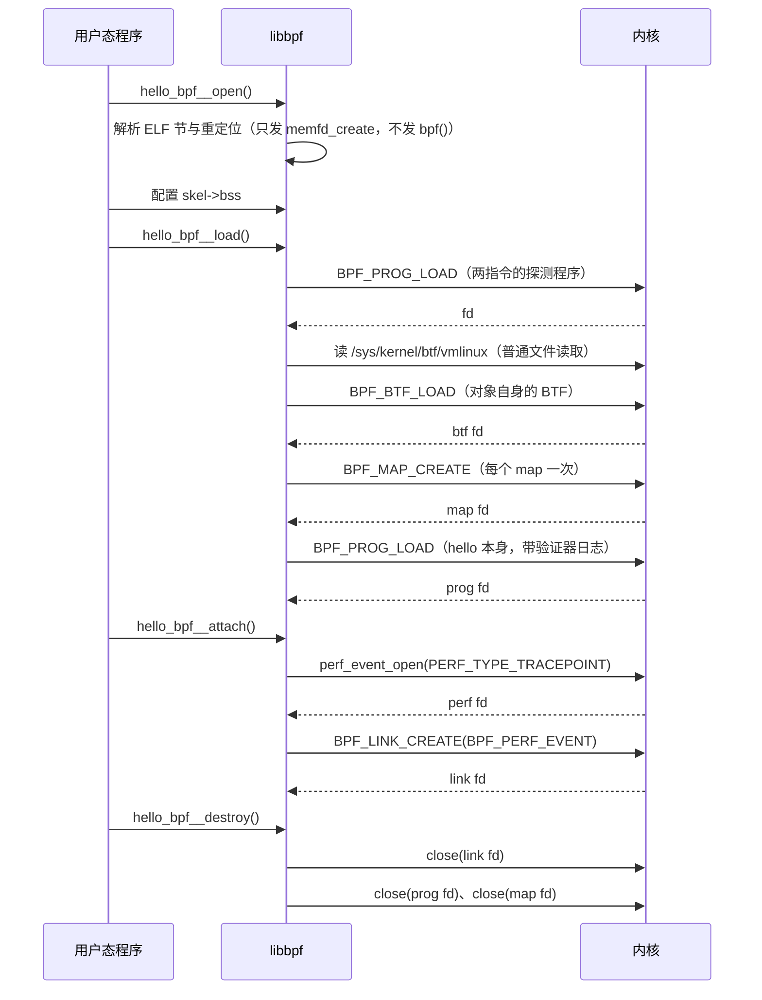
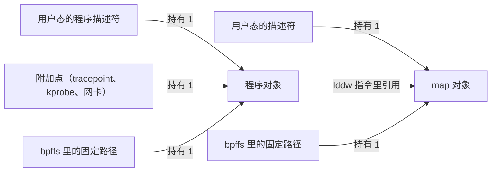

# B.7 加载与附加：bpf() 系统调用与程序生命周期

[B.3](/教程/正文/系统编程/拓展B_eBPF/B_3_第一个eBPF程序) 的 hello 只有四个骨架调用：open、load、attach、destroy。按 Ctrl-C 之后 `trace_pipe` 立刻安静下来，是因为 destroy 关掉了附加用的文件描述符；[B.6](/教程/正文/系统编程/拓展B_eBPF/B_6_Map与数据交换) 的 syscount 每次重新启动都从零开始计数：它打印完就删掉键，加上 map 又随着上一个进程退出被内核回收，两次运行之间什么也没留下。两件事背后是同一套机制：bpf() 系统调用创建的对象都靠引用计数存活，谁持有引用，谁决定它活多久。

这一页把骨架拆开。先看 bpf() 这个系统调用有多少命令、各自返回什么；再抛开 libbpf 手写一个加载程序，看清 `BPF_PROG_LOAD` 到底收到哪些字段；然后回到骨架，把 open、load、attach、destroy 对应到具体的系统调用；最后讲引用计数、BPF link、bpffs 固定，以及用 bpftool 观察系统中的对象。读完能判断一个附加好的程序在加载程序退出后还在不在，能让 map 的数据跨进程存活，也能读懂 `bpftool prog show` 的每一列。

本页的 `raw_load.c` 在 Debian 13 上用 `gcc -std=c17 -Wall -Wextra` 编译链接通过，`bpftool` 的帮助文本是在同一台机器上实际运行得到的。凡是要把程序加载进内核才能看到的输出，都照 bpf(2) 手册、内核文档和 libbpf 源码引用，写成「输出类似」，来源列在「参考资料」里。

## 1. 一个系统调用，几十个命令

bpf() 的原型只有一个：

```c
#include <linux/bpf.h>

int bpf(int cmd, union bpf_attr *attr, unsigned int size);
```

`cmd` 选操作，`attr` 指向一个联合体，`size` 是这个联合体的大小。建 map、加载程序、附加、固定、查信息，全部是这一个系统调用的不同 `cmd`。bpf(2) 手册对 `attr` 有一句必须遵守的说明：*The unused fields and padding must be zeroed out before the call.*

常用的命令列在下表里：

| 命令 | 作用 | 成功时返回 | 主要 attr 字段 |
| --- | --- | --- | --- |
| `BPF_MAP_CREATE` | 创建 map | map 的文件描述符 | `map_type`、`key_size`、`value_size`、`max_entries` |
| `BPF_MAP_LOOKUP_ELEM` | 按键读值 | 0 | `map_fd`、`key`、`value` |
| `BPF_MAP_UPDATE_ELEM` | 写入或更新 | 0 | `map_fd`、`key`、`value`、`flags` |
| `BPF_MAP_DELETE_ELEM` | 删除一个键 | 0 | `map_fd`、`key` |
| `BPF_MAP_GET_NEXT_KEY` | 遍历时取下一个键 | 0 | `map_fd`、`key`、`next_key` |
| `BPF_BTF_LOAD` | 上传 BTF 类型信息 | BTF 的文件描述符 | `btf`、`btf_size` |
| `BPF_PROG_LOAD` | 验证并加载程序 | 程序的文件描述符 | `prog_type`、`insns`、`insn_cnt`、`license` |
| `BPF_LINK_CREATE` | 附加并创建 BPF link | link 的文件描述符 | `prog_fd`、`target_fd`、`attach_type` |
| `BPF_PROG_ATTACH` | 旧式附加，不创建 link | 0 | `target_fd`、`attach_bpf_fd`、`attach_type` |
| `BPF_LINK_UPDATE` | 原子替换 link 上的程序 | 0 | `link_fd`、`new_prog_fd` |
| `BPF_OBJ_PIN` | 把对象固定到 bpffs | 0 | `bpf_fd`、`pathname` |
| `BPF_OBJ_GET` | 按固定路径取回对象 | 对象的文件描述符 | `pathname` |
| `BPF_PROG_TEST_RUN` | 用构造的输入运行一次 | 0 | `prog_fd`、`data_in`、`data_out` |

返回值几乎全落在两类里：一个新的文件描述符，或者 0。内核文档的 Syscall API 页统计了全部命令，十三个返回文件描述符，二十五个返回 0，只有 `BPF_PROG_STREAM_READ_BY_FD` 返回读到的字节数；失败一律返回 -1 并设置 `errno`。手册里明确写了 `BPF_MAP_CREATE` 和 `BPF_PROG_LOAD` 返回的描述符带 close-on-exec 标志，这些描述符都不该被 `execve()` 之后的程序继承。

返回描述符这件事决定了整个对象模型。一个 map 在内核里没有名字，只有别人手上的描述符：描述符关掉，引用就少一个，见第 4 节。

::: warning `attr` 里没用到的字段必须清零

内核会检查这条命令用不到的字段，只要不是零就返回 `EINVAL`；`size` 超过内核认识的 `union bpf_attr` 时，多出来的那一段也必须是零，否则返回 `E2BIG`。调用前一句 `memset(&attr, 0, sizeof(attr))` 同时解决这两件事。

:::

`size` 传 `sizeof(union bpf_attr)` 就行。内核只拷贝前 `size` 个字节，再把比它自己的联合体多出来的部分检查一遍是否全零，所以旧程序用旧头文件编译出来的小结构照样能工作。

## 2. 不用 libbpf 加载一个程序

libbpf 把 bpf() 包了很多层。要看清它到底做了什么，最直接的办法是抛开它写一遍。下面这个程序只包含 `<linux/bpf.h>` 和 `<sys/syscall.h>`，不链接 libbpf。

完整文件在 `code/系统编程/拓展B_eBPF/B_7_加载与附加_bpf系统调用与程序生命周期/raw_load.c`，正文里贴出关键的三段。

### 2.1 程序要做的事

程序把一个套接字过滤器挂在本进程的 UDP 套接字上，过滤器每运行一次就把 map 里的计数加一，然后返回 0 丢弃报文。步骤是：

1. `socket(AF_INET, SOCK_DGRAM, 0)` 之后绑定 `127.0.0.1:20003`；
2. `BPF_MAP_CREATE` 建一个只有一项的数组 map；
3. `BPF_PROG_LOAD` 加载手写的字节码；
4. `setsockopt(SO_ATTACH_BPF)` 把程序挂到这个套接字上；
5. 向自己发三个数据报，再 `recv`，然后用 `BPF_MAP_LOOKUP_ELEM` 读计数。

端口 20003 是本章网络示例固定使用的一个，B.12、B.13 也用它。真正要观察的是第 2 步到第 4 步。

### 2.2 建 map 与加载程序的 attr

`bpf()` 没有 glibc 的包装函数，libbpf 内部也是直接调 `syscall()`：

```c
static int bpf_sys(enum bpf_cmd cmd, union bpf_attr *attr)
{
    return (int)syscall(__NR_bpf, cmd, attr, sizeof(*attr));
}
```

建 map 只需要填四个字段：

```c
static int create_array_map(void)
{
    union bpf_attr attr;

    /* 没用到的字段必须清零，内核会把非零的保留字段当作错误参数拒绝。 */
    memset(&attr, 0, sizeof(attr));
    attr.map_type = BPF_MAP_TYPE_ARRAY;
    attr.key_size = sizeof(__u32);
    attr.value_size = sizeof(__u32);
    attr.max_entries = 1;
    return bpf_sys(BPF_MAP_CREATE, &attr);
}
```

对照 bpf(2) 手册里 `BPF_MAP_CREATE` 的说明：`map_type` 选择内核里的 map 实现，`key_size` 和 `value_size` 是键和值的字节数，`max_entries` 是最大项数。键和值都是二进制块，内核不关心里面是什么类型，所以 map 的值可以是一个结构体。

加载程序要填的字段多一些：

```c
static int load_prog(int map_fd)
{
    /* 验证器日志可以很长，放在静态区，不要占用栈。 */
    static char log_buf[64 * 1024];
    static const char license[] = "GPL";
    union bpf_attr attr;
    int fd;

    /* libbpf 在加载前做的事之一就是这一步：把重定位指向的 map fd 填进指令。 */
    prog[0].imm = map_fd;

    memset(&attr, 0, sizeof(attr));
    attr.prog_type = BPF_PROG_TYPE_SOCKET_FILTER;
    attr.insn_cnt = sizeof(prog) / sizeof(prog[0]);
    attr.insns = (unsigned long)prog;
    attr.license = (unsigned long)license;

    /* 第一次不带日志：log_level 为 0 时 log_buf 必须是 NULL、log_size 必须是 0。
     * 失败后打开日志重试一次，这跟 libbpf 的做法相同。 */
    fd = bpf_sys(BPF_PROG_LOAD, &attr);
    if (fd >= 0) {
        return fd;
    }
    if (errno == EPERM || errno == EACCES) {
        fprintf(stderr, "BPF_PROG_LOAD 失败：%s（需要 root 或 CAP_BPF）\n", strerror(errno));
        return -1;
    }

    attr.log_level = 1;
    attr.log_buf = (unsigned long)log_buf;
    attr.log_size = sizeof(log_buf);
    fd = bpf_sys(BPF_PROG_LOAD, &attr);
    if (fd < 0) {
        fprintf(stderr, "BPF_PROG_LOAD 失败：%s\n验证器日志：\n%s\n", strerror(errno), log_buf);
        return -1;
    }
    return fd;
}
```

`prog_type` 决定验证器按哪一套规则检查、程序能调用哪些辅助函数（[B.10](/教程/正文/系统编程/拓展B_eBPF/B_10_程序类型与附加类型) 展开）。`license` 是字符串指针，一部分辅助函数只对 GPL 兼容的许可证开放。`log_level` 非零时内核把验证过程写进 `log_buf`，`log_size` 不够时返回 `ENOSPC`。

`prog[0].imm = map_fd` 这一行值得停一下：字节码里引用 map 的那条 `lddw` 指令，`src_reg` 是 `BPF_PSEUDO_MAP_FD`，`imm` 是 map 的描述符。libbpf 从 ELF 重定位表里读出「这条指令指向第几个 map」，再把运行时的描述符填进去，做的正是同一件事。

### 2.3 手写字节码

套接字过滤器是一串 `struct bpf_insn`，每条 8 字节。下面这段实现「如果 map[0] 存在就加一，然后返回 0」：

```c
static struct bpf_insn prog[] = {
    /* 槽 0～1：r1 = map 的 fd。lddw 占两个槽，第二个槽必须全零。
     * imm 字段在加载前填入，见 load_prog()。 */
    {.code = BPF_LD | BPF_DW | BPF_IMM,
     .dst_reg = BPF_REG_1,
     .src_reg = BPF_PSEUDO_MAP_FD,
     .off = 0,
     .imm = 0},
    {.code = 0, .dst_reg = 0, .src_reg = 0, .off = 0, .imm = 0},
    /* 2：*(u32 *)(r10 - 4) = 0，键 0 放在栈上。r10 是只读的帧指针。 */
    {.code = BPF_ST | BPF_MEM | BPF_W, .dst_reg = BPF_REG_10, .off = -4, .imm = 0},
    /* 3：r2 = r10，r2 用来传键的地址。 */
    {.code = BPF_ALU64 | BPF_MOV | BPF_X, .dst_reg = BPF_REG_2, .src_reg = BPF_REG_10},
    /* 4：r2 += -4，键的地址是 r10 - 4。 */
    {.code = BPF_ALU64 | BPF_ADD | BPF_K, .dst_reg = BPF_REG_2, .imm = -4},
    /* 5：call bpf_map_lookup_elem，返回值在 r0。 */
    {.code = BPF_JMP | BPF_CALL, .imm = BPF_FUNC_map_lookup_elem},
    /* 6：if (r0 == NULL) goto 9，偏移 2 跳过下面的加一。 */
    {.code = BPF_JMP | BPF_JEQ | BPF_K, .dst_reg = BPF_REG_0, .off = 2, .imm = 0},
    /* 7：r1 = 1。 */
    {.code = BPF_ALU64 | BPF_MOV | BPF_K, .dst_reg = BPF_REG_1, .imm = 1},
    /* 8：lock *(u32 *)(r0 + 0) += r1，原子地加一。 */
    {.code = BPF_STX | BPF_XADD | BPF_W,
     .dst_reg = BPF_REG_0,
     .src_reg = BPF_REG_1,
     .off = 0},
    /* 9：r0 = 0，套接字过滤器返回保留的字节数，0 表示丢弃。 */
    {.code = BPF_ALU64 | BPF_MOV | BPF_K, .dst_reg = BPF_REG_0, .imm = 0},
    /* 10：exit。 */
    {.code = BPF_JMP | BPF_EXIT},
};
```

有四条规则在这段代码里都能看到。

第一条，`lddw` 这类 64 位立即数加载占两个槽，第二个槽全零，跳转偏移按槽数算而不是按指令条数算。第 6 条的 `off = 2` 跳过槽 7、8，落到槽 9。

第二条，栈上读写用 `r10` 加负偏移。`r10` 是帧指针，不能写；栈从 `r10 - 1` 向下生长，最多 512 字节。map 的查找辅助函数要求键指针指向栈或 map 值，直接传一个用户空间地址会被验证器拒绝。

第三条，辅助函数按编号调用。`BPF_FUNC_map_lookup_elem` 展开就是 1，所以字节码里是 `call 1`。B.4 在反汇编里见过同一种写法。

第四条，套接字过滤器的返回值是「保留多少个字节」，返回 0 就是全部丢弃。这个约定只对 `BPF_PROG_TYPE_SOCKET_FILTER` 成立，XDP 的返回值是另一套（[B.10](/教程/正文/系统编程/拓展B_eBPF/B_10_程序类型与附加类型)）。

对照一下：clang 为同一段逻辑生成的指令是十二个槽，比手写的多一个。它先把键 0 放进 `r1` 再存到栈上（`r1 = 0; *(u32 *)(r10 - 4) = r1`），而手写版本用 `BPF_ST` 直接把立即数写进栈。功能完全一样，手写版本省掉寄存器中转的那一步。两边的跳转偏移、`call 1` 和结尾的 `XADD` 都对得上。

### 2.4 附加与预期结果

附加只有一句：

```c
if (setsockopt(sock, SOL_SOCKET, SO_ATTACH_BPF, &prog_fd, sizeof(prog_fd)) < 0) {
    perror("setsockopt(SO_ATTACH_BPF)");
    return 1;
}
```

这个选项收的是程序描述符。套接字从此持有程序的一个引用，每收到一个数据报就运行一次过滤器，返回值非零时保留前若干字节，返回 0 时丢弃。程序忽略 `ctx` 参数，所以它看不到报文内容，只知道有报文经过。

有 root 权限运行时，程序的行为是：三个数据报全部被丢弃，`recv` 返回 -1、`errno` 为 `EAGAIN`（`MSG_DONTWAIT` 下没有数据），最后一行打印 `过滤器运行了 3 次`。没有 root 时在第一步 `BPF_MAP_CREATE` 就被拒绝，错误是 `Operation not permitted`；发行版一般把 `kernel.unprivileged_bpf_disabled` 设成 2，普通用户连 map 都建不了，这个错误就是本页在 Debian 13 上以普通用户运行 `raw_load` 时实际得到的。

本页的验证只做到编译。运行它就会向内核加载程序，这不在本页的验证范围之内，所以上面两段结果是按代码推出来的，不是实机输出。

### 2.5 编译

`raw_load.c` 只用系统头文件，不需要 libbpf，编译命令里也没有 `-lbpf`：

::: terminal title="zsh - build raw_load"

```text
$ gcc -std=c17 -Wall -Wextra raw_load.c -o raw_load
$ size raw_load
   text    data     bss     dec     hex filename
   4152     800   65568   70520   11378 raw_load
```

:::

`bss` 有 64 KiB，那一大块就是静态的 `log_buf`。把它放在静态区是有意的：64 KiB 放在栈上会直接撑爆线程栈的默认大小。

::: generate ebpf-b7-raw-load-walkthrough kind=explanation

面向刚读完 B.6、第一次看手写 BPF 字节码的读者，把 raw_load.c 从上到下走一遍。从 socket 和 bind 讲起，说明数组 map 的四个字段各自对应内核里的什么；重点解释 prog 数组里每一条指令的作用，特别是 lddw 为什么占两个槽、键为什么必须放在栈上、call 1 对应哪个辅助函数、XADD 与普通赋值在多个 CPU 同时运行时有什么区别；最后说明 setsockopt 附加之后，程序描述符和套接字各自持有哪一份引用。不要展开验证器的内部规则，也不要讲 CO-RE。

:::

## 3. 骨架背后的系统调用

`raw_load.c` 里那几步，libbpf 每天都在替我们做。它把编译好的 ELF 读进来，替我们填 `union bpf_attr`，替我们处理重定位，最后把描述符交给骨架结构体。

### 3.1 四个骨架调用各自做了什么

`hello_bpf__open()` 不发任何 bpf() 请求。它把骨架里嵌入的目标文件字节当 ELF 解析：读节头、认 SEC 名称确定每个程序的类型、从 `.maps` 节的 BTF 里读出 map 定义、收集重定位表。libbpf 的源码里这段叫 `bpf_object_open()`，结尾是 `bpf_object__elf_finish()`，中间没有任何 `sys_bpf()`。它会为每个 map 预留一个描述符槽位，用的是 `memfd_create()` 造的空文件描述符，等 load 阶段真正建 map 时再原地替换。这一手是为了让重定位在 map 还不存在时就能算好。

`hello_bpf__load()` 是一长串系统调用：

```text
bpf_object_load()
├── bpf_object__probe_loading()      加载一个两指令的临时程序，确认内核允许 BPF
├── bpf_object__load_vmlinux_btf()   读 /sys/kernel/btf/vmlinux
├── bpf_object__resolve_externs()    解析 __kconfig、__ksym 这类外部对象
├── bpf_object__relocate()           CO-RE 重定位，改写指令里的偏移
├── bpf_object__sanitize_and_load_btf()  BPF_BTF_LOAD
├── bpf_object__create_maps()        BPF_MAP_CREATE，每个 map 一次
└── bpf_object__load_progs()         BPF_PROG_LOAD，每个程序一次
```

这个顺序是从 libbpf 源码的 `bpf_object_load()` 里抄下来的，函数名一字不差。注意第一项：libbpf 在加载任何东西之前，先加载一个只有 `r0 = 0; exit` 的临时程序，验证通过就立刻关掉描述符。它探测的是「这个内核到底让不让我用 BPF」，失败时给出的提示是 *Couldn't load trivial BPF program*。

`hello_bpf__attach()` 按 SEC 名称决定附加方式。tracepoint 走 `perf_event_open()` 加 `BPF_LINK_CREATE`：先按事件名查出 tracepoint 的 ID，用 `PERF_TYPE_TRACEPOINT` 和这个 ID 开一个 perf 事件，再以 `BPF_PERF_EVENT` 为附加类型创建 link。kprobe、uprobe 同理，只是 perf 事件的类型不同。

`hello_bpf__destroy()` 先对每个 link 调 `bpf_link__destroy()`：对 tracepoint 这类基于 perf 事件的 link，内部的 detach 会 `ioctl(PERF_EVENT_IOC_DISABLE)`，再关掉 link 和 perf 事件两个描述符；然后 `bpf_object__close()` 关掉所有程序和 map 的描述符。第 4 节会说明，这两步就是程序从内核里消失的全部原因。

::: tip 自己看一遍这些系统调用

在一台允许加载 BPF 的机器上，把加载程序的系统调用录下来：

```bash
sudo strace -f -e trace=bpf,perf_event_open,memfd_create ./hello 2>&1 | head -40
```

会看到 `bpf(BPF_PROG_LOAD, ...)`、`bpf(BPF_MAP_CREATE, ...)`、`perf_event_open(...)`、`bpf(BPF_LINK_CREATE, ...)` 依次出现，以及 open 阶段那几个 `memfd_create`。`-e trace=bpf` 只留下 bpf() 时更清楚。

:::

### 3.2 libbpf 的调试日志

libbpf 把每一步都写进调试日志，默认级别不显示，用 `libbpf_set_print()` 打开。libbpf-bootstrap 的 bootstrap 示例带 `-v` 选项，README 给出了它的日志开头（输出类似）：

::: terminal title="zsh - ./bootstrap -v（引用 libbpf-bootstrap README）"

```text
$ sudo ./bootstrap -v
libbpf: loading object 'bootstrap_bpf' from buffer
libbpf: elf: section(2) tp/sched/sched_process_exec, size 384, link 0, flags 6, type=1
libbpf: sec 'tp/sched/sched_process_exec': found program 'handle_exec' at insn offset 0 (0 bytes), code size 48 insns (384 bytes)
libbpf: elf: section(3) tp/sched/sched_process_exit, size 432, link 0, flags 6, type=1
libbpf: sec 'tp/sched/sched_process_exit': found program 'handle_exit' at insn offset 0 (0 bytes), code size 54 insns (432 bytes)
libbpf: elf: section(4) license, size 13, link 0, flags 3, type=1
libbpf: license of bootstrap_bpf is Dual BSD/GPL
...
```

:::

这几行全部发生在 open 阶段，也就是在 `BPF_PROG_LOAD` 之前。它们证明 open 只做 ELF 解析：`section(2)`、`section(3)` 是节索引，`type=1` 是 `SHT_PROGBITS`，`found program` 后面的 `48 insns` 是从节大小除以 8 推算出来的。日志走 `pr_debug`，级别为 `LIBBPF_DEBUG`，所以加载程序里那个 `libbpf_set_print` 回调必须放行 `LIBBPF_DEBUG` 才能看到。

::: code-group

```c [默认只显示警告与错误]
static int on_libbpf_log(enum libbpf_print_level level, const char *format,
                         va_list args)
{
    if (level == LIBBPF_DEBUG) {
        return 0;
    }
    return vfprintf(stderr, format, args);
}
```

```c [加上 -v 开关]
static bool verbose_log;

static int on_libbpf_log(enum libbpf_print_level level, const char *format,
                         va_list args)
{
    if (level == LIBBPF_DEBUG && !verbose_log) {
        return 0;
    }
    return vfprintf(stderr, format, args);
}
```

:::

### 3.3 一次完整的时间线



## 4. 引用计数决定对象存活

第 1 节说过，bpf() 建出来的对象没有名字，只有描述符。这带来一个直接后果：程序加载完、描述符交给用户态之后，对象是死是活取决于还有谁拿着它。

::: concept ebpf-b7-object-lifetime title="BPF 对象的存活由引用计数决定"

BPF 程序、map、BTF 和 link 都是引用计数的内核对象。引用计数大于 0 时对象存活；减到 0 之后，对象在宽限期结束后被释放。以下四件事各持有一份引用：打开的文件描述符、程序指令里引用的 map、附加到钩子上这件事本身、bpffs 里的一个固定路径。

:::

「Lifetime of BPF objects」一文把这个规则写得很干脆：*As long as the refcnt of a BPF object (program or map) is > 0, the kernel will keep it alive.*（只要 BPF 对象（程序或 map）的引用计数大于 0，内核就会让它活着。）同一篇还说明了几种增加计数的动作：

- 创建对象时计数为 1，随对象返回一个描述符；
- 程序加载时，验证器把它引用到的每个 map 的计数加一，程序自己的计数置为 1；
- 程序附加到钩子上时，程序的计数加一；
- 把对象固定到 bpffs 时，计数加一。



bpf(2) 手册的 NOTES 一节把描述符的性质写得更细：描述符在 `fork()` 之后被子进程继承，可以经 Unix 域套接字传给别的进程，也可以正常 `dup()`（[主线第 10 章](/教程/正文/系统编程/10_套接字编程)讲过 `SCM_RIGHTS`）。一个对象只有在所有指向它的描述符都关闭之后才被释放。手册同时说了一句容易被忽略的话：*Programs normally disappear when their loader exits, although an attached subsystem can retain a reference.*（程序通常在加载程序退出时消失，不过附加它的子系统可能保留一份引用。）

### 4.1 两类附加点

上面那句话里的「附加它的子系统可能保留一份引用」，就是程序在加载程序退出后还在不在的分界线。「Lifetime of BPF objects」把钩子分成两类：

| 类别 | 例子 | 谁持有引用 | 加载程序退出后 |
| --- | --- | --- | --- |
| 绑定在进程的描述符上 | kprobe、uprobe、tracepoint、raw tracepoint、perf_event、套接字过滤器、reuseport | 进程打开的那个事件描述符或套接字 | 描述符关闭，程序被分离 |
| 全局的（经 netlink 或 `BPF_PROG_ATTACH` 附加） | XDP、tc 的 clsact、cgroup 钩子 | 网卡或 cgroup 本身 | 程序继续处理报文，直到显式卸载 |

套接字过滤器是前一类里最直观的例子：`SO_ATTACH_BPF` 把程序挂在套接字上，套接字一关，附加就结束。`raw_load.c` 里如果删掉 `close(sock)`，进程退出时内核也会替它关。

<Quiz
  type="single"
  :options="[
    { label: '程序随 link 描述符关闭被分离', value: 'A' },
    { label: '程序留在钩子上，直到显式卸载', value: 'B' },
    { label: '程序立刻被内核卸载，但 link 还在', value: 'C' },
    { label: '加载程序崩溃后程序进入等待状态', value: 'D' }
  ]"
  answer="A"
>

<template #question>

用 `bpf_program__attach_tracepoint()` 附加了一个 tracepoint 程序，加载程序随后退出。这个程序会怎样？

</template>

正确答案是 **A**。libbpf 的附加函数返回的是 `bpf_link`，骨架的 `__destroy` 会关闭它的描述符；link 是引用计数对象，最后一个描述符关闭时内核的 release 回调把程序从钩子上摘下来。B 描述的是经 netlink 附加的旧式 XDP、tc 程序，见 4.2 节。

</Quiz>

### 4.2 用 link 附加时，情况变了

还有一类附加点需要单独说明：用 `BPF_LINK_CREATE` 创建的 link。link 本身是一个引用计数对象，它的生命周期绑定在描述符上。内核源码里 XDP link 的 release 回调 `bpf_xdp_link_release()` 直接把程序从网卡上摘下来，`close()` 最后一个描述符就会走到这里。

所以「XDP 程序在加载程序退出后还留在网卡上」这句话，只对旧式的 netlink 附加成立：`ip link set dev lo xdpgeneric obj xdp.o sec xdp` 这种方式由内核直接记在网卡的 `xdp_state` 上，没有 link 对象。而用 `bpf_program__attach_xdp()`（内部是 `BPF_LINK_CREATE`）附加的 XDP 程序，加载程序一退出就没了。

::: compare vertical left-title="经 netlink 附加：留在网卡上" right-title="经 BPF link 附加：随描述符消失"

```text
# 由 iproute2 通过 netlink 请求内核把程序装到网卡上
$ sudo ip link set dev lo xdpgeneric obj xdp_count.bpf.o sec xdp
$ ip link show lo
2: lo: <LOOPBACK,UP,LOWER_UP> mtu 65536 qdisc noqueue state UNKNOWN mode DEFAULT
    link/loopback 00:00:00:00:00:00 brd 00:00:00:00:00:00
    prog/xdp id 12 tag 3b594a6b5b8c0d3e jited

# 命令退出，程序仍在，直到显式卸载
$ sudo ip link set dev lo xdpgeneric off
```

---

```c
/* libbpf 的 bpf_program__attach_xdp 内部创建 link */
link = bpf_program__attach_xdp(skel->progs.xdp_count, ifindex);
...
/* destroy 时 bpf_link__destroy → 关掉 link 的描述符
 * 内核的 release 回调把程序从网卡上摘下来 */
```

:::

左边那几行的格式照 xdp-tutorial 的演示，`prog/xdp id ... tag ... jited` 是 `ip link show` 在挂有 XDP 程序时多出来的一行。

真正需要「加载程序退出、程序留下」的场合，做法不是指望 netlink，而是把 link 固定到 bpffs，见第 6 节。

::: info 不要把长驻程序交给一个前台命令

凡是靠加载程序维持的附加，都会在进程收到 `SIGKILL`、崩溃或重启时消失。生产环境里要么让加载程序常驻并由服务管理器拉起，要么把 link 固定到 bpffs。临时用 `sudo ./tool` 跑起来再关终端，程序随之消失，这是正常的。

:::

::: generate ebpf-b7-refcount kind=explanation concepts=ebpf-b7-object-lifetime

面向刚学过文件描述符的读者，用「进程打开一个文件」作对照，讲清 BPF 对象的引用计数：描述符只是一张凭证，对象本身在内核里，谁拿着凭证谁就替对象续命。依次举四个例子：加载程序退出时 map 为什么消失、程序为什么还引用着它的 map、附加为什么让程序活着、固定为什么能让对象跨进程存活。每个例子都指出是哪一步让计数加减一，最后回答「按 Ctrl-C 之后 hello 为什么立刻停止打印」。

:::

## 5. BPF link

用 `BPF_PROG_ATTACH` 附加时，内核里没有「这次附加」的实体，只有「这个钩子现在挂着这个程序」这一条状态。要撤销，得再发一次 `BPF_PROG_DETACH`；要查现在挂着什么，得用 `BPF_PROG_QUERY`；程序要换怎么办？先 detach 再 attach，中间有一段时间钩子上什么都没有。

BPF link 把「程序附加在某处」这件事本身做成内核对象。`BPF_LINK_CREATE` 接受程序描述符、目标描述符和附加类型，返回 link 的描述符。此后：

- link 的存活按第 4 节的规则走，关掉最后一个描述符就分离；
- link 可以固定到 bpffs，让附加状态跨进程存活；
- `bpftool link show` 能列出系统里所有的 link，并且能看出它挂在哪个钩子上；
- `BPF_LINK_UPDATE` 换掉 link 上的程序，不经过「先摘后挂」的中间状态。

内核文档对它的定位写得很直接：*BPF links are the newest and thus preferred way to attach BPF programs to their hook locations within the kernel.*（BPF link 是把 BPF 程序附加到内核钩子上的最新、也是首选的途径。）同一页说明：*It is intended to replace both BPF_PROG_ATTACH and other legacy attachment methods.*（它意在取代 `BPF_PROG_ATTACH` 与其他旧的附加方式。）

libbpf 的附加 API 全部返回 `struct bpf_link *`。`bpf_program__attach_tracepoint()` 这样的函数内部就是 `perf_event_open()` 加 `bpf_link_create()`，骨架的 `__attach` 把这些返回值存进 `skel->links`。`hello_bpf__destroy()` 调 `bpf_link__destroy()`，对 tracepoint 这类 link 就是停用 perf 事件、关掉两个描述符。

### 5.1 五种附加方式的对照

| 方式 | 内核里的实体 | 关闭描述符后 | 能否固定 | 能否原子替换 |
| --- | --- | --- | --- | --- |
| `setsockopt(SO_ATTACH_BPF)` | 套接字上的一个指针 | 分离 | 否 | 否 |
| `BPF_PROG_ATTACH` | 钩子上的一条状态 | 不受描述符影响 | 否 | 否 |
| `BPF_LINK_CREATE` | link 对象 | 分离 | 是 | 看 link 类型 |
| netlink（`ip link set ... xdp`） | 网卡的 `xdp_state` | 不受影响 | 否 | 否 |
| `perf_event_open` 加 ioctl | perf 事件上的一个指针 | 分离 | 否 | 否 |

第三行的「看 link 类型」是内核里的实际实现：`link_update()` 检查 link 的操作表里有没有 `update_prog`，没有就返回 `EINVAL`。XDP link 登记了 `bpf_xdp_link_update`，perf 事件的 link 没有，所以对 tracepoint link 调 `BPF_LINK_UPDATE` 会失败。

<Quiz
  type="single"
  :options="[
    { label: '依赖加载程序活着，它一退出程序就没了', value: 'A' },
    { label: '程序留在网卡上，直到显式卸载', value: 'B' },
    { label: '只有 root 运行时才留在网卡上', value: 'C' },
    { label: '程序留下，但不再处理报文', value: 'D' }
  ]"
  answer="B"
>

<template #question>

`ip link set dev lo xdpgeneric obj xdp.bpf.o sec xdp` 把 XDP 程序装到 lo 上，命令随即退出。程序会怎样？

</template>

正确答案是 **B**。这条路走 netlink，程序直接记在网卡的 `xdp_state` 上，没有 link 对象，因此不受发起命令的进程影响。要卸载得再执行一次 `ip link set dev lo xdpgeneric off`。用 `bpf_program__attach_xdp()` 走 link 时结果才是 A。

</Quiz>

::: tip 新代码一律用 link

libbpf 的附加函数返回的都是 link，骨架的 `skel->links` 里存的也是 link，所以只要按 B.3 的写法用骨架，已经在用 link 了。需要留意的是两类旧写法：`setsockopt(SO_ATTACH_BPF)` 和 `bpf_program__attach_perf_event()` 的 legacy 模式。前者在 libbpf 里没有替代品，套接字过滤器本来就只能这样附加；后者只在旧内核上退化成 ioctl。

:::

### 5.2 用 BPF_LINK_UPDATE 换程序

换程序时可以把新旧两头的描述符都交出去：

```c
int err = bpf_link_update(bpf_link__fd(link), new_prog_fd, &opts);
```

`opts` 是 `struct bpf_link_update_opts`，其中有 `old_prog_fd` 和 `flags` 两个字段。先给 `old_prog_fd` 赋值、再把 `flags` 置成 `BPF_F_REPLACE`，内核就会先确认这个 link 上现在挂着的确实是 `old_prog_fd`，不是就返回 `EPERM`，避免两个管理进程互相覆盖。旧程序在替换之后引用计数减一，如果没人再拿着它，就被释放。

libbpf 的包装是 `bpf_link__update_program(link, prog)`，它只填 `new_prog_fd`，不带 `old_prog_fd`。

## 6. 固定到 BPF 文件系统

第 4 节说引用计数决定存活，那么「让对象活得比进程久」的办法就很自然：找一个进程之外的东西替它持有引用。bpffs 就是这个东西。

### 6.1 bpffs 与 bpf_obj_pin

bpffs 是一种伪文件系统，通常挂在 `/sys/fs/bpf`。它不能存普通文件，只能存 BPF 对象的固定点（pin）。一个固定点看起来是个空文件，实际含义是「这里有一份对某个 BPF 对象的引用」。对它 `unlink()`，引用就减一。

```c
/* 把对象固定到 bpffs，路径必须在这个文件系统里，且不能含 '.' */
if (bpf_obj_pin(prog_fd, "/sys/fs/bpf/mdr_hello") < 0) {
    perror("bpf_obj_pin");
}

/* 另一个进程按路径取回描述符，拿到的是同一个对象 */
int fd = bpf_obj_get("/sys/fs/bpf/mdr_hello");
```

`BPF_OBJ_PIN` 成功时返回 0，`BPF_OBJ_GET` 返回描述符。内核文档对前者的说明是 *Pin an eBPF program or map referred by the specified bpf_fd to the provided pathname on the filesystem.*，并强调路径的父目录必须属于 `BPF_FS_MAGIC` 这个文件系统；成功后 *pathname retains a reference to the eBPF object*（路径本身保留一份对对象的引用）。

::: concept ebpf-b7-pin-lifetime title="固定的作用只是多一份引用"

固定不是把对象「保存到磁盘」，也不是让对象「永久存在」。它只是在 bpffs 里多一个目录项，这个目录项持有对象的一份引用。`rm` 掉这个路径，引用就减一；机器重启，bpffs 里的内容全部消失，对象随之消失。所以固定解决的是「进程退出后对象还在不在」，不解决「重启后还在不在」。

:::

<Quiz
  type="single"
  :options="[
    { label: '把 map 的内容写进一个普通文件', value: 'A' },
    { label: '在 bpffs 里造一个路径，由它持有 map 的一份引用', value: 'B' },
    { label: '让 map 在系统重启之后仍然存在', value: 'C' },
    { label: '把 map 复制到加载程序的进程空间', value: 'D' }
  ]"
  answer="B"
>

<template #question>

`bpf_obj_pin(map_fd, "/sys/fs/bpf/mdr_counts")` 做了什么？

</template>

正确答案是 **B**。固定只是在 bpffs 里多一个目录项，这个目录项持有对象的一份引用；它不写磁盘，也不跨系统重启。C 是常见的误解：bpffs 里的内容在重启后清空。

</Quiz>

### 6.2 libbpf 的固定接口

libbpf 有三层：

- `bpf_map__pin(map, path)`、`bpf_program__pin(prog, path)`、`bpf_link__pin(link, path)`：固定单个对象。文档对 `bpf_link__pin` 的说明是 *This increments the links reference count, allowing it to stay loaded after the process which loaded it has exited.*（它增加 link 的引用计数，使 link 在加载它的进程退出后仍然存在。）
- `bpf_object__pin_maps(obj, dir)`：把对象里所有 map 固定到某个目录下，按 map 名命名。`bpf_object__pin_programs(obj, dir)` 对程序做同样的事。
- map 定义里的 `__uint(pinning, LIBBPF_PIN_BY_NAME);`：load 时自动按 map 名固定到 `/sys/fs/bpf`。重新运行时如果路径已经存在，libbpf 会 `bpf_obj_get()` 取回已有的 map 而不是新建一个，这正是「重启加载程序、计数还在」的实现方式。

最后一条要配合 `bpf_object_open_opts.pin_root_path` 才能改目录。它的默认值是 libbpf 源码里的 `BPF_FS_DEFAULT_PATH`，也就是 `/sys/fs/bpf`。

### 6.3 让 map 跨进程存活

B.6 的 syscount 里那张哈希 map 叫 `counts`，按进程名统计系统调用次数。在它的定义里加一行：

```c
__uint(pinning, LIBBPF_PIN_BY_NAME);
```

重新编译运行，load 阶段就会把这张 map 固定到 `/sys/fs/bpf/counts`。此后第一次运行到某个时刻按 Ctrl-C 退出，路径留在那里；第二次启动读到的是同一张 map 对象。要看出跨进程累加，还得去掉 syscount 打印后删除键的那段逻辑，否则每次打印都等于清零；删不删它，都不影响「map 这个对象还在不在」。

机制在 libbpf 的 `bpf_object__create_maps()` 里：建每个 map 之前先看它有没有带 `pin_path`，有就调 `bpf_object__reuse_map()` 用 `bpf_obj_get()` 打开已有路径；只有取回 `ENOENT` 时才继续走 `BPF_MAP_CREATE`，建好之后按同一个路径固定。syscount 的计数本身没有权威输出可引，这里只描述机制。

读完之后清理：`sudo rm /sys/fs/bpf/counts`。

`rm` 之后，如果没有别的描述符引用这个 map，它就在宽限期结束后被释放。下一次运行 syscount 会重新建一个空 map。

### 6.4 bpftool 的固定命令

`bpftool prog load` 的参数在 SignalX 上是这样的（本机真实输出）：

::: terminal title="zsh - bpftool prog help"

```text
Usage: bpftool prog { show | list } [PROG]
       bpftool prog dump xlated PROG [{ file FILE | [opcodes] [linum] [visual] }]
       bpftool prog dump jited  PROG [{ file FILE | [opcodes] [linum] }]
       bpftool prog pin   PROG FILE
       bpftool prog { load | loadall } OBJ  PATH \
                         [type TYPE] [{ offload_dev | xdpmeta_dev } NAME] \
                         [map { idx IDX | name NAME } MAP]\
                         [pinmaps MAP_DIR]
                         [autoattach]
       bpftool prog attach PROG ATTACH_TYPE [MAP]
       bpftool prog detach PROG ATTACH_TYPE [MAP]
       bpftool prog run PROG \
                         data_in FILE \
                         [data_out FILE [data_size_out L]] \
                         [ctx_in FILE [ctx_out FILE [ctx_size_out M]]] \
                         [repeat N]
       bpftool prog profile PROG [duration DURATION] METRICs
       bpftool prog tracelog
       bpftool prog help
```

:::

`load` 的位置参数 `PATH` 就是固定路径，不是输出文件名。所以「加载并固定」是同一个命令：

```bash
sudo bpftool prog load hello.bpf.o /sys/fs/bpf/mdr_hello
```

`autoattach` 是另一个开关，含义是「先附加、再把 link 固定到 `PATH`」：bpftool 的文档说 *with autoattach, attachment precedes pinning*，此时 *only the link (representing the program attached to its hook) is pinned, not the program as such*（固定的是代表附加的 link，而不是程序本身）。需要程序长期挂着时用它；只需要程序本身留着、以后再附加时，不加这个开关。

`bpftool map pin` 和 `bpftool link pin` 分别对应另外两类对象，`link` 子命令的语法在帮助里写得很清楚：

::: terminal title="zsh - bpftool link help"

```text
Usage: bpftool link { show | list }   [LINK]
       bpftool link pin        LINK  FILE
       bpftool link detach     LINK
       bpftool link help

       LINK := { id LINK_ID | pinned FILE }
       OPTIONS := { {-j|--json} [{-p|--pretty}] | {-d|--debug} |
                    {-f|--bpffs} | {-n|--nomount} }
```

:::

`link detach` 也值得注意：它把 link 从钩子上摘下来，但 link 对象和它指向的程序仍然有效，link 进入失效状态，直到最后一个描述符关闭。这与 `close()` 的效果不同，后者是引用减一，减到零才释放。

### 6.5 工程里的用法

systemd 的资源控制指令 `IPIngressFilterPath=` 和 `IPEgressFilterPath=` 收的就是固定在 bpffs 里的程序路径。文档原文是 *Takes an absolute path to a pinned BPF program in the BPF virtual filesystem*（接收一个指向 BPF 虚拟文件系统中已固定程序的绝对路径），作用范围是 *all IP packets sent and received over AF_INET and AF_INET6 sockets*（该单元所有 AF_INET 与 AF_INET6 套接字上的收发报文）。

这就是「固定」在生产里的典型位置：一个独立的加载程序负责把编译好的程序固定到 `/sys/fs/bpf`，systemd 在启动服务时按路径把它挂到服务的 cgroup 上。加载程序可以退出，甚至可以在服务启动完之后就不再运行，过滤器照样生效，因为 cgroup 持有引用。

## 7. 用 bpftool 观察

bpftool 读的是内核里的实际对象，所以它是检验前几节结论的工具。

### 7.1 prog show 的每一列

`bpftool prog show` 列出所有已加载的程序。bpftool 文档给出的样例（输出类似）：

::: terminal title="zsh - bpftool prog show（引用 bpftool-prog 文档）"

```text
10: xdp  name some_prog  tag 005a3d2123620c8b  gpl run_time_ns 81632 run_cnt 10
        loaded_at 2017-09-29T20:11:00+0000  uid 0
        xlated 528B  jited 370B  memlock 4096B  map_ids 10
        pids systemd(1)
```

:::

各字段的含义：

| 字段 | 含义 |
| --- | --- |
| `10` | 程序的 ID，内核内唯一，从 1 开始分配 |
| `xdp` | 程序类型 |
| `name some_prog` | 加载时指定的名字，通常来自 BPF 对象的函数名 |
| `tag` | 对程序指令算出的哈希，同一份字节码在任何机器上都是这个值 |
| `gpl` | 许可证与 GPL 兼容 |
| `loaded_at` | 加载时刻 |
| `uid` | 加载者的用户 ID |
| `xlated`、`jited` | 字节码与 JIT 后机器码的大小 |
| `memlock` | 占用内核内存的记账值 |
| `map_ids` | 程序引用到的 map 的 ID 列表 |
| `pids` | 打开着这个程序描述符的进程 |

`pids` 这一列直接对应第 4 节：它列出的是当前还开着这个程序描述符的进程。一个只能靠 bpffs 里的固定点存活的程序，这一列是空的，因为它已经没有进程描述符，只剩固定路径那一份引用。

### 7.2 map show 与 link show

::: terminal title="zsh - bpftool map show（引用 bpftool-map 文档）"

```text
10: hash  name some_map  flags 0x0
        key 4B  value 8B  max_entries 2048  memlock 167936B
        pids systemd(1)
```

:::

map 的 ID 出现在 `prog show` 的 `map_ids` 里，两边可以对上：程序 10 引用了 map 10，这个 map 就是第 2 节里用 `BPF_MAP_CREATE` 建出来的那种对象。

::: terminal title="zsh - bpftool link show（引用 bpftool-link 文档）"

```text
10: cgroup  prog 25
        cgroup_id 614  attach_type egress
        pids test_progs(223)
```

:::

link 的输出以 ID 开头，跟着 link 类型和若干属性。`prog 25` 是它挂着的程序 ID。cgroup 类型多出 `cgroup_id` 与 `attach_type`；perf 事件类型的 link 会显示 kprobe 或 tracepoint 的函数名、偏移；XDP link 会显示 `ifindex`。这些差异来自每种 link 各自的 `fill_link_info` 回调。

一个 link 在 `bpftool link show` 里出现，说明它还没被分离，也就说明钩子上确实挂着那个程序。加载程序退出之后再跑一次这条命令，如果 link 消失了，程序就已经被分离。

### 7.3 dump xlated 与 jited

`bpftool prog dump xlated` 显示内核里保存的字节码，`dump jited` 显示 JIT 之后的机器码。前者是验证器实际检查过的那一份，可以和 `llvm-objdump` 看到的原始字节码对照；后者能看出 JIT 有没有真正生效。

::: terminal title="zsh - bpftool prog dump（引用 bpftool-prog 文档）"

```text
# bpftool prog dump xlated id 10 file /tmp/t
$ ls -l /tmp/t
-rw------- 1 root root 560 Jul 22 01:42 /tmp/t

# bpftool prog dump jited tag 005a3d2123620c8b
0:   push   %rbp
1:   mov    %rsp,%rbp
2:   sub    $0x228,%rsp
3:   sub    $0x28,%rbp
4:   mov    %rbx,0x0(%rbp)
```

:::

xlated 是内核里保存的那一份字节码，jited 是 JIT 之后的机器码，两者的编号都是指令序号。加上 `opcodes` 参数时还会打印每条指令的原始字节。

::: tip 没有权限时 bpftool 报什么

`bpftool prog show` 需要 `CAP_BPF`（或者 root）。没有权限时它会报 `Error: can't get next program: Operation not permitted`，libbpf-bootstrap 的 lsm 示例就是用这个报错来证明「bpf() 被自己的 LSM 程序拦住了」。这条输出是 README 里的原文，不是编的。

:::

::: generate ebpf-b7-bpftool-fields kind=explanation concepts=ebpf-b7-object-lifetime

面向已经会用 strace 但没看过 bpftool 的读者，讲清 `bpftool prog show` 每一列从哪里来：tag 为什么能用来比对两份字节码、pids 为空意味着什么、map_ids 与 `bpftool map show` 的 ID 怎样对上、为什么一个程序可能同时出现在多个钩子上。再说明 `bpftool link show` 的 `prog 25` 与 `prog show` 的 `25:` 是同一种 ID。不要展开 bpftool 的其他子命令。

:::

## 8. 习题

### 8.1 巩固

<Exercise id="47701" :d="2" :w="2">

`raw_load.c` 的过滤器返回 0，所以报文全部被丢弃。把返回值改成「不丢弃」，让 `recv()` 能收到那三个数据报，同时计数仍然要增加。

改动只允许动 `prog` 数组里的一两条指令。改完之后说明：套接字过滤器返回值的合法范围是什么，返回一个比报文长度大的数会怎样。

验收：挂在有 root 的机器上运行，`recv` 收到 5 字节，最后一行仍是 `过滤器运行了 3 次`。

</Exercise>

<Exercise id="47702" :d="2" :w="1">

写出完成下面每件事的 bpftool 命令，并说明它读的是内核里的哪一类对象：

(1) 列出系统中所有 BPF link，只看类型和它挂着的程序 ID；

(2) 把已经加载的程序 37 的字节码导出到文件；

(3) 把 id 为 12 的 map 固定到 `/sys/fs/bpf/mdr_counts`；

(4) 查看一个已固定的程序所引用的 map 的 ID 列表。

</Exercise>

<Exercise id="47703" :d="2" :w="1">

`bpf_sys()` 把 `sizeof(*attr)` 作为第三个参数传给内核。回答：

(1) 如果传 0，`BPF_MAP_CREATE` 会成功还是失败，为什么？

(2) 如果用旧版头文件编译，`union bpf_attr` 比内核里的小，调用会失败吗？

(3) 为什么 `attr` 里没用到的字段必须清零，内核是怎么检查的？

</Exercise>

### 8.2 编程

<Exercise id="47704" :d="3" :w="3">

不依赖 libbpf，只用 `syscall(__NR_bpf, ...)` 写一个 `raw_map.c`，对哈希 map 完成一轮完整操作：

(1) 用 `BPF_MAP_CREATE` 建一个 `BPF_MAP_TYPE_HASH`，键和值都是 `__u32`，`max_entries` 为 8；

(2) 用 `BPF_MAP_UPDATE_ELEM` 写入 `0..4` → `0, 10, 20, 30, 40`，其中一次用 `BPF_NOEXIST` 重复写同一个键，观察返回值；

(3) 用 `BPF_MAP_LOOKUP_ELEM` 逐个读回并打印，再查一个不存在的键，打印 `errno`；

(4) 用 `BPF_MAP_GET_NEXT_KEY` 遍历全部键（注意第一次要传 `key = NULL`），打印遍历顺序；

(5) 用 `BPF_MAP_DELETE_ELEM` 删掉两个键，再遍历一次。

要求 `-Wall -Wextra` 无警告，每个系统调用的返回值都检查。验收：程序在 root 下跑完不崩溃，遍历能取到全部 5 个键，删除后只剩 3 个。

</Exercise>

<Exercise id="47705" :d="4" :w="3">

写一对程序，演示 bpffs 固定跨进程传递对象：

- `pin_writer.c`：建一个数组 map（1 项，`__u64` 值），把 42 写进去，用 `BPF_OBJ_PIN` 固定到 `/sys/fs/bpf/mdr_answer`，然后退出；
- `pin_reader.c`：用 `BPF_OBJ_GET` 打开 `/sys/fs/bpf/mdr_answer`，读出值并打印，再用 `BPF_MAP_UPDATE_ELEM` 改成 43。

验收步骤：

```text
$ sudo ./pin_writer
$ sudo ./pin_reader      # 打印 42，之后把值改成 43
$ ls -l /sys/fs/bpf/mdr_answer
$ sudo ./pin_reader      # 打印 43
$ sudo rm /sys/fs/bpf/mdr_answer
$ sudo ./pin_reader      # 打开失败，errno = ENOENT
```

说明每一步的引用计数是多少、谁持有它。另外说明 `ls -l` 看到的权限位是怎么定下来的（看 `bpf_obj_do_pin()` 里 `mode` 的算法），以及这对「非 root 能不能读这个固定点」意味着什么。

</Exercise>

<Exercise id="47706" :d="4" :w="4">

B.6 的 `syscount` 每次启动都从零开始，而且每次打印之后会删掉所有键，相当于自己清零。把它改成跨进程累加：

(1) 在 `syscount.bpf.c` 的计数 map 定义里加上 `__uint(pinning, LIBBPF_PIN_BY_NAME);`；

(2) 在 `syscount.c` 里用 `bpf_object_open_opts.pin_root_path` 把固定目录改到一个可写的临时目录，并检查 `bpf_map__is_pinned()` 的返回值；

(3) 加一个只读模式：遍历仍然用 `bpf_map__get_next_key` 和 `bpf_map__lookup_elem`，但不再调 `bpf_map__delete_elem`。原来的清零行为仍是默认。

验收：先后运行两次，第二次用只读模式，打印出的计数不小于第一次的值；不用只读模式时，第二次的计数从零重新开始。写一段说明：第二次启动时 libbpf 在 load 阶段哪一步发现了已有的固定点，用的是哪个系统调用。

</Exercise>

### 8.3 综合与挑战

<Exercise id="47707" :d="5" :w="4">

用骨架写一个 `pinlink.c`，把 B.3 的 hello 程序附加之后，再把 **link** 固定到 bpffs：

(1) `open`、`load`、`attach` 之后，调用 `bpf_link__pin(skel->links.handle_tp, "/sys/fs/bpf/mdr_hello_link")`；

(2) 进入主循环等待 `SIGINT`，退出时先 `bpf_link__unpin()` 再 `__destroy()`；

(3) 在另一个终端用 `sudo bpftool link show` 观察 link 是否出现，`rm` 固定路径之后再观察一次。

要求额外回答：如果在主循环里直接 `kill -9` 这个进程，link 和固定点各是什么状态？第二次运行程序时，固定路径已经存在，`bpf_link__pin` 会返回什么？

验收：给出一组 `bpftool link show` 前后的对照（可以只写字段变化），并解释每一条的成因。

</Exercise>

<Exercise id="47708" :d="6" :w="5">

给程序加一个「热替换」功能：准备两个版本的程序（一个丢弃、一个放行，两者都统计），用 `BPF_LINK_CREATE` 附加第一个，运行一段时间后用 `BPF_LINK_UPDATE` 换成第二个，验证计数不中断。

套接字过滤器只能经 `setsockopt()` 附加，没有 link，所以这一题要换一个能走 link 的附加点。可以改用 XDP（`lo` 就够）或 kprobe（`perf_event_open` 加 `BPF_LINK_CREATE`）。选定之后：

(1) 分别加载两个程序，各自带自己的 map 或共用同一张 map；

(2) 创建 link 并附加第一个；

(3) 用 `bpf_link_update()` 替换，注意 `old_prog_fd` 与 `BPF_F_REPLACE` 的配合；

(4) 故意传一个错误的 `old_prog_fd`，确认返回 `EPERM`。

验收：替换前后的计数连续；错误的 `old_prog_fd` 被拒绝并且 link 仍然指向原程序。说明为什么 `BPF_LINK_UPDATE` 比「detach 再 attach」更适合生产环境。

</Exercise>

<Exercise id="47709" :d="7" :w="6" scope="*">

写一个最小加载器 `mini_loader.c`，不链接 libbpf，直接从 `.bpf.o` 里读出 SEC 名称和指令并加载：

(1) 用 `<elf.h>` 打开 ELF，遍历节头，找出名称形如 `tp/...`、`xdp`、`socket` 的节，以及 `license` 节；

(2) 从 `license` 节读出许可证字符串，从程序节读出 `struct bpf_insn` 数组；

(3) 处理 `.maps` 节与 `.rel<程序节名>` 重定位节：按符号找到 map 定义，用 `BPF_MAP_CREATE` 建出来，再把 fd 填进对应的 `lddw` 指令（`BPF_PSEUDO_MAP_FD`）；

(4) 用 `BPF_PROG_LOAD` 加载，把验证器日志打到 stderr；

(5) 对 `socket` 类型的程序用 `setsockopt(SO_ATTACH_BPF)` 附加，对 `tp/` 类型的程序给出「需要 perf_event_open」的提示即可。

用 B.3 的 `hello.bpf.o` 验收：程序能被加载，`bpftool prog show` 能看到它，`trace_pipe` 里有输出。

最后用一段话说明：libbpf 在这个流程之外还替你做了哪些事（至少列出 BTF 上传、CO-RE 重定位、map 复用、link 创建四项），以及为什么生产工具不该自己写这一套。

</Exercise>

## 9. 参考资料

- bpf(2) 手册：系统调用原型、`BPF_MAP_CREATE` 与 `BPF_PROG_LOAD` 的字段、返回值规则、`attr` 清零要求、描述符在 `fork()` 与 Unix 域套接字间的传递。https://man7.org/linux/man-pages/man2/bpf.2.html
- 内核文档 *eBPF Syscall API*：各命令的返回值分类（返回描述符的 13 个、返回 0 的 25 个）、`BPF_OBJ_PIN` 与 `BPF_OBJ_GET` 的语义、bpffs 的作用。https://docs.kernel.org/userspace-api/ebpf/syscall.html
- Alexei Starovoitov，*Lifetime of BPF objects*（2018）：引用计数规则、程序对 map 的引用、附加对程序的引用、固定对对象的引用、fd 局部附加点与全局附加点的区别。https://facebookmicrosites.github.io/bpf/blog/2018/08/31/object-lifetime.html
- docs.ebpf.io *BPF_LINK_CREATE*：link 是首选附加方式、取代 `BPF_PROG_ATTACH` 与其他旧方式、link 是引用计数对象、关闭描述符导致的销毁与固定。https://docs.ebpf.io/linux/syscall/BPF_LINK_CREATE/
- docs.ebpf.io *Pinning*：固定的定义（在 bpffs 中放一个伪文件持有引用）、`BPF_OBJ_PIN` 与 `BPF_OBJ_GET`、固定点不跨重启。https://docs.ebpf.io/linux/concepts/pinning/
- libbpf 源码与头文件：`bpf_object_load()` 的加载顺序、`bpf_object__probe_loading()`、`bpf_object__sanitize_and_load_btf()`、`bpf_program_attach_fd()`、`bpf_link__destroy()`、`bpf_link__pin()` 的文档注释、`BPF_FS_DEFAULT_PATH`。https://github.com/libbpf/libbpf
- libbpf API 文档：`bpf_link__pin`、`bpf_link__unpin`、`bpf_link__update_program` 的说明。https://libbpf.readthedocs.io/en/latest/api.html
- libbpf-bootstrap README：Troubleshooting 一节的 libbpf 调试日志（本页 bootstrap 日志引用自此），以及 lsm 示例里 `bpftool prog list` 被拦时的报错。https://github.com/libbpf/libbpf-bootstrap
- bpftool 文档：`bpftool-prog`（prog show 的样例、`prog load` 的 `autoattach` 与固定路径、dump xlated/jited 的样例）、`bpftool-map`（map show 与 map pin）、`bpftool-link`（link show、link pin、link detach）。https://github.com/libbpf/bpftool/tree/main/docs
- 内核源码：`kernel/bpf/syscall.c`（`link_update()` 对 `update_prog` 的检查、`bpf_perf_link_release()`、`bpf_check_uarg_tail_zero()`）、`net/core/dev.c`（`bpf_xdp_link_release()`、`bpf_xdp_link_lops`、`bpf_xdp_link_update()`）、`kernel/bpf/inode.c`（`bpf_obj_do_pin()` 的 `mode` 计算）。https://git.kernel.org/pub/scm/linux/kernel/git/torvalds/linux.git
- systemd 资源控制文档：`IPIngressFilterPath=`、`IPEgressFilterPath=`、`BPFProgram=` 的说明。https://www.freedesktop.org/software/systemd/man/latest/systemd.resource-control.html
- Liz Rice，*Learning eBPF*，第 2、3 章：bpf() 系统调用与 BPF 对象的生命周期。
- 本页的 `bpftool prog help`、`bpftool link help`、`bpftool map help` 与 `bpftool gen help` 是在 Debian 13（内核 6.12、bpftool 7.5.0）上实际运行的，正文只引用了其中的 `prog` 与 `link` 两段；`raw_load.c` 的编译输出、`size` 的结果与无 root 时的失败信息也是实际运行得到的。
- `raw_load.c` 的编译与运行都在 SignalX 上完成。运行以普通用户身份进行，在 `BPF_MAP_CREATE` 处被内核拒绝，没有向内核加载任何 BPF 程序。
