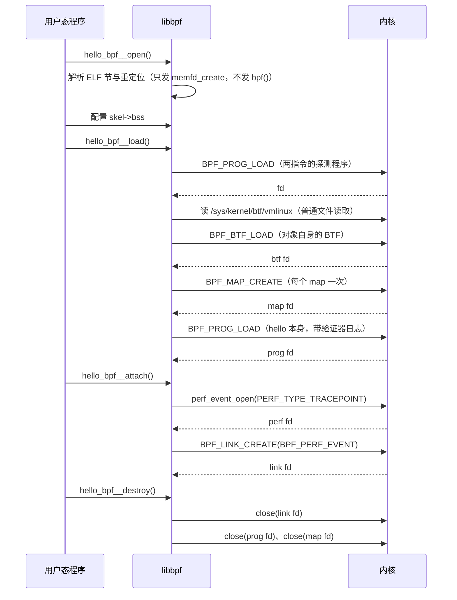
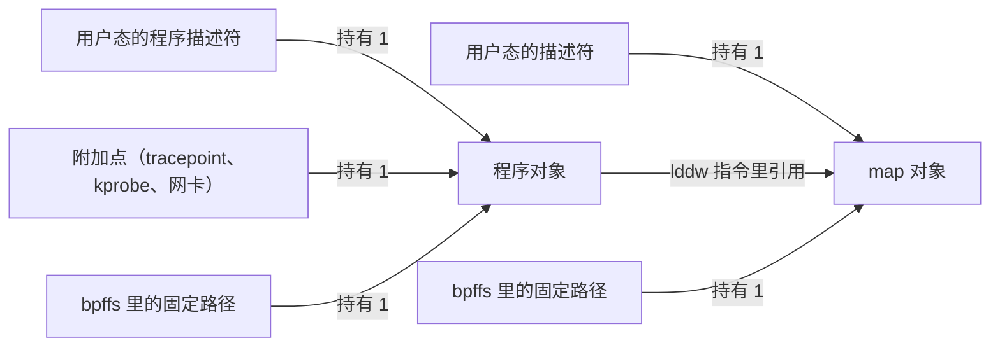

# B.7 加载与附加：bpf() 系统调用与程序生命周期

回顾 [B.3](/教程/正文/系统编程/拓展B_eBPF/B_3_第一个eBPF程序) 中的 `hello` 入门程序，用户态控制面仅仅依序调用了 `open`、`load`、`attach` 与 `destroy` 四个骨架函数；当我们在终端按下 `Ctrl-C` 触发退出信号时，原本不断刷新的 `trace_pipe` 管道便会瞬间归于沉寂，原因正是 `destroy` 关闭了维持挂载状态的文件描述符。同样地，在 [B.6](/教程/正文/系统编程/拓展B_eBPF/B_6_Map与数据交换) 的 `syscount` 工具中，每次重启监控进程都会从零开始重新计数：一方面它在每轮打印后主动清空了键值，另一方面其底层的内核 Map 也会随着前一个用户态进程的退出而被内核彻底回收，导致先后两次运行之间无法延续任何状态。这两处现象背后指向了同一套内核资源管理法则：由 `bpf()` 系统调用创建的各类内核对象均依托引用计数（Reference Counting）维持生命周期，究竟有哪些实体正持有对象引用，直接决定了该对象能在内核中存续多久。

为了彻底看清骨架封装之下的底层脉络，本节将深入 `bpf()` 系统调用的命令分发机制与对象生命周期模型：从梳理 `bpf()` 所支持的子命令与返回值约定出发，我们将暂时抛开 libbpf 高级库，直接基于原生系统调用手写一份完整的字节码加载器，直观审视 `BPF_PROG_LOAD` 与 `BPF_MAP_CREATE` 传递给内核的联合体字段；随后重新回到现代骨架编程模型，将 `open`、`load`、`attach`、`destroy` 四个阶段精准映射到具体的系统调用序列；最后围绕内核引用计数规则，剖析 BPF link 抽象、BPF 虚拟文件系统（bpffs）钉住（Pinning）持久化机制，并结合 `bpftool` 检视运行态内核对象的各项属性指标。

本节配套的原生加载示例 `raw_load.c` 已在 Debian 13 环境下通过 `gcc -std=c17 -Wall -Wextra` 严格编译校验，`bpftool` 相关子命令的帮助信息亦取自同一实测环境；涉及将字节码实际载入内核后产生的运行时输出，则对照 `bpf(2)` 手册页、Linux 内核官方文档与 libbpf 源码注释给出。完整工程归档于 `code/系统编程/拓展B_eBPF/B_7_加载与附加_bpf系统调用与程序生命周期/` 目录下。

## 1. 一个系统调用，几十个命令

整个 eBPF 子系统向用户空间暴露的系统调用入口极其收束，仅包含 `bpf()` 一个函数原型：

```c
#include <linux/bpf.h>

int bpf(int cmd, union bpf_attr *attr, unsigned int size);
```

其中，第一个参数 `cmd` 用于指定具体的操作指令（枚举类型 `enum bpf_cmd`），第二个参数 `attr` 指向一个庞大的共用联合体 `union bpf_attr`，第三个参数 `size` 则告知内核当前传入联合体的字节大小。无论是创建 Map、上传 BTF 元数据、加载并验证程序字节码，还是将探针附加到内核钩子、把对象钉住在文件系统中乃至查询对象运行信息，全部通过向同一个 `bpf()` 系统调用传递不同的 `cmd` 枚举值来完成分发。在使用该接口时，`bpf(2)` 手册页对 `attr` 参数提出了一条必须严格遵守的铁律：*The unused fields and padding must be zeroed out before the call.*（在发起调用前，所有当前子命令未使用的字段与内存对齐填充字节必须全部清零。）

工程中高频接触的核心子命令归纳如下表所示：

| 命令 | 作用 | 成功时返回 | 主要 attr 字段 |
| --- | --- | --- | --- |
| `BPF_MAP_CREATE` | 创建内核 Map 实例 | 新 Map 的文件描述符 | `map_type`、`key_size`、`value_size`、`max_entries` |
| `BPF_MAP_LOOKUP_ELEM` | 按键查询对应元素的值 | 0 | `map_fd`、`key`、`value` |
| `BPF_MAP_UPDATE_ELEM` | 插入新键值或更新已有元素 | 0 | `map_fd`、`key`、`value`、`flags` |
| `BPF_MAP_DELETE_ELEM` | 删除指定键对应的元素 | 0 | `map_fd`、`key` |
| `BPF_MAP_GET_NEXT_KEY` | 迭代遍历时获取下一个键 | 0 | `map_fd`、`key`、`next_key` |
| `BPF_BTF_LOAD` | 向内核上传 BTF 类型元数据 | BTF 对象的文件描述符 | `btf`、`btf_size` |
| `BPF_PROG_LOAD` | 静态验证并加载 eBPF 程序 | 程序对象的文件描述符 | `prog_type`、`insns`、`insn_cnt`、`license` |
| `BPF_LINK_CREATE` | 附加程序并创建 BPF link 实例 | link 对象的文件描述符 | `prog_fd`、`target_fd`、`attach_type` |
| `BPF_PROG_ATTACH` | 传统附加模式（不生成 link） | 0 | `target_fd`、`attach_bpf_fd`、`attach_type` |
| `BPF_LINK_UPDATE` | 原子替换 link 所绑定的程序 | 0 | `link_fd`、`new_prog_fd` |
| `BPF_OBJ_PIN` | 将内核对象钉住到 bpffs 路径 | 0 | `bpf_fd`、`pathname` |
| `BPF_OBJ_GET` | 按 bpffs 固定路径获取句柄 | 目标对象的文件描述符 | `pathname` |
| `BPF_PROG_TEST_RUN` | 在沙箱中注入测试输入试运行程序 | 0 | `prog_fd`、`data_in`、`data_out` |

审视上述子命令的返回值设计可以发现，几乎所有成功调用的结果都收敛在两个范畴内：要么返回一个新分配的**文件描述符**（当子命令在内核中创建或打开某个实体对象时），要么返回 **0**（当子命令针对既有对象执行读写、挂载或属性变更时）。根据 Linux 内核文档 *eBPF Syscall API* 的完整统计，在全部子命令中共有 13 个命令返回文件描述符，25 个命令返回 0，仅 `BPF_PROG_STREAM_READ_BY_FD` 返回实际读取的字节数；而一旦调用失败，则统一返回 `-1` 并设置相应的 `errno`。此外，手册页特别指明：`BPF_MAP_CREATE` 与 `BPF_PROG_LOAD` 等命令返回的文件描述符默认自动附带 `FD_CLOEXEC`（close-on-exec）标志，以防止这些敏感的内核对象句柄在当前进程调用 `execve()` 载入新映像时无意间泄漏给子进程。

“创建对象即返回文件描述符”这一设计直接奠定了整个 eBPF 的内核对象管理模型。一个 Map 或一段 eBPF 程序在内核空间内并不依靠全局唯一的字符串名称来维系自身的存在，它的存续完全系于外部持有的文件描述符与内核引用之上——每关闭一个描述符，对象的内核引用计数便相应递减，具体规则将在第 4 节深入展开。

::: warning `attr` 里没用到的字段必须清零

内核在处理 `bpf()` 调用时，会严格核验当前 `cmd` 子命令未涉及的其余字段：只要发现任何未使用的字段或填充位包含非零残留字节，便会立即拒绝请求并返回 `EINVAL`；同时，当用户态传入的 `size` 大于当前运行内核所认知的 `union bpf_attr` 结构体尺寸时，内核还会逐字节检查超出部分是否全为零，若存在非零字节则返回 `E2BIG`。因此，在组装参数前始终执行一句 `memset(&attr, 0, sizeof(attr))`，便能同时满足这两项前向与后向兼容要求。

:::

在实际编码中，第三个参数 `size` 直接传入 `sizeof(union bpf_attr)` 即可。这种“携带结构体尺寸并强制零值校验”的设计是 Linux 内核实现系统调用平滑扩展的经典手法：当旧版用户态程序运行在新内核上时，内核只从用户空间拷贝前 `size` 个字节并将新增尾部视作零值默认值；当使用新头文件编译的程序运行在旧内核上时，只要未使用新特性（尾部新增字段保持全零），旧内核在校验尾部全零后依然能够正常放行。

## 2. 不用 libbpf 加载一个程序

在日常开发中，libbpf 库为我们屏蔽了繁琐的 ELF 解析与系统调用拼装细节。为了直观洞悉 libbpf 在幕后完成的底层工作，最直接的途径便是暂时脱离第三方库，仅凭内核头文件 `<linux/bpf.h>` 与 `<sys/syscall.h>` 手工编写一个最小自包含加载器。

该示例的完整源码位于 `code/系统编程/拓展B_eBPF/B_7_加载与附加_bpf系统调用与程序生命周期/raw_load.c`，下文分段剖析其中的三处核心实现。

### 2.1 程序要做的事

该示例程序的目标是向当前进程自身创建的 UDP 套接字挂载一段 eBPF 套接字过滤器（Socket Filter）：每当有网络数据报流经该套接字时，过滤器便将内核数组 Map 中的计数器加一，随后返回 `0` 指示内核直接丢弃该报文。完整的执行流程包含以下五个步骤：

1. 调用 `socket(AF_INET, SOCK_DGRAM, 0)` 创建 UDP 套接字，并将其绑定至本地回环地址 `127.0.0.1:20003`；
2. 发起 `BPF_MAP_CREATE` 系统调用，在内核中创建一个仅包含 1 个元素的数组 Map；
3. 发起 `BPF_PROG_LOAD` 系统调用，将手工构造的 eBPF 字节码数组加载进内核；
4. 调用 `setsockopt(SO_ATTACH_BPF)` 将加载成功的程序描述符附加到上述 UDP 套接字上；
5. 通过该套接字向自身连续发送三个测试数据报，尝试调用非阻塞 `recv` 接收，最后发起 `BPF_MAP_LOOKUP_ELEM` 系统调用读回内核 Map 中的累计计数值。

其中端口号 `20003` 是本系列网络编程示例统一选用的测试端口（后续 B.12 与 B.13 章节亦沿用该端口）。我们重点关注其中的第 2 步至第 4 步。

### 2.2 建 map 与加载程序的 attr

由于 GNU C 标准库（glibc）并未为 `bpf()` 提供专门的同名封装函数，包括 libbpf 在内的所有用户态工具在底层均通过通用的 `syscall()` 接口按系统调用号发起调用：

```c
static int bpf_sys(enum bpf_cmd cmd, union bpf_attr *attr)
{
    return (int)syscall(__NR_bpf, cmd, attr, sizeof(*attr));
}
```

创建一个基础的数组 Map 仅需在清零后的联合体中填充四个核心字段：

```c
static int create_array_map(void)
{
    union bpf_attr attr;

    /* 没用到的字段必须清零，内核会把非零的保留字段当作错误参数拒绝。 */
    memset(&attr, 0, sizeof(attr));
    attr.map_type = BPF_MAP_TYPE_ARRAY;
    attr.key_size = sizeof(__u32);
    attr.value_size = sizeof(__u32);
    attr.max_entries = 1;
    return bpf_sys(BPF_MAP_CREATE, &attr);
}
```

对照 `bpf(2)` 手册页中关于 `BPF_MAP_CREATE` 的规范说明：`map_type` 用于指定内核底层的存储数据结构实现，`key_size` 与 `value_size` 分别定义了键与值的字节宽度，而 `max_entries` 则限定了容器的最大条目容量。在内核眼里，Map 的键与值均只是定长的原始二进制字节块，内核本身并不介入其内部字段的语义解析，这也使得开发者能够自由地将任意复杂的 C 语言结构体作为 Map 的值进行存取。

相比之下，调用 `BPF_PROG_LOAD` 加载程序时需要填写的元数据字段要丰富得多：

```c
static int load_prog(int map_fd)
{
    /* 验证器日志可以很长，放在静态区，不要占用栈。 */
    static char log_buf[64 * 1024];
    static const char license[] = "GPL";
    union bpf_attr attr;
    int fd;

    /* libbpf 在加载前做的事之一就是这一步：把重定位指向的 map fd 填进指令。 */
    prog[0].imm = map_fd;

    memset(&attr, 0, sizeof(attr));
    attr.prog_type = BPF_PROG_TYPE_SOCKET_FILTER;
    attr.insn_cnt = sizeof(prog) / sizeof(prog[0]);
    attr.insns = (unsigned long)prog;
    attr.license = (unsigned long)license;

    /* 第一次不带日志：log_level 为 0 时 log_buf 必须是 NULL、log_size 必须是 0。
     * 失败后打开日志重试一次，这跟 libbpf 的做法相同。 */
    fd = bpf_sys(BPF_PROG_LOAD, &attr);
    if (fd >= 0) {
        return fd;
    }
    if (errno == EPERM || errno == EACCES) {
        fprintf(stderr, "BPF_PROG_LOAD 失败：%s（需要 root 或 CAP_BPF）\n", strerror(errno));
        return -1;
    }

    attr.log_level = 1;
    attr.log_buf = (unsigned long)log_buf;
    attr.log_size = sizeof(log_buf);
    fd = bpf_sys(BPF_PROG_LOAD, &attr);
    if (fd < 0) {
        fprintf(stderr, "BPF_PROG_LOAD 失败：%s\n验证器日志：\n%s\n", strerror(errno), log_buf);
        return -1;
    }
    return fd;
}
```

在这段加载逻辑中，`prog_type` 告知内核验证器应当采用哪一套上下文内存布局规则与辅助函数白名单来审查这段代码（详见 [B.10](/教程/正文/系统编程/拓展B_eBPF/B_10_程序类型与附加类型)）；`license` 传递指向许可证字符串的指针（需要强制转换为 64 位无符号整型以填入联合体），确保标记为 `gpl_only` 的辅助函数得以顺利放行；而在验证日志处理上，代码复刻了 libbpf 内部的经典两阶段策略：首次调用将 `log_level`、`log_buf` 与 `log_size` 全部置零，以避免验证器在正常加载路径上耗费额外的字符串格式化开销；一旦首次加载因验证失败而被驳回，则立即挂载 64 KiB 的日志缓冲区并将 `log_level` 设为 1 重新发起调用，从而将验证器拒绝的具体指令位置与寄存器状态完整捕获并打印出来（若日志缓冲区容量不足以容纳完整推演过程，内核会返回 `ENOSPC`）。

尤其值得驻足细看的是开头的 `prog[0].imm = map_fd;` 这一行赋值操作。在 eBPF 字节码中，凡是需要把某个 Map 对象的地址加载进寄存器以供辅助函数调用的地方，都必须使用一条跨越两个指令槽位的 64 位立即数加载指令（`lddw`），将其源寄存器字段标记为 `BPF_PSEUDO_MAP_FD`，并将当前进程持有的 Map 文件描述符填入第一槽位的 `imm` 立即数字段。当内核验证器扫描到带有 `BPF_PSEUDO_MAP_FD` 标记的加载指令时，便会根据 `imm` 中的文件描述符在当前进程的文件表中查找到对应的内核 `struct bpf_map` 实例，并在指令内部将其改写为该 Map 对象在内核虚拟地址空间中的真实内存指针。我们在使用 libbpf 时之所以无需手动填写描述符，正是因为 libbpf 在解析 ELF 重定位表时自动识别出了目标指令关联的 Map 符号，并在调用 `BPF_MAP_CREATE` 拿到描述符后替我们完成了这一步指令回填。

### 2.3 手写字节码

在内核头文件中，单条 eBPF 指令由 8 字节宽的 `struct bpf_insn` 结构体表示。下面这段手工编排的指令数组实现了“查找 `map[0]` 槽位，若指针非空则执行原子加一，最后统一返回 0”的完整逻辑：

```c
static struct bpf_insn prog[] = {
    /* 槽 0～1：r1 = map 的 fd。lddw 占两个槽，第二个槽必须全零。
     * imm 字段在加载前填入，见 load_prog()。 */
    {.code = BPF_LD | BPF_DW | BPF_IMM,
     .dst_reg = BPF_REG_1,
     .src_reg = BPF_PSEUDO_MAP_FD,
     .off = 0,
     .imm = 0},
    {.code = 0, .dst_reg = 0, .src_reg = 0, .off = 0, .imm = 0},
    /* 2：*(u32 *)(r10 - 4) = 0，键 0 放在栈上。r10 是只读的帧指针。 */
    {.code = BPF_ST | BPF_MEM | BPF_W, .dst_reg = BPF_REG_10, .off = -4, .imm = 0},
    /* 3：r2 = r10，r2 用来传键的地址。 */
    {.code = BPF_ALU64 | BPF_MOV | BPF_X, .dst_reg = BPF_REG_2, .src_reg = BPF_REG_10},
    /* 4：r2 += -4，键的地址是 r10 - 4。 */
    {.code = BPF_ALU64 | BPF_ADD | BPF_K, .dst_reg = BPF_REG_2, .imm = -4},
    /* 5：call bpf_map_lookup_elem，返回值在 r0。 */
    {.code = BPF_JMP | BPF_CALL, .imm = BPF_FUNC_map_lookup_elem},
    /* 6：if (r0 == NULL) goto 9，偏移 2 跳过下面的加一。 */
    {.code = BPF_JMP | BPF_JEQ | BPF_K, .dst_reg = BPF_REG_0, .off = 2, .imm = 0},
    /* 7：r1 = 1。 */
    {.code = BPF_ALU64 | BPF_MOV | BPF_K, .dst_reg = BPF_REG_1, .imm = 1},
    /* 8：lock *(u32 *)(r0 + 0) += r1，原子地加一。 */
    {.code = BPF_STX | BPF_XADD | BPF_W,
     .dst_reg = BPF_REG_0,
     .src_reg = BPF_REG_1,
     .off = 0},
    /* 9：r0 = 0，套接字过滤器返回保留的字节数，0 表示丢弃。 */
    {.code = BPF_ALU64 | BPF_MOV | BPF_K, .dst_reg = BPF_REG_0, .imm = 0},
    /* 10：exit。 */
    {.code = BPF_JMP | BPF_EXIT},
};
```

透过这段紧凑的指令序列，可以直观印证前文介绍过的四项虚拟机底层准则：

第一，双槽位宽指令与相对跳转计算。槽位 `0` 与 `1` 共同组成了一条 16 字节的 `lddw` 伪加载指令，其中第二个槽位必须保持全零；而所有的条件跳转偏移量（`off`）均以 8 字节指令槽为单位，并从当前跳转指令的**下一条指令**开始起算——例如槽位 `6` 处的 `off = 2` 会在条件成立时跳过紧随其后的槽位 `7` 与 `8`，精准降落在槽位 `9` 处。

第二，基于帧指针 R10 的栈空间寻址。在调用 `bpf_map_lookup_elem` 时，第二个参数 R2 必须传递指向待查找键值的内存指针，且验证器强制要求该指针必须指向当前函数栈帧或其它已受控的内核内存区。由于 R10 是只读的栈底帧指针，代码在槽位 `2` 处将 4 字节整型键 `0` 写入 `r10 - 4` 处的栈内存中，随后在槽位 `3` 与 `4` 中计算出 `r10 - 4` 的地址并装入 R2。

第三，按静态编号分发辅助函数调用。槽位 `5` 处的 `BPF_FUNC_map_lookup_elem` 在头文件中展开为枚举常量 `1`，对应的机器指令正是我们在 B.4 反汇编中见过的 `call 1`。

第四，特定于程序类型的返回值契约。对于 `BPF_PROG_TYPE_SOCKET_FILTER` 类型的程序而言，退出前装入 R0 的返回值代表“允许内核保留并递交给套接字接收队列的报文最大字节数”，返回 `0` 即指示内核将该数据报完整丢弃（而在 XDP 等其它网络程序类型中，返回值则采用专门的动作枚举码，将在 [B.10](/教程/正文/系统编程/拓展B_eBPF/B_10_程序类型与附加类型) 中对比介绍）。

如果将完全相同的 C 语言逻辑交由 Clang 编译器生成目标代码，编译器会产出占据 12 个槽位的指令序列，比我们手写的版本多出 1 条指令：Clang 选择先将立即数 `0` 装入通用寄存器（`r1 = 0`），再通过寄存器写内存指令（`BPF_STX`）将其存入 `r10 - 4`；而手写版本则直接利用立即数写内存指令（`BPF_ST`）一步到位地完成了栈初始化，省去了寄存器中转。除此之外，两者在后续的指针判空跳转、`call 1` 辅助函数调用以及末尾的 `BPF_XADD` 原子累加指令上完全吻合。

### 2.4 附加与预期结果

将加载就绪的套接字过滤器挂载到目标 UDP 套接字上，仅需调用一行标准的 `setsockopt`：

```c
if (setsockopt(sock, SOL_SOCKET, SO_ATTACH_BPF, &prog_fd, sizeof(prog_fd)) < 0) {
    perror("setsockopt(SO_ATTACH_BPF)");
    return 1;
}
```

`SO_ATTACH_BPF` 选项接收刚才由 `BPF_PROG_LOAD` 返回的程序文件描述符。调用成功后，内核中的套接字结构体便正式持有了该 eBPF 程序的一份引用：此后每当有数据报到达该套接字，内核协议栈便会触发过滤器执行，并根据返回值决定截断保留的长度或直接丢弃。由于我们的手写字节码全程忽略了上下文寄存器 R1，它并不读取报文载荷内容，仅在每次被唤醒时忠实累加流经的数据报数量。

当在具备 `root` 特权（或拥有 `CAP_BPF` 与 `CAP_NET_ADMIN` 能力）的环境下运行该程序时，预期的运行表现为：主程序向自身发送的三个 UDP 数据报在进入接收队列前被过滤器悉数拦截丢弃，随后的非阻塞 `recv(..., MSG_DONTWAIT)` 调用因无数据可读而返回 `-1`（`errno` 置为 `EAGAIN`），最终从内核 Map 中读回并打印出 `过滤器运行了 3 次`。反之，若以普通非特权用户身份直接执行，程序在第一步调用 `BPF_MAP_CREATE` 时便会遭遇内核拦截并报出 `Operation not permitted` 错误——现代主流 Linux 发行版通常默认将内核参数 `kernel.unprivileged_bpf_disabled` 配置为 `2`，禁止非特权用户发起任何 `bpf()` 系统调用（我们在 Debian 13 实验环境 SignalX 上以普通用户身份实测运行 `raw_load` 时，捕获到的正是这一权限拒绝错误）。

### 2.5 编译

由于 `raw_load.c` 仅依赖 Linux 内核 UAPI 头文件与标准 C 库，编译时无需链接 `-lbpf`：

::: terminal title="zsh - build raw_load"

```text
$ gcc -std=c17 -Wall -Wextra raw_load.c -o raw_load
$ size raw_load
   text    data     bss     dec     hex filename
   4152     800   65568   70520   11378 raw_load
```

:::

通过 `size` 工具观察生成的可执行文件可以发现，`.bss` 未初始化数据段占据了约 64 KiB 空间，对应的正是我们在 `load_prog()` 内部声明为 `static` 的验证器日志缓冲区 `log_buf`。将其放置在静态存储区而非函数局部栈上，是为了避免硕大的字符数组耗尽用户态线程栈空间。

::: generate ebpf-b7-raw-load-walkthrough kind=explanation

面向刚读完 B.6、第一次看手写 BPF 字节码的读者，把 raw_load.c 从上到下走一遍。从 socket 和 bind 讲起，说明数组 map 的四个字段各自对应内核里的什么；重点解释 prog 数组里每一条指令的作用，特别是 lddw 为什么占两个槽、键为什么必须放在栈上、call 1 对应哪个辅助函数、XADD 与普通赋值在多个 CPU 同时运行时有什么区别；最后说明 setsockopt 附加之后，程序描述符和套接字各自持有哪一份引用。不要展开验证器的内部规则，也不要讲 CO-RE。

:::

## 3. 骨架背后的系统调用

在手工走完 `raw_load.c` 的每一处底层细节后，我们再来审视现代 libbpf 骨架机制就会倍感清晰：libbpf 正是在幕后替我们接管了读取 ELF 目标文件、组装 `union bpf_attr` 参数、执行符号与描述符重定位，并将最终生成的各类文件描述符妥善保存在骨架结构体中的全套脏活累活。

### 3.1 四个骨架调用各自做了什么

调用第一阶段 `hello_bpf__open()` 时，libbpf **不会向内核发起任何 `bpf()` 系统调用**。该阶段纯粹在用户态内存中进行 ELF 格式解析：扫描各个节区头部、根据 `SEC(...)` 节名称推断每个探针的程序类型与附加类型、从 `.maps` 与 `.BTF` 节区中解析出所有 Map 的创建参数，并收集重定位表。在 libbpf 源码实现中，这一过程对应于 `bpf_object_open()` 函数，直至末尾调用 `bpf_object__elf_finish()` 释放原始 ELF 缓冲区为止，全程不触碰内核 BPF 子系统。唯一涉及的系统调用是：libbpf 会提前为每一个待创建的 Map 调用 `memfd_create()` 申请一个占位的匿名内存文件描述符，以便在尚未真正创建内核 Map 的情况下提前完成相关指令的描述符槽位分配，待进入 `load` 阶段创建出真实的内核 Map 后再通过 `dup2()` 原地替换。

进入第二阶段 `hello_bpf__load()` 后，libbpf 开始向内核密集发起一系列系统调用。对照 libbpf 源码中 `bpf_object_load()` 的真实实现，其内部调用链严格遵循如下顺序：

```text
bpf_object_load()
├── bpf_object__probe_loading()      加载一个两指令的临时程序，确认内核允许 BPF
├── bpf_object__load_vmlinux_btf()   读 /sys/kernel/btf/vmlinux
├── bpf_object__resolve_externs()    解析 __kconfig、__ksym 这类外部对象
├── bpf_object__relocate()           CO-RE 重定位，改写指令里的偏移
├── bpf_object__sanitize_and_load_btf()  BPF_BTF_LOAD
├── bpf_object__create_maps()        BPF_MAP_CREATE，每个 map 一次
└── bpf_object__load_progs()         BPF_PROG_LOAD，每个程序一次
```

上述子函数名称与源码保持完全一致。其中排在首位的 `bpf_object__probe_loading()` 尤为有趣：在正式处理业务对象之前，libbpf 会先向内核提交一段仅包含 `r0 = 0; exit` 两条指令的极简探测程序，一旦加载成功便立即关闭该描述符。这一步旨在探测当前宿主机内核是否开启了 BPF 支持以及当前进程是否具备足够的加载权限；若连这两条指令都被拒绝，libbpf 便会直接终止后续流程并输出 *Couldn't load trivial BPF program* 提示。随后，libbpf 依次读取宿主内核的 `/sys/kernel/btf/vmlinux`、完成跨版本结构体偏移重定位、通过 `BPF_BTF_LOAD` 上传目标文件自身的 BTF 元数据、遍历创建所有内核 Map 并把真实的 `map_fd` 回填进字节码的 `lddw` 指令中，最后针对每一个探针函数调用 `BPF_PROG_LOAD` 完成验证与加载。

第三阶段 `hello_bpf__attach()` 则依据各探针的 `SEC` 节名称自动分派对应的挂载系统调用。以静态跟踪点（tracepoint）为例，libbpf 首先从 `/sys/kernel/tracing/events/.../id` 中读取目标事件的数值编号，调用 `perf_event_open()`（指定 `PERF_TYPE_TRACEPOINT`）打开一个内核性能事件文件描述符，最后发起 `bpf(BPF_LINK_CREATE, ...)` 系统调用（指定附加类型为 `BPF_PERF_EVENT`）将探针程序与该性能事件正式绑定，并返回一个 `bpf_link` 对象。对于 kprobe 与 uprobe 等动态探针，底层同样遵循“先打开 perf 事件描述符、再创建 BPF link”的两步挂载路径。

第四阶段 `hello_bpf__destroy()` 负责逆向拆卸并释放全部资源：它首先遍历骨架中的每一个 `link` 指针并调用 `bpf_link__destroy()`（对于基于 perf 事件的跟踪探针，内部会先通过 `ioctl(PERF_EVENT_IOC_DISABLE)` 停用事件触发，随后依次关闭 `link` 描述符与 `perf` 事件描述符）；紧接着调用 `bpf_object__close()`，将此前打开的所有程序文件描述符、Map 文件描述符以及 BTF 文件描述符逐一调用 `close()` 关闭。正如第 4 节即将揭示的，关闭这批文件描述符正是让探针程序与 Map 从内核中彻底卸载销毁的根本触发动作。

::: tip 自己看一遍这些系统调用

在一台具备 BPF 加载权限的实验机器上，可以直接借助 `strace` 拦截并录制加载器进程发起的核心系统调用序列：

```bash
sudo strace -f -e trace=bpf,perf_event_open,memfd_create ./hello 2>&1 | head -40
```

在终端输出中，你将清晰目睹 `open` 阶段用于占位的 `memfd_create`、以及 `load` 和 `attach` 阶段依次触发的 `bpf(BPF_PROG_LOAD, ...)`、`bpf(BPF_MAP_CREATE, ...)`、`perf_event_open(...)` 与 `bpf(BPF_LINK_CREATE, ...)` 调用轨迹。若将过滤条件收敛为 `-e trace=bpf`，则可专门检视每一次 `bpf()` 调用的具体参数字段。

:::

### 3.2 libbpf 的调试日志

为了便于开发者诊断 ELF 解析、重定位与验证过程中的异常，libbpf 在内部各关键节点均埋设了详尽的调试日志，默认情况下仅输出警告与错误信息，可通过注册 `libbpf_set_print()` 回调函数将其完整开启。在 libbpf-bootstrap 仓库的 `bootstrap` 示例中便内置了 `-v` 详细日志开关，其官方 README 展示了开启后的典型输出片段：

::: terminal title="zsh - ./bootstrap -v（引用 libbpf-bootstrap README）"

```text
$ sudo ./bootstrap -v
libbpf: loading object 'bootstrap_bpf' from buffer
libbpf: elf: section(2) tp/sched/sched_process_exec, size 384, link 0, flags 6, type=1
libbpf: sec 'tp/sched/sched_process_exec': found program 'handle_exec' at insn offset 0 (0 bytes), code size 48 insns (384 bytes)
libbpf: elf: section(3) tp/sched/sched_process_exit, size 432, link 0, flags 6, type=1
libbpf: sec 'tp/sched/sched_process_exit': found program 'handle_exit' at insn offset 0 (0 bytes), code size 54 insns (432 bytes)
libbpf: elf: section(4) license, size 13, link 0, flags 3, type=1
libbpf: license of bootstrap_bpf is Dual BSD/GPL
...
```

:::

上面展示的这几行日志全部产生于 `open` 阶段（即尚未发起任何 `BPF_PROG_LOAD` 系统调用之前），直观印证了 `open` 阶段纯粹聚焦于用户态 ELF 解析：`section(2)` 与 `section(3)` 对应 ELF 节区表下标，`type=1` 对应标准代码数据节类型 `SHT_PROGBITS`，而 `48 insns (384 bytes)` 则是将节区字节总长度除以单条指令的 8 字节跨度直接换算得出的指令条数。由于这些内部追踪日志在 libbpf 源码中均通过 `pr_debug` 宏以 `LIBBPF_DEBUG` 级别发出，用户态注册的打印回调函数只需放行该级别即可将其呈现在标准错误流上：

::: code-group

```c [默认只显示警告与错误]
static int on_libbpf_log(enum libbpf_print_level level, const char *format,
                         va_list args)
{
    if (level == LIBBPF_DEBUG) {
        return 0;
    }
    return vfprintf(stderr, format, args);
}
```

```c [加上 -v 开关]
static bool verbose_log;

static int on_libbpf_log(enum libbpf_print_level level, const char *format,
                         va_list args)
{
    if (level == LIBBPF_DEBUG && !verbose_log) {
        return 0;
    }
    return vfprintf(stderr, format, args);
}
```

:::

### 3.3 一次完整的时间线



## 4. 引用计数决定对象存活

正如第 1 节所述，通过 `bpf()` 创建出的内核对象本身不具备全局符号名称，仅凭返回给调用方的文件描述符加以标识。这一机制带来了一个直接结果：当一段程序或一个 Map 完成加载并将文件描述符交还给用户态之后，该对象在内核中能否继续存续，完全取决于系统中是否仍有实体持有它的引用。

::: concept ebpf-b7-object-lifetime title="BPF 对象的存活由引用计数决定"

BPF 程序、Map、BTF 元数据以及 BPF link 均属于受引用计数（`refcnt`）管控的内核对象。只要对象的引用计数大于 0，它便持续驻留在内核内存中；一旦引用计数归零，内核便会在经历一次 RCU 宽限期（Grace Period）后将其彻底释放回收。在系统中，以下四类载体各自独立持有一份对象引用：用户态打开的文件描述符、已加载程序指令中对 Map 的内部引用、挂载在内核钩子上的附加关系本身，以及钉住在 bpffs 虚拟文件系统中的目录项路径。

:::

内核首席维护者 Alexei Starovoitov 在经典技术文档 *Lifetime of BPF objects* 中将这一存活法则概括得极为简明：*As long as the refcnt of a BPF object (program or map) is > 0, the kernel will keep it alive.*（只要 BPF 程序或 Map 对象的引用计数大于 0，内核就会维持其存活状态。）该文档同时梳理了引发引用计数递增的四个核心环节：

- 调用 `bpf()` 创建对象成功时，对象的初始引用计数被置为 `1`，并与返回给用户态的文件描述符相绑定；
- 当某段 eBPF 程序通过 `BPF_PROG_LOAD` 加载入内核时，验证器会扫描其字节码中所有标记为 `BPF_PSEUDO_MAP_FD` 的指令，将所引用的每一个 Map 对象的引用计数分别加 `1`，并将该程序自身的初始引用计数置为 `1`；
- 当程序被附加到内核钩子（Hook）或创建出关联的 `bpf_link` 时，程序对象的引用计数相应加 `1`；
- 当调用 `BPF_OBJ_PIN` 将对象钉住到 bpffs 文件系统路径上时，目标对象的引用计数加 `1`。



`bpf(2)` 手册页的 NOTES 章节进一步阐明了 BPF 文件描述符在进程间流转时的标准 POSIX 属性：这些描述符在调用 `fork()` 派生子进程时会被自动继承，支持通过 `dup()` 复制句柄，也支持借助 Unix 域套接字的 `SCM_RIGHTS` 辅助消息在无亲缘关系的进程之间传递（参见[主线第 10 章 套接字编程](/教程/正文/系统编程/10_套接字编程)）；唯独在执行 `execve()` 时会因默认携带 `FD_CLOEXEC` 标志而被内核自动关闭。只有当指向同一个底层内核对象的所有文件描述符与外部引用全部关闭销毁后，该对象才会被内核回收。手册页随后补充了一句耐人寻味的总结：*Programs normally disappear when their loader exits, although an attached subsystem can retain a reference.*（程序通常会在加载它的进程退出时随之消失，但挂载该程序的内核子系统可能会额外保留一份引用。）

### 4.1 两类附加点

手册页中提到的“挂载子系统是否额外保留引用”，恰恰构成了决定“用户态加载器进程退出后，内核探针是否仍在后台继续运行”的分水岭。*Lifetime of BPF objects* 一文据此将内核中的挂载钩子划分为两大类别：

| 类别 | 例子 | 谁持有引用 | 加载程序退出后 |
| --- | --- | --- | --- |
| 绑定在进程的描述符上 | kprobe、uprobe、tracepoint、raw tracepoint、perf_event、套接字过滤器、reuseport | 进程打开的那个事件描述符或套接字 | 描述符关闭，程序被分离 |
| 全局的（经 netlink 或 `BPF_PROG_ATTACH` 附加） | XDP、tc 的 clsact、cgroup 钩子 | 网卡或 cgroup 本身 | 程序继续处理报文，直到显式卸载 |

前文手写的套接字过滤器正是第一类“描述符局部挂载点”的典型代表：`setsockopt(SO_ATTACH_BPF)` 将程序引用直接挂载在套接字内核结构上，一旦所属的套接字文件描述符被关闭，附加关系便即刻解除。即便我们在 `raw_load.c` 末尾故意省去 `close(sock)` 调用，当进程终止退出时，操作系统内核在清理进程文件表时依然会自动关闭所有残留描述符，进而触发过滤器的自动分离与释放。

<Quiz
  type="single"
  :options="[
    { label: '程序随 link 描述符关闭被分离', value: 'A' },
    { label: '程序留在钩子上，直到显式卸载', value: 'B' },
    { label: '程序立刻被内核卸载，但 link 还在', value: 'C' },
    { label: '加载程序崩溃后程序进入等待状态', value: 'D' }
  ]"
  answer="A"
>

<template #question>

用 `bpf_program__attach_tracepoint()` 附加了一个 tracepoint 程序，加载程序随后退出。这个程序会怎样？

</template>

正确答案是 **A**。libbpf 的现代附加接口统一返回 `struct bpf_link *` 对象，无论用户态是显式调用骨架的 `__destroy` 还是直接退出进程，内核都会关闭该 `bpf_link` 关联的文件描述符；当最后一个描述符关闭使 link 的引用计数归零时，内核的 `release` 回调便会自动将程序从跟踪点钩子上摘除。选项 B 描述的是通过传统 netlink 消息直接挂载在网卡或排队规则上的旧式 XDP 与 TC 程序行为，详见下节对比。

</Quiz>

### 4.2 用 link 附加时，情况变了

随着现代内核引入 `BPF_LINK_CREATE` 机制，上述“全局钩子在进程退出后依然常驻”的传统规律发生了一项重要演进。由于 `bpf_link` 本身是一个由文件描述符托管的引用计数对象，它的存亡默认与创建它的进程文件描述符深度绑定。翻阅 Linux 内核网络子系统源码可以看到，XDP link 对象的销毁回调函数 `bpf_xdp_link_release()` 会直接把绑定的 XDP 程序从网卡驱动槽位上摘除——只要用户态关闭了指向该 link 的最后一个文件描述符（且未将其钉住在 bpffs 上），内核就会立即走入这一清理分支。

因此，许多早期技术资料中常说的“XDP 程序在加载进程退出后依然留在网卡上持续处理数据包”，实际上仅适用于通过传统 netlink 接口（例如执行 `ip link set dev lo xdpgeneric obj xdp.o sec xdp` 命令）直接修改网卡 `xdp_state` 状态的挂载方式，因为该路径根本不会创建 `bpf_link` 对象。反之，如果使用现代 libbpf 的 `bpf_program__attach_xdp()` 接口（底层默认发起 `BPF_LINK_CREATE` 调用）完成附加，一旦加载器进程退出且未做持久化钉住，挂载在网卡上的 XDP 程序同样会随进程一道自动卸载：

::: compare vertical left-title="经 netlink 附加：留在网卡上" right-title="经 BPF link 附加：随描述符消失"

```text
# 由 iproute2 通过 netlink 请求内核把程序装到网卡上
$ sudo ip link set dev lo xdpgeneric obj xdp_count.bpf.o sec xdp
$ ip link show lo
2: lo: <LOOPBACK,UP,LOWER_UP> mtu 65536 qdisc noqueue state UNKNOWN mode DEFAULT
    link/loopback 00:00:00:00:00:00 brd 00:00:00:00:00:00
    prog/xdp id 12 tag 3b594a6b5b8c0d3e jited

# 命令退出，程序仍在，直到显式卸载
$ sudo ip link set dev lo xdpgeneric off
```

---

```c
/* libbpf 的 bpf_program__attach_xdp 内部创建 link */
link = bpf_program__attach_xdp(skel->progs.xdp_count, ifindex);
...
/* destroy 时 bpf_link__destroy → 关掉 link 的描述符
 * 内核的 release 回调把程序从网卡上摘下来 */
```

:::

左侧终端展示的输出格式引自 `xdp-tutorial` 经典实验，其中 `prog/xdp id ... tag ... jited` 一行正是 `ip link show` 在检测到网卡挂载有 XDP 程序时额外输出的内核状态标识。

如果在使用现代 `bpf_link` 接口的同时，又希望实现“命令行加载工具执行完毕立即退出，而探针或网络程序继续留在内核钩子上工作”的守护效果，只需将该 `bpf_link` 对象钉住（Pin）到 bpffs 文件系统中即可，具体做法见第 6 节。

::: info 不要把长驻程序交给一个前台命令

凡是依赖加载器进程所持有的文件描述符来维持附加状态的程序，一旦该进程遭遇 `SIGKILL` 强制终止、意外崩溃或终端会话断开，内核都会在回收进程描述符表时自动摘除全部探针。因此在生产环境部署长驻监控或网络策略时，要么将加载器注册为受 `systemd` 等服务管理器守护的后台常驻服务，要么显式将创建的 `bpf_link` 与 Map 钉住到 `/sys/fs/bpf` 下。而在日常调试中直接在前台运行 `sudo ./tool` 并随时按 `Ctrl-C` 退出，探针随之干净卸载不留任何内核残留，恰恰是文件描述符生命周期带来的便利特性。

:::

::: generate ebpf-b7-refcount kind=explanation concepts=ebpf-b7-object-lifetime

面向刚学过文件描述符的读者，用「进程打开一个文件」作对照，讲清 BPF 对象的引用计数：描述符只是一张凭证，对象本身在内核里，谁拿着凭证谁就替对象续命。依次举四个例子：加载程序退出时 map 为什么消失、程序为什么还引用着它的 map、附加为什么让程序活着、固定为什么能让对象跨进程存活。每个例子都指出是哪一步让计数加减一，最后回答「按 Ctrl-C 之后 hello 为什么立刻停止打印」。

:::

## 5. BPF link

在早期仅支持 `BPF_PROG_ATTACH` 或 netlink 挂载的内核版本中，内核内部并不存在一个专门代表“某次挂载关系”的独立对象，目标钩子槽位上仅仅记录着“当前挂载的是哪一个程序指针”。这种无句柄设计在工程运维中暴露出诸多不便：若要卸载程序，必须再次构造完全相同的目标参数发起 `BPF_PROG_DETACH`；若加载器进程意外崩溃，钩子上的程序便沦为无人认领的孤儿状态；若要将旧版程序升级为新版程序，或者需要先 `detach` 再 `attach`（从而在切换瞬间留下毫微秒级的监控真空期），或者极易在多个管理进程并发操作时发生无条件互相覆盖。

为了统一收束纷繁各异的挂载机制，Linux 内核引入了 **BPF link**，将“程序与内核钩子之间的绑定关系”正式抽象为一等公民级别的内核对象。调用 `BPF_LINK_CREATE` 时传入程序描述符、目标对象描述符以及附加类型，内核便会返回指向该绑定关系的 `link` 文件描述符。自此之后，挂载关系获得了四项关键能力：

- **统一的自动回收语义**：无论底层挂载的是跟踪点还是 XDP 网卡驱动，只要关闭指向 link 的最后一个文件描述符，内核便自动将程序从钩子上安全摘除，彻底消除了进程崩溃导致的探针残留；
- **跨进程持久化**：link 对象自身支持通过 `BPF_OBJ_PIN` 钉住到 bpffs 文件系统中，使挂载状态能够以受控的伪文件路径形式跨进程存活；
- **全局可观测性**：管理员随时可执行 `bpftool link show` 枚举系统中所有活跃的挂载关系，清晰检视每个程序分别绑定在哪个具体的内核事件、cgroup 或网卡接口上；
- **无损原子热替换**：支持调用 `BPF_LINK_UPDATE` 将 link 上绑定的旧程序原地原子切换为新程序，全程不产生任何中断或卸载空窗期。

Linux 内核官方文档在介绍该机制时明确给出了架构定调：*BPF links are the newest and thus preferred way to attach BPF programs to their hook locations within the kernel. It is intended to replace both BPF_PROG_ATTACH and other legacy attachment methods.*（BPF link 是将 BPF 程序附加到内核钩子位置的最新且首选的方式，旨在全面取代 `BPF_PROG_ATTACH` 以及其它历史遗留的附加手段。）

在 libbpf 的用户态编程接口中，所有形如 `bpf_program__attach_*()` 的函数统一返回 `struct bpf_link *` 指针。例如调用 `bpf_program__attach_tracepoint()` 时，函数内部会自动依次完成 `perf_event_open()` 与 `bpf_link_create()`，而骨架生成的 `__attach` 函数则将返回的指针保存在 `skel->links` 结构体字段中；待销毁阶段调用 `hello_bpf__destroy()` 时，内部遍历调用 `bpf_link__destroy()` 即可一次性关闭 link 描述符与底层 perf 事件描述符。

### 5.1 五种附加方式的对照

下表横向对比了 Linux 演进历程中出现的五种典型附加方式在对象模型与运维能力上的差异：

| 方式 | 内核里的实体 | 关闭描述符后 | 能否固定 | 能否原子替换 |
| --- | --- | --- | --- | --- |
| `setsockopt(SO_ATTACH_BPF)` | 套接字上的一个指针 | 分离 | 否 | 否 |
| `BPF_PROG_ATTACH` | 钩子上的一条状态 | 不受描述符影响 | 否 | 否 |
| `BPF_LINK_CREATE` | link 对象 | 分离 | 是 | 看 link 类型 |
| netlink（`ip link set ... xdp`） | 网卡的 `xdp_state` | 不受影响 | 否 | 否 |
| `perf_event_open` 加 ioctl | perf 事件上的一个指针 | 分离 | 否 | 否 |

表格第三行中的“看 link 类型”直接对应于内核 `kernel/bpf/syscall.c` 中的 `link_update()` 实现：当收到 `BPF_LINK_UPDATE` 请求时，内核会检查该 link 所属的操作函数表（`struct bpf_link_ops`）是否注册了 `.update_prog` 回调方法，若未注册则直接返回 `-EINVAL`。例如 XDP link 与 cgroup link 均实现了各自的更新回调（如 `bpf_xdp_link_update`），支持平滑原子替换；而基于 perf 事件的 tracepoint、kprobe 等跟踪类 link 目前并未注册该回调，因此对其调用 `BPF_LINK_UPDATE` 会收到不支持错误。

<Quiz
  type="single"
  :options="[
    { label: '依赖加载程序活着，它一退出程序就没了', value: 'A' },
    { label: '程序留在网卡上，直到显式卸载', value: 'B' },
    { label: '只有 root 运行时才留在网卡上', value: 'C' },
    { label: '程序留下，但不再处理报文', value: 'D' }
  ]"
  answer="B"
>

<template #question>

`ip link set dev lo xdpgeneric obj xdp.bpf.o sec xdp` 把 XDP 程序装到 lo 上，命令随即退出。程序会怎样？

</template>

正确答案是 **B**。`iproute2` 的 `ip link` 命令通过传统 netlink 消息直接将程序挂载在网卡设备的 `xdp_state` 属性上，并未创建绑定于进程描述符的 `bpf_link` 对象，因此在命令行工具退出后程序依然常驻网卡处理报文，直至显式执行 `ip link set dev lo xdpgeneric off` 将其卸载。唯有使用 `bpf_program__attach_xdp()` 走 `BPF_LINK_CREATE` 路径且未钉住时，结果才是 A。

</Quiz>

::: tip 新代码一律用 link

由于 libbpf 的现代附加接口默认返回 `bpf_link`、生成的骨架结构也在 `skel->links` 中统一托管它们，因此只要遵循 B.3 介绍的标准骨架开发模式，便已经自然而然地处于 BPF link 体系的保护之下。日常阅读存量代码时，仅需留意两类传统写法：其一是 `setsockopt(SO_ATTACH_BPF)`，因为普通套接字过滤器至今仍专门通过套接字选项挂载，并未设立对应的 link 类型；其二是 `bpf_program__attach_perf_event()` 在早期内核上自动回退的 `ioctl(PERF_EVENT_IOC_SET_BPF)` 模式。

:::

### 5.2 用 BPF_LINK_UPDATE 换程序

在支持原子替换的 link 类型上，用户态可以通过 `bpf_link_update()` 将挂载的程序无缝切换为新版本：

```c
int err = bpf_link_update(bpf_link__fd(link), new_prog_fd, &opts);
```

第三个参数指向 `struct bpf_link_update_opts` 选项结构体，其中包含 `old_prog_fd` 与 `flags` 两个关键字段。若在调用时将当前预期正在运行的旧程序描述符填入 `old_prog_fd`，并将 `flags` 设置为 `BPF_F_REPLACE`，内核在执行替换前便会执行一次严格的“比较并交换”（Compare-And-Swap）校验：唯有确认该 link 当前绑定的确实是 `old_prog_fd` 所指向的程序时才允许替换，若不一致则立即拒绝并返回 `-EPERM`。这一乐观锁机制能够有效防止多个控制面进程在并发热升级时发生误覆盖。替换生效后，旧程序的内核引用计数随即减 `1`，若无其它描述符引用便被自动回收。

若无需校验旧版本，也可直接调用 libbpf 提供的简写封装 `bpf_link__update_program(link, prog)`，它在底层仅传入 `new_prog_fd` 完成无条件替换。

## 6. 固定到 BPF 文件系统

既然第 4 节确立了“内核对象的存亡完全取决于引用计数是否归零”这一准则，那么想要让某个程序、Map 或 link 在创建它的进程退出之后依然长久留存，思路便十分清晰：只需在进程生命周期之外找一个常驻载体替我们持有一份引用。Linux 内核专为此设计的载体便是 **BPF 虚拟文件系统（bpffs）**。

### 6.1 bpffs 与 bpf_obj_pin

bpffs 是一种完全驻留在内存中的伪文件系统（文件系统魔数为 `BPF_FS_MAGIC`），在现代 Linux 发行版中默认挂载于 `/sys/fs/bpf` 目录下。它不能用于存储常规的磁盘文本或二进制文件，专门用于承载 BPF 内核对象的**固定点**（Pin，常译作“钉住”）。当我们将一个 BPF 对象固定在 `/sys/fs/bpf` 下的某个路径时，该路径在 `ls` 下呈现为一个大小为 0 的特殊文件节点，但它在内核 VFS 层面的实质含义是：“由该目录项（dentry）与索引节点（inode）直接持有底层 BPF 对象的一份内核引用”。一旦对该路径执行 `unlink()`（或 `rm` 命令），这份引用便随之释放，对象的引用计数相应减 `1`。

```c
/* 把对象固定到 bpffs，路径必须在这个文件系统里，且不能含 '.' */
if (bpf_obj_pin(prog_fd, "/sys/fs/bpf/mdr_hello") < 0) {
    perror("bpf_obj_pin");
}

/* 另一个进程按路径取回描述符，拿到的是同一个对象 */
int fd = bpf_obj_get("/sys/fs/bpf/mdr_hello");
```

在底层系统调用层面，`BPF_OBJ_PIN` 成功时返回 `0`，而 `BPF_OBJ_GET` 则在当前进程中分配并返回一个指向同一个内核对象的全新文件描述符。Linux 内核文档对前者的语义给出了明确界定：*Pin an eBPF program or map referred by the specified bpf_fd to the provided pathname on the filesystem... pathname retains a reference to the eBPF object.*（将指定 `bpf_fd` 所指向的 eBPF 程序、Map 或 link 固定到文件系统上的目标路径……该路径本身将持有一份对该 eBPF 对象的引用。）同时内核强制要求：目标路径所在的父目录必须位于已挂载的 `BPF_FS_MAGIC` 文件系统之内，且文件名本身不得包含点号（`.`）。

::: concept ebpf-b7-pin-lifetime title="固定的作用只是多一份引用"

将对象固定（Pin）到 bpffs，本质上只是在内存虚拟文件系统中创建一个持有该对象引用的目录项节点；对象本身的字节码或键值数据依然完全存放在内核 RAM 中，不会向底层块设备磁盘写入任何持久化数据。执行 `rm` 删除该路径会使对象的引用计数减 `1`；而一旦宿主机操作系统发生重启，内存中的 bpffs 随之清空，所有固定点与对应的 BPF 对象也会一并消失。

:::

<Quiz
  type="single"
  :options="[
    { label: '把 map 的内容写进一个普通文件', value: 'A' },
    { label: '在 bpffs 里造一个路径，由它持有 map 的一份引用', value: 'B' },
    { label: '让 map 在系统重启之后仍然存在', value: 'C' },
    { label: '把 map 复制到加载程序的进程空间', value: 'D' }
  ]"
  answer="B"
>

<template #question>

`bpf_obj_pin(map_fd, "/sys/fs/bpf/mdr_counts")` 做了什么？

</template>

正确答案是 **B**。固定操作只是在 `/sys/fs/bpf` 内存虚拟文件系统中创建一个目录项，由该文件系统节点持有一份对目标 Map 的内核引用，从而使其在进程退出后不被回收；它既不会把键值序列化写入磁盘，也无法跨越操作系统重启。选项 C 是初学者常见的误解：系统重启后内存中的 bpffs 会被完全重置。

</Quiz>

### 6.2 libbpf 的固定接口

围绕 bpffs 固定机制，libbpf 由细到粗提供了三个层级的开发接口：

- **单对象显式固定**：直接调用 `bpf_map__pin(map, path)`、`bpf_program__pin(prog, path)` 或 `bpf_link__pin(link, path)` 将单个指定对象固定到目标路径。libbpf 官方 API 文档对 `bpf_link__pin` 注释道：*This increments the links reference count, allowing it to stay loaded after the process which loaded it has exited.*（该操作会增加 link 的引用计数，使其在加载进程退出后依然保持挂载状态。）
- **整包批量固定**：调用 `bpf_object__pin_maps(obj, dir)` 或 `bpf_object__pin_programs(obj, dir)`，自动将当前 ELF 对象内包含的所有 Map 或所有程序按各自的名称批量固定到指定的 `dir` 目录下。
- **声明式自动固定与复用**：在内核态 `.bpf.c` 源码的 Map 定义结构体内直接加入一行声明 `__uint(pinning, LIBBPF_PIN_BY_NAME);`。如此一来，libbpf 在首次 `load` 阶段会自动按 Map 名称将其固定到默认根路径（`/sys/fs/bpf/<map名>`）；而在程序后续再次启动运行时，libbpf 一旦检测到该固定路径已经存在，便会自动调用 `bpf_obj_get()` 取回并复用现有的内核 Map 实例，跳过重新创建空表的步骤——这正是实现“控制面进程重启升级、而内核态统计数据无缝延续”的标准工程范式。

若在使用声明式 `LIBBPF_PIN_BY_NAME` 时希望自定义固定目录，可在调用 `open_opts` 时通过 `bpf_object_open_opts.pin_root_path` 字段指定自定义路径；未指定时则默认采用 libbpf 源码中定义的 `BPF_FS_DEFAULT_PATH`（即 `/sys/fs/bpf`）。

### 6.3 让 map 跨进程存活

回顾 [B.6](/教程/正文/系统编程/拓展B_eBPF/B_6_Map与数据交换) 中的 `syscount` 工具，其内部用于按进程名统计系统调用次数的哈希表名为 `counts`。如果我们希望这张哈希表在用户态监控进程退出后继续保留在内核中，只需在 `syscount.bpf.c` 的 Map 声明体内补充一行属性：

```c
__uint(pinning, LIBBPF_PIN_BY_NAME);
```

重新编译并启动程序后，libbpf 会在 `load` 阶段自动将该哈希表固定至 `/sys/fs/bpf/counts`。此时即便我们在运行中途按下 `Ctrl-C` 终止 `syscount` 进程，`/sys/fs/bpf/counts` 路径依然持有着该 Map 的引用；待下一次重新启动 `syscount` 时，新进程打开并读取的将是同一个内核哈希表实例（当然，若要直观观察到两次运行之间的计数累加效果，还需要同步注释掉 `syscount.c` 每次打印后调用 `bpf_map__delete_elem` 清空键值的代码，但这并不影响底层 Map 对象本身的跨进程存续）。

这一“存在即复用、不存在则新建并固定”的完整闭环实现在 libbpf 源码的 `bpf_object__create_maps()` 函数中：在遍历创建每一个 Map 之前，libbpf 会先检查该 Map 是否配置了 `pin_path`；若已配置，则优先调用内部函数 `bpf_object__reuse_map()` 尝试通过 `bpf_obj_get()` 打开既有路径（并在复用前严格校验既有 Map 的类型、键值尺寸与最大容量是否与当前程序声明一致）；唯有当路径尚不存在（返回 `-ENOENT`）时，才继续走 `BPF_MAP_CREATE` 创建新实例并随即将其固定到该路径上。

实验完毕后，若要彻底销毁并释放该内核 Map，只需在终端删除对应的固定路径：

```bash
sudo rm /sys/fs/bpf/counts
```

执行 `rm` 移除目录项后，若当前没有任何正在运行的进程或探针持有该 Map 的引用，内核便会在 RCU 宽限期结束后回收其占用的全部内存；此后再次启动 `syscount` 时，便会重新创建一张全新的空表。

### 6.4 bpftool 的固定命令

除在 C 代码中调用 API 外，运维人员也可以直接使用 `bpftool` 命令行工具在终端完成加载与固定操作。在 Debian 13 实验环境 SignalX 上执行 `bpftool prog help`，可以看到其支持的完整参数语法：

::: terminal title="zsh - bpftool prog help"

```text
Usage: bpftool prog { show | list } [PROG]
       bpftool prog dump xlated PROG [{ file FILE | [opcodes] [linum] [visual] }]
       bpftool prog dump jited  PROG [{ file FILE | [opcodes] [linum] }]
       bpftool prog pin   PROG FILE
       bpftool prog { load | loadall } OBJ  PATH \
                         [type TYPE] [{ offload_dev | xdpmeta_dev } NAME] \
                         [map { idx IDX | name NAME } MAP]\
                         [pinmaps MAP_DIR]
                         [autoattach]
       bpftool prog attach PROG ATTACH_TYPE [MAP]
       bpftool prog detach PROG ATTACH_TYPE [MAP]
       bpftool prog run PROG \
                         data_in FILE \
                         [data_out FILE [data_size_out L]] \
                         [ctx_in FILE [ctx_out FILE [ctx_size_out M]]] \
                         [repeat N]
       bpftool prog profile PROG [duration DURATION] METRICs
       bpftool prog tracelog
       bpftool prog help
```

:::

注意 `bpftool prog load OBJ PATH` 命令中的必填位置参数 `PATH`：由于 `bpftool` 本身是一个执行完命令即刻退出的瞬态进程，倘若它加载完程序后不将其固定在 bpffs 上，程序会在 `bpftool` 退出的同一毫秒内因引用计数归零而被内核立即回收。因此，`bpftool prog load` 天然将“加载字节码”与“固定到 `PATH`”合并为一步原子操作：

```bash
sudo bpftool prog load hello.bpf.o /sys/fs/bpf/mdr_hello
```

命令末尾可选的 `autoattach` 开关则进一步改变了固定的目标对象。正如 `bpftool-prog` 官方文档所阐明的：*with autoattach, attachment precedes pinning... only the link (representing the program attached to its hook) is pinned, not the program as such.*（一旦指定 `autoattach`，工具会先按节名称将程序附加到内核钩子上，随后将代表这次附加关系的 `bpf_link` 对象固定到 `PATH` 路径，而不再单独固定程序对象本身——因为 link 已经持有了程序的引用。）因此，当需要让探针在后台立即开始工作并长期驻留时，应当加上 `autoattach`；而若仅仅希望先把程序载入内核备用、留待后续由其它组件按路径取回并挂载，则不加该开关。

与之类似，`bpftool map pin` 与 `bpftool link pin` 分别用于将系统中已存在的 Map 与 link 对象固定到指定路径。其中 `bpftool link` 子命令的完整语法如下：

::: terminal title="zsh - bpftool link help"

```text
Usage: bpftool link { show | list }   [LINK]
       bpftool link pin        LINK  FILE
       bpftool link detach     LINK
       bpftool link help

       LINK := { id LINK_ID | pinned FILE }
       OPTIONS := { {-j|--json} [{-p|--pretty}] | {-d|--debug} |
                    {-f|--bpffs} | {-n|--nomount} }
```

:::

这里同样值得辨析的是 `bpftool link detach` 子命令的语义：它会强制将目标 link 从内核钩子上剥离摘除（使探针立即停止触发），但即便此时仍有某个进程或 bpffs 路径持有该 link 的引用，link 对象本身也只是进入“已分离失效（detached）”的空壳状态，直至所有引用全部释放后才最终销毁内存。这与关闭文件描述符或删除固定路径靠引用计数归零来触发分离属于两条不同的控制路径。

### 6.5 工程里的用法

在现代 Linux 生产系统的基础设施中，bpffs 固定机制最典型的应用范例莫过于 `systemd` 的网络访问控制指令 `IPIngressFilterPath=` 与 `IPEgressFilterPath=`。查阅 `systemd.resource-control(5)` 官方手册可以看到：这两个配置项接收的参数正是 *an absolute path to a pinned BPF program in the BPF virtual filesystem*（指向 BPF 虚拟文件系统中某个已固定 BPF 程序的绝对路径），用于对该服务单元所属 cgroup 内所有 `AF_INET` 与 `AF_INET6` 套接字的收发 IP 数据包实施内核级过滤与记账。

这一协作流程清晰展示了 bpffs 在工业级架构中的枢纽地位：专职的安全策略编译加载工具在系统初始化阶段运行，将经过验证的 eBPF 过滤程序固定到 `/sys/fs/bpf/filters/...` 路径下并随即退出；随后每当 `systemd` 拉起受控的业务守护进程时，便根据配置文件中的路径调用 `bpf_obj_get()` 取回程序描述符，并将其附加到对应服务的 cgroup 钩子上。如此一来，策略加载器无需作为后台守护进程常驻内存，而业务服务与安全过滤策略的生命周期也由 `systemd` 统一接管。

## 7. 用 bpftool 观察

由于 `bpftool` 直接通过内核迭代接口读取当前系统中真实存活的 BPF 对象，它是我们在日常开发与运维中核验前文生命周期规律的最佳观测窗口。

### 7.1 prog show 的每一列

执行 `bpftool prog show` 可以枚举当前内核中所有已加载的 eBPF 程序。以下输出片段引自 `bpftool-prog` 官方文档示例：

::: terminal title="zsh - bpftool prog show（引用 bpftool-prog 文档）"

```text
10: xdp  name some_prog  tag 005a3d2123620c8b  gpl run_time_ns 81632 run_cnt 10
        loaded_at 2017-09-29T20:11:00+0000  uid 0
        xlated 528B  jited 370B  memlock 4096B  map_ids 10
        pids systemd(1)
```

:::

输出中各核心字段的物理含义如下表所示：

| 字段 | 含义 |
| --- | --- |
| `10` | 内核分配给该程序的全局唯一整型 ID（自系统启动起从 1 递增分配） |
| `xdp` | 程序的挂载类型（对应 `enum bpf_prog_type`） |
| `name some_prog` | 加载时注册的程序名称（通常截取自 ELF 目标文件中的 C 函数名，最长 15 字符） |
| `tag` | 内核对程序指令流计算出的 SHA-1 摘要截断值，相同字节码在不同机器上具有相同的 tag |
| `gpl` | 标识该程序声明了兼容 GPL 的开源许可证 |
| `loaded_at` | 程序完成加载的绝对时间戳 |
| `uid` | 发起 `BPF_PROG_LOAD` 系统调用的进程有效用户 ID |
| `xlated`、`jited` | 经验证器改写后的 eBPF 字节码字节数，以及经 JIT 编译后的原生机器码字节数 |
| `memlock` | 该程序对象在内核中锁定的物理内存记账大小 |
| `map_ids` | 该程序字节码中引用的所有内核 Map 的 ID 列表 |
| `pids` | 当前正持有该程序文件描述符的用户态进程名称与 PID |

最末一行的 `pids` 字段直观映射了第 4 节讲述的描述符引用关系：它通过扫描系统中活跃进程的文件描述符表，列出当前正直接握有该程序句柄或关联 link 句柄的进程。如果某个程序仅仅依靠钉住在 `/sys/fs/bpf` 下的路径维持存活、而加载它的进程早已退出，那么输出的条目中将不会出现 `pids` 这一行（或者需要附加 `-f` 选项让 `bpftool` 扫描文件系统以额外显示 `pinned /sys/fs/bpf/...` 路径）。

### 7.2 map show 与 link show

同理，使用 `bpftool map show` 可以检视系统中存活的 Map 实例（引自 `bpftool-map` 官方文档）：

::: terminal title="zsh - bpftool map show（引用 bpftool-map 文档）"

```text
10: hash  name some_map  flags 0x0
        key 4B  value 8B  max_entries 2048  memlock 167936B
        pids systemd(1)
```

:::

此处显示的 Map ID `10`，恰好与上方 `bpftool prog show` 输出中的 `map_ids 10` 形成一一对应：表明编号为 10 的 XDP 程序在其字节码指令中持有了对编号为 10 的哈希表的内核引用。

而执行 `bpftool link show` 则会列出系统中所有活跃的 `bpf_link` 挂载关系（引自 `bpftool-link` 官方文档）：

::: terminal title="zsh - bpftool link show（引用 bpftool-link 文档）"

```text
10: cgroup  prog 25
        cgroup_id 614  attach_type egress
        pids test_progs(223)
```

:::

每条 link 记录均以自身的 link ID 开头，紧随其后的是 link 类型以及当前所绑定的目标程序 ID（如 `prog 25`）。针对不同挂载子系统的 link，内核会通过各自的 `.fill_link_info` 回调补充专属的挂载点标识：例如 cgroup link 会输出目标 `cgroup_id` 与进出方向 `attach_type`；perf 事件类 link 会展示所挂载的 tracepoint 名称或 kprobe 目标函数地址；XDP link 则会输出目标网卡的接口索引 `ifindex`。

只要某条记录依然出现在 `bpftool link show` 的输出列表中，就说明该挂载关系在内核中依然处于激活生效状态。当用户态加载器进程退出后，再次执行该命令即可迅速确认对应的 link 是否已随描述符关闭而被自动摘除。

### 7.3 dump xlated 与 jited

除了查看对象元数据，`bpftool` 还支持直接从内核内存中反汇编导出已加载程序的指令流：`bpftool prog dump xlated` 用于导出经过验证器重定位与内部改写后的最终 eBPF 字节码，而 `bpftool prog dump jited` 则用于导出经由内核 JIT 编译器翻译生成的宿主 CPU 原生汇编指令。通过对比 `llvm-objdump` 针对磁盘 `.bpf.o` 目标文件的静态反汇编与 `dump xlated` 的内核实态输出，开发者能够清晰观察到验证器对 Map 地址与辅助函数调用所做的内部改写；而 `dump jited` 则直接反映了 JIT 硬件加速是否生效。

::: terminal title="zsh - bpftool prog dump（引用 bpftool-prog 文档）"

```text
# bpftool prog dump xlated id 10 file /tmp/t
$ ls -l /tmp/t
-rw------- 1 root root 560 Jul 22 01:42 /tmp/t

# bpftool prog dump jited tag 005a3d2123620c8b
0:   push   %rbp
1:   mov    %rsp,%rbp
2:   sub    $0x228,%rsp
3:   sub    $0x28,%rbp
4:   mov    %rbx,0x0(%rbp)
```

:::

如果不指定 `file` 参数，反汇编结果将直接以人类可读的助记符形式输出到终端；附加 `opcodes` 参数时还会在每条助记符下方一并列出原始机器字节码。

::: tip 没有权限时 bpftool 报什么

执行 `bpftool prog show` 等查询命令同样需要调用方具备 `CAP_BPF`（或 `root`）特权。在非特权账户下直接运行会报出 `Error: can't get next program: Operation not permitted`。在 libbpf-bootstrap 官方仓库的 `lsm` 安全模块示例中，作者正是通过在挂载拦截策略后运行该命令并观察这一报错，来验证自定义的 BPF LSM 安全钩子已经成功拦截了针对 `bpf()` 系统调用的访问。

:::

::: generate ebpf-b7-bpftool-fields kind=explanation concepts=ebpf-b7-object-lifetime

面向已经会用 strace 但没看过 bpftool 的读者，讲清 `bpftool prog show` 每一列从哪里来：tag 为什么能用来比对两份字节码、pids 为空意味着什么、map_ids 与 `bpftool map show` 的 ID 怎样对上、为什么一个程序可能同时出现在多个钩子上。再说明 `bpftool link show` 的 `prog 25` 与 `prog show` 的 `25:` 是同一种 ID。不要展开 bpftool 的其他子命令。

:::

## 8. 习题

### 8.1 巩固

<Exercise id="46701" :d="2" :w="2">

在示例 `raw_load.c` 中，手写的套接字过滤器在退出前将返回值 R0 置为 `0`，导致流经套接字的数据报被全部丢弃。请修改这段字节码的返回值，使其放行数据报并让用户态的 `recv()` 调用能够顺利收到那三个测试报文，同时保持 Map 计数器的累加逻辑不变。

要求仅改动 `prog` 指令数组中的一至两条指令。完成修改后请结合内核实现回答：套接字过滤器（`BPF_PROG_TYPE_SOCKET_FILTER`）返回值的合法语义范围是什么？如果返回一个大于当前数据报实际字节长度的正整数，内核会如何处理？

验证方式：在拥有 `root` 权限的实验环境中编译运行修改后的程序，确认每次 `recv` 调用均成功收到 5 字节载荷，且最终输出依然显示 `过滤器运行了 3 次`。

</Exercise>

<Exercise id="46702" :d="2" :w="1">

请写出完成以下各项运维操作的具体 `bpftool` 命令，并分别指出每条命令在底层操作的是哪一类内核对象：

(1) 枚举当前系统中所有活跃的 BPF link，检视其附加类型以及所绑定的目标程序 ID；

(2) 将已加载进内核、ID 为 `37` 的程序经过验证器改写后的字节码反汇编导出至指定文件；

(3) 将内核中 ID 为 `12` 的 Map 实例固定（Pin）到 `/sys/fs/bpf/mdr_counts` 路径；

(4) 查看一个已被固定在 bpffs 指定路径上的程序所引用的全部 Map ID 列表。

</Exercise>

<Exercise id="46703" :d="2" :w="1">

在 `raw_load.c` 的封装函数 `bpf_sys()` 中，我们将 `sizeof(*attr)` 作为第三个参数传递给内核。请围绕该参数的设计机制回答以下问题：

(1) 如果故意将第三个参数 `size` 传为 `0`，发起 `BPF_MAP_CREATE` 调用会成功还是失败？原因是什么？

(2) 如果使用较旧版本的内核头文件编译用户态加载器（导致编译期的 `sizeof(union bpf_attr)` 小于当前运行的新内核所定义的联合体尺寸），发起系统调用会失败吗？内核是如何兼容这种尺寸差异的？

(3) 为什么 `union bpf_attr` 中当前子命令未使用的字段必须清零？内核在系统调用入口处是如何执行这项零值校验的？

</Exercise>

### 8.2 编程

<Exercise id="46704" :d="3" :w="3">

不链接 libbpf 库，仅使用 `<linux/bpf.h>` 与 `syscall(__NR_bpf, ...)` 编写一个独立程序 `raw_map.c`，针对内核哈希 Map 完成一轮完整的增删改查与遍历操作：

(1) 调用 `BPF_MAP_CREATE` 创建一个 `BPF_MAP_TYPE_HASH` 类型的哈希表，键与值的类型均为 `__u32`，`max_entries` 容量设为 `8`；

(2) 调用 `BPF_MAP_UPDATE_ELEM` 依次写入键 `0..4` 及其对应的值 `0, 10, 20, 30, 40`；随后针对某个已存在的键指定 `BPF_NOEXIST` 标志发起重复写入，记录并验证内核返回的错误码；

(3) 调用 `BPF_MAP_LOOKUP_ELEM` 逐一读回上述键的值并打印，随后查询一个不存在的键，打印此时设置的 `errno`；

(4) 调用 `BPF_MAP_GET_NEXT_KEY` 迭代遍历哈希表中的所有键（注意首次调用时需将 `key` 指针设为 `0`），打印实际遍历到的键顺序；

(5) 调用 `BPF_MAP_DELETE_ELEM` 删除其中的两个键，随后再次执行全表遍历以确认剩余条目。

要求代码在 `-Wall -Wextra` 下编译无任何警告，且对每一次系统调用的返回值均作严格检查。验证标准：在 `root` 权限下运行全程无崩溃，首次遍历能够完整取出 5 个键，删除两个键后二次遍历恰好剩余 3 个键。

</Exercise>

<Exercise id="46705" :d="4" :w="3">

编写一对协同工作的用户态程序，演示通过 bpffs 固定机制在两个无亲缘关系的进程之间传递并共享同一个内核 Map 对象：

- `pin_writer.c`：创建一个仅包含 1 个元素的数组 Map（值类型为 `__u64`），向第 0 号槽位写入数值 `42`，调用 `BPF_OBJ_PIN` 将该 Map 固定至 `/sys/fs/bpf/mdr_answer`，随后立即退出进程；
- `pin_reader.c`：调用 `BPF_OBJ_GET` 打开 `/sys/fs/bpf/mdr_answer` 获取文件描述符，读出第 0 号槽位的当前数值并打印，随后调用 `BPF_MAP_UPDATE_ELEM` 将其原地修改为 `43` 并退出。

按如下步骤依次执行并完成验证：

```text
$ sudo ./pin_writer
$ sudo ./pin_reader      # 打印 42，之后把值改成 43
$ ls -l /sys/fs/bpf/mdr_answer
$ sudo ./pin_reader      # 打印 43
$ sudo rm /sys/fs/bpf/mdr_answer
$ sudo ./pin_reader      # 打开失败，errno = ENOENT
```

请结合执行过程分析：在每一个命令执行节点上，该数组 Map 的内核引用计数分别是多少，各自被哪些载体持有？此外，请结合内核源码 `kernel/bpf/inode.c` 中的 `bpf_obj_do_pin()` 实现，说明 `ls -l` 观察到的文件权限位是如何计算得出的，以及这一权限设置对“非特权用户能否打开该固定点”有何影响。

</Exercise>

<Exercise id="46706" :d="4" :w="4">

在 [B.6](/教程/正文/系统编程/拓展B_eBPF/B_6_Map与数据交换) 的 `syscount` 工具中，每次重启进程都会新建空表，且每轮打印时都会删除已读取的键。请将其改造为支持跨进程持久化累加的版本：

(1) 在 `syscount.bpf.c` 的 `counts` 哈希表定义中加入 `__uint(pinning, LIBBPF_PIN_BY_NAME);` 声明；

(2) 在用户态 `syscount.c` 中利用 `bpf_object_open_opts.pin_root_path` 将固定根目录指定到 `/sys/fs/bpf` 下的专属子目录，并在打开后调用 `bpf_map__is_pinned()` 核实固定状态；

(3) 为用户态程序新增一个“只读观测模式”命令行开关：在该模式下，遍历哈希表时仅调用 `bpf_map__get_next_key` 与 `bpf_map__lookup_elem` 读取并排序打印，不再调用 `bpf_map__delete_elem` 清空条目；未指定该开关时则保持原有的排空清零行为。

验证标准：连续启动并运行两次程序，第二次开启只读模式，确认打印出的各进程系统调用累计数不小于第一次退出时的数值；若不开启只读模式，则每轮打印后计数归零。最后请结合 libbpf 源码说明：当程序第二次启动时，libbpf 是在 `load` 阶段的哪一个内部函数中检测到既有固定点的，底层调用了哪一个系统调用命令完成复用？

</Exercise>

### 8.3 综合与挑战

<Exercise id="46707" :d="5" :w="4">

基于 libbpf 骨架编写一个控制面程序 `pinlink.c`，在将 [B.3](/教程/正文/系统编程/拓展B_eBPF/B_3_第一个eBPF程序) 的 `hello` 探针附加到跟踪点之后，进一步将其生成的 **`bpf_link`** 对象固定到 bpffs 文件系统中：

(1) 依次执行 `open`、`load` 与 `attach` 后，调用 `bpf_link__pin(skel->links.handle_tp, "/sys/fs/bpf/mdr_hello_link")`；

(2) 进入主循环等待 `SIGINT` 信号，收到退出信号时先调用 `bpf_link__unpin()` 移除固定点，再调用 `__destroy()` 清理资源；

(3) 在主循环等待期间，从另一终端运行 `sudo bpftool link show` 观察该 link 的状态；手动执行 `rm` 删除固定路径后再次观察。

请在此基础上深入验证并回答：如果在主循环运行期间，直接从另一终端向 `pinlink` 进程发送无法捕获的 `kill -9`（`SIGKILL`）信号强制杀死进程，此时内核中的 link 对象与 `/sys/fs/bpf/mdr_hello_link` 固定点分别处于什么状态，`trace_pipe` 中是否还会继续输出日志？如果此时不删除固定路径便直接第二次启动 `pinlink` 程序，`bpf_link__pin` 会返回什么错误码？

验证要求：记录并对比进程被 `kill -9` 前后以及手动 `rm` 固定点前后的 `bpftool link show` 输出变化（重点关注 `pids` 与 `pinned` 字段），并阐述每一处变化的内核成因。

</Exercise>

<Exercise id="46708" :d="6" :w="5">

设计并实现一套支持“在线无损热升级”的探针程序：准备两个版本的内核态程序（版本 A 在递增 Map 计数器后丢弃/拦截事件，版本 B 在递增同一计数器后正常放行），首先使用 `BPF_LINK_CREATE` 将版本 A 挂载运行，持续工作一段时间后调用 `BPF_LINK_UPDATE` 原地原子替换为版本 B，验证切换全过程中数据包或事件计数连续不中断。

由于传统套接字过滤器仅支持 `setsockopt()` 挂载而不支持 BPF link，本题需选用支持 `BPF_LINK_UPDATE` 的挂载类型（推荐使用本地回环网卡 `lo` 上的 XDP 程序，或挂载于 cgroup 上的网络程序）。具体实现步骤如下：

(1) 分别加载两个版本的程序，并让它们共享访问同一张内核计数 Map；

(2) 为版本 A 创建 `bpf_link` 并挂载生效；

(3) 运行数秒后调用 `bpf_link_update()` 将 link 切换至版本 B，要求显式填入 `old_prog_fd` 并启用 `BPF_F_REPLACE` 标志；

(4) 额外构造一次故意传入错误 `old_prog_fd` 的更新调用，确认内核拒绝替换并返回 `-EPERM`。

验证标准：热替换前后 Map 中的累计计数平滑递增无断层；传入错误的旧程序描述符时更新被安全拦截且原程序继续正常工作。最后请结合高并发生产环境的需求，阐述为何 `BPF_LINK_UPDATE` 相比于“先 `detach` 旧程序、再 `attach` 新程序”具有不可替代的工程优势。

</Exercise>

<Exercise id="46709" :d="7" :w="6" scope="*">

编写一个不依赖 libbpf 的轻量级通用 ELF 加载器 `mini_loader.c`，直接解析编译器生成的 `.bpf.o` 目标文件并将其中包含的 Map 与程序加载进内核：

(1) 使用标准 `<elf.h>` 头文件解析 ELF 二进制结构，遍历节头表（Section Header Table），自动识别名称形如 `tp/...`、`xdp`、`socket` 的程序代码节，以及 `license` 节、`.maps` 节与对应的重定位节；

(2) 从 `license` 节中提取许可证字符串，从程序代码节中读取 `struct bpf_insn` 指令数组；

(3) 解析旧式或基础 Map 声明与 `.rel<程序节名>` 重定位表：先调用 `BPF_MAP_CREATE` 创建内核 Map 实例，再根据重定位项记录的指令字节偏移，将返回的 `map_fd` 填入对应 `lddw` 指令的 `imm` 字段，同时将其 `src_reg` 置为 `BPF_PSEUDO_MAP_FD`；

(4) 调用 `BPF_PROG_LOAD` 将完成重定位的字节码载入内核，当验证失败时将完整验证器日志输出到 `stderr`；

(5) 针对 `socket` 类型的程序自动调用 `setsockopt(SO_ATTACH_BPF)` 挂载到测试套接字上；针对 `tp/` 类型的程序则给出“需要配合 `perf_event_open`”的提示信息。

使用 [B.3](/教程/正文/系统编程/拓展B_eBPF/B_3_第一个eBPF程序) 的 `hello.bpf.o` 进行验证：确认程序能够被顺利加载，`bpftool prog show` 列表中能够查看到该程序，附加后 `trace_pipe` 中有对应输出。

最后请撰写一段总结分析：对比你手写的 `mini_loader.c` 与工业级的 libbpf 库，指出 libbpf 在上述基础流程之外还替开发者额外承担了哪些关键工作（至少涵盖 BTF 类型上传、CO-RE 跨版本字段重定位、声明式 Map 固定复用以及统一 `bpf_link` 生命周期管理四项），并阐述为何生产级工具不应自行从零维护裸加载逻辑。

</Exercise>

## 9. 参考资料

- `bpf(2)` Linux 手册页：详述了 `bpf()` 系统调用原型、`BPF_MAP_CREATE` 与 `BPF_PROG_LOAD` 的联合体字段规范、返回值分类、`attr` 未用字段清零要求，以及文件描述符在 `fork()` 与 Unix 域套接字间的传递规则。https://man7.org/linux/man-pages/man2/bpf.2.html
- Linux 内核官方文档 *eBPF Syscall API*：汇总了全部子命令的返回值分类（13 个返回文件描述符、25 个返回 0）、`BPF_OBJ_PIN` 与 `BPF_OBJ_GET` 的调用语义以及 bpffs 虚拟文件系统的设计定位。https://docs.kernel.org/userspace-api/ebpf/syscall.html
- Alexei Starovoitov，*Lifetime of BPF objects*（2018）：系统阐述了 BPF 内核对象的引用计数法则、程序字节码对 Map 的内部引用、挂载关系对程序的引用、bpffs 固定点对对象的引用，以及描述符局部挂载点与全局挂载点的本质区别。https://facebookmicrosites.github.io/bpf/blog/2018/08/31/object-lifetime.html
- docs.ebpf.io *BPF_LINK_CREATE*：解析了 BPF link 作为首选现代附加机制的设计初衷、对 `BPF_PROG_ATTACH` 等旧接口的演进替代，以及基于引用计数的自动分离与固定机制。https://docs.ebpf.io/linux/syscall/BPF_LINK_CREATE/
- docs.ebpf.io *Pinning*：阐明了对象固定的内核实现机理（通过 bpffs 伪文件目录项持有内核引用）、`BPF_OBJ_PIN` 与 `BPF_OBJ_GET` 的配合使用，以及固定点不跨越系统重启的内存属性。https://docs.ebpf.io/linux/concepts/pinning/
- libbpf 源码与头文件：涵盖 `bpf_object_load()` 的内部子阶段调用顺序、`bpf_object__probe_loading()` 内核能力探测、`bpf_object__sanitize_and_load_btf()`、`bpf_program_attach_fd()`、`bpf_link__destroy()`、`bpf_link__pin()` 的文档注释以及 `BPF_FS_DEFAULT_PATH` 宏定义。https://github.com/libbpf/libbpf
- libbpf 官方 API 文档：提供了 `bpf_link__pin`、`bpf_link__unpin` 与 `bpf_link__update_program` 等接口的参数说明与返回值规范。https://libbpf.readthedocs.io/en/latest/api.html
- libbpf-bootstrap 官方仓库 README：包含 Troubleshooting 章节中的 libbpf `-v` 调试日志示例（本文第 3.2 节引用自该处），以及 `lsm` 示例拦截 `bpftool prog list` 时的权限报错说明。https://github.com/libbpf/libbpf-bootstrap
- bpftool 官方文档（`bpftool-prog`、`bpftool-map`、`bpftool-link`）：详述了 `prog show` 各列含义、`prog load` 的 `autoattach` 与固定路径语义、`dump xlated/jited` 指令导出，以及 Map 与 link 的查询、固定与强制分离用法。https://github.com/libbpf/bpftool/tree/main/docs
- Linux 内核源码：`kernel/bpf/syscall.c`（包含 `link_update()` 对 `.update_prog` 操作表的检查、`bpf_perf_link_release()` 以及 `bpf_check_uarg_tail_zero()` 尾部零值校验）、`net/core/dev.c`（包含 `bpf_xdp_link_release()` 与 `bpf_xdp_link_update()` 实现）、`kernel/bpf/inode.c`（包含 `bpf_obj_do_pin()` 的权限计算逻辑）。https://git.kernel.org/pub/scm/linux/kernel/git/torvalds/linux.git
- `systemd.resource-control(5)` 官方手册：说明了 `IPIngressFilterPath=`、`IPEgressFilterPath=` 与 `BPFProgram=` 等资源控制指令如何消费固定在 bpffs 中的 BPF 程序。https://www.freedesktop.org/software/systemd/man/latest/systemd.resource-control.html
- Liz Rice，*Learning eBPF*（ISBN 978-1-098-13512-6），第 2、3 章：深入浅出地介绍了 `bpf()` 系统调用与 BPF 内核对象的生命周期模型。
- 本节展示的 `bpftool prog help`、`bpftool link help` 输出以及 `raw_load.c` 的编译结果、`size` 段大小统计与非特权用户运行时的 `BPF_MAP_CREATE` 权限拒绝报错，均在 Debian 13（Linux 内核 6.12、bpftool 7.5.0）实验环境 SignalX 上实测生成。
- `raw_load.c` 的编译与非特权用户运行验证均在 SignalX 环境中完成；以普通用户身份运行时在 `BPF_MAP_CREATE` 阶段即被内核安全策略拦截拒绝，未向宿主机内核实际注入任何 BPF 程序。
