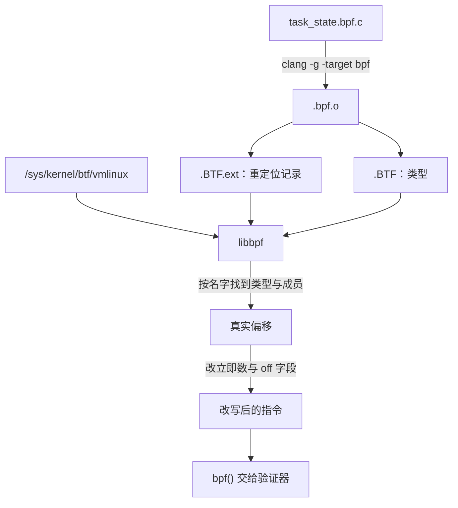

# B.8 libbpf、BTF 与 CO-RE

在 B.5 中我们曾写过一行 `BPF_CORE_READ(task, real_parent, tgid)`，B.6 的 `proclife` 示例也靠同样的写法去读取父进程信息。这些深入内核数据结构内部的代码之所以换一台机器、换一个内核版本还能照常运行，靠的是一套专门为“一次编译、到处运行”设计的重定位机制。本节我们就来拆解这套机制背后的三方协作：BTF 究竟记录了哪些类型元数据，`vmlinux.h` 是如何生成的，编译器与加载器在 CO-RE 过程中各自承担什么职责，以及当内核结构体成员改名或重定位失败（例如验证器报出 `invalid func unknown#195896080`）时应当如何编写兼容代码与排查问题。

本节涉及的 BPF 程序均使用 zig 自带的 clang 18 编译，`bpftool btf dump` 与 `bpftool gen skeleton` 的输出采自 SignalX 环境，反汇编则使用 LLVM 19 的 `llvm-objdump -dr`。加载阶段的日志和验证器报错需要将程序装入内核才能触发，文中引用了权威资料的实测结果并标为“输出类似”。完整示例源码位于 `code/系统编程/拓展B_eBPF/B_8_libbpf_BTF与CO_RE/` 目录下。

## 1. 同一个结构体在不同内核里长得不一样

内核数据结构从来不是一成不变的。以 `task_struct` 为例，在某个内核版本的 `vmlinux.h` 里它拥有 261 个成员，总大小达到 9792 字节。随着内核演进，里面的成员可能会改名、被挪进内层嵌套结构体，或者更换数据类型，各个成员相对于结构体起始地址的字节偏移也会随之发生变动。本节稍后要用到的进程状态字段 `__state` 就经历过一次改名，它在旧版本内核中的名字叫作 `state`。

如果编译器在编译时就把算好的成员偏移写死在 BPF 指令的立即数或偏移字段里，编译出来的程序一旦换到另一个版本的内核上就会读错位置。早期 BCC 工具链的应对办法是在目标机器上做现场编译：把 BPF 的 C 源码当作字符串嵌在可执行工具里，运行时先写出到临时文件，再调用工具自带的 LLVM 和 clang 对着目标机器本地安装的内核头文件现场编译一遍，最后加载进内核。这条路虽然能走通，但代价是工具自身必须背上一整套沉重的编译器依赖。Brendan Gregg 在介绍 CO-RE 的文章中给出的实测数字是，BCC 的运行时依赖体积超过 100 MB；相比之下，同样功能的 `opensnoop` 改用 libbpf 编译成 ELF 可执行文件并经过 strip 之后只有 151 KB，彻底摆脱了 libLLVM 和 libclang。此外，现场编译还要求每台目标机器上都预先装好对应版本的内核头文件，而且任何编译期错误都会被推迟到工具实际运行的那一刻才暴露出来。

CO-RE（一次编译、到处运行，Compile Once – Run Everywhere）换了一条思路。编译工作照常在开发机上完成，但编译器在生成指令的同时，还会把“这里要读取 `task_struct` 里名为 `real_parent` 的成员，接着再读取它内部名为 `tgid` 的成员”这一访问意图记录到目标文件里，把最终偏移量的计算留到加载阶段。等到程序在目标机器上启动时，加载器再去读取目标内核自身提供的类型信息，重新算出目标内核里的真实偏移，并把结果回填到 BPF 指令中。这样一来，目标机器上既不需要安装编译器，也不需要准备内核头文件，只要运行中的内核能够提供自己的类型元数据即可。

内核用来提供这套类型元数据的机制就是 BTF。

## 2. BTF

### 2.1 一种紧凑的类型格式

BTF（BPF 类型格式，BPF Type Format）专门用来描述 C 程序里的类型结构，包括有哪些结构体、每个结构体成员的类型与位偏移、有哪些函数及其原型声明，以及有哪些全局对象。内核文档一共列出了 19 种类型节点，其中最常打交道的有以下几种：

| 种类 | 描述的东西 |
| --- | --- |
| `INT` | 整数类型，带位数和有无符号 |
| `PTR` | 指针，指向另一个类型 id |
| `ARRAY` | 数组，元素类型、下标类型、元素个数 |
| `STRUCT`、`UNION` | 结构体与联合，成员列表里每个成员带名字、类型 id 和位偏移 |
| `ENUM`、`ENUM64` | 枚举及其取值 |
| `TYPEDEF`、`CONST`、`VOLATILE` | 类型别名与限定符 |
| `FUNC`、`FUNC_PROTO` | 函数与函数原型 |
| `VAR` | 全局对象，带链接属性（static、global、extern） |
| `DATASEC` | 一个数据节，列出属于它的 `VAR` 及节内偏移和大小 |

在 BTF 中，每一个类型条目都有一个递增的数字编号（`type_id`），各个类型之间全部靠这个编号互相引用。例如 `INT` 类型节点直接保存着“占用几个字节、多少个比特位、有符号还是无符号”这些编译器已经算清楚的基本事实；所有的标识符名称则集中存放在另一张字符串表里，由类型节点按字节偏移去引用。整套编码围绕紧凑性而设计，Andrii Nakryiko 曾指出，BTF 的体积相比传统的 DWARF 调试信息最多可以缩小 100 倍，省下的空间主要是那些只有源码级调试器才会用到的冗余信息。

需要注意，BTF 本身只负责描述静态类型，并不记录“某条具体的 BPF 指令打算读取哪个结构体的哪个字段”。在编译生成的 ELF 目标文件里，这两部分信息由两个独立的节分担：`.BTF` 节存放类型节点和字符串表，而 `.BTF.ext` 节则存放函数信息、源码行号映射以及 CO-RE 重定位记录。

### 2.2 程序自己的 BTF

使用 `clang -g` 编译 BPF 目标文件时，编译器会自动把程序中用到的类型信息写进 `.BTF` 节。我们可以拿 B.6 编译出来的 `proclife.bpf.o` 来看一眼，它里面包含两个 map、两个 BPF 程序以及一个 `const volatile` 全局对象，执行 `bpftool btf dump` 可以看到开头的几条记录：

::: terminal title="bash - bpftool btf dump"

```text
$ bpftool btf dump file proclife.bpf.o
[1] PTR '(anon)' type_id=3
[2] INT 'int' size=4 bits_offset=0 nr_bits=32 encoding=SIGNED
[3] ARRAY '(anon)' type_id=2 index_type_id=4 nr_elems=1
[4] INT '__ARRAY_SIZE_TYPE__' size=4 bits_offset=0 nr_bits=32 encoding=(none)
[5] PTR '(anon)' type_id=6
[6] ARRAY '(anon)' type_id=2 index_type_id=4 nr_elems=8192
[7] PTR '(anon)' type_id=8
[8] TYPEDEF 'pid_t' type_id=9
[9] TYPEDEF '__kernel_pid_t' type_id=2
[10] PTR '(anon)' type_id=11
[11] TYPEDEF '__u64' type_id=12
[12] INT 'unsigned long long' size=8 bits_offset=0 nr_bits=64 encoding=(none)
[13] STRUCT '(anon)' size=32 vlen=4
	'type' type_id=1 bits_offset=0
	'max_entries' type_id=5 bits_offset=64
	'key' type_id=7 bits_offset=128
	'value' type_id=10 bits_offset=192
[14] VAR 'exec_start' type_id=13, linkage=global
```

:::

其中第 13 条那个匿名结构体就是 map 的定义，包含 `type`、`max_entries`、`key`、`value` 四个成员——B.6 介绍过的 `__uint` 和 `__type` 宏在展开后，其实就是把键值与容量信息编码成了这样一个结构体的成员类型（例如第 6 条 `ARRAY ... nr_elems=8192` 的元素个数就对应着 `max_entries` 设定的 8192）。紧随其后的第 14 条 `VAR 'exec_start'` 则是这个 map 对象本身，`linkage=global` 表明它具有全局链接属性。

翻到这份输出的末尾，可以看到三个 `DATASEC` 条目，它们负责把上面声明的各个 `VAR` 归入各自所属的 ELF 数据节：

::: terminal title="bash - bpftool btf dump（末尾）"

```text
[375] DATASEC '.maps' size=0 vlen=2
	type_id=14 offset=0 size=32 (VAR 'exec_start')
	type_id=20 offset=0 size=16 (VAR 'events')
[376] DATASEC '.rodata' size=0 vlen=1
	type_id=374 offset=0 size=8 (VAR 'min_duration_ns')
[377] DATASEC 'license' size=0 vlen=1
	type_id=371 offset=0 size=13 (VAR 'LICENSE')
```

:::

这里显示的 `size=0` 是因为在单个目标文件的编译阶段还无法确定数据节的最终大小，后续由加载器把真实的字节数填进去。两个 map 在 `.maps` 节里的偏移也都暂记为 0，因为在这个节里每个 map 各自是一个独立的定义。

在同一次 dump 的输出中往前翻一点，还能找到对应两个 BPF 程序入口的 `FUNC` 类型：

::: terminal title="bash - bpftool btf dump（节选）"

```text
[368] FUNC_PROTO '(anon)' ret_type_id=2 vlen=1
	'ctx' type_id=366
[369] FUNC 'handle_exit' type_id=368 linkage=global
```

:::

`FUNC` 条目引用了一个 `FUNC_PROTO` 的编号，原型里记录了函数的返回值类型、参数个数以及每个参数的类型编号。例如 `handle_exit` 的参数 `ctx` 指向 `type_id=366`，顺着编号往上查就能在 BTF 里找到 `trace_event_raw_sched_process_template` 的完整结构体定义。如果在调用 `bpftool btf dump` 时加上 `format c` 选项，工具就会把这些类型节点直接还原成合法的 C 语言声明：

::: terminal title="bash - bpftool btf dump format c"

```text
struct trace_event_raw_sched_process_exec {
	struct trace_entry ent;
	u32 __data_loc_filename;
	pid_t pid;
	pid_t old_pid;
	char __data[0];
};
```

:::

这正是我们在 B.2 中执行 `bpftool btf dump file /sys/kernel/btf/vmlinux format c > vmlinux.h` 背后的工作原理：把内核自身 BTF 里记录的所有类型一次性全部还原为 C 语言头文件声明。当时生成的那个长达 127716 行的 `vmlinux.h`，所有内容都来自这一条命令。

### 2.3 内核自己的 BTF

只要内核配置开启了 `CONFIG_DEBUG_INFO_BTF` 选项，在构建内核镜像时，`pahole` 工具就会把编译产物里的 DWARF 调试信息转换成紧凑的 BTF 数据并直接嵌入 `vmlinux` 镜像中。系统启动后，sysfs 会把这段嵌在内核里的 BTF 暴露为一个只读虚拟文件 `/sys/kernel/btf/vmlinux`（它在磁盘上并不占用实际存储空间，大小取决于当前内核的配置）。我们可以像上面读取目标文件那样用 `bpftool btf dump file /sys/kernel/btf/vmlinux` 直接读取它，加上 `format c` 就能导出完整的 `vmlinux.h`。

libbpf 在加载 BPF 程序时读取的目标类型信息同样来自这个入口：内部的 `btf__load_vmlinux_btf()` 函数会优先尝试打开 `/sys/kernel/btf/vmlinux`，如果找不到，再去 `/boot` 和 `/lib/modules` 目录下按当前内核版本号寻找备选的镜像文件；要是所有标准路径都找不到，它就会打印出 `kernel BTF is missing at '/sys/kernel/btf/vmlinux', was CONFIG_DEBUG_INFO_BTF enabled?` 并放弃执行 CO-RE 重定位。

除了主内核镜像，`/sys/kernel/btf/` 目录下还陈列着各个已加载内核模块的 BTF 文件，文件名就是模块名。模块的 BTF 只记录该模块自身新引入的类型，并通过 split BTF 机制挂接在主内核 `vmlinux` 的基础 BTF 之上。libbpf 在重定位阶段也会按需读取这些模块 BTF，因此内核模块内部定义的结构体同样可以参与 CO-RE 重定位。

::: tip 内核没有 BTF 时

如果部署环境运行的是早期未开启 `CONFIG_DEBUG_INFO_BTF` 的旧版发行版内核，可以借助 BTFHub 项目收集的各主流发行版 BTF 存档，再配合 `bpftool gen min_core_btf` 从庞大的完整 BTF 文件中裁剪出当前 BPF 程序实际访问到的那一小部分类型定义，随程序一起打包分发。加载时只需通过 `bpf_object_open_opts` 结构体的 `btf_custom_path` 字段指定这份精简 BTF 文件的路径，libbpf 就能照常完成重定位。这套兜底方案只在目标内核确实没有内置 BTF 时才需要动用。

:::

### 2.4 BTF 的其它用途

除了支撑 CO-RE 重定位，BTF 在日常调试与程序挂载中还有三处常见的用途：

- **格式化打印 Map 内容**：执行 `bpftool map dump` 时，如果 map 关联了 BTF 类型信息，工具就能按照结构体定义把键和值的每个成员名及对应数值结构化地打印出来，读起来比一长串原始十六进制字节直观得多。
- **在验证器日志与反汇编中附带源码行**：加载程序时，libbpf 会把 `.BTF.ext` 节里的行号映射信息一并提交给内核。一旦某条指令未能通过安全检查，验证器报错时就能直接把对应的 C 源码行打印出来；平时执行 `bpftool prog dump xlated` 查看内核里的指令流时，也能将 C 源码与 BPF 指令穿插对照显示。
- **为 `fentry` 等挂载点提供带类型的参数**：正如 B.11 所介绍的，`fentry` 程序不再依赖底层 CPU 寄存器的传参约定，而是按挂载的目标函数名直接去内核 BTF 里查找对应的 `FUNC` 类型，从函数原型中提取每个参数的确切类型。


## 3. CO-RE 的三方分工

::: concept ebpf-b08-core-three-parties title="CO-RE 的三方分工"

CO-RE 的运作由编译器、加载器和内核三方配合完成：clang 在编译阶段把每一次带有 `preserve_access_index` 标记的结构体成员访问记录成一条重定位项，写入目标文件的 `.BTF.ext` 节（记录中保存着重定位种类、根类型的 BTF 编号、成员名称与访问路径，而不依赖固定偏移）；libbpf 在加载阶段读取目标内核的 BTF，按类型名和成员名定位到目标内核里的对应定义，算出真实字节偏移后直接改写指令中的立即数或偏移字段；内核自身则只负责提供 `/sys/kernel/btf/vmlinux` 数据，不参与字节码的改写过程。

:::

在这三方当中，编译器和加载器都是现成的工具，编写 BPF 程序的人只需要把结构体定义和访问方式写对，让前两方能够准确对上话即可。

### 3.1 记录：preserve_access_index

打开生成的 `vmlinux.h`，文件开头的几行预处理指令就是开启重定位记录的总开关：

::: terminal title="bash - vmlinux.h 开头"

```text
$ head -8 vmlinux.h
#ifndef __VMLINUX_H__
#define __VMLINUX_H__

#ifndef BPF_NO_PRESERVE_ACCESS_INDEX
#pragma clang attribute push (__attribute__((preserve_access_index)), apply_to = record)
#endif
```

:::

这里的 `#pragma clang attribute push` 会为随后出现的所有 `struct` 和 `union` 定义统一挂上 `preserve_access_index` 属性，直到文件末尾再用 `#pragma clang attribute pop` 将其撤销。这个属性的作用是通知 clang：只要代码里通过该类型访问了内部成员，就在 `.BTF.ext` 节里留下一条 CO-RE 重定位记录。由于 `bpftool btf dump format c` 在导出 `vmlinux.h` 时已经自动加上了这对编译指示，平时只要直接包含 `vmlinux.h`，访问其中的任何内核结构体都会自动带上重定位记录，无需额外标注。

如果是在 BPF 源码里自己手写结构体定义来映射内核类型，就需要手动加上这个属性。本节示例 `task_state.bpf.c` 里为了兼容旧版内核而定义的 `task_struct___old` 就是这样写的：

```c
struct task_struct___old {
    long state;
} __attribute__((preserve_access_index));
```

注意这个属性必须加在结构体或联合体的类型定义上，而不能加在指针或对象声明上。如果写成 `struct task_struct___old *t __attribute__((preserve_access_index));`，编译器就会直接报错退出：`error: 'preserve_access_index' attribute only applies to structs, unions, and classes`。

另一方面，libbpf 提供的 `BPF_CORE_READ` 系列宏在内部展开时，已经给每一层成员访问表达式都套上了 `__builtin_preserve_access_index()` 内建函数。这意味着即便某个结构体类型在定义时忘了加 `preserve_access_index` 属性，只要通过 `BPF_CORE_READ` 宏去读取它的成员，同样会生成重定位记录。回顾 B.5 写过的 `bpf_probe_read_kernel(&parent, sizeof(parent), &task->real_parent)`，当时虽然用的是普通的 `->` 成员访问，但由于 `task_struct` 的定义来自自带属性的 `vmlinux.h`，clang 照样为它生成了重定位记录。本节 `three_ways.bpf.c` 里的第一个程序 `manual` 就采用了这种手写方式，其中两次成员地址计算各自产生了一条重定位记录：

::: terminal title="bash - llvm-objdump -dr three_ways.bpf.o"

```text
Disassembly of section tp/sched/sched_process_exec:

0000000000000000 <manual>:
       0:	bf 16 00 00 00 00 00 00	r6 = r1
       1:	85 00 00 00 23 00 00 00	call 0x23
       2:	b7 01 00 00 00 00 00 00	r1 = 0x0
       3:	7b 1a f8 ff 00 00 00 00	*(u64 *)(r10 - 0x8) = r1
       4:	b7 01 00 00 90 09 00 00	r1 = 0x990
		0000000000000020:  CO-RE <byte_off> [17] struct task_struct::real_parent (0:90)
       5:	0f 10 00 00 00 00 00 00	r0 += r1
       6:	b4 01 00 00 00 00 00 00	w1 = 0x0
       7:	63 1a f4 ff 00 00 00 00	*(u32 *)(r10 - 0xc) = r1
       8:	bf a1 00 00 00 00 00 00	r1 = r10
       9:	07 01 00 00 f8 ff ff ff	r1 += -0x8
      10:	b4 02 00 00 08 00 00 00	w2 = 0x8
      11:	bf 03 00 00 00 00 00 00	r3 = r0
      12:	85 00 00 00 71 00 00 00	call 0x71
      13:	b7 01 00 00 84 09 00 00	r1 = 0x984
		0000000000000068:  CO-RE <byte_off> [17] struct task_struct::tgid (0:88)
      14:	79 a3 f8 ff 00 00 00 00	r3 = *(u64 *)(r10 - 0x8)
      15:	0f 13 00 00 00 00 00 00	r3 += r1
      16:	bf a1 00 00 00 00 00 00	r1 = r10
      17:	07 01 00 00 f4 ff ff ff	r1 += -0xc
      18:	b4 02 00 00 04 00 00 00	w2 = 0x4
      19:	85 00 00 00 71 00 00 00	call 0x71
```

:::

仔细看反汇编输出里的每一条 `CO-RE` 注释行，它清楚地列出了四项关键信息：待改写指令在当前节内的字节偏移（如 `0x20` 和 `0x68`）、重定位的种类（`<byte_off>`）、根类型的 BTF 编号（`[17]`），以及根类型名、目标成员名与访问路径（如 `(0:90)`）。括号里用冒号分隔的数字串就是访问路径，它的表示法与 LLVM IR 中的 `getelementptr`（GEP）下标一致：假设通过指针访问 `s->b`，路径就记作 `0:1`，其中开头的 `0` 表示先对基地址指针做一次解引用拿到结构体本身，后面的数字则是目标成员在结构体定义中的序号（从 0 开始计数）。在当前开发机的 `vmlinux.h` 里，`__state` 排在 `task_struct` 的第 1 号成员，所以路径是 `(0:1)`；`real_parent` 排在第 90 号成员，所以路径是 `(0:90)`。至于上方指令 `r1 = 0x990` 里的立即数 `0x990`（十进制 2448 字节），则是编译器先按开发机本地的 `vmlinux.h` 算出来填进去的初始偏移。

也就是说，`r1 = 0x990` 是实实在在的 BPF 指令，而下方的 `CO-RE` 行则是 `llvm-objdump -dr` 读取 `.BTF.ext` 节里的重定位表后，按指令地址匹配打印出来的辅助注释。用 `readelf -SW` 查看目标文件的节表，可以看到 `.BTF` 与 `.BTF.ext` 各自独立成节：

::: terminal title="bash - readelf -SW"

```text
  [13] .BTF              PROGBITS        0000000000000000 084a28 00742c 00      0   0  4
  [14] .rel.BTF          REL             0000000000000000 0de2c0 000020 10   I 22  13  8
  [15] .BTF.ext          PROGBITS        0000000000000000 08be54 00018c 00      0   0  4
  [16] .rel.BTF.ext      REL             0000000000000000 0de2e0 000150 10   I 22  15  8
```

:::

这里 `.BTF` 节占了 `0x742c` 字节，而 `.BTF.ext` 节只有 `0x18c` 字节：完整的类型树定义占去了绝大部分体积，重定位记录本身只是几条轻量的索引。

::: warning 少了 `-g` 连编译都过不去

如果在调用 clang 编译时漏掉了 `-g` 选项，编译器就不会生成 BTF 类型表，一旦遇到带有 `preserve_access_index` 的成员访问便无法记录类型编号，只能当场报错：`error: using builtin_preserve_access_index() without -g`。B.4 曾提到编译 BPF 程序必须加 `-g` 以生成 BTF，这里看到的就是它在 CO-RE 重定位中的关键作用。

:::

### 3.2 执行：libbpf 在加载时改写

当用户态程序调用 libbpf 开始加载阶段时，libbpf 会先读取 `/sys/kernel/btf/vmlinux`，接着拿着程序自身 `.BTF` 里记录的根类型名字，去目标内核的 BTF 里寻找同名类型（内部调用 `bpf_core_essential_name_len()` 比较名字时会自动在最后一个 `___` 处截断，这正是第 5 节处理结构体改名的基础）。找到匹配的目标类型后，libbpf 便顺着重定位记录里的访问路径逐级核对成员名，算出该成员在目标内核里的真实字节偏移，最后根据重定位种类的不同去改写指令中的对应字段：

- `byte_off`：修改访存指令（`BPF_LDX`、`BPF_STX`、`BPF_ST`）的 `off` 偏移字段，或者修改算术与加载指令（`BPF_ALU`、`BPF_ALU64`、`BPF_LD`）的 `imm` 立即数字段；
- `byte_sz`：修改访存指令的宽度标记（如 `BPF_W`、`BPF_DW`）或算术指令中的字节数立即数；
- `field_exists`、`type_exists`、`enumval_exists`：根据目标是否存在，将指令立即数改写为 `1` 或 `0`；
- `enumval_value`：将指令立即数改写为目标内核里该枚举项的真实数值。

因为 `llvm-objdump -dr` 会把重定位注释原样打印在指令下方，我们可以把 `three_ways.bpf.o` 里另外两个读取同一个 `real_parent->tgid` 的程序放在一起对比。第二个程序 `core` 用的是 `BPF_CORE_READ` 宏：

::: terminal title="bash - llvm-objdump -dr three_ways.bpf.o（节选）"

```text
Disassembly of section tp/sched/sched_process_exit:

0000000000000000 <core>:
       0:	bf 16 00 00 00 00 00 00	r6 = r1
       1:	85 00 00 00 23 00 00 00	call 0x23
       2:	b7 01 00 00 90 09 00 00	r1 = 0x990
		0000000000000010:  CO-RE <byte_off> [17] struct task_struct::real_parent (0:90)
       3:	0f 10 00 00 00 00 00 00	r0 += r1
       4:	61 66 18 00 00 00 00 00	r6 = *(u32 *)(r6 + 0x18)
		0000000000000020:  CO-RE <byte_off> [353] struct trace_event_raw_sched_process_template::pid (0:2)
       5:	bf a1 00 00 00 00 00 00	r1 = r10
       6:	07 01 00 00 f0 ff ff ff	r1 += -0x10
       7:	b4 02 00 00 08 00 00 00	w2 = 0x8
       8:	bf 03 00 00 00 00 00 00	r3 = r0
       9:	85 00 00 00 71 00 00 00	call 0x71
      10:	b7 01 00 00 84 09 00 00	r1 = 0x984
		0000000000000050:  CO-RE <byte_off> [17] struct task_struct::tgid (0:88)
      11:	79 a3 f0 ff 00 00 00 00	r3 = *(u64 *)(r10 - 0x10)
      12:	0f 13 00 00 00 00 00 00	r3 += r1
      13:	bf a1 00 00 00 00 00 00	r1 = r10
      14:	07 01 00 00 fc ff ff ff	r1 += -0x4
      15:	b4 02 00 00 04 00 00 00	w2 = 0x4
      16:	85 00 00 00 71 00 00 00	call 0x71
```

:::

可以看到，它生成的重定位种类、目标成员名和访问路径与刚才手写的 `manual` 程序完全一致，生成的指令序列也逐条对应：先加上 `0x990` 算出 `real_parent` 成员的地址，调用一次 `0x71`（即 `bpf_probe_read_kernel`）把父进程指针读到栈上，接着加上 `0x984` 算出 `tgid` 成员的地址，再调用一次 `bpf_probe_read_kernel` 读出 `tgid` 的值。两边唯一的差别在于打印参数的来源，以及 `manual` 程序里多出了几条先把栈上局部对象清零的指令。`BPF_CORE_READ` 完全在编译期展开，不会引入任何额外的运行时开销。

第三个程序 `direct` 挂在 `fentry/do_exit` 上。由于 `fentry` 程序以及 `bpf_get_current_task_btf()` 辅助函数返回的指针本身就带有内核 BTF 类型标记，代码里可以直接写成 `task->real_parent->tgid`：

::: terminal title="bash - llvm-objdump -dr three_ways.bpf.o（节选）"

```text
Disassembly of section fentry/do_exit:

0000000000000000 <direct>:
       0:	85 00 00 00 9e 00 00 00	call 0x9e
       1:	79 01 90 09 00 00 00 00	r1 = *(u64 *)(r0 + 0x990)
		0000000000000008:  CO-RE <byte_off> [17] struct task_struct::real_parent (0:90)
       2:	61 13 84 09 00 00 00 00	r3 = *(u32 *)(r1 + 0x984)
		0000000000000010:  CO-RE <byte_off> [17] struct task_struct::tgid (0:88)
```

:::

这里完全没有调用 `bpf_probe_read_kernel`，而是浓缩成了两条干脆的直接内存加载指令（`BPF_LDX`），重定位改写的目标也从算术加法的立即数变成了访存指令自身的偏移字段（`+ 0x990` 和 `+ 0x984`）。验证器之所以放行这种直接解引用，是因为该程序所属的类型（B.10 将要介绍的 `fentry`、`fexit`、`tp_btf`、`lsm` 等）关联了内核 BTF，验证器能够确切识别出 `r0` 和 `r1` 指向合法的 `task_struct` 内核对象，并核实这两次偏移访问没有越界。

### 3.3 一张流程图



回顾 B.7 介绍过的加载生命周期，libbpf 在 `bpf_object__open()` 阶段只负责解析 ELF 文件结构，并不会立刻动手改写指令；真正的 CO-RE 重定位发生在 `bpf_object__load()` 阶段内部，赶在通过 `BPF_PROG_LOAD` 把指令数组提交给内核验证器之前完成。

<Quiz
  type="single"
  :options="[
    { label: 'clang 记录重定位，libbpf 在加载时按目标内核的 BTF 执行', value: 'A' },
    { label: 'clang 按本机内核算出偏移，libbpf 原样传递', value: 'B' },
    { label: '内核在 BPF_PROG_LOAD 时读 .BTF.ext 并改写程序', value: 'C' },
    { label: 'bpftool 在生成骨架时改写成目标机器的偏移', value: 'D' }
  ]"
  answer="A"
>

<template #question>

CO-RE 重定位由谁记录、由谁执行？

</template>

正确答案是 **A**。clang 在编译时把类型与成员路径写进 `.BTF.ext`，libbpf 在加载阶段读 `/sys/kernel/btf/vmlinux`、算出真实偏移并改写指令。B 错在偏移来自开发机的 `vmlinux.h`，恰恰是 CO-RE 要摆脱的东西；C 错在验证器只接收已经改写好的指令，它不读 `.BTF.ext`；D 错在骨架只是把 `.bpf.o` 的字节嵌进头文件，重定位仍由 libbpf 运行时完成。

</Quiz>

## 4. 读取内核数据

### 4.1 BPF_CORE_READ 系列

`BPF_CORE_READ(src, a, b, c)` 宏从起始指针 `src` 出发，按顺序逐级读取 `a`、`b`、`c` 三层成员：中间的每一层过渡都对应一次指针解引用与探针读取，最后一步则读出目标成员本身的值。以 `task_state.bpf.c` 里那行 `BPF_CORE_READ(task, real_parent, tgid)` 为例，经过预处理器展开之后会变成一段复合语句表达式：

::: details BPF_CORE_READ(task, real_parent, tgid) 的完整展开

```c
ppid = ({
    typeof((task)->real_parent->tgid) __r;
    {
        const void *__t;
        bpf_probe_read_kernel((void *)(&__t), sizeof(*(&__t)),
            (const void *)__builtin_preserve_access_index(
                &((typeof(((task))))(((task))))->real_parent));
        bpf_probe_read_kernel((void *)(&__r), sizeof(*(&__r)),
            (const void *)__builtin_preserve_access_index(
                &((typeof(((task))->real_parent))(__t))->tgid));
    };
    __r;
});
```

这里连续调用了两次 `bpf_probe_read_kernel`，第一次读取 `task->real_parent` 的指针值并存入临时指针 `__t`，第二次再从 `__t` 指向的父进程结构体中读取 `tgid` 成员；两次取地址操作各自套了一层 `__builtin_preserve_access_index`，从而产生两条 `<byte_off>` 重定位记录，与上一节 `manual` 程序里的两条记录完全对应。

:::

该宏最多支持传入 9 个层级的访问参数。如果相邻的几层属于嵌套在同一个结构体内部的子结构体（中间没有指针跳转），可以在同一个参数里直接用点号连写，例如 `BPF_CORE_READ(t, mm, exe_file, path.dentry, d_name.name)` 只占用 `mm`、`exe_file`、`path.dentry`、`d_name.name` 四个参数位置；点号连写的部分在同一次偏移计算里合并完成，不会产生多余的 `bpf_probe_read_kernel` 调用。

围绕不同的返回值与目标缓冲区需求，libbpf 提供了三个内核态读取变体，它们的区别集中在最后一步读取操作上：

- `BPF_CORE_READ(src, ...)` 直接返回读到的成员值；如果中途某一步读取失败，宏会将结果清零并返回 `0`，但不会单独向调用者报告错误码。
- `BPF_CORE_READ_INTO(&dst, src, ...)` 将最终读出的数据写入调用者提供的 `dst` 存储区，并返回最后一次 `bpf_probe_read_kernel` 的错误码，适合需要显式检查读取是否成功的场景。
- `BPF_CORE_READ_STR_INTO(&buf, src, ...)` 在最后一步改调 `bpf_probe_read_kernel_str`，专门用来读取以空字符结尾的内核字符串。

如果待读取的指针指向用户空间内存，还有一组对应的用户态变体：`bpf_core_read_user()`、`BPF_CORE_READ_USER()`、`BPF_CORE_READ_USER_INTO()` 与 `BPF_CORE_READ_USER_STR_INTO()`，它们将底层调用的辅助函数从 `bpf_probe_read_kernel` 换成了 `bpf_probe_read_user`。不过需要注意，哪怕读取的是用户空间地址，宏里使用的结构体类型仍然必须是内核 BTF 里有记录的内核类型（例如系统调用参数涉及的 `struct sockaddr_in`），否则 libbpf 在目标内核 BTF 里找不到类型定义，重定位依然会失败——CO-RE 机制只为内核自身暴露的类型服务，纯用户态程序自定义的私有结构体无法靠内核 BTF 完成重定位。

### 4.2 三种写法对照

::: compare vertical left-title="直接解引用（指针带类型时）" right-title="BPF_CORE_READ（指针不带类型时）"

```c
SEC("fentry/do_exit")
int BPF_PROG(direct, long code)
{
    struct task_struct *task = bpf_get_current_task_btf();

    bpf_printk("ppid = %d\n", task->real_parent->tgid);
    return 0;
}
```

---

```c
SEC("tp/sched/sched_process_exit")
int core(void *ctx)
{
    struct task_struct *task = (struct task_struct *)bpf_get_current_task();

    bpf_printk("ppid = %d\n", BPF_CORE_READ(task, real_parent, tgid));
    return 0;
}
```

:::

把这两种写法放在一起对比：它们在编译阶段生成的 CO-RE 重定位记录完全相同，但最终装入内核执行的指令却大不相同。左侧的 `direct` 编译出来只是两条普通的内存加载指令，执行代价与常规的 C 语言指针访存无异；右侧的 `core` 编译出来则是两次 `call 0x71`（调用 113 号辅助函数 `bpf_probe_read_kernel`），每次调用都要在内核里走一遍探针读取路径，完成地址合法性检查与缺页异常保护。

在实际编写程序时，究竟选用哪一种写法并不取决于个人偏好，而是取决于当前手里的指针在验证器眼中是否带有 BTF 类型信息。例如静态 tracepoint 的上下文指针 `ctx` 指向 `vmlinux.h` 里的 `trace_event_raw_*` 结构体，验证器知道它的确切布局，所以 `task_state.bpf.c` 里的 `ctx->pid` 可以直接解引用；但普通辅助函数 `bpf_get_current_task()` 返回的只是一个无类型的 64 位整数（标量），哪怕我们在 C 代码里用 `(struct task_struct *)` 做了强制类型转换，验证器也并不认账，这时就必须老老实实使用 `BPF_CORE_READ` 或 `bpf_probe_read_kernel`。相反，如果程序挂载在 `fentry`、`fexit`、`tp_btf` 或 `lsm` 上，或者改用 `bpf_get_current_task_btf()` 获取当前任务指针，拿到的指针本身就是验证器认可的 BTF 类型指针（`PTR_TO_BTF_ID`），自然就能像写普通 C 代码那样一路用 `->` 直接解引用。

至于 `three_ways.bpf.c` 里手写两次 `bpf_probe_read_kernel` 的 `manual` 版本，它生成的指令序列与 `BPF_CORE_READ` 版本完全一致，只是源码写起来繁琐得多，还得自己声明中间指针对象，日常开发中直接用 `BPF_CORE_READ` 即可。

### 4.3 完整示例：task_state

下面来看完整的 `task_state.bpf.c`，它把本节的核心操作串在了一起：一边用 `BPF_CORE_READ` 读取父进程的 `real_parent->tgid`，一边处理 `task_struct` 中改过名的进程状态字段（`state` 与 `__state`）。

::: code-group

```c [task_state.bpf.c]
// SPDX-License-Identifier: GPL-2.0 OR BSD-3-Clause
#include "vmlinux.h"
#include <bpf/bpf_core_read.h>
#include <bpf/bpf_helpers.h>

char LICENSE[] SEC("license") = "Dual BSD/GPL";

/* 旧内核把这个成员叫 state，新内核叫 __state。
 * 名字里带 ___ 后缀的部分在匹配目标内核时被忽略：
 * 这个类型会被当成 struct task_struct，成员名按 state 去找。 */
struct task_struct___old {
    long state;
} __attribute__((preserve_access_index));

SEC("tp/sched/sched_process_exec")
int handle_exec(struct trace_event_raw_sched_process_exec *ctx)
{
    struct task_struct *task;
    long state;
    pid_t ppid;

    task = (struct task_struct *)bpf_get_current_task();
    ppid = BPF_CORE_READ(task, real_parent, tgid);

    if (bpf_core_field_exists(task->__state)) {
        state = BPF_CORE_READ(task, __state);
    } else {
        state = BPF_CORE_READ((struct task_struct___old *)task, state);
    }

    bpf_printk("pid = %d, ppid = %d, state = %ld\n", ctx->pid, ppid, state);
    return 0;
}
```

```c [task_state.c]
#define _POSIX_C_SOURCE 200809L

#include <errno.h>
#include <signal.h>
#include <stdio.h>
#include <string.h>
#include <unistd.h>

#include <bpf/libbpf.h>

#include "task_state.skel.h"

static volatile sig_atomic_t stop;

static void on_signal(int signo)
{
    (void)signo;
    stop = 1;
}

static int print_libbpf(enum libbpf_print_level level, const char *format, va_list args)
{
    (void)level;
    return vfprintf(stderr, format, args);
}

int main(void)
{
    struct task_state_bpf *skel;
    struct sigaction sa;
    int err;

    libbpf_set_print(print_libbpf);

    skel = task_state_bpf__open_and_load();
    if (skel == NULL) {
        fprintf(stderr, "无法打开并加载骨架\n");
        return 1;
    }

    err = task_state_bpf__attach(skel);
    if (err != 0) {
        fprintf(stderr, "附加失败：%s\n", strerror(-err));
        goto cleanup;
    }

    memset(&sa, 0, sizeof(sa));
    sa.sa_handler = on_signal;
    sigaction(SIGINT, &sa, NULL);

    printf("已启动，另开一个终端执行 sudo cat /sys/kernel/tracing/trace_pipe\n");
    while (!stop) {
        sleep(1);
    }

cleanup:
    task_state_bpf__destroy(skel);
    return err != 0;
}
```

:::

编译命令与前面几节保持一致：

::: terminal title="bash - clang"

```text
$ clang -g -O2 -target bpf -mcpu=v3 -D__TARGET_ARCH_x86 -I. -c task_state.bpf.c -o task_state.bpf.o
$ bpftool gen skeleton task_state.bpf.o > task_state.skel.h
$ cc -std=c17 -Wall -Wextra task_state.c -o task_state $(pkg-config --cflags --libs libbpf)
```

:::

在 `task_state.bpf.o` 的反汇编输出里一共有六条 CO-RE 重定位记录：读取 `real_parent` 和 `tgid` 各占一条，针对 `__state` 的存在性检查与读取各占一条，针对旧版 `task_struct___old::state` 的读取占一条，最后读取 `ctx->pid` 占一条。下面摘出前五条重定位以及紧随其后的条件跳转分支：

::: terminal title="bash - llvm-objdump -dr task_state.bpf.o（节选）"

```text
0000000000000000 <handle_exec>:
       0:	bf 16 00 00 00 00 00 00	r6 = r1
       1:	85 00 00 00 23 00 00 00	call 0x23
       2:	bf 07 00 00 00 00 00 00	r7 = r0
       3:	b7 01 00 00 90 09 00 00	r1 = 0x990
		0000000000000018:  CO-RE <byte_off> [17] struct task_struct::real_parent (0:90)
       4:	bf 73 00 00 00 00 00 00	r3 = r7
       5:	0f 13 00 00 00 00 00 00	r3 += r1
       6:	bf a1 00 00 00 00 00 00	r1 = r10
       7:	07 01 00 00 f0 ff ff ff	r1 += -0x10
       8:	b4 02 00 00 08 00 00 00	w2 = 0x8
       9:	85 00 00 00 71 00 00 00	call 0x71
      10:	b7 01 00 00 84 09 00 00	r1 = 0x984
		0000000000000050:  CO-RE <byte_off> [17] struct task_struct::tgid (0:88)
      11:	79 a3 f0 ff 00 00 00 00	r3 = *(u64 *)(r10 - 0x10)
      12:	0f 13 00 00 00 00 00 00	r3 += r1
      13:	bf a1 00 00 00 00 00 00	r1 = r10
      14:	07 01 00 00 fc ff ff ff	r1 += -0x4
      15:	b4 02 00 00 04 00 00 00	w2 = 0x4
      16:	85 00 00 00 71 00 00 00	call 0x71
      17:	61 a8 fc ff 00 00 00 00	r8 = *(u32 *)(r10 - 0x4)
      18:	b7 01 00 00 01 00 00 00	r1 = 0x1
		0000000000000090:  CO-RE <field_exists> [17] struct task_struct::__state (0:1)
      19:	16 01 09 00 00 00 00 00	if w1 == 0x0 goto +0x9 <LBB0_2>
      20:	b7 01 00 00 18 00 00 00	r1 = 0x18
		00000000000000a0:  CO-RE <byte_off> [17] struct task_struct::__state (0:1)
      21:	0f 17 00 00 00 00 00 00	r7 += r1
      22:	bf a1 00 00 00 00 00 00	r1 = r10
      23:	07 01 00 00 f0 ff ff ff	r1 += -0x10
      24:	b4 02 00 00 04 00 00 00	w2 = 0x4
      25:	bf 73 00 00 00 00 00 00	r3 = r7
      26:	85 00 00 00 71 00 00 00	call 0x71
      27:	61 a5 f0 ff 00 00 00 00	r5 = *(u32 *)(r10 - 0x10)
      28:	05 00 08 00 00 00 00 00	goto +0x8 <LBB0_3>

00000000000000e8 <LBB0_2>:
      29:	b7 01 00 00 00 00 00 00	r1 = 0x0
		00000000000000e8:  CO-RE <byte_off> [352] struct task_struct___old::state (0:0)
      30:	0f 17 00 00 00 00 00 00	r7 += r1
```

:::

观察第 18 条指令 `r1 = 0x1`：这是 clang 为 `<field_exists>` 重定位留下的占位赋值。因为在编译阶段并不知道目标机器的内核里有没有 `__state` 成员，编译器就先默认填上 `1`，并照常生成紧随其后的条件跳转指令 `if w1 == 0x0 goto +0x9 <LBB0_2>`。等到程序在目标机器上加载时，libbpf 会去核对目标内核的 BTF，把这条赋值指令的立即数改成真实的 `1` 或 `0`。在当前这台内核 6.12 的机器上，`__state` 确实存在，所以立即数保持为 `1`，`w1 == 0` 条件恒不成立，执行流顺序落入第 20 条指令去读取 `__state`；至于标号 `<LBB0_2>` 所在的分支，则只有在不存在 `__state` 的旧内核上才会跳进去。

再看 `<LBB0_2>` 分支内部的第 29 条指令，它关联着 `struct task_struct___old::state` 的偏移重定位。由于当前机器的内核里已经没有名为 `state` 的成员了，libbpf 在重定位这条指令时会找不到目标，于是将它改写成一条特殊标记的非法调用指令（具体细节见第 6 节）。然而，由于前面第 18 条指令已经把 `r1` 确定为常量 `1`，验证器在模拟执行第 19 条条件跳转时能够断定 `<LBB0_2>` 分支永远不可达，直接将其视为死代码跳过检查，那条因找不到 `state` 而产生的坏指令也就不会引发验证器报错。反过来，如果把同一份 `.bpf.o` 放到只有 `state` 成员的旧版内核上加载，两条分支的处境便正好对调：第 18 条指令被改写成 `r1 = 0x0`，验证器顺着跳转进入 `<LBB0_2>` 正常解析 `state`，而上方读取 `__state` 的分支则作为死代码被安全忽略。

::: tip 确认目标内核里有哪个成员

想在目标机器上快速确认某个成员的名字，直接运行 `bpftool btf dump file /sys/kernel/btf/vmlinux | grep "'__state'"` 搜索成员名，比凭印象猜测可靠得多；如果想查看整个结构体的完整布局，可以先用 `format c` 导出 `vmlinux.h` 再从中检索。

:::

## 5. 应对内核差异

### 5.1 存在性检查

为了在运行时分支中判断目标内核是否具备某项定义，libbpf 提供了一组存在性检查宏。它们的底层工作方式如出一辙：编译阶段生成一条特殊种类的 CO-RE 重定位记录，加载阶段由 libbpf 核对目标内核 BTF 后将指令立即数改写为 `1` 或 `0`：

- `bpf_core_field_exists(field)`：若成员在目标内核里存在则求值为 `1`，否则为 `0`。支持传入成员访问表达式（如 `bpf_core_field_exists(task->__state)`）或传入类型名加成员名（如 `bpf_core_field_exists(struct task_struct, __state)`）两种写法。
- `bpf_core_type_exists(type)`：若指定类型（`struct`、`union`、`enum` 或 `typedef`）在目标内核里存在则求值为 `1`，否则为 `0`。
- `bpf_core_enum_value_exists(enum_type, value)`：若枚举类型中包含该枚举项则求值为 `1`，否则为 `0`。

除此之外，还有两个配套的查询宏：`bpf_core_enum_value(enum_type, value)` 返回指定枚举项在目标内核里的真实整数值，常用于应对不同内核版本中辅助函数编号或标志位数值发生变动的场合；`bpf_core_field_size(field)` 则返回指定成员在目标内核里的字节宽度，常用于成员类型发生改变（例如 `state` 从 8 字节的 `long` 缩减为 4 字节的 `unsigned int`）的场合。

上面三个 `*_exists` 宏有一个极其重要的共同性质：**检查操作本身绝不会导致重定位失败**。即便目标内核里根本没有 `task->__state` 这个成员，`bpf_core_field_exists(task->__state)` 也不会让加载器报错退出，而只是平平静静地把立即数改成 `0`。正因为检查本身必定成功，受它保护的条件分支才能安全地把不适用于当前内核的读取代码包裹起来，交给验证器的死代码消除机制去妥善处理。

### 5.2 成员改名：`__state`

在内核提交 `sched: Change task_struct::state` 中，开发者将 `task_struct` 里的 `state` 成员改名为了 `__state`，并配套引入了一组专门的读写辅助函数。改名本身的并发背景不必深究，但它直接导致新旧两代内核的 `task_struct` 在这一字段上拥有不同的成员名字。

旧版代码需要读 `state`，新版代码需要读 `__state`。要想让同一份编译产物在新旧内核上都能正常跑起来，就得在源码里同时备好新旧两种结构体定义，再用刚刚介绍的存在性检查在运行时挑选分支。不过这里会立刻碰到一个 C 语言层面的障碍：本地已经包含了 `vmlinux.h`，里面已经有了一份带 `__state` 的 `struct task_struct`；如果为了声明旧字段再写一个同名的 `struct task_struct`，编译器就会报类型重定义错误。为此，libbpf 约定了一套 `___`（三个下划线）后缀规则，允许给兼容用的结构体起名为 `struct task_struct___old`。

这套规则的实现位于 libbpf 的 `bpf_core_essential_name_len()` 函数中：只要名字里出现了连续三个下划线 `___`，libbpf 在比对目标内核 BTF 时就会从最后一个 `___` 处将名字截断，完全忽略后面的后缀字符。因此，本地代码里的 `struct task_struct___old` 在加载阶段会被当作 `struct task_struct` 去目标内核的 BTF 里查找，而它内部的 `state` 成员则照常按原名查找。这一截断约定对结构体/联合体类型名、内部成员名以及枚举名全都适用。

::: concept ebpf-b08-flavor-suffix title="`___` 后缀的匹配规则"

类型名、成员名或枚举项名中出现的 `___`（连续三个下划线）及其后续字符属于本地风味（flavor）后缀，不参与 CO-RE 的目标名称匹配。无论是 `struct task_struct___old` 还是 `struct task_struct___2`，在目标内核的 BTF 里都会按截断后的 `task_struct` 去查找。后缀的作用纯粹是在同一份 C 源码里绕过重名限制，为同一个内核类型声明多份不同历史版本的布局，或者为局部精简定义起一个不与 `vmlinux.h` 冲突的名字。

:::

需要注意，只有连续三个下划线才会触发截断，普通的单下划线或双下划线（例如写成 `task_struct__old`）都会被当作原类型名的一部分保留下来。

顺便一提，如果翻看导出的 `vmlinux.h`，有时也会看到内核自己的类型名后面带着 `___2` 这样的后缀。它的来源是：整份内核源码的不同子系统里偶尔会定义两个同名的私有结构体，它们都会被 `pahole` 收录进同一个内核 BTF 中；当 `bpftool` 用 `format c` 把所有类型导出到同一个头文件时，为了避免生成的 C 代码出现重定义错误，`btf_dump_resolve_name()` 就会用 `%s___%zu` 格式串给后续重名的结构体依次加上编号。例如本机内核 BTF 里就同时存在两个 `struct console`，一个占 280 字节（含 29 个成员），另一个占 40 字节（含 4 个成员），后者在 `vmlinux.h` 里就被导出成了 `struct console___2`。由于同样遵循三下划线规则，这类带编号的名字在参与 CO-RE 重定位时也会自动截掉 `___2`，按原始的 `console` 去目标内核里匹配。

<Quiz
  type="single"
  :options="[
    { label: '它只用于区分本地定义，匹配目标内核时名字按 task_struct 处理', value: 'A' },
    { label: '它让 libbpf 把这段代码编译成三个不同的版本', value: 'B' },
    { label: '它表示这个类型是可选的，不存在时不参与编译', value: 'C' },
    { label: '它与 libbpf 无关，只是 C 语言的命名习惯', value: 'D' }
  ]"
  answer="A"
>

<template #question>

`struct task_struct___old` 里的三个下划线起什么作用？

</template>

正确答案是 **A**。`bpf_core_essential_name_len()` 在最后一个 `___` 处截断名字，`task_struct___old` 匹配目标内核的 `task_struct`，`state` 按普通成员名去查。B 错在 CO-RE 不生成多个版本，只有一份字节码；C 错在类型是否参与编译由 C 编译器决定，与后缀无关；D 错在这个后缀是 libbpf 明确规定的匹配规则，不是任意命名习惯。

</Quiz>

::: generate ebpf-b08-relo-walk kind=explanation concepts=ebpf-b08-core-three-parties

面向第一次看到 `CO-RE <byte_off>` 注释的读者，以 `task_state.bpf.c` 里 `BPF_CORE_READ(task, real_parent, tgid)` 的两条重定位为例，逐步说明：clang 在编译时往 `.BTF.ext` 里写了什么、libbpf 在加载时怎样从 `/sys/kernel/btf/vmlinux` 里按名字找到 `task_struct` 和 `tgid`、算出的偏移和编译时的 `0x990` 不一样时改的是哪条指令的哪个字段，以及为什么同一份 `.bpf.o` 可以在两个内核上都跑。

:::

### 5.3 用版本号分支

除了检查字段或类型是否存在，另一种处理跨版本差异的办法是直接读取目标内核的版本号或构建配置。libbpf 支持一种带有 `__kconfig` 属性的 `extern` 外部对象声明，在程序加载阶段由 libbpf 自动从当前运行内核或内核配置文件中提取真实数值并填入程序：

```c
extern int LINUX_KERNEL_VERSION __kconfig;
extern bool CONFIG_BPF_JIT_ALWAYS_ON __kconfig __weak;
```

其中 `LINUX_KERNEL_VERSION` 是 libbpf 自己合成的虚拟配置项，它的数值按照 `KERNEL_VERSION(a, b, c)` 宏的规则编码，即 `(a << 16) + (b << 8) + c`。而以 `CONFIG_*` 开头的对象则由 libbpf 去读取 `/proc/config.gz`（或 `/boot/config-$(uname -r)`）来获取；如果目标内核既没有开启 `CONFIG_IKCONFIG_PROC` 也没有保留配置文件，未加 `__weak` 修饰的 `CONFIG_*` 外部对象就会导致加载直接失败，加上 `__weak` 修饰后则会在找不到配置时回退为零值。

在 BPF 源码里写下这两行声明后，编译器会在生成的目标文件中单独建立一个 `.kconfig` 数据节，用 `bpftool btf dump` 查看末尾可以看到对应的 `DATASEC` 条目：

::: terminal title="bash - bpftool btf dump file kconfig_example.bpf.o"

```text
[20] DATASEC '.kconfig' size=0 vlen=2
	type_id=9 offset=0 size=4 (VAR 'LINUX_KERNEL_VERSION')
	type_id=17 offset=0 size=1 (VAR 'CONFIG_BPF_JIT_ALWAYS_ON')
[21] DATASEC '.rodata' size=0 vlen=3
	type_id=12 offset=0 size=9 (VAR 'handle_exec.____fmt')
	type_id=14 offset=9 size=7 (VAR 'handle_exec.____fmt.1')
	type_id=19 offset=16 size=15 (VAR 'handle_exec.____fmt.2')
```

:::

这些外部对象在 BTF 里带有 `linkage=extern` 标记。等到加载阶段，libbpf 会把解析出来的版本号与配置值写入专门为 `.kconfig` 创建的只读 map 中并将其冻结（freeze），随后把指令中指向这些符号的引用重定位到该 map 内的对应偏移处。由于冻结后的 map 内容不可更改，验证器在检查指令流时会把从中读出的值当作已知常量看待，据此编写的版本比较分支同样可以触发死代码消除：

::: terminal title="bash - llvm-objdump -dr kconfig_example.bpf.o（节选）"

```text
0000000000000000 <handle_exec>:
       0:	18 01 00 00 00 00 00 00 00 00 00 00 00 00 00 00	r1 = 0x0 ll
		0000000000000000:  R_BPF_64_64	LINUX_KERNEL_VERSION
       2:	61 11 00 00 00 00 00 00	r1 = *(u32 *)(r1 + 0x0)
       3:	c6 01 04 00 00 0e 05 00	if w1 s< 0x50e00 goto +0x4 <LBB0_2>
       4:	18 01 00 00 00 00 00 00 00 00 00 00 00 00 00 00	r1 = 0x0 ll
		0000000000000020:  R_BPF_64_64	.rodata
       6:	b4 02 00 00 09 00 00 00	w2 = 0x9
       7:	05 00 03 00 00 00 00 00	goto +0x3 <LBB0_3>

0000000000000040 <LBB0_2>:
       8:	18 01 00 00 09 00 00 00 00 00 00 00 00 00 00 00	r1 = 0x9 ll
		0000000000000040:  R_BPF_64_64	.rodata
      10:	b4 02 00 00 07 00 00 00	w2 = 0x7

0000000000000058 <LBB0_3>:
      11:	85 00 00 00 06 00 00 00	call 0x6
      12:	18 01 00 00 00 00 00 00 00 00 00 00 00 00 00 00	r1 = 0x0 ll
		0000000000000060:  R_BPF_64_64	CONFIG_BPF_JIT_ALWAYS_ON
      14:	71 11 00 00 00 00 00 00	r1 = *(u8 *)(r1 + 0x0)
```

:::

反汇编第 3 条指令里的立即数 `0x50e00` 正好对应 `KERNEL_VERSION(5, 14, 0)`；因为 `LINUX_KERNEL_VERSION` 被声明为有符号的 `int`，编译器在这里生成了有符号小于比较指令 `w1 s<`。另外可以看到，这里并没有出现 `CO-RE` 注释，而是普通的 ELF 符号重定位（`R_BPF_64_64`），它们在加载阶段由 libbpf 的 `bpf_object__resolve_externs()` 单独解析，不经过 `.BTF.ext` 里的 CO-RE 重定位表。

在实际工程中处理内核差异时，应当优先使用 `bpf_core_field_exists` 等存在性检查，把 `LINUX_KERNEL_VERSION` 版本号判断留作最后手段。这是因为各家 Linux 发行版经常会把高版本主线内核的特性与结构体改动向后移植（backport）到自己维护的低版本长期支持内核中，单看内核主次版本号并不能可靠地断定某个结构体成员到底有没有改名；相比之下，存在性检查直接向目标内核的 BTF 询问“这个成员在不在”，判断依据始终与真实的内存布局严格一致。

## 6. 重定位失败会怎样

如果某条读取指令访问的字段在目标内核里并不存在，而且编写代码时也没有用存在性检查分支将它保护起来，libbpf 在执行重定位时并不会立刻报错中止加载，而是把那条无法解析的指令整条替换成一条特殊的辅助函数调用指令：

```c
/* libbpf 的 relo_core.c */
insn->code = BPF_JMP | BPF_CALL;
insn->dst_reg = 0;
insn->src_reg = 0;
insn->off = 0;
/* if this instruction is reachable (not a dead code),
 * verifier will complain with the following message:
 * invalid func unknown#195896080
 */
insn->imm = 195896080; /* => 0xbad2310 => "bad relo" */
```

这里的立即数 `195896080` 转成十六进制正好是 `0xbad2310`，用十六进制谐音拼出了 `"bad relo"`（坏的重定位）。内核里自然没有任何辅助函数使用这个编号，一旦验证器在路径分析过程中走到了这条指令，就会当场拦下程序并打出如下报错（引自 Andrii Nakryiko 的 [BPF CO-RE reference guide](https://nakryiko.com/posts/bpf-core-reference-guide/)）：

::: terminal title="bash - 验证器日志（输出类似）"

```text
1: (85) call unknown#195896080
invalid func unknown#195896080
```

:::

之所以采取这种“先塞入毒丸指令、留给验证器去裁决”的延迟报错设计，正是为了配合前面第 4.3 节看到的条件分支裁剪：只要这条找不到目标的指令位于一条已经被 `bpf_core_field_exists` 判定为不成立的死代码分支里，验证器根本不会踏足那条路径，程序就能顺利通过验证并正常加载，那条 `call unknown#195896080` 则留在不可达分支里永远不会被执行。只有当程序既找不到字段、又确实试图在可达路径上执行这次读取时，验证器才会将它拦截下来。

因此，平时在加载日志里一旦看到 `invalid func unknown#195896080`，排查方向就非常明确：某处 CO-RE 重定位在当前内核上没能找到对应的类型或成员。此时可以开启 libbpf 的调试日志，寻找以 `relo #` 开头的重定位失败记录；或者根据验证器报错给出的指令序号（如上面的 `1:`），去 `llvm-objdump -dr` 的反汇编输出或 `bpftool prog dump xlated` 的指令流里对照定位，看看到底是哪一次成员访问落了空，随后按照第 5 节的方法补上存在性检查与备用定义即可。

最后还要留心一点：在所有 CO-RE 内建宏当中，只有 `*_exists` 系列宏会在目标不存在时安全地求值为 `0`；至于 `bpf_core_field_size` 和 `bpf_core_enum_value`，当它们查询的成员或枚举项在目标内核里不存在时，重定位同样会宣告失败，所在的指令同样会被改写成 `call unknown#195896080`。因此，这两个取值宏在跨版本拿不准目标是否存在时，必须包裹在对应的 `*_exists` 条件分支内部使用，切勿直接写出 `if (bpf_core_field_size(t->f) > 0)` 这样把尺寸查询当作存在性检查的危险代码。

<Quiz
  type="single"
  :options="[
    { label: '某个 CO-RE 重定位在目标内核上没有找到对应字段，而且这条指令可达', value: 'A' },
    { label: '程序用了一个不存在的辅助函数编号，需要升级 libbpf', value: 'B' },
    { label: 'BTF 格式版本不匹配，加载程序读不懂内核 BTF', value: 'C' },
    { label: '内核没有开启 CONFIG_DEBUG_INFO_BTF', value: 'D' }
  ]"
  answer="A"
>

<template #question>

验证器报 `invalid func unknown#195896080` 说明什么？

</template>

正确答案是 **A**。195896080 是 0xbad2310，libbpf 用它标记重定位失败的指令：字段在目标内核里找不到，又没有存在性检查保护，指令就被换成这条调用。验证器走到它才报错。B 错在这个编号是 libbpf 自己填的，不是调用哪个真实辅助函数；C 错在 BTF 版本不对会让 libbpf 在重定位阶段就失败；D 错在没有 BTF 时是 CO-RE 无法执行，报的不是这个号码。

</Quiz>

## 7. libbpf 在加载阶段还做了什么

CO-RE 重定位其实只是 `bpf_object__load()` 在幕后完成的一连串准备工序中的一环。对照 libbpf 的源码，整个加载阶段会按先后顺序依次完成以下八步工作：

1. **探测目标内核特性**：通过发出一系列极简的 `BPF_PROG_LOAD` 试探请求，摸清当前内核是否支持 BTF、ringbuf、全局数据节以及 `BPF_PROG_TYPE_TRACING` 等特性，并将探测结果记录在一张内部特性表里，供后续步骤决定是否需要降级处理。
2. **读取并上传 BTF**：加载目标内核自身的 `/sys/kernel/btf/vmlinux`（及模块 BTF），同时将 BPF 程序自己的 `.BTF` 节通过 `BPF_BTF_LOAD` 系统调用装入内核；若当前内核版本较老不支持某项新 BTF 特性，libbpf 会先对程序 BTF 做降级裁剪再上传，而依赖 CO-RE 的程序在完全缺失内核 BTF 的机器上会在这一步报错退出。
3. **创建所有 Map**：遍历 `.maps` 节以及全局数据节的定义，逐一发起 `BPF_MAP_CREATE` 系统调用在内核中创建对应的 map 实例，并填入初始数据。
4. **冻结 `.rodata` 与 `.kconfig`**：将用户态在 `open` 之后、`load` 之前修改过的只读全局变量值写入 `.rodata` 对应的 map，随后立刻调用 `BPF_MAP_FREEZE` 将 `.rodata` 与 `.kconfig` 彻底冻结。这正是 B.6 强调 `const volatile` 参数“只能在 `load` 之前设置”的根本原因——写入和冻结都在这一步尘埃落定，一旦冻结完成，无论用户态还是内核态都无法再修改分毫，验证器也因此才敢在后续检查中把它们当作编译期常量对待。
5. **解析外部符号（externs）**：为带有 `__kconfig` 属性的对象填入内核配置值或版本号，为带有 `__ksym` 属性的对象填入 `/proc/kallsyms` 中的真实内核符号地址。
6. **执行 CO-RE 重定位**：也就是本节第 3 节详述的过程，遍历每个 BPF 程序的 `.BTF.ext` 重定位记录，逐条修正指令中的偏移量、宽度或立即数。
7. **根据 `SEC` 名称设定程序类型与挂载参数**：将源码里的段名映射为内核认识的 `bpf_prog_type` 与 `expected_attach_type`（具体规则将在 B.10 展开）。
8. **逐个加载 BPF 程序**：对对象文件里的每一个 BPF 程序调用 `BPF_PROG_LOAD`，将最终改写完毕的指令流提交给内核验证器做安全审查（验证器的内部机制将在 B.9 详解）。

平时我们用 `bpftool gen skeleton` 生成的 `.skel.h` 骨架头文件，本质上就是给上面这套标准流程套上了一层带类型的薄包装：工具把整个 `.bpf.o` 目标文件的二进制字节以字节数组的形式直接嵌进头文件里，并自动生成 `task_state_bpf__open()`、`__load()`、`__attach()`、`__destroy()` 等一族辅助函数，它们在内部依次转发给 `bpf_object__open_mem()`、`bpf_object__load()`、`bpf_program__attach()` 和 `bpf_object__close()`。在生成的骨架结构体中，每个 map、每个 BPF 程序以及挂载后的每个 link 都有自己专属的具名指针成员：

::: terminal title="bash - bpftool gen skeleton task_state.bpf.o"

```text
struct task_state_bpf {
	struct bpf_object_skeleton *skeleton;
	struct bpf_object *obj;
	struct {
		struct bpf_map *rodata;
	} maps;
	struct {
		struct bpf_program *handle_exec;
	} progs;
	struct {
		struct bpf_link *handle_exec;
	} links;
```

:::

比如在 B.6 的 `proclife` 骨架里，`maps` 下面就会列出 `exec_start`、`events`、`rodata` 三个成员，`progs` 和 `links` 下面则会列出 `handle_exec` 与 `handle_exit` 两个成员。使用骨架能让用户态代码省去按名字查找 map 和程序的样板代码，但它并非强制要求——直接调用 `bpf_object__open_file()` 配合 `bpf_object__load()` 走完的同样是上面那八步流程。

## 8. 习题

题面用到的程序都在 `code/系统编程/拓展B_eBPF/B_8_libbpf_BTF与CO_RE/` 下。需要加载程序的步骤请在自己的虚拟机或测试机上做，不在生产机器上加载。

### 8.1 巩固

<Exercise id="46801" :d="1" :w="1">

`task_state.bpf.o` 的反汇编里有六条 `CO-RE` 注释。把每条的种类、根类型、成员和访问路径列出来，并说明哪几条在目标内核不同时会被改成坏指令。

</Exercise>

<Exercise id="46802" :d="2" :w="2">

`three_ways.bpf.c` 里的 `manual`、`core`、`direct` 三个程序读的是同一个 `real_parent->tgid`，但加载到内核里的指令不同。用 `llvm-objdump -dr` 对比后说明：

- 三个程序里属于 `task_struct` 的重定位各有几条、种类是否相同；
- `manual` 与 `core` 的读取部分为什么逐条对应，多出来的指令是什么；
- `direct` 版本少掉了什么，为什么它能直接访存；
- 如果把 `direct` 的 SEC 改成 `kprobe/do_exit`，会发生什么。

</Exercise>

### 8.2 编程

<Exercise id="46803" :d="3" :w="3">

写一个程序，在执行 `exec` 时打印当前进程的 `comm`、`pid`、`ppid` 和可执行文件名（`mm->exe_file->f_path.dentry->d_name.name`）。要求：

- 用一条 `BPF_CORE_READ` 读完路径，数一下用了几个访问参数；
- 路径读不到时打印 `(unknown)`，不要打印空串；
- 编译后用 `llvm-objdump -dr` 确认每条重定位都指向内核类型；
- 加一个 `const volatile int verbose` 控制是否打印路径，并说明它在第 7 节那串加载步骤的哪一步被冻结、为什么加载之后就改不了。

</Exercise>

<Exercise id="46804" :d="4" :w="3">

`task_state.bpf.c` 现在只用 `bpf_core_field_exists` 选了 `state` 的来源。改成同时兼容类型变化：旧内核的 `state` 是 `long`，新内核的 `__state` 是 `unsigned int`。要求：

- 用 `bpf_core_field_size` 判断字节数，打印时按实际宽度格式化；
- 在反汇编里找到 `byte_sz` 种类的重定位，说明它在加载时改的是指令的哪一部分；
- 说明为什么不能用 `sizeof(task->__state)` 取代 `bpf_core_field_size`。

</Exercise>

<Exercise id="46805" :d="4" :w="3">

补完 `three_ways.bpf.c` 里挂在 `sys_enter_connect` 上的 `user_read` 程序。现在它只读了 `sa_family`，把它补成读 `sin_port` 与 `sin_addr.s_addr`。要求：

- 用 `BPF_CORE_READ_USER` 或 `BPF_CORE_READ_USER_INTO`，说出它与 `BPF_CORE_READ` 的底层辅助函数各是哪一个；
- 用 `bpf_ntohs` 转换字节序后再打印；
- 只在 `sa_family` 为 `AF_INET` 时读端口和地址。

</Exercise>

<Exercise id="46806" :d="4" :w="4">

给 `task_state.bpf.c` 加上第二种兼容手段：用 `extern int LINUX_KERNEL_VERSION __kconfig;` 按版本号选分支。要求：

- 两个分支各自打印一行，分别标注走的是哪条路；
- 编译后对比 `llvm-objdump -dr` 的输出，说明版本号分支与字段存在性分支在指令上的区别；
- 用 `bpftool btf dump file /sys/kernel/btf/vmlinux format c` 确认 `task_struct` 里到底有没有 `state` 成员，把结论写下来。

</Exercise>

### 8.3 综合与挑战

<Exercise id="46807" :d="5" :w="4">

写一个小工具 `btf_field`，给一个结构体名和一个成员名，打印这个成员在本机内核 BTF 里的偏移、大小、类型。要求：

- 用 libbpf 的 `btf__parse()` 读 `/sys/kernel/btf/vmlinux`，不要调用 `bpftool`；
- 找成员时按 CO-RE 的规则处理 `___` 后缀（`bpf_core_essential_name_len` 是内部函数，自己实现）；
- 用法 `btf_field task_struct __state`，输出一行 `off=... size=... type=...`；
- 用 `bpftool btf dump file /sys/kernel/btf/vmlinux format raw` 的输出交叉验证 `task_struct.__state`、`task_struct.real_parent`、`task_struct.exit_code` 三个成员。

</Exercise>

<Exercise id="46808" :d="4" :w="3">

以 `task_state.bpf.c` 为起点，做一个展示 `___` 后缀规则的对照实验：定义 `struct task_struct___a`、`struct task_struct___2`、`struct task_struct__b` 三个类型，各选一个成员，编译后用 `bpftool gen skeleton` 和 `llvm-objdump -dr` 观察：

- 哪些类型的重定位在加载时会被接受，哪些会失败；
- `___2` 这个名字与内核 BTF 里本来就有的同名类型有什么关系；
- 如果本地同时定义一份完整的 `struct task_struct` 和 `struct task_struct___old`，与 `vmlinux.h` 会不会重定义冲突，`preserve_access_index` 属性会不会打架。

写出结论，并说明为什么内核 BTF 里会出现 `___2` 这种名字。

</Exercise>

<Exercise id="46809" :d="7" :w="5" scope="*">

写一个 BTF 兼容性检查器：读入一个 `.bpf.o`，从 `.BTF.ext` 里取出所有 CO-RE 重定位，对每一条打印根类型、成员路径和种类，并判断在给定的 BTF 文件（可能来自另一台机器）里能否解析。要求：

- 用 `btf__parse()` 分别读本地对象和作为参数传入的 BTF 文件；
- 用 libbpf 内部的 `bpf_core_parse_spec()` 与 `bpf_core_calc_relo()`（签名要从 libbpf 源码里取），或者按 `.BTF.ext` 的记录格式自己解析；
- 对不能解析的项，用与 libbpf 相同的方式标出会被改成 `0xbad2310` 的位置；
- 用本页的 `task_state.bpf.o` 和另一台机器的 BTF 做输入，给出完整报告。

</Exercise>

## 9. 参考资料

- Andrii Nakryiko，[BPF portability and CO-RE](https://nakryiko.com/posts/bpf-portability-and-co-re/)：CO-RE 的目标、BCC 运行时代价、`/sys/kernel/btf/vmlinux` 与 `vmlinux.h` 的生成方式。
- Andrii Nakryiko，[BPF CO-RE reference guide](https://nakryiko.com/posts/bpf-core-reference-guide/)：`0xbad2310` 与 `invalid func unknown#195896080`、`___` 后缀的匹配规则、`BPF_CORE_READ` 系列宏、`__kconfig` 与 `__weak` 的语义。验证器日志片段引自这里。
- 内核文档，[BPF Type Format (BTF)](https://docs.kernel.org/bpf/btf.html)：19 种类型、`.BTF` 与 `.BTF.ext` 的分工、`VAR` 与 `DATASEC`、`pahole` 的转换作用。
- 内核文档，[LLVM 生成的 CO-RE 重定位](https://docs.kernel.org/bpf/llvm_reloc.html)：`bpf_core_relo` 的记录格式、各种重定位种类、`llvm-objdump` 的注释格式与它改写指令的哪些字段。
- 内核文档，[libbpf overview](https://docs.kernel.org/bpf/libbpf/libbpf_overview.html)：打开与加载两个阶段各做什么。
- 内核文档，[BPF 程序类型与 SEC 名称](https://docs.kernel.org/bpf/libbpf/program_types.html)：`SEC` 名称到程序类型的映射。
- bpftool 文档，[bpftool-btf](https://github.com/libbpf/bpftool/blob/main/docs/bpftool-btf.rst)：`btf dump` 的用法与 `raw`、`c` 两种格式。
- Brendan Gregg，[BPF CO-RE, BTF, and libbpf](https://www.brendangregg.com/blog/2020-11-04/bpf-co-re-btf-libbpf.html)：BCC 依赖超过 100 MB、`opensnoop` 的 libbpf 版本 strip 后 151 KB。
- [BTFHub](https://github.com/aquasecurity/btfhub)：各发行版的内核 BTF 存档，用于目标内核没有 BTF 的场合。
- 内核提交 `sched: Change task_struct::state`（Peter Zijlstra）：`state` 改名为 `__state` 的来源。https://lore.kernel.org/lkml/20201209121744.612354261@infradead.org/
- 本页的 `bpftool btf dump`、`bpftool gen skeleton`、`readelf -SW` 输出在 Debian 13（内核 6.12）上实际执行；BPF 程序用 clang 18（zig 0.13 自带）编译，`llvm-objdump -dr` 用 LLVM 19。
