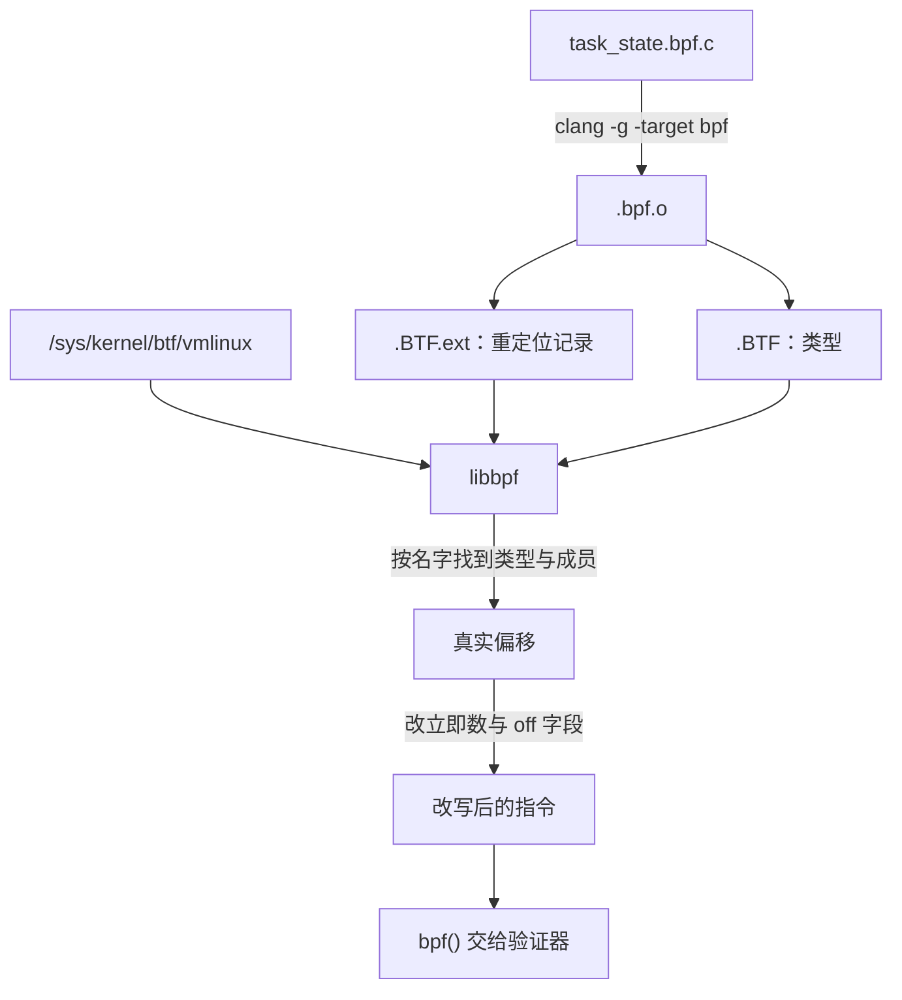

# B.8 libbpf、BTF 与 CO-RE

B.5 写过一行 `BPF_CORE_READ(task, real_parent, tgid)`，B.6 的 `proclife` 也靠同样的写法读父进程。这些读取换一台机器还能用，靠的是一套专门为「编译一次、到处运行」设计的机制。这一页讲这套机制：编译器和加载程序各做什么，内核提供什么。

读完这一页，能说清 BTF 记录了哪些东西、`vmlinux.h` 是怎么来的；能说清 CO-RE 的三方各做什么；能写出内核字段改名时仍然可用的读取代码；看到验证器报 `invalid func unknown#195896080` 时知道去哪里找。本页的 BPF 程序用 zig 自带的 clang 18 编译，`bpftool btf dump`、`bpftool gen skeleton` 的输出来自 SignalX，反汇编用 LLVM 19 的 `llvm-objdump -dr`。加载阶段的日志和验证器报错要把程序装进内核才能得到，只能引用权威资料，写成「输出类似」。完整程序在 `code/系统编程/拓展B_eBPF/B_8_libbpf_BTF与CO_RE/` 下。

## 1. 同一个结构体在不同内核里长得不一样

`task_struct` 在一个内核的 `vmlinux.h` 里有 261 个成员、9792 字节。成员会改名、会挪进内层结构、类型也会换，位置于是跟着变。本页要用的 `__state` 就改过名，它的前一个名字是 `state`。

编译时算好的偏移写死在指令的立即数或偏移字段里，换一个内核就对不上。BCC 的应对办法是在目标机器上现场编译：BPF 的 C 源码以字符串形式嵌在工具里，运行时写到临时文件，用工具自带的 LLVM 和 clang 对着本机内核头文件编一遍，再加载。这条路能走通，代价是工具本身要背上一个完整的编译器。Brendan Gregg 在介绍 CO-RE 的文章里给的数字是依赖超过 100 MB；同样功能的 `opensnoop`，用 libbpf 写成 ELF 可执行文件再 strip，只有 151 KB，里面不含 libLLVM 和 libclang。现场编译还要求目标机器上装着内核头文件，而编译错误的第一次暴露时间被推到了运行的那一刻。

CO-RE（一次编译、到处运行，Compile Once – Run Everywhere）换了个思路：编译照常在开发机上做，但编译器不把偏移写死，而是把「要读 `task_struct` 里叫 `real_parent` 的成员，再读它里面叫 `tgid` 的成员」这件事记录到目标文件里。加载时由加载程序拿目标内核的类型信息重新算一遍偏移，把结果填回指令。目标机器上不需要编译器，不需要内核头文件，只要内核肯提供自己的类型信息。

提供类型信息的机制就是 BTF。

## 2. BTF

### 2.1 一种紧凑的类型格式

BTF（BPF 类型格式，BPF Type Format）描述 C 程序的类型：有哪些结构体、每个成员的类型和位偏移、有哪些函数以及原型、有哪些全局对象。内核文档列出了 19 种类型，常用的几种是：

| 种类 | 描述的东西 |
| --- | --- |
| `INT` | 整数类型，带位数和有无符号 |
| `PTR` | 指针，指向另一个类型 id |
| `ARRAY` | 数组，元素类型、下标类型、元素个数 |
| `STRUCT`、`UNION` | 结构体与联合，成员列表里每个成员带名字、类型 id 和位偏移 |
| `ENUM`、`ENUM64` | 枚举及其取值 |
| `TYPEDEF`、`CONST`、`VOLATILE` | 类型别名与限定符 |
| `FUNC`、`FUNC_PROTO` | 函数与函数原型 |
| `VAR` | 全局对象，带链接属性（static、global、extern） |
| `DATASEC` | 一个数据节，列出属于它的 `VAR` 及节内偏移和大小 |

每个类型有一个数字 id，类型之间靠 id 互相引用。`INT` 存的是「占几个字节、占几个位、有符号还是无符号」这些编译器已经算清楚的事实，不是 C 的关键字。名字单独放在字符串表里，按偏移引用。整个格式为紧凑而设计，Nakryiko 说它与 DWARF 相比最多能小 100 倍，省掉的主要是调试器才用的东西。

BTF 只描述类型，不描述某条指令想读哪个字段。这部分由两个 ELF 节分担：`.BTF` 放类型和字符串，`.BTF.ext` 放函数信息、行号信息，以及 CO-RE 重定位记录。

### 2.2 程序自己的 BTF

`clang -g` 编 BPF 目标文件时，会把程序用到的类型写进 `.BTF`。用 B.6 的 `proclife.bpf.o` 看一眼。它包含两个 map、两个程序和一个 `const volatile` 全局对象，`bpftool btf dump` 的头几条是：

::: terminal title="bash - bpftool btf dump"

```text
$ bpftool btf dump file proclife.bpf.o
[1] PTR '(anon)' type_id=3
[2] INT 'int' size=4 bits_offset=0 nr_bits=32 encoding=SIGNED
[3] ARRAY '(anon)' type_id=2 index_type_id=4 nr_elems=1
[4] INT '__ARRAY_SIZE_TYPE__' size=4 bits_offset=0 nr_bits=32 encoding=(none)
[5] PTR '(anon)' type_id=6
[6] ARRAY '(anon)' type_id=2 index_type_id=4 nr_elems=8192
[7] PTR '(anon)' type_id=8
[8] TYPEDEF 'pid_t' type_id=9
[9] TYPEDEF '__kernel_pid_t' type_id=2
[10] PTR '(anon)' type_id=11
[11] TYPEDEF '__u64' type_id=12
[12] INT 'unsigned long long' size=8 bits_offset=0 nr_bits=64 encoding=(none)
[13] STRUCT '(anon)' size=32 vlen=4
	'type' type_id=1 bits_offset=0
	'max_entries' type_id=5 bits_offset=64
	'key' type_id=7 bits_offset=128
	'value' type_id=10 bits_offset=192
[14] VAR 'exec_start' type_id=13, linkage=global
```

:::

第 13 条这个匿名结构体就是 map 的定义：四个成员 `type`、`max_entries`、`key`、`value`，B.6 讲的 `__uint` 和 `__type` 宏把它们变成这样一个结构体的成员。第 14 条 `VAR 'exec_start'` 是那个 map 对象本身，`linkage=global` 说明它是全局的。`[6] ARRAY ... nr_elems=8192` 对应 `max_entries` 的值 8192。

文件末尾是三个 `DATASEC`，把上面那些 `VAR` 归到各自的节里：

::: terminal title="bash - bpftool btf dump（末尾）"

```text
[375] DATASEC '.maps' size=0 vlen=2
	type_id=14 offset=0 size=32 (VAR 'exec_start')
	type_id=20 offset=0 size=16 (VAR 'events')
[376] DATASEC '.rodata' size=0 vlen=1
	type_id=374 offset=0 size=8 (VAR 'min_duration_ns')
[377] DATASEC 'license' size=0 vlen=1
	type_id=371 offset=0 size=13 (VAR 'LICENSE')
```

:::

`size=0` 不是笔误：编译时还不知道这个节最终有多大，加载程序会把真实的字节数填进去。两个 map 在 `.maps` 里的偏移都是 0，因为这个节里每个 map 各自是一个独立的定义。

同一次 dump 里往下翻，能找到两个程序的 `FUNC` 类型：

::: terminal title="bash - bpftool btf dump（节选）"

```text
[368] FUNC_PROTO '(anon)' ret_type_id=2 vlen=1
	'ctx' type_id=366
[369] FUNC 'handle_exit' type_id=368 linkage=global
```

:::

`FUNC` 带一个 `FUNC_PROTO` 的 id，原型里写着参数个数和每个参数的类型 id。`handle_exit` 的参数是 `trace_event_raw_sched_process_template`，这个类型在 BTF 里也能找到。`bpftool btf dump` 用 `format c` 能直接把它还原成 C：

::: terminal title="bash - bpftool btf dump format c"

```text
struct trace_event_raw_sched_process_exec {
	struct trace_entry ent;
	u32 __data_loc_filename;
	pid_t pid;
	pid_t old_pid;
	char __data[0];
};
```

:::

这就是 `bpftool btf dump file /sys/kernel/btf/vmlinux format c > vmlinux.h` 的原理：把内核 BTF 里的类型全部还原成 C 声明。B.2 生成的那个 127716 行的 `vmlinux.h`，内容全部来自这一个命令。

### 2.3 内核自己的 BTF

内核构建时，`pahole` 把编译产物里的 DWARF 调试信息转成 BTF，放在 `vmlinux` 里，前提是开启 `CONFIG_DEBUG_INFO_BTF`。sysfs 把这份 BTF 暴露成一个只读文件 `/sys/kernel/btf/vmlinux`，`bpftool btf dump file /sys/kernel/btf/vmlinux` 就能像上面那样读出来，加 `format c` 就是 B.2 生成 `vmlinux.h` 的那条命令。这个文件在运行时由内核拼出来，不是磁盘上的文件，大小随内核配置而定。libbpf 加载程序时读的就是它：`btf__load_vmlinux_btf()` 先试 `/sys/kernel/btf/vmlinux`，找不到再去 `/boot`、`/lib/modules` 下按内核版本号找，最后打印 `kernel BTF is missing at '/sys/kernel/btf/vmlinux', was CONFIG_DEBUG_INFO_BTF enabled?` 并放弃 CO-RE 重定位。

`/sys/kernel/btf/` 下还有每个内核模块的 BTF 文件，名字就是模块名。模块 BTF 里记录的是模块自己用到的类型，与 `vmlinux` 的 BTF 通过 split BTF 的方式衔接。libbpf 在加载时会把模块 BTF 也读进来，模块里定义的结构体因此也能参与重定位。

::: tip 内核没有 BTF 时

用 BTFHub 提供的各发行版 BTF 存档，配上 `bpftool gen min_core_btf`，可以从一个较大的 BTF 里裁出程序需要的那部分，随程序一起分发。`bpf_object_open_opts` 的 `btf_custom_path` 用来指定拿哪个文件做重定位。这条路只在目标内核确实没有 BTF 时才需要。

:::

### 2.4 BTF 的其它用途

BTF 不只服务于 CO-RE。另外三处也会用到它：

- `bpftool map dump` 按 BTF 里的类型打印 map 的键和值。一个存结构体的 map，输出是带成员名的字段，不是一串十六进制。
- 验证器日志带源码行。程序加载时把 `.BTF.ext` 里的行号信息交给内核，验证器报错时能指出是哪一行 C 代码，`bpftool prog dump xlated` 也能按源码行显示。
- fentry 这类程序的参数带类型。B.11 讲过，fentry 的参数不是从寄存器布局推出来的，而是按函数名去内核 BTF 里查 `FUNC` 类型，拿到原型才知道每个参数是什么。


## 3. CO-RE 的三方分工

::: concept ebpf-b08-core-three-parties title="CO-RE 的三方分工"

clang 在编译时把每一次经过 `preserve_access_index` 的结构体成员访问记录成一条重定位，写进 `.BTF.ext`。一条记录里写的是重定位的种类、根类型的 BTF id、成员名和访问路径，没有偏移。libbpf 在加载时读目标内核的 BTF，按类型名和成员名找到对应的类型与成员，算出真实偏移，把指令里的立即数或偏移字段改成新值。内核负责提供自己的 BTF，它不参与改写，只提供数据。

:::

三方里有两方是现成的工具，写作者要做的只是把结构体定义写对，让前两方能对上话。

### 3.1 记录：preserve_access_index

`vmlinux.h` 的开头几行就是这件事的总开关：

::: terminal title="bash - vmlinux.h 开头"

```text
$ head -8 vmlinux.h
#ifndef __VMLINUX_H__
#define __VMLINUX_H__

#ifndef BPF_NO_PRESERVE_ACCESS_INDEX
#pragma clang attribute push (__attribute__((preserve_access_index)), apply_to = record)
#endif
```

:::

`#pragma clang attribute push` 给后面所有 struct、union 定义加上 `preserve_access_index` 属性，文件末尾的 `#pragma clang attribute pop` 把它撤掉。这个属性告诉 clang：每次有人通过这个类型访问成员，都在 `.BTF.ext` 里留一条记录。`bpftool btf dump format c` 生成 `vmlinux.h` 时自动加上了这两行，所以直接包含 `vmlinux.h` 不需要额外做什么。

自己定义的结构体要手动加。`task_state.bpf.c` 里的 `task_struct___old` 就是这么写的：

```c
struct task_struct___old {
    long state;
} __attribute__((preserve_access_index));
```

属性加在类型上，不加在对象上。写成 `struct task_struct___old *t __attribute__((preserve_access_index));` 编译不过，clang 的报错是 `error: 'preserve_access_index' attribute only applies to structs, unions, and classes`。

`BPF_CORE_READ` 系列宏内部对每个访问表达式套了 `__builtin_preserve_access_index()`，所以哪怕类型本身没有这个属性，用宏读也会产生重定位。B.5 里写的 `bpf_probe_read_kernel(&parent, sizeof(parent), &task->real_parent)` 用的是普通成员访问，但由于 `task_struct` 来自 `vmlinux.h`、带有属性，同样会产生重定位。本页的 `three_ways.bpf.c` 里第一个程序就是这么写的，两次成员读取各自产生一条重定位：

::: terminal title="bash - llvm-objdump -dr three_ways.bpf.o"

```text
Disassembly of section tp/sched/sched_process_exec:

0000000000000000 <manual>:
       0:	bf 16 00 00 00 00 00 00	r6 = r1
       1:	85 00 00 00 23 00 00 00	call 0x23
       2:	b7 01 00 00 00 00 00 00	r1 = 0x0
       3:	7b 1a f8 ff 00 00 00 00	*(u64 *)(r10 - 0x8) = r1
       4:	b7 01 00 00 90 09 00 00	r1 = 0x990
		0000000000000020:  CO-RE <byte_off> [17] struct task_struct::real_parent (0:90)
       5:	0f 10 00 00 00 00 00 00	r0 += r1
       6:	b4 01 00 00 00 00 00 00	w1 = 0x0
       7:	63 1a f4 ff 00 00 00 00	*(u32 *)(r10 - 0xc) = r1
       8:	bf a1 00 00 00 00 00 00	r1 = r10
       9:	07 01 00 00 f8 ff ff ff	r1 += -0x8
      10:	b4 02 00 00 08 00 00 00	w2 = 0x8
      11:	bf 03 00 00 00 00 00 00	r3 = r0
      12:	85 00 00 00 71 00 00 00	call 0x71
      13:	b7 01 00 00 84 09 00 00	r1 = 0x984
		0000000000000068:  CO-RE <byte_off> [17] struct task_struct::tgid (0:88)
      14:	79 a3 f8 ff 00 00 00 00	r3 = *(u64 *)(r10 - 0x8)
      15:	0f 13 00 00 00 00 00 00	r3 += r1
      16:	bf a1 00 00 00 00 00 00	r1 = r10
      17:	07 01 00 00 f4 ff ff ff	r1 += -0xc
      18:	b4 02 00 00 04 00 00 00	w2 = 0x4
      19:	85 00 00 00 71 00 00 00	call 0x71
```

:::

每条 `CO-RE` 行给出四样东西：指令在节内的字节偏移（`0x20`、`0x68`）、重定位的种类（`byte_off`）、根类型的 BTF id（`[17]`），以及类型名、成员名和访问路径（`(0:90)`）。括号里冒号分隔的数字是访问路径，写法和 GEP 下标一样：`s->b` 记作 `0:1`，第一个 0 是「取指针指向的那个结构体」，后面的数就是成员在结构体里的序号。`__state` 排在第 1 个成员，所以是 `(0:1)`；`real_parent` 排在第 90 个，所以是 `(0:90)`。上面那行 `0x990` 是编译时按本机 `vmlinux.h` 算出来的偏移，2448 字节。

`r1 = 0x990` 这条指令本身就带着偏移，`CO-RE` 行是附在它下面的注释。`llvm-objdump` 把这个数从 `.BTF.ext` 里的重定位记录与指令地址对上之后打印出来，而不是从指令里反推。目标文件里 `.BTF.ext` 是独立的节：

::: terminal title="bash - readelf -SW"

```text
  [13] .BTF              PROGBITS        0000000000000000 084a28 00742c 00      0   0  4
  [14] .rel.BTF          REL             0000000000000000 0de2c0 000020 10   I 22  13  8
  [15] .BTF.ext          PROGBITS        0000000000000000 08be54 00018c 00      0   0  4
  [16] .rel.BTF.ext      REL             0000000000000000 0de2e0 000150 10   I 22  15  8
```

:::

`.BTF` 有 0x742c 字节，`.BTF.ext` 只有 0x18c 字节：类型信息占大头，重定位记录只是几条索引。

::: warning 少了 `-g` 连编译都过不去

不加 `-g` 时 clang 无法记录类型信息，遇到 `preserve_access_index` 的访问直接报错：`error: using builtin_preserve_access_index() without -g`。B.4 讲过 `-g` 用来生成 BTF，这里能看到它的另一半作用。

:::

### 3.2 执行：libbpf 在加载时改写

libbpf 开始加载时先读 `/sys/kernel/btf/vmlinux`，然后在目标 BTF 里按名字找出与本地根类型同名的类型。`bpf_core_essential_name_len()` 比较名字时会在最后一个 `___` 处截断，这正是第 5 节要用的机制。找到候选类型后，它沿着访问路径逐级检查每个成员是否存在，算出在目标内核里的字节偏移，再按重定位的种类改写指令：

- `byte_off`：改 `BPF_LDX`、`BPF_STX`、`BPF_ST` 的 `off` 字段，或 `BPF_ALU`、`BPF_ALU64`、`BPF_LD` 的立即数；
- `byte_sz`：改访存指令的宽度（`BPF_W`、`BPF_DW` 等）；
- `field_exists`、`type_exists`、`enumval_exists`：改成立即数 1 或 0；
- `enumval_value`：改成目标内核里枚举项的真实数值。

`llvm-objdump` 的注释把种类原样印出来，所以 `three_ways.bpf.o` 里几个程序读同一个成员的差别一眼可见。第二个程序用 `BPF_CORE_READ`：

::: terminal title="bash - llvm-objdump -dr three_ways.bpf.o（节选）"

```text
Disassembly of section tp/sched/sched_process_exit:

0000000000000000 <core>:
       0:	bf 16 00 00 00 00 00 00	r6 = r1
       1:	85 00 00 00 23 00 00 00	call 0x23
       2:	b7 01 00 00 90 09 00 00	r1 = 0x990
		0000000000000010:  CO-RE <byte_off> [17] struct task_struct::real_parent (0:90)
       3:	0f 10 00 00 00 00 00 00	r0 += r1
       4:	61 66 18 00 00 00 00 00	r6 = *(u32 *)(r6 + 0x18)
		0000000000000020:  CO-RE <byte_off> [353] struct trace_event_raw_sched_process_template::pid (0:2)
       5:	bf a1 00 00 00 00 00 00	r1 = r10
       6:	07 01 00 00 f0 ff ff ff	r1 += -0x10
       7:	b4 02 00 00 08 00 00 00	w2 = 0x8
       8:	bf 03 00 00 00 00 00 00	r3 = r0
       9:	85 00 00 00 71 00 00 00	call 0x71
      10:	b7 01 00 00 84 09 00 00	r1 = 0x984
		0000000000000050:  CO-RE <byte_off> [17] struct task_struct::tgid (0:88)
      11:	79 a3 f0 ff 00 00 00 00	r3 = *(u64 *)(r10 - 0x10)
      12:	0f 13 00 00 00 00 00 00	r3 += r1
      13:	bf a1 00 00 00 00 00 00	r1 = r10
      14:	07 01 00 00 fc ff ff ff	r1 += -0x4
      15:	b4 02 00 00 04 00 00 00	w2 = 0x4
      16:	85 00 00 00 71 00 00 00	call 0x71
```

:::

重定位的种类、成员名和访问路径都与第一个程序一样。两边真正干的活也逐条对应：算出 `real_parent` 的地址、调一次 `bpf_probe_read_kernel`、再算出 `tgid` 的地址、再调一次。差别只在打印参数从哪里来，以及 `manual` 里多出的几条把局部对象清零的指令。`BPF_CORE_READ` 在编译期展开，不留下任何运行时开销。

第三个程序挂在 fentry 上，参数和 `bpf_get_current_task_btf()` 返回的指针都带类型，直接写 `task->real_parent->tgid` 就行：

::: terminal title="bash - llvm-objdump -dr three_ways.bpf.o（节选）"

```text
Disassembly of section fentry/do_exit:

0000000000000000 <direct>:
       0:	85 00 00 00 9e 00 00 00	call 0x9e
       1:	79 01 90 09 00 00 00 00	r1 = *(u64 *)(r0 + 0x990)
		0000000000000008:  CO-RE <byte_off> [17] struct task_struct::real_parent (0:90)
       2:	61 13 84 09 00 00 00 00	r3 = *(u32 *)(r1 + 0x984)
		0000000000000010:  CO-RE <byte_off> [17] struct task_struct::tgid (0:88)
```

:::

这里没有 `bpf_probe_read_kernel`，就是两条直接访存的指令。验证器接受这种写法，是因为程序类型带 BTF 类型信息（B.10 讲的各种类型里，`fentry`、`fexit`、`tp_btf`、`lsm` 都算），它知道这个指针指向一个真的 `task_struct`，也知道这两次访问都在范围里。

### 3.3 一张流程图



libbpf 打开对象时只读 ELF，不做重定位；重定位发生在 `bpf_object__load()` 阶段，就在 `BPF_PROG_LOAD` 之前。B.7 讲过这套调用的顺序。

<Quiz
  type="single"
  :options="[
    { label: 'clang 记录重定位，libbpf 在加载时按目标内核的 BTF 执行', value: 'A' },
    { label: 'clang 按本机内核算出偏移，libbpf 原样传递', value: 'B' },
    { label: '内核在 BPF_PROG_LOAD 时读 .BTF.ext 并改写程序', value: 'C' },
    { label: 'bpftool 在生成骨架时改写成目标机器的偏移', value: 'D' }
  ]"
  answer="A"
>

<template #question>

CO-RE 重定位由谁记录、由谁执行？

</template>

正确答案是 **A**。clang 在编译时把类型与成员路径写进 `.BTF.ext`，libbpf 在加载阶段读 `/sys/kernel/btf/vmlinux`、算出真实偏移并改写指令。B 错在偏移来自开发机的 `vmlinux.h`，恰恰是 CO-RE 要摆脱的东西；C 错在验证器只接收已经改写好的指令，它不读 `.BTF.ext`；D 错在骨架只是把 `.bpf.o` 的字节嵌进头文件，重定位仍由 libbpf 运行时完成。

</Quiz>

## 4. 读取内核数据

### 4.1 BPF_CORE_READ 系列

`BPF_CORE_READ(src, a, b, c)` 从 `src` 出发，按顺序读 `a`、`b`、`c` 三层。每一层之间是一次指针解引用，最后一次读出目标成员的值。`task_state.bpf.c` 里那行 `BPF_CORE_READ(task, real_parent, tgid)` 预处理之后是：

::: details BPF_CORE_READ(task, real_parent, tgid) 的完整展开

```c
ppid = ({
    typeof((task)->real_parent->tgid) __r;
    {
        const void *__t;
        bpf_probe_read_kernel((void *)(&__t), sizeof(*(&__t)),
            (const void *)__builtin_preserve_access_index(
                &((typeof(((task))))(((task))))->real_parent));
        bpf_probe_read_kernel((void *)(&__r), sizeof(*(&__r)),
            (const void *)__builtin_preserve_access_index(
                &((typeof(((task))->real_parent))(__t))->tgid));
    };
    __r;
});
```

两次 `bpf_probe_read_kernel` 分别读 `task->real_parent` 的指针值和它的 `tgid` 成员，两次访问各自产生一条 `byte_off` 重定位，与上面 `manual` 程序的两条完全对应。

:::

宏最多接受 9 个访问参数。每个参数里可以用点连写多层结构体成员，例如 `BPF_CORE_READ(t, mm, exe_file, path.dentry, d_name.name)` 只算 4 个参数：`mm`、`exe_file`、`path.dentry`、`d_name.name`。点连写的部分在同一个结构体里，不产生额外的探针读取。

三个变体的差别在最终那次读：

- `BPF_CORE_READ` 返回读到的值，读不到时返回 0，不报告错误；
- `BPF_CORE_READ_INTO(&dst, src, ...)` 把结果写进调用者给的存储，返回最后一次读取的错误码；
- `BPF_CORE_READ_STR_INTO(&buf, src, ...)` 最后一步用 `bpf_probe_read_kernel_str`，用于读字符数组。

还有一组读用户空间内存的版本：`bpf_core_read_user()`、`BPF_CORE_READ_USER()`、`BPF_CORE_READ_USER_INTO()`、`BPF_CORE_READ_USER_STR_INTO()`，它们把底层的辅助函数从 `bpf_probe_read_kernel` 换成 `bpf_probe_read_user`。注意源类型仍然是内核类型，必须能在内核 BTF 里找到，否则重定位会失败：CO-RE 只为内核类型服务，自定义的用户态类型没法重定位。

### 4.2 三种写法对照

::: compare vertical left-title="直接解引用（指针带类型时）" right-title="BPF_CORE_READ（指针不带类型时）"

```c
SEC("fentry/do_exit")
int BPF_PROG(direct, long code)
{
    struct task_struct *task = bpf_get_current_task_btf();

    bpf_printk("ppid = %d\n", task->real_parent->tgid);
    return 0;
}
```

---

```c
SEC("tp/sched/sched_process_exit")
int core(void *ctx)
{
    struct task_struct *task = (struct task_struct *)bpf_get_current_task();

    bpf_printk("ppid = %d\n", BPF_CORE_READ(task, real_parent, tgid));
    return 0;
}
```

:::

两种写法编译出的重定位一样，加载到内核里的指令不一样：左边是两条直接访存，右边是两次辅助函数调用（`call 0x71` 就是 `bpf_probe_read_kernel`，编号 113）。辅助函数在内核里走一遍探针读取的路径，要检查地址、处理异常；直接访存的代价与普通内存访问相同。

该用哪种取决于手里那个指针有没有类型，不取决于喜好。tracepoint 的 `ctx` 来自 `vmlinux.h` 里的 `trace_event_raw_*`，可以按成员直接读，`task_state.bpf.c` 里的 `ctx->pid` 就是直接读的。但从 `bpf_get_current_task()` 拿到的返回值只是一个 64 位整数，编译器和验证器都不知道它指向什么，必须用 `BPF_CORE_READ` 或 `bpf_probe_read_kernel`。fentry、fexit、tp_btf、lsm 的程序参数和 `bpf_get_current_task_btf()` 的返回值带 BTF 类型，就能像普通 C 一样解引用。

手写两次 `bpf_probe_read_kernel` 的版本在 `three_ways.bpf.c` 里也有，它的指令与 `BPF_CORE_READ` 版逐一对应，只是写起来啰嗦，中间还要自己声明一个 `const void *` 临时对象。

### 4.3 完整示例：task_state

`task_state.bpf.c` 把本页的两件事合在一起：读 `real_parent->tgid`，以及兼容改过名的 `state` 成员。

::: code-group

```c [task_state.bpf.c]
// SPDX-License-Identifier: GPL-2.0 OR BSD-3-Clause
#include "vmlinux.h"
#include <bpf/bpf_core_read.h>
#include <bpf/bpf_helpers.h>

char LICENSE[] SEC("license") = "Dual BSD/GPL";

/* 旧内核把这个成员叫 state，新内核叫 __state。
 * 名字里带 ___ 后缀的部分在匹配目标内核时被忽略：
 * 这个类型会被当成 struct task_struct，成员名按 state 去找。 */
struct task_struct___old {
    long state;
} __attribute__((preserve_access_index));

SEC("tp/sched/sched_process_exec")
int handle_exec(struct trace_event_raw_sched_process_exec *ctx)
{
    struct task_struct *task;
    long state;
    pid_t ppid;

    task = (struct task_struct *)bpf_get_current_task();
    ppid = BPF_CORE_READ(task, real_parent, tgid);

    if (bpf_core_field_exists(task->__state)) {
        state = BPF_CORE_READ(task, __state);
    } else {
        state = BPF_CORE_READ((struct task_struct___old *)task, state);
    }

    bpf_printk("pid = %d, ppid = %d, state = %ld\n", ctx->pid, ppid, state);
    return 0;
}
```

```c [task_state.c]
#define _POSIX_C_SOURCE 200809L

#include <errno.h>
#include <signal.h>
#include <stdio.h>
#include <string.h>
#include <unistd.h>

#include <bpf/libbpf.h>

#include "task_state.skel.h"

static volatile sig_atomic_t stop;

static void on_signal(int signo)
{
    (void)signo;
    stop = 1;
}

static int print_libbpf(enum libbpf_print_level level, const char *format, va_list args)
{
    (void)level;
    return vfprintf(stderr, format, args);
}

int main(void)
{
    struct task_state_bpf *skel;
    struct sigaction sa;
    int err;

    libbpf_set_print(print_libbpf);

    skel = task_state_bpf__open_and_load();
    if (skel == NULL) {
        fprintf(stderr, "无法打开并加载骨架\n");
        return 1;
    }

    err = task_state_bpf__attach(skel);
    if (err != 0) {
        fprintf(stderr, "附加失败：%s\n", strerror(-err));
        goto cleanup;
    }

    memset(&sa, 0, sizeof(sa));
    sa.sa_handler = on_signal;
    sigaction(SIGINT, &sa, NULL);

    printf("已启动，另开一个终端执行 sudo cat /sys/kernel/tracing/trace_pipe\n");
    while (!stop) {
        sleep(1);
    }

cleanup:
    task_state_bpf__destroy(skel);
    return err != 0;
}
```

:::

编译命令与跨页约定一致：

::: terminal title="bash - clang"

```text
$ clang -g -O2 -target bpf -mcpu=v3 -D__TARGET_ARCH_x86 -I. -c task_state.bpf.c -o task_state.bpf.o
$ bpftool gen skeleton task_state.bpf.o > task_state.skel.h
$ cc -std=c17 -Wall -Wextra task_state.c -o task_state $(pkg-config --cflags --libs libbpf)
```

:::

反汇编里有六条重定位：读 `real_parent` 和 `tgid` 各一条，`__state` 一条存在性检查加一条读，`task_struct___old::state` 一条，`ctx->pid` 一条。下面摘出前五条与随后的条件分支：

::: terminal title="bash - llvm-objdump -dr task_state.bpf.o（节选）"

```text
0000000000000000 <handle_exec>:
       0:	bf 16 00 00 00 00 00 00	r6 = r1
       1:	85 00 00 00 23 00 00 00	call 0x23
       2:	bf 07 00 00 00 00 00 00	r7 = r0
       3:	b7 01 00 00 90 09 00 00	r1 = 0x990
		0000000000000018:  CO-RE <byte_off> [17] struct task_struct::real_parent (0:90)
       4:	bf 73 00 00 00 00 00 00	r3 = r7
       5:	0f 13 00 00 00 00 00 00	r3 += r1
       6:	bf a1 00 00 00 00 00 00	r1 = r10
       7:	07 01 00 00 f0 ff ff ff	r1 += -0x10
       8:	b4 02 00 00 08 00 00 00	w2 = 0x8
       9:	85 00 00 00 71 00 00 00	call 0x71
      10:	b7 01 00 00 84 09 00 00	r1 = 0x984
		0000000000000050:  CO-RE <byte_off> [17] struct task_struct::tgid (0:88)
      11:	79 a3 f0 ff 00 00 00 00	r3 = *(u64 *)(r10 - 0x10)
      12:	0f 13 00 00 00 00 00 00	r3 += r1
      13:	bf a1 00 00 00 00 00 00	r1 = r10
      14:	07 01 00 00 fc ff ff ff	r1 += -0x4
      15:	b4 02 00 00 04 00 00 00	w2 = 0x4
      16:	85 00 00 00 71 00 00 00	call 0x71
      17:	61 a8 fc ff 00 00 00 00	r8 = *(u32 *)(r10 - 0x4)
      18:	b7 01 00 00 01 00 00 00	r1 = 0x1
		0000000000000090:  CO-RE <field_exists> [17] struct task_struct::__state (0:1)
      19:	16 01 09 00 00 00 00 00	if w1 == 0x0 goto +0x9 <LBB0_2>
      20:	b7 01 00 00 18 00 00 00	r1 = 0x18
		00000000000000a0:  CO-RE <byte_off> [17] struct task_struct::__state (0:1)
      21:	0f 17 00 00 00 00 00 00	r7 += r1
      22:	bf a1 00 00 00 00 00 00	r1 = r10
      23:	07 01 00 00 f0 ff ff ff	r1 += -0x10
      24:	b4 02 00 00 04 00 00 00	w2 = 0x4
      25:	bf 73 00 00 00 00 00 00	r3 = r7
      26:	85 00 00 00 71 00 00 00	call 0x71
      27:	61 a5 f0 ff 00 00 00 00	r5 = *(u32 *)(r10 - 0x10)
      28:	05 00 08 00 00 00 00 00	goto +0x8 <LBB0_3>

00000000000000e8 <LBB0_2>:
      29:	b7 01 00 00 00 00 00 00	r1 = 0x0
		00000000000000e8:  CO-RE <byte_off> [352] struct task_struct___old::state (0:0)
      30:	0f 17 00 00 00 00 00 00	r7 += r1
```

:::

`r1 = 0x1` 这一条是 clang 给 `field_exists` 重定位留的占位值：编译时不知道目标内核有没有这个成员，先填 1，加载时由 libbpf 按实际情况改成 0 或 1。紧接着的 `if w1 == 0x0 goto LBB0_2` 是普通的条件分支，编译器照常生成。在这台机器上 `__state` 确实存在，占位值保持 1，条件不成立，执行往下走进 `__state` 那条读取；`LBB0_2` 只有在 `__state` 不存在的内核上才会进入。

`LBB0_2` 里读的是 `task_struct___old::state`。本机的目标内核没有 `state` 成员，所以这条重定位在这里找不到目标，libbpf 会把它改写成一条特殊的调用（第 6 节）。它所在的 `LBB0_2` 只从「`__state` 不存在」的分支进入，而 `__state` 存在，所以这条指令永远不会执行，坏重定位也就不会让验证器报错。这就是「不成立的分支是死代码」的实际形态。换到一条只有 `state` 的旧内核上，两条重定位的处境正好对调：`field_exists` 变成 0，跳进 `LBB0_2`，`state` 正常解析，而 `__state` 那条跟着分支一起被排除。

::: tip 确认目标内核里有哪个成员

在目标机器上执行 `bpftool btf dump file /sys/kernel/btf/vmlinux | grep "'__state'"` 直接搜成员名，比猜快。要看整个结构体，用 `format c` 生成 `vmlinux.h` 再 grep。

:::

## 5. 应对内核差异

### 5.1 存在性检查

三个宏，一个套路：编译时产生一条特殊种类的重定位，加载时由 libbpf 改成 1 或 0。

- `bpf_core_field_exists(field)`：成员在目标内核里存在为 1，否则为 0。两种写法都行：`bpf_core_field_exists(task->__state)` 或 `bpf_core_field_exists(struct task_struct, __state)`。
- `bpf_core_type_exists(type)`：类型（struct、union、enum、typedef）存在为 1，否则为 0。
- `bpf_core_enum_value_exists(enum_type, value)`：枚举项存在为 1，否则为 0。

还有两个配套的：`bpf_core_enum_value(enum_type, value)` 给出枚举项在目标内核里的真实数值，`bpf_core_field_size(field)` 给出成员在目标内核里的字节数。前者用于辅助函数编号在不同内核里变了的场合，后者用于成员类型换过（例如 `state` 从 `long` 变成 `unsigned int`）的场合。

这几类宏的共同点是：检查本身绝不失败。`bpf_core_field_exists` 不会因为成员不存在而让加载失败，它只返回 0。正因如此，被检查保护的那条分支才是安全的。

### 5.2 成员改名：`__state`

`sched: Change task_struct::state` 这个提交把 `task_struct` 的 `state` 成员改名成了 `__state`，同时给出了一组存取函数。改名的原因和细节与本页无关，需要知道的是它造成了两个内核之间同一个结构体的成员名单不同。

旧代码读 `state`，新代码读 `__state`。要在两边都能跑，就写两个类型的定义，一个用新名字，一个用旧名字，用存在性检查选分支。旧名字的定义要用 `___` 后缀把类型名变一下，否则与 `vmlinux.h` 里的 `task_struct` 重名，编译不过。

`___` 后缀的规则在 libbpf 的 `bpf_core_essential_name_len()` 里：名字里如果出现 `___`（三个下划线），从这个位置截断，剩下的部分在匹配目标类型时被忽略。`task_struct___old` 在目标内核里匹配 `task_struct`，`state` 就是普通成员名去查。这个约定对类型名、成员名、枚举名都适用。

::: concept ebpf-b08-flavor-suffix title="`___` 后缀的匹配规则"

类型名、成员名、枚举项名里出现的 `___` 后缀不参与 CO-RE 匹配。`struct task_struct___old` 在目标内核的 BTF 里按 `task_struct` 查找，`struct task_struct___2` 也一样。后缀的作用只是在本地给同一个内核对象起多个名字，以便同时定义多份，或者给自建的类型起一个不与内核重名的名字。

:::

三个下划线的含义与普通标识符里的下划线没有关系，它就是 libbpf 约定的分隔符。两个下划线（`task_struct__old`）不会截断。

内核 BTF 里的 `___2` 来自另一个地方：同一个 BTF 里出现两个同名结构体时，`bpftool` 在输出 C 代码时给重名的加编号，`btf_dump_resolve_name()` 里的格式串就是 `%s___%zu`。本机内核 BTF 里就有两个 `struct console`，一个占 280 字节、29 个成员，另一个占 40 字节、4 个成员；后者在 `vmlinux.h` 里叫 `console___2`。这类名字照样参与 CO-RE 匹配，`___2` 被截掉，按 `console` 去找。

<Quiz
  type="single"
  :options="[
    { label: '它只用于区分本地定义，匹配目标内核时名字按 task_struct 处理', value: 'A' },
    { label: '它让 libbpf 把这段代码编译成三个不同的版本', value: 'B' },
    { label: '它表示这个类型是可选的，不存在时不参与编译', value: 'C' },
    { label: '它与 libbpf 无关，只是 C 语言的命名习惯', value: 'D' }
  ]"
  answer="A"
>

<template #question>

`struct task_struct___old` 里的三个下划线起什么作用？

</template>

正确答案是 **A**。`bpf_core_essential_name_len()` 在最后一个 `___` 处截断名字，`task_struct___old` 匹配目标内核的 `task_struct`，`state` 按普通成员名去查。B 错在 CO-RE 不生成多个版本，只有一份字节码；C 错在类型是否参与编译由 C 编译器决定，与后缀无关；D 错在这个后缀是 libbpf 明确规定的匹配规则，不是任意命名习惯。

</Quiz>

::: generate ebpf-b08-relo-walk kind=explanation concepts=ebpf-b08-core-three-parties

面向第一次看到 `CO-RE <byte_off>` 注释的读者，以 `task_state.bpf.c` 里 `BPF_CORE_READ(task, real_parent, tgid)` 的两条重定位为例，逐步说明：clang 在编译时往 `.BTF.ext` 里写了什么、libbpf 在加载时怎样从 `/sys/kernel/btf/vmlinux` 里按名字找到 `task_struct` 和 `tgid`、算出的偏移和编译时的 `0x990` 不一样时改的是哪条指令的哪个字段，以及为什么同一份 `.bpf.o` 可以在两个内核上都跑。

:::

### 5.3 用版本号分支

另一条路是读内核版本号。libbpf 支持一种叫 `__kconfig` 的外部对象，声明成 `extern` 加上 `__kconfig` 属性，加载时由 libbpf 从内核配置或内核自身取到值填进去：

```c
extern int LINUX_KERNEL_VERSION __kconfig;
extern bool CONFIG_BPF_JIT_ALWAYS_ON __kconfig __weak;
```

`LINUX_KERNEL_VERSION` 是 libbpf 自己合成的虚拟对象，值按 `KERNEL_VERSION(a, b, c)` 编码，也就是 `(a << 16) + (b << 8) + c`。`CONFIG_*` 开头的对象来自 `/proc/config.gz`，没有开启 `CONFIG_IKCONFIG_PROC` 的内核取不到。加了 `__weak` 的取不到时用零值，不加 `__weak` 的取不到会让加载失败。

这两个声明会在目标文件里生成一个 `.kconfig` 节，`bpftool btf dump` 的末尾能看到：

::: terminal title="bash - bpftool btf dump file kconfig_example.bpf.o"

```text
[20] DATASEC '.kconfig' size=0 vlen=2
	type_id=9 offset=0 size=4 (VAR 'LINUX_KERNEL_VERSION')
	type_id=17 offset=0 size=1 (VAR 'CONFIG_BPF_JIT_ALWAYS_ON')
[21] DATASEC '.rodata' size=0 vlen=3
	type_id=12 offset=0 size=9 (VAR 'handle_exec.____fmt')
	type_id=14 offset=9 size=7 (VAR 'handle_exec.____fmt.1')
	type_id=19 offset=16 size=15 (VAR 'handle_exec.____fmt.2')
```

:::

`linkage=extern` 是这些对象的标志。加载时 libbpf 把值填进 `.kconfig` 这个 map，冻结它，再把指向 `.kconfig` 的重定位改成对象在 map 里的偏移。之后验证器看到的是常量，用它做的比较能直接化简：

::: terminal title="bash - llvm-objdump -dr kconfig_example.bpf.o（节选）"

```text
0000000000000000 <handle_exec>:
       0:	18 01 00 00 00 00 00 00 00 00 00 00 00 00 00 00	r1 = 0x0 ll
		0000000000000000:  R_BPF_64_64	LINUX_KERNEL_VERSION
       2:	61 11 00 00 00 00 00 00	r1 = *(u32 *)(r1 + 0x0)
       3:	c6 01 04 00 00 0e 05 00	if w1 s< 0x50e00 goto +0x4 <LBB0_2>
       4:	18 01 00 00 00 00 00 00 00 00 00 00 00 00 00 00	r1 = 0x0 ll
		0000000000000020:  R_BPF_64_64	.rodata
       6:	b4 02 00 00 09 00 00 00	w2 = 0x9
       7:	05 00 03 00 00 00 00 00	goto +0x3 <LBB0_3>

0000000000000040 <LBB0_2>:
       8:	18 01 00 00 09 00 00 00 00 00 00 00 00 00 00 00	r1 = 0x9 ll
		0000000000000040:  R_BPF_64_64	.rodata
      10:	b4 02 00 00 07 00 00 00	w2 = 0x7

0000000000000058 <LBB0_3>:
      11:	85 00 00 00 06 00 00 00	call 0x6
      12:	18 01 00 00 00 00 00 00 00 00 00 00 00 00 00 00	r1 = 0x0 ll
		0000000000000060:  R_BPF_64_64	CONFIG_BPF_JIT_ALWAYS_ON
      14:	71 11 00 00 00 00 00 00	r1 = *(u8 *)(r1 + 0x0)
```

:::

`0x50e00` 就是 `KERNEL_VERSION(5, 14, 0)`。`w1 s<` 是有符号比较，因为 `LINUX_KERNEL_VERSION` 声明成 `int`。这里没有 `CO-RE` 注释，因为 `__kconfig` 对象走的是普通 ELF 重定位（`R_BPF_64_64`），由 libbpf 的 `bpf_object__resolve_externs()` 单独处理，不属于 `.BTF.ext` 里的 CO-RE 记录。

作者判断：优先用存在性检查，版本号只作最后手段。原因之一是分发版会往旧内核里回移新特性，也会往新内核里删旧接口，版本号与「有没有这个成员」不是一一对应的。存在性检查问的正是你关心的那个问题，版本号只是它的一个粗代理。

## 6. 重定位失败会怎样

字段在目标内核里不存在、又没有被存在性检查保护时，libbpf 不会中止加载。它把这条指令整条换掉，改成一条调用：

```c
/* libbpf 的 relo_core.c */
insn->code = BPF_JMP | BPF_CALL;
insn->dst_reg = 0;
insn->src_reg = 0;
insn->off = 0;
/* if this instruction is reachable (not a dead code),
 * verifier will complain with the following message:
 * invalid func unknown#195896080
 */
insn->imm = 195896080; /* => 0xbad2310 => "bad relo" */
```

195896080 是十六进制的 0xbad2310，拆开读是 `bad relo`（坏的 relocation）。内核里没有任何辅助函数用这个编号，验证器走到这条指令时就报错。Nakryiko 的文章里给的两行是：

::: terminal title="bash - 验证器日志（输出类似）"

```text
1: (85) call unknown#195896080
invalid func unknown#195896080
```

:::

这两行来自 [BPF CO-RE reference guide](https://nakryiko.com/posts/bpf-core-reference-guide/)，要加载进内核才能复现。

这个设计有个好处：只有当这条指令真的会被执行时才会出错。如果它在一条被存在性检查排除掉的分支里，验证器不会验证那条路径，加载照常成功。坏重定位留在程序里，成为一个永不执行的调用。

看到 `unknown#195896080` 之后怎么办：在 libbpf 的调试日志里找 `relo #` 开头的行，或者按指令序号在反汇编里定位。`llvm-objdump -dr` 标出每条重定位对应哪条指令，`bpftool prog dump xlated` 给出加载后内核里的指令，两边一对比就知道是哪条访问被改坏了。改成第 5 节的写法、加上存在性检查即可。

只有 `_exists` 系列在成员不存在时安全返回 0。`bpf_core_field_size` 与 `bpf_core_enum_value` 就不是：它们拿不到目标时产生的重定位同样失败，指令同样被改成坏调用。所以这两个宏必须包在 `_exists` 检查里，`if (bpf_core_field_size(t->f) > 0)` 这种写法本身就带着隐患。

<Quiz
  type="single"
  :options="[
    { label: '某个 CO-RE 重定位在目标内核上没有找到对应字段，而且这条指令可达', value: 'A' },
    { label: '程序用了一个不存在的辅助函数编号，需要升级 libbpf', value: 'B' },
    { label: 'BTF 格式版本不匹配，加载程序读不懂内核 BTF', value: 'C' },
    { label: '内核没有开启 CONFIG_DEBUG_INFO_BTF', value: 'D' }
  ]"
  answer="A"
>

<template #question>

验证器报 `invalid func unknown#195896080` 说明什么？

</template>

正确答案是 **A**。195896080 是 0xbad2310，libbpf 用它标记重定位失败的指令：字段在目标内核里找不到，又没有存在性检查保护，指令就被换成这条调用。验证器走到它才报错。B 错在这个编号是 libbpf 自己填的，不是调用哪个真实辅助函数；C 错在 BTF 版本不对会让 libbpf 在重定位阶段就失败；D 错在没有 BTF 时是 CO-RE 无法执行，报的不是这个号码。

</Quiz>

## 7. libbpf 在加载阶段还做了什么

CO-RE 重定位只是 `bpf_object__load()` 做的一件事。按 libbpf 的源码，加载依次做：

1. 探测内核特性。用 `BPF_PROG_LOAD` 之类的探测请求问内核支持不支持 BTF、ringbuf、全局数据、`BPF_PROG_TYPE_TRACING` 等，结果记在一张特性表里，后续步骤按表决定走哪条路。
2. 读取并处理 BTF。读目标内核的 BTF，把自己的 `.BTF` 交给 `BPF_BTF_LOAD` 装进内核；内核不支持 BTF 时把 BTF 降级（去掉内核不认识的部分），或者跳过上传。需要 CO-RE 的程序这时会失败。
3. 创建 map。按 `.maps` 节里的定义逐个 `BPF_MAP_CREATE`，把初始值写进去。
4. 冻结 `.rodata` 和 `.kconfig`。写完之后调 `BPF_MAP_FREEZE`，之后从用户态和内核态都不能改。B.6 说 `const volatile` 参数「只在 load 之前能设置」，原因就在这里：写入发生在 load 途中的这一步，冻结紧跟在后面。
5. 解析外部对象。`__kconfig` 的对象按内核配置或内核版本填值，`__ksym` 的对象按内核符号地址填值。
6. CO-RE 重定位。第 3 节的过程，对每个程序逐条改写。
7. 按 SEC 名称设置程序类型。B.10 会展开。
8. 逐程序 `BPF_PROG_LOAD`。验证器在这里工作（B.9）。

骨架是这一串调用的包装。`bpftool gen skeleton` 把整个 `.bpf.o` 的字节以数组形式嵌进一个头文件，生成 `task_state_bpf__open()`、`__load()`、`__attach()`、`__destroy()` 等函数，这些函数分别调用 `bpf_object__open()`、`bpf_object__load()`、`bpf_program__attach()` 和 `bpf_object__close()`。生成的骨架里能看到每个 map 和程序的访问器：

::: terminal title="bash - bpftool gen skeleton task_state.bpf.o"

```text
struct task_state_bpf {
	struct bpf_object_skeleton *skeleton;
	struct bpf_object *obj;
	struct {
		struct bpf_map *rodata;
	} maps;
	struct {
		struct bpf_program *handle_exec;
	} progs;
	struct {
		struct bpf_link *handle_exec;
	} links;
```

:::

`proclife` 的骨架里有 `exec_start`、`events`、`rodata` 三个 map，`handle_exec`、`handle_exit` 两个程序以及对应的两个 link。骨架只是方便，不用它也能加载：`bpf_object__open_file()` 加 `bpf_object__load()` 是同样的东西。

## 8. 习题

题面用到的程序都在 `code/系统编程/拓展B_eBPF/B_8_libbpf_BTF与CO_RE/` 下。需要加载程序的步骤请在自己的虚拟机或测试机上做，不在生产机器上加载。

### 8.1 巩固

<Exercise id="47801" :d="1" :w="1">

`task_state.bpf.o` 的反汇编里有六条 `CO-RE` 注释。把每条的种类、根类型、成员和访问路径列出来，并说明哪几条在目标内核不同时会被改成坏指令。

</Exercise>

<Exercise id="47802" :d="2" :w="2">

`three_ways.bpf.c` 里的 `manual`、`core`、`direct` 三个程序读的是同一个 `real_parent->tgid`，但加载到内核里的指令不同。用 `llvm-objdump -dr` 对比后说明：

- 三个程序里属于 `task_struct` 的重定位各有几条、种类是否相同；
- `manual` 与 `core` 的读取部分为什么逐条对应，多出来的指令是什么；
- `direct` 版本少掉了什么，为什么它能直接访存；
- 如果把 `direct` 的 SEC 改成 `kprobe/do_exit`，会发生什么。

</Exercise>

### 8.2 编程

<Exercise id="47803" :d="3" :w="3">

写一个程序，在执行 `exec` 时打印当前进程的 `comm`、`pid`、`ppid` 和可执行文件名（`mm->exe_file->f_path.dentry->d_name.name`）。要求：

- 用一条 `BPF_CORE_READ` 读完路径，数一下用了几个访问参数；
- 路径读不到时打印 `(unknown)`，不要打印空串；
- 编译后用 `llvm-objdump -dr` 确认每条重定位都指向内核类型；
- 加一个 `const volatile int verbose` 控制是否打印路径，并说明它在第 7 节那串加载步骤的哪一步被冻结、为什么加载之后就改不了。

</Exercise>

<Exercise id="47804" :d="4" :w="3">

`task_state.bpf.c` 现在只用 `bpf_core_field_exists` 选了 `state` 的来源。改成同时兼容类型变化：旧内核的 `state` 是 `long`，新内核的 `__state` 是 `unsigned int`。要求：

- 用 `bpf_core_field_size` 判断字节数，打印时按实际宽度格式化；
- 在反汇编里找到 `byte_sz` 种类的重定位，说明它在加载时改的是指令的哪一部分；
- 说明为什么不能用 `sizeof(task->__state)` 取代 `bpf_core_field_size`。

</Exercise>

<Exercise id="47805" :d="4" :w="3">

补完 `three_ways.bpf.c` 里挂在 `sys_enter_connect` 上的 `user_read` 程序。现在它只读了 `sa_family`，把它补成读 `sin_port` 与 `sin_addr.s_addr`。要求：

- 用 `BPF_CORE_READ_USER` 或 `BPF_CORE_READ_USER_INTO`，说出它与 `BPF_CORE_READ` 的底层辅助函数各是哪一个；
- 用 `bpf_ntohs` 转换字节序后再打印；
- 只在 `sa_family` 为 `AF_INET` 时读端口和地址。

</Exercise>

<Exercise id="47806" :d="4" :w="4">

给 `task_state.bpf.c` 加上第二种兼容手段：用 `extern int LINUX_KERNEL_VERSION __kconfig;` 按版本号选分支。要求：

- 两个分支各自打印一行，分别标注走的是哪条路；
- 编译后对比 `llvm-objdump -dr` 的输出，说明版本号分支与字段存在性分支在指令上的区别；
- 用 `bpftool btf dump file /sys/kernel/btf/vmlinux format c` 确认 `task_struct` 里到底有没有 `state` 成员，把结论写下来。

</Exercise>

### 8.3 综合与挑战

<Exercise id="47807" :d="5" :w="4">

写一个小工具 `btf_field`，给一个结构体名和一个成员名，打印这个成员在本机内核 BTF 里的偏移、大小、类型。要求：

- 用 libbpf 的 `btf__parse()` 读 `/sys/kernel/btf/vmlinux`，不要调用 `bpftool`；
- 找成员时按 CO-RE 的规则处理 `___` 后缀（`bpf_core_essential_name_len` 是内部函数，自己实现）；
- 用法 `btf_field task_struct __state`，输出一行 `off=... size=... type=...`；
- 用 `bpftool btf dump file /sys/kernel/btf/vmlinux format raw` 的输出交叉验证 `task_struct.__state`、`task_struct.real_parent`、`task_struct.exit_code` 三个成员。

</Exercise>

<Exercise id="47808" :d="6" :w="5">

以 `task_state.bpf.c` 为起点，做一个展示 `___` 后缀规则的对照实验：定义 `struct task_struct___a`、`struct task_struct___2`、`struct task_struct__b` 三个类型，各选一个成员，编译后用 `bpftool gen skeleton` 和 `llvm-objdump -dr` 观察：

- 哪些类型的重定位在加载时会被接受，哪些会失败；
- `___2` 这个名字与内核 BTF 里本来就有的同名类型有什么关系；
- 如果本地同时定义一份完整的 `struct task_struct` 和 `struct task_struct___old`，与 `vmlinux.h` 会不会重定义冲突，`preserve_access_index` 属性会不会打架。

写出结论，并说明为什么内核 BTF 里会出现 `___2` 这种名字。

</Exercise>

<Exercise id="47809" :d="7" :w="5" scope="*">

写一个 BTF 兼容性检查器：读入一个 `.bpf.o`，从 `.BTF.ext` 里取出所有 CO-RE 重定位，对每一条打印根类型、成员路径和种类，并判断在给定的 BTF 文件（可能来自另一台机器）里能否解析。要求：

- 用 `btf__parse()` 分别读本地对象和作为参数传入的 BTF 文件；
- 用 libbpf 内部的 `bpf_core_parse_spec()` 与 `bpf_core_calc_relo()`（签名要从 libbpf 源码里取），或者按 `.BTF.ext` 的记录格式自己解析；
- 对不能解析的项，用与 libbpf 相同的方式标出会被改成 `0xbad2310` 的位置；
- 用本页的 `task_state.bpf.o` 和另一台机器的 BTF 做输入，给出完整报告。

</Exercise>

## 9. 参考资料

- Andrii Nakryiko，[BPF portability and CO-RE](https://nakryiko.com/posts/bpf-portability-and-co-re/)：CO-RE 的目标、BCC 运行时代价、`/sys/kernel/btf/vmlinux` 与 `vmlinux.h` 的生成方式。
- Andrii Nakryiko，[BPF CO-RE reference guide](https://nakryiko.com/posts/bpf-core-reference-guide/)：`0xbad2310` 与 `invalid func unknown#195896080`、`___` 后缀的匹配规则、`BPF_CORE_READ` 系列宏、`__kconfig` 与 `__weak` 的语义。验证器日志片段引自这里。
- 内核文档，[BPF Type Format (BTF)](https://docs.kernel.org/bpf/btf.html)：19 种类型、`.BTF` 与 `.BTF.ext` 的分工、`VAR` 与 `DATASEC`、`pahole` 的转换作用。
- 内核文档，[LLVM 生成的 CO-RE 重定位](https://docs.kernel.org/bpf/llvm_reloc.html)：`bpf_core_relo` 的记录格式、各种重定位种类、`llvm-objdump` 的注释格式与它改写指令的哪些字段。
- 内核文档，[libbpf overview](https://docs.kernel.org/bpf/libbpf/libbpf_overview.html)：打开与加载两个阶段各做什么。
- 内核文档，[BPF 程序类型与 SEC 名称](https://docs.kernel.org/bpf/libbpf/program_types.html)：`SEC` 名称到程序类型的映射。
- bpftool 文档，[bpftool-btf](https://github.com/libbpf/bpftool/blob/main/docs/bpftool-btf.rst)：`btf dump` 的用法与 `raw`、`c` 两种格式。
- Brendan Gregg，[BPF CO-RE, BTF, and libbpf](https://www.brendangregg.com/blog/2020-11-04/bpf-co-re-btf-libbpf.html)：BCC 依赖超过 100 MB、`opensnoop` 的 libbpf 版本 strip 后 151 KB。
- [BTFHub](https://github.com/aquasecurity/btfhub)：各发行版的内核 BTF 存档，用于目标内核没有 BTF 的场合。
- 内核提交 `sched: Change task_struct::state`（Peter Zijlstra）：`state` 改名为 `__state` 的来源。https://lore.kernel.org/lkml/20201209121744.612354261@infradead.org/
- 本页的 `bpftool btf dump`、`bpftool gen skeleton`、`readelf -SW` 输出在 Debian 13（内核 6.12）上实际执行；BPF 程序用 clang 18（zig 0.13 自带）编译，`llvm-objdump -dr` 用 LLVM 19。
