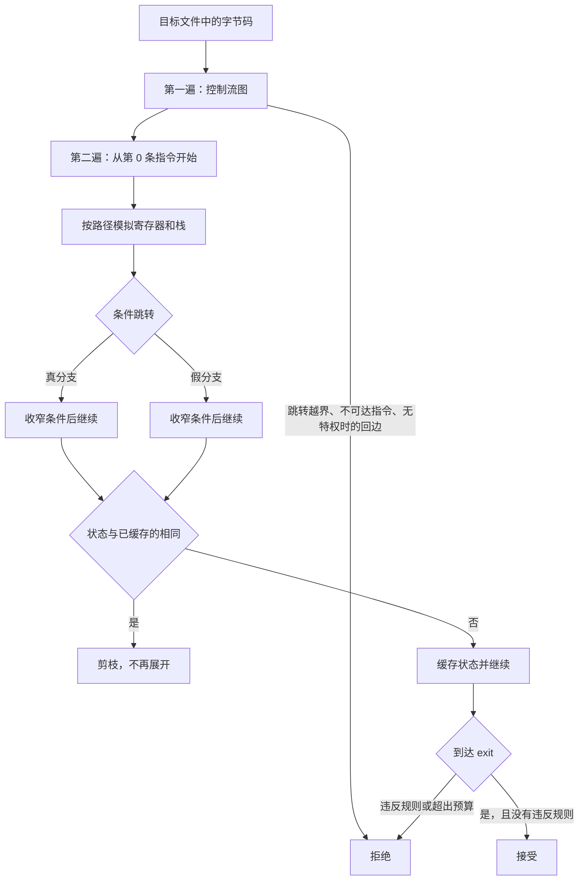

# B.9 验证器

编写 eBPF 程序时，开发者常常会遇到这样的场景：代码通过 `clang` 编译时毫无警告，`bpftool gen skeleton` 也能顺畅生成骨架头文件，但程序一经运行，屏幕上却打印出 `libbpf: prog 'count_syscall': BPF program load failed: Invalid argument`，紧接着输出了一长串内核诊断日志，末尾停在 `R0 invalid mem access 'map_value_or_null'`。整个程序还没来得及在内核中执行哪怕一条指令，就已被断然拦截。筑起这道防线的，正是 eBPF 运行栈中最为核心的基础设施——验证器（verifier）。

验证器的核心使命在于静态推演并证明程序的安全边界。理解验证器的工作机理，关键在于摸清它在指令路径上到底试图建立哪些数学或逻辑层面的不变条件、面对晦涩的寄存器诊断日志该如何反推回 C 源码中具体的控制流与指针操作，以及如何顺应它的静态证明逻辑写出稳健的代码。

文中的配套示例均收录于 `code/系统编程/拓展B_eBPF/B_9_验证器/` 目录，以成对的「问题版本」与「修正版本」呈现。内核侧代码使用 clang 18 编译，骨架由 bpftool 7.5 生成，用户态代码则经由编译期语法检查。文中涉及的验证器日志均参照内核官方文档、`verifier.c` 源码格式串及内核 selftests 典型用例进行剖析，以确保读者在不实际加载程序的前提下也能建立清晰直观的排错认知。

## 1. 为什么需要验证器

eBPF 程序在内核里并不是逐条由解释器慢速执行的。在程序加载完成后，内核即时编译器（just-in-time compilation，JIT）便会将字节码全部编译为宿主机的原生机器指令；一旦挂载生效，这些指令就直接在宿主内核的特权上下文里全速运转：自由地读取上下文数据、解引用内存地址、调用各类辅助函数。这期间没有任何硬件或虚拟机的二次沙箱拦截。倘若其中包含一处越界偏移或算错的地址，在内核空间中它就是一枚致命的野指针，轻则泄露或者损坏敏感数据，重则直接触发内核崩溃导致整机死锁。在生产环境中，这类严重事故一旦发生，事后再去收集转储文件往往为时已晚。

正是这种零开销原生运行的特性，倒逼所有的安全保证必须前置到加载阶段。验证器在处理 `BPF_PROG_LOAD` 系统调用时介入，它把待加载的字节码视作一个形式化证明题：面对一切可能的运行时输入与分支路径，这段代码是否绝对不可能破坏内核的内存完整性与执行秩序？如果无法在有限的资源内推导得出这一结论，验证器便会坚决拒绝加载，被拦下的字节码永远不会获得运行机会。

::: concept ebpf-verifier-properties title="通过验证的程序具备的性质"

验证器在加载时证明下列性质对程序的每条执行路径都成立：程序在有限步内结束，循环的上界能被算出来；每次内存访问都落在已证明安全的范围内，包括 map 的值、栈、报文和上下文；不读未初始化的寄存器；指针按类型使用，不做非法的指针算术，不把内核地址泄漏给用户态或写进 map；只调用当前程序类型允许的辅助函数，且实参满足它的约束；取得的引用在每条返回路径上都释放；栈不超过 512 字节，BPF 到 BPF 的调用不超过 8 层。

:::

这里列举的性质保证的是「程序不会危及操作系统内核」，却绝不能等同于「业务逻辑完全正确」。诸如统计计数少加了一位、哈希键的设计不合理导致严重冲突、或是每次事件都触发了代价高昂的遍历，这些纯粹的业务逻辑或算法瑕疵，验证器均不过问。与之相对，一段在运行时完全不会出错、但其安全边界难以被有限状态机推断出来的复杂代码，同样会被验证器拒绝。这就是静态分析与形式化证明的固有权衡：验证器并不会在运行时执行程序，面对无法一眼看穿的不确定路径，它只能采取极端保守的处置策略。

这种保守性有着极为明确的工程取向。在内核的稳定性面前，宁可将一段实际无害的代码拒之门外让开发者去调整写法，也绝不能放过哪怕万分之一引发崩溃的潜在漏洞。因此，面对验证器的阻拦，最理智的排查路径永远是自查「代码在哪一步让验证器丢失了安全推断的上下文」，进而将分支和约束表达得更加直接明晰，而不是试图去寻找隐晦的技巧来绕过检查。

<Quiz
  type="multi"
  :options="[
    { label: '程序一定在有限步内结束', value: 'A' },
    { label: '每次内存访问都在已证明安全的范围内', value: 'B' },
    { label: '只调用当前程序类型允许的辅助函数', value: 'C' },
    { label: '程序一定不读栈上未初始化的字节', value: 'D' }
  ]"
  :answer="['A', 'B', 'C']"
>

<template #question>

下列哪些是验证器在加载时证明的性质？

</template>

正确答案是 **A、B、C**。D 不成立：以拥有 `CAP_PERFMON` 的身份加载时，验证器允许读栈上未初始化的字节，这条检查为了验证速度被放宽了；无特权的加载仍然拒绝。寄存器的未初始化读则一律拒绝。

</Quiz>

::: generate ebpf-verifier-why-ahead-of-time kind=explanation concepts=ebpf-verifier-properties

面向刚接触 eBPF 的读者，用「JIT 之后程序以本机指令在内核里运行、出错就是内核出错」这个前提，解释为什么检查必须放在加载时、为什么验证器宁可拒绝也不放过，并逐条说明概念块里的性质各自防止哪一类事故，不展开具体报错和修改方法。

:::

## 2. 验证器怎样工作

### 2.1 两遍检查

验证器的检查分为首尾相接的两遍（pass）。

第一遍走的是经典的控制流图分析。验证器首先扫描指令流中的跳转目标，若有跳转跨出了程序边界，便立即报出 `jump out of range from insn %d to %d`；若发现存在无论如何都无法从起始指令到达的死代码指令，则给出 `unreachable insn %d` 告警；而在非特权权限的加载中，一旦检测到任何可能构成循环的回边（back-edge），验证器会直接拒绝，因为在缺乏特权约束时无法证明循环一定会在有限时间内终结。具备特权能力的加载则会放行回边，将循环终结性与有界性的证明留给后续的第二阶段。

第二遍则是极其详尽的符号执行与抽象解释过程。分析器从第零条指令出发，顺着所有可能的执行路径逐步展开。每行进一步，它都会在抽象层面模拟各寄存器与栈帧槽位的状态演变：当前指令究竟读写了何种类型的寄存器、数值的上下界收紧到了什么程度、指针所绑定的内存对象处于何处、剩余合法的读写空间还剩多少字节。一旦遇到条件跳转，验证器便会在真分支与假分支上分别收窄条件假设，并沿着两条截然不同的路径继续展开推演。只有当所有可达分支全部走到 `exit` 指令且全程没有任何越权或违规操作时，整段程序才被视为合格通过。



### 2.2 寄存器类型与取值范围

在验证器的抽象模型中，每一个寄存器都被赋予了一个极为精细的状态描述结构：当前持有的抽象类型、固定的基地址偏移量、运行期可变的偏移量、无符号上下界、有符号上下界，外加一个记录每一位已知比特的 tnum 掩码。在这些元数据中，寄存器类型决定了指令操作的合法基调。

| 类型 | 含义 |
| --- | --- |
| `NOT_INIT` | 尚未写入任何确切数据的单元，对其执行读操作会立即遭到拒绝，报出 `R2 !read_ok` |
| `SCALAR_VALUE` | 常规数值标量，携带完备的数学取值范围，严禁被当作指针直接解引用 |
| `PTR_TO_CTX` | 程序运行时上下文指针，仅允许依据当前程序类型规定的只读或读写字段进行受限访问 |
| `CONST_PTR_TO_MAP` | 指向 map 对象本身的结构句柄，日志中通常记作 `map_ptr`，严禁对其做任何指针算术运算 |
| `PTR_TO_MAP_VALUE` | 指向 map 元素内部数据值的安全指针，允许读写，其合法访问边界由元素尺寸精确限制 |
| `PTR_TO_MAP_VALUE_OR_NULL` | map 查找操作返回的候选指针，既可能指向元素，也可能为空，在完成校验前不可使用 |
| `PTR_TO_STACK` | 当前调用栈帧的基准指针，日志中一般写作 `fp`，其本身为只读，合法偏移落在 -512 至 0 之间 |
| `PTR_TO_PACKET` | 处于网络数据包报文内部的位置指针，只有在成功与 `data_end` 比对后才具备合法读写区间 |

当程序刚进入入口函数时，R1 寄存器被系统预置为 `PTR_TO_CTX`。若执行 `r2 = r1`，R2 也随之继承 `PTR_TO_CTX` 的类型；但如果将两个指针直接相加，其结果会被立即降级为 `SCALAR_VALUE`，因为两个指针的线性加和不再具备任何合法的物理内存映射含义。此外，一旦调用了辅助函数，根据调用惯例，R1 至 R5 的寄存器状态都会重置为未初始化，仅有被调用方保存寄存器 R6 至 R9 的内容得以完好保留。

取值范围的收窄主要仰赖条件分支指令的辅助推断。例如当程序判断某个标量寄存器大于 8 之后，在真分支中该寄存器的无符号下界就会顺理成章地更新为 9；假分支中其无符号上界则被固定为 8。有符号与无符号的分支比较逻辑彼此协同，假定程序先排除了 `x < 8`，随后又过滤了 `x > 4`，验证器在内层分支中便能明确得出 `4 < x < 8` 的区间判定，从而允许以此作为安全的数组边界依据。

### 2.3 判空与状态剪枝

调用 `bpf_map_lookup_elem` 等函数时，返回指针的初始抽象类型永远是 `PTR_TO_MAP_VALUE_OR_NULL`。若在代码中直接对它做解引用，验证器无法排除空指针解引用引发内核崩溃的风险，必然会断然拦截。只有显式加入 `if (value == NULL) return 0;` 这样的防线后，在非空的分支上下文中，验证器才会将该寄存器的类型提升为安全的 `PTR_TO_MAP_VALUE`，此时后续的读写操作才被正式放行。

更精巧的是，同一查找操作所衍生的所有引用副本共享相同的跟踪标识（ID）。即使把该指针复制给其他寄存器，或是临时溢出保存至栈帧随后又重新载入，它们的 ID 始终保持一致；只要这组副本中的任意一个在某一分支中被证实非空，与之关联的所有副本便会同步变更为非空状态。相反，如果在判空之后重新执行了一次查找操作，新得到的指针会被分配全新的 ID，此前的分支推断完全无法作用于它。

面对庞大的控制流，验证器不会盲目地将每一个执行分支都逐条推演到终点。每到达一条指令，它都会把当前累积的寄存器与栈帧状态同该指令之前已经记录并缓存的状态进行等价性或包含性比对。如果发现先前成功通过验证的某一缓存状态已经完全包容了当前状态的边界，这条分支便会被当场剪枝（pruning）而不再向下展开，因为一个更宽泛的状态能够安全退出，收敛得更狭窄的状态自然同样安全。在此之前，验证器还会借助活跃性分析剔除后续流程不再使用的废弃寄存器和栈槽，从而极大提高状态命中的几率，剪除大量无谓的推演路径。

### 2.4 复杂度预算

然而，这种虚拟推演并非毫无代价。验证器内部设有多道复杂度防线，每模拟执行一步，全局指令计数器便会累加；当累计检查的指令状态步数超过 1000000 步时，内核便会报出 `BPF program is too large. Processed %d insn` 并终止加载。若控制流中悬挂的分支深度超过 8192，则会触发 `The sequence of %d jumps is too complex.` 报错；在非特权环境下，同一指令位置上能够缓存的状态数量也受到更苛刻的压制。程序本身的物理尺寸同样有限制：拥有特权的载入操作上限为 100 万条指令，非特权加载则仅允许 4096 条。前者限制的是静态推演所消耗的工作量，后者限制的则是目标文件本身的物理指令数。

这种推演步数的预算机制，直接左右了高并发网络或跟踪程序的代码组织方式。一个看似简单的双重循环，如果使用了 `#pragma unroll` 将内层展开数百次，在源码层面虽仅寥寥数十行，但在验证器眼中却会指数级膨胀为数十万个状态分支，极易在推演阶段将百万步的预算挥霍殆尽。在诊断加载问题时，检查日志末尾打印的 `processed %d insns (limit %d)` 往往比统计编译产物的指令条数更能反映程序的验证压力。这一行统计汇总通常需要提升日志级别才能输出，使用 `bpftool -d` 命令可以便捷地调出完整的统计信息。

<Quiz
  type="single"
  :options="[
    { label: '指向 map 元素的指针，一定非空', value: 'A' },
    { label: '指向 map 元素的指针，也可能为空，判空之前不能解引用', value: 'B' },
    { label: '一个尚未解析的 map 句柄', value: 'C' },
    { label: '指向 map 本身的指针，不能做算术', value: 'D' }
  ]"
  answer="B"
>

<template #question>

日志里 `R0=map_value_or_null(id=1,map=counts,ks=4,vs=8)` 中的类型是什么意思？

</template>

正确答案是 **B**。这是 `bpf_map_lookup_elem` 的返回类型 `PTR_TO_MAP_VALUE_OR_NULL`：哈希 map 里找不到键时返回空指针，所以验证器要求程序在解引用之前证明它非空。D 说的是 `map_ptr`（`CONST_PTR_TO_MAP`），是 map 自身的句柄，不是元素。

</Quiz>

## 3. 读懂验证器日志

### 3.1 日志从哪里来

加载失败时，libbpf 先打印一行摘要，再把内核返回的整段日志夹在两行标记之间。这两行在 `libbpf.c` 里的格式是固定的：

::: terminal title="bash - 加载失败时的 libbpf 输出（输出类似）"

```text
$ sudo ./syscount
libbpf: prog 'count_syscall': BPF program load failed: Invalid argument
libbpf: prog 'count_syscall': -- BEGIN PROG LOAD LOG --
0: (85) call bpf_get_current_pid_tgid#14
...
R0 invalid mem access 'map_value_or_null'
libbpf: prog 'count_syscall': -- END PROG LOAD LOG --
加载失败：Invalid argument
```

:::

摘要里输出的 `Invalid argument` 仅仅是系统调用返回 `-EINVAL` 时由标准库翻译出的通用错误文本，绝大多数验证失败均以该值呈现，并不具备具体的排错指引；核心的诊断线索全部分布在前后标记所夹紧的日志区间内。libbpf 拿到内核日志后还会做一次语义翻译，将 `invalid func unknown#...` 这类内部索引换算为可读的描述，专门覆盖 CO-RE 重定位失败、引用了未创建的 map 对象、以及内核 kfunc 未能完成符号解析这三类典型场景。

### 3.2 日志的每一行

日志的主体按执行顺序排列，每行前半是编号和反汇编，形如 `序号: (opcode) 操作数`。编译时加了 `-g`，前面还会多出源码行和一个 `;` 标记。出错的那一条不再往下走，最后一行只有错误文本，没有编号。

内核文档 `Documentation/bpf/verifier.rst` 用一段最小程序演示了这个格式。程序往栈上写一个 8 字节，取地址当键，调用 `map_lookup_elem`，然后把返回的指针当普通指针写：

::: terminal title="bash - 内核文档中的验证器日志（输出类似）"

```text
0: (7a) *(u64 *)(r10 -8) = 0
1: (bf) r2 = r10
2: (07) r2 += -8
3: (b7) r1 = 0x0
4: (85) call 1
5: (7a) *(u64 *)(r0 +0) = 0
R0 invalid mem access 'map_value_or_null'
```

:::

编号 0 到 3 的指令准备调用：把 0 写到 `r10 - 8`，把 `r10 - 8` 算进 r2 作键，把 map 的句柄装进 r1。编号 4 调用返回，R0 的类型成为 `PTR_TO_MAP_VALUE_OR_NULL`；编号 5 直接写 `*(u64 *)(r0 + 0)`，验证器不能排除 R0 为空，于是拒绝。错误行点名了寄存器 R0 和它的类型。

本页的 `map_lookup_unchecked.bpf.c` 编译出来是同一回事，只是键来自系统调用号：

```c
key = (__u32)bpf_get_current_pid_tgid();
value = bpf_map_lookup_elem(&counts, &key);
*value += 1;
```

`*value += 1` 展开成先读后写两条指令，第一条读 `*(u64 *)(r0 + 0)` 时就停住了。缺的不是某条指令，是查找和读之间那个判空。

更完整的日志还会带寄存器快照。启用二级日志时，验证器在调用的前后和状态变化处打印 `from 5 to 8: R0=imm0 R10=fp` 这样的行，括号里是每个寄存器的类型和取值范围。日志末尾有一行统计，格式是 `processed %d insns (limit %d) max_states_per_insn %d total_states %d peak_states %d mark_read %d`，填出来形如：

```text
processed 12 insns (limit 1000000) max_states_per_insn 0 total_states 1 peak_states 1 mark_read 0
```

统计行只在日志级别包含统计时出现，`bpftool -d` 会把级别设成一级加二级加统计，所以用它看日志最全。

### 3.3 对回 C 源码

日志里的编号就是目标文件里指令的序号。用 `llvm-objdump -S` 反汇编同一个 `.bpf.o`，每个序号旁边就是对应的 C 源码行。下面是对 `map_lookup_unchecked.bpf.o` 的真实反汇编（用 clang 18 编译，LLVM 19 的 `llvm-objdump` 读取）：

::: terminal title="bash - llvm-objdump -S map_lookup_unchecked.bpf.o"

```text
$ llvm-objdump -S map_lookup_unchecked.bpf.o
map_lookup_unchecked.bpf.o:	file format elf64-bpf

Disassembly of section tp/raw_syscalls/sys_enter:

0000000000000000 <count_syscall>:
;     key = (__u32)bpf_get_current_pid_tgid();
       0:	85 00 00 00 0e 00 00 00	call 0xe
       1:	63 0a fc ff 00 00 00 00	*(u32 *)(r10 - 0x4) = r0
       2:	bf a2 00 00 00 00 00 00	r2 = r10
       3:	07 02 00 00 fc ff ff ff	r2 += -0x4
;     value = bpf_map_lookup_elem(&counts, &key);
       4:	18 01 00 00 00 00 00 00 00 00 00 00 00 00 00 00	r1 = 0x0 ll
       6:	85 00 00 00 01 00 00 00	call 0x1
;     *value += 1;
       7:	79 01 00 00 00 00 00 00	r1 = *(u64 *)(r0 + 0x0)
       8:	07 01 00 00 01 00 00 00	r1 += 0x1
       9:	7b 10 00 00 00 00 00 00	*(u64 *)(r0 + 0x0) = r1
;     return 0;
      10:	b4 00 00 00 00 00 00 00	w0 = 0x0
      11:	95 00 00 00 00 00 00 00	exit
```

:::

验证器日志里的 `call 1` 对应这里的 `call 0x1`，编号 7 的 `r1 = *(u64 *)(r0 + 0x0)` 就是它停下来拒绝加载的那条读。两边一对照，源码里唯一可疑的地方是 `*value += 1` 之前没有判空。

同一份源码，加上判空之后：

::: terminal title="bash - llvm-objdump -S map_lookup_checked.bpf.o"

```text
$ llvm-objdump -S map_lookup_checked.bpf.o
map_lookup_checked.bpf.o:	file format elf64-bpf

Disassembly of section tp/raw_syscalls/sys_enter:

0000000000000000 <count_syscall>:
;     key = (__u32)bpf_get_current_pid_tgid();
       0:	85 00 00 00 0e 00 00 00	call 0xe
       1:	63 0a fc ff 00 00 00 00	*(u32 *)(r10 - 0x4) = r0
       2:	bf a2 00 00 00 00 00 00	r2 = r10
       3:	07 02 00 00 fc ff ff ff	r2 += -0x4
;     value = bpf_map_lookup_elem(&counts, &key);
       4:	18 01 00 00 00 00 00 00 00 00 00 00 00 00 00 00	r1 = 0x0 ll
       6:	85 00 00 00 01 00 00 00	call 0x1
;     if (value == NULL) {
       7:	15 00 03 00 00 00 00 00	if r0 == 0x0 goto +0x3 <LBB0_2>
;     *value += 1;
       8:	79 01 00 00 00 00 00 00	r1 = *(u64 *)(r0 + 0x0)
       9:	07 01 00 00 01 00 00 00	r1 += 0x1
      10:	7b 10 00 00 00 00 00 00	*(u64 *)(r0 + 0x0) = r1

0000000000000058 <LBB0_2>:
; }
      11:	b4 00 00 00 00 00 00 00	w0 = 0x0
      12:	95 00 00 00 00 00 00 00	exit
```

:::

多出来的指令 7 是那条判空。验证器在这里把真分支的 R0 收窄为「就是 0」，假分支的 R0 收窄为 `PTR_TO_MAP_VALUE`；后者在指令 8 上读写都合法，前者直接跳到出口，不碰指针。

::: tip 数字是辅助函数编号

内核文档里的日志写 `call 1`，这是辅助函数的编号。现在的内核打印名字和编号两部分，形如 `4: (85) call bpf_map_lookup_elem#1`，名字来自 `disasm.c` 里的函数表。`bpf_map_lookup_elem` 是 1、`bpf_ktime_get_ns` 是 5、`bpf_get_current_pid_tgid` 是 14、`bpf_ringbuf_reserve` 是 131、`bpf_ringbuf_submit` 是 132、`bpf_ringbuf_discard` 是 133，编号的权威来源是 `bpf_helper_defs.h` 里每个函数指针的初值。

:::

### 3.4 不写加载程序也能看日志

`bpftool prog load` 直接把目标文件交给内核，失败时把同样的日志打出来。加 `-d` 打开全部日志级别：

```bash
sudo bpftool prog load map_lookup_unchecked.bpf.o /sys/fs/bpf/mdr_probe -d
```

免去写用户态加载程序这一步，适合单独验证一个程序。成功时它会把程序固定到 bpffs 上，用完 `rm` 掉即可；`-d` 的输出比 libbpf 的默认输出长得多，包含每条指令的寄存器快照。类似的检查能不能放进持续集成，见 [B.14 bpftrace 与编程工具链](/教程/正文/系统编程/拓展B_eBPF/B_14_bpftrace与编程工具链) 的「在持续集成中检查 BPF 代码」一节。

要批量比较，用 [veristat](https://github.com/libbpf/veristat)。它加载一组 `.bpf.o`，按程序输出 `processed insns`、`total_states`、`peak_states`、栈深度等列，可以排序和筛选，是调验证成本时的主力工具。

<Quiz
  type="single"
  :options="[
    { label: '摘要里的 Invalid argument 就是原因', value: 'A' },
    { label: 'BEGIN PROG LOAD LOG 与 END PROG LOAD LOG 之间的最后一行', value: 'B' },
    { label: '编译器的警告', value: 'C' },
    { label: 'dmesg 里的第一条', value: 'D' }
  ]"
  answer="B"
>

<template #question>

加载失败时，去哪里获取确切的错误原因？

</template>

正确答案是 **B**。`Invalid argument` 只是 `-EINVAL` 的通用文本；内核写出的诊断日志完整保存在两条标记之间，最后一行正是触发拦截的具体指令或错误描述。

</Quiz>

::: generate ebpf-verifier-log-walkthrough kind=explanation concepts=ebpf-verifier-properties

面向第一次读验证器日志的读者，以 3.2 节里内核文档的那段六行日志为例逐行讲解：说明编号与反汇编的位置关系、调用前后 R0 类型的变化、为什么最后一条写指令被拒绝，以及看到这类日志后应该回到 C 源码的哪一行去改。不逐条罗列日志级别。

:::

## 4. 常见报错与修正

下面每一组都是同一个程序的两个版本，错误版本编译干净、只是过不了验证。文件都在 `code/系统编程/拓展B_eBPF/B_9_验证器/` 下，编译用[本章统一的命令](/教程/正文/系统编程/拓展B_eBPF/B_3_第一个eBPF程序)。每一组后面附的 `llvm-objdump -S` 反汇编来自本机编译的同名目标文件，`readelf` 输出来自 SignalX；验证器日志一律引用内核文档或 `verifier.c` 的格式串，写成「输出类似」。

### 4.1 map 查找结果没有判空

这是最常见的一类。`bpf_map_lookup_elem` 在哈希 map 里找不到键时返回空指针，验证器把返回值标成 `PTR_TO_MAP_VALUE_OR_NULL`，直到程序证明它非空。

::: compare left-title="直接解引用（验证器拒绝）" right-title="先判空再使用"

```c
value = bpf_map_lookup_elem(&counts, &key);
*value += 1;
```

---

```c
value = bpf_map_lookup_elem(&counts, &key);
if (value == NULL) {
    return 0;
}
*value += 1;
```

:::

被拒绝时日志的最后一行是：

```text
R0 invalid mem access 'map_value_or_null'
```

同一行还可能带上指针的额外信息，形如 `R0=map_value_or_null(id=1,map=counts,ks=4,vs=8)`，`id` 是这次查找的编号，`ks`、`vs` 是 map 的键长和值长。读到这一句就直接去查找结果第一次被使用的地方找判空。

判空之后仍然要保证「用的是同一个副本」。把返回值赋给另一个指针再判空没问题，因为副本共享编号；判空之后重新查找一次，拿到的是新编号，旧判断管不到它。

<Quiz
  type="single"
  :options="[
    { label: '把 if (value == NULL) 挪到解引用之后', value: 'A' },
    { label: '在解引用之前加 if (value == NULL) { return 0; }', value: 'B' },
    { label: '把 map 的 max_entries 调大', value: 'C' },
    { label: '加 __always_inline', value: 'D' }
  ]"
  answer="B"
>

<template #question>

`R0 invalid mem access 'map_value_or_null'` 应该怎么改？

</template>

正确答案是 **B**。验证器要的是「解引用这条路径上已经证明非空」，判空放在解引用之后等于没判。调大 `max_entries` 改变不了返回值的类型，`__always_inline` 与此无关。

</Quiz>

### 4.2 把没写完的栈结构体交给辅助函数

`bpf_map_update_elem` 的第三个参数指向一个结构体，内核会把整块内存按值大小拷进 map。结构体的填充字节有没有写过，验证器单独记着。

::: compare left-title="逐字段赋值，填充字节未写" right-title="整体清零后赋值"

```c
struct record rec;

rec.pid = (__u32)(bpf_get_current_pid_tgid() >> 32);
rec.ts = bpf_ktime_get_ns();
bpf_map_update_elem(&records, &rec.pid, &rec, BPF_ANY);
```

---

```c
struct record rec = {0};

rec.pid = (__u32)(bpf_get_current_pid_tgid() >> 32);
rec.ts = bpf_ktime_get_ns();
bpf_map_update_elem(&records, &rec.pid, &rec, BPF_ANY);
```

:::

结构体是：

```c
struct record {
    __u32 pid;
    __u64 ts;
};
```

根据结构体的对齐规则，`pid` 占用第 0 至 3 字节，`ts` 占用第 8 至 15 字节，而第 4 至 7 字节则是编译器为了满足 64 位自然对齐而插入的填充间隙（padding）。如果采用逐字段赋值的方式，代码实际上只向第 0~3 与 8~15 字节写入了确定的数值，中间 4 个字节的填充区始终处于未初始化的悬空状态。验证器在跟踪栈帧内存时是以具体字节为最小粒度，而非单纯依据 C 语言的结构体字段边界。当非特权程序试图将整块 16 字节的结构体传递给辅助函数时，验证器捕捉到了这片来源不明的未初始化区域，随即报出：

```text
invalid indirect read from stack R3 off -16+4 size 16
```

这条格式串在 `verifier.c` 里写作 `invalid%s read from stack R%d off %d+%d size %d`，给辅助函数用时 `%s` 是 ` indirect`。`-16` 是结构体在栈上的起点相对 `r10` 的偏移，`+4` 是第一个未初始化字节在结构体内的偏移，`size 16` 是辅助函数要读的字节数。R3 就是传给 `bpf_map_update_elem` 的那个指针所在的寄存器。

当以 root 身份运行且进程持有 `CAP_PERFMON` 权能时，内核出于降低静态推演计算开销的考量，适度放宽了对栈帧未初始化读取的严苛检查。此时同一份代码虽然能够通过验证并成功加载，但那 4 个未被覆盖的填充字节却会携带着此前内核栈上的随机残留数据被一同拷入 map，最终被用户态程序完整读出。验证器放行绝不代表代码逻辑毫无破绽：此处规则的放宽仅仅是性能权衡的妥协，而由此产生的数据泄露恰恰是系统安全防线极力避免的隐患。在定义栈结构体时采用 `{0}` 整体初始化，其核心价值绝非单纯为了应付验证器的语法拦截，而是从源头上杜绝内核敏感栈数据发生跨域泄露。

两个版本的反汇编只差开头清零的那两条指令：

::: terminal title="bash - llvm-objdump -S（左：未清零，右：清零）"

```text
$ llvm-objdump -S stack_padding.bpf.o
0000000000000000 <record_exec>:
;     rec.pid = (__u32)(bpf_get_current_pid_tgid() >> 32);
       0:	85 00 00 00 0e 00 00 00	call 0xe
       1:	77 00 00 00 20 00 00 00	r0 >>= 0x20
       2:	63 0a f0 ff 00 00 00 00	*(u32 *)(r10 - 0x10) = r0
;     rec.ts = bpf_ktime_get_ns();
       3:	85 00 00 00 05 00 00 00	call 0x5
       4:	7b 0a f8 ff 00 00 00 00	*(u64 *)(r10 - 0x8) = r0
       5:	bf a2 00 00 00 00 00 00	r2 = r10
;     rec.pid = (__u32)(bpf_get_current_pid_tgid() >> 32);
       6:	07 02 00 00 f0 ff ff ff	r2 += -0x10
;     bpf_map_update_elem(&records, &rec.pid, &rec, BPF_ANY);
       7:	18 01 00 00 00 00 00 00 00 00 00 00 00 00 00 00	r1 = 0x0 ll
       9:	bf 23 00 00 00 00 00 00	r3 = r2
      10:	b7 04 00 00 00 00 00 00	r4 = 0x0
      11:	85 00 00 00 02 00 00 00	call 0x2
;     return 0;
      12:	b4 00 00 00 00 00 00 00	w0 = 0x0
      13:	95 00 00 00 00 00 00 00	exit

$ llvm-objdump -S stack_zeroed.bpf.o
0000000000000000 <record_exec>:
; {
       0:	b7 01 00 00 00 00 00 00	r1 = 0x0
;     struct record rec = {0};
       1:	7b 1a f0 ff 00 00 00 00	*(u64 *)(r10 - 0x10) = r1
;     rec.pid = (__u32)(bpf_get_current_pid_tgid() >> 32);
       2:	85 00 00 00 0e 00 00 00	call 0xe
       3:	77 00 00 00 20 00 00 00	r0 >>= 0x20
       4:	63 0a f0 ff 00 00 00 00	*(u32 *)(r10 - 0x10) = r0
;     rec.ts = bpf_ktime_get_ns();
       5:	85 00 00 00 05 00 00 00	call 0x5
       6:	7b 0a f8 ff 00 00 00 00	*(u64 *)(r10 - 0x8) = r0
       7:	bf a2 00 00 00 00 00 00	r2 = r10
       8:	07 02 00 00 f0 ff ff ff	r2 += -0x10
;     bpf_map_update_elem(&records, &rec.pid, &rec, BPF_ANY);
       9:	18 01 00 00 00 00 00 00 00 00 00 00 00 00 00 00	r1 = 0x0 ll
      11:	bf 23 00 00 00 00 00 00	r3 = r2
      12:	b7 04 00 00 00 00 00 00	r4 = 0x0
      13:	85 00 00 00 02 00 00 00	call 0x2
;     return 0;
      14:	b4 00 00 00 00 00 00 00	w0 = 0x0
      15:	95 00 00 00 00 00 00 00	exit
```

:::

清零版本比原版多两条指令：一条把 0 装进 r1，一条把 8 字节的 0 写到 `r10 - 0x10`。`r10 - 0x10` 到 `r10 - 0x9` 这 8 字节覆盖 `pid` 和紧随其后的填充，`ts` 在 `r10 - 0x8` 到 `r10 - 0x1`，之后被整体覆盖。两次写覆盖的区间不同，编译器无法把清零省掉。

顺手验证一下填充在哪里：

::: terminal title="bash - padding_demo"

```text
$ gcc -std=c17 -Wall -Wextra padding_demo.c -o padding_demo
$ ./padding_demo
sizeof(struct record) = 16
offsetof(pid) = 0, offsetof(ts) = 8
44 33 22 11 aa aa aa aa
08 07 06 05 04 03 02 01
```

:::

`padding_demo.c` 先把整块内存填成 `0xAA`，再给两个字段赋值。第 5 到 8 字节仍是 `aa`，说明 `pid` 之后确实有 4 个字节不属于任何字段。这段程序在本机（MinGW gcc 13.2）和 SignalX（gcc 14.2）上各跑了一遍，输出相同。

::: tip 清零的写法

`struct record rec = {0};` 是最直接的写法，编译成一条或几条整块清零的写。结构体很大、只用到几个字段时，也可以用一个显式的填充字段把每个字节都写一遍，或者只把传给辅助函数的那一段清零。只赋关心的字段、指望验证器替你补剩余字节，无论加载时会不会被拦，都是把栈上的残留内容送出去。

:::

### 4.3 环形缓冲区 reserve 之后没有释放

`bpf_ringbuf_reserve` 从环形缓冲区里取出一块内存，返回一个引用（reference）。这块内存最终必须交给 `bpf_ringbuf_submit` 提交，或者交给 `bpf_ringbuf_discard` 丢弃，两者都释放引用。验证器追踪每个引用的分配指令，走完所有路径后还有引用没释放就拒绝：

::: compare left-title="某条路径直接返回" right-title="每条路径都释放"

```c
e = bpf_ringbuf_reserve(&events, sizeof(*e), 0);
if (e == NULL) {
    return 0;
}
e->pid = pid;
if (pid == 1) {
    return 0;
}
bpf_ringbuf_submit(e, 0);
```

---

```c
e = bpf_ringbuf_reserve(&events, sizeof(*e), 0);
if (e == NULL) {
    return 0;
}
e->pid = pid;
if (pid == 1) {
    bpf_ringbuf_discard(e, 0);
    return 0;
}
bpf_ringbuf_submit(e, 0);
```

:::

报错来自 `verifier.c` 的 `check_reference_leak()`，格式串是 `Unreleased reference id=%d alloc_insn=%d`，填上本例的数字形如：

```text
Unreleased reference id=1 alloc_insn=6
```

`alloc_insn=6` 是分配引用的那条指令的序号，`id` 是这次分配拿到的编号，程序里有多个引用时靠它区分；本例的分配点在反汇编里正是 `6: 85 00 00 00 83 00 00 00 call 0x83`，即 `bpf_ringbuf_reserve`（辅助函数编号 131）。两个版本的区别只在 `pid == 1` 分支上：

::: terminal title="bash - llvm-objdump -S（左：泄漏，右：释放）"

```text
$ llvm-objdump -S ringbuf_leak.bpf.o
       6:	85 00 00 00 83 00 00 00	call 0x83
;     if (e == NULL) {
       7:	15 00 08 00 00 00 00 00	if r0 == 0x0 goto +0x8 <LBB0_3>
       8:	b4 01 00 00 78 00 00 00	w1 = 0x78
;     e->comm[0] = 'x';
       9:	73 10 08 00 00 00 00 00	*(u8 *)(r0 + 0x8) = r1
;     pid = (__u32)(bpf_get_current_pid_tgid() >> 32);
      10:	77 06 00 00 20 00 00 00	r6 >>= 0x20
;     e->pid = pid;
      11:	63 60 00 00 00 00 00 00	*(u32 *)(r0 + 0x0) = r6
;     if (pid == 1) {
      12:	16 06 03 00 01 00 00 00	if w6 == 0x1 goto +0x3 <LBB0_3>
;     bpf_ringbuf_submit(e, 0);
      13:	bf 01 00 00 00 00 00 00	r1 = r0
      14:	b7 02 00 00 00 00 00 00	r2 = 0x0
      15:	85 00 00 00 84 00 00 00	call 0x84

0000000000000080 <LBB0_3>:
; }
      16:	b4 00 00 00 00 00 00 00	w0 = 0x0
      17:	95 00 00 00 00 00 00 00	exit

$ llvm-objdump -S ringbuf_released.bpf.o
       6:	85 00 00 00 83 00 00 00	call 0x83
;     if (e == NULL) {
       7:	15 00 0c 00 00 00 00 00	if r0 == 0x0 goto +0xc <LBB0_4>
       8:	b4 01 00 00 78 00 00 00	w1 = 0x78
;     e->comm[0] = 'x';
       9:	73 10 08 00 00 00 00 00	*(u8 *)(r0 + 0x8) = r1
;     pid = (__u32)(bpf_get_current_pid_tgid() >> 32);
      10:	77 06 00 00 20 00 00 00	r6 >>= 0x20
;     e->pid = pid;
      11:	63 60 00 00 00 00 00 00	*(u32 *)(r0 + 0x0) = r6
;     if (pid == 1) {
      12:	55 06 04 00 01 00 00 00	if w6 != 0x1 goto +0x4 <LBB0_3>
;         bpf_ringbuf_discard(e, 0);
      13:	bf 01 00 00 00 00 00 00	r1 = r0
      14:	b7 02 00 00 00 00 00 00	r2 = 0x0
      15:	85 00 00 00 85 00 00 00	call 0x85
      16:	05 00 03 00 00 00 00 00	goto +0x3 <LBB0_4>

0000000000000088 <LBB0_3>:
;     bpf_ringbuf_submit(e, 0);
      17:	bf 01 00 00 00 00 00 00	r1 = r0
      18:	b7 02 00 00 00 00 00 00	r2 = 0x0
      19:	85 00 00 00 84 00 00 00	call 0x84

00000000000000a0 <LBB0_4>:
; }
      20:	b4 00 00 00 00 00 00 00	w0 = 0x0
      21:	95 00 00 00 00 00 00 00	exit
```

:::

左侧错误示例中的 `pid == 1` 分支在发现过滤条件命中后便直接跳往函数出口，导致 r0 中所持有的缓冲区内存引用就此悬空丢失，破坏了内核环形缓冲区的引用平衡。右侧修正版本则显式补全了 `bpf_ringbuf_discard` 调用，在分支退出前正确注销了引用。在包含复杂多级分支的业务逻辑中，更为稳健的编程惯例是采用结构化的控制流，让所有成功执行 reserve 的路径最终收敛至单一出口，并在出口处集中进行 submit 或 discard 决策；相较于在每一个早退分支处零散补全调用，集中收敛的做法能大幅降低引用遗漏的风险。

### 4.4 循环的上界证明不出来

在支持有限循环的现代内核中，验证器允许程序包含循环结构，但前提是它必须能够在加载期推导出确切的迭代次数上限。如果直接使用取自运行期的动态数值作为循环边界——例如从 map 中动态读出的统计计数——验证器无法推断出该循环到底会执行多少轮，因而无法证明程序必然会在有限步内终结，只能终止加载。

::: compare left-title="上界来自运行期的值" right-title="用位与收窄上界"

```c
value = bpf_map_lookup_elem(&counts, &key);
if (value == NULL) {
    return 0;
}
for (i = 0; i < *value; i++) {
    acc = acc * 3 + 1;
}
*value = acc;
```

---

```c
value = bpf_map_lookup_elem(&counts, &key);
if (value == NULL) {
    return 0;
}
steps = *value & 0x3f;
for (i = 0; i < steps; i++) {
    acc = acc * 3 + 1;
}
*value = acc;
```

:::

`steps` 经过 `& 0x3f` 之后，验证器知道它的无符号上界是 63，循环最多展开 64 次，每次迭代的状态都能算清楚。左图的上界直接是 `*value`，取值从 0 到 `2^64 - 1`，验证器会在处理到一定数量的指令之后报：

```text
BPF program is too large. Processed 1000001 insn
```

这是最常见的循环报错形式。内核在检测到循环可能不收敛时还有一条 `infinite loop detected at insn %d`，出现在状态无法收敛的情况，比如循环体里两个寄存器的关系每轮都变、永远找不到能剪枝的等价状态。两条报错的根源相同：验证器没法给出迭代次数的上界。

两个版本的反汇编：

::: terminal title="bash - llvm-objdump -S（左：上界无界，右：掩码后 6 位）"

```text
$ llvm-objdump -S loop_unbounded.bpf.o
;     if (value == NULL) {
       7:	15 00 09 00 00 00 00 00	if r0 == 0x0 goto +0x9 <LBB0_5>
       8:	b7 01 00 00 01 00 00 00	r1 = 0x1
       9:	79 02 00 00 00 00 00 00	r2 = *(u64 *)(r0 + 0x0)
;     for (i = 0; i < *value; i++) {
      10:	15 02 05 00 00 00 00 00	if r2 == 0x0 goto +0x5 <LBB0_4>
      11:	b7 03 00 00 00 00 00 00	r3 = 0x0

0000000000000060 <LBB0_3>:
;         acc = acc * 3 + 1;
      12:	27 01 00 00 03 00 00 00	r1 *= 0x3
      13:	07 01 00 00 01 00 00 00	r1 += 0x1
;     for (i = 0; i < *value; i++) {
      14:	07 03 00 00 01 00 00 00	r3 += 0x1
      15:	2d 32 fc ff 00 00 00 00	if r2 > r3 goto -0x4 <LBB0_3>

0000000000000080 <LBB0_4>:
;     *value = acc;
      16:	7b 10 00 00 00 00 00 00	*(u64 *)(r0 + 0x0) = r1

0000000000000088 <LBB0_5>:
; }
      17:	b7 00 00 00 00 00 00 00	r0 = 0x0
      18:	95 00 00 00 00 00 00 00	exit

$ llvm-objdump -S loop_bounded.bpf.o
;     if (value == NULL) {
       7:	15 00 0a 00 00 00 00 00	if r0 == 0x0 goto +0xa <LBB0_5>
       8:	b7 01 00 00 01 00 00 00	r1 = 0x1
;     steps = *value & 0x3f;
       9:	79 02 00 00 00 00 00 00	r2 = *(u64 *)(r0 + 0x0)
      10:	57 02 00 00 3f 00 00 00	r2 &= 0x3f
;     for (i = 0; i < steps; i++) {
      11:	15 02 05 00 00 00 00 00	if r2 == 0x0 goto +0x5 <LBB0_4>
      12:	b7 03 00 00 00 00 00 00	r3 = 0x0

0000000000000068 <LBB0_3>:
;         acc = acc * 3 + 1;
      13:	27 01 00 00 03 00 00 00	r1 *= 0x3
      14:	07 01 00 00 01 00 00 00	r1 += 0x1
;     for (i = 0; i < steps; i++) {
      15:	07 03 00 00 01 00 00 00	r3 += 0x1
      16:	2d 32 fc ff 00 00 00 00	if r2 > r3 goto -0x4 <LBB0_3>

0000000000000088 <LBB0_4>:
;     *value = acc;
      17:	7b 10 00 00 00 00 00 00	*(u64 *)(r0 + 0x0) = r1

0000000000000090 <LBB0_5>:
; }
      18:	b4 00 00 00 00 00 00 00	w0 = 0x0
      19:	95 00 00 00 00 00 00 00	exit
```

:::

两个版本的循环结构一样：一条判断是否为零的指令、一段循环体、一条回边。差别只有一条指令：右图在读出 `*value` 之后多了一条 `r2 &= 0x3f`（编号 10），后面的编号因此整体后移一位。相与之后 `r2` 的无符号上界是 63，验证器据此知道循环最多 64 次；左图的 `r2` 直接从 map 里读出，上界没变，验证器拿不到迭代次数。

::: tip 上界要能从循环入口的状态推出来

上界来自常量、掩码之后的值，或者与常量比较的计数器，验证器都能算出迭代次数。它算的是「从循环入口的这个状态出发，最多能走几轮」，因此收窄要在进入循环之前完成。循环体里再写条件也能让某一次迭代提前结束，但每多展开一轮，验证预算就多花一份；上界能压小就压小。

:::

循环次数很大时，展开的成本会超过预算。内核对这类需求提供了 `bpf_loop` 和 `bpf_for` 这类开放编码迭代器：把循环体写成回调，由内核在运行时迭代，验证器只验证回调本身一次。两种写法的取舍是另一回事，版本与选型见 [B.4 程序的解剖：受限的 C](/教程/正文/系统编程/拓展B_eBPF/B_4_程序的解剖_受限的C) 的「循环必须能证明会结束」一节。

### 4.5 访问报文前没有与 data_end 比较

在 XDP 与 tc 等网络数据路径中，`ctx->data` 标识了报文有效载荷的起始边界，而 `ctx->data_end` 则划定了报文的结尾边界。这两个指针在上下文结构体中以 32 位偏移量呈现，验证器在载入阶段会将其抽象转换为专门的 `PTR_TO_PACKET` 与 `PTR_TO_PACKET_END` 类型。对于刚刚从上下文获取的报文指针，验证器初始分配给它的可访问安全区间为零字节；只有当程序显式执行了指针与 `data_end` 的比较指令之后，在判定未越界的有效分支路径上，验证器才会赋予该指针相应长度的合法访问空间。

::: compare left-title="直接读以太网头" right-title="先比较再读"

```c
void *data = (void *)(long)ctx->data;
struct ethhdr *eth = data;

if (eth->h_proto == bpf_htons(ETH_P_IP)) {
    return XDP_DROP;
}
return XDP_PASS;
```

---

```c
void *data_end = (void *)(long)ctx->data_end;
void *data = (void *)(long)ctx->data;
struct ethhdr *eth = data;

if ((void *)(eth + 1) > data_end) {
    return XDP_PASS;
}
if (eth->h_proto == bpf_htons(ETH_P_IP)) {
    return XDP_DROP;
}
return XDP_PASS;
```

:::

报错原文来自 `verifier.c` 里的格式串 `invalid access to packet, off=%d size=%d, R%d(id=%d,off=%d,r=%d)`，本例填出来形如：

```text
invalid access to packet, off=12 size=2, R1(id=0,off=0,r=0)
```

`off=12` 就是 `h_proto` 在以太网头里的偏移，`size=2` 是一次 16 位读，`r=0` 说明验证器认为 R1 指向的位置后面一个字节都没有可访问的。两个版本的反汇编差异集中在比较上：

::: terminal title="bash - llvm-objdump -S（左：不比较，右：比较）"

```text
$ llvm-objdump -S packet_unchecked.bpf.o
0000000000000000 <xdp_peek>:
;     void *data = (void *)(long)ctx->data;
       0:	61 11 00 00 00 00 00 00	r1 = *(u32 *)(r1 + 0x0)
;     if (eth->h_proto == bpf_htons(ETH_P_IP)) {
       1:	69 11 0c 00 00 00 00 00	r1 = *(u16 *)(r1 + 0xc)
       2:	b4 00 00 00 01 00 00 00	w0 = 0x1
       3:	16 01 01 00 08 00 00 00	if w1 == 0x8 goto +0x1 <LBB0_2>
       4:	b4 00 00 00 02 00 00 00	w0 = 0x2

0000000000000028 <LBB0_2>:
; }
       5:	95 00 00 00 00 00 00 00	exit

$ llvm-objdump -S packet_checked.bpf.o
0000000000000000 <xdp_peek>:
; {
       0:	b7 00 00 00 02 00 00 00	w0 = 0x2
;     void *data_end = (void *)(long)ctx->data_end;
       1:	61 12 04 00 00 00 00 00	r2 = *(u32 *)(r1 + 0x4)
;     void *data = (void *)(long)ctx->data;
       2:	61 11 00 00 00 00 00 00	r1 = *(u32 *)(r1 + 0x0)
;     if ((void *)(eth + 1) > data_end) {
       3:	bf 13 00 00 00 00 00 00	r3 = r1
       4:	07 03 00 00 0e 00 00 00	r3 += 0xe
       5:	2d 23 04 00 00 00 00 00	if r3 > r2 goto +0x4 <LBB0_3>
;     if (eth->h_proto == bpf_htons(ETH_P_IP)) {
       6:	69 11 0c 00 00 00 00 00	r1 = *(u16 *)(r1 + 0xc)
       7:	b4 00 00 00 01 00 00 00	w0 = 0x1
       8:	15 01 01 00 08 00 00 00	if w1 == 0x8 goto +0x1 <LBB0_3>
       9:	b4 00 00 00 02 00 00 00	w0 = 0x2

0000000000000050 <LBB0_3>:
; }
      10:	95 00 00 00 00 00 00 00	exit
```

:::

右图指令 3 到 5 是边界检查：把 `data` 加 14（以太网头长度）放进 r3，与 `data_end` 比较，大于就跳到出口。验证器看到这个比较，在落空的那条路径上把 r1 的可访问范围记为 14 字节，指令 6 读偏移 12 处的 2 字节才合法。报文解析的完整写法在 [B.12 网络应用：XDP 与 tc](/教程/正文/系统编程/拓展B_eBPF/B_12_网络应用_XDP与tc)。

### 4.6 许可证不兼容，调用了 GPL 专用辅助函数

一部分辅助函数的内核原型上标了 `.gpl_only = true`，只对 GPL 兼容的程序开放。程序用的是哪个许可证，来自它在 `license` 节里写的字符串。`bpf_get_current_task_btf`、`bpf_probe_read_kernel`、`bpf_trace_printk` 都属于这一类。

::: compare left-title="MIT 许可证 + GPL 专用辅助函数" right-title="GPL 兼容的许可证"

```c
char LICENSE[] SEC("license") = "MIT";

SEC("tp/sched/sched_process_exec")
int count_exec(void *ctx)
{
    struct task_struct *task;

    (void)ctx;
    task = bpf_get_current_task_btf();
    (void)task;
    return 0;
}
```

---

```c
char LICENSE[] SEC("license") = "Dual BSD/GPL";

SEC("tp/sched/sched_process_exec")
int count_exec(void *ctx)
{
    struct task_struct *task;

    (void)ctx;
    task = bpf_get_current_task_btf();
    (void)task;
    return 0;
}
```

:::

被拒绝时，`verifier.c` 的 `check_helper_call()` 打印：

```text
cannot call GPL-restricted function from non-GPL compatible program
```

许可证的判断在 `include/linux/license.h` 里，只有 `GPL`、`GPL v2`、`GPL and additional rights`、`Dual BSD/GPL`、`Dual MIT/GPL`、`Dual MPL/GPL` 六个字符串算兼容，其余一律不算，包括单独的 `MIT`、`BSD`、`Apache-2.0`。字符串原样比较，`GPL-2.0` 也不认。两个版本编译出来的字节码完全一样，`readelf` 看 license 节才分得出：

::: terminal title="bash - readelf -p license"

```text
$ readelf -p license license_mit.bpf.o

String dump of section 'license':
  [     0]  MIT

$ readelf -p license license_dual.bpf.o

String dump of section 'license':
  [     0]  Dual BSD/GPL
```

:::

这段输出在 SignalX 上实际执行。换用许可证在代码中不过是修改一处字符串声明，但实质上等于把程序置于 GPL 兼容条款的约束之下分发，这一决策往往涉及开源合规考量，早已超出了纯粹的技术范畴。若必须避开 GPL 专用辅助函数，就必须从架构设计上调整实现思路：例如在需要获取当前任务信息时，应当厘清业务真正依赖的具体字段，评估能否使用 `bpf_get_current_pid_tgid` 这类不受许可证限制的通用辅助函数，再配合用户态辅助映射表来间接达成目的。若业务逻辑不可避免地需要深入读取内核核心结构体，由于 `bpf_probe_read_kernel` 与 `bpf_get_current_task_btf` 均被严格限定在 GPL 名单之内，缺乏等价的非 GPL 替代品，这就构成了一条不可逾越的技术与授权红线。

### 4.7 程序类型不允许调用这个辅助函数

每个程序类型有自己的辅助函数表，`bpf_get_current_comm` 只在跟踪类程序的表里。XDP 程序调用它会得到：

::: compare left-title="XDP 程序调用 bpf_get_current_comm" right-title="换成 XDP 允许的辅助函数"

```c
SEC("xdp")
int count_xdp(struct xdp_md *ctx)
{
    char comm[16];

    (void)ctx;
    bpf_get_current_comm(comm, sizeof(comm));
    return XDP_PASS;
}
```

---

```c
SEC("xdp")
int count_xdp(struct xdp_md *ctx)
{
    __u32 key = 0;
    __u64 *value;

    (void)ctx;
    value = bpf_map_lookup_elem(&counts, &key);
    if (value == NULL) {
        return XDP_PASS;
    }
    *value += 1;
    return XDP_PASS;
}
```

:::

`verifier.c` 的格式串是 `program of this type cannot use helper %s#%d`，本例填出来是：

```text
program of this type cannot use helper bpf_get_current_comm#16
```

`#16` 是辅助函数的编号，`bpf_get_current_comm` 在 `bpf_helper_defs.h` 里声明为 `(void *) 16`，两者一致。这类错误在编译期发现不了：`bpf_helper_defs.h` 把所有辅助函数都声明了一遍，头文件不区分程序类型；能用的表由内核在加载时按程序类型选。同一份 C 代码换个 SEC 名称、换个程序类型，可能就编不过验证，也可能反过来。

修法要看程序想做什么。XDP 程序里拿不到当前进程的 `comm`，因为它在软中断或驱动上下文里运行，与某个进程没有关系；想统计报文就只能用 XDP 允许的辅助函数，比如这里改用 map 的查找和更新（`bpf_map_lookup_elem` 在基础表里，所有程序类型可用）。如果确实需要 `bpf_get_current_comm`，程序就得改成跟踪类，挂在一个与进程相关的事件上。

::: details 辅助函数编号从哪里查

`bpf_helper_defs.h` 里每个辅助函数的声明都带编号：

```c
static long (* const bpf_get_current_comm)(void *buf, __u32 size_of_buf) = (void *) 16;
```

运行时也可以用 `bpftool feature probe`，它按程序类型列出可用的辅助函数：

```bash
sudo bpftool feature probe kernel macros prefix BPF_
```

输出里每一段以 `Scanning ...` 开头，辅助函数段先打印 `eBPF helpers supported for program type <名称>:`，随后逐行列出。这是查「某个类型能用哪些辅助函数」最快的办法。

:::

## 5. 与验证器配合的写法

在前面的讨论中，我们大多是从验证器报出的具体错误逆向定位代码缺陷。然而在实际开发中，更为积极的做法是顺应验证器的推导逻辑来组织代码：一旦理解了静态分析器如何审视指令流与寄存器状态，就能写出结构清晰、边界自明的程序，从而在编写阶段就自然避开各种常见的加载障碍。下面整理的几项工程习惯虽非编译器的硬性语法规范，但在规避验证拦截、降低推演状态数方面极为实用。

### 5.1 先证明，再使用

验证器只采信当前执行路径上已经得到充分证明的事实。同样的防御性分支，置于指针或内存访问之后毫无意义，必须严格放置在实际访问之前才能生效。判空、数据包边界校验以及数值上界收窄均遵循这一铁律。

```c
value = bpf_map_lookup_elem(&counts, &key);
if (value == NULL) {
    return 0;
}
*value += 1;
```

一条路径上检查过，不等于所有路径都检查过。`if` 的两个分支各自往下走，验证器分别证明；如果一个分支跳过了检查就到达使用点，那个分支被拒绝，报错往往还是那一句 `invalid mem access`，但错误行前面的 `from 5 to 8: R0=imm0 R10=fp` 会显示是从哪条路径过来的。

这类问题最常见的来源是把检查逻辑分散到了内联函数深处，或者先用一个布尔标志记录检查结果，随后在远处依据该标志执行条件跳转。验证器并不会根据一个间接的布尔标志反向推断「进入该分支说明此前已执行过非空检验」，在它的判定逻辑里，只采信目标寄存器自身在当前控制流上的直接状态。将检查语句紧贴着实际访问点写在同一段连续指令流中，是让验证器准确捕捉意图的最有效方式。

### 5.2 边界用显式的比较或掩码

对于数组索引、缓冲区偏移以及长度计算，验证器必须明确掌握其数值上限。若直接使用从 map 中读出的动态标量作为偏移下标，由于其理论上限等同于该整数类型的最大可能值，该内存访问必定被立即拦截：

```c
len = value->len;              /* 上界未知，循环或访问被拒 */
```

常用的收窄手段有两种，分别适应不同的业务场景：

```c
if (len > MAX_LEN) {           /* 比较，收窄到 [0, MAX_LEN] */
    len = MAX_LEN;
}
idx = len & (MAX_LEN - 1);     /* 掩码，上界变成 MAX_LEN - 1 */
```

使用位与操作符（`&`）进行掩码计算无需引入额外的条件跳转分支，指令开销极低，但前提是上限阈值必须为 2 的幂；若上限是非标准尺寸，则只能使用显式的条件比较与赋值。这两种收窄操作必须在指针运算之前完成，且期间不可再次从 map 重新读取数值——重新读出的数值在验证器眼中属于全新的未约束对象，前置的推导结论无法延续到新值上。

::: tip 让编译器替你做死代码消除

`const volatile` 修饰的全局对象在加载前由用户态写入，之后不再改变。验证器把它当常量，`if (min_duration_ns != 0) { ... }` 这种分支会按实际取值直接剪掉一边，走不到的那一半连验证都不做。把只在调试时用的分支挂在这样的参数后面，既能保留源码，又不占验证预算，也不进最终字节码。用法见 [B.6 Map：内核态与用户态的数据交换](/教程/正文/系统编程/拓展B_eBPF/B_6_Map与数据交换)。

:::

### 5.3 大函数拆开，让每一段单独证明

当一个函数的体积达到数百行且包含密集的分支逻辑时，验证器必须在同一个调用上下文内完整跟踪所有路径的状态组合，这会导致状态缓存急剧膨胀。适度将其拆解为若干独立的小型函数，让每个函数仅负责一段边界明确的输入变换，能够显著减轻验证器在单次推演中所承受的状态负担。

拆分时有两种截然不同的组织方式，其在验证阶段产生的效果大相径庭。若使用 `static __noinline` 修饰，仅仅是告知编译器在调用处生成独立的子程序调用指令；但在内核加载时，验证器依然会从每一个具体调用点的寄存器状态出发，把被调函数重复推演一遍，因此当调用点较多时，整体验证工作量反而会成倍上升。反之，若去掉 `static` 将其提升为全局函数（global function），验证器便会依据该函数的函数原型独立执行且仅执行一次推演，而调用方则只需验证传递的实参类型是否符合签名契约。这也正是内核文档中所阐述的「全局函数独立验证机制」：它假定入参严格符合类型约束，不再继承具体调用点的隐式范围，因此函数体内部必须自备完备的边界防御。

无论采取哪种拆分策略，调用栈深度的物理限制依然有效。每个子函数都需要分配独立的栈帧，整条调用链路上的累积栈空间绝不能超出 512 字节的上限，且 BPF 到 BPF 的函数调用嵌套深度最多只有 8 层。若为了追求模块化而过度拆解为数十个层层调用的小函数，极易撞上调用栈深度的硬墙，触发 `the call stack of 8 frames is too deep !`。因此对于逻辑极其简短的工具例程，维持 `static __always_inline` 内联展开仍是最佳选择，既能让验证器在调用者的线性上下文里通盘掌握所有前置约束，又规避了额外的栈帧开销。

### 5.4 写不出来时，先怀疑代码

当代码遭到验证器拦截时，开发者的第一直觉应当是自省「代码中的哪处逻辑使得验证器无法推导出确凿的安全结论」，而不是急于寻找某种隐蔽的手段绕过审查。试图利用内联汇编、`volatile` 强转、无意义的空操作或是精巧伪造的指针运算去误导验证器，即使侥幸通过，本质上也只是让一段未被证明安全的指令潜入了内核，运行时的崩溃风险未减分毫，而且一旦升级内核版本，这类偶发的漏洞便可能被彻底封堵。

在某些极端场景下，确实存在既不改变逻辑语义又能辅助验证器收敛状态的微调技巧，例如插入 `asm volatile("" ::: "memory")` 内存屏障以阻止编译器合并相邻的两次 map 访问，从而压低日志中的待跟踪状态数。这类手段在面临严苛的验证指令步数瓶颈时确实能作为应急手段，但使用时必须清醒知晓其背后的编译器行为，并辅以详尽的注释阐明原因；如果无法阐明其必然性，通常说明业务逻辑中本身就潜藏着尚未理顺的边界瑕疵。

<Quiz
  type="single"
  :options="[
    { label: '把检查挪到使用之后', value: 'A' },
    { label: '把检查和用放进同一段直线代码，让验证器在路径上直接看到', value: 'B' },
    { label: '把指针转成 u64 再转回来', value: 'C' },
    { label: '换成无特权的加载', value: 'D' }
  ]"
  answer="B"
>

<template #question>

一段程序在 `if` 的一个分支里判过空，验证器仍然拒绝另一个分支里的解引用。正确的处理是什么？

</template>

正确答案是 **B**。验证器逐条路径证明，检查必须在使用之前、在同一条路径上成立。C 会丢掉指针类型，D 只会让限制更严。

</Quiz>

## 6. 习题

### 6.1 巩固

<Exercise id="46901" :d="1" :w="2">

下面这段程序是 `map_lookup_unchecked.bpf.c` 的变体：判空做了，但判空之后又重新查找了一次。指出它会不会通过验证；不会的话，写出日志末尾那一行，并说明这个判断对第一次查找的结果是否有效。

```c
key = (__u32)bpf_get_current_pid_tgid();
value = bpf_map_lookup_elem(&counts, &key);
if (value == NULL) {
    return 0;
}
value = bpf_map_lookup_elem(&counts, &key);
*value += 1;
```

</Exercise>

<Exercise id="46902" :d="2" :w="1">

下列五个寄存器类型，各写一个能得到它的操作：

1. `PTR_TO_CTX`
2. `PTR_TO_MAP_VALUE_OR_NULL`
3. `PTR_TO_MAP_VALUE`
4. `PTR_TO_STACK`
5. `PTR_TO_PACKET`

其中哪两个在判空之后会互相转换？哪一种在程序入口就存在？

</Exercise>

<Exercise id="46903" :d="2" :w="2">

`stack_padding.bpf.c` 里结构体从 `{ __u32 pid; __u64 ts; }` 改成 `{ __u64 ts; __u32 pid; }`，其余不动。

1. 用 `llvm-objdump -S` 看反汇编，填充字节现在在哪个偏移？
2. 无特权加载时，未清零的版本还会不会被验证器拒绝？为什么？
3. 如果改成 `{ __u32 pid; __u32 pad; __u64 ts; }` 并显式给 `pad` 赋值，还需要 `= {0}` 吗？

</Exercise>

### 6.2 编程

<Exercise id="46904" :d="3" :w="3">

`verify_log.c` 只是把日志原样转出。把它改成 `verify_report`：

1. 只接受一个 `.bpf.o` 路径；
2. 加载失败时，从日志里提取出最后一行不含编号的错误文本，单独打印成一行，以 `原因:` 开头；
3. 加载成功时打印 `通过`，并以 `程序名 指令数` 的格式列出每个程序；
4. 用 `bpf_program__insn_cnt()` 取指令数。

要求：在 `map_lookup_unchecked.bpf.o`、`stack_padding.bpf.o`、`license_mit.bpf.o` 三个文件上各跑一次。前两个的「原因」行应当分别以 `R0 invalid mem access` 和 `invalid indirect read from stack` 开头。第三个在 root 下应当通过，在非 root 下应当被拒绝，说明原因。

`verify_log.c` 里的 libbpf 打印回调已经拿到了日志的入口，可以在回调里按行缓存，不必自己解析 `bpf_attr`。

</Exercise>

<Exercise id="46905" :d="4" :w="3">

写一个 `map_counter.bpf.c`，用每 CPU（per-CPU）数组 map 统计每个 CPU 上的系统调用次数，键是 `bpf_get_smp_processor_id()` 的返回值。

要求：

1. 用 `bpf_map_lookup_elem` 查找，返回值先判空再累加；说明数组 map 的键在 `max_entries` 范围内时运行时不会为空，为什么验证器仍然要求判空；
2. 编译后反汇编，指出哪条指令把 CPU 号写成了键；
3. 写用户态程序用 `bpf_map_lookup_elem` 读回每个 CPU 的值并求和；
4. 再做一版故意不判空的，对照 `map_lookup_unchecked.bpf.c` 的日志，确认两者报的是同一类错误。

验收：不判空的版本在哈希 map 和数组 map 上都会被拒绝，报 `invalid mem access 'map_value_or_null'`。

</Exercise>

<Exercise id="46906" :d="4" :w="4">

`packet_checked.bpf.c` 只比较了以太网头的长度。把它扩展成能安全读取 IP 头的 `protocol` 和 `saddr`：

1. 检查 `h_proto` 是不是 `ETH_P_IP`；
2. 把 `ip = (struct iphdr *)(eth + 1)` 与 `data_end` 比较；
3. 检查 `ip->ihl >= 5`；
4. 输出 `protocol` 到跟踪输出。

要求：每一步的比较都写成验证器能理解的形式，用注释标出每次比较是为了证明哪一次访问。编译后用 `llvm-objdump -S` 把四条比较指令找出来，对照源码说明它们分别对应哪个 `if`。

</Exercise>

<Exercise id="46907" :d="5" :w="4">

写一个 `ringbuf_paths.bpf.c`，故意构造三个分支，让 reserve 之后的引用有两条路径忘记释放，一条正确释放：

1. `pid % 3 == 0` 时直接返回；
2. `pid % 3 == 1` 时 `discard` 后返回；
3. 其余情况 `submit` 后返回。

先编译、用 `llvm-objdump -S` 确认三个分支都存在，再说明验证器会报哪一条路径的引用泄漏（`alloc_insn` 是哪条指令）。然后把第一类改成 `discard`，再想一种不改变语义的写法，让出口只剩一处。

</Exercise>

### 6.3 综合与挑战

<Exercise id="46908" :d="6" :w="5">

`proclife.bpf.c` 里的 `handle_exit` 在 `start_ts != NULL` 时算出存活时间，在用 `min_duration_ns` 过滤之后才 reserve。故意改坏它：

1. 把 `bpf_map_delete_elem` 的调用移到 `e->duration_ns = duration_ns` 之后（但仍在 submit 之前）；
2. 删掉 `handle_exec` 里的 `bpf_map_update_elem`；
3. 把 `handle_exit` 的 `if (pid != tid)` 判断去掉。

对每一处改动，说出它会不会被验证器拒绝。会拒绝的，写出报错原文的类型；不会拒绝的，说明它会在运行时造成什么后果。

这道题要分清「验证器拒绝」与「程序有 bug」：两件事不重合。

</Exercise>

<Exercise id="46909" :d="7" :w="6" scope="*">

用 [veristat](https://github.com/libbpf/veristat) 比较同一程序的两种写法在验证成本上的差别。

1. 取 `loop_bounded.bpf.c`，把掩码从 `0x3f` 分别改成 `0xf`、`0x3f`、`0xff`，得到上界 15、63、255 的三个版本，分别编译；
2. 用 veristat 加载三个版本，记录 `processed insns`、`total_states`、`peak_states`、`max_states_per_insn`；
3. 把结果画成表，说明处理指令数随上界增长是线性的还是别的；
4. 把循环体改得复杂一些（加两次 map 读），重复一遍，观察增长的变化；
5. 说明为什么「展开得更少」不等于「验证更便宜」。

如果手边没有 veristat，可以用 `verify_log.c` 加日志里的统计行代替，只是要逐个程序跑。

</Exercise>

## 7. 参考资料

- [eBPF verifier](https://docs.kernel.org/bpf/verifier.html)，内核文档：两遍检查、寄存器类型、状态剪枝，以及 3.2 节引用的验证器日志示例。
- [BPF verifier](https://docs.ebpf.io/linux/concepts/verifier/)，ebpf.io：验证的整体流程、复杂度上限从 4k/128k 到 100 万的变化。
- [BPF and XDP Reference Guide](https://docs.cilium.io/en/stable/reference-guides/bpf/)，Cilium：程序类型、辅助函数和直接访问报文数据。
- [kernel/bpf/verifier.c](https://git.kernel.org/pub/scm/linux/kernel/git/torvalds/linux.git/tree/kernel/bpf/verifier.c)，本页引用的所有报错格式串的出处：`invalid mem access`、`invalid indirect read from stack`、`Unreleased reference`、`invalid access to packet`、`cannot call GPL-restricted function`、`program of this type cannot use helper`、`BPF program is too large`、`infinite loop detected`。
- [tools/testing/selftests/bpf/progs](https://git.kernel.org/pub/scm/linux/kernel/git/torvalds/linux.git/tree/tools/testing/selftests/bpf/progs)，验证器的回归测试，每个用例都带 `__msg()` 断言，可以查到某一类错误应当长什么样。
- [include/linux/license.h](https://git.kernel.org/pub/scm/linux/kernel/git/torvalds/linux.git/tree/include/linux/license.h)，GPL 兼容许可证的完整列表。
- [veristat](https://github.com/libbpf/veristat)，批量统计验证成本的工具。
- [bpf(2)](https://man7.org/linux/man-pages/man2/bpf.2.html)，`BPF_PROG_LOAD` 的 `log_level`、`log_buf` 字段与 `BPF_F_STRICT_ALIGNMENT` 的说明。
- ***Learning eBPF***（Liz Rice），第 6 章，验证器的讲解顺序与本页接近。
