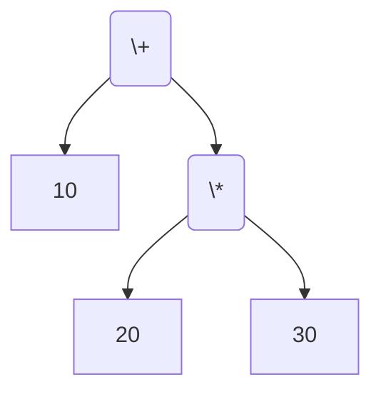
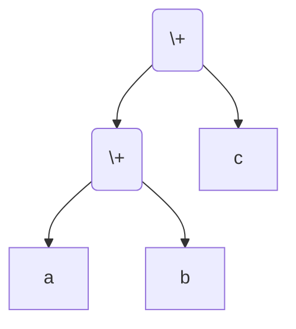
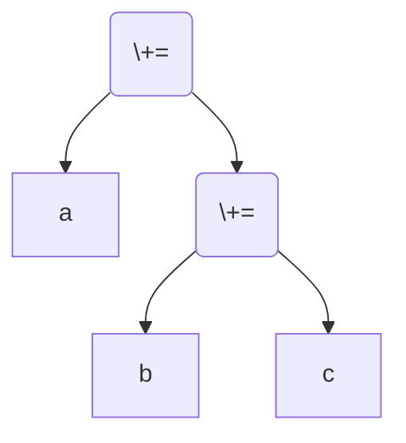

# 3.9 优先级和结合性

**优先级**和**结合性**解决在表达式中“如何加括号”的问题。

## 1. 优先级

优先级决定了当表达式中存在不同运算符时，运算符与操作数绑定的顺序。

比如加法和乘法：

```c
int a = 10 + 20 * 30;
```

因为乘法的优先级高于加法，所以乘法运算符会**优先把它两侧的操作数和它绑定**，形成 `10 + (20 * 30)`：



显然最后 a 的值为 610。

## 2. 结合性

举例：`a + b + c` 中，由于加法具有左结合性，所以操作数 `b` 属于左边的 `+`，形成 `(a + b) + c`。把这个表达式用树形表示就是：



赋值运算是**右结合**的，所以 `a += b += c` 会变成 `a += (b += c)`：



## 3. 优先级和结合性表

下表列举了 C 语言中所有运算符的优先级和结合性。

::: details 如何得知优先级？

标准中没有单独规定运算符的优先级，优先级由语法（文法）推出。

比如下面的 BNF：

```bnf
expr ::= term | expr '+' term | expr '-' term
term ::= factor | term '*' factor | term '/' factor
```

注：本教程中 BNF 均使用 `::=` 表示定义，使用 `|` 表示 alternatives。

这时，我们就说，`+` 与 `-` 具有相同的优先级，`*` 与 `/` 也具有相同的优先级，`+` 和 `-` 的优先级低于 `*` 与 `/`。

:::

| 优先级 |   运算符   | 描述                           | 用法                             |  结合性  |
| :----: | :--------: | :----------------------------- | :------------------------------- | :------: |
|   1    |    `++`    | 后缀自增                       | `左值++`                         | 从左到右 |
|        |    `--`    | 后缀自减                       | `左值--`                         | 从左到右 |
|        |    `()`    | 函数调用                       | `函数指示符(表达式列表)`         | 从左到右 |
|        |    `[]`    | 数组下标                       | `指针表达式[表达式]`             | 从左到右 |
|        |    `.`     | 结构体与联合体成员访问         | `结构体或联合体表达式.成员`      | 从左到右 |
|        |    `->`    | 结构体与联合体成员通过指针访问 | `指向结构体或联合体的指针->成员` | 从左到右 |
|   2    |    `++`    | 前缀自增                       | `++左值`                         | 从右到左 |
|        |    `--`    | 前缀自减                       | `--左值`                         | 从右到左 |
|        |    `+`     | 一元加                         | `+表达式`                        | 从右到左 |
|        |    `-`     | 一元减                         | `-表达式`                        | 从右到左 |
|        |    `!`     | 逻辑非                         | `!表达式`                        | 从右到左 |
|        |    `~`     | 逐位非                         | `~表达式`                        | 从右到左 |
|        |  `(type)`  | 转型                           | `(类型)表达式`                   | 从右到左 |
|        |    `*`     | 解引用                         | `*指针表达式`                    | 从右到左 |
|        |    `&`     | 取址                           | `&左值`                          | 从右到左 |
|        |  `sizeof`  | 取大小                         | `sizeof(类型)`                   | 从右到左 |
|        | `_Alignof` | 对齐要求                       | `_Alignof(类型)`                 | 从右到左 |
|   3    |    `*`     | 乘法                           | `表达式 * 表达式`                | 从左到右 |
|        |    `/`     | 除法                           | `表达式 / 表达式`                | 从左到右 |
|        |    `%`     | 余数                           | `整型表达式 % 整型表达式`        | 从左到右 |
|   4    |    `+`     | 加法                           | `表达式 + 表达式`                | 从左到右 |
|        |    `-`     | 减法                           | `表达式 - 表达式`                | 从左到右 |
|   5    |    `<<`    | 逐位左移                       | `整型表达式 << 表达式`           | 从左到右 |
|        |    `>>`    | 逐位右移                       | `整型表达式 >> 表达式`           | 从左到右 |
|   6    |    `<`     | 小于                           | `表达式 < 表达式`                | 从左到右 |
|        |    `<=`    | 小于等于                       | `表达式 <= 表达式`               | 从左到右 |
|        |    `>`     | 大于                           | `表达式 > 表达式`                | 从左到右 |
|        |    `>=`    | 大于等于                       | `表达式 >= 表达式`               | 从左到右 |
|   7    |    `==`    | 等于                           | `表达式 == 表达式`               | 从左到右 |
|        |    `!=`    | 不等于                         | `表达式 != 表达式`               | 从左到右 |
|   8    |    `&`     | 逐位与                         | `表达式 & 表达式`                | 从左到右 |
|   9    |    `^`     | 逐位异或                       | `表达式 ^ 表达式`                | 从左到右 |
|   10   |    `\|`    | 逐位或                         | `表达式 \| 表达式`               | 从左到右 |
|   11   |    `&&`    | 逻辑与                         | `表达式 && 表达式`               | 从左到右 |
|   12   |   `\|\|`   | 逻辑或                         | `表达式 \|\| 表达式`             | 从左到右 |
|   13   |    `?:`    | 三元条件                       | `表达式1 ? 表达式2 : 表达式3`    | 从右到左 |
|   14   |    `=`     | 简单赋值                       | `左值 = 表达式`                  | 从右到左 |
|        |    `+=`    | 以和赋值                       | `左值 += 表达式`                 | 从右到左 |
|        |    `-=`    | 以差赋值                       | `左值 -= 表达式`                 | 从右到左 |
|        |    `*=`    | 以积赋值                       | `左值 *= 表达式`                 | 从右到左 |
|        |    `/=`    | 以商赋值                       | `左值 /= 表达式`                 | 从右到左 |
|        |    `%=`    | 以余数赋值                     | `左值 %= 表达式`                 | 从右到左 |
|        |   `<<=`    | 以逐位左移赋值                 | `左值 <<= 表达式`                | 从右到左 |
|        |   `>>=`    | 以逐位右移赋值                 | `左值 >>= 表达式`                | 从右到左 |
|        |    `&=`    | 以逐位与赋值                   | `左值 &= 表达式`                 | 从右到左 |
|        |    `^=`    | 以逐位异或赋值                 | `左值 ^= 表达式`                 | 从右到左 |
|        |   `\|=`    | 以逐位或赋值                   | `左值 \|= 表达式`                | 从右到左 |
|   15   |    `,`     | 逗号                           | `表达式, 表达式`                 | 从左到右 |

不用背这个表。多打几个括号，让自己的代码变得更易于理解，这很重要。

## 4. 习题

### 4.1 巩固

<Exercise id="10335" :d="2" :w="1">

下面的程序用同一组对象计算五个表达式：

```c
#include <stdio.h>

int main(void) {
    int a = 10, b = 3, c = 6;

    printf("1: %d\n", a + b << 2);
    printf("2: %d\n", a << b + 2);
    printf("3: %d\n", a & b ^ c);
    printf("4: %d\n", a ^ b | c);
    printf("5: %d\n", a | b && c);
    return 0;
}
```

(1) 不运行，先按优先级表写出五行的值，再编译运行核对。

(2) 用 `gcc -std=c17 -Wall -Wextra` 编译，记下提示出现在哪几行。五行的分组都容易看错，编译器却只提醒了四行：哪一行一条提示都没有？

(3) 第 5 行 `a | b && c` 读起来像「`a`，或者 `b` 与 `c`」，实际却是先算 `|`。写出它的实际分组和值，再写出「先算 `&&`」时的值，两者相差多少？

(4) 第 3、4 行说明 `&`、`^`、`|` 三者之间也有高低之分。按本页的表排出次序，再分别用括号强制先算另一侧（`a & (b ^ c)` 与 `a ^ (b | c)`），说明两行的值各变成多少。

</Exercise>

<Exercise id="10336" :d="2" :w="2">

```c
#include <stdio.h>

int main(void) {
    int a = 10, b = 3, c = 2;
    printf("1: %d %d\n", a - b - c, a - (b - c));

    int p, q;
    p = q = b;
    printf("2: %d %d\n", p, q);

    int x;
    x = 1, 2;
    printf("3: %d\n", x);
    x = (1, 2);
    printf("4: %d\n", x);

    int y = (x = 3, x + 1);
    printf("5: %d %d\n", x, y);

    printf("6: %d\n", (a, b) + 1);
    printf("7: %d\n", a, b + 1);
    return 0;
}
```

(1) 写出七行输出，并为每一处表达式补上括号，标明结合方向。

(2) 第 1 行两个值的差异来自减法左结合：`a - b - c` 是 `(a - b) - c`。第 2 行的 `p = q = b` 却是先算 `q = b`，为什么同一张表里减法和赋值的方向相反？

(3) 第 3、4 行说明逗号运算符在第 3 行里根本不属于 `x` 的初始化式。按优先级表解释：`=` 与 `,` 哪一个优先级低？`x = 1, 2;` 作为一个完整表达式，它的结果值是多少、被谁丢弃了？

(4) 第 6 行 `(a, b) + 1` 得到 `b + 1`。把括号去掉写成 `a, b + 1` 会怎样？第 7 行 `printf` 里正是这种写法，编译时出现了什么提示？它实际打印出几个数？

</Exercise>

### 4.2 编程

<Exercise id="10337" :d="3" :w="2">

下面的程序要从 `0xDEADBEE0` 里取出最高字节和次高字节、算 `2 * n + 1`、判断最低四位是否全为 0：

```c
#include <stdint.h>
#include <stdio.h>

int main(void) {
    uint32_t ctrl = 0xDEADBEE0u;
    int n = 6;

    unsigned high_byte = ctrl & 0xFF000000u >> 24;
    unsigned mid_byte = ctrl & 0x00FF0000u >> 16;
    int twice_plus_one = n << 1 + 1;
    int low_nibble_zero = !ctrl & 0xFu;

    printf("high_byte = 0x%X\n", high_byte);
    printf("mid_byte = 0x%X\n", mid_byte);
    printf("twice_plus_one = %d\n", twice_plus_one);
    printf("low_nibble_zero = %d\n", low_nibble_zero);
    return 0;
}
```

(1) 编译运行，记下输出。四行里有两行编译器给了提示，另外两行一声不响地算错了：哪两行是后者？

(2) 写出四处表达式各自的实际分组，说明每一处被哪个优先级更高的运算符拆开。

(3) 四处都要靠加括号改正：前两处把 `>>` 挪到 `&` 的外面，`n << 1 + 1` 是让 `+` 先算，`!ctrl & 0xFu` 则是让 `&` 先算再取反。改正后使程序输出：

```text
high_byte = 0xDE
mid_byte = 0xAD
twice_plus_one = 13
low_nibble_zero = 1
```

前两处也可以改写成 `(ctrl >> 24) & 0xFFu` 这种「先移位、后取掩码」的顺序，结果相同。说明两种顺序各自依赖哪条优先级规则，以及为什么工程代码里更常写后者。

(4) 把 `ctrl` 换成 `0x12120012u`，未改正的程序算出的 `high_byte`、`mid_byte` 恰好都是 `0x12`，与正确答案完全一致。再看 `0x34000034u`：`high_byte` 仍然碰巧正确，`mid_byte` 却错了。结合这两个数据说明「拿一组碰巧合适的数据验收」为什么靠不住，再另外给出一个（不是 `0xDEADBEE0`）能同时暴露两处字节错误的取值。

</Exercise>

### 4.3 综合与挑战

<Exercise id="10338" :d="4" :w="2">

一个 32 位控制字分成三段：第 3～0 位放 `mode`，第 13～8 位放 `count`，第 31 位放 `flag`。实现下面三个函数：

```c
#include <stdint.h>

uint32_t word_pack(unsigned mode, unsigned count, unsigned flag);
unsigned word_get(uint32_t word, unsigned shift, unsigned width);
uint32_t word_set(uint32_t word, unsigned shift, unsigned width, uint32_t value);
```

要求：

1. `word_pack` 按上面的布局拼出控制字，超出字段宽度的位被截断。
2. `word_get` 先从 `width` 造出掩码，再移到目标位置取出该段。
3. `word_set` 只改目标段，其余位保持不变。
4. `-Wall -Wextra` 下无警告，并用下面的数据验收：

```text
word_pack(3, 7, 0)               = 0x00000703
word_pack(15, 63, 1)             = 0x80003F0F
word_pack(5, 40, 1)              = 0x80002805
word_get(0xDEADBEEF, 8, 8)       = 0xBE
word_set(0xDEADBEEF, 8, 8, 0x12) = 0xDEAD12EF
```

5. 把 `word_get` 中的 `(word & (mask << shift)) >> shift` 改成 `word & mask >> shift`，在 `shift` 为 8 和 0 时各运行一次。两次结果有什么不同？为什么只用 `shift = 0` 的用例测不出这个错误？

6. 把 `word_set` 里的 `~(mask << shift)` 改成 `~mask << shift`，`shift = 8` 时结果变成什么？这两处错误都属于「少一层括号」，但一处的症状是取错字段、另一处是破坏无关的位。分别说明为什么。

</Exercise>
