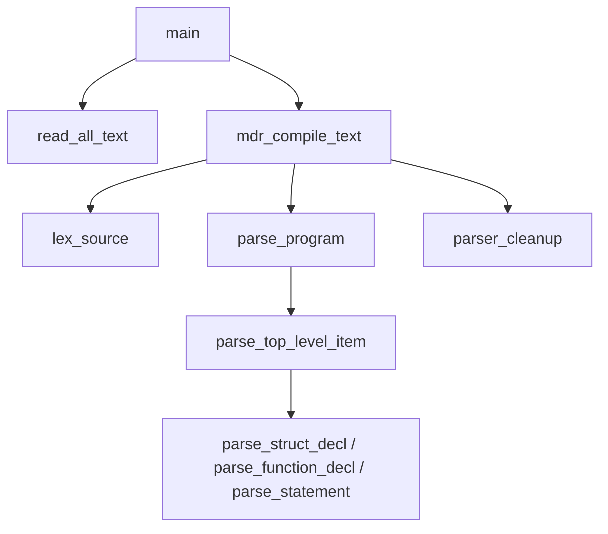

# 1. 源码阅读与案例方法

打开一个陌生的 C 语言工程，迎面而来的往往是层层嵌套的目录、成百上千个源文件，以及一段语焉不详的构建说明。初涉其中的开发者常会陷入两种典型的困境：一种是试图从第一个文件的首行按部就班地读下去，往往在翻阅了几百行定义后就迷失了方向；另一种则是随手修改几行逻辑看程序产生什么反应，却在程序第一次崩溃抛出段错误时茫然不知所措。

面对复杂的工业级或教学级代码库，更从容的切入方式是建立一套具备稳定可复现性的探索路径：先明确并钉住代码版本，按照关闭优化的调试配置把程序在本地真正运行起来；接着从主入口与核心数据结构出发，勾勒出模块交互的骨干脉络；随后借助符号搜索、交互式调试器、测试覆盖率以及 Git 历史记录来解答阅读中的具体疑惑；最后通过提出并验证具备可证伪性的假设，把对架构的认知稳定沉淀下来。掌握这套系统性的读法，便能从容应对数百行至数十万行不同规模的 C 项目，也能清晰理解本模块收录的八个工程案例在平台、规模与前置依赖上的演进逻辑。后续各个案例都会遵循相同的节奏递进展开，相关的调试工具与排查命令则统一在本篇中完整交待。

本部分引用的上游项目代码均固定在具体提交与发布版本上：kilo 取自提交 `323d93b`（2025-01-04，`kilo.c` 共 1308 行），Redis 取自官方版本 8.10.2，SQLite 取自版本 3.46.1，Mdr Lang 则采用当前仓库自带的实现版本（其中 C 版实现对应提交 `351fd42`）。正文中提及的全部源码文件与行号，均以这些基准版本为准。

## 1. 本部分的案例与读法

本部分有八个案例。四个规模较大的各自成章，其中 kilo、Redis 和 SQLite 是上游项目，Mdr Lang 用的是仓库里的实现：

| 案例 | 内容 | 平台 | 规模 | 主要前置 |
| --- | --- | --- | --- | --- |
| [kilo](/教程/正文/项目案例/kilo/2_1_源码阅读_kilo)（2.1、2.2） | 终端文本编辑器，单个 C 文件，直接向终端发送 VT100 转义序列 | Linux（Debian 13，gcc 14.2）、macOS | `kilo.c` 1308 行 | [系统编程 13](/教程/正文/系统编程/13_终端_伪终端与作业控制) |
| [Redis](/教程/正文/项目案例/Redis/5_1_架构与请求生命周期)（5.1–5.5） | 内存数据结构服务器：事件循环、协议解析、命令表、持久化 | Linux（Debian 13，gcc 14.2） | `src/` 下 126 个 `.c`、84 个 `.h`，共约 20.8 万行 | [系统编程 10](/教程/正文/系统编程/10_套接字编程)、[11](/教程/正文/系统编程/11_非阻塞IO与IO多路复用)、[12](/教程/正文/系统编程/12_事件循环)、[数据结构 3](/教程/正文/数据结构与算法/数据结构/3_散列表) |
| [SQLite](/教程/正文/项目案例/SQLite/6_1_架构概述)（6.1–6.4） | 嵌入式 SQL 数据库引擎：B 树、字节码虚拟机、VFS | 本机可构建 | 合并源码 `sqlite3.c` 约 25.8 万行 | [数据结构 10](/教程/正文/数据结构与算法/数据结构/10_B树与外存数据结构) |
| [Mdr Lang](/教程/正文/项目案例/Mdr_Lang/8_1_项目概述)（8.1–8.4） | 编译器前端：词法、语法与语义检查，C 与 JS 两个实现，代码在仓库内 | 本机可构建 | C 版 2898 行，JS 版 1351 行 | [开发与工程基础 20](/教程/正文/开发与工程基础/20_JSON解析器工程化) |

另外四个也是本仓库里的教学项目，代码就在 `code/项目/` 下，读的时候可以随时和正文对照：

- [Mdr Chat Room](/教程/正文/项目案例/Mdr_Chat_Room/3_1_项目概述)：用 `poll()` 同时照看多个连接的聊天室服务器与命令行客户端，双方走一套自定义的长度前缀协议。
- [Mdr Server](/教程/正文/项目案例/Mdr_Server/4_1_项目概述)：`epoll` 加非阻塞套接字的 HTTP/1.1 静态文件服务器，带长连接、空闲超时和优雅退出。
- [MdrDB](/教程/正文/项目案例/MdrDB/7_1_项目概述)：单文件数据库，页缓存、B+ 树、记录编码和回滚日志各写了一遍。
- [MdrOS](/教程/正文/项目案例/MdrOS/9_1_项目概述)：x86 平台上的教程式操作系统，从引导程序一直写到中断、内存管理和多任务。

每个案例章节都遵循统一的节奏推进：先宏观梳理工程设计并绘制架构蓝图，再挑选一条典型执行链路展开深度的专题跟踪，最后落脚于实际的构建、调试与代码改动任务。前面的步骤帮助我们在陌生代码库中建立全景地图，最后的动手环节则促使外部代码真正内化为自己的工程积累。

第一次探索真实世界的开源项目时，推荐以 kilo 作为起点。它全部逻辑收敛在单个源文件内，省去了复杂构建系统的干扰，遇到的每个细节都能精确定位到具体的代码行。完成整篇阅读后，即可对照 2.2 节的调试与修复任务进行实战检验。在此之后，可以在 Redis 与 SQLite 之间挑选一个完整通读整章，尽量避免同时并行两套大型项目。这两者的体量都在二十万行以上，探索它们的核心诀窍在于专注沿着单条主线走到底：在 Redis 中追踪一条命令从网络层 `accept` 接入直到数据写回客户端的全流程，在 SQLite 中跟随一条 SQL 语句经历语法解析最终步入 VDBE 虚拟机的全路径。若并行探索，大脑中好不容易建立起的系统上下文很容易产生相互干扰与遗忘。

## 2. 先让程序跑起来

在真正开始逐行推敲代码之前，首要任务是在本地把程序顺利编译并运行起来。尚未运行的代码往往只能依赖主观推测，而缺乏实际运行环境作为支撑的推论，既无法通过调试器验证，也无法通过打桩输入来检验。

### 2.1 钉住版本

第一步是明确并记录当前所处的精确版本，确保眼前阅读的代码文本与本地运行的可执行文件严格出自同一份源码：

::: terminal title="bash - 钉住 kilo 的版本"

```console
$ git clone https://github.com/antirez/kilo
$ cd kilo
$ git checkout 323d93b
$ git log -1 --format="%h %ad %s" --date=short
323d93b 2025-01-04 Fix function declaration missing void.
$ git describe --always
323d93b
$ git status --short
```

:::

`git status --short` 没有产生任何输出，表明当前工作区处于干净状态，没有任何未提交的代码修改。将 `git log -1` 打印出的提交哈希与日期记录到工作笔记中，日后每次重新打开工程都可以对照校验。当仓库打过发布标签时，`git describe` 会优先给出标签名并附带与标签相隔的提交计数；由于 kilo 项目未打过标签，直接执行该命令会提示 `No names found, cannot describe anything.`，此时追加 `--always` 参数即可稳妥地回退至显示短提交哈希。

在代码阅读与调试排查过程中，版本不一致是许多无谓困扰的根源：网页浏览器中浏览的是最新的主分支，本地机器上运行的却是半年前打包的旧版本，诸如“某个函数为何凭空消失”“某处逻辑为何与文档记载不一致”等疑惑便会接踵而至。正文中针对上游源码给出的每一处定位都明确标注了文件名与行号，目的正是让每一次推演和对照都有据可依。

### 2.2 按调试配置构建

所谓的调试配置，核心在于关闭编译器优化并完整保留符号调试信息，在 CMake 构建体系中通常对应 `CMAKE_BUILD_TYPE=Debug`，直接传递给 GCC 的编译参数则是 `-O0 -g`。一旦开启了编译器优化，编译器可能会将许多对象直接分配到寄存器中，甚至整段删减掉看似未使用的函数或分支逻辑。如此一来，在调试器中观察到的运行期对象状态可能与源文件字面逻辑产生偏离，断点也有可能跳跃至难以预料的代码行。在研读与动态跟踪代码时，应当尽量避免这类优化重排带来的干扰。

以 Mdr Lang 的 C 语言前端实现为例。如果工程路径中包含中文字符，而在 Windows 控制台默认的 936 代码页环境下，程序打印中文路径时往往会出现乱码显示。为了获得整洁一致的终端输出，可以将工程复制至全 ASCII 字符的独立路径下再行配置与构建。以下演示均在 `D:\mdr\read` 目录下展开：

::: terminal title="PowerShell - 用 Debug 配置构建 mdrcc"

```text
> cd D:\mdr\read
> cmake -S compiler_c -B compiler_c\build -G Ninja -DCMAKE_BUILD_TYPE=Debug -DCMAKE_EXPORT_COMPILE_COMMANDS=ON "-DCMAKE_C_FLAGS=-D__USE_MINGW_ANSI_STDIO=1"
-- The C compiler identification is GNU 13.2.0
-- Detecting C compiler ABI info
-- Detecting C compiler ABI info - done
-- Check for working C compiler: D:/Software/Strawberry/c/bin/gcc.exe - skipped
-- Detecting C compile features
-- Detecting C compile features - done
-- Configuring done (0.8s)
-- Generating done (0.0s)
-- Build files have been written to: D:/mdr/read/compiler_c/build
> cmake --build compiler_c\build
[1/3] Building C object CMakeFiles/mdrcc.dir/src/main.c.obj
[2/3] Building C object CMakeFiles/mdrcc.dir/src/mdr_compiler.c.obj
[3/3] Linking C executable mdrcc.exe
```

:::

`__USE_MINGW_ANSI_STDIO=1` 是为了让 MinGW 的 `printf` 按 C99 检查格式串，否则源码里的 `%zu` 会触发 `-Werror`。原因和完整输出在 [8.1](/教程/正文/项目案例/Mdr_Lang/8_1_项目概述)，这里照抄参数即可。换成 Linux 或 MSVC，这个宏不需要，其余各项含义不变。

### 2.3 跑一个例子和一个反例

构建完成后，先各跑一个能通过和一个必须失败的输入。正例证明构建可用，反例把一条诊断和一段最小输入绑定起来，后面用调试器追诊断时直接拿它当靶子。

反例只有四行，含义是给 `i32` 的对象赋一个 `bool`：

```c
function main() -> () {
    let x: i32 = 1;
    x = true;
}
```

::: terminal title="PowerShell - 一个正例与一个反例"

```text
> cd D:\mdr\read\example
> ..\compiler_c\build\mdrcc.exe range_step.mdr
OK: range_step.mdr
> cd ..
> .\compiler_c\build\mdrcc.exe bad.mdr
bad.mdr:3:7: assignment type mismatch: expected i32, got bool
```

:::

两次调用的退出码分别为 0 和 1。不妨将这两行控制台输出及其输入文件一同整理到阅读笔记中：诊断输出里的 `3:7` 清晰标明了赋值运算符所在的列号，而 `expected i32, got bool` 则是类型检查器给出的具体结论。到了 4.1 节借助调试器展开调用栈时，这些信息都能严丝合缝地与回溯帧相互印证。

在验证构建产物时，仅运行合法正例并不充分。正例仅仅说明编译器能够接受预期的输入，而反例才能切实证明类型系统的校验分支正在忠实地履行检查职责。设计或寻找反例的方法很轻巧：既可以从项目自带的 13 组测试用例中选取贴合当前主题的一段，也可以观察正在研读的函数逻辑，将其中的失败校验分支提炼为一段最小的可触发输入。

### 2.4 让编辑器看懂构建参数

在执行 CMake 配置时追加 `-DCMAKE_EXPORT_COMPILE_COMMANDS=ON`，构建系统会自动生成一份 `compile_commands.json` 文件。这份编译数据库完整记录了构建每个源文件时所使用的底层编译指令。其中一条典型记录呈现如下：

```json
{
  "directory": "D:/mdr/read/compiler_c/build",
  "command": "D:\\Software\\Strawberry\\c\\bin\\gcc.exe -ID:/mdr/read/compiler_c/include -D__USE_MINGW_ANSI_STDIO=1 -g -std=c11 -Wall -Wextra -Wpedantic -Werror -o CMakeFiles\\mdrcc.dir\\src\\main.c.obj -c D:\\mdr\\read\\compiler_c\\src\\main.c",
  "file": "D:\\mdr\\read\\compiler_c\\src\\main.c",
  "output": "CMakeFiles\\mdrcc.dir\\src\\main.c.obj"
}
```

clangd 这类语言服务器读这个文件，就能得到和构建完全一致的包含路径、宏定义和标准版本。少了它，编辑器会按自己的猜测补全和跳转，`-D__USE_MINGW_ANSI_STDIO=1` 这类只在命令行上出现的宏就丢了，代码里被 `#if` 包住的分支也会标错。生成的编译命令同时说明了当前是 Debug 配置（`-g`，没有 `-O2`），读代码时顺手核对一眼。

::: tip 只有部分生成器支持这个选项

`CMAKE_EXPORT_COMPILE_COMMANDS` 只对 Makefile 和 Ninja 生成器有效，Visual Studio 与 Xcode 生成器会忽略它。在 Windows 上用 Ninja 构建，得到的是一份不带平台工程文件的编译数据库，正好适合阅读。

:::

<Quiz
  type="single"
  :options="[
    { label: 'git log -1 打出的提交号', value: 'A' },
    { label: 'compile_commands.json 里的 -g', value: 'B' },
    { label: 'git status --short 的输出为空', value: 'C' },
    { label: '上面三项合起来才对', value: 'D' }
  ]"
  answer="D"
>

<template #question>

要确认“读的代码和跑的程序是同一版本”，至少需要看哪些信息？

</template>

正确答案是 **D**。提交号固定了源码，`git status` 说明工作区没有未提交的改动，`-g` 说明跑的是带调试信息的构建。单项都不足以排除“读的是这个提交、跑的是另一个构建”的情况。

</Quiz>

## 3. 从入口与类型读起

程序从哪里开始、数据怎么组织，这两个问题定下来，剩下的代码大都能按图索骥。

### 3.1 从入口画出调用骨架

`main.c` 只有 105 行，读一遍用不了几分钟。它先读入整个文件，再把源文本交给 `mdr_compile_text`，最后按返回值打印 `OK:` 或诊断。具体工作在 `mdr_compile_text` 里：先切记号，再交给语法分析，收尾时释放符号表和记号数组。



这张图一共八个节点，作用是把后面要读的东西分成两半：从 `main` 到 `mdr_compile_text` 是输入输出，`mdr_compile_text` 以下做语言处理。诊断可能来自 `lex_source`（词法错误），也可能来自 `parse_program` 往下的一整支（语法与语义错误）；符号表只存在于 `parse_program` 使用的 `parser` 里。带着这两个范围去读，比从文件头往下翻快得多。

画图时不必追求准确到每个函数。第一版只要把“读文件—词法—语法”这三段分开，读的过程中再补细节；画错的边在读到对应代码时自然会改过来。

### 3.2 先读类型

Rob Pike 在 **_Notes on Programming in C_** 里把这条规则讲得很直接：数据决定算法。选对了数据结构，算法往往自己就浮现出来；选错了，再聪明的算法也只能绕着数据打转。所以读完入口之后，先看类型，再看函数。

Exuberant Ctags 可以列出文件里所有的 typedef，不用读完全文。`--sort=no` 让它按文件中的出现顺序输出，省得读者在排序后的表里来回跳：

::: terminal title="bash - 列出 mdr_compiler.c 的 typedef"

```console
$ ctags --sort=no -x --c-kinds=t src/mdr_compiler.c
token_kind       typedef      19 src/mdr_compiler.c } token_kind;
token            typedef      29 src/mdr_compiler.c } token;
token_vec        typedef      35 src/mdr_compiler.c } token_vec;
semantic_type_kind typedef      59 src/mdr_compiler.c } semantic_type_kind;
semantic_type    typedef      65 src/mdr_compiler.c } semantic_type;
lexer            typedef      74 src/mdr_compiler.c } lexer;
parser           typedef      91 src/mdr_compiler.c } parser;
symbol_kind      typedef      98 src/mdr_compiler.c } symbol_kind;
semantic_symbol  typedef     116 src/mdr_compiler.c } semantic_symbol;
name_entry       typedef     125 src/mdr_compiler.c } name_entry;
name_vec         typedef     131 src/mdr_compiler.c } name_vec;
callee_kind      typedef     137 src/mdr_compiler.c } callee_kind;
expr_meta        typedef     143 src/mdr_compiler.c } expr_meta;
expr_result      typedef     149 src/mdr_compiler.c } expr_result;
type_vec         typedef     155 src/mdr_compiler.c } type_vec;
```

:::

::: tip ctags 找不到临时目录

Exuberant Ctags 靠 `TMPDIR` 找临时目录。环境里没有它时，它会报 `cannot open temporary file : No such file or directory` 并直接退出；在 Git Bash 里设上 `export TMPDIR="$(cygpath -w /tmp)"` 即可。只设 `TMP` 或 `TEMP` 不够，本机的 5.8 版在 `TMPDIR` 缺失时不会退回到这两个名字。

:::

五列依次是名字、种类、行号、文件名和该行的开头。行号落在 typedef 的最后一个字段上，即 `}` 所在的那一行，往上就能找到 `typedef` 的开头。十五个类型里，先读三个：

- `token`（21～29 行）：记号。`begin` 指向源文本里的起点，`len` 是长度，两者合起来是一个不复制内容的切片；后面四个字段是起止行列。
- `parser`（76～91 行）：语法分析器的全部状态，包括记号数组、当前位置、符号表、作用域标记和循环深度。
- `semantic_symbol`（100～116 行）：符号表里的一项，记录名字、种类、类型、参数表和成员表。

`parser` 里的 `scope_marks` 值得单独看一遍。知道了它的含义（每一项是进入某个作用域时的 `symbol_count`），第 5 节的作用域追踪表就不难读懂。用 `rg` 一次找出这个成员所有的读写位置：

::: terminal title="bash - 找出某个成员的全部引用"

```console
$ rg -n scope_marks src/mdr_compiler.c
85:    size_t *scope_marks;
334:        .scope_marks = NULL,
2150:        size_t *mem = (size_t *)realloc(p->scope_marks, next * sizeof(*mem));
2154:        p->scope_marks = mem;
2157:        p->scope_marks[p->scope_count++] = p->symbol_count;
2165:    size_t begin = p->scope_marks[p->scope_count - 1u];
2205:    size_t begin = p->scope_marks[p->scope_count - 1u];
2319:    free(p->scope_marks);
2320:    p->scope_marks = NULL;
```

:::

这九行里，85 是结构体成员，334 是初始化，2319、2320 是释放，参与作用域逻辑的只有三处：2157 写入标记，2165 与 2205 读取标记。读这三个函数的上下文，就掌握了作用域的整个机制，不必把一千多行的语义检查从头翻到尾。

### 3.3 按函数名前缀分组

同一个命令换成 `--c-kinds=f`，列出文件里所有函数定义，共 91 个。把名字按第一段前缀归类，模块划分自己就出来了：

::: terminal title="bash - 按前缀统计函数"

```console
$ ctags --sort=no -x --c-kinds=f src/mdr_compiler.c | awk '{print $1}' | grep -o '^[a-z]*_' | sort | uniq -c | sort -rn
     32 parse_
     27 parser_
     17 semantic_
      7 token_
      2 type_
      2 name_
      1 set_
      1 mdr_
      1 lex_
      1 is_
```

:::

`parse_` 承载着语法分析中各层优先级表达式与语句的推导，`parser_` 汇集了记号流操作与符号表维护的基础工具函数，而 `semantic_` 则专职处理静态类型计算与约束检查。函数名前缀正是开发者有意识划分出的架构分界线，也构成了快速切入代码的天然路标：若想理清某种语法构造是如何推导的，直接定位至对应的 `parse_` 函数即可；若要探究类型兼容性如何判定，则以 `semantic_type_compatible` 作为探索起点。

面对这 91 个函数，逐行顺读或者按字典序排列阅读往往会陷入琐碎的细节泥潭。更舒展的策略是先从主驱动函数 `parse_program` 和 `parse_top_level_item` 切入，建立顶层解析的全局意识；接着挑选一类最关心的语法构造（例如绑定语句的解析函数 `parse_binding_statement`），顺着层层调用的轨迹深入挖掘。其余分支函数不必急于一口气读完，留待后续遇到对应语法节点时再按需索引即可。

### 3.4 大项目先读它自己的地图

面对数万行乃至数十万行规模的工程，原作者往往已经在仓库中留下了宏观维度的导览材料。Redis 7.2 的 README 文档中特设了“Redis internals”章节，逐个文件梳理了职责划分；尽管在 8.10.2 版本的官方文档中该节被重新调整为面向构建与部署的说明，但其核心子系统的归属关系依然保持稳定，5.1 节便是对照这套划分脉络展开的。类似地，SQLite 官方网站上的 ***Architecture of SQLite*** 将整体架构自顶向下划分为接口、词法分析、语法分析、代码生成、虚拟机、B 树、页缓存以及操作系统抽象接口等层次，6.1 节同样紧扣这八个分层逐一推进。

当源码规模超过一万行时，先花上二十分钟通读项目自带的设计说明与架构文档，往往比直接扎进源文件更具全局视野。如果遇到没有现成架构文档的项目，则不妨借助前文介绍的入口剖析与前缀分组方法，自底向上勾勒出一张适合自己的导览草图。

<Quiz
  type="single"
  :options="[
    { label: '按行号顺序从第一个函数读起', value: 'A' },
    { label: '先读入口和核心类型，再按前缀挑一组函数', value: 'B' },
    { label: '把每个函数的注释都读一遍', value: 'C' },
    { label: '先读单元测试，不读实现', value: 'D' }
  ]"
  answer="B"
>

<template #question>

面对一个几千行的 C 文件，下面哪一种读法最快建立起可用的地图？

</template>

正确答案是 **B**。入口给出流程，类型给出数据的组织方式，前缀把函数切成几块。行号顺序会把相关的函数拆散，注释往往只讲局部，单元测试反映行为，看不出结构。

</Quiz>

## 4. 用工具回答具体问题

前两节建立的是地图，接下来的理解来自一个个具体问题：这条诊断从哪里产生，这次运行到底执行了哪些代码，这一行为什么写成这样。三个问题各有一组工具。

### 4.1 这条诊断从哪里产生：调试器与回溯

先量一下问题的规模。`parser_fail` 是产生诊断的函数，用 `rg` 数一数有多少处调用：

::: terminal title="bash - 数一数诊断的出口"

```console
$ rg -c 'parser_fail(_type_mismatch)?\(' src/mdr_compiler.c
66
```

:::

这 66 行里，两个函数各有一次声明和一次定义，占去 4 行，包装函数内部又有一行转发，只有剩下的 61 行会产生诊断。其中 45 处直接调 `parser_fail`，16 处调 `parser_fail_type_mismatch`。逐个读这 61 处的上下文，一两个小时就没了，而且大部分和手上的问题无关。把反例交给调试器，断点设在这一个出口上，运行时自然会告诉你是哪一条路径走到这里。

::: terminal title="bash - 在 parser_fail 处断下并回溯"

```console
$ gdb -q -batch -ex "break parser_fail" -ex "run bad.mdr" -ex "bt" compiler_c/build/mdrcc.exe
Breakpoint 1 at 0x1400093bf: file D:/mdr/read/compiler_c/src/mdr_compiler.c, line 2107.
[New Thread 21144.0x64a8]

Thread 1 hit Breakpoint 1, parser_fail (p=0x5ffc30, where=0x102bc0, message=0x5ff5d0 "assignment type mismatch: expected i32, got bool") at D:/mdr/read/compiler_c/src/mdr_compiler.c:2107
2107	    if (where == NULL) {
#0  parser_fail (p=0x5ffc30, where=0x102bc0, message=0x5ff5d0 "assignment type mismatch: expected i32, got bool") at D:/mdr/read/compiler_c/src/mdr_compiler.c:2107
#1  0x00007ff620a7b4cf in parser_fail_type_mismatch (p=0x5ffc30, where=0x102bc0, context=0x7ff620a84ad2 <k_operators+1874> "assignment type mismatch", expected=..., actual=...) at D:/mdr/read/compiler_c/src/mdr_compiler.c:2721
#2  0x00007ff620a75a2c in parse_expression_or_assignment_statement (p=0x5ffc30) at D:/mdr/read/compiler_c/src/mdr_compiler.c:1366
#3  0x00007ff620a74c22 in parse_statement (p=0x5ffc30) at D:/mdr/read/compiler_c/src/mdr_compiler.c:1143
#4  0x00007ff620a7487c in parse_function_block (p=0x5ffc30, generic_names=0x5ffaa0, param_names=0x5ffa80, has_receiver=false, receiver_type=...) at D:/mdr/read/compiler_c/src/mdr_compiler.c:1068
#5  0x00007ff620a74230 in parse_function_decl (p=0x5ffc30) at D:/mdr/read/compiler_c/src/mdr_compiler.c:942
#6  0x00007ff620a73257 in parse_top_level_item (p=0x5ffc30) at D:/mdr/read/compiler_c/src/mdr_compiler.c:673
#7  0x00007ff620a731ae in parse_program (p=0x5ffc30) at D:/mdr/read/compiler_c/src/mdr_compiler.c:658
#8  0x00007ff620a71e52 in mdr_compile_text (file_path=0xf8ec0 "bad.mdr", source=0xfba00 "function main() -> () {\n    let x: i32 = 1;\n    x = true;\n}\n", dump_tokens=false, error=0x5ffd30) at D:/mdr/read/compiler_c/src/mdr_compiler.c:342
#9  0x00007ff620a71b7c in main (argc=2, argv=0xf8e70) at D:/mdr/read/compiler_c/src/main.c:95
```

:::

`-batch` 让 gdb 执行完命令就退出，适合一次性的调查；`-ex` 依次给出要执行的命令；最后一个是待调试的程序。三件事按顺序发生：在第 2107 行的 `parser_fail` 上设断点，运行程序并送上反例，命中后打印回溯（backtrace）。输出里每帧的地址和实参值都照实保留，因为它们说明断点确实停在运行中的进程里，是一份真实的执行结果。

::: concept src-reading-backtrace title="回溯的读法"

回溯是一串调用帧（frame）。`#0` 是当前正在执行的函数，编号每加一就上移一层调用者，最大编号的那个帧最接近 `main`。每一帧给出函数名、实参和它停在源码的哪一行。函数之间的调用关系就是相邻两帧的关系：`#k` 直接调用了 `#k-1`。

:::

读上面的回溯，从下往上更顺：`main`（`#9`）调 `mdr_compile_text`（`#8`），后者再调 `parse_program`（`#7`）。`parse_program` 在循环里调 `parse_top_level_item`（`#6`），遇到 `function` 关键字后调 `parse_function_decl`（`#5`），再进函数体 `parse_function_block`（`#4`），循环处理语句时调 `parse_statement`（`#3`），遇到一句赋值表达式后调 `parse_expression_or_assignment_statement`（`#2`），后者发现左右类型不相容，交给 `parser_fail_type_mismatch`（`#1`）拼出消息，最后由 `parser_fail`（`#0`）记录错误。

帧 `#1` 还有两个细节。`context` 的值显示为 `<k_operators+1874>`，因为消息的前缀是一个字符串字面量，调试信息把它归到只读数据段的一个偏移上，后面跟着的 `"assignment type mismatch"` 是消息内容。`expected=...` 和 `actual=...` 是 `semantic_type` 结构体，gdb 默认不展开，要看它们得再敲 `frame 1` 和 `print expected`。

每帧的行号也能说明问题：`#2` 停在 1366 行，那里正是赋值类型检查调用 `parser_fail_type_mismatch` 的位置；`#3` 停在 1143 行，是语句分派里调用表达式语句的那一行。把这几行打开，回溯就成了一条带坐标的路径。

::: generate src-reading-backtrace-walkup kind=explanation concepts=src-reading-backtrace

面向第一次用 gdb 读回溯的读者，逐帧走一遍这份回溯：说明 `#0` 为什么是当前帧、编号为什么越大越靠近 `main`，解释每一帧的实参里哪个是源码位置、哪个是运行期对象，指出 `context=<k_operators+1874>` 这种显示是怎么来的，并说明如何用 `frame N`、`print`、`list` 在帧之间移动，把一次回溯变成对一段源码的阅读。不要重复 4.1 已经讲过的内容，也不要展开 gdb 的其余命令。

:::

### 4.2 这次运行执行了哪些代码：覆盖率

第二个问题是执行范围：读一个具体输入时，哪些函数会被执行，哪些完全用不上。GCC 的覆盖率工具 gcov 能直接回答。

构建时加 `--coverage`（等价于 `-fprofile-arcs -ftest-coverage`），运行结束后用 `gcov` 把计数还原成逐行数据。下面的命令在一个同时放着两个 `.c` 文件和 `include/` 目录的工作目录里执行。注意 GCC 11 起，一次编译并链接多个源文件时，生成的 `.gcda` 名字会带上输出文件前缀，`gcov mdr_compiler.c` 就找不到数据文件了。所以这里分两步：先用 `-c` 分别编译，再链接。

::: terminal title="bash - 带覆盖率构建"

```console
$ gcc -std=c11 -g -O0 --coverage -D__USE_MINGW_ANSI_STDIO=1 -Iinclude -c main.c mdr_compiler.c
$ gcc --coverage main.o mdr_compiler.o -o mdrcc_cov.exe
$ ./mdrcc_cov.exe range_step.mdr
OK: range_step.mdr
```

:::

然后对 `mdr_compiler.c` 运行 `gcov -f`，`-f` 让它按函数汇总：

::: terminal title="bash - gcov -f 的函数覆盖率"

```console
$ gcov -f mdr_compiler.c
Function 'token_kind_name'
Lines executed:0.00% of 17

Function 'set_error'
Lines executed:0.00% of 7

Function 'token_vec_free'
Lines executed:100.00% of 6

...

Function 'parse_range'
Lines executed:75.00% of 24

...

Function 'parse_for_statement'
Lines executed:0.00% of 31

Function 'parse_function_decl'
Lines executed:0.00% of 113

Function 'parse_struct_decl'
Lines executed:0.00% of 85

...

Function 'lex_source'
Lines executed:48.94% of 188

Function 'mdr_compile_text'
Lines executed:54.55% of 22

File 'mdr_compiler.c'
Lines executed:28.38% of 1614
```

:::

`range_step.mdr` 里只有 `let` 声明、`print` 调用和范围表达式，所以 `parse_range` 执行了 75% 的行，`lex_source` 执行了约一半的行，而 `parse_function_decl`、`parse_struct_decl`、`parse_for_statement` 一行都没执行。整份文件只覆盖了 28.38% 的可执行行。

这正是想要的信息：读这个输入涉及的范围表达式逻辑时，0% 的函数可以先跳过；反过来，如果某个函数在预期该执行的场景下显示 0%，说明你的理解或者输入有问题，先查这个矛盾，不要继续往下读。

同一个二进制可以反复运行、累积计数；删掉 `.gcda` 再跑一次、换一个输入，两次的差集就是新输入特有的路径。单独跑 `counter.mdr` 时，因为它用到了结构体和方法，整份文件的覆盖率是 48.76%，`parse_function_decl` 是 57.52%，`parse_struct_decl` 是 45.88%，而 `parse_for_statement` 仍然是 0%。对照这两组数字，`range_step.mdr` 没碰到的结构体与方法路径一目了然。

::: details 完整的 gcov 输出

首次运行 `range_step.mdr` 时，`gcov -f mdr_compiler.c` 一共打印 288 行，列出 93 个函数条目的覆盖率（含链接进来、被当作函数统计的 `printf`、`snprintf`），其中 40 个条目为 0%。逐一看完没有必要，按函数名前缀挑你关心的那几组即可。`.gcov` 后缀的文本文件里带每一行的执行次数，要定位到具体分支时看它。

:::

<Quiz
  type="single"
  :options="[
    { label: '这些函数被编译器优化掉了', value: 'A' },
    { label: '它们存在，但这次运行的输入没有走到', value: 'B' },
    { label: '覆盖率统计有 bug', value: 'C' },
    { label: '这些函数只在错误处理时执行，所以永远是 0%', value: 'D' }
  ]"
  answer="B"
>

<template #question>

`gcov -f` 显示 `parse_function_decl` 为 0%，说明什么？

</template>

正确答案是 **B**。覆盖率是运行期计数，0% 只表示这份输入没有让它执行。换一个定义函数的输入，同一个函数就会从 0% 变成几十个百分点。A 也不成立：`-O0` 下没有优化可言，而且 gcov 的记录是编译期生成的，与执行多少无关。

</Quiz>

### 4.3 这行代码为什么是这样：Git 考古

第三个问题是历史：某一行为什么写成这样，是疏忽还是有意，改过没有。Git 能回答，但 `-S`、`-G`、`--grep`、`-L`、`blame` 各管一件事，选错了会得出相反的结论。

先在 kilo 仓库里演示。`UINT32_MAX` 是修复整数溢出时引入的，看看谁引入了它：

::: terminal title="bash - 谁引入了 UINT32_MAX"

```console
$ git log --oneline -S'UINT32_MAX' -- kilo.c
7709a04 Fix integer overflow in row allocation. #60.
$ git log --oneline --grep=UINT32_MAX
69c3ce6 Merge pull request #68 from unknowntpo/master
262d556 Fixing the ‘UINT32_MAX’ undeclared problem
```

:::

两条命令给出不同的结果，原因是它们在找不同的东西。`-S` 只看某个字符串在文件里出现的次数有没有变：`7709a04` 从 0 次变成 1 次（新增了比较），所以被挑出来。`--grep` 只看提交说明里的文字，`262d556` 的说明里有 `UINT32_MAX`，尽管它只是在 `kilo.c` 顶部加了一行 `#include <stdint.h>`，字符串次数没有变化，`-S` 就漏掉了它。

要问“谁动过这个字符串所在的行”，还有第三个选项 `-G`：它按 diff 里增删的行来筛选，不要求出现次数变化。三者的分工可以概括成一句话：`-S` 找内容增减，`-G` 找改动行，`--grep` 找提交说明。

::: terminal title="bash - -S 与 -G 的差别"

```console
$ git log --oneline -S'int tabs' -- kilo.c
a9f98a9 First public alpha version.
$ git log --oneline -G'int tabs' -- kilo.c
7709a04 Fix integer overflow in row allocation. #60.
a9f98a9 First public alpha version.
```

:::

`7709a04` 把 `int tabs = 0, nonprint = 0, j, idx;` 拆成了 `unsigned int tabs = 0, nonprint = 0;` 和 `int j, idx;`。改完之后，`int tabs` 这个子串仍然出现在 `unsigned int tabs` 里，出现次数从 1 变 1，`-S` 不认为它有变化；而它所在的那一行确实被改写了，`-G` 就会把它列出来。这正是两者的分工：`-S` 判断“内容有没有增减”，`-G` 判断“这一行有没有被改动”。

“这个函数最后被改过是什么时候”用 `-L`，它跟踪一段代码的行范围在历史里的移动：

::: terminal title="bash - 跟踪一个函数的历史"

```console
$ git log --format='%h %s' --no-patch -L :editorDelRow:kilo.c
a9f98a9 First public alpha version.
$ git blame -L 628,628 kilo.c
^a9f98a9 (antirez 2016-07-10 12:25:07 +0200 628)     for (int j = at; j < E.numrows-1; j++) E.row[j].idx++;
```

:::

`:editorDelRow` 是 `-L` 参数的高级用法之一：只要给出目标函数名，Git 就会自动识别并跟踪该函数在各个历史提交中的起止行范围。上述命令的输出仅包含单个提交，表明该函数自 2016 年首个公开版本合并以来从未被改写。而 `git blame` 则按行追溯最后一次修改指定代码行的提交记录，行首附带的 `^` 符号表示该行代码直接继承自仓库的初始根提交。

在阅读陌生代码时，如果对某一行具体实现的意图产生疑问，先用 `git blame` 追溯其历史往往是最快速的定位手段。如果该行直接来自于初始提交且后续未曾变动，多半是系统早期架构设计的自然留存；如果该行诞生于一次专门的修复提交中，利用 `git show <提交号>` 查阅提交说明，往往能直接发现当年开发者针对特定缺陷场景给出的分析与关联的 issue 编号。kilo 在 `kilo.c:628` 行的表现正属于前一种情况：所在函数自初始提交起未曾改动，而该行逻辑本身潜藏着边界缺陷，后续将在 2.2 节中对其展开复现与修复。

<Quiz
  type="single"
  :options="[
    { label: 'git log -S 找提交说明里的关键字，--grep 找代码里的字符串', value: 'A' },
    { label: 'git log -S 找字符串出现次数的变化，--grep 找提交说明里的文字', value: 'B' },
    { label: '两者等价，只是写法不同', value: 'C' },
    { label: 'git log -S 找被删除的行，--grep 找新增的行', value: 'D' }
  ]"
  answer="B"
>

<template #question>

`git log -S` 与 `git log --grep` 各找什么？

</template>

正确答案是 **B**。上面的输出就是反例：`262d556` 的说明里有 `UINT32_MAX`，但代码里只是多了一行 `#include`，`-S` 找不到它；要连这种改动一起找，用 `-G`。

</Quiz>

## 5. 假设、实验与笔记

借助调试器、覆盖率和版本考古工具，能够高效解答那些目标明确的技术疑问。但在真实的源码探索中，更多时候面对的是“感觉机制大概如此、但缺乏确凿把握”的模糊状态。此时，需要建立一套能够逐步收敛不确定性、验证技术推断的轻量验证流程。

### 5.1 把代码当标本

Peter Seibel 在 ***Code is not literature*** 一文中指出，不宜将工程源代码当作纯粹的文学作品来被动阅读。文学作品往往依赖于读者在字里行间的体悟，读者通常不会主动验证文本句子的真伪；而运行中的软件工程更接近于需要亲手解剖的实验标本，其中的每一条理解都应当能够通过可控实验被证伪或证实。仅仅停留在“代码大致逻辑我似乎明白了”的心态，往往容易掩盖关键细节。每当读完一段核心流程，尝试提出一句具有明确判定标准的结论，并为其设计一组最小化的验证实验，才是将他人代码转化为自身心智资产的关键路径。

这一严谨的验证习惯把原本被动的浏览转化成了一系列可复现的微型实验。每个小实验的要素清晰精简：一句明确且可被证伪的假设、一份触发该边界的最小输入样例，以及一组用于对比预期与实际表现的输出结果。

### 5.2 假设与最小实验

所提出的技术假设必须表述为能够被具体输入推翻的明确陈述。例如，“在同一作用域内允许对同一标识符进行重复绑定”是一个非真即假的命题，可以通过编写一段简短的代码直接检验；而诸如“该语言的绑定机制大概挺灵活”这类模糊的感受，则无法落地为可执行的测试。下面直接对第一条命题展开验证：

::: terminal title="bash - 实验一：同一作用域重复绑定"

```console
$ cat dup_let.mdr
function main() -> () {
    let x: i32 = 1;
    let x: bool = true;
    print(x);
}
$ ./compiler_c/build/mdrcc.exe dup_let.mdr
OK: dup_let.mdr
```

:::

第二次 `let` 被接受，后一个同名绑定遮蔽（shadowing）了前一个，作用域里从此按 `bool` 看待这个名字。这和 [15.5 作用域](/教程/正文/语法和标准库/15_声明_名称与生存期/15_5_作用域) 讲的遮蔽规则一致。

第二个假设来自读代码时的直觉：“函数体里调用的函数，可以在后面才定义”。这在很多语言里成立，但在单遍处理的语法分析器里未必：

::: terminal title="bash - 实验二：前向引用"

```console
$ cat forward.mdr
function a() -> i32 { return b(); }
function b() -> i32 { return 1; }
function main() -> () { print(a()); }
$ ./compiler_c/build/mdrcc.exe forward.mdr
forward.mdr:1:30: unknown identifier: b
```

:::

`b` 还没登记到符号表，`a` 里对它的调用就被拒绝了。原因在 `parse_program` 的循环：顶层项按顺序逐个解析，函数名在解析自己的函数体之前登记，所以 `a` 的函数体开始解析时，符号表里只有 `print` 和 `a`，后面那个 `b` 还不存在。8.3 会讲这在单遍前端里会带来什么限制。

实验二还带出一个更小的发现。在函数体里写 `let y = y + 1;`，得到 `2:13: unknown identifier: y`。原因是 `parse_binding_statement` 先解析初始化式、再登记名字，所以初始化式里看不到正在声明的这个绑定。一个假设、一个输入、一行输出，比读三页注释更可靠。

`forward.mdr` 里的错误列号 `1:30` 也值得核对：`function a() -> i32 { return b(); }` 里 `b` 的列号数一遍正好是 30，说明诊断的位置取自记号本身，调用者没有另行拼凑。

### 5.3 笔记：把结论写成可以复核的形式

读一个项目应该留下笔记，否则一周之后只剩下“读过”的印象。笔记按下面这个结构写，每一项都能被复核：

```text
项目：mdrcc（Mdr Lang 的 C 版前端）
版本：351fd42，mdr_compiler.c 2777 行，main.c 105 行
入口：main -> read_all_text -> mdr_compile_text -> {lex_source, parse_program}
核心类型：token（切片 + 起止行列）、parser（记号流 + 符号表 + 作用域标记）、semantic_symbol
调用骨架：见 3.1 的图
不变式：scope_marks[k] 是第 k 层作用域开始时 symbol_count 的值；退出作用域时符号数回退到该值
已验证的假设：
  1. 同一作用域可以重复 let（dup_let.mdr -> OK）
  2. 函数不能先用后定义（forward.mdr -> unknown identifier: b）
  3. 绑定在初始化式之后登记（let y = y + 1 -> unknown identifier: y）
未解的问题：61 个诊断点里，16 个走带类型信息的包装函数，另外 45 个直接给消息，这个分界是按什么定的
```

模板里没有“感想”一栏。值得写进去的只有能被下一个人用手上的命令复核的东西：版本、入口、类型、不变式、带命令和输出的假设，以及还没解决的问题。未解的问题比已解的问题更有用，它决定下次从哪读起。

### 5.4 追踪表

Felienne Hermans 在 **_The Programmer's Brain_** 里讲过一个办法：读一段循环或状态机时，把关键对象的取值一步步写在纸上，让代码的执行过程留在视野里。对 `parser_end_scope` 的循环，这张表可以这样填。用一条带嵌套块的输入：

```c
function main() -> () {
    let a: i32 = 1;
    {
        let b: i32 = 2;
        print(a + b);
    }
    print(a);
}
```

在 gdb 里给三个函数下断点，每次命中打印一层深度和符号数，得到下面这份逐行记录：

::: terminal title="bash - 用 gdb 记录作用域的开始与结束"

```console
$ cat trace.gdb
set pagination off
set confirm off
break parser_begin_scope
commands
silent
printf "begin    depth=%zu symbols=%zu\n", p->scope_count, p->symbol_count
continue
end
break parser_end_scope
commands
silent
printf "end      depth=%zu symbols=%zu mark=%zu\n", p->scope_count, p->symbol_count, p->scope_marks[p->scope_count-1]
continue
end
break parser_declare_name
commands
silent
printf "declare  line=%zu depth=%zu symbols=%zu\n", line, p->scope_count, p->symbol_count
continue
end
run scope_trace.mdr
$ gdb -q -batch -x trace.gdb compiler_c/build/mdrcc.exe
begin    depth=0 symbols=0
declare  line=1 depth=1 symbols=0
declare  line=1 depth=1 symbols=1
begin    depth=1 symbols=2
declare  line=2 depth=2 symbols=2
begin    depth=2 symbols=3
declare  line=4 depth=3 symbols=3
end      depth=3 symbols=4 mark=3
end      depth=2 symbols=3 mark=2
end      depth=1 symbols=2 mark=0
OK: scope_trace.mdr
```

:::

输出里省掉了 gdb 启动时打印的断点地址和线程信息，其余照原样。整理成表，`scope_marks` 的用法一目了然：

| 事件 | 深度 | 符号数 | 记下的标记 |
| --- | --- | --- | --- |
| 进入程序作用域 | 1 | 0 | 0 |
| 登记 `print` | 1 | 0 → 1 | — |
| 登记 `main` | 1 | 1 → 2 | — |
| 进入函数体 | 2 | 2 | 2 |
| 登记 `a` | 2 | 2 → 3 | — |
| 进入内层块 | 3 | 3 | 3 |
| 登记 `b` | 3 | 3 → 4 | — |
| 退出内层块 | 3 → 2 | 4 → 3 | 3 |
| 退出函数体 | 2 → 1 | 3 → 2 | 2 |
| 退出程序作用域 | 1 → 0 | 2 → 0 | 0 |

::: concept src-reading-scope-marks title="作用域标记的用法"

`scope_marks` 是一个栈，每一项记录进入某一层作用域时的 `symbol_count`。进入作用域时压栈，退出作用域时把 `symbol_count` 回退到栈顶的值并弹栈，被回退掉的那些符号随之释放。名字查找从 `symbol_count` 往下倒着扫，第一个匹配的就是最新的绑定，所以内层同名绑定会遮蔽外层；内层退出后，那条绑定已经不在符号表里，外层同名的重新可见。

:::

表格最后一列的用法要看清：进入作用域时把当前的 `symbol_count` 压进去，退出时把符号数回退到这个值。所以退出内层块时删掉的是 `b`（符号数 4 → 3，标记 3），退出函数体时删掉的是 `a`（3 → 2，标记 2），最后 `parser_cleanup` 退出程序作用域，把 `main` 和 `print` 一起删光（2 → 0，标记 0）。`parser_end_scope` 里那个 `while` 循环就是在做这件事，看了这张表，循环体里一路 `free` 的字段也就有了意义。

::: generate src-reading-scope-table kind=explanation concepts=src-reading-scope-marks

面向已经读懂 C 指针与结构体、但没见过符号表实现的读者，用上面这张追踪表走一遍 `parser_begin_scope` 与 `parser_end_scope`：说明为什么只存一个整数就能回滚整层符号，解释 `parser_declare_name` 里为什么要从 `scope_marks` 顶端开始扫描重名，并指出如果退出时忘了回退 `symbol_count`，后面的重名检查和查找会错成什么样。用表里的数字讲，不要引入新的代码。

:::

## 6. 修改之前先跑通测试

读到能改代码的程度，下一步是动手。动手之前先确认现有的测试是绿的，否则改坏之后分不清是你改坏了还是本来就坏。

### 6.1 先跑一遍现有测试

Mdr Lang 的 C 版带一个 PowerShell 冒烟测试 `compiler_c/tests/smoke.ps1`。它把 10 个示例逐个交给 `mdrcc`，要求退出码为 0；再把 13 段反例写进临时文件，要求退出码非 0；最后打印一行汇总：

::: terminal title="PowerShell - 修改前的安全网"

```text
> powershell -NoProfile -ExecutionPolicy Bypass -File code\项目\Mdr_Lang\compiler_c\tests\smoke.ps1
OK: D:\Projects\C\docs\...\Mdr_Lang\example\array_from_range.mdr
OK: D:\Projects\C\docs\...\Mdr_Lang\example\arr_range.mdr
...
OK: D:\Projects\C\docs\...\Mdr_Lang\example\vec2.mdr
smoke test passed
```

:::

路径里的中文在活动代码页 936 下显示成乱码，这里用 `...` 省掉了中间部分，末行 `smoke test passed` 是真实的汇总。测试通过说明当前代码在它覆盖的范围内是好的，这个状态就是修改的基线。

冒烟测试只检查退出码，不比对诊断文字，覆盖面也窄。它的价值在于快和稳：任何一次改动之后先跑它，能在几秒内排除“改崩了”这种最坏情况。更完整的测试（以及它为什么不够）在 8.4 展开。

### 6.2 修改的顺序

改代码的推荐顺序是：先写一个现在会失败的测试，再改代码让它通过，最后重跑全部测试确认没有回退。

以一个具体改动为例。Mdr 允许同一作用域重复绑定，后一个遮蔽前一个，第 5 节已经用 `dup_let.mdr` 验证过。假设你决定改成禁止重复，先写一个现在会失败的测试，在 `smoke.ps1` 的反例列表末尾加上这一行（下面把它另存为 `smoke_new.ps1` 再跑）：

```powershell
Assert-CompileFail "function main() -> () { let x: i32 = 1; let x: bool = true; }"
```

在未改动的代码上跑，脚本在这里停下。这份副本放在 `D:\mdr\read` 下，所以示例路径是那里的：

::: terminal title="PowerShell - 测试先行，先看它失败"

```text
> powershell -NoProfile -ExecutionPolicy Bypass -File compiler_c\tests\smoke_new.ps1
OK: D:\mdr\read\example\array_from_range.mdr
OK: D:\mdr\read\example\arr_range.mdr
...
OK: D:\mdr\read\example\vec2.mdr
expected semantic failure for: function main() -> () { let x: i32 = 1; let x: bool = true; }
At D:\mdr\read\compiler_c\tests\smoke_new.ps1:32 char:13
+             throw "expected semantic failure for: $Code"
+             ~~~~~~~~~~~~~~~~~~~~~~~~~~~~~~~~~~~~~~~~~~~~
    + CategoryInfo          : OperationStopped: (expected semant... bool = true; }:String) [], RuntimeException
```

:::

测试失败，说明代码接受了这段输入，要改的就是它。改法在 `parse_binding_statement` 里：登记绑定时把第四个参数从 `NULL` 换成重名消息，重复声明就会在 `parser_declare_name` 的扫描里被拒绝：

```c
if (!parser_declare_token(p, name_tok, SYMBOL_OBJECT, "duplicate binding name")) {
    return false;
}
```

改完重新构建，`dup_let.mdr` 得到 `3:9: duplicate binding name`，`counter.mdr` 这类没有重名的示例不受影响。可这份测试还是没走到新增的那条断言：脚本先跑一遍全部示例，仓库自带的 `arr_range.mdr` 和 `type.mdr` 都在同一作用域里用了同名绑定，改完之后它们分别报 `arr_range.mdr:13:5: duplicate binding name` 和 `type.mdr:4:5: duplicate binding name`，脚本在第一步就停了。要让整份测试通过，得先改这两份示例，或者接受“这条新规则与现有语料冲突”的结论。这正是测试先行的价值：注册新规则之前，先看清现有语料依赖了什么。

测试写在改动之前，才能区分“改对了”和“碰巧还能跑”。先改代码再补测试，补出来的测试往往只验证了你已经写好的那一条路径。

改完之后用 `git diff` 看改了什么，用 `git stash` 暂时收走未完成的改动去处理别的事。`git stash push -m "说明"` 会把工作区恢复干净，`git stash pop` 取回来；具体用法在 [4. Git 本地工作流](/教程/正文/开发与工程基础/4_Git本地工作流)。需要把改动整理成可以寄给别人的形式时，`git format-patch -1 --stdout` 输出一个带提交信息的补丁文件，收件人用 `git am` 应用。

::: tip 改动前的三个动作

跑测试、记住输出、把当前提交号抄进笔记。三件事三十秒就能做完，却能让你在任何时候回到“知道自己在哪”的状态。

:::

对于缺乏现成测试套件的项目，在着手修改前先补充一组轻量的冒烟测试是非常稳妥的工程习惯。测试最初不必强求覆盖所有复杂的边界行为，只需牢牢固化两条底线标准：一条保证程序在输入典型样例时能够正常解析并顺利退出，另一条验证程序遇到已知异常输入时能够准确报错拒绝。仅仅抓住这两条基准线，就足以在后续重构与改动时过滤掉绝大多数意外引入的低级错误。即便是面对 kilo 这样紧凑的单文件项目，这一习惯同样行之有效：编写一段自动化驱动脚本模拟按键并检验最终文件输出，其可靠性远胜于频繁的手工键入与肉眼核验，在 2.2 节中便会着手构建这样一个测试驱动程序。

## 7. 习题

本页的练习都在 `code/项目/Mdr_Lang` 上做，代码在仓库里，改副本即可。开始之前先按 2.2 的做法构建一次 `mdrcc`，构建目录放在源码目录之外。

### 7.1 巩固

<Exercise id="50101" :d="1" :w="2">

把 2.1 到 2.3 走完，产出一份可以复核的笔记：

1. 执行 `git log -1 --format="%h %ad %s" --date=short`、`git status --short`、`git describe --always`，贴出三条输出。
2. 用 Debug 配置构建 `mdrcc`，跑 `example/range_step.mdr`，给出输出与退出码。
3. 自己写一个反例：在函数体里给 `i32` 的对象赋一个 `bool`，给出诊断与退出码。
4. 按 5.3 的模板填五项：版本、入口、核心类型、不变式、带命令的两条假设。

最后回答两个问题：三条 Git 输出里有没有哪一条单独就能证明“读的代码和跑的程序是同一份”？按第 1 节的两条判断（规模、前置），读完本页之后你应当先读哪个案例，为什么不是另外三个大案例。

</Exercise>

<Exercise id="50102" :d="2" :w="2">

先在 `parser_fail` 上断下，跑 2.3 的反例，抄一条回溯；再把反例换成一个顶层语句 `let y = 1 + true;`，同样取一条回溯。两条各回答：

1. `#0` 与最末一帧各是哪个函数；
2. 从最末一帧往下，第一次出现 `parse_` 前缀的是第几帧，它对应 3.1 那张图的哪一段；
3. 诊断里的行列号指向源码里的哪个字符，用 `print *where` 核对，并说明 `where->column` 是 1 起还是 0 起。

两条回溯的帧数差多少，差在哪一段？再把第二条套进 `function main() -> () { ... }` 里跑一次，帧数与行列号各变成多少。

</Exercise>

<Exercise id="50103" :d="2" :w="3">

按 2.4 的做法生成 `compile_commands.json`，然后：

1. 取出 `main.c` 那一条命令，用它的参数手工编译一次，确认成功。
2. 改成 `-DCMAKE_BUILD_TYPE=Release` 重新配置，再取同一条命令，指出两处差别。
3. 删掉 `-D__USE_MINGW_ANSI_STDIO=1` 但保留 `-Werror`，编译 `main.c`，记录报错原文、文件名与行号。
4. 同时用 3.2 的 ctags 方法列出 `mdr_compiler.c` 的 typedef 个数，并写出 `parser` 的成员个数。

第 3 步的报错说明了 `compile_commands.json` 的什么价值？这个文件是构建过程自动生成的，而 ctags 的清单是另算的：如果两者对同一个文件给出的函数个数不一致，你会先怀疑哪一个，为什么。

</Exercise>

### 7.2 编程

<Exercise id="50104" :d="3" :w="4">

写一个脚本 `reading-map.ps1`（或 `.sh`），输入一个 `.c` 文件，输出四段：

1. 行数、函数个数、typedef 个数；
2. 按前缀分组的函数表，按个数从多到少排序，每行写“前缀 + 个数 + 名字列表”；
3. 每个 typedef 的起止行号与成员个数（成员用 `ctags --c-kinds=m` 按行号区间数）；
4. `#include` 清单，项目内头文件与系统头文件分开列。

用 `mdr_compiler.c` 各跑一次并贴出输出，再对只有 3 个函数、0 个 typedef 的 `main.c` 跑一次，确认脚本不打印空表头、不除以零。

验收：`mdr_compiler.c` 的前四组前缀与正文 3.3 的表一致（32、27、17、7）；`parser` 的成员数是 14；脚本对 `main.c` 的三段计数分别是 105 行、3 个函数、0 个 typedef。

</Exercise>

<Exercise id="50105" :d="3" :w="4">

在空目录里用下面的脚本建一个四提交仓库，用它练 4.3 的四种查询：

```bash
git init repo && cd repo
git config user.email reader@example.com && git config user.name Reader
printf 'int sum(int a, int b) {\n    return a + b;\n}\n\nint count = 0, i;\n' > main.c
printf '# 计数器\n' > README.md
git add . && git commit -qm "c1 初始"
printf 'int sum(int a, int b) {\n    return a + b;\n}\n\nunsigned int count = 0;\nint i;\n' > main.c
git commit -qam "c2 拆分声明"
printf '# 计数器\n\ncount 记录条目数。\n' > README.md
git commit -qam "c3 说明 count"
printf 'int sum(int a, int b) {\n    return 3;\n}\n\nunsigned int count = 0;\nint i;\n' > main.c
git commit -qam "c4 改 sum"
```

四条命令各跑一遍：`git log --oneline -S'int count' -- main.c`、`git log --oneline -G'int count' -- main.c`、`git log --oneline --grep='count'`、`git log --format='%h %s' --no-patch -L :sum:main.c`。填表并在表后写结论：

| 问题 | 命令 | 命中的提交 |
| --- | --- | --- |
| `int count` 出现次数何时变了 | `-S` | |
| 含 `int count` 的行何时被改过 | `-G` | |
| 提交说明里何时提到 count | `--grep` | |
| `sum` 函数的改动历史 | `-L :sum:` | |

再执行 `git blame -L 1,1 main.c`，解释行首 `^` 表示什么，它和正文里 kilo 那行 `^a9f98a9` 是不是同一回事。最后自答：要查“`count` 这一行的注释为什么这么写”，四条命令里该先用哪一条。

</Exercise>

<Exercise id="50106" :d="4" :w="4">

`parser_end_scope` 回退作用域的完整逻辑只有两行：`size_t begin = p->scope_marks[p->scope_count - 1u];` 与 `while (p->symbol_count > begin) { ... }`。四个变体各改一处，每次只改这一处：

| 变体 | 改法 |
| --- | --- |
| 甲 | `begin` 直接取 `0u` |
| 乙 | `while` 的条件改成 `>= begin` |
| 丙 | `while` 的条件改成 `> begin + 1u` |
| 丁 | 压栈那行改成 `= p->symbol_count + 1u` |

对每个变体重新构建，跑 `example` 下 10 个示例与 `smoke.ps1` 的 13 条反例，填表：示例通过数、反例被拒数。然后为每个变体找一个能暴露问题的最小 `.mdr`，写出输出与退出码：

- 甲会让 5 个示例失败，其中 `counter.mdr` 报的是 `left side of assignment is not assignable`。解释这条诊断从哪里来，为什么不是“未知名字”。
- 乙会让所有示例异常结束。给出一次崩溃时的回溯，说明它在释放哪一个对象时越界。
- 丙和丁的示例、反例数字都正常，必须自己构造输入。丙要一个“块里声明两个符号、块后引用第一个”的输入；丁要一个参数同名的函数（`function f(a: i32, a: i32) -> () { }`，原版报 `duplicate parameter name`）。
- 丁还会让 5.4 那张追踪表的“标记”一列整体偏移。用 `trace.gdb` 跑 `scope_trace.mdr`，指出从哪一行起对不上、差多少。

原版两项的数字是 10 与 13。

</Exercise>

<Exercise id="50107" :d="4" :w="5">

把 5.4 的追踪表做成可重复运行的工具。写 `scope_trace.ps1`（或 `.sh`），输入一个 `.mdr`，输出 Markdown 表格，列为事件、深度、符号数、标记：

1. 用 `gdb -q -batch -x` 采集，断点为 `parser_begin_scope`、`parser_end_scope`、`parser_declare_name`，`printf` 格式照 5.4 的 `trace.gdb`。
2. 事件名映射成中文，`declare` 那一行要带名字原文。gdb 的 `printf` 不支持 `%.*s`，改用 `p *name@len`，它的输出形如 `$1 = "x"`，用正则取出引号里的内容。
3. 自动核对两条不变式：退出时打印的标记等于进入那一层时的符号数；下一行事件里的符号数等于该标记。任一条不成立就打印 `FAIL` 并以 1 退出。

用 5.4 的 `scope_trace.mdr` 跑一次，与正文的表逐行对照。再跑这个输入：

```text
function main() -> () {
    for (i: 1..3) {
        print(i);
    }
}
```

它的序列里会出现两次连续的“进入作用域”、中间没有登记任何名字：函数体开一层，`parse_for_statement` 为迭代器再开一层；登记 `i` 之后，循环体再开一层。在表里标出这三层各是谁开的，并说明不变式核对为什么在连续压栈时仍然成立。验收：两次都打印 `OK`，第一次的事件序列与正文一致。

</Exercise>

### 7.3 综合与挑战

<Exercise id="50108" :d="5" :w="6" multi>

下面两问可以分开做，第 1 问先做。

(1) _[5.4]_ 用覆盖率回答“这个反例走进了哪些代码”。构建一份带 `--coverage` 的 `mdrcc`（分两步：先用 `-c` 分编，再链接，否则 `.gcda` 会带输出文件前缀，`gcov` 找不到），然后：

- 只跑 `range_step.mdr`，给出 `mdr_compiler.c` 的总覆盖率、`lex_source`、`parse_range` 三个数字；
- 再跑 `counter.mdr`，给出同样三个数字，说明哪一个几乎不变、为什么；
- 只跑正例时 `set_error`、`parser_fail`、`parser_fail_type_mismatch` 都是 0%，用一个反例让三者都非 0%，给出反例原文与三个百分比；
- 打开 `.gcov` 文件，找到 `parser_end_scope` 里的 `while` 循环，写出循环条件与循环体各执行了多少次，并用 5.4 的追踪表核对这两个数字（提示：条件比循环体多执行的那几次，正是每次退出时让 `while` 判断为假的那一次）；
- 跑完 10 个示例后，列出至少 5 个仍为 0% 的函数，各说出它对应的语言特性与 `example` 里没用到的原因。

(2) _[6.6]_ 用测试先行的顺序给 `parse_binding_statement` 加一条“同一作用域禁止重复绑定”的规则，并处理与现有语料的冲突：

- 先写测试：复制 `smoke.ps1`，在反例列表末尾加 `Assert-CompileFail "function main() -> () { let x: i32 = 1; let x: bool = true; }"`，在未改动的代码上跑，记录它停在哪一行、打印了什么；
- 再改代码：把 `parser_declare_token(p, name_tok, SYMBOL_OBJECT, NULL)` 的 `NULL` 换成 `"duplicate binding name"`，重建后跑 10 个示例，记录哪两个失败、诊断原文；
- 那两个失败的示例是仓库原文件，不能改。给出两种处理方案（改示例、或让规则只对新名字生效），各写一句取舍，选一种实施，让整套测试通过；
- 补一条回归测试，证明方案没有把“内层块遮蔽外层同名对象”一起禁掉，给出输入、输出与原版对照。

验收：第 1 问每个数字都附命令，循环次数与追踪表对得上；第 2 问贴出失败示例名与诊断原文，回归测试在原版与改后版本上结果相同，最后贴出完整测试输出。

</Exercise>

## 8. 参考资料

1. Diomidis Spinellis, ***Code Reading: The Open Source Perspective***, Addison-Wesley, 2003, ISBN 978-0-201-79940-8。自顶向下与按声明阅读的编排参照此书。
2. Peter Seibel, ***Code is not literature***：<https://gigamonkeys.com/code-reading/>。第 5 节对“代码是标本”的引用出自此文。
3. Felienne Hermans, ***The Programmer's Brain***, Manning, 2021, ISBN 978-1-61729-867-7。第 5 节追踪表的做法参照此书关于工作记忆与代码追踪的讨论。
4. Rob Pike, ***Notes on Programming in C***：<http://doc.cat-v.org/bell_labs/pikestyle>。“数据决定算法”出自此文。
5. Git 文档，`git-log` 的 `-S`、`-G`、`-L` 与 `--grep`：<https://git-scm.com/docs/git-log>。
6. Pro Git, 7.10 ***Debugging with Git***：<https://git-scm.com/book/en/v2/Git-Tools-Debugging-with-Git>。`git blame` 与二分查找的用法参照此节。
7. GDB 手册，***Backtraces***：<https://sourceware.org/gdb/current/onlinedocs/gdb.html/Backtrace.html>。
8. GCC 文档，***gcov***：<https://gcc.gnu.org/onlinedocs/gcc/Gcov.html> 与 ***Instrumentation Options***：<https://gcc.gnu.org/onlinedocs/gcc/Instrumentation-Options.html>。
9. CMake 文档，`CMAKE_EXPORT_COMPILE_COMMANDS`：<https://cmake.org/cmake/help/latest/variable/CMAKE_EXPORT_COMPILE_COMMANDS.html>。
10. Exuberant Ctags 手册：<https://ctags.sourceforge.net/ctags.html>。
11. ripgrep, ***GUIDE***：<https://github.com/BurntSushi/ripgrep/blob/master/GUIDE.md>。
12. Redis 7.2 README 的“Redis internals”：<https://github.com/redis/redis/blob/7.2/README.md>。8.10.2 的 README 已不含这一节。
13. SQLite, ***Architecture of SQLite***：<https://www.sqlite.org/arch.html>。
14. kilo 仓库：<https://github.com/antirez/kilo>，本文基于提交 `323d93b`。
15. 本教程：[9. CMake 与 XMake](/教程/正文/开发与工程基础/9_CMake与XMake)、[12. 调试器](/教程/正文/开发与工程基础/12_调试器)、[14. 覆盖率与模糊测试](/教程/正文/开发与工程基础/14_覆盖率与模糊测试)、[4. Git 本地工作流](/教程/正文/开发与工程基础/4_Git本地工作流)、[17. Git 协作](/教程/正文/开发与工程基础/17_Git协作)、[8.1 Mdr Lang 项目概述](/教程/正文/项目案例/Mdr_Lang/8_1_项目概述)。
