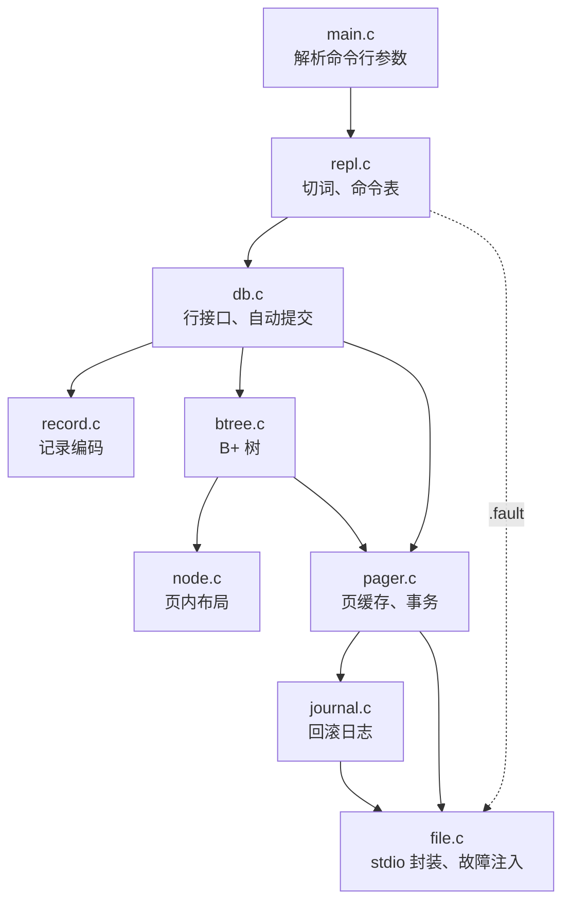
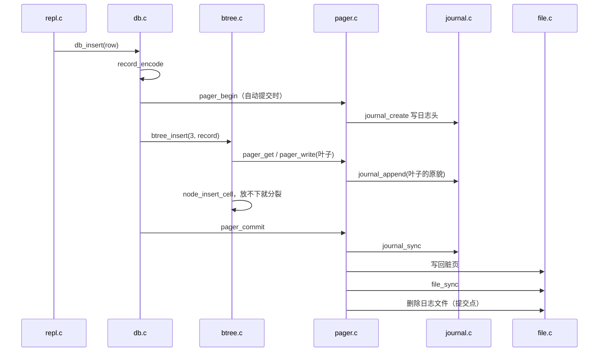

# 7.1 MdrDB 项目概述

读 [6.3 SQLite 的 B 树与存储引擎](/教程/正文/项目案例/SQLite/6_3_B树与存储引擎) 时，存储引擎是按层讲的：B 树向 Pager 要页，Pager 管缓存和回滚日志（rollback journal），最下面才是文件读写。看懂一条语句经过哪几层，和自己把这几层写出来，中间隔着一大段距离。MdrDB 就是用来补上这段距离的：仓库里一个从零实现的单文件数据库，固定 4096 字节的页、带最近最少使用（least recently used，LRU）替换的页缓存、B+ 树、varint 记录、回滚日志和崩溃恢复各写了一遍，全部只用标准 C，库加命令行 3052 行，测试 1668 行。

本节是这一章的地图。读完能独立构建 MdrDB 并跑完 7 个测试，用 REPL 完成增删查和事务，用 `.tree`、`.page`、`.info`、`.check` 和 `xxd` 观察文件内部；能说出每个源文件负责什么，按依赖从下往上开始读，并且只用 `include/mdrdb.h` 写一个小程序。存储层的实现细节由 [7.2 存储、页面与索引](/教程/正文/项目案例/MdrDB/7_2_存储_页面与索引) 展开，查询路径、日志与恢复、测试由 [7.3 查询路径、恢复与测试](/教程/正文/项目案例/MdrDB/7_3_查询路径_恢复与测试) 展开。

> 源码在仓库的 `code/项目/MdrDB/`，同一目录的 `README.md` 收录了完整的格式表、架构图、执行路径和已知限制。GitHub 上的目录：<https://github.com/Mdr-C-Tutorial/C/tree/main/code/项目/MdrDB>。

## 1. 做什么，不做什么

MdrDB 是一张表、一个文件、一个进程。表的结构固定为 `(id, name, email)`：`id` 是 32 位无符号整数主键，`name` 最多 32 字节，`email` 最多 255 字节。命令行支持 `insert`、`select`、`delete`、`begin`、`commit`、`rollback`，另有 `.tree`、`.page`、`.info`、`.check`、`.fault`、`.help`、`.exit` 七条以点开头的元命令，用来观察内部状态。

| 项目 | 取值 |
|:---|:---|
| 页大小 | 4096 字节，固定 |
| 表 | 一张，`(id, name, email)`，`id` 为主键 |
| 索引 | 一棵 B+ 树，根固定在第 1 页 |
| 事务 | 回滚日志，进程崩溃后可恢复 |
| 规模 | 库与命令行 3052 行，测试 1668 行（均含注释） |
| 依赖 | 标准 C11 的 stdio，没有平台接口 |

刻意不做的事情同样明确：没有 SQL，只有上面六条语句；没有并发和文件锁，两个进程同时打开同一个库，结果无法预料；没有多表、二级索引和溢出页；删除只去掉单元格，不合并页面，文件只增不减；持久性只做到 `fflush`，也就是把数据交给操作系统，断电仍可能丢。

这些取舍换来的是可读性。源码里没有平台相关的分支，也没有任何一行是为了兼容某条 SQL 语法而写的，读者可以在一周内把每个函数都看一遍。规模参照了 cstack 的 ***Let's Build a Simple Database***，那套教程写到把 B+ 树存进文件就结束了，没有页缓存和事务；MdrDB 在此之上补了 pager、回滚日志，以及一个在每次写操作处模拟崩溃的测试。

## 2. 构建与运行

### 2.1 CMake

`CMakeLists.txt` 生成一个静态库 `mdrdb_core`、一个命令行程序 `mdrdb` 和 7 个测试程序，并把测试登记进 CTest。三条命令完成构建与测试（以下为 Linux，Debian 13，gcc 14.2，CMake 3.31；输出里的目录是一次演示时的位置，读者看到的路径不同）：

::: terminal title="bash - MdrDB 构建与测试"

```console
$ cmake -S . -B build
$ cmake --build build -j2
$ ctest --test-dir build
Internal ctest changing into directory: /home/minsecrus/tutorial/work/mdrdb/build
Test project /home/minsecrus/tutorial/work/mdrdb/build
    Start 1: record
1/7 Test #1: record ...........................   Passed    0.00 sec
    Start 2: node
2/7 Test #2: node .............................   Passed    0.00 sec
    Start 3: journal
3/7 Test #3: journal ..........................   Passed    0.01 sec
    Start 4: pager
4/7 Test #4: pager ............................   Passed    0.03 sec
    Start 5: btree
5/7 Test #5: btree ............................   Passed    0.41 sec
    Start 6: crash
6/7 Test #6: crash ............................   Passed    0.17 sec
    Start 7: repl
7/7 Test #7: repl .............................   Passed    0.01 sec

100% tests passed, 0 tests failed out of 7

Total Test time (real) =   0.63 sec
```

:::

CMake 给 GCC 和 Clang 打开 `-Wall -Wextra -Wpedantic`，默认再加 `-Werror`，任何警告都会让构建失败。换了编译器、遇到新的警告，可以用 `-DMDRDB_WARNINGS_AS_ERRORS=OFF` 先关掉。

::: warning Windows 上用 MinGW Makefiles 时要加 `-G Ninja`

仓库路径里含有中文目录 `项目`。CMake 生成的 MinGW Makefile 用绝对路径引用源文件，`mingw32-make` 按系统代码页解释这些路径，构建时报：

```text
mingw32-make[2]: *** No rule to make target 'D:/Projects/C/code/项目/MdrDB/src/btree.c', needed by 'CMakeFiles/mdrdb_core.dir/src/btree.c.obj'.  Stop.
```

配置时加 `-G Ninja` 即可正常构建；把整个目录复制到纯英文路径下，MinGW Makefiles 也能通过。

:::

### 2.2 Makefile

没有 CMake 时用同目录的 `Makefile`，它需要 GNU make 和 POSIX shell：

::: terminal title="bash - make"

```text
$ make          # 构建 build-make/mdrdb 与全部测试
$ make test     # 构建并运行全部测试
$ make clean    # 删除 build-make
```

:::

`make test` 逐个运行测试程序并打印每个用例的 `ok` 行。这里只保留每组的统计，以及 `test_crash` 里与统计交错的那几行，其余 `ok` 行省略：

::: terminal title="bash - make test"

```text
$ make test
== test_record
63 checks, 0 failed
== test_node
132 checks, 0 failed
== test_journal
70 checks, 0 failed
== test_pager
442 checks, 0 failed
== test_btree
34077 checks, 0 failed
== test_crash
     62 crash points, 0 recovered incorrectly
ok   test_crash_at_every_write
     recovery interrupted 8 times, then completed
ok   test_crash_during_recovery
     8 crash points while creating, 0 recovered incorrectly
ok   test_crash_while_creating
4842 checks, 0 failed
== test_repl
14 checks, 0 failed
```

:::

Windows 上在 Git Bash 或 MSYS2 里把命令换成 `mingw32-make` 与 `mingw32-make test`，输出相同；测试在构建目录里运行，生成的临时数据库文件结束时自行删除。

### 2.3 第一次会话

把命令逐行写进 `demo.txt`，用重定向喂给程序。`--echo` 让程序把读到的每一行打印在提示符后面，输出与交互操作时一样：

::: terminal title="bash - mdrdb --echo demo.db < demo.txt"

```console
$ ./build/mdrdb --echo demo.db < demo.txt
mdrdb> insert 1 alice alice@example.com
ok
mdrdb> insert 2 bob bob@example.com
ok
mdrdb> insert 2 bob bob@example.com
error: duplicate key
mdrdb> insert 3 carol carol@example.com
ok
mdrdb> select
(1, alice, alice@example.com)
(2, bob, bob@example.com)
(3, carol, carol@example.com)
(3 rows)
mdrdb> select 2
(2, bob, bob@example.com)
(1 row)
mdrdb> delete 2
ok
mdrdb> select 1 10
(1, alice, alice@example.com)
(3, carol, carol@example.com)
(2 rows)
mdrdb> begin
ok
mdrdb> insert 4 dave dave@example.com
ok
mdrdb> rollback
ok
mdrdb> .page 1
page 1: leaf
  cells 2, free bytes 4020, content start 4036, next leaf 0
  cell 0: offset 4066, size 30, key 1
  cell 1: offset 4036, size 30, key 3
mdrdb> .check
ok: rows 2, leaf pages 1, internal pages 0, height 1
mdrdb> .info
file: demo.db
page size: 4096, page count: 2
cache: 64 frames, hits 42, misses 2, spills 0
journal: pages saved 6, pages restored at open 0
transaction: none
mdrdb> .exit
```

:::

输出的格式只有三类。修改语句成功打印 `ok`，失败打印 `error: <原因>`，原因取自 `db_status_message`；查询先逐行打印 `(id, name, email)`，最后一行是 `(n rows)`，一行时写 `(1 row)`；元命令打印各自的观察结果。`select 2` 只找到一行；`select 1 10` 是闭区间，删掉 2 号之后剩下 1 和 3。

`rollback` 之后 `.page 1` 只剩两条单元格，说明 dave 那一行确实没进文件。`.check` 在树的结构和每条记录都能解码时才打印 `ok`。`.info` 打印五行：文件路径、页大小与页数、缓存统计、日志统计、事务状态。`pages saved 6` 是这次会话里累计写进日志的页数：打开新库时建根页一次（护住第 0 页的文件头），三条成功的自动提交各一次，`delete 2` 一次，`begin` 之后那条插入一次。第二条 `insert 2` 因重复键失败，它的事务也开了日志，但一条页都没改，所以没有页进日志：连续执行两次插入再查 `.info`，失败那一次前后的 `pages saved` 不变。后五次改的都是第 1 页同一片叶子，每页的原始内容在一次事务里只记一次，所以每次恰好一页。日志与恢复的细节在 7.3 讲。

::: tip `--echo` 让重定向的会话可读

没有 `--echo` 时，程序不会把读到的命令打印出来，输出里只剩结果，看不出哪一行对应哪条命令。写演示脚本、做回归测试时都加上它。

:::

::: details `.help` 的完整输出

```text
mdrdb> .help
  insert <id> <name> <email>       add a row
  select [<id> | <first> <last>]   show rows
  delete <id>                      remove a row
  begin                            start a transaction
  commit                           make the transaction permanent
  rollback                         undo the transaction
  .tree                            print the shape of the B+ tree
  .page <n>                        print the layout of page n
  .info                            print file and cache statistics
  .check                           verify the B+ tree and records
  .fault <n>                       crash after n more writes
  .help                            list commands
  .exit                            quit
```

:::

## 3. 观察数据库内部

顺序插入 300 行，看树怎样从一页长成两层：

::: terminal title="bash - big.db"

```console
$ for i in $(seq 1 300); do echo "insert $i user$i user$i@example.com"; done > rows.txt
$ ./build/mdrdb big.db < rows.txt > /dev/null
$ printf '.tree\n' | ./build/mdrdb --echo big.db
mdrdb> .tree
internal 1: 4 keys
  leaf 2: 61 keys (1..61)
  key 62
  leaf 3: 60 keys (62..121)
  key 122
  leaf 4: 57 keys (122..178)
  key 179
  leaf 5: 57 keys (179..235)
  key 236
  leaf 6: 65 keys (236..300)
```

:::

第 1 页仍是根，类型变成了内部节点：4 个分隔键把 5 个叶子串起来。叶子 2 装了 61 个键，其余叶子在 57 到 65 个之间，都只有半满。原因是分裂总把单元格按字节数对半分，顺序插入时每次都是最右边的叶子满、分裂、一半搬到新页，左边的叶子从此不再变化。这个形状在 7.2 讲分裂时会再算一遍。

同一个库上的观察命令，依次查看文件头、根页、一致性检查和统计：

::: terminal title="bash - big.db（观察内部）"

```text
mdrdb> .page 0
page 0: file header
  page size 4096, page count 7
mdrdb> .page 1
page 1: internal
  cells 4, free bytes 4044, content start 4064, right child 6
  cell 0: offset 4088, size 8, key 62, child 2
  cell 1: offset 4080, size 8, key 122, child 3
  cell 2: offset 4072, size 8, key 179, child 4
  cell 3: offset 4064, size 8, key 236, child 5
mdrdb> .check
ok: rows 300, leaf pages 5, internal pages 1, height 2
mdrdb> .info
file: big.db
page size: 4096, page count: 7
cache: 64 frames, hits 614, misses 6, spills 0
journal: pages saved 0, pages restored at open 0
transaction: none
mdrdb> .exit
```

:::

`.page` 打印一页的页头和各单元格的位置，字段的含义与手算方法留在 7.2；这里只需看出内部单元格是定长的 8 字节（键 4 字节、孩子页号 4 字节），叶子单元格则带着负载。`.check` 从根遍历整棵树，检查键的范围、顺序、叶子深度、叶子链以及每页是否只被引用一次，`height 2` 表示根加叶子两层。

`.info` 的数字只统计经过页缓存的操作。打开数据库时读文件头由 `load_header` 直接从文件读，不计入；`.page 0` 只打印页大小和页数，也不经过缓存。`.page 1` 取根页 1 次，未命中 1 次。`.check` 先取根页，此时已在缓存里，算一次命中；再逐个取叶子，5 个叶子各未命中 1 次；检查完结构后，它又用游标把 300 行逐条读出来解码，每次移动游标都重新取页，全部命中。两段命令合计 `hits 614, misses 6`。单独运行 `.check` 时是 `hits 613, misses 6`：先执行 `.page 1` 让根页的那一次未命中提前发生，`.check` 再取根页就成了命中，命中数多 1，未命中总数不变。`spills 0` 表示没有脏页在提交前被换出。这些数字会随你执行命令的顺序变化，对照时以自己那次操作为准。

文件本身的字节用 `xxd` 看。开头 32 字节是文件头，偏移 16 和 20 分别是页大小和页数，都是大端序：

::: terminal title="bash - xxd"

```console
$ xxd -l 32 big.db
00000000: 4d64 7244 4220 666f 726d 6174 2031 0000  MdrDB format 1..
00000010: 0000 1000 0000 0007 0000 0000 0000 0000  ................
$ xxd -s 4096 -l 16 big.db
00001000: 0200 0004 0fe0 0000 0000 0006 0ff8 0ff0  ................
```

:::

第一行 16 字节是魔数 `MdrDB format 1`，后面补 0；`00 00 10 00` 是 4096，`00 00 00 07` 是 7 页。第二段从偏移 4096（第 1 页）开始：首字节 `02` 表示内部节点，`0004` 是 4 个单元格，`0fe0` 是内容区起点 4064，`00000006` 是最右孩子的页号。页数 7 与 `.page 0` 的打印一致，文件大小 28672 字节正好是 7 × 4096。

::: concept mdr-db-page-unit title="页是 MdrDB 的读写单位"

数据库文件由 4096 字节的页组成，第 n 页从文件偏移 n × 4096 处开始。第 0 页是文件头，记录魔数、页大小和页数；B+ 树的根固定在第 1 页。页缓存、日志和文件读写都以整页为单位：pager 按页取用和换出，回滚日志保存的是整页的原貌。

:::

<Quiz
  type="single"
  :options="[
    { label: '5 × 4096 = 20480（0x5000）', value: 'A' },
    { label: '5 × 4096 + 1 = 20481（0x5001）', value: 'B' },
    { label: '4 × 4096 = 16384（0x4000）', value: 'C' },
    { label: '5 × 4096 + 4096 = 24576（0x6000）', value: 'D' }
  ]"
  answer="A"
>

<template #question>

第 5 页的第一个字节在文件里的偏移是多少？

</template>

正确答案是 **A**。第 0 页占偏移 0～4095，第 n 页从 n × 4096 开始，第 5 页从 5 × 4096 = 20480 开始，也就是十六进制的 0x5000。

</Quiz>

## 4. 模块与分层

模块之间的调用关系如下。箭头表示“调用”，其中 `repl.c` 到 `db.c` 的调用经公共头文件 `mdrdb.h` 声明，其余各层都有自己的头文件：



每个源文件的职责和行数：

| 文件 | 行数 | 职责 |
|:---|---:|:---|
| `src/main.c` | 71 | 解析 `--echo`、`--cache` 和数据库文件名，打开数据库，进入 REPL |
| `src/repl.c` | 329 | 切词、命令表、参数个数检查、结果格式；`.fault` 直接调用文件层的故障注入 |
| `src/db.c` | 302 | 面向“行”的接口，组织记录编码、B+ 树和事务 |
| `src/record.c` | 100 | varint 与记录的编码、解码 |
| `src/btree.c` | 724 | 查找、插入与分裂、删除、游标、一致性检查 |
| `src/node.c` | 222 | 一页之内的页头、单元格指针数组和单元格 |
| `src/pager.c` | 503 | 页框、钉住计数、LRU 换出、页的分配、事务的起止 |
| `src/journal.c` | 139 | 回滚日志的格式、追加、同步与回放 |
| `src/file.c` | 169 | stdio 封装、关闭缓冲、故障注入 |
| `src/format.h` | 44 | 页大小常量与大端序整数的读写 |
| `include/mdrdb.h` | 82 | 公共类型、状态码和函数声明 |
| 其余头文件 | 367 | `file.h`、`journal.h`、`pager.h`、`node.h`、`btree.h`、`record.h`、`repl.h` |
| `tests/` | 1668 | 7 个测试程序与 `test.h` |

库加命令行共 3052 行（`src/*.c` 2559 行，头文件 493 行），测试 1668 行。

依赖只指向下层，没有下层反过来包含上层。`mdrdb.h` 是个例外：`file.h`、`pager.h`、`btree.h`、`record.h`、`repl.h` 都包含它。它只放共享的类型与常量（`db_status`、`db_row`、两个长度上限），不含任何函数实现，也不包含别的头文件，所以不算一层，不会造成循环。`repl.c` 包含 `file.h` 看似越过了 `db.c`，原因是 `.fault` 要直接调用 `fault_arm` 让进程在写操作处退出，这个开关属于文件层，与行数据无关。

对照 [6.3](/教程/正文/项目案例/SQLite/6_3_B树与存储引擎) 里 SQLite 的三层，`node.c` 与 `btree.c` 合起来相当于它的 btree.c，`pager.c` 加 `journal.c` 相当于 pager.c，`file.c` 相当于最下面的 VFS。多出来的 `record.c` 和 `db.c` 是 MdrDB 自己的一组行接口：前者决定负载的字节格式，后者把“行”翻译成键和负载。

分层的价值在改动时看得出来：把页缓存换成 CLOCK 算法只需要动 `pager.c`，把记录格式换成定长字段只需要动 `record.c`，命令行和测试都不用改。7.2 和 7.3 的习题都按这个分工出。

::: generate mdr-db-layers-walkthrough kind=explanation concepts=mdr-db-page-unit

面向第一次读存储引擎的读者，沿着“一条 insert 从命令行到磁盘”的顺序，解释 main.c、repl.c、db.c、btree.c、pager.c、journal.c、file.c 各自收到什么、交出什么，说明为什么每层只认下一层的接口。重点讲清页在 pager 与 file 之间的角色，不要展开 B+ 树分裂或日志协议的细节。

:::

## 5. 一条命令的旅程

`insert 3 carol carol@example.com` 从命令行到磁盘，经过的函数和顺序如下：



1. `repl.c` 把一行切成单词，查命令表，检查参数个数，把 `id`、`name`、`email` 填进 `db_row` 后调用 `db_insert`。切词与命令表的细节在 7.3。
2. `db.c` 把 `name` 和 `email` 编码成记录。用户没有显式开启事务时，这里先调 `pager_begin`，让这一条语句自成一个事务（自动提交）。
3. `btree_insert` 从根下降到叶子，记下路径；键已存在就返回 `DB_DUPLICATE`，此时还没有修改任何页。
4. 叶子放得下就直接插入；放不下就分裂，把右半放进新页，分隔键插进父节点。根放不下时树长高一层，根仍在第 1 页。分裂算法在 7.2。
5. 提交按固定顺序进行：同步日志、写回所有脏页、同步数据库文件、删除日志。删除日志就是提交点；在这之前进程崩溃，下次打开时日志还在，事务被撤销。日志格式、提交点与恢复在 7.3。

读路径短得多。`select <id>` 走 `db_find` → `btree_find`：从根下降到叶子，在叶子里二分查找，命中后解码记录。`select` 和 `select <a> <b>` 走 `db_scan`：`btree_seek` 定位到第一个不小于 `a` 的键，然后沿叶子链向右，直到键大于 `b` 或链表走完。游标不钉住页面，每走一步重新取页，这是 `db_scan` 的回调里不能修改数据库的原因，7.2 的游标一节会讲。

<Quiz
  type="single"
  :options="[
    { label: '根的内容搬到新页，第 1 页重新初始化为只有 1 个孩子的内部节点', value: 'A' },
    { label: '根搬到最后一页，第 1 页留空', value: 'B' },
    { label: '新页成为根，页号记在文件头里', value: 'C' },
    { label: '根和第 1 页都不变，只在叶子之间加链', value: 'D' }
  ]"
  answer="A"
>

<template #question>

顺序插入到根页装满时，树长高一层。此时根为什么还在第 1 页？

</template>

正确答案是 **A**。`grow_root` 先把根的全部内容复制到新分配的页，再把第 1 页重新初始化为内部节点并指向新页，所以根的页号永远是 1，`btree.h` 里的 `BTREE_ROOT` 不需要保存到任何地方。

</Quiz>

## 6. 公共接口

数据库对外的全部接口在 `include/mdrdb.h`。命令行程序和测试都只通过它使用数据库，内部的 `pager.h`、`btree.h` 等不在公共范围：

```c
#define DB_NAME_MAX 32   /* name 最多 32 字节 */
#define DB_EMAIL_MAX 255 /* email 最多 255 字节 */

typedef struct db_row {
    uint32_t id;
    char name[DB_NAME_MAX + 1];
    char email[DB_EMAIL_MAX + 1];
} db_row;

/* 所有可能失败的函数都返回 db_status。 */
typedef enum db_status {
    DB_OK = 0,
    DB_NOT_FOUND,  /* 键不存在 */
    DB_DUPLICATE,  /* 键已存在 */
    DB_TOO_LONG,   /* 字段或负载超过长度上限 */
    DB_MISUSE,     /* 调用顺序不对，例如没有 begin 就 commit */
    DB_CACHE_FULL, /* 页缓存里的页都被钉住，腾不出页框 */
    DB_FULL,       /* 数据库文件达到大小上限 */
    DB_NO_MEMORY,
    DB_IO_ERROR,
    DB_CORRUPT /* 文件内容不符合格式 */
} db_status;
```

主要函数：

| 函数 | 作用 |
|:---|:---|
| `db_open(path, cache_pages, &d)` | 打开或新建数据库；`cache_pages` 为 0 时用默认的 64 个页框 |
| `db_insert` / `db_delete` / `db_find` | 按主键插入、删除、点查 |
| `db_scan(d, first, last, fn, ctx)` | 按 id 升序访问闭区间内的每一行 |
| `db_begin` / `db_commit` / `db_rollback` | 显式事务 |
| `db_check` / `db_print_tree` / `db_print_page` / `db_print_info` | 观察内部，REPL 的元命令就调用它们 |

所有可能失败的函数都返回 `db_status`，调用者要检查。`DB_OK` 之外的取值都是错误；`DB_DUPLICATE`、`DB_NOT_FOUND`、`DB_TOO_LONG` 在修改任何页之前就能查出来，不影响当前事务，其余错误会回滚整个事务。

下面这个程序只用公共接口：插入 1000 行，用 `db_scan` 统计 `[100, 199]` 内的行数，编译时链接 `build/libmdrdb_core.a`。

```c
#include "mdrdb.h"

#include <stdio.h>

static bool count_row(const db_row *row, void *ctx) {
    (void)row;
    int *n = ctx;
    (*n)++;
    return true;
}

int main(void) {
    remove("count.db");
    remove("count.db-journal");
    db *d;
    db_status rc = db_open("count.db", 0, &d);
    if (rc != DB_OK) {
        fprintf(stderr, "open: %s\n", db_status_message(rc));
        return 1;
    }
    for (uint32_t id = 1; id <= 1000; id++) {
        db_row row = {0};
        snprintf(row.name, sizeof row.name, "user%u", id);
        snprintf(row.email, sizeof row.email, "user%u@example.com", id);
        row.id = id;
        rc = db_insert(d, &row);
        if (rc != DB_OK) {
            fprintf(stderr, "insert %u: %s\n", id, db_status_message(rc));
            db_close(d);
            return 1;
        }
    }
    int n = 0;
    rc = db_scan(d, 100, 199, count_row, &n);
    if (rc != DB_OK) {
        fprintf(stderr, "scan: %s\n", db_status_message(rc));
        db_close(d);
        return 1;
    }
    printf("ok, rows in [100, 199]: %d\n", n);
    db_close(d);
    return 0;
}
```

编译和运行：

::: terminal title="bash - count"

```console
$ gcc -std=c11 -Wall -Wextra -Wpedantic -I include count.c build/libmdrdb_core.a -o count
$ ./count
ok, rows in [100, 199]: 100
```

:::

程序开头先删掉 `count.db` 和它的日志，否则第二次运行第一条插入就会得到 `duplicate key`，统计出来是 0。插入时 `db_row` 用 `{0}` 初始化，`snprintf` 顺带补上结尾的 `'\0'`；`db_insert` 检查记录长度，超长返回 `DB_TOO_LONG`。

`db_scan` 的回调返回 `false` 可以提前结束遍历。回调里不能修改数据库：游标不钉住页面，每一步都重新取页，修改会让游标脚下的叶子被搬走甚至分裂。真这么做，扫描可能返回 `DB_CORRUPT`。规则的原因在 7.2 的游标一节。

<Quiz
  type="multi"
  :options="[
    { label: '回调里可以调用 db_insert，库会自动处理', value: 'A' },
    { label: '回调里不能修改数据库，游标不钉住页面', value: 'B' },
    { label: '回调返回 false 可以提前结束遍历', value: 'C' },
    { label: 'db_scan 的区间是闭区间', value: 'D' }
  ]"
  :answer="['B', 'C', 'D']"
>

<template #question>

关于 `db_scan`，下列说法正确的是哪些？

</template>

正确答案是 **B、C、D**。A 错在“自动处理”：扫描期间修改树会让游标指向的页内容变化，库没有为此做保护，属于文档禁止的用法。

</Quiz>

## 7. 阅读顺序

按依赖从下往上读，每个文件带着问题看：

| 顺序 | 文件 | 读的时候问自己 |
|:---:|:---|:---|
| 1 | `src/format.h` | 为什么逐字节拼装而不直接写结构体？`get_u32` 里为什么先转成 `uint32_t` 再左移？ |
| 2 | `src/file.c` | 关掉 stdio 缓冲换来了什么？故障注入在哪些函数里检查？ |
| 3 | `src/journal.c` | 回放读到什么时候停？CRC 覆盖了哪些字节？ |
| 4 | `src/pager.c` | 一页的原貌什么时候进日志？换出脏页之前为什么要先同步日志？ |
| 5 | `src/node.c` | 单元格在页里的物理位置与指针数组的顺序是什么关系？ |
| 6 | `src/btree.c` | 根分裂后第 1 页变成了什么？分隔键从哪里来？ |
| 7 | `src/record.c` | varint 最多占几个字节？解码时怎样防止越界？ |
| 8 | `src/db.c` | 自动提交在哪里实现？哪几种错误不必回滚？ |
| 9 | `src/repl.c` | 加一条命令要改几处？为什么 `.fault` 要包含 `file.h`？ |
| 10 | `tests/` | `test_crash` 怎样做到在每一次写操作处崩溃？ |

::: tip 先跑测试，再读代码

读到一个函数时，先到 `tests/` 里找调用它的用例。`test_pager` 演示了 `pager_get` 与 `pager_unpin` 的配对，`test_btree` 用 200～999 字节的负载把 3000 个键压到三层树、又在 4 个页框下演示了换出，`test_crash` 把每次写操作都当成一次潜在崩溃。测试是代码的最短使用说明。

:::

## 8. 习题

### 8.1 巩固

<Exercise id="50711" :d="2" :w="2">

在自己的机器上分别用 CMake 和 Makefile 各构建一次，跑完全部测试。CMake 用 `cmake -S . -B build`、`cmake --build build`、`ctest --test-dir build`；Windows 上如果默认生成器是 MinGW Makefiles，换 `-G Ninja` 或把目录放到纯英文路径。Makefile 用 `make` 与 `make test`（Windows 为 `mingw32-make`）。记录两次的测试数与检查数，确认都是 7 个测试、0 失败。

</Exercise>

<Exercise id="50712" :d="2" :w="2">

写一个小程序，读取数据库文件开头的 32 字节，从偏移 16 和 20 各取一个 4 字节大端整数，打印页大小和页数。只用标准 C 的 `fopen`/`fread` 和手写的四字节拼装就够了；也可以包含 `src/format.h` 借用 `get_u32`，编译时加 `-I src`。在 300 行的库和再插入 300 行之后的库上各跑一次。运行前先预测第二个数，再用 `.page 0` 核对（实测两次分别是 7 页与 12 页）；说明页数在哪个函数里被改写，以及为什么文件头也要先 `pager_write` 再修改。

</Exercise>

<Exercise id="50713" :d="3" :w="2">

MdrDB 把多字节整数按大端序逐字节写入文件，而不直接 `fwrite` 一个结构体。写一个实验验证这个选择：定义一个含 16 字节魔数、`uint32_t` 页大小和页数的结构体，`fwrite` 到文件，用 `xxd` 看字节，再用 `get_u32` 读回来。然后在魔数与页大小之间加一个 1 字节的版本字段，重新看 `offsetof` 的结果，说明填充字节从哪里来。从字节序、填充字节、换编译器三个方面说明直接写结构体会出什么问题。

</Exercise>

<Exercise id="50714" :d="3" :w="2">

写一个脚本（bash、PowerShell 或 C 都行），列出 `src/` 下每个 `.c` 文件和每个头文件包含的内部头文件，据此画出依赖图，确认没有下层包含上层。注意 `mdrdb.h` 只提供共享的类型和常量，不算上层模块。回答：`repl.c` 为什么包含 `file.h`？

</Exercise>

<Exercise id="50715" :d="3" :w="3">

生成 300 行命令，用 `begin` 和 `commit` 包成一个事务，分别以 `--cache 4` 和默认页框数导入两个新库，在导入的那个进程里执行 `.info`（把 `.info` 也写进输入脚本）。比较 `hits`、`misses`、`spills` 和 `journal: pages saved`，解释 `spills` 的含义。再把 `begin`、`commit` 去掉重做一次，说明这次两种页框数下 `spills` 为什么都是 0，`pages saved` 又为什么大了两个数量级。做完再看 7.2 的 3.5 节对答案。

</Exercise>

### 8.2 编程

<Exercise id="50716" :d="4" :w="3">

在 `repl.c` 的命令表里加一条元命令 `.count`，用 `db_scan` 统计并打印表中的行数，格式为 `<n> rows`。要求：`insert` 前后各执行一次，在空库上打印 `0 rows`，插入一行后打印 `1 rows`；`.help` 要列出这条命令。再把 `.count` 加进 `tests/test_repl.c` 的脚本和期望输出，重跑全部测试。`test_repl` 是逐字比较输出，脚本里多加一行，期望数组也要同步加一行。

</Exercise>

<Exercise id="50717" :d="4" :w="3">

只用 `include/mdrdb.h` 写一个程序：插入 id 1～1000 的行，分别统计 id 在 `[100, 199]`、`[900, 999]` 和 `[199, 100]`（反向区间）内的行数，再用 `db_check` 打印总行数。再做一次提前结束的遍历：扫描 `[300, 399]`，回调对 id 小于 310 的行打印并返回 `true`，遇到 310 时返回 `false`，最后打印回调被调用的次数与打印的行数。次数应当是 11，因为 310 这一行已经交给回调、只是没有被打印；`db_scan` 拿到 `false` 才停止。输出应为：

```text
[100, 199]: 100
[900, 999]: 100
[199, 100]: 0
total: 1000 (ok)
visited 11 rows in [300, 399], printed 10
```

链接 `build/libmdrdb_core.a`，用 `-std=c11 -Wall -Wextra -Wpedantic` 编译，无警告。

</Exercise>

<Exercise id="50718" :d="4" :w="3">

写一个转储程序：用 `db_scan` 遍历全库，把每一行打印成一条可以直接喂给 REPL 的 `insert <id> <name> <email>` 命令。用它在 `big.db` 上生成脚本，重定向给 `mdrdb` 建一个 `restore.db`，再用 `sha256sum`（Windows 用 `certutil -hashfile`）比较两个文件。要求两个文件的摘要相同，`.check` 都通过。说明为什么文件能逐字节相同。

</Exercise>

### 8.3 综合与挑战

<Exercise id="50719" :d="5" :w="4">

写一个“整理副本”工具：打开一个源库，用 `db_scan` 读出全部行，在一个事务里插入新建的目标库，提交后分别对两个库执行 `.check` 和 `.info`。验证步骤：在 300 行的库上删掉所有偶数 id（剩 150 行），源库仍是 7 页；整理出的副本只有 4 页，文件从 28672 字节降到 16384 字节。结合 7.2 的删除算法和文件只增不减的限制，解释页数下降的原因，以及为什么源库自己不会缩回去。再给工具加一个 `--dry-run`：只读、不建目标库，打印将要复制多少行；对同一个库连跑两次，确认源库的文件大小和修改时间都没变。

</Exercise>

## 9. 参考资料

1. 本项目源码与说明：仓库 `code/项目/MdrDB/`，其中 `README.md` 含文件格式表、架构图、执行路径、测试说明与已知限制；GitHub：<https://github.com/Mdr-C-Tutorial/C/tree/main/code/项目/MdrDB>。
2. cstack, ***Let's Build a Simple Database***：<https://cstack.github.io/db_tutorial/>。REPL、B+ 树的规模与讲法参照了这套教程。
3. SQLite, ***Architecture of SQLite***：<https://www.sqlite.org/arch.html>。B 树、Pager、OS 接口三层的划分，本文与 6.1 一致。
4. SQLite, ***Database File Format***：<https://www.sqlite.org/fileformat2.html>。页、页头、单元格指针数组与 varint 的布局对照此文档。
5. CMake, ***ctest(1)***：<https://cmake.org/cmake/help/latest/manual/ctest.1.html>。`--test-dir` 的语义与测试汇总行。
6. 本教程：[6.3 SQLite 的 B 树与存储引擎](/教程/正文/项目案例/SQLite/6_3_B树与存储引擎)、[数据结构 10. B 树与外存数据结构](/教程/正文/数据结构与算法/数据结构/10_B树与外存数据结构)、[9. CMake 与 XMake](/教程/正文/开发与工程基础/9_CMake与XMake)、[11. 自动化测试](/教程/正文/开发与工程基础/11_自动化测试)。
