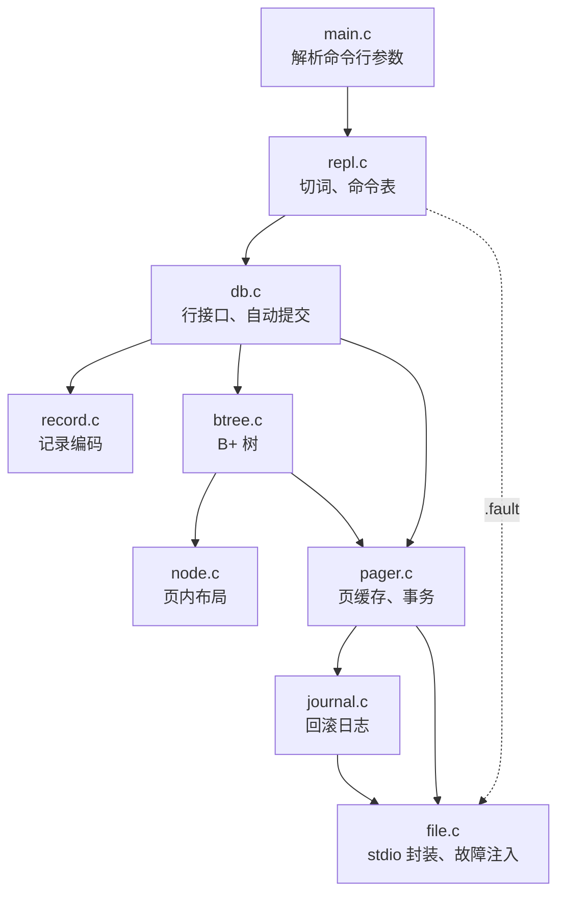
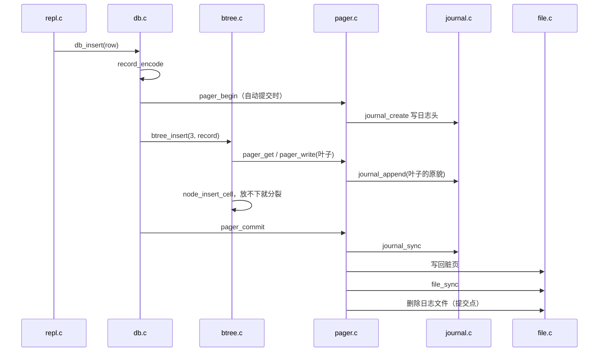

# 7.1 MdrDB 项目概述

读 [6.3 SQLite 的 B 树与存储引擎](/教程/正文/项目案例/SQLite/6_3_B树与存储引擎) 时，我们把存储引擎拆成了清晰的分层：B 树负责索引逻辑，向底层的 Pager 申请与管理页面；Pager 调度内存中的页缓存与磁盘上的回滚日志（rollback journal）；最底层的系统调用再把数据真正落实到文件。从概念上理解一条语句在各层之间的穿梭，与亲手把每一层的读写细节拼装完整，中间往往隔着不少工程细节。

MdrDB 正是为弥补这段认知距离而设计的微型单文件数据库。在这个完全从零实现的工程里，页面大小固定为 4096 字节，配备了基于最近最少使用（least recently used，LRU）淘汰策略的页缓存、紧凑的 B+ 树索引、varint 变长编码记录，以及在遭遇异常断电或崩溃时能够自我修复的回滚日志。整个项目完全基于标准 C11 编写，不引入任何平台私有接口。核心库与配套的交互式命令行总共 3052 行，测试代码 1668 行。

本节先为整个项目梳理全景脉络。我们将完整走通 MdrDB 的编译构建与内置测试，通过交互式 REPL 体验增删查与事务流程，借助 `.tree`、`.page`、`.info`、`.check` 等内置元命令以及外部的 `xxd` 工具直观查看二进制文件的物理排布。同时，我们还会理清各个源码文件在整体架构中的分工与依赖关系，最后仅依赖公共接口头文件 `include/mdrdb.h` 完成一个独立的行级读写小程序。更深入的页面排布与索引算法见 [7.2 存储、页面与索引](/教程/正文/项目案例/MdrDB/7_2_存储_页面与索引)，关于查询执行路径、事务日志恢复机制与崩溃测试的解析则由 [7.3 查询路径、恢复与测试](/教程/正文/项目案例/MdrDB/7_3_查询路径_恢复与测试) 接续展开。

> 源码在仓库的 `code/项目/MdrDB/`，同一目录的 `README.md` 收录了完整的格式表、架构图、执行路径和已知限制。GitHub 上的目录：<https://github.com/Mdr-C-Tutorial/C/tree/main/code/项目/MdrDB>。

## 1. 做什么，不做什么

在设计边界上，MdrDB 保持了极高的克制：它只管理一张表、一个单文件，并且只服务于单一进程。表的模式在编译期固定为 `(id, name, email)`，其中 `id` 为 32 位无符号整数主键，`name` 限制在 32 字节以内，`email` 则不超过 255 字节。命令行交互界面仅提供 `insert`、`select`、`delete` 以及事务控制的 `begin`、`commit`、`rollback` 共六条常规操作语句，此外还提供了 `.tree`、`.page`、`.info`、`.check`、`.fault`、`.help`、`.exit` 七条点号元命令，专门用来检视存储引擎运行时的内部状态。

| 项目 | 取值 |
|:---|:---|
| 页大小 | 4096 字节，固定 |
| 表 | 一张，`(id, name, email)`，`id` 为主键 |
| 索引 | 一棵 B+ 树，根固定在第 1 页 |
| 事务 | 回滚日志，进程崩溃后可恢复 |
| 规模 | 库与命令行 3052 行，测试 1668 行（均含注释） |
| 依赖 | 标准 C11 的 stdio，没有平台接口 |

界定清晰的“不做清单”与“功能特性”同等重要。MdrDB 没有内置复杂的 SQL 解析器，所有命令直接按空格拆分执行；没有引入多线程并发与跨进程文件锁，倘若两个进程并发打开同一个数据库文件，其行为未定义；没有设计多表关联、二级索引，也不支持跨越多页的长字段溢出页机制；在页面回收方面，记录删除后仅在页内抹除单元格偏移，不执行跨页合并，因而数据库文件体积只增不减；在持久性保障上，刷盘只调用标准库的 `fflush` 将缓冲区提交给操作系统内核，并未调用系统级 `fsync`，因此在主机遭遇突发掉电时数据仍有可能受损。

正是这些主动退让，换来了整个系统极佳的透视度与可读性。代码里不存在错综复杂的跨平台兼容分支，也没有为了迁就边缘 SQL 语法而引入的冗余分支，初学者可以在数天内逐行读完所有实现。这个项目的体量与学习曲线参考了著名的开源教学项目 ***Let's Build a Simple Database***（cstack），原项目在完成 B+ 树持久化后便告一段落，没有涵盖内存页缓存调度与崩溃恢复机制；MdrDB 则在这一基础上补充了完整的 Pager 缓存池、基于磁盘的回滚日志机制，以及一套在每个物理写入点强制注入故障的鲁棒性测试套件。

## 2. 构建与运行

### 2.1 CMake

项目根目录的 `CMakeLists.txt` 定义了一个静态库目标 `mdrdb_core`、一个交互式命令行可执行文件 `mdrdb`，以及 7 个独立的单元与集成测试程序，并通过 `add_test` 注册给 CTest 管理。通常只需三步标准流程即可完成构建与全套测试（以下演示基于 Linux Debian 13 环境，编译器为 gcc 14.2，CMake 版本为 3.31；实际运行时输出的工作路径会与此略有出入）：

::: terminal title="bash - MdrDB 构建与测试"

```console
$ cmake -S . -B build
$ cmake --build build -j2
$ ctest --test-dir build
Internal ctest changing into directory: /home/minsecrus/tutorial/work/mdrdb/build
Test project /home/minsecrus/tutorial/work/mdrdb/build
    Start 1: record
1/7 Test #1: record ...........................   Passed    0.00 sec
    Start 2: node
2/7 Test #2: node .............................   Passed    0.00 sec
    Start 3: journal
3/7 Test #3: journal ..........................   Passed    0.01 sec
    Start 4: pager
4/7 Test #4: pager ............................   Passed    0.03 sec
    Start 5: btree
5/7 Test #5: btree ............................   Passed    0.41 sec
    Start 6: crash
6/7 Test #6: crash ............................   Passed    0.17 sec
    Start 7: repl
7/7 Test #7: repl .............................   Passed    0.01 sec

100% tests passed, 0 tests failed out of 7

Total Test time (real) =   0.63 sec
```

:::

在编译选项方面，CMake 配置针对 GCC 和 Clang 默认启用了严苛的警告选项 `-Wall -Wextra -Wpedantic`，且通过 `-Werror` 将所有告警视作错误终止编译。若在特定编译器或异构平台上遇到新的警告信息，可通过传入 `-DMDRDB_WARNINGS_AS_ERRORS=OFF` 参数放宽这一限制。

::: warning Windows 上用 MinGW Makefiles 时要加 `-G Ninja`

仓库路径里含有中文目录 `项目`。CMake 生成的 MinGW Makefile 用绝对路径引用源文件，`mingw32-make` 按系统代码页解释这些路径，构建时报：

```text
mingw32-make[2]: *** No rule to make target 'D:/Projects/C/code/项目/MdrDB/src/btree.c', needed by 'CMakeFiles/mdrdb_core.dir/src/btree.c.obj'.  Stop.
```

配置时加 `-G Ninja` 即可正常构建；把整个目录复制到纯英文路径下，MinGW Makefiles 也能通过。

:::

### 2.2 Makefile

若环境未安装 CMake，可以直接使用工程配套的纯原生 `Makefile`，该脚本兼容 GNU make 和 POSIX shell 环境：

::: terminal title="bash - make"

```text
$ make          # 构建 build-make/mdrdb 与全部测试
$ make test     # 构建并运行全部测试
$ make clean    # 删除 build-make
```

:::

执行 `make test` 会依次启动各个独立的测试程序，并在终端打印测试断言的详细结果。下文终端输出中仅保留了各测试套件的总计检查项，以及在 `test_crash` 崩溃恢复模拟中夹杂的统计信息，其余大量冗长的逐项 `ok` 行已作精简省略：

::: terminal title="bash - make test"

```text
$ make test
== test_record
63 checks, 0 failed
== test_node
132 checks, 0 failed
== test_journal
70 checks, 0 failed
== test_pager
442 checks, 0 failed
== test_btree
34077 checks, 0 failed
== test_crash
     62 crash points, 0 recovered incorrectly
ok   test_crash_at_every_write
     recovery interrupted 8 times, then completed
ok   test_crash_during_recovery
     8 crash points while creating, 0 recovered incorrectly
ok   test_crash_while_creating
4842 checks, 0 failed
== test_repl
14 checks, 0 failed
```

:::

在 Windows 平台上，如果使用 Git Bash 或 MSYS2 环境，只需将构建指令换为 `mingw32-make` 和 `mingw32-make test`，即可得到相同的验证结果。所有测试案例都在构建输出目录内完成读写，运行期间生成的临时测试数据库会在执行完毕后自行清理，不会在工作区残留垃圾文件。

### 2.3 第一次会话

我们可以先将一系列操作指令逐行写入文本文件 `demo.txt`，再通过输入重定向送入执行程序。添加 `--echo` 参数后，CLI 程序会将从标准输入读取到的每一行指令直接回显在命令提示符后方，呈现与终端交互完全一致的视效：

::: terminal title="bash - mdrdb --echo demo.db < demo.txt"

```console
$ ./build/mdrdb --echo demo.db < demo.txt
mdrdb> insert 1 alice alice@example.com
ok
mdrdb> insert 2 bob bob@example.com
ok
mdrdb> insert 2 bob bob@example.com
error: duplicate key
mdrdb> insert 3 carol carol@example.com
ok
mdrdb> select
(1, alice, alice@example.com)
(2, bob, bob@example.com)
(3, carol, carol@example.com)
(3 rows)
mdrdb> select 2
(2, bob, bob@example.com)
(1 row)
mdrdb> delete 2
ok
mdrdb> select 1 10
(1, alice, alice@example.com)
(3, carol, carol@example.com)
(2 rows)
mdrdb> begin
ok
mdrdb> insert 4 dave dave@example.com
ok
mdrdb> rollback
ok
mdrdb> .page 1
page 1: leaf
  cells 2, free bytes 4020, content start 4036, next leaf 0
  cell 0: offset 4066, size 30, key 1
  cell 1: offset 4036, size 30, key 3
mdrdb> .check
ok: rows 2, leaf pages 1, internal pages 0, height 1
mdrdb> .info
file: demo.db
page size: 4096, page count: 2
cache: 64 frames, hits 42, misses 2, spills 0
journal: pages saved 6, pages restored at open 0
transaction: none
mdrdb> .exit
```

:::

终端输出的反馈格式非常规范清晰，整体归纳为三类：写操作（插入与删除）成功时输出 `ok`，发生故障时打印 `error: <原因>`，其错误文本直接映射自 `db_status_message` 状态函数；数据查询先按行输出 `(id, name, email)` 元组，并在尾部汇总行数统计 `(n rows)`，若只有单条记录则打印 `(1 row)`；以点号开头的元命令则输出专门的内部诊断视图。例如 `select 2` 命中单一主键，而 `select 1 10` 执行闭区间范围扫描，在前面删除了 2 号记录之后，返回结果中准确保留了 1 号与 3 号两条记录。

事务回滚的效果可以直接由物理页面来印证：执行 `rollback` 后，我们用 `.page 1` 检视根节点，其中单元格数量依然保持为 2，说明未提交的第 4 条记录完全没有落入磁盘。`.check` 会深度校验整棵 B+ 树的拓扑关系并尝试解码全部行记录，只有全部合法才输出 `ok`。`.info` 输出了当前会话的物理关键指标：底层文件路径、页面规格与总页数、页缓存命中率、回滚日志写入统计以及事务活动状态。

指标中的 `pages saved 6` 记录了本次会话累计写入回滚日志的页面总次数：新建空库时创建根页占用一次（用以在修改时保护第 0 页文件头），随后的三条成功插入各自作为独立事务提交占用了三次，执行 `delete 2` 占用一次，而在显式开启 `begin` 后的那次插入又记录了一次。值得注意的是，中间那次由于主键冲突而失败的 `insert 2` 虽然同样开启了事务上下文，但由于冲突在写入脏页之前就被拦截，根本没有改动任何磁盘页，因此回滚日志并没有增加记录——连续两次尝试相同插入并观察 `.info`，前后日志页计数保持不变。其后五次写操作均发生在第 1 页同一个叶子节点上，由于 MdrDB 在单个事务生命周期内对同一物理页的旧镜像仅记录一次，因此每次事务恰好保存一个原始页副本。关于事务回滚与崩溃恢复协议的更深层机制，将在 7.3 详细阐释。

::: tip `--echo` 参数的工程实用价值

在批处理脚本或管道重定向输入时，若不显式指定 `--echo`，控制台将仅打印单纯的执行结果，读者很难直观将输出结果与各条原指令准确对应。在编写自动化演示脚本、排查测试回归或记录文档会话日志时，建议始终附带此参数。

:::

::: details `.help` 的完整输出

```text
mdrdb> .help
  insert <id> <name> <email>       add a row
  select [<id> | <first> <last>]   show rows
  delete <id>                      remove a row
  begin                            start a transaction
  commit                           make the transaction permanent
  rollback                         undo the transaction
  .tree                            print the shape of the B+ tree
  .page <n>                        print the layout of page n
  .info                            print file and cache statistics
  .check                           verify the B+ tree and records
  .fault <n>                       crash after n more writes
  .help                            list commands
  .exit                            quit
```

:::

## 3. 观察数据库内部

为了更直观地观察树的生长过程，我们连续顺序写入 300 条记录。随着数据量增加，单个物理页容纳不下所有键值，整棵 B+ 树将从单单一页蜕变为两层结构：

::: terminal title="bash - big.db"

```console
$ for i in $(seq 1 300); do echo "insert $i user$i user$i@example.com"; done > rows.txt
$ ./build/mdrdb big.db < rows.txt > /dev/null
$ printf '.tree\n' | ./build/mdrdb --echo big.db
mdrdb> .tree
internal 1: 4 keys
  leaf 2: 61 keys (1..61)
  key 62
  leaf 3: 60 keys (62..121)
  key 122
  leaf 4: 57 keys (122..178)
  key 179
  leaf 5: 57 keys (179..235)
  key 236
  leaf 6: 65 keys (236..300)
```

:::

从树形诊断输出可以看出，第 1 页依然稳稳坐落在根节点位置，但其节点类型已经从原本的叶子节点晋升为了内部路由节点：页面中维护着 4 个分隔键，将下方 5 个叶子页面有序地串接起来。叶子页 2 容纳了 61 个键，其余叶子页装载的键数量也稳定在 57 到 65 之间，空间利用率大致在半满左右。这种物理分布是由 MdrDB 的分裂策略决定的：节点分裂时总是按单元格的字节占用大致对半拆分。在主键单调递增的顺序写入场景下，每次触发分裂的永远是最右侧的叶子节点，其中一半数据迁入新分配的页，而留在左侧的叶子节点此后便不再追加新数据。关于这种空间利用率与分裂门槛的严密核算，我们会在 7.2 深入讨论。

在同一个数据库实例中，我们继续运行各项底层元命令，依次检视文件头、根节点、全局一致性以及页缓存的命中统计：

::: terminal title="bash - big.db（观察内部）"

```text
mdrdb> .page 0
page 0: file header
  page size 4096, page count 7
mdrdb> .page 1
page 1: internal
  cells 4, free bytes 4044, content start 4064, right child 6
  cell 0: offset 4088, size 8, key 62, child 2
  cell 1: offset 4080, size 8, key 122, child 3
  cell 2: offset 4072, size 8, key 179, child 4
  cell 3: offset 4064, size 8, key 236, child 5
mdrdb> .check
ok: rows 300, leaf pages 5, internal pages 1, height 2
mdrdb> .info
file: big.db
page size: 4096, page count: 7
cache: 64 frames, hits 614, misses 6, spills 0
journal: pages saved 0, pages restored at open 0
transaction: none
mdrdb> .exit
```

:::

`.page` 命令打印出指定页面的元信息头部以及每一个单元格的偏移排布。内部节点中的单元格非常规整，均为定长的 8 字节（4 字节主键加 4 字节子节点页号），而叶子节点中的单元格则背负着变长的行数据记录。`.check` 会从根节点向下递归遍历整棵树，逐项检验键的上下界范围、排序单调性、所有叶子节点所处的物理深度、同层叶子链表的连续性，并确认每个页面在树中仅被唯一引用。输出里的 `height 2` 表明整棵树包含一层内部节点与一层叶子节点共两层。

`.info` 呈现的统计数值只涵盖经过 Pager 缓冲池调度的页面操作。在数据库启动初期，`load_header` 直接从磁盘裸读文件头，并不经过缓冲池；执行 `.page 0` 时由于只需展示缓存区已知的基础参数，同样不产生页面载入。随后执行 `.page 1` 触发对根节点的单次读取，由于缓存初建，产生 1 次缓存未命中。接着运行 `.check`，它首先读取根节点，此时根节点已驻留内存，计入 1 次命中；紧接着深入遍历 5 个叶子页，各自产生 1 次未命中；校验完拓扑骨架后，校验器借助游标按序读出 300 条行记录进行字段解码，游标每次推进均重新走缓存接口确认当前页，此时目标页均已常驻内存，全部转化为缓存命中。前后两条命令累加，便呈现出 `hits 614, misses 6` 的统计。若跳过 `.page 1` 直接运行 `.check`，首次触碰根节点的那次未命中便算在 `.check` 头上，命中数相应变为 613，而总未命中数恒定为 6。统计中 `spills 0` 证明在此期间没有任何未提交的脏页因内存紧张而被中途驱逐到磁盘。读者在不同操作序列下观察到的计数会有细微变化，完全取决于命令触发缓存载入的先后次序。

脱离 MdrDB 自身的命令行工具，我们直接借助二进制查看工具 `xxd` 审视磁盘文件最原始的字节排布。文件起始的 32 字节严格保留给文件全局头部，其中偏移 16 与偏移 20 处分别保存着页面规格与文件总页数，均按大端字节序编码存储：

::: terminal title="bash - xxd"

```console
$ xxd -l 32 big.db
00000000: 4d64 7244 4220 666f 726d 6174 2031 0000  MdrDB format 1..
00000010: 0000 1000 0000 0007 0000 0000 0000 0000  ................
$ xxd -s 4096 -l 16 big.db
00001000: 0200 0004 0fe0 0000 0000 0006 0ff8 0ff0  ................
```

:::

在十六进制转储中，首行前 16 个字节是标识文件格式的魔数 ASCII 串 `MdrDB format 1`，右侧以空字节补齐；紧随其后的 `00 00 10 00` 对应十进制 4096 字节页长，`00 00 00 07` 则表明全文件当前共占据 7 个物理页。第二段转储从文件偏移 4096（即第 1 页根节点起点）开始：标志字节 `02` 明确标注此页已转变为内部节点，`0004` 指示页内包含 4 个有效单元格，`0fe0`（十进制 4064）代表自底向上分配的单元格内容区起始偏移，而 `00000006` 则记录着最右侧子节点的物理页号为 6。此时文件总字节数为 28672 字节，恰好等于 7 × 4096，与 `.page 0` 的统计完全吻合。

::: concept mdr-db-page-unit title="页是 MdrDB 的读写单位"

在 MdrDB 的底层世界里，所有磁盘与内存交互均以固定 4096 字节的物理页面为最小粒度。编号为 n 的页面，其物理存储起点精确落在文件的 `n × 4096` 字节偏移处。第 0 页保留给文件头，记录格式魔数、页规格以及当前分配的总页数；B+ 树的根节点自始至终固定驻留在第 1 页。无论是内存中的 Pager 缓存置换，抑或是发生异常时的回滚日志备份，所有 IO 调度与恢复协议都以整页镜像作为操作原子，回滚日志中保存的同样是受影响页面的完整原始快照。

:::

<Quiz
  type="single"
  :options="[
    { label: '5 × 4096 = 20480（0x5000）', value: 'A' },
    { label: '5 × 4096 + 1 = 20481（0x5001）', value: 'B' },
    { label: '4 × 4096 = 16384（0x4000）', value: 'C' },
    { label: '5 × 4096 + 4096 = 24576（0x6000）', value: 'D' }
  ]"
  answer="A"
>

<template #question>

第 5 页的第一个字节在文件里的偏移是多少？

</template>

正确答案是 **A**。第 0 页占偏移 0～4095，第 n 页从 n × 4096 开始，第 5 页从 5 × 4096 = 20480 开始，也就是十六进制的 0x5000。

</Quiz>

## 4. 模块与分层

MdrDB 内部各个模块之间有着极为严格的层次依从关系。下方的架构调用拓扑展示了数据流与控制流的流向。箭头表示直接的函数调用关系，其中 `repl.c` 借助公共头文件 `mdrdb.h` 与核心行接口 `db.c` 对接，其余各内部模块之间均通过私有的内部头文件完成解耦隔离：



每个源文件的职责和行数：

| 文件 | 行数 | 职责 |
|:---|---:|:---|
| `src/main.c` | 71 | 解析 `--echo`、`--cache` 和数据库文件名，打开数据库，进入 REPL |
| `src/repl.c` | 329 | 切词、命令表、参数个数检查、结果格式；`.fault` 直接调用文件层的故障注入 |
| `src/db.c` | 302 | 面向“行”的接口，组织记录编码、B+ 树和事务 |
| `src/record.c` | 100 | varint 与记录的编码、解码 |
| `src/btree.c` | 724 | 查找、插入与分裂、删除、游标、一致性检查 |
| `src/node.c` | 222 | 一页之内的页头、单元格指针数组和单元格 |
| `src/pager.c` | 503 | 页框、钉住计数、LRU 换出、页的分配、事务的起止 |
| `src/journal.c` | 139 | 回滚日志的格式、追加、同步与回放 |
| `src/file.c` | 169 | stdio 封装、关闭缓冲、故障注入 |
| `src/format.h` | 44 | 页大小常量与大端序整数的读写 |
| `include/mdrdb.h` | 82 | 公共类型、状态码和函数声明 |
| 其余头文件 | 367 | `file.h`、`journal.h`、`pager.h`、`node.h`、`btree.h`、`record.h`、`repl.h` |
| `tests/` | 1668 | 7 个测试程序与 `test.h` |

库加命令行共 3052 行（`src/*.c` 2559 行，头文件 493 行），测试 1668 行。

在模块依赖设计上，系统的包含关系严格自顶向下单向流动，下层实现绝不反向包含上层头文件。`include/mdrdb.h` 在整个依赖图中属于特例：各内部模块头文件（如 `file.h`、`pager.h`、`btree.h`、`record.h`、`repl.h`）均包含了它。但它本质上只扮演了公共词汇表的角色，集中统一定义了跨模块共享的错误枚举 `db_status`、行记录数据结构 `db_row` 以及字段长度上限等基础常数，没有任何函数实现，也未引入任何下层头文件，因而不会引发循环包含。至于 `repl.c` 直接包含底层的 `file.h`，这是因为调试诊断命令 `.fault` 需要直接触发底层的文件故障注入开关 `fault_arm`，以便在指定次数的物理写入后立即中止进程，这项特性专属于硬件 IO 模拟层，无需经由行接口层做无意义的透传包装。

若与 [6.3 SQLite 的 B 树与存储引擎](/教程/正文/项目案例/SQLite/6_3_B树与存储引擎) 中剖析的 SQLite 经典三层架构相对照：MdrDB 的 `node.c` 与 `btree.c` 共同承担了 SQLite 中 btree.c 的职责，分别管理物理页内细粒度排布与全局树型查找；`pager.c` 协同 `journal.c` 完整映射了 pager.c 的职责，调度内存页面与事务恢复；最下层的 `file.c` 则对应于抽象操作系统底层文件读写的 OS VFS 层。在此之上，MdrDB 额外抽离出的 `record.c` 与 `db.c` 构建了一套极简的面向对象的行级接口：前者全权决定每行字段变长打包的物理字节协议，后者则把上层业务的行级增删查请求顺畅翻译为 B+ 树所理解的键与负载载荷。

这种职责划分在后续的功能演进与算法替换中展现出极佳的灵活性：如果希望将内存缓存替换为 CLOCK 时钟淘汰策略，改动范围被完全锁死在 `pager.c` 之内；若要试验某种定长字段编码，也只需重构 `record.c`，上层的命令行界面与外围测试套件均无需改动哪怕一行代码。后续在 7.2 与 7.3 中设置的课后实践任务，也正是紧紧围绕这一模块边界所设计的。

::: generate mdr-db-layers-walkthrough kind=explanation concepts=mdr-db-page-unit

面向第一次读存储引擎的读者，沿着“一条 insert 从命令行到磁盘”的顺序，解释 main.c、repl.c、db.c、btree.c、pager.c、journal.c、file.c 各自收到什么、交出什么，说明为什么每层只认下一层的接口。重点讲清页在 pager 与 file 之间的角色，不要展开 B+ 树分裂或日志协议的细节。

:::

## 5. 一条命令的旅程

`insert 3 carol carol@example.com` 从命令行到磁盘，经过的函数和顺序如下：



一条形如 `insert 3 carol carol@example.com` 的写操作在贯穿整个引擎时，其调用序列分明，各层的权责流转如下：

1. **输入解析与分发**：`repl.c` 接收到终端行输入后执行词法切分，根据首个词元在静态分派表中完成命令匹配，校验参数完整性后，将 `id`、`name` 与 `email` 逐一提取装配进行结构对象 `db_row`，随后委托给核心入口 `db_insert`。具体的切词逻辑与命令派发表在 7.3 展开。
2. **记录序列化与事务引导**：`db.c` 接收到行对象后，调用 `record_encode` 将文本字段按紧凑变长编码压制成二进制记录负载。若当前没有外部显式声明的事务上下文，该层会主动调用 `pager_begin` 初始化一次单语句的隐式自动提交事务。在此阶段，Pager 借助 `journal_create` 建立回滚日志文件并写入日志头。
3. **索引探路与冲突检测**：`btree_insert` 从物理第 1 页根节点出发向下遍历，沿途将经过的内部节点页号压入路径栈，直至定位到目标叶子节点。若发现主键已存在，则立即提前返回 `DB_DUPLICATE` 终止操作。由于此时尚未对内存页面做任何修改，因此无需触发任何撤销逻辑。
4. **叶子节点写操作与级联分裂**：若目标叶子节点剩余空间充足，直接调用 `node_insert_cell` 写入单元格；若空间耗尽，则分配新页执行节点对半切分，将右半段键值迁移到新页，并向父节点上提分隔键。当树的根节点被填满时，系统会触发根分裂机制，整棵树垂直增高一层，但根节点自始至终在物理上被锚定在第 1 页。关于分裂算法的数学边界与物理重排，将在 7.2 详述。
5. **两阶段提交与物理持久化**：提交操作严格遵循既定顺序推进：Pager 首先将日志缓冲区通过 `journal_sync` 彻底刷新到磁盘日志文件，确保故障镜像已安全就绪；紧接着将内存中的全部脏页批量写回主数据文件，并调用 `file_sync` 强制同步；最后物理删除磁盘上的回滚日志文件。日志文件的瞬间抹除便是整个事务的原子提交点（Commit Point）。在此动作发生之前的任何一瞬间若遭遇异常崩溃，遗留的日志文件都将在下次启动时被自动重放回滚。关于事务日志的二进制布局与恢复协议，在 7.3 中深入解析。

相较于写操作的严密流程，读路径要轻巧得多。对于按主键点查的 `select <id>`，调用链路仅为 `db_find` → `btree_find`：算法从根节点顺次下潜至对应叶子节点，在页内单元格指针数组上执行二分查找，命中对应记录后由 `record_decode` 还原字段。对于全局全表遍历或范围查询 `select <a> <b>`，则走统一的 `db_scan` 通道：首先由 `btree_seek` 定位到首个大于等于下界 `a` 的叶子节点单元格，随后顺着叶子节点头部的右兄弟指针沿双向链表向右顺序遍历，直至遭遇大于上界 `b` 的键或触及链表终点。值得注意的是，为了防止长时间持有内存导致缓存池枯竭，游标在扫描推进时并不钉住页面，每移动一步都会重新向 Pager 申请获取当前页，这也解释了为何在 `db_scan` 的迭代回调函数中绝对禁止夹杂修改数据库的操作，详细成因将在 7.2 的游标机制中专门剖析。

<Quiz
  type="single"
  :options="[
    { label: '根的内容搬到新页，第 1 页重新初始化为只有 1 个孩子的内部节点', value: 'A' },
    { label: '根搬到最后一页，第 1 页留空', value: 'B' },
    { label: '新页成为根，页号记在文件头里', value: 'C' },
    { label: '根和第 1 页都不变，只在叶子之间加链', value: 'D' }
  ]"
  answer="A"
>

<template #question>

顺序插入到根页装满时，树长高一层。此时根为什么还在第 1 页？

</template>

正确答案是 **A**。`grow_root` 先把根的全部内容复制到新分配的页，再把第 1 页重新初始化为内部节点并指向新页，所以根的页号永远是 1，`btree.h` 里的 `BTREE_ROOT` 不需要保存到任何地方。

</Quiz>

## 6. 公共接口

对于外部调用者而言，MdrDB 的全部公开能力均收敛在单一公共头文件 `include/mdrdb.h` 之中。无论是附带的命令行终端 `main.c` 还是集成测试，均仅需引入此头文件即可完成全套数据库操作。诸如 `pager.h`、`btree.h` 等内部实现细节均被严密封装在模块内部，不对外暴露：

```c
#define DB_NAME_MAX 32   /* name 最多 32 字节 */
#define DB_EMAIL_MAX 255 /* email 最多 255 字节 */

typedef struct db_row {
    uint32_t id;
    char name[DB_NAME_MAX + 1];
    char email[DB_EMAIL_MAX + 1];
} db_row;

/* 所有可能失败的函数都返回 db_status。 */
typedef enum db_status {
    DB_OK = 0,
    DB_NOT_FOUND,  /* 键不存在 */
    DB_DUPLICATE,  /* 键已存在 */
    DB_TOO_LONG,   /* 字段或负载超过长度上限 */
    DB_MISUSE,     /* 调用顺序不对，例如没有 begin 就 commit */
    DB_CACHE_FULL, /* 页缓存里的页都被钉住，腾不出页框 */
    DB_FULL,       /* 数据库文件达到大小上限 */
    DB_NO_MEMORY,
    DB_IO_ERROR,
    DB_CORRUPT /* 文件内容不符合格式 */
} db_status;
```

主要函数：

| 函数 | 作用 |
|:---|:---|
| `db_open(path, cache_pages, &d)` | 打开或新建数据库；`cache_pages` 为 0 时用默认的 64 个页框 |
| `db_insert` / `db_delete` / `db_find` | 按主键插入、删除、点查 |
| `db_scan(d, first, last, fn, ctx)` | 按 id 升序访问闭区间内的每一行 |
| `db_begin` / `db_commit` / `db_rollback` | 显式事务 |
| `db_check` / `db_print_tree` / `db_print_page` / `db_print_info` | 观察内部，REPL 的元命令就调用它们 |

在接口契约上，所有存在失败可能的 API 均以统一的 `db_status` 作为返回值，调用端应当养成严格检查状态码的习惯。除了常规的成功标识 `DB_OK` 之外，其余枚举值均代表特定的错误状态。其中，像主键冲突 `DB_DUPLICATE`、记录缺失 `DB_NOT_FOUND` 以及长度越界 `DB_TOO_LONG` 这一类属于业务层面的校验失误，它们在改动任何物理内存页面之前就会被提前拦截并返回，因此不会破坏当前事务的上下文状态；而其余底层 IO、内存不足或存储损坏等严重错误，则会强制触发整笔事务的立即回滚。

下面的独立示例程序完全基于公共头文件编写：代码首先向数据库连续插入 1000 条测试记录，随后借助 `db_scan` 高效遍历主键区间落在 `[100, 199]` 的目标数据并统计行数。编译时只需静态链接构建生成的 `build/libmdrdb_core.a`：

```c
#include "mdrdb.h"

#include <stdio.h>

static bool count_row(const db_row *row, void *ctx) {
    (void)row;
    int *n = ctx;
    (*n)++;
    return true;
}

int main(void) {
    remove("count.db");
    remove("count.db-journal");
    db *d;
    db_status rc = db_open("count.db", 0, &d);
    if (rc != DB_OK) {
        fprintf(stderr, "open: %s\n", db_status_message(rc));
        return 1;
    }
    for (uint32_t id = 1; id <= 1000; id++) {
        db_row row = {0};
        snprintf(row.name, sizeof row.name, "user%u", id);
        snprintf(row.email, sizeof row.email, "user%u@example.com", id);
        row.id = id;
        rc = db_insert(d, &row);
        if (rc != DB_OK) {
            fprintf(stderr, "insert %u: %s\n", id, db_status_message(rc));
            db_close(d);
            return 1;
        }
    }
    int n = 0;
    rc = db_scan(d, 100, 199, count_row, &n);
    if (rc != DB_OK) {
        fprintf(stderr, "scan: %s\n", db_status_message(rc));
        db_close(d);
        return 1;
    }
    printf("ok, rows in [100, 199]: %d\n", n);
    db_close(d);
    return 0;
}
```

编译和运行：

::: terminal title="bash - count"

```console
$ gcc -std=c11 -Wall -Wextra -Wpedantic -I include count.c build/libmdrdb_core.a -o count
$ ./count
ok, rows in [100, 199]: 100
```

:::

在示例程序的入口处，我们显式移除了已有的 `count.db` 及其同名日志文件，防止重复运行脚本时因主键冲突报错而导致统计归零。向结构对象填充数据时，`db_row` 采用 `{0}` 进行了规范的清零初始化，配合 `snprintf` 确保字符串均有严格的空字符截断；`db_insert` 会在序列化前对各字段的实际长度做前置校验，一旦溢出便返回 `DB_TOO_LONG`。

在遍历回调函数的设计上，若回调返回 `false`，迭代器会立刻终止后续遍历。需要牢记的是，在遍历的回调函数内部绝对不能调用任何写入接口：因为底层游标在步进时并不钉住页面，每移至下一个单元格都会重新去缓存中检索引导，如果在遍历途中插入或删除记录导致页面发生数据搬移乃至节点分裂，当前游标指针将瞬间悬空失效，甚至引发致命的 `DB_CORRUPT` 数据损坏报错。关于游标设计中不钉页的权衡与约束，在 7.2 中将给出详细推导。

<Quiz
  type="multi"
  :options="[
    { label: '回调里可以调用 db_insert，库会自动处理', value: 'A' },
    { label: '回调里不能修改数据库，游标不钉住页面', value: 'B' },
    { label: '回调返回 false 可以提前结束遍历', value: 'C' },
    { label: 'db_scan 的区间是闭区间', value: 'D' }
  ]"
  :answer="['B', 'C', 'D']"
>

<template #question>

关于 `db_scan`，下列说法正确的是哪些？

</template>

正确答案是 **B、C、D**。A 错在“自动处理”：扫描期间修改树会让游标指向的页内容变化，库没有为此做保护，属于文档禁止的用法。

</Quiz>

## 7. 阅读顺序

初读这套代码库时，建议遵从软件工程的自底向上原则，顺着依赖拓扑由最基础的底层设施逐步向上推演。在阅读各个源文件时，可以带着以下设计问题展开思索：

| 顺序 | 文件 | 读的时候问自己 |
|:---:|:---|:---|
| 1 | `src/format.h` | 为什么逐字节拼装而不直接写结构体？`get_u32` 里为什么先转成 `uint32_t` 再左移？ |
| 2 | `src/file.c` | 关掉 stdio 缓冲换来了什么？故障注入在哪些函数里检查？ |
| 3 | `src/journal.c` | 回放读到什么时候停？CRC 覆盖了哪些字节？ |
| 4 | `src/pager.c` | 一页的原貌什么时候进日志？换出脏页之前为什么要先同步日志？ |
| 5 | `src/node.c` | 单元格在页里的物理位置与指针数组的顺序是什么关系？ |
| 6 | `src/btree.c` | 根分裂后第 1 页变成了什么？分隔键从哪里来？ |
| 7 | `src/record.c` | varint 最多占几个字节？解码时怎样防止越界？ |
| 8 | `src/db.c` | 自动提交在哪里实现？哪几种错误不必回滚？ |
| 9 | `src/repl.c` | 加一条命令要改几处？为什么 `.fault` 要包含 `file.h`？ |
| 10 | `tests/` | `test_crash` 怎样做到在每一次写操作处崩溃？ |

::: tip 以测试用例作为第一手使用文档

在阅读具体的实现函数之前，不妨先翻阅 `tests/` 目录中对应的单元测试。`test_pager` 清晰演示了获取页 `pager_get` 与释放解钉 `pager_unpin` 的严谨配对约定；`test_btree` 通过注入 200 到 999 字节的变长负载，将 3000 个键压进三层深的 B+ 树，并在仅有 4 个物理页框的严苛环境下模拟页面换出；而 `test_crash` 则把每一次物理写操作都设想为一次突发的断电崩溃现场。这些高质量的测试用例正是理解各模块契约最高效的向导。

:::

## 8. 习题

### 8.1 巩固

<Exercise id="50711" :d="2" :w="2">

在自己的机器上分别用 CMake 和 Makefile 各构建一次，跑完全部测试。CMake 用 `cmake -S . -B build`、`cmake --build build`、`ctest --test-dir build`；Windows 上如果默认生成器是 MinGW Makefiles，换 `-G Ninja` 或把目录放到纯英文路径。Makefile 用 `make` 与 `make test`（Windows 为 `mingw32-make`）。记录两次的测试数与检查数，确认都是 7 个测试、0 失败。

</Exercise>

<Exercise id="50712" :d="2" :w="2">

写一个小程序，读取数据库文件开头的 32 字节，从偏移 16 和 20 各取一个 4 字节大端整数，打印页大小和页数。只用标准 C 的 `fopen`/`fread` 和手写的四字节拼装就够了；也可以包含 `src/format.h` 借用 `get_u32`，编译时加 `-I src`。在 300 行的库和再插入 300 行之后的库上各跑一次。运行前先预测第二个数，再用 `.page 0` 核对（实测两次分别是 7 页与 12 页）；说明页数在哪个函数里被改写，以及为什么文件头也要先 `pager_write` 再修改。

</Exercise>

<Exercise id="50713" :d="3" :w="2">

MdrDB 把多字节整数按大端序逐字节写入文件，而不直接 `fwrite` 一个结构体。写一个实验验证这个选择：定义一个含 16 字节魔数、`uint32_t` 页大小和页数的结构体，`fwrite` 到文件，用 `xxd` 看字节，再用 `get_u32` 读回来。然后在魔数与页大小之间加一个 1 字节的版本字段，重新看 `offsetof` 的结果，说明填充字节从哪里来。从字节序、填充字节、换编译器三个方面说明直接写结构体会出什么问题。

</Exercise>

<Exercise id="50714" :d="3" :w="2">

写一个脚本（bash、PowerShell 或 C 都行），列出 `src/` 下每个 `.c` 文件和每个头文件包含的内部头文件，据此画出依赖图，确认没有下层包含上层。注意 `mdrdb.h` 只提供共享的类型和常量，不算上层模块。回答：`repl.c` 为什么包含 `file.h`？

</Exercise>

<Exercise id="50715" :d="3" :w="3">

生成 300 行命令，用 `begin` 和 `commit` 包成一个事务，分别以 `--cache 4` 和默认页框数导入两个新库，在导入的那个进程里执行 `.info`（把 `.info` 也写进输入脚本）。比较 `hits`、`misses`、`spills` 和 `journal: pages saved`，解释 `spills` 的含义。再把 `begin`、`commit` 去掉重做一次，说明这次两种页框数下 `spills` 为什么都是 0，`pages saved` 又为什么大了两个数量级。做完再看 7.2 的 3.5 节对答案。

</Exercise>

### 8.2 编程

<Exercise id="50716" :d="4" :w="3">

在 `repl.c` 的命令表里加一条元命令 `.count`，用 `db_scan` 统计并打印表中的行数，格式为 `<n> rows`。要求：`insert` 前后各执行一次，在空库上打印 `0 rows`，插入一行后打印 `1 rows`；`.help` 要列出这条命令。再把 `.count` 加进 `tests/test_repl.c` 的脚本和期望输出，重跑全部测试。`test_repl` 是逐字比较输出，脚本里多加一行，期望数组也要同步加一行。

</Exercise>

<Exercise id="50717" :d="4" :w="3">

只用 `include/mdrdb.h` 写一个程序：插入 id 1～1000 的行，分别统计 id 在 `[100, 199]`、`[900, 999]` 和 `[199, 100]`（反向区间）内的行数，再用 `db_check` 打印总行数。再做一次提前结束的遍历：扫描 `[300, 399]`，回调对 id 小于 310 的行打印并返回 `true`，遇到 310 时返回 `false`，最后打印回调被调用的次数与打印的行数。次数应当是 11，因为 310 这一行已经交给回调、只是没有被打印；`db_scan` 拿到 `false` 才停止。输出应为：

```text
[100, 199]: 100
[900, 999]: 100
[199, 100]: 0
total: 1000 (ok)
visited 11 rows in [300, 399], printed 10
```

链接 `build/libmdrdb_core.a`，用 `-std=c11 -Wall -Wextra -Wpedantic` 编译，无警告。

</Exercise>

<Exercise id="50718" :d="4" :w="3">

写一个转储程序：用 `db_scan` 遍历全库，把每一行打印成一条可以直接喂给 REPL 的 `insert <id> <name> <email>` 命令。用它在 `big.db` 上生成脚本，重定向给 `mdrdb` 建一个 `restore.db`，再用 `sha256sum`（Windows 用 `certutil -hashfile`）比较两个文件。要求两个文件的摘要相同，`.check` 都通过。说明为什么文件能逐字节相同。

</Exercise>

### 8.3 综合与挑战

<Exercise id="50719" :d="5" :w="4">

写一个“整理副本”工具：打开一个源库，用 `db_scan` 读出全部行，在一个事务里插入新建的目标库，提交后分别对两个库执行 `.check` 和 `.info`。验证步骤：在 300 行的库上删掉所有偶数 id（剩 150 行），源库仍是 7 页；整理出的副本只有 4 页，文件从 28672 字节降到 16384 字节。结合 7.2 的删除算法和文件只增不减的限制，解释页数下降的原因，以及为什么源库自己不会缩回去。再给工具加一个 `--dry-run`：只读、不建目标库，打印将要复制多少行；对同一个库连跑两次，确认源库的文件大小和修改时间都没变。

</Exercise>

## 9. 参考资料

1. 本项目源码与说明：仓库 `code/项目/MdrDB/`，其中 `README.md` 含文件格式表、架构图、执行路径、测试说明与已知限制；GitHub：<https://github.com/Mdr-C-Tutorial/C/tree/main/code/项目/MdrDB>。
2. cstack, ***Let's Build a Simple Database***：<https://cstack.github.io/db_tutorial/>。REPL、B+ 树的规模与讲法参照了这套教程。
3. SQLite, ***Architecture of SQLite***：<https://www.sqlite.org/arch.html>。B 树、Pager、OS 接口三层的划分，本文与 6.1 一致。
4. SQLite, ***Database File Format***：<https://www.sqlite.org/fileformat2.html>。页、页头、单元格指针数组与 varint 的布局对照此文档。
5. CMake, ***ctest(1)***：<https://cmake.org/cmake/help/latest/manual/ctest.1.html>。`--test-dir` 的语义与测试汇总行。
6. 本教程：[6.3 SQLite 的 B 树与存储引擎](/教程/正文/项目案例/SQLite/6_3_B树与存储引擎)、[数据结构 10. B 树与外存数据结构](/教程/正文/数据结构与算法/数据结构/10_B树与外存数据结构)、[9. CMake 与 XMake](/教程/正文/开发与工程基础/9_CMake与XMake)、[11. 自动化测试](/教程/正文/开发与工程基础/11_自动化测试)。
