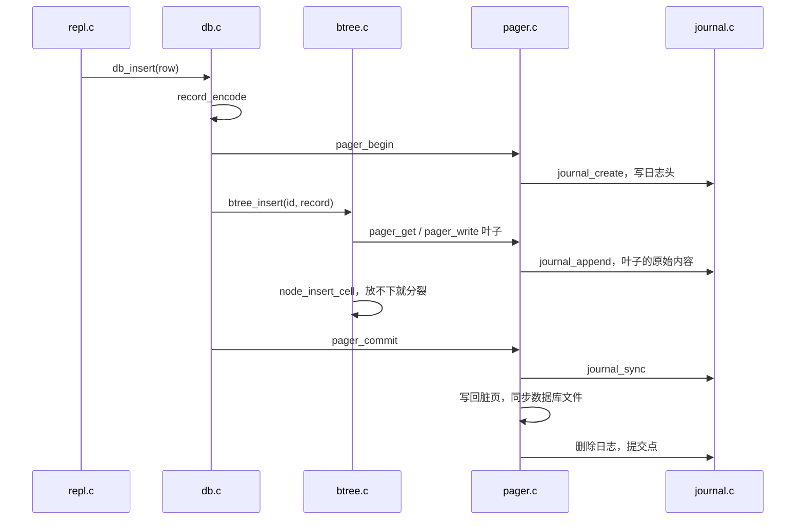
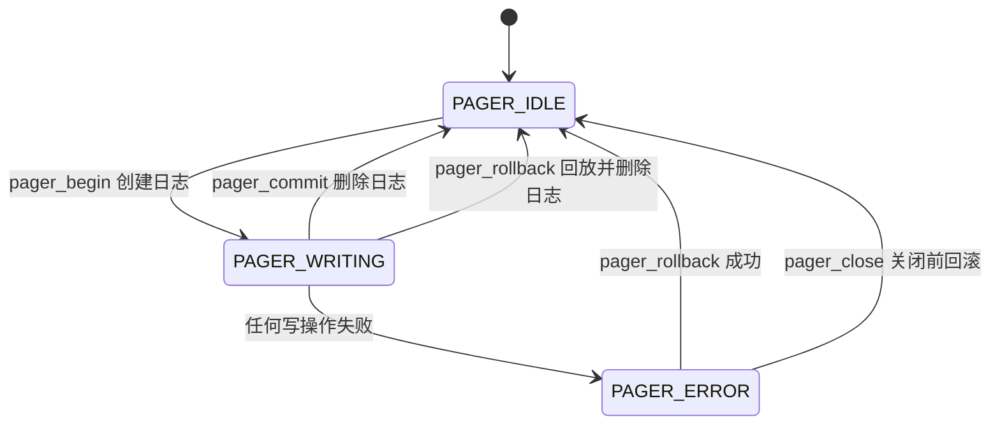

# 7.3 MdrDB：查询路径、恢复与测试

在 MdrDB 里，一条 `insert` 从终端读入到写进文件要穿过命令表、查询层、B+ 树、页管理器和文件层；如果进程在中间被杀掉，下次打开时这一行要么完整存在，要么完全不存在。这一页沿两条线读这份代码：一条是一行命令怎样走到页和日志，一条是崩溃之后怎样回到事务开始前的状态。最后看测试怎样把「在任何一次写操作处崩溃」逐点验证一遍。

先看一次可以复现的崩溃。`demo.db` 里已经有三行，`.fault 3` 让进程再完成三次写操作之后，在下一次写操作处退出；随后的 `insert 4` 在这时被杀掉，目录里留下 4120 字节的 `demo.db-journal`。

::: terminal title="bash - mdrdb"

```console
$ printf '.fault 3\ninsert 4 dave dave@example.com\n' | ./build/mdrdb --echo demo.db 2>&1
mdrdb> .fault 3
fault: the process will crash after 3 writes
mdrdb> insert 4 dave dave@example.com
fault: simulated crash
$ echo $?
1
$ wc -c < demo.db-journal
4120
```

:::

再次打开时，`main` 在进入 REPL 之前就完成了恢复，所以 `recovery:` 一行出现在提示符之前：

::: terminal title="bash - mdrdb"

```console
$ printf 'select\n' | ./build/mdrdb --echo demo.db
recovery: 1 page restored from the journal
mdrdb> select
(1, alice, alice@example.com)
(2, bob, bob@example.com)
(3, carol, carol@example.com)
(3 rows)
```

:::

第四行没有留下，恢复后的文件与插入前逐字节相同。下面先读命令路径（第 1～3 节），再读日志与恢复（第 4～5 节），最后读测试（第 6 节）。源码在 `code/项目/MdrDB/`，引用的代码以仓库当前版本为准。

## 1. 从命令到函数

REPL（read-eval-print loop）的分层很浅：`repl_run` 负责读行、回显和刷新，`repl_execute` 负责把一行切成单词、查命令表、调用处理函数，具体的命令各有一个 `cmd_` 开头的处理函数。

### 1.1 读一行，执行，刷新

`repl_run` 的循环不长，值得逐行看一遍：

```c
void repl_run(db *d, FILE *in, FILE *out, bool echo) {
    char line[REPL_LINE_MAX];
    for (;;) {
        fputs("mdrdb> ", out);
        fflush(out);
        if (fgets(line, sizeof line, in) == NULL) {
            fputc('\n', out);
            break;
        }
        size_t len = strlen(line);
        bool complete = len > 0 && line[len - 1] == '\n';
        if (!complete && len == sizeof line - 1) {
            int c;
            do {
                c = fgetc(in);
            } while (c != EOF && c != '\n');
            fputs("error: line is too long\n", out);
            continue;
        }
        if (echo) {
            fputs(line, out);
            if (!complete) {
                fputc('\n', out);
            }
            /* 命令可能让进程崩溃（.fault），先把已有的输出送出去。 */
            fflush(out);
        }
        if (repl_execute(d, line, out) == REPL_EXIT) {
            break;
        }
    }
    fflush(out);
}
```

每轮先打印提示符并刷新。提示符后面没有换行，输出重定向到管道或文件时 stdout 是全缓冲的，不刷新就看不到提示。读到一行后，若开了 `--echo`，先把这一行原样写回输出，再刷新一次，然后才执行。这个顺序不是多余的讲究：`.fault` 会让进程在写操作中途直接退出，缓冲区里没有送出去的文字会随进程一起消失，或者与 stderr 上的输出颠倒次序。

`fgets` 最多读入 `REPL_LINE_MAX - 1`（1023）个字符。没读到换行而缓冲区已满时，程序把这一行余下的字符读到换行，输出 `error: line is too long`，然后继续读下一行。空行什么都不做。

::: tip 让演示输出按顺序出现

`--echo` 把读到的命令回显在提示符后面；`2>&1` 把 `fault: simulated crash` 这条写到 stderr 的消息并进同一股流。两者一起用，管道喂命令时的输出才与交互操作时一样。

:::

::: details 去掉执行前的 `fflush` 会怎样

在副本里删掉 `repl_execute` 前面那一行 `fflush(out)`，重新构建，再做同样的管道演示：在 Linux（glibc）上，被回显的那条 `insert` 整行没有出现；在 Windows（UCRT）上，它出现在 `fault: simulated crash` 之后。两种表现来自同一件事：文字还留在 stdio 的缓冲区里，进程没有走正常的出口。是丢失还是顺序颠倒，取决于运行库，唯一可靠的做法是执行前显式刷新。

:::

### 1.2 切词与命令表

`repl_execute` 把一行就地切开。`strtok` 会把分隔符改写成 `'\0'`，所以 `line` 必须是可写的字符数组，不能是字符串字面量：

```c
repl_result repl_execute(db *d, char *line, FILE *out) {
    char *argv[MAX_WORDS + 1];
    int argc = 0;
    /* strtok 把分隔符改写成 '\0'，line 就地切成一个个单词。 */
    for (char *w = strtok(line, " \t\r\n"); w != NULL;
         w = strtok(NULL, " \t\r\n")) {
        if (argc == MAX_WORDS) {
            fputs("error: too many words\n", out);
            return REPL_CONTINUE;
        }
        argv[argc++] = w;
    }
    argv[argc] = NULL; /* 与 main 的 argv 一样以 NULL 结尾 */
    if (argc == 0) {
        return REPL_CONTINUE;
    }
    const command *cmd = find_command(argv[0]);
    if (cmd == NULL) {
        fprintf(out, "error: unknown command '%s', try .help\n", argv[0]);
        return REPL_CONTINUE;
    }
    if (argc - 1 < cmd->min_args || argc - 1 > cmd->max_args) {
        fprintf(out, "usage: %s\n", cmd->usage);
        return REPL_CONTINUE;
    }
    if (cmd->run == NULL) {
        return REPL_EXIT;
    }
    cmd->run(d, argv, out);
    return REPL_CONTINUE;
}
```

`argv` 与 `main` 的参数一样以 `NULL` 结尾，处理函数因此可以直接用 `argv[1]`、`argv[2]`，不必再传个数。表里的 `min_args`、`max_args` 指参数个数（不含命令名），越界时打印用法。

命令表把命令名、参数范围、用法、帮助文字和处理函数放在一起：

```c
static const command commands[] = {
    {"insert", 3, 3, "insert <id> <name> <email>", "add a row", cmd_insert},
    {"select", 0, 2, "select [<id> | <first> <last>]", "show rows", cmd_select},
    {"delete", 1, 1, "delete <id>", "remove a row", cmd_delete},
    {"begin", 0, 0, "begin", "start a transaction", cmd_begin},
    {"commit", 0, 0, "commit", "make the transaction permanent", cmd_commit},
    {"rollback", 0, 0, "rollback", "undo the transaction", cmd_rollback},
    {".tree", 0, 0, ".tree", "print the shape of the B+ tree", cmd_tree},
    {".page", 1, 1, ".page <n>", "print the layout of page n", cmd_page},
    {".info", 0, 0, ".info", "print file and cache statistics", cmd_info},
    {".check", 0, 0, ".check", "verify the B+ tree and records", cmd_check},
    {".fault", 1, 1, ".fault <n>", "crash after n more writes", cmd_fault},
    {".help", 0, 0, ".help", "list commands", cmd_help},
    {".exit", 0, 0, ".exit", "quit", NULL},
};
```

`run` 为 `NULL` 的那一项表示退出；`find_command` 顺序查找，`cmd_help` 也遍历这张表生成帮助。加一条命令只需要加一行、再写一个处理函数，7.1 的习题 50716 要求加 `.count`，做的就是这样一件事。

::: terminal title="bash - mdrdb（节选）"

```console
mdrdb> update 4
error: unknown command 'update', try .help
mdrdb> insert 1 a b c d
usage: insert <id> <name> <email>
mdrdb> insert 1 a b c d e f g h
error: too many words
```

:::

## 2. 读路径

读命令有两条路径：`select <id>` 按主键点查，`select <a> <b>` 沿叶子链范围扫描。

### 2.1 点查

`db_find` 只做三件事：让 B+ 树找到负载，记下键，把负载解码成一行：

```c
db_status db_find(db *d, uint32_t id, db_row *row) {
    uint8_t payload[BTREE_MAX_PAYLOAD];
    size_t size;
    db_status rc = btree_find(d->pager, id, payload, &size);
    if (rc != DB_OK) {
        return rc;
    }
    row->id = id;
    return record_decode(payload, size, row);
}
```

`btree_find` 先用 `find_leaf` 从根走到叶子，每层用 `child_slot` 选孩子，然后在叶子里用 `node_search` 二分查找（7.2 讲过这两步）。找到以后 `leaf_payload` 返回负载指针和长度，`record_decode` 把 `name`、`email` 解出来，并检查长度、越界、内嵌的 `'\0'` 和多余的字节。找不到返回 `DB_NOT_FOUND`，`cmd_select` 把它当作空结果，照样打印行数：

::: terminal title="bash - mdrdb"

```console
mdrdb> select 2
(2, bob, bob@example.com)
(1 row)
mdrdb> select 7
(0 rows)
mdrdb> select 0
(0 rows)
```

:::

行数为 1 时打印 `row`，其余打印 `rows`，所以是 `(1 row)` 和 `(0 rows)`。

### 2.2 范围查询

`db_scan` 是整页代码里唯一一处把遍历交给调用者的地方：

```c
db_status db_scan(db *d, uint32_t first, uint32_t last, db_row_fn fn,
                  void *ctx) {
    btree_cursor c;
    db_status rc = btree_seek(d->pager, first, &c);
    while (rc == DB_OK && c.valid) {
        uint8_t payload[BTREE_MAX_PAYLOAD];
        size_t size;
        db_row row;
        rc = btree_read(&c, &row.id, payload, &size);
        if (rc != DB_OK || row.id > last) {
            break;
        }
        rc = record_decode(payload, size, &row);
        if (rc != DB_OK || !fn(&row, ctx)) {
            break;
        }
        rc = btree_next(&c);
    }
    return rc;
}
```

`btree_seek` 定位到第一个不小于 `first` 的键，`btree_read` 取当前单元格，`btree_next` 让游标前进一格。游标（cursor）只记页号和单元格下标，不钉住页面，每一步重新取页，所以遍历期间缓存可以换出别的页。`settle` 负责跳过空叶子：删除不合并页面，一条链上可能夹着没有单元格的叶子。它还有一项检查：每走一步，停下来的键必须比上一个键大，否则说明叶子链接错了或者成了环，返回 `DB_CORRUPT`。

空叶子与范围查询放在一起看最清楚。导入 300 行，删掉 1～61，再查看树和范围查询的结果：

::: terminal title="bash - mdrdb（节选）"

```console
$ for i in $(seq 1 300); do echo "insert $i user$i user$i@example.com"; done > rows.txt
$ ./build/mdrdb big.db < rows.txt > /dev/null
$ printf 'begin\n' > del.txt
$ for i in $(seq 1 61); do echo "delete $i" >> del.txt; done
$ echo commit >> del.txt
$ ./build/mdrdb big.db < del.txt > /dev/null
$ printf '.tree\nselect 60 70\n' | ./build/mdrdb --echo big.db
mdrdb> .tree
internal 1: 4 keys
  leaf 2: 0 keys
  key 62
  leaf 3: 60 keys (62..121)
  key 122
  leaf 4: 57 keys (122..178)
  key 179
  leaf 5: 57 keys (179..235)
  key 236
  leaf 6: 65 keys (236..300)
mdrdb> select 60 70
(62, user62, user62@example.com)
(63, user63, user63@example.com)
(64, user64, user64@example.com)
(65, user65, user65@example.com)
(66, user66, user66@example.com)
(67, user67, user67@example.com)
(68, user68, user68@example.com)
(69, user69, user69@example.com)
(70, user70, user70@example.com)
(9 rows)
```

:::

第 2 页已经空了，`select 60 70` 却从 62 开始，说明游标跨过空叶子继续向右走。范围为空时（`select 3 1`）同样返回 `(0 rows)`。

回调 `db_row_fn` 返回 `false` 可以提前结束遍历，`db_scan` 返回 `DB_OK`，REPL 只按已经输出的行数打印。回调里不能修改数据库：游标不钉住页面，插入或删除会让树在遍历途中变化。越界使用时现在的代码会给出 `error: database file is corrupt`：在遍历途中插入一个排在前面的键，下一次 `settle` 看到键没有变大，就按损坏处理。

<Quiz
  type="single"
  :options="[
    { label: '游标钉住了叶子页，换出时会被跳过', value: 'A' },
    { label: '每一步都要重新取页，被修改的树可能让游标读到别的页', value: 'B' },
    { label: '回调是在只读事务里执行的，写入会被拒绝', value: 'C' },
    { label: 'db_scan 内部又开了一个事务，与外面的冲突', value: 'D' }
  ]"
  answer="B"
>

<template #question>

`db_scan` 的回调里为什么不能插入或删除行？

</template>

正确答案是 **B**。`btree_cursor` 只保存页号和单元格下标，每次 `btree_read`、`btree_next` 都重新取页。遍历途中树的结构一改，原来记下的页号与下标就可能指向别的单元格，`settle` 的「键必须变大」检查会把这种情况当作文件损坏报告出来。

</Quiz>

## 3. 写路径与事务

### 3.1 一条 insert 的调用链

`db_insert` 决定事务从哪里开始、到哪里结束：

```c
db_status db_insert(db *d, const db_row *row) {
    uint8_t record[RECORD_MAX_SIZE];
    size_t size;
    db_status rc = record_encode(row, record, &size);
    if (rc != DB_OK) {
        return rc;
    }
    bool autocommit = !d->explicit_txn;
    if (autocommit) {
        rc = pager_begin(d->pager);
        if (rc != DB_OK) {
            return rc;
        }
    }
    rc = btree_insert(d->pager, row->id, record, size);
    return finish_statement(d, autocommit, rc);
}
```

用户没有用 `db_begin` 开启事务时，每条修改语句自成一个事务，语句返回之前已经提交，这叫自动提交（autocommit）。`pager_begin` 创建日志并记下当前页数，`btree_insert` 改页，`finish_statement` 负责提交或回滚。整条链经过的层如下：



### 3.2 两类失败

语句失败时不是一律回滚。`finish_statement` 先把错误分成两类，分界线在 `is_clean_failure`：

```c
/*
 * 这几种错误在修改任何页之前就能查出来：插入前先找过键，删除前也先
 * 找过键。语句失败但数据库原封未动，事务可以照常继续。
 */
static bool is_clean_failure(db_status rc) {
    return rc == DB_DUPLICATE || rc == DB_NOT_FOUND || rc == DB_TOO_LONG;
}
```

重复键、键不存在、字段过长都在修改任何页之前就能查出来：`btree_insert` 先找过键，发现存在就返回 `DB_DUPLICATE`，这时一个页都没改；删除也一样；负载长度在入口就检查。其余错误（例如读页失败、写日志失败）可能发生在改到一半的时候，树的状态无法保证，只能把整个事务回滚：

```c
static db_status finish_statement(db *d, bool autocommit, db_status rc) {
    if (rc == DB_OK || is_clean_failure(rc)) {
        if (!autocommit) {
            return rc;
        }
        db_status commit_rc = pager_commit(d->pager);
        if (commit_rc == DB_OK) {
            return rc;
        }
        rc = commit_rc;
    }
    (void)pager_rollback(d->pager);
    d->explicit_txn = false;
    return rc;
}
```

自动提交时，干净的失败也会走完事务：提交一个什么都没改的事务，代价是创建日志、写日志头、删除日志三次写操作。在一张只有三行的表上实测，重复键的 `insert` 花了 3 次写操作，正常插入花了 5 次。

REPL 在修改失败后要告诉用户前面已经成功的修改也没了，`report_write` 负责补这句话：

```c
/* 修改失败时如果整个事务被回滚了，要告诉用户之前的修改也没了。 */
static void report_write(db *d, bool was_in_txn, db_status rc, FILE *out) {
    report(rc, out);
    if (rc != DB_OK && was_in_txn && !db_in_transaction(d)) {
        fputs("the transaction was rolled back\n", out);
    }
}
```

`cmd_insert` 在调用 `db_insert` 之前先记下 `db_in_transaction(d)`，`cmd_commit` 则直接传 `true`：提交失败时 `db_commit` 一定会回滚，REPL 打印 `error: I/O error` 加上 `the transaction was rolled back`。`test_repl` 里的 `test_failed_commit_is_reported` 用故障注入让提交的第一次写就失败，检查的正是这两行，并确认重新打开后那一行不在。

### 3.3 显式事务与退出

`begin`、`commit`、`rollback` 把 `explicit_txn` 置位或清除。显式事务里每条语句不再自动提交，失败的影响由上一节的两类失败决定。重复键之后事务还开着，可以继续用：

::: terminal title="bash - mdrdb（节选）"

```console
mdrdb> insert 1 alice alice@example.com
ok
mdrdb> begin
ok
mdrdb> insert 2 bob bob@example.com
ok
mdrdb> insert 2 bob bob@example.com
error: duplicate key
mdrdb> .info
file: q2.db
page size: 4096, page count: 2
cache: 64 frames, hits 8, misses 1, spills 0
journal: pages saved 3, pages restored at open 0
transaction: open
mdrdb> insert 3 carol carol@example.com
ok
mdrdb> commit
ok
mdrdb> select
(1, alice, alice@example.com)
(2, bob, bob@example.com)
(3, carol, carol@example.com)
(3 rows)
```

:::

回滚则撤销事务开始后的全部修改：

::: terminal title="bash - mdrdb"

```console
mdrdb> begin
ok
mdrdb> insert 2 bob bob@example.com
ok
mdrdb> insert 3 carol carol@example.com
ok
mdrdb> rollback
ok
mdrdb> select
(1, alice, alice@example.com)
(1 row)
```

:::

REPL 收到 `.exit` 或输入结束时，如果事务还开着，`main` 先打印 `the open transaction was rolled back`，再调用 `db_close`，`pager_close` 发现状态不是空闲就会回滚。退出等同于 `rollback`，不会留下半个事务。

<Quiz
  type="single"
  :options="[
    { label: '事务已经被回滚，必须重新 begin', value: 'A' },
    { label: '事务仍然开着，可以继续插入或提交', value: 'B' },
    { label: '只有这一条被撤销，事务自动提交', value: 'C' },
    { label: '进程会立即退出', value: 'D' }
  ]"
  answer="B"
>

<template #question>

显式事务里连续执行两次同样的 `insert 2 bob bob@example.com`，第二次返回 `duplicate key`。此时事务处于什么状态？

</template>

正确答案是 **B**。重复键属于干净失败：`btree_insert` 发现键已存在时还没有修改任何页，`finish_statement` 看到 `DB_DUPLICATE` 就直接返回，既不提交也不回滚，`explicit_txn` 保持为真。`.info` 里那一行 `transaction: open` 就是证据。

</Quiz>

## 4. 回滚日志

事务能撤销，靠的是一份回滚日志（rollback journal）：在覆盖数据库文件里的某一页之前，先把这一页的原始内容写进日志；事务提交时删除日志。进程在提交前死掉，日志还在，下次打开时把其中的原始页写回去。

### 4.1 日志格式与 CRC-32

日志与数据库文件同名，后缀 `-journal`。文件头 16 字节，之后每条记录 4104 字节：

<BitField
  mode="packet"
  title="MdrDB 回滚日志的文件头"
  :fields="[
    { name: '魔数', bytes: 8, value: 'MDBJRNL1', tone: 'brand', desc: '8 个字节的字符，不是整数' },
    { name: '页大小', bytes: 4, value: '0x00001000', desc: '4096，与数据库文件的页大小一致' },
    { name: 'CRC-32', bytes: 4, value: '0xcf55f7f7', tone: 'green', desc: '前 12 字节的校验和' }
  ]"
/>

每条记录是页号（4 字节）、这一页的原始内容（4096 字节）、前两项的 CRC-32（4 字节）。文件里不记条数，回放读到文件尾或者遇到第一条校验和不符的记录就停。下面是 `.fault 3` 演示留下的日志：第一条 `xxd` 同时显示了 16 字节的文件头和第一条记录的开头，第二条从偏移 20 开始，显示的是被备份的第 1 页的原始内容：

::: terminal title="bash - xxd"

```console
$ xxd -l 24 demo.db-journal
00000000: 4d44 424a 524e 4c31 0000 1000 cf55 f7f7  MDBJRNL1.....U..
00000010: 0000 0001 0100 0003                      ........
$ xxd -s 20 -l 16 demo.db-journal
00000014: 0100 0003 0faa 0000 0000 0000 0fe2 0fc8  ................
```

:::

前 8 个字节是 `MDBJRNL1`，接着是页大小 `00 00 10 00`（4096），然后是头部 CRC-32 `cf 55 f7 f7`。偏移 16 处是第一条记录的页号 `00 00 00 01`，偏移 20 处开始的 4096 字节是第 1 页的原始内容，它的头两字节 `01 00` 表示叶子节点，单元格数是 `00 03`。整个文件 4120 字节 = 16 字节头 + 4104 字节的一条记录。

校验和用的是 IEEE 802.3 多项式，与 zlib 的 `crc32` 结果相同，逐位计算：

```c
static uint32_t crc32_update(uint32_t crc, const uint8_t *data, size_t size) {
    crc = ~crc;
    for (size_t i = 0; i < size; i++) {
        crc ^= data[i];
        for (int bit = 0; bit < 8; bit++) {
            uint32_t mask = 0u - (crc & 1u); /* 最低位为 1 时全 1 */
            crc = (crc >> 1) ^ (0xEDB88320u & mask);
        }
    }
    return ~crc;
}
```

`mask` 由最低位扩展成全 1 或全 0，省掉一个分支：`0xEDB88320` 是反射形式的多项式，最低位为 1 时才异或进去。拿日志里的字节核对，头部前 12 字节的 CRC 是 `0xcf55f7f7`，第一条记录前 4100 字节的 CRC 是 `0x15f4fe78`，与 `xxd` 里看到的字段一致。逐位算法比查表慢，但每条记录只算一次，日志写入又是整页量级，速度不成问题。

校验和防的是两件事：写到一半的记录，以及长度完整但内容坏掉的记录。前者在文件尾部留下一条短记录，回放读到长度不够就停；后者只能靠校验和认出来，回放同样停在这一条。这两种情况的区别见 5.1 节。

### 4.2 写前规则与位图

`pager_write` 是修改页面的唯一入口，规则写在它的注释里：

```c
db_status pager_write(pager *p, page *pg) {
    if (p->state == PAGER_ERROR) {
        return DB_IO_ERROR;
    }
    if (p->state != PAGER_WRITING) {
        return DB_MISUSE;
    }
    /*
     * 事务开始后才分配的页（页号不小于 orig_page_count）没有需要保存
     * 的原始内容：回滚后页数恢复原值，这些页落在页数之外，自然作废。
     * 位图保证每页只记一次：同一页第二次修改时，日志里已经是它的原貌。
     */
    if (pg->pgno < p->orig_page_count && !test_bit(p->journaled, pg->pgno)) {
        db_status rc = journal_append(&p->journal, pg->pgno, pg->data);
        if (rc != DB_OK) {
            return fail(p, rc);
        }
        set_bit(p->journaled, pg->pgno);
        p->stats.journaled++;
    }
    pg->dirty = true;
    return DB_OK;
}
```

三个条件缺一不可。

页号必须小于 `orig_page_count`。事务开始后分配的页不在日志里：回滚时文件头里的页数被恢复成事务开始时的值，这些新页落在页数之外，谁也读不到，自然作废。

每页只记一次。位图 `journaled` 的每一位对应一页，第二次修改同一页时跳过。如果记两次，日志里就会出现两条同一页的记录：第一条是原貌，第二条是已经改过的内容。回放按顺序写回，后一条会把前一条覆盖掉，回滚反而「恢复」成了事务中途的状态。

首次修改之前。`pager_write` 必须在上层改动 `pg->data` 之前调用，7.2 用一条 warning 强调过这一点。调用之后，页被标成脏页，等待提交时写回。

<Quiz
  type="single"
  :options="[
    { label: '新页的内容还没确定，写日志没有意义', value: 'A' },
    { label: '回滚会恢复文件头里的页数，新页落在页数之外，读不到', value: 'B' },
    { label: '新页的页号超出日志的编码范围', value: 'C' },
    { label: '日志只能记录被删除的页', value: 'D' }
  ]"
  answer="B"
>

<template #question>

事务开始后新分配的页为什么不写进日志？

</template>

正确答案是 **B**。日志的作用是把页恢复成事务开始前的样子。事务开始前这些页根本不存在，回滚时文件头里的页数恢复原值，它们就落在页数之外，谁也读不到，不需要恢复。标准 C 不能截短文件，这些字节留在文件尾部，之后分配新页时被重新使用。

</Quiz>

举个例子。库里先有一行，再用一个显式事务连续插入两行，两行都落在第 1 页上：

::: terminal title="bash - mdrdb（节选）"

```console
mdrdb> begin
ok
mdrdb> insert 10 ten ten@example.com
ok
mdrdb> insert 11 eleven eleven@example.com
ok
mdrdb> .info
file: q1.db
page size: 4096, page count: 2
cache: 64 frames, hits 5, misses 1, spills 0
journal: pages saved 1, pages restored at open 0
transaction: open
mdrdb> commit
ok
```

:::

`pages saved` 是 1，因为两行都改第 1 页，位图让第二次修改跳过了日志。同一段会话用改过的 `file.c` 记下每次写操作，顺序是：创建日志、写日志头、写第一条记录、写数据库文件、删除日志。日志里只有一条记录。

### 4.3 换出：提交前就写回数据库文件

页框只有固定几个，事务大到装不下时，脏页会在提交之前被换出（steal），提前写进数据库文件。这并不违反提交的含义，只要原始内容已经在日志里，随时可以撤销。`write_back` 把这条前提写成了代码：

```c
static db_status write_back(pager *p, page *pg) {
    db_status rc = journal_sync(&p->journal);
    if (rc == DB_OK) {
        rc = file_write_at(p->file, page_offset(pg->pgno), pg->data,
                           DB_PAGE_SIZE);
    }
    if (rc != DB_OK) {
        return fail(p, rc);
    }
    pg->dirty = false;
    return DB_OK;
}
```

每次写回数据库文件之前先 `journal_sync`，日志里还没有同步的记录会先落盘。`journal_sync` 自己检查 `needs_sync`，没有新记录时直接返回，所以这里的重复调用不产生多余的写操作。

换出对用户可见。用 `--cache 4` 打开一个 300 行的库，在一个事务里删掉分散在五个叶子上的六行：

::: terminal title="bash - mdrdb"

```console
mdrdb> begin
ok
mdrdb> delete 10
ok
mdrdb> delete 70
ok
mdrdb> delete 130
ok
mdrdb> delete 185
ok
mdrdb> delete 240
ok
mdrdb> delete 290
ok
mdrdb> insert 331 a331 a331@example.com
ok
mdrdb> .info
file: sp.db
page size: 4096, page count: 7
cache: 4 frames, hits 16, misses 6, spills 2
journal: pages saved 5, pages restored at open 0
transaction: open
mdrdb> rollback
ok
mdrdb> select 10 10
(10, user10, user10@example.com)
(1 row)
mdrdb> select 290 290
(290, user290, user290@example.com)
(1 row)
```

:::

`spills 2` 就是提交前被换出、提前写回文件的脏页数；`pages saved 5` 是进了日志的页数。这个库一共七页：第 0 页是文件头，第 1 页是内部节点，第 2 页到第 6 页是五个叶子。六次删除分散在五个叶子上，插入 331 号行又落在最后一个叶子，五页因此都改了；根页和文件头没有动。`rollback` 之后数据库回到原样，可以接着 `select` 验证。

::: details 一次换出的完整写序列

同一个事务在 `--cache 4` 下用带日志的 `file.c` 重放，写操作依次是：

```text
create journal        创建日志
write offset 0        日志头 16 字节
write offset 16       第 2 页的原始内容（第一条记录）
write offset 4120     第 3 页的原始内容
write offset 8224     第 4 页的原始内容
write offset 8192     第 2 页的新内容（换出）
write offset 12328    第 5 页的原始内容
write offset 12288    第 3 页的新内容（换出）
write offset 16432    第 6 页的原始内容
write offset 8192     回滚：第 2 页恢复
write offset 12288    回滚：第 3 页恢复
write offset 16384    回滚：第 4 页恢复
write offset 20480    回滚：第 5 页恢复
write offset 24576    回滚：第 6 页恢复
remove journal
```

数据库文件的偏移除以 4096 就是页号。日志依次记下第 2、3、4、5、6 页的原貌；页框只有 4 个，第 2 页和第 3 页在事务中途被换出，各自先同步日志再写回文件。最后回滚把日志里的五页原样写回，同步文件，再删除日志。每一次写回数据库文件之前，日志里对应的记录都已经写过并同步过。

:::

### 4.4 提交的四个步骤

`pager_commit` 是整份代码里最需要按顺序读的函数：

```c
db_status pager_commit(pager *p) {
    if (p->state == PAGER_ERROR) {
        return DB_IO_ERROR;
    }
    if (p->state != PAGER_WRITING) {
        return DB_MISUSE;
    }
    for (size_t i = 0; i < p->frame_count; i++) {
        page *pg = &p->frames[i];
        if (pg->in_use && pg->dirty) {
            db_status rc = write_back(p, pg);
            if (rc != DB_OK) {
                return rc;
            }
        }
    }
    db_status rc = file_sync(p->file);
    if (rc != DB_OK) {
        return fail(p, rc);
    }
    /*
     * 删除日志就是提交点（commit point）。删除之前崩溃，下次打开时
     * 日志还在，事务被撤销；删除之后，事务才算生效。
     */
    journal_close(&p->journal);
    rc = file_remove(p->journal_path);
    if (rc != DB_OK) {
        return fail(p, rc);
    }
    end_transaction(p);
    return DB_OK;
}
```

把它拆成四个步骤：

1. **同步日志**。这一步发生在每个脏页写回之前，藏在 `write_back` 里。事务里追加过的记录先落盘。
2. **写回脏页**。缓存里所有改过的页写进数据库文件。
3. **同步数据库文件**。`file_sync` 目前是 `fflush`，保证数据交给了操作系统。
4. **删除日志**。`remove` 成功的那一刻，事务提交。

<Quiz
  type="single"
  :options="[
    { label: '日志同步完成时', value: 'A' },
    { label: '脏页全部写回数据库文件时', value: 'B' },
    { label: '数据库文件同步完成时', value: 'C' },
    { label: '日志文件被删除时', value: 'D' }
  ]"
  answer="D"
>

<template #question>

`pager_commit` 的四步里，哪一步完成才算事务提交？

</template>

正确答案是 **D**。前三步都只是让新内容就位；日志还在，就还有撤销的依据，事务不算完成。日志删除之后，数据库文件里已经是新内容，也没有旧内容可回放，事务才生效。

</Quiz>

删除日志之所以能当提交点，是因为前面三步已经让新内容完全落在数据库文件里，日志里的旧内容在删除之后不再需要。反过来说，只要日志还在，无论数据库文件被改成什么样，下次打开都能把旧内容写回去。SQLite 的文档把这句话说得很直接：日志删除的那一刻就是事务提交的那一刻。

顺序写反会怎样，用一次真实的变异实验看得最清楚。把「删除日志」挪到「写回脏页」之前，其它不动：

::: compare vertical left-title="先删日志，再写页" right-title="先写页，同步，再删日志"

```c
/* 变异：提交点提前了 */
journal_close(&p->journal);
db_status rc = file_remove(p->journal_path);
if (rc != DB_OK) {
    return fail(p, rc);
}
for (size_t i = 0; i < p->frame_count; i++) {
    page *pg = &p->frames[i];
    if (pg->in_use && pg->dirty) {
        rc = file_write_at(p->file, page_offset(pg->pgno), pg->data,
                           DB_PAGE_SIZE);
        if (rc != DB_OK) {
            return rc;
        }
        pg->dirty = false;
    }
}
rc = file_sync(p->file);
```

---

```c
for (size_t i = 0; i < p->frame_count; i++) {
    page *pg = &p->frames[i];
    if (pg->in_use && pg->dirty) {
        db_status rc = write_back(p, pg);
        if (rc != DB_OK) {
            return rc;
        }
    }
}
db_status rc = file_sync(p->file);
if (rc != DB_OK) {
    return fail(p, rc);
}
journal_close(&p->journal);
rc = file_remove(p->journal_path);
if (rc != DB_OK) {
    return fail(p, rc);
}
```

:::

左栏里，日志一删，事务就算提交了；如果进程恰好死在删除日志之后、写回脏页之前，数据库文件里还是旧内容，新内容只存在于内存，随进程一起消失。`test_crash` 的 62 个崩溃点里，有 12 个恢复出了错误的结果：

::: terminal title="bash - test_crash（变异实验，节选）"

```console
$ ./test_crash
  crash point 4: row 2 should not exist
  crash point 9: row 4 should not exist
  crash point 14: row 6 should not exist
  ……（中间省略若干条）
  crash point 55: page 2: bad page layout
  crash point 60: row 104 should not exist
tests/test_crash.c:228: check failed: wrong == 0
……（中间省略）
     62 crash points, 12 recovered incorrectly
FAIL test_crash_at_every_write
     recovery interrupted 0 times, then completed
FAIL test_crash_during_recovery
     8 crash points while creating, 2 recovered incorrectly
FAIL test_crash_while_creating
4834 checks, 5 failed
```

:::

同一份变异下，`test_record`、`test_node`、`test_journal`、`test_pager`、`test_btree`、`test_repl` 全部通过。抓到这个错误的只有崩溃测试。原因不难理解：其它测试从不把进程停在「日志已删、页未写」的那一刻。

### 4.5 回滚与恢复

回滚和打开时的恢复共用同一条路径。`pager_rollback` 先丢弃整个缓存，再回放日志：

```c
db_status pager_rollback(pager *p) {
    if (p->state == PAGER_IDLE) {
        return DB_MISUSE;
    }
    if (pager_pinned(p) > 0) {
        return DB_MISUSE; /* 还有人拿着页的指针，不能把缓存清掉 */
    }
    journal_close(&p->journal);
    /*
     * 缓存里的页要么改过，要么可能是"换出后又读回来"的修改后版本，
     * 一律丢弃，之后以恢复好的文件为准。
     */
    for (size_t i = 0; i < p->frame_count; i++) {
        p->frames[i].in_use = false;
        p->frames[i].dirty = false;
    }
    uint32_t restored;
    db_status rc = replay_journal(p, &restored);
    if (rc == DB_OK) {
        rc = load_header(p);
    }
    if (rc != DB_OK) {
        p->state = PAGER_ERROR;
        return rc;
    }
    end_transaction(p);
    return DB_OK;
}
```

缓存里的页一律丢弃，包括那些换出以后又被读回来的页：它们的内容是修改后的版本，回放之后已经过时。`load_header` 重新读出文件头里的页数，`pager_page_count` 因此回到事务开始时的值。

`replay_journal` 只有三行有效操作：

```c
static db_status replay_journal(pager *p, uint32_t *restored) {
    db_status rc = journal_playback(p->journal_path, p->file, restored);
    if (rc == DB_OK) {
        rc = file_sync(p->file);
    }
    if (rc == DB_OK) {
        rc = file_remove(p->journal_path);
    }
    return rc;
}
```

先回放，再同步数据库文件，最后删除日志。这三步与提交时对称：在同步完成之前删除日志，崩溃后就没有第二次机会。`journal_playback` 逐条读记录，校验和不对就停下，把完好的记录所对应的原始页写回数据库文件：

```c
    uint8_t record[JOURNAL_RECORD_SIZE];
    long offset = JOURNAL_HEADER_SIZE;
    for (;;) {
        rc = file_read_at(jf, offset, record, sizeof record, &n);
        if (rc != DB_OK || n < sizeof record) {
            break;
        }
        uint32_t crc = get_u32(record + 4 + DB_PAGE_SIZE);
        if (crc != crc32_update(0, record, 4 + DB_PAGE_SIZE)) {
            break; /* 写了一半的记录：它对应的页还没写进数据库文件 */
        }
        uint32_t pgno = get_u32(record);
        if (pgno >= DB_MAX_PAGES) {
            break;
        }
        rc = file_write_at(dest, (long)pgno * DB_PAGE_SIZE, record + 4,
                           DB_PAGE_SIZE);
        if (rc != DB_OK) {
            break;
        }
        (*restored)++;
        offset += JOURNAL_RECORD_SIZE;
    }
```

打开数据库时，`open_file` 发现同名日志还在，就走同一个 `replay_journal`：

```c
static db_status open_file(pager *p, const char *path, uint32_t *recovered) {
    db_status rc = file_exists(path) ? file_open(path, &p->file)
                                     : file_create(path, &p->file);
    if (rc != DB_OK) {
        return rc;
    }
    uint8_t data[DB_PAGE_SIZE];
    uint8_t fresh[DB_PAGE_SIZE];
    size_t n;
    rc = file_read_at(p->file, 0, data, DB_PAGE_SIZE, &n);
    if (rc != DB_OK) {
        return rc;
    }
    fresh_header(fresh);
    bool has_journal = file_exists(p->journal_path);
    if (n < DB_PAGE_SIZE && memcmp(data, fresh, n) == 0) {
        /*
         * 不足一页，已有的字节又都与新库的文件头相同：上次新建数据库时，
         * 文件头还没写完进程就中断了（空文件是 n 为 0 的情形）。库里还
         * 没有数据，重写文件头即可。旁边若有日志，只能是与它无关的旧文件。
         */
        if (has_journal) {
            rc = file_remove(p->journal_path);
        }
        return rc == DB_OK ? init_header(p) : rc;
    }
    if (has_journal) {
        /* 热日志（hot journal）：上次有事务没提交就中断了。 */
        rc = replay_journal(p, recovered);
        if (rc != DB_OK) {
            return rc;
        }
    }
    return load_header(p);
}
```

前半段处理新建库被打断的情形。新建数据库时文件头直接写到文件里，不经过日志：这时还没有需要保护的数据。写到一半进程死掉，文件不足一页，已有的字节又都与新库的文件头相同，下次打开时据此认出这种情况，重写文件头；空文件是其中最简单的一种。这段判断来自复核时修掉的一个缺陷，在这之前，文件头只写进一半的库再也打不开。

回放可以重复执行。回放只做一件事：把日志里的原始页按页号写回；写一遍和写两遍结果相同。把演示留下的日志复制回去，再打开一次数据库：

::: terminal title="bash - mdrdb"

```console
$ cp demo.db-journal saved.journal
$ printf 'select\n' | ./build/mdrdb --echo demo.db
recovery: 1 page restored from the journal
mdrdb> select
(1, alice, alice@example.com)
(2, bob, bob@example.com)
(3, carol, carol@example.com)
(3 rows)
$ cp saved.journal demo.db-journal
$ printf 'select\n' | ./build/mdrdb --echo demo.db
recovery: 1 page restored from the journal
mdrdb> select
(1, alice, alice@example.com)
(2, bob, bob@example.com)
(3, carol, carol@example.com)
(3 rows)
```

:::

两次输出逐字相同，数据库文件也没有变大。`test_crash` 的第二个测试把这个性质用到了极致：让恢复过程本身在每一次写操作处崩溃，下次打开从头再回放，最终仍然回到事务开始前的状态。

<Quiz
  type="single"
  :options="[
    { label: '第二遍会把已经恢复好的页再改一遍，数据出错', value: 'A' },
    { label: '回放只是把同样的原始页按页号再写一次，结果不变', value: 'B' },
    { label: '第二遍会读到空日志，直接跳过', value: 'C' },
    { label: '日志在第一次回放结束时已被改写，第二遍内容不同', value: 'D' }
  ]"
  answer="B"
>

<template #question>

同一份日志被回放两次，数据库会变成什么样？

</template>

正确答案是 **B**。回放不做增量计算，只是把日志里每条记录中的原始页写到记录给出的页号处。同一页写两次，内容相同。恢复之所以能「中途再崩溃」，靠的就是这一点。

</Quiz>

事务开始后新分配的页不进日志，回滚后它们落在页数之外，自然作废。标准 C 不能截短文件，这些页留在文件尾部。下面这个例子把整个过程摊开。`grow.db` 是一个 300 行、7 页的库；`grow.txt` 里第一行是 `.fault 10`，接着是 `begin`、插入 301～500 行的两百条语句和 `commit`。用 `--cache 4` 打开并导入这个脚本，进程会在写回数据库页的过程中崩溃（`.fault` 那一行与命令回显被几条 `ok` 混在提示符之间，这里只留 stderr 上的那一行）：

::: terminal title="bash - mdrdb（节选）"

```console
$ ./build/mdrdb --cache 4 grow.db < grow.txt > /dev/null
fault: simulated crash
$ echo $?
1
$ wc -c < grow.db
38912
$ wc -c < grow.db-journal
12328
$ xxd -s 20 -l 4 grow.db
00000014: 0000 000a                                ....
```

:::

数据库文件在崩溃后是 38912 字节，9.5 页，最后一次写只写进一半。日志里有三条记录，页号是第 6、0、1 页；文件头里的页数已经是 10，因为分配新页时先改的就是这个字段。再打开：

::: terminal title="bash - mdrdb"

```console
$ printf '.info\nselect 500 500\n' | ./build/mdrdb --echo grow.db
recovery: 3 pages restored from the journal
mdrdb> .info
file: grow.db
page size: 4096, page count: 7
cache: 64 frames, hits 0, misses 0, spills 0
journal: pages saved 0, pages restored at open 3
transaction: none
mdrdb> select 500 500
(0 rows)
```

:::

页数回到 7，第 500 行不在。文件仍然是 38912 字节，第 7 页以后的内容谁也读不到。把同一个事务（去掉 `.fault` 那一行）再跑一遍并提交，文件长到 40960 字节，第 500 行出现：分配新页时从第 7 页接着往下排，回滚后作废的那些页被重新用上了。

::: concept mdr-journal-rules title="回滚日志的四条规则"

1. 一页的原始内容必须先写进日志，才能覆盖数据库文件里的这一页。
2. 日志里的内容同步之前，数据库文件里的对应页不能被覆盖（`write_back` 每次写之前先 `journal_sync`）。
3. 删除日志是提交点。日志还在，事务未完成；日志不在，事务已提交。
4. 恢复就是回放日志再删除日志。回放可以重复执行，写一遍和写两遍结果相同。

:::

pager 在事务里的状态只有三个，转换关系如下：



进入 `PAGER_ERROR` 之后只允许回滚或关闭。`pager_get` 和 `pager_write` 都会直接返回 `DB_IO_ERROR`，因为磁盘上的内容可能新旧混杂，继续读写只会更糟；回滚所需的日志还在磁盘上，所以回滚这条路必须留着。

::: generate mdr-commit-walkthrough kind=example concepts=mdr-journal-rules

面向刚读完本节、想确认自己能否推演崩溃结果的读者，以一条自动提交的 `insert` 为例，逐个写操作推演：如果进程停在第 1、2、3、4、5 次写操作之后，重开数据库时日志是否存在、回放了哪些页、那一行最终在不在。每次推演都对应到 `pager_commit` 的哪一步，并说明为什么第 5 次写之后崩溃与提交成功没有区别。

:::

## 5. 撕裂写、校验和与持久性

### 5.1 撕裂写与校验和

故障注入在崩溃点不让写操作失败，而是只写进一半数据：

```c
db_status file_write_at(db_file *f, long offset, const void *buf, size_t size) {
    if (fault.crashed) {
        return DB_IO_ERROR;
    }
    bool crash_here = at_crash_point();
    /* 崩溃点上的写只写进前一半，模拟断电时只写进一部分的撕裂写。 */
    size_t n = crash_here ? size / 2 : size;
    if (fseek(f->fp, offset, SEEK_SET) != 0 || fwrite(buf, 1, n, f->fp) != n) {
        clearerr(f->fp);
        return DB_IO_ERROR;
    }
    if (crash_here) {
        crash();
        return DB_IO_ERROR;
    }
    return DB_OK;
}
```

写日志记录时，一条 4104 字节的记录只写进 2052 字节，文件尾部就留下半条。回放按整条记录读，读到的字节数不够，循环立刻结束，这条记录对应的页不会被恢复。真实的例子：在一个 300 行的库上开一个事务，插入 301～340 行、删掉 1～39 行，前面加 `.fault 3`，进程在写第二条日志记录时崩溃。日志是 6172 字节，正好是 16 字节头 + 4104 字节的第一条记录 + 2052 字节的半条：

::: terminal title="bash - xxd"

```console
$ wc -c < torn.db-journal
6172
$ xxd -l 24 torn.db-journal
00000000: 4d44 424a 524e 4c31 0000 1000 cf55 f7f7  MDBJRNL1.....U..
00000010: 0000 0006 0100 0041                      .......A
```

:::

打开时只回放完整的第一条记录，日志头在偏移 16 处的 `00 00 00 06` 说明它是第 6 页；输出 `recovery: 1 page restored from the journal`，数据库回到事务开始前的 300 行（`select` 的末行是 `(300 rows)`）。

另一种撕裂不同：长度已经更新，内容却没写进去，或者写进去的是垃圾。这种记录长度完整，只能靠校验和认出来。`test_journal` 用两个用例分别覆盖：

```c
/* 写第二条记录时崩溃：记录只写进一半，回放到它为止。 */
static void test_torn_record_is_ignored(void) {
    db_file *dbf = make_db();
    journal j;
    uint8_t data[DB_PAGE_SIZE];
    remove(JOURNAL_FILE);
    fault_arm(3, FAULT_RETURN_ERROR); /* 创建、写头、第一条记录 */
    CHECK_OK(journal_create(&j, JOURNAL_FILE));
    memset(data, 0xA1, sizeof data);
    CHECK_OK(journal_append(&j, 1, data));
    memset(data, 0xA2, sizeof data);
    CHECK_STATUS(journal_append(&j, 2, data), DB_IO_ERROR);
    CHECK(fault_crashed());
    journal_close(&j);
    fault_disarm();

    uint32_t restored = 0;
    CHECK_OK(journal_playback(JOURNAL_FILE, dbf, &restored));
    CHECK(restored == 1);
    CHECK(page_byte(dbf, 1) == 0xA1);
    CHECK(page_byte(dbf, 2) == 2); /* 没有被半条记录覆盖 */
    file_close(dbf);
}
```

```c
/*
 * 第二条记录长度完整、内容却是坏的。断电后文件长度已经更新、数据块
 * 还没写进去时就会这样。只有校验和能识别这种记录。
 */
static void test_bad_checksum_stops_playback(void) {
    db_file *dbf = make_db();
    make_journal();
    const uint8_t garbage = 0x5A;
    poke(JOURNAL_HEADER_SIZE + JOURNAL_RECORD_SIZE + 4 + 100, &garbage, 1);
    uint32_t restored = 0;
    CHECK_OK(journal_playback(JOURNAL_FILE, dbf, &restored));
    CHECK(restored == 1);
    CHECK(page_byte(dbf, 2) == 2);
    file_close(dbf);
}
```

第一个用例靠长度，第二个用例靠校验和：`poke` 把第二条记录中间的一个字节改成垃圾，长度不变，只有 CRC 能发现。日志头的 16 字节也有校验和，头部被改坏时整份日志作废，回放一页也不写。

SQLite 的做法可以对照。它的日志头里记着页数，这个数字在日志内容同步之前一直是 0，同步之后才写进去；即使崩溃时文件长度已经变大，读到一个页数为 0 的头，回放也不会改动数据库。日志头单独占一个扇区，改写它不会伤到页数据。同步级别降到 `NORMAL` 时只做一次刷新，此时每页一个校验和就是后备手段：读到校验和不对的页，回滚就此放弃。MdrDB 不记条数，读到文件尾或者第一条坏记录就停，依据的是同一条规则：日志同步之前，数据库文件里的页不会被覆盖。两种做法都只需要「日志先于数据页落盘」这一条前提。

### 5.2 fflush 与 fsync

`file_sync` 只有一行：

```c
db_status file_sync(db_file *f) {
    if (fault.crashed) {
        return DB_IO_ERROR;
    }
    /*
     * fflush 只保证数据交给了操作系统：进程崩溃不会丢，断电仍可能丢。
     * 要抵御断电，这里还得调用 fsync（POSIX）或 FlushFileBuffers
     * （Windows），它们不属于标准 C，见 README 的扩展任务。
     */
    return fflush(f->fp) == 0 ? DB_OK : DB_IO_ERROR;
}
```

`fflush` 把 stdio 缓冲区里的数据交给操作系统，之后数据在操作系统的页缓存里。进程崩溃时这部分数据还在，所以 MdrDB 能保证进程崩溃后的一致性；断电时页缓存里的内容可能丢失，写入的先后顺序也可能被打乱，这时的结果不在 MdrDB 的保证范围内。

`fsync` 的语义比 `fflush` 重：它等到设备报告传输完成才返回，并且连文件的元数据一起刷新。man 手册还提醒，`fsync` 不保证文件所在目录的条目也落盘，新建或删除文件之后，要让文件名本身也持久，得再对目录调用一次 `fsync`。MdrDB 的日志正是创建、删除频繁的文件，这条规则在习题 50734 里展开。

这几条规则用起来比看上去难。Dan Luu 调查过一批以持久性为卖点的程序，发现最常见的错误就是「想当然地认为两次系统调用按代码顺序落盘」；某些 ext3 配置会把 `write` 和日志的写重排，`rename` 的原子性也只对正常运行成立，崩溃时并不保证。SQLite 的文档列出的损坏原因里，与本节有关的有三条：日志被删除、改名或配错；关闭同步（`synchronous=OFF`）；以及磁盘谎报同步完成。这些都不是「代码写得对不对」的问题，而是对下层的假设是否成立的问题。

::: warning MdrDB 不保证断电后的持久性

`file_sync` 只调用 `fflush`。要抵御断电，需要 `fsync`（POSIX）或 `FlushFileBuffers`（Windows），它们不属于标准 C，见习题 50734。

:::

## 6. 测试

### 6.1 极简的测试框架

`tests/test.h` 只有六十来行，三个宏加一个汇总函数：

```c
#define CHECK(cond)                                                            \
    do {                                                                       \
        test_checks++;                                                         \
        if (!(cond)) {                                                         \
            test_failures++;                                                   \
            fprintf(stderr, "%s:%d: check failed: %s\n", __FILE__, __LINE__,   \
                    #cond);                                                    \
        }                                                                      \
    } while (0)

#define CHECK_STATUS(expr, expected)                                           \
    do {                                                                       \
        db_status got_ = (expr);                                               \
        test_checks++;                                                         \
        if (got_ != (expected)) {                                              \
            test_failures++;                                                   \
            fprintf(stderr, "%s:%d: %s returned \"%s\", expected \"%s\"\n",    \
                    __FILE__, __LINE__, #expr, db_status_message(got_),        \
                    db_status_message(expected));                              \
        }                                                                      \
    } while (0)

#define CHECK_OK(expr) CHECK_STATUS(expr, DB_OK)

#define RUN_TEST(fn)                                                           \
    do {                                                                       \
        int before_ = test_failures;                                           \
        fn();                                                                  \
        printf("%-4s %s\n", test_failures == before_ ? "ok" : "FAIL", #fn);    \
    } while (0)
```

检查失败只打印文件名、行号和条件，计数之后继续往下执行。一个函数里有十项检查，第一项失败不会遮住后面九项的结果，一次运行就能看到全部失败。`RUN_TEST` 在调用前后比较失败数，据此打印 `ok` 或 `FAIL`。`CHECK_STATUS` 多打印两个状态的名字，失败信息因此是 `returned "I/O error", expected "ok"` 这样的句子，不必回去查枚举值。

每个测试文件是一个独立的程序，在构建目录里运行，临时数据库文件也生成在那里，结束时删除。CMake 用 `add_test` 登记，Makefile 的 `test` 目标依次运行。下面的 `ctest` 输出里，第一行的路径随构建目录而变：

::: terminal title="bash - ctest"

```console
$ ctest
Test project …/MdrDB/build
    Start 1: record
1/7 Test #1: record ...........................   Passed    0.01 sec
    Start 2: node
2/7 Test #2: node .............................   Passed    0.01 sec
    Start 3: journal
3/7 Test #3: journal ..........................   Passed    0.05 sec
    Start 4: pager
4/7 Test #4: pager ............................   Passed    0.09 sec
    Start 5: btree
5/7 Test #5: btree ............................   Passed    0.36 sec
    Start 6: crash
6/7 Test #6: crash ............................   Passed    1.39 sec
    Start 7: repl
7/7 Test #7: repl .............................   Passed    0.02 sec

100% tests passed, 0 tests failed out of 7

Total Test time (real) =   1.93 sec
```

:::

::: details `make test` 的完整输出

```console
$ make test
== test_record
ok   test_varint_round_trip
ok   test_varint_bytes
ok   test_varint_rejects_bad_input
ok   test_record_layout
ok   test_record_round_trip
ok   test_record_rejects_unterminated_field
ok   test_record_rejects_corruption
63 checks, 0 failed
== test_node
ok   test_empty_leaf
ok   test_cells_sorted_by_pointer_not_by_address
ok   test_search
ok   test_remove_compacts_content
ok   test_fill_until_full
ok   test_internal_children
ok   test_validate_rejects_garbage
132 checks, 0 failed
== test_journal
ok   test_layout
ok   test_playback_restores_pages
ok   test_torn_record_is_ignored
ok   test_bad_checksum_stops_playback
ok   test_bad_header_restores_nothing
70 checks, 0 failed
== test_pager
ok   test_new_file_has_header
ok   test_commit_persists
ok   test_rollback_restores_pages_and_count
ok   test_spill_then_rollback_or_commit
ok   test_hot_journal_recovery
ok   test_misuse
ok   test_pins_and_cache_full
ok   test_rejects_foreign_files
ok   test_half_written_header
442 checks, 0 failed
== test_btree
ok   test_root_grows
ok   test_ascending_and_descending
ok   test_random_insert_and_delete
ok   test_duplicate_and_oversized
ok   test_cursor_scan
ok   test_tiny_cache
ok   test_rejects_oversized_payload
ok   test_scan_detects_leaf_cycle
34077 checks, 0 failed
== test_crash
     62 crash points, 0 recovered incorrectly
ok   test_crash_at_every_write
     recovery interrupted 8 times, then completed
ok   test_crash_during_recovery
     8 crash points while creating, 0 recovered incorrectly
ok   test_crash_while_creating
4842 checks, 0 failed
== test_repl
ok   test_session
ok   test_data_survives_reopen
ok   test_failed_commit_is_reported
14 checks, 0 failed
```

:::

### 6.2 单元测试一览

| 测试 | 检查数 | 内容 |
|:---|---:|:---|
| `test_record` | 63 | varint 的往返与字节布局；记录往返；拒绝越界、多余字节、过长字段 |
| `test_node` | 132 | 单元格按指针有序；删除后内容区紧凑；`node_validate` 拒绝损坏的页 |
| `test_journal` | 70 | 日志字节布局；回放；半条记录；长度完整但内容坏的记录；坏掉的日志头 |
| `test_pager` | 442 | 新文件头；提交后重开；回滚恢复内容和页数；换出；热日志恢复；钉住与 `DB_CACHE_FULL`；半写的文件头 |
| `test_btree` | 34077 | 顺序、逆序、随机插入；删除与重插；游标；只有 4 个页框时的分裂；负载超长与叶子链成环 |
| `test_crash` | 4842 | 每一次写操作处崩溃再恢复 |
| `test_repl` | 14 | 脚本输入、逐字比较；重开后数据仍在；提交失败的提示 |

`test_btree` 的检查数最多，因为它在几千次插入和删除之后，每一步都调用 `btree_check` 核对全部不变式。检查树之后，测试还会确认 `pager_pinned(p) == 0`：没有忘记归还的页。这个习惯值得照搬，漏掉一次 `pager_unpin` 不会立刻出错，只会让可用页框慢慢变少，最后以 `DB_CACHE_FULL` 的形式在很远的地方发作。

`test_repl` 是端到端测试，输入一段命令脚本，输出与期望逐字比较：

```c
static const char script[] = "insert 1 alice alice@example.com\n"
                             "insert 2 bob bob@example.com\n"
                             "insert 2 bob bob@example.com\n"
                             "select\n"
                             "select 2\n"
                             "select 7\n"
                             "select 1 1\n"
                             "delete 1\n"
                             "delete 1\n"
                             "begin\n"
                             "insert 3 carol carol@example.com\n"
                             "select\n"
                             "rollback\n"
                             "select\n"
                             "commit\n"
                             "insert x y z\n"
                             "insert 4 dave\n"
                             "update 4\n"
                             ".tree\n"
                             ".page 1\n"
                             ".check\n"
                             ".exit\n"
                             "select\n";
```

期望输出把提示符、`ok`、错误信息、行数全部写死。这样连错误信息的措辞都成了被测对象，改动任何一条消息，测试立刻失败。为了让管道输入得到与交互一样的输出，测试调用 `repl_run(d, in, out, true)`，`echo` 传 `true`。

### 6.3 故障注入

`file.h` 把「写操作」定义清楚：`file_create`、`file_write_at`、`file_remove`。`fault_arm(n, mode)` 之后，再有 n 次写操作照常完成，第 n + 1 次就是崩溃点。两种模式用途不同：

```c
typedef enum fault_mode { FAULT_RETURN_ERROR, FAULT_EXIT } fault_mode;

void fault_arm(long writes_allowed, fault_mode mode);
void fault_disarm(void);
bool fault_crashed(void);
long fault_write_count(void); /* 程序启动以来完成的写操作次数 */
```

`FAULT_EXIT` 用 `_Exit` 直接结束进程，给命令行里的 `.fault` 演示用；`FAULT_RETURN_ERROR` 让这次和之后的写操作都失败且不改动磁盘，进程还活着，给进程内的测试用，测试可以在「崩溃」之后调用 `db_close`、再重新打开。

故障注入的状态是全局的：

```c
/* 故障注入的状态是全局的：真实的崩溃会同时影响进程打开的所有文件。 */
static struct {
    bool armed;
    long writes_left;
    fault_mode mode;
    bool crashed;
    long write_count;
} fault;
```

真实的崩溃不会挑文件，数据库文件和日志文件一起停摆。如果按 `db_file` 各存一份计数，「第 n 次写操作」就要先说清是哪个文件的第 n 次，测试里的数字会变得难以对应。全局计数还有一个好处：`fault_write_count()` 可以直接数出一个工作负载一共写了多少次，`test_crash` 用它来定循环上界。

### 6.4 在每一个写操作处崩溃

`test_crash` 的第一个测试先数、再逐点崩溃：

```c
static void test_crash_at_every_write(void) {
    long total = count_workload_writes();
    CHECK(total > 0);
    long wrong = 0;
    for (long k = 0; k <= total; k++) {
        model committed;
        db *d = create_initial(&committed);
        if (d == NULL) {
            return;
        }
        model pending = committed;
        bool in_txn = false;

        fault_arm(k, FAULT_RETURN_ERROR);
        for (size_t i = 0; i < WORKLOAD_SIZE; i++) {
            db_status rc = apply(d, &workload[i]);
            if (fault_crashed()) {
                break;
            }
            CHECK_OK(rc);
            update_model(&workload[i], &committed, &pending, &in_txn);
        }
        CHECK(fault_crashed() == (k < total));
        /* 进程已经"死了"：关闭时的回滚写不进文件，磁盘停在崩溃那一刻。 */
        db_close(d);
        fault_disarm();

        d = NULL;
        CHECK_OK(db_open(CRASH_DB, CACHE_FRAMES, &d));
        if (d == NULL) {
            return;
        }
        if (!matches(d, &committed, k)) {
            wrong++;
        }
        db_row extra = row_for(MODEL_KEYS - 1); /* 恢复后还能正常写入 */
        CHECK_OK(db_insert(d, &extra));
        db_close(d);
    }
    CHECK(wrong == 0);
    printf("     %ld crash points, %ld recovered incorrectly\n", total + 1,
           wrong);
}
```

工作负载是固定的：自动提交的插入和删除、一个跨多个叶子的显式事务、一个被回滚的显式事务，最后再来一条自动提交。`create_initial` 先建一个 50 行的库，页框只给 4 个，事务中途必然换出脏页。第一遍不注入故障，数出工作负载一共 N 次写操作；然后对 k = 0, 1, …, N 各来一次：重建初始库，让第 k + 1 次写操作成为崩溃点，跑工作负载，关闭（关闭时的回滚写不进文件，磁盘恰好停在崩溃那一刻），重新打开，检查。

检查分两步：`db_check` 确认树的结构和每一行都能解码，然后逐行与模型比较。模型有两个副本，`committed` 和 `pending`：语句成功时改 `pending`，提交时 `pending` 整体赋给 `committed`，回滚时 `pending` 重新从 `committed` 拷贝。崩溃之后，数据库的内容必须恰好等于最后一次成功提交时的 `committed`。

::: details 工作负载与模型更新

```c
/* clang-format off */
static const op workload[] = {
    /* 自动提交的插入和删除 */
    {OP_INSERT, 2},   {OP_INSERT, 4},   {OP_INSERT, 6},   {OP_DELETE, 9},
    {OP_INSERT, 100}, {OP_INSERT, 102},
    /* 跨多个叶子的显式事务，最后提交 */
    {OP_BEGIN, 0},    {OP_INSERT, 10},  {OP_INSERT, 12},  {OP_INSERT, 14},
    {OP_INSERT, 16},  {OP_INSERT, 18},  {OP_INSERT, 20},  {OP_INSERT, 22},
    {OP_INSERT, 24},  {OP_INSERT, 26},  {OP_INSERT, 28},  {OP_INSERT, 30},
    {OP_INSERT, 32},  {OP_INSERT, 34},  {OP_INSERT, 36},  {OP_INSERT, 38},
    {OP_INSERT, 40},  {OP_INSERT, 42},  {OP_INSERT, 44},  {OP_INSERT, 46},
    {OP_INSERT, 48},  {OP_DELETE, 51},  {OP_DELETE, 53},  {OP_COMMIT, 0},
    /* 被回滚的显式事务 */
    {OP_BEGIN, 0},    {OP_INSERT, 60},  {OP_DELETE, 61},  {OP_INSERT, 62},
    {OP_ROLLBACK, 0},
    /* 回滚之后，自动提交照常工作 */
    {OP_DELETE, 1},   {OP_INSERT, 104},
};
/* clang-format on */
```

```c
/* 语句成功后更新模型：事务里的修改记在 pending，提交时才算数。 */
static void update_model(const op *o, model *committed, model *pending,
                         bool *in_txn) {
    switch (o->kind) {
    case OP_INSERT:
        pending->present[o->id] = true;
        break;
    case OP_DELETE:
        pending->present[o->id] = false;
        break;
    case OP_BEGIN:
        *in_txn = true;
        break;
    case OP_COMMIT:
        *in_txn = false;
        break;
    case OP_ROLLBACK:
        *in_txn = false;
        *pending = *committed;
        break;
    }
    if (!*in_txn) {
        *committed = *pending;
    }
}
```

:::

本机运行的结果是 62 个崩溃点、0 个恢复错误：

::: terminal title="bash - test_crash"

```console
$ ./build/test_crash
     62 crash points, 0 recovered incorrectly
ok   test_crash_at_every_write
     recovery interrupted 8 times, then completed
ok   test_crash_during_recovery
     8 crash points while creating, 0 recovered incorrectly
ok   test_crash_while_creating
4842 checks, 0 failed
```

:::

第二个测试专门折腾恢复过程。先做一个大事务，让它在提交的最后一步（删除日志）崩溃，此时数据库文件里已经全是新内容、日志也完整，这是恢复工作量最大的时刻；然后对 j = 0, 1, 2, … 逐个让恢复本身在第 j + 1 次写操作处崩溃，再打开，再崩溃。日志每次都在，回放每次从头开始，最后某一次打开时恢复完成，中断了 8 次。第三个测试在新建数据库的每一次写操作处崩溃，包括文件头只写进一半的情形；每一次重新打开都必须得到一个完好的空库。新建一个库一共 8 次写操作，8 个崩溃点全部通过。

### 6.5 这套测试测不出什么

故障注入只模拟进程崩溃：已经交给操作系统的数据都会保留，写入的顺序也不变。因此有一类错误它发现不了，即漏掉同步调用。把 `write_back` 里的 `journal_sync` 删掉，编译运行，全部测试通过：

::: terminal title="bash - test_crash（变异实验：去掉 journal_sync）"

```console
$ ./test_crash
     62 crash points, 0 recovered incorrectly
ok   test_crash_at_every_write
     recovery interrupted 8 times, then completed
ok   test_crash_during_recovery
     8 crash points while creating, 0 recovered incorrectly
ok   test_crash_while_creating
4842 checks, 0 failed
```

:::

原因很直接：在进程崩溃的模型里，`fwrite` 一返回，数据就算到了磁盘，同步不同步没有区别。要抓住这个错误，得让模型知道哪些写入在崩溃时会丢，也就是习题 50738 要做的事。SQLite 的测试用专门的 VFS 检查写入顺序，原理相同：在虚拟文件系统里记录每一次写入和同步，再检查数据库页的写之前是否有对应的日志写和同步。

故障注入假定已交给操作系统的数据不会丢，这也正是它只覆盖进程崩溃的原因。MdrDB 只调用 `fflush`，断电后的行为不在它的保证范围内，这套测试不会报告这一类问题。

### 6.6 检验测试本身

测试全绿不代表测试有效。用变异实验检验：在副本里改坏一处实现，看测试能不能发现。三个变异，三种结果。

**变异一：日志根本不写。** 把 `journal_append` 改成直接返回 `DB_OK`，不写任何记录。`test_crash` 一败涂地：

::: terminal title="bash - test_crash（变异一，节选）"

```console
$ ./test_crash
  crash point 2: row 2 should not exist
  crash point 3: row 2 should not exist
  ...
  crash point 42: row 104 should not exist
  crash point 43: row 104 should not exist
tests/test_crash.c:228: check failed: wrong == 0
  crash point -1: row 1 is wrong
tests/test_crash.c:296: check failed: matches(d, &initial, -1)
     45 crash points, 23 recovered incorrectly
FAIL test_crash_at_every_write
     recovery interrupted 1 times, then completed
FAIL test_crash_during_recovery
     7 crash points while creating, 2 recovered incorrectly
FAIL test_crash_while_creating
3578 checks, 4 failed
```

:::

`test_journal` 也有 11 项检查失败，`test_pager` 33 项，`test_repl` 1 项。这个变异太粗暴，任何一层都能发现。

**变异二：提交点提前。** 就是 4.4 节那个实验，只有 `test_crash` 能发现，其余测试全部通过。这说明崩溃测试在做别处做不到的事。

**变异三：不校验记录。** 把回放里的 CRC 比较删掉，`test_journal` 立刻抓住：

::: terminal title="bash - test_journal（变异三）"

```console
$ ./test_journal
tests/test_journal.c:130: check failed: restored == 1
tests/test_journal.c:131: check failed: page_byte(dbf, 2) == 2
ok   test_layout
ok   test_playback_restores_pages
ok   test_torn_record_is_ignored
FAIL test_bad_checksum_stops_playback
ok   test_bad_header_restores_nothing
70 checks, 2 failed
```

:::

同一个变异下，`test_crash` 的 4842 项检查全部通过。原因不难找：故障注入写到一半就停，长度不足的记录本来就被长度检查拦住了；它从不会写出长度完整、内容却错误的记录。这正是 5.1 节说过的第二种撕裂，`test_crash` 的模型里没有它。

这个差别说明了测试分工：崩溃测试覆盖时序，格式测试覆盖字节。两者都在，变异三才刚改一行就被发现。反过来，如果某条规则只写在文档里、没有任何一个测试盯着，它被改坏的代价就要等到线上才发现。复核报告里那几个缺陷也印证了这一点：叶子链成环的恢复问题在加入 `test_scan_detects_leaf_cycle` 之前，所有测试都通过。

::: tip 做变异实验的规矩

在源码的副本里改，编译到单独的构建目录，跑完记录结果，然后丢掉副本。仓库里的代码一行不动；变异只用来回答「测试能不能发现这个错误」，不是候选实现。

:::

### 6.7 在 Linux 上用 sanitizer 跑一遍

常规构建与测试不带内存检查。加上 AddressSanitizer 与 UndefinedBehaviorSanitizer，在 Linux（Debian 13，gcc 14.2）上再跑一遍：

::: terminal title="bash - make（ASan/UBSan，节选）"

```console
$ make BUILD=build-asan \
       CFLAGS="-std=c11 -O1 -g -fno-omit-frame-pointer -fsanitize=address,undefined" test
== test_record
……（逐项输出省略）
63 checks, 0 failed
== test_node
……（逐项输出省略）
132 checks, 0 failed
== test_journal
……（逐项输出省略）
70 checks, 0 failed
== test_pager
……（逐项输出省略）
442 checks, 0 failed
== test_btree
……（逐项输出省略）
34077 checks, 0 failed
== test_crash
     62 crash points, 0 recovered incorrectly
ok   test_crash_at_every_write
     recovery interrupted 8 times, then completed
ok   test_crash_during_recovery
     8 crash points while creating, 0 recovered incorrectly
ok   test_crash_while_creating
4842 checks, 0 failed
== test_repl
ok   test_session
ok   test_data_survives_reopen
ok   test_failed_commit_is_reported
14 checks, 0 failed
```

:::

七组测试全部通过，没有 sanitizer 报告。`-O1` 是 sanitizer 常用的优化级别，`-fno-omit-frame-pointer` 让报告里的调用栈完整，`-g` 提供行号。LeakSanitizer 在 Linux 上默认随 AddressSanitizer 开启，测试退出时还顺带检查了内存泄漏。

## 7. 习题

### 7.1 巩固

<Exercise id="50731" :d="2" :w="3">

用 `.fault` 把一个自动提交的 `insert` 在每一个可能的写操作处停下来，整理成表。要求：

(1) 准备一个只有三行的库，对 k = 0, 1, 2, … 逐个执行 `.fault k` 加一条 `insert 4 dave dave@example.com`，记录崩溃后 `demo.db-journal` 的字节数和再次打开时 `recovery:` 一行是否出现。

(2) 把每个 k 对应到 `pager_commit` 的四个步骤：崩溃发生在创建日志、写日志头、写日志记录、写数据库页、同步数据库文件、删除日志中的哪一步之前。

(3) 指出哪一个 k 实际上没有崩溃，解释为什么。

(4) 用一句话说明为什么 k 落在「写数据库页」与「删除日志」之间时，重开后那一行仍然不在。

(5) 其中有一个 k 留下的日志恰好是 2068 字节。说明这个长度由哪两部分组成，回放时为什么一页都不写。

</Exercise>

<Exercise id="50732" :d="3" :w="2">

给 `select` 加一个可选的上限：`select <a> <b> <n>` 只打印前 n 行。要求：

(1) 改命令表的参数范围和用法字符串，说明要动哪几行。

(2) `cmd_select` 里把 n 传给回调，回调数到 n 就返回 `false`。贴出改动后的 `cmd_select` 与回调。

(3) 验收：在 300 行的库上执行 `select 1 300 5`，只得到 5 行，且末行是 `(5 rows)`；`select 1 300` 仍然是全部行。

(4) 说明这个改动为什么不需要动 `db_scan`。

</Exercise>

<Exercise id="50733" :d="3" :w="3">

用 `fault_write_count` 比较两种提交方式的开销。写一个只用 `include/mdrdb.h` 和 `src/file.h` 的程序：

(1) 插入 1000 行，每行一个自动提交的事务，记录写操作次数。

(2) 清空数据库，把同样的 1000 行放进一个显式事务，记录写操作次数。

(3) 解释两个数字的差别，指出每一次自动提交固定花在哪几次写操作上。

(4) 把行数改成 100，预测两个数字，再实测验证。

</Exercise>

### 7.2 编程

<Exercise id="50734" :d="4" :w="4">

让 `file_sync` 真正抵御断电。要求：

(1) 把 POSIX 实现放进单独的源文件，文件开头定义 `#define _POSIX_C_SOURCE 200809L`，用 `fileno` 取得描述符后调用 `fsync`；Windows 分支用 `FlushFileBuffers`（`_get_osfhandle` 取得句柄）。构建文件里按平台选择源文件。

(2) 说明 `fsync` 返回成功代表什么，失败时 `errno` 可能是什么。

(3) 在 Linux 上实测：先正常提交一次，再用 `strace -e trace=fsync` 跑一次插入，贴出系统调用。

(4) 回答：POSIX 上创建或删除日志之后，为什么还要对日志所在的目录调用 `fsync`？给出加在 `journal_create` 与 `file_remove` 之后的代码。

</Exercise>

<Exercise id="50735" :d="4" :w="5">

实现 `update <id> <name> <email>`：

(1) 记录长度不变时原地覆盖，否则删除后重新插入。写出处理函数并加进命令表。

(2) 保证原子性：更新失败时旧行必须还在。说明你会把编码、查找、删除、插入安排在哪一层，为什么不能直接调用两次 `db_delete`、`db_insert` 就算完成。

(3) 把它加进 `test_crash` 的工作负载，运行测试，贴出崩溃点数量与结果。

(4) 写一个测试覆盖「长度不变」和「长度改变」两条路径，并确认更新后的行能被 `db_find` 正确读出。

</Exercise>

<Exercise id="50736" :d="5" :w="4">

6.6 节用三个变异检验了测试。现在反过来：设计一个当前测试发现不了的变异，再补一个能发现它的测试。要求：

(1) 写出变异的具体改法（一行或几行），说明它为什么在当前测试的覆盖范围之外。

(2) 先预测哪些测试会通过，再实际运行验证预测。

(3) 补一个测试，让这个变异失败；测试要短，只覆盖它带来的错误。

(4) 说明新测试为什么不会在正确的实现上失败。

</Exercise>

<Exercise id="50737" :d="6" :w="6">

实现语句级回滚：显式事务里一条语句中途失败时，只撤销这一条，事务继续有效。要求：

(1) 在 `pager` 里记下语句开始时哪些页已经在日志里（提示：复制一份 `journaled` 位图，或者记下日志的结束偏移）。

(2) 语句失败时，把这一条开始后新追加的日志记录回放掉，再让事务继续。给出实现和用到的新接口。

(3) 验收：在 300 行的库上开事务，连续删除六行成功，第七条注入故障失败；随后 `select` 应当看到前六行已删、事务仍是 `open`，再执行 `commit`，重开后只有这六行不在。

(4) 说明这个改动与「回滚整个事务」相比多保护了什么，又新引入了哪些需要测试的状态。

</Exercise>

### 7.3 综合与挑战

<Exercise id="50738" :d="7" :w="6">

给故障注入加一个掉电模型：崩溃时丢掉每个文件在上一次 `file_sync` 之后的写入。要求：

(1) 在 `file.h`、`file.c` 里记录每个文件最近一次同步的位置，崩溃时截断到该位置。

(2) 用模型重跑 `test_crash`，确认正确实现仍然全部通过。

(3) 删掉 `write_back` 里的 `journal_sync`，用新模型跑一遍，贴出失败输出；再用原来的模型跑一遍，解释为什么它发现不了。

(4) 用一句准确的话改写 6.5 节的结论：这套测试在什么模型下成立。

</Exercise>

<Exercise id="50739" :d="8" :w="7" scope="*">

把回滚日志换成预写日志（write-ahead log，WAL）。要求：

(1) 提交时把脏页追加到 `-wal` 文件，末尾写一条提交记录，不删除 WAL；读页时先查 WAL，找不到再读数据库文件。

(2) 实现检查点：把 WAL 里已提交的页写回数据库文件，然后可以复用 WAL。

(3) 重新设计 `test_crash` 的期望结果：同一个崩溃点，在 WAL 下应看到什么？哪些点由「未提交的帧被丢弃」处理，哪些点由检查点处理？

(4) 比较两种方案在「一条插入写几次」「恢复要读多少」上的差别，用实测数字说明。

</Exercise>

## 8. 参考资料

1. 本仓库 `code/项目/MdrDB/`：`src/repl.c`、`src/db.c`、`src/pager.c`、`src/journal.c`、`src/file.c` 与 `tests/`。
2. SQLite, [**_Atomic Commit In SQLite_**](https://www.sqlite.org/atomiccommit.html)：回滚日志的四个提交步骤、提交点、热日志的判定、日志头里的页数。
3. SQLite, [**_How SQLite Is Tested_**](https://www.sqlite.org/testing.html)：崩溃测试与 I/O 错误测试的注入方式。
4. SQLite, [**_How To Corrupt An SQLite Database File_**](https://www.sqlite.org/howtocorrupt.html)：同步、锁与文件系统可能导致损坏的地方。
5. Linux man-pages, [**_fsync(2)_**](https://man7.org/linux/man-pages/man2/fsync.2.html)：`fsync` 的语义、返回值与「目录条目也需要同步」的说明。
6. Microsoft Learn, [**_FlushFileBuffers_**](https://learn.microsoft.com/en-us/windows/win32/api/fileapi/nf-fileapi-flushfilebuffers)：Windows 上对应的接口、返回值与不适用的情况（控制台句柄）。
7. cppreference, [**_fflush_**](https://en.cppreference.com/w/c/io/fflush) 与 [**_\_Exit_**](https://en.cppreference.com/w/c/program/_Exit)：缓冲与进程终止的关系。
8. Dan Luu, [**_Files are hard_**](https://danluu.com/file-consistency/)：常见的「想当然认为系统调用按顺序落盘」错误、`fsync` 与 `rename` 在崩溃时的局限。
9. Pillai et al., [**_All File Systems Are Not Created Equal_**](https://www.usenix.org/conference/osdi14/technical-sessions/presentation/pillai)（OSDI 2014）：不同文件系统在崩溃一致性上的差异。
10. Alex Petrov, **_Database Internals_**（O'Reilly，2019），第 5 章：事务处理与恢复。
11. 本教程：[6.3 源码阅读：SQLite B 树与存储引擎](/教程/正文/项目案例/SQLite/6_3_B树与存储引擎)；[11 自动化测试](/教程/正文/开发与工程基础/11_自动化测试)；[2 文件描述符与非缓冲 IO](/教程/正文/系统编程/2_文件描述符与非缓冲IO)。
