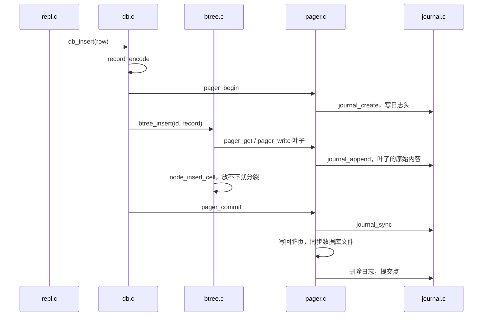
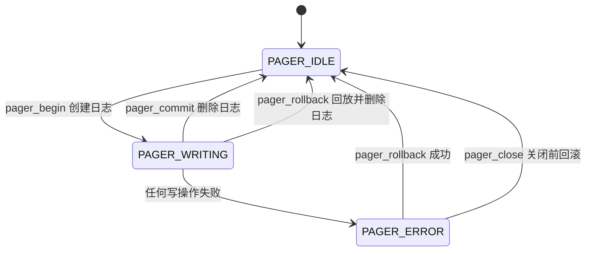

# 7.3 MdrDB：查询路径、恢复与测试

在 MdrDB 的运行世界里，一条写语句从终端键盘敲入到最终在物理磁盘上生根，需要依次穿越命令调度表、行接口层、B+ 树索引、Pager 页面缓冲池以及最底层的无缓冲文件层；若进程在任何一个物理写盘的间隙被操作系统强行杀死，下次重启挂载时，该操作要么完整持久化，要么像从未发生过一样被全盘抹去。

本节沿着两条平行的工程主线展开剖析：第一条主线是执行流与控制流的推进路径，观察一条常规操作语句如何被词法拆分、路由至对应算子，并如何在物理页与磁盘日志之间周密协作；第二条主线是异常发生时的回滚恢复状态机，推导系统在遭遇断电或崩溃后，如何借助磁盘上的日志快照精准还原至事务开启前的纯净状态。最后，我们将剖析测试套件如何通过确定性的单步故障注入，在每一个物理写入点验证系统的崩溃一致性。

在展开具体源码之前，我们可以先通过一个完全确定性的故障注入实验直观感受崩溃恢复的威力。在一个已存有 3 条记录的 `demo.db` 数据库中，我们通过点号元命令 `.fault 3` 预置故障计数器，要求文件层在累计执行 3 次物理写盘后，在第 4 次写入触发时直接自杀退出。紧随其后的 `insert 4` 写入在此刻被强制截断，宿主目录下随即遗留了一个 4120 字节的 `demo.db-journal` 回滚日志文件：

::: terminal title="bash - mdrdb"

```console
$ printf '.fault 3\ninsert 4 dave dave@example.com\n' | ./build/mdrdb --echo demo.db 2>&1
mdrdb> .fault 3
fault: the process will crash after 3 writes
mdrdb> insert 4 dave dave@example.com
fault: simulated crash
$ echo $?
1
$ wc -c < demo.db-journal
4120
```

:::

当新的数据库进程重新挂载 `demo.db` 时，初始化例程在进入 REPL 交互循环前便探测到了遗留的日志文件并立即执行了原子回滚，因而终端输出中的诊断提示 `recovery:` 出现在了第一道命令提示符之前：

::: terminal title="bash - mdrdb"

```console
$ printf 'select\n' | ./build/mdrdb --echo demo.db
recovery: 1 page restored from the journal
mdrdb> select
(1, alice, alice@example.com)
(2, bob, bob@example.com)
(3, carol, carol@example.com)
(3 rows)
```

:::

通过随后的查询可以确证，未完成提交的第 4 条记录被干净彻底地剔除，恢复后的数据库主数据文件与插入前相比实现了逐字节的精准一致。这一可靠性背后的状态流转，正是我们接下来要层层解构的核心。

## 1. 终端交互层：从行输入到算子派发

MdrDB 的命令行交互层（REPL）设计得非常扁平直接：入口函数 `repl_run` 统揽输入读取、命令回显与缓冲区刷新；执行分发函数 `repl_execute` 负责原地词法切分、命令表匹配与参数合法性裁定；而具体的常规业务操作与元命令诊断，则各自收敛在以 `cmd_` 为前缀的独立处理函数中。

### 1.1 输入流水线：读取、回显与显式刷盘

交互主循环 `repl_run` 的行文紧凑且富有工程细节：

```c
void repl_run(db *d, FILE *in, FILE *out, bool echo) {
    char line[REPL_LINE_MAX];
    for (;;) {
        fputs("mdrdb> ", out);
        fflush(out);
        if (fgets(line, sizeof line, in) == NULL) {
            fputc('\n', out);
            break;
        }
        size_t len = strlen(line);
        bool complete = len > 0 && line[len - 1] == '\n';
        if (!complete && len == sizeof line - 1) {
            int c;
            do {
                c = fgetc(in);
            } while (c != EOF && c != '\n');
            fputs("error: line is too long\n", out);
            continue;
        }
        if (echo) {
            fputs(line, out);
            if (!complete) {
                fputc('\n', out);
            }
            /* 命令可能让进程崩溃（.fault），先把已有的输出送出去。 */
            fflush(out);
        }
        if (repl_execute(d, line, out) == REPL_EXIT) {
            break;
        }
    }
    fflush(out);
}
```

在每次循环迭代的起点，程序首先打印交互提示符并主动调用 `fflush` 刷新标准输出。这一调用的必要性在于提示符末尾没有换行符；当标准输出被重定向至管道或文件时，C 运行时库默认采用全缓冲策略（Full Buffering），若不显式刷新，提示符将被积压在内存缓冲区中，无法实时在终端浮现。

在成功读入一行后，若启用了 `--echo` 选项，程序会先将该行原样写向输出流，并在此处再次强制调用 `fflush`，随后才放行执行 `repl_execute`。这种看似繁琐的显式刷新具有极其关键的物理原因：在故障注入模式下，`.fault` 命令会触发底层在写操作进行到一半时突发调用 `exit` 终止进程；如果此时回显文字仍滞留在标准库的用户态缓冲区中，这部分日志便会伴随进程的猝死而彻底丢失，或者与直接写向标准错误流 `stderr` 的崩溃诊断信息发生时序颠倒。

在边界处理上，`fgets` 设定了单行读取上限 `REPL_LINE_MAX - 1`（1023 个字符）。倘若在缓冲区被塞满后仍未捕获到换行符，说明输入流中存在一行异常超长文本；程序会主动排空该行剩余的后续字符直至遇见换行符，输出 `error: line is too long` 并继续监听下一行，防止超长文本污染后续命令。面对纯空行输入，解释器则直接静默跳过。

::: tip 管道批处理与控制台视效的一致性

在利用脚本管道自动化喂入测试指令时，`--echo` 参数负责将执行命令实时穿插回显在提示符后方；而在 Shell 命令后追加 `2>&1` 则将写入 `stderr` 的故障报警信息重定向并入同一条标准输出通道。二者协同运作，能让批处理日志获得与终端人工键盘交互完全一致的可读性与时间因果关系。

:::

::: details 缺少前置 `fflush` 时的真实异常表现

在源码副本中尝试注释掉 `repl_execute` 前方的那一行 `fflush(out)` 并重新编译测试：在 Linux glibc 环境下，被回显的那条 `insert` 整行字符在终端中直接神秘失踪；在 Windows UCRT 环境下，该行回显虽然被刷出，却异常倒置在 `fault: simulated crash` 报警信息之后。这两种截然不同的表象源于相同的底层机制：回显文字滞留在标准 IO 缓冲区，进程因崩溃自杀而未走常规退出流程清理缓冲区。在异常退出场景下依赖平台隐式刷盘是不可靠的，在关键动作前执行显式刷新是保证可观察性的基石。

:::

### 1.2 原地切词与静态命令派发表

`repl_execute` 采用了零内存分配的原地切词策略。标准库的 `strtok` 会在识别到空白字符时将其就地改写为字符串结束符 `'\0'`，因此入参 `line` 必须是指向可读写字符数组的指针，绝不能直接传入只读的字符串常量：

```c
repl_result repl_execute(db *d, char *line, FILE *out) {
    char *argv[MAX_WORDS + 1];
    int argc = 0;
    /* strtok 把分隔符改写成 '\0'，line 就地切成一个个单词。 */
    for (char *w = strtok(line, " \t\r\n"); w != NULL;
         w = strtok(NULL, " \t\r\n")) {
        if (argc == MAX_WORDS) {
            fputs("error: too many words\n", out);
            return REPL_CONTINUE;
        }
        argv[argc++] = w;
    }
    argv[argc] = NULL; /* 与 main 的 argv 一样以 NULL 结尾 */
    if (argc == 0) {
        return REPL_CONTINUE;
    }
    const command *cmd = find_command(argv[0]);
    if (cmd == NULL) {
        fprintf(out, "error: unknown command '%s', try .help\n", argv[0]);
        return REPL_CONTINUE;
    }
    if (argc - 1 < cmd->min_args || argc - 1 > cmd->max_args) {
        fprintf(out, "usage: %s\n", cmd->usage);
        return REPL_CONTINUE;
    }
    if (cmd->run == NULL) {
        return REPL_EXIT;
    }
    cmd->run(d, argv, out);
    return REPL_CONTINUE;
}
```

切词完成后装配出的指针数组 `argv` 严格遵循 C 语言惯例以 `NULL` 指针封尾，各处理函数可以直接按参数索引 `argv[1]`、`argv[2]` 提取操作数，无需额外传递参数计数。命令项中配置的 `min_args` 与 `max_args` 严格规定了除命令名称本身外所允许携带的操作数闭区间；一旦参数数量越界，解释器便会统一打印规范的用法提示 `usage:`。

整套 REPL 的调度核心依托于一个平铺直叙的静态命令表：

```c
static const command commands[] = {
    {"insert", 3, 3, "insert <id> <name> <email>", "add a row", cmd_insert},
    {"select", 0, 2, "select [<id> | <first> <last>]", "show rows", cmd_select},
    {"delete", 1, 1, "delete <id>", "remove a row", cmd_delete},
    {"begin", 0, 0, "begin", "start a transaction", cmd_begin},
    {"commit", 0, 0, "commit", "make the transaction permanent", cmd_commit},
    {"rollback", 0, 0, "rollback", "undo the transaction", cmd_rollback},
    {".tree", 0, 0, ".tree", "print the shape of the B+ tree", cmd_tree},
    {".page", 1, 1, ".page <n>", "print the layout of page n", cmd_page},
    {".info", 0, 0, ".info", "print file and cache statistics", cmd_info},
    {".check", 0, 0, ".check", "verify the B+ tree and records", cmd_check},
    {".fault", 1, 1, ".fault <n>", "crash after n more writes", cmd_fault},
    {".help", 0, 0, ".help", "list commands", cmd_help},
    {".exit", 0, 0, ".exit", "quit", NULL},
};
```

表中 `run` 函数指针为 `NULL` 的项专用于标记进程退出（如 `.exit`）；`find_command` 采用简单的线性遍历完成前缀匹配，而帮助命令 `cmd_help` 同样通过遍历该表动态输出全命令字典。在架构上为 MdrDB 扩充一条新指令仅需在表中追加一行配置并编写一个 `cmd_` 算子函数，7.1 中设计的课后练习正是沿着这套标准套路展开的。

::: terminal title="bash - mdrdb（节选）"

```console
mdrdb> update 4
error: unknown command 'update', try .help
mdrdb> insert 1 a b c d
usage: insert <id> <name> <email>
mdrdb> insert 1 a b c d e f g h
error: too many words
```

:::

## 2. 查询执行路径：点查与区间扫描

在行接口层，数据读取被正交划分为两条经典链路：一种是面向单条主键的精确点查（`select <id>`），另一种是面向键值闭区间的有序范围扫描（`select <a> <b>` 或无参数的全表遍历 `select`）。

### 2.1 单点检索（Point Query）

行级点查入口 `db_find` 的权责高度收敛，核心仅包含三步：调度 B+ 树索引检索目标载荷、回填确认主键，并将原始变长字节反序列化为行对象结构体：

```c
db_status db_find(db *d, uint32_t id, db_row *row) {
    uint8_t payload[BTREE_MAX_PAYLOAD];
    size_t size;
    db_status rc = btree_find(d->pager, id, payload, &size);
    if (rc != DB_OK) {
        return rc;
    }
    row->id = id;
    return record_decode(payload, size, row);
}
```

点查执行链由外至内层层递进：`btree_find` 驱动 `find_leaf` 从根节点自顶向下寻径，每层经由 `child_slot` 选取下游分支，定位至叶子节点后借助 `node_search` 执行页内二分查找。一旦命中，`leaf_payload` 提取出单元格的二进制载荷切片，`record_decode` 随即展开字段校验与反序列化，防范截断、内嵌空字符与非法尾部字节等损坏。若主键不存在，底层返回状态码 `DB_NOT_FOUND`；在命令行交互中，`cmd_select` 将该状态自然视为空结果集，输出匹配行数统计：

::: terminal title="bash - mdrdb"

```console
mdrdb> select 2
(2, bob, bob@example.com)
(1 row)
mdrdb> select 7
(0 rows)
mdrdb> select 0
(0 rows)
```

:::

终端格式具有严格的单复数规范：仅当结果集行数严格等于 1 时输出 `(1 row)`，行数为 0 或大于 1 时均使用复数形式 `(n rows)`。

### 2.2 范围查询

`db_scan` 是整页代码里唯一一处把遍历交给调用者的地方：

```c
db_status db_scan(db *d, uint32_t first, uint32_t last, db_row_fn fn,
                  void *ctx) {
    btree_cursor c;
    db_status rc = btree_seek(d->pager, first, &c);
    while (rc == DB_OK && c.valid) {
        uint8_t payload[BTREE_MAX_PAYLOAD];
        size_t size;
        db_row row;
        rc = btree_read(&c, &row.id, payload, &size);
        if (rc != DB_OK || row.id > last) {
            break;
        }
        rc = record_decode(payload, size, &row);
        if (rc != DB_OK || !fn(&row, ctx)) {
            break;
        }
        rc = btree_next(&c);
    }
    return rc;
}
```

整套迭代流程由游标紧密协同：`btree_seek` 首先在树中二分定位至大于等于下界 `first` 的首个实体单元格；随后通过 `btree_read` 读取反序列化记录，并由 `btree_next` 驱动游标沿叶子链平滑步进。游标只持有轻量的逻辑寻址状态（页号与页内索引），中途绝不钉住物理页面；这一抉择换来了极佳的内存解耦，但也要求调用端在回调函数 `fn` 中绝对遵守只读约束，严禁执行任何插入或删除操作。

空叶子与范围查询放在一起看最清楚。导入 300 行，删掉 1～61，再查看树和范围查询的结果：

::: terminal title="bash - mdrdb（节选）"

```console
$ for i in $(seq 1 300); do echo "insert $i user$i user$i@example.com"; done > rows.txt
$ ./build/mdrdb big.db < rows.txt > /dev/null
$ printf 'begin\n' > del.txt
$ for i in $(seq 1 61); do echo "delete $i" >> del.txt; done
$ echo commit >> del.txt
$ ./build/mdrdb big.db < del.txt > /dev/null
$ printf '.tree\nselect 60 70\n' | ./build/mdrdb --echo big.db
mdrdb> .tree
internal 1: 4 keys
  leaf 2: 0 keys
  key 62
  leaf 3: 60 keys (62..121)
  key 122
  leaf 4: 57 keys (122..178)
  key 179
  leaf 5: 57 keys (179..235)
  key 236
  leaf 6: 65 keys (236..300)
mdrdb> select 60 70
(62, user62, user62@example.com)
(63, user63, user63@example.com)
(64, user64, user64@example.com)
(65, user65, user65@example.com)
(66, user66, user66@example.com)
(67, user67, user67@example.com)
(68, user68, user68@example.com)
(69, user69, user69@example.com)
(70, user70, user70@example.com)
(9 rows)
```

:::

通过上述测试用例可以清晰观察到惰性删除与游标的自适应行为：当第 1 至 61 号记录被成批删除后，第 2 页彻底沦为容量为 0 的空叶子；当随后执行 `select 60 70` 区间查询时，游标轻快地跳过了空置的第 2 页，直接落脚在第 3 页的首项有效记录 62 上，并依次顺序输出直至触及上界 70。

在控制流设计上，回调函数 `db_row_fn` 若返回 `false`，迭代器会立刻终止扫描并向外层返回 `DB_OK`，命令行交互端随即按实际输出的记录条数打印汇总尾巴。倘若上层违反只读约定、擅自在遍历回调中向当前游标左侧插入了较小的主键，底层 `settle` 函数在步进时便会敏锐察觉到主键序列失去了单调递增性，并立即中止流程抛出 `error: database file is corrupt` 结构损坏警报。

<Quiz
  type="single"
  :options="[
    { label: '游标钉住了叶子页，换出时会被跳过', value: 'A' },
    { label: '每一步都要重新取页，被修改的树可能让游标读到别的页', value: 'B' },
    { label: '回调是在只读事务里执行的，写入会被拒绝', value: 'C' },
    { label: 'db_scan 内部又开了一个事务，与外面的冲突', value: 'D' }
  ]"
  answer="B"
>

<template #question>

`db_scan` 的回调里为什么不能插入或删除行？

</template>

正确答案是 **B**。`btree_cursor` 只保存页号和单元格下标，每次 `btree_read`、`btree_next` 都重新取页。遍历途中树的结构一改，原来记下的页号与下标就可能指向别的单元格，`settle` 的「键必须变大」检查会把这种情况当作文件损坏报告出来。

</Quiz>

## 3. 写操作路径与事务边界

### 3.1 一条写入语句的全链路透视

在行接口层，`db_insert` 充当了单条写入语句的事务总指挥：

```c
db_status db_insert(db *d, const db_row *row) {
    uint8_t record[RECORD_MAX_SIZE];
    size_t size;
    db_status rc = record_encode(row, record, &size);
    if (rc != DB_OK) {
        return rc;
    }
    bool autocommit = !d->explicit_txn;
    if (autocommit) {
        rc = pager_begin(d->pager);
        if (rc != DB_OK) {
            return rc;
        }
    }
    rc = btree_insert(d->pager, row->id, record, size);
    return finish_statement(d, autocommit, rc);
}
```

当调用者未通过 `db_begin` 显式开启事务上下文时，每一条独立的写语句均自成一个微型事务，在语句返回前必须就地完成持久化提交，这一机制被称为自动提交（Autocommit）。`pager_begin` 负责在磁盘上创建日志文件并快照记录当前的物理页数；随后 `btree_insert` 完成页内槽位调整与级联分裂；最后由 `finish_statement` 统一裁决事务的成功提交或异常回滚。各层在单条插入推进过程中的时序交互如图所示：



### 3.2 故障定级：轻度业务拦截与严重结构破坏

在执行写语句时，遭遇失败并不等同于必须将整笔事务全盘推翻。系统核心通过辅助函数 `is_clean_failure` 将错误审慎划分为两类截然不同的等级：

```c
/*
 * 这几种错误在修改任何页之前就能查出来：插入前先找过键，删除前也先
 * 找过键。语句失败但数据库原封未动，事务可以照常继续。
 */
static bool is_clean_failure(db_status rc) {
    return rc == DB_DUPLICATE || rc == DB_NOT_FOUND || rc == DB_TOO_LONG;
}
```

像主键冲突（`DB_DUPLICATE`）、删除目标不存在（`DB_NOT_FOUND`）以及字段超长（`DB_TOO_LONG`）这类错误，属于纯粹的业务层合法性校验拦截。在真正动笔触碰物理内存页框之前，底层已经提前通过二分查找完成了存在性判定或算出了编码长度，整座底层存储与缓冲池未受丝毫污染，因此这类失误被归定为“**干净的失败（Clean Failure）**”，当前所在的事务上下文完全可以安然保留，允许用户纠正后继续操作。

相比之下，底层 IO 故障、日志落盘受阻或内存耗尽等严重错误，往往发生在页面已经被部分修改但尚未闭环的险境之中，索引树的中间状态已无法保证拓扑完整性。面对此类不可逆污染，系统只能采取最为刚性的防御手段——强制回滚整笔事务：

```c
static db_status finish_statement(db *d, bool autocommit, db_status rc) {
    if (rc == DB_OK || is_clean_failure(rc)) {
        if (!autocommit) {
            return rc;
        }
        db_status commit_rc = pager_commit(d->pager);
        if (commit_rc == DB_OK) {
            return rc;
        }
        rc = commit_rc;
    }
    (void)pager_rollback(d->pager);
    d->explicit_txn = false;
    return rc;
}
```

在自动提交场景下，即便遭遇了干净的失败，系统同样会走完完整的生命周期闭环：正常提交一个数据零变动的空事务。这一闭环付出了 3 次磁盘写操作的物理开销（创建日志文件、写入日志头、最后删除日志文件）。在三行记录的基准库上实测，因主键冲突被拦截的插入消耗了 3 次物理写盘，而一条真正成功追加数据的插入则消耗了 5 次写盘（多出了数据脏页写入与主文件同步）。

当修改失败触发了事务的级联回滚时，交互终端有义务明确警示用户先前的成果已全部失效，`report_write` 专司这一用户侧通知：

```c
/* 修改失败时如果整个事务被回滚了，要告诉用户之前的修改也没了。 */
static void report_write(db *d, bool was_in_txn, db_status rc, FILE *out) {
    report(rc, out);
    if (rc != DB_OK && was_in_txn && !db_in_transaction(d)) {
        fputs("the transaction was rolled back\n", out);
    }
}
```

`cmd_insert` 在调用前预先锁存事务状态标志；若操作后检测到原本处于活动事务中、但此刻已被动回退为无事务状态，终端便会在打印具体错误信息之外追加一行沉重的警示 `the transaction was rolled back`。测试用例 `test_failed_commit_is_reported` 正是通过故障注入强制让提交操作在首笔写盘处立即失败，验证该通知能够准确输出，并确认重启后受损事务的数据完全未落盘。

### 3.3 显式事务的生命周期控制与安全退出

元命令 `begin`、`commit` 与 `rollback` 共同操纵着全局布尔标记 `explicit_txn`。在显式事务开启后，每条独立语句不再自动触发物理提交，其执行容错性完全依循前述的双层规则运转。遭遇重复键等轻度业务失误后，事务依然稳健处于活动状态，用户可继续执行后续追加：

::: terminal title="bash - mdrdb（节选）"

```console
mdrdb> insert 1 alice alice@example.com
ok
mdrdb> begin
ok
mdrdb> insert 2 bob bob@example.com
ok
mdrdb> insert 2 bob bob@example.com
error: duplicate key
mdrdb> .info
file: q2.db
page size: 4096, page count: 2
cache: 64 frames, hits 8, misses 1, spills 0
journal: pages saved 3, pages restored at open 0
transaction: open
mdrdb> insert 3 carol carol@example.com
ok
mdrdb> commit
ok
mdrdb> select
(1, alice, alice@example.com)
(2, bob, bob@example.com)
(3, carol, carol@example.com)
(3 rows)
```

:::

而主动执行 `rollback` 则将事务启动以来的全部修改瞬间一笔勾销，使存储状态精准回退至原点：

::: terminal title="bash - mdrdb"

```console
mdrdb> begin
ok
mdrdb> insert 2 bob bob@example.com
ok
mdrdb> insert 3 carol carol@example.com
ok
mdrdb> rollback
ok
mdrdb> select
(1, alice, alice@example.com)
(1 row)
```

:::

当交互终端接收到退出指令 `.exit` 或触及标准输入的 EOF 时，若检测到底层仍有一笔未完成提交的悬空事务，运行时会显式向终端抛出提示 `the open transaction was rolled back`，并驱动 `db_close` 调用 `pager_close` 触发原子回滚。在系统语义上，未提交的退出等价于显式执行了 `rollback`，坚决不向磁盘遗留半决状态的残缺数据。

<Quiz
  type="single"
  :options="[
    { label: '事务已经被回滚，必须重新 begin', value: 'A' },
    { label: '事务仍然开着，可以继续插入或提交', value: 'B' },
    { label: '只有这一条被撤销，事务自动提交', value: 'C' },
    { label: '进程会立即退出', value: 'D' }
  ]"
  answer="B"
>

<template #question>

显式事务里连续执行两次同样的 `insert 2 bob bob@example.com`，第二次返回 `duplicate key`。此时事务处于什么状态？

</template>

正确答案是 **B**。重复键属于干净失败：`btree_insert` 发现键已存在时还没有修改任何页，`finish_statement` 看到 `DB_DUPLICATE` 就直接返回，既不提交也不回滚，`explicit_txn` 保持为真。`.info` 里那一行 `transaction: open` 就是证据。

</Quiz>

## 4. 回滚日志机制与磁盘协议

事务能够实现随时随地的物理撤销，核心依托于一套基于快照的回滚日志（Rollback Journal）体系：在准备覆盖修改主数据文件中的任意物理页之前，Pager 必须预先将该页面在磁盘上的完整原始镜像提取并追加保存至日志文件中；直到事务正式完成提交的那一刹那，才将日志文件从物理上予以抹除。若宿主进程在提交点之前的任何微秒发生猝死崩溃，遗留在磁盘上的日志快照便是下次挂载时用于逆向重构的绝对凭据。

### 4.1 二进制日志帧与 CRC-32 校验和

回滚日志与目标数据库主文件同处同一宿主目录，其文件名为数据库名追加 `-journal` 后缀。物理日志文件由 16 字节的固定头部以及后续若干条固定为 4104 字节的页面记录帧平铺组成：

<BitField
  mode="packet"
  title="MdrDB 回滚日志的文件头"
  :fields="[
    { name: '魔数', bytes: 8, value: 'MDBJRNL1', tone: 'brand', desc: '8 个字节的字符，不是整数' },
    { name: '页大小', bytes: 4, value: '0x00001000', desc: '4096，与数据库文件的页大小一致' },
    { name: 'CRC-32', bytes: 4, value: '0xcf55f7f7', tone: 'green', desc: '前 12 字节的校验和' }
  ]"
/>

每条日志记录帧由 4 字节的目标页号、4096 字节的原始整页物理镜像，以及覆盖前两项的 4 字节 CRC-32 校验和依次复合而成，单帧规格恒定为 4104 字节。日志格式在头部刻意不记录总帧数，回放引擎在恢复时只需顺序扫描，直到遭遇文件末尾或遇见第一条校验和损坏的残缺帧即告正常终止。先前的 `.fault 3` 崩溃现场转储直观揭示了这一底细：

::: terminal title="bash - xxd"

```console
$ xxd -l 24 demo.db-journal
00000000: 4d44 424a 524e 4c31 0000 1000 cf55 f7f7  MDBJRNL1.....U..
00000010: 0000 0001 0100 0003                      ........
$ xxd -s 20 -l 16 demo.db-journal
00000014: 0100 0003 0faa 0000 0000 0000 0fe2 0fc8  ................
```

:::

前 8 字节为 ASCII 标识字符 `MDBJRNL1`，紧随其后的 `00 00 10 00` 声明页长为 4096，`cf 55 f7 f7` 则是头部的自校验和。自偏移 16 处开始的第一条记录帧中，`00 00 00 01` 表明此快照备份的是物理第 1 页根节点，偏移 20 之后的 4096 字节完整定格了该页在写入前的旧结构。整文件尺寸 16 + 4104 = 4120 字节，与统计完全一致。

为了在无外部库依赖的环境下实现快速可靠的数据完整性自检，系统基于 IEEE 802.3 标准多项式实现了逐位 CRC-32 校验算法：

```c
static uint32_t crc32_update(uint32_t crc, const uint8_t *data, size_t size) {
    crc = ~crc;
    for (size_t i = 0; i < size; i++) {
        crc ^= data[i];
        for (int bit = 0; bit < 8; bit++) {
            uint32_t mask = 0u - (crc & 1u); /* 最低位为 1 时全 1 */
            crc = (crc >> 1) ^ (0xEDB88320u & mask);
        }
    }
    return ~crc;
}
```

在实现中，掩码表达式 `mask = 0u - (crc & 1u)` 巧妙地利用无符号数溢出将最低有效位扩展为全 1 或全 0 的掩码，彻底消除了内层循环中的分支跳转开销。`0xEDB88320` 是反射形式的多项式，最低位为 1 时才异或进去。拿日志里的字节核对，头部前 12 字节的 CRC 是 `0xcf55f7f7`，第一条记录前 4100 字节的 CRC 是 `0x15f4fe78`，与 `xxd` 里看到的字段一致。基于位运算的算法虽然稍逊于大表查表法，但由于日志记录是以整页为单位推进，计算开销与昂贵的物理磁盘 IO 相比完全可以忽略不计。

每一帧尾随的校验和筑起了两道不可逾越的防伪屏障：它既能防御由于进程突发猝死而滞留在日志尾部的截断撕裂帧，也能识别出磁盘坏道或系统层未落盘引起的静默数据位翻转。无论遭遇哪种残缺，恢复状态机均会在异常帧前精确截断，绝不容许受污染的垃圾数据倒灌回主数据文件。

### 4.2 写前铁律（Write-Ahead）与位图去重机制

在 Pager 调度器中，`pager_write` 构成了向物理页动笔修改的唯一合法狭口：

```c
db_status pager_write(pager *p, page *pg) {
    if (p->state == PAGER_ERROR) {
        return DB_IO_ERROR;
    }
    if (p->state != PAGER_WRITING) {
        return DB_MISUSE;
    }
    /*
     * 事务开始后才分配的页（页号不小于 orig_page_count）没有需要保存
     * 的原始内容：回滚后页数恢复原值，这些页落在页数之外，自然作废。
     * 位图保证每页只记一次：同一页第二次修改时，日志里已经是它的原貌。
     */
    if (pg->pgno < p->orig_page_count && !test_bit(p->journaled, pg->pgno)) {
        db_status rc = journal_append(&p->journal, pg->pgno, pg->data);
        if (rc != DB_OK) {
            return fail(p, rc);
        }
        set_bit(p->journaled, pg->pgno);
        p->stats.journaled++;
    }
    pg->dirty = true;
    return DB_OK;
}
```

日志的采集调度严格受控于三大不可动摇的契约约束：

1. **未决新页免记原则**：被修改页面的物理页号必须严格小于事务开始时的基准页数 `orig_page_count`。这是因为凡是在当前事务生命周期内才新开辟的页面，在事务开启前在物理上根本不存在，自然无历史镜像需要保留；一旦事务回滚，文件头中记录的总页数直接被重置为旧基准，这些尾部新页直接沦为寻址界限外的物理荒漠，自然失效作废。
2. **单事务单页单快照（Bitmap Deduplication）**：位图 `journaled` 保证了在单笔事务生命周期中，无论某一物理页被上层算法反复改写多少次，其原始镜像进入回滚日志的次数严格有且仅有一次。假若允许重复追加，日志中便会沉淀出该页的历史原貌与被中途改动后的中间脏状态；在崩溃回放时按时序自前向后写回，后序的中间脏快照会反向覆盖前序的干净原貌，导致数据库非但无法还原，反而被强行“恢复”至中途受损的畸变状态。
3. **写前强制声明（Write-Ahead Logging）**：`pager_write` 必须无条件在数据内存字节发生实际改写之前执行，确保在任何潜在的刷盘指令发出前，其安全气囊已在日志中稳妥就绪。

<Quiz
  type="single"
  :options="[
    { label: '新页的内容还没确定，写日志没有意义', value: 'A' },
    { label: '回滚会恢复文件头里的页数，新页落在页数之外，读不到', value: 'B' },
    { label: '新页的页号超出日志的编码范围', value: 'C' },
    { label: '日志只能记录被删除的页', value: 'D' }
  ]"
  answer="B"
>

<template #question>

事务开始后新分配的页为什么不写进日志？

</template>

正确答案是 **B**。日志的作用是把页恢复成事务开始前的样子。事务开始前这些页根本不存在，回滚时文件头里的页数恢复原值，它们就落在页数之外，谁也读不到，不需要恢复。标准 C 不能截短文件，这些字节留在文件尾部，之后分配新页时被重新使用。

</Quiz>

举个例子。库里先有一行，再用一个显式事务连续插入两行，两行都落在第 1 页上：

::: terminal title="bash - mdrdb（节选）"

```console
mdrdb> begin
ok
mdrdb> insert 10 ten ten@example.com
ok
mdrdb> insert 11 eleven eleven@example.com
ok
mdrdb> .info
file: q1.db
page size: 4096, page count: 2
cache: 64 frames, hits 5, misses 1, spills 0
journal: pages saved 1, pages restored at open 0
transaction: open
mdrdb> commit
ok
```

:::

`pages saved` 是 1，因为两行都改第 1 页，位图让第二次修改跳过了日志。同一段会话用改过的 `file.c` 记下每次写操作，顺序是：创建日志、写日志头、写第一条记录、写数据库文件、删除日志。日志里只有一条记录。

### 4.3 换出：提交前就写回数据库文件

在面向磁盘的存储系统中，内存中的页框池容量通常是有限的。当活跃事务所涉及的脏页体量超出了页框配额时，缓冲池策略便不得不将部分脏页在事务正式提交前淘汰换出（steal），提前刷新至底层的数据库主文件中。

这种提前落盘的操作并不会违背事务的原子性承诺——关键在于换出前是否已经在回滚日志中安全封存了这些页面的原始镜像。只要历史镜像稳固在卷，即使数据库主文件提前被未决脏数据覆盖，后续无论遇到主动中止还是异常宕机，系统都能依据日志从容回溯。`write_back` 函数精确落地了这一写前保护逻辑：

```c
static db_status write_back(pager *p, page *pg) {
    db_status rc = journal_sync(&p->journal);
    if (rc == DB_OK) {
        rc = file_write_at(p->file, page_offset(pg->pgno), pg->data,
                           DB_PAGE_SIZE);
    }
    if (rc != DB_OK) {
        return fail(p, rc);
    }
    pg->dirty = false;
    return DB_OK;
}
```

在每次向数据库主文件刷写脏页前，`write_back` 都会首先触发 `journal_sync`，强制把日志缓冲区中尚未落盘的快照记录刷向底层物理介质。`journal_sync` 内部会持续维护 `needs_sync` 标记，当日志自上次同步后并无新增追加项时便会直接跳过系统调用，因此在循环刷写期间的重复调用并不会引入冗余的 I/O 开销。

页面的提前换出行为对上层交互是完全可感知的。我们可以通过 `--cache 4` 参数将缓存页框强行限制为 4 个，开启一个包含 300 条记录的现有数据库，随后在一个显式事务内针对性地删除分散在五个叶子页上的六条记录：

::: terminal title="bash - mdrdb"

```console
mdrdb> begin
ok
mdrdb> delete 10
ok
mdrdb> delete 70
ok
mdrdb> delete 130
ok
mdrdb> delete 185
ok
mdrdb> delete 240
ok
mdrdb> delete 290
ok
mdrdb> insert 331 a331 a331@example.com
ok
mdrdb> .info
file: sp.db
page size: 4096, page count: 7
cache: 4 frames, hits 16, misses 6, spills 2
journal: pages saved 5, pages restored at open 0
transaction: open
mdrdb> rollback
ok
mdrdb> select 10 10
(10, user10, user10@example.com)
(1 row)
mdrdb> select 290 290
(290, user290, user290@example.com)
(1 row)
```

:::

终端统计中的 `spills 2` 直观反映了因页框耗尽而在提交前被提前换出写回主文件的脏页计数；而 `pages saved 5` 则表示本次事务累计向回滚日志备份的原始页总数。

该数据库当前总计占用 7 个页面：0 号页承载文件头与元数据，1 号页为根内部节点，2 至 6 号页则是 5 个存储叶子节点。前序的六次删除操作精准命中了全部 5 个叶子页，后续向末尾插入 331 号记录同样落在最末的叶子页上，因而 5 个叶子节点均被先后标记为脏；根节点与文件头在此期间保持未变。在显式执行 `rollback` 之后，数据库借助日志完整撤销了这 5 个页面的变动，重新执行 `select` 查询仍可精准读取原先的数据。

::: details 一次换出的完整写序列

同一个事务在 `--cache 4` 下用带日志的 `file.c` 重放，写操作依次是：

```text
create journal        创建日志
write offset 0        日志头 16 字节
write offset 16       第 2 页的原始内容（第一条记录）
write offset 4120     第 3 页的原始内容
write offset 8224     第 4 页的原始内容
write offset 8192     第 2 页的新内容（换出）
write offset 12328    第 5 页的原始内容
write offset 12288    第 3 页的新内容（换出）
write offset 16432    第 6 页的原始内容
write offset 8192     回滚：第 2 页恢复
write offset 12288    回滚：第 3 页恢复
write offset 16384    回滚：第 4 页恢复
write offset 20480    回滚：第 5 页恢复
write offset 24576    回滚：第 6 页恢复
remove journal
```

观察主文件的物理偏移，将其除以 4096 即对应具体的目标页号。可以清晰梳理出底层的 I/O 节奏：日志率先依次为第 2、3、4、5、6 号页面建立快照镜像；然而内存页框池的总容量仅有 4 个，当事务执行至中途时，第 2 号页与第 3 号页因新页面载入而被迫换出，各自在严格确保日志落盘同步后才写入主文件。随后的回滚流程则依照日志记录，将 5 个页面的历史原貌完整重写回数据库主文件，调用同步后最终清理删除日志文件。在这整个执行序列中，主文件在被任何一次改写前，日志里对应页面的原始快照都已提前落盘。

:::

### 4.4 提交的四个步骤

在事务处理引擎的源码中，`pager_commit` 是对 I/O 时序依赖最为严苛的核心函数：

```c
db_status pager_commit(pager *p) {
    if (p->state == PAGER_ERROR) {
        return DB_IO_ERROR;
    }
    if (p->state != PAGER_WRITING) {
        return DB_MISUSE;
    }
    for (size_t i = 0; i < p->frame_count; i++) {
        page *pg = &p->frames[i];
        if (pg->in_use && pg->dirty) {
            db_status rc = write_back(p, pg);
            if (rc != DB_OK) {
                return rc;
            }
        }
    }
    db_status rc = file_sync(p->file);
    if (rc != DB_OK) {
        return fail(p, rc);
    }
    /*
     * 删除日志就是提交点（commit point）。删除之前崩溃，下次打开时
     * 日志还在，事务被撤销；删除之后，事务才算生效。
     */
    journal_close(&p->journal);
    rc = file_remove(p->journal_path);
    if (rc != DB_OK) {
        return fail(p, rc);
    }
    end_transaction(p);
    return DB_OK;
}
```

仔细梳理其内部控制流，提交过程被严谨划分为环环相扣的四个动作：

1. **同步日志**：在每个内存脏页刷回主文件之前隐式触发，由 `write_back` 内部负责兜底。当前事务累计追加的所有日志快照必须在此阶段确保固化在物理介质中。
2. **写回脏页**：遍历页框缓存，将所有被当前事务所标记的脏页面逐一写入数据库主文件的对应物理偏移。
3. **同步主文件**：调用 `file_sync` 执行物理刷盘（当前实现为 `fflush`），确保数据库主文件的所有最新修改已切实脱离用户态缓冲区、移交操作系统内核管辖。
4. **删除日志**：调用文件系统接口解构并移除回滚日志文件。日志在物理上被抹除的那一个瞬间，即构成了整个事务生效的临界提交点。

<Quiz
  type="single"
  :options="[
    { label: '日志同步完成时', value: 'A' },
    { label: '脏页全部写回数据库文件时', value: 'B' },
    { label: '数据库文件同步完成时', value: 'C' },
    { label: '日志文件被删除时', value: 'D' }
  ]"
  answer="D"
>

<template #question>

`pager_commit` 的四步里，哪一步完成才算事务提交？

</template>

正确答案是 **D**。前三步都只是让新内容就位；日志还在，就还有撤销的依据，事务不算完成。日志删除之后，数据库文件里已经是新内容，也没有旧内容可回放，事务才生效。

</Quiz>

日志文件之所以能够作为决定事务命运的天然仲裁者，核心在于前三个步骤已经稳健地将所有新状态送入数据库主文件。一旦日志被销毁，主文件中的新状态便宣告永久合法，且系统也彻底失去了撤销这些新状态的历史凭据。相反，只要日志文件依然驻留在磁盘上，无论数据库主文件正处于何种残缺或换出脏态，系统在下次重启初始化时都能凭借日志将一切完好回拨至事务启动前的模样。SQLite 官方架构文档对此的概括极其精炼：日志被删除的那一个原子瞬间，才是事务在物理世界中真正宣告生效的提交点。

假若人为破坏这一顺序，后果究竟有多严重？我们可以通过一个极具说服力的变异测试来直观感受。尝试将「删除日志」的动作提前至「写回脏页」循环之前，其余所有逻辑完全保持原貌：

::: compare vertical left-title="先删日志，再写页" right-title="先写页，同步，再删日志"

```c
/* 变异：提交点提前了 */
journal_close(&p->journal);
db_status rc = file_remove(p->journal_path);
if (rc != DB_OK) {
    return fail(p, rc);
}
for (size_t i = 0; i < p->frame_count; i++) {
    page *pg = &p->frames[i];
    if (pg->in_use && pg->dirty) {
        rc = file_write_at(p->file, page_offset(pg->pgno), pg->data,
                           DB_PAGE_SIZE);
        if (rc != DB_OK) {
            return rc;
        }
        pg->dirty = false;
    }
}
rc = file_sync(p->file);
```

---

```c
for (size_t i = 0; i < p->frame_count; i++) {
    page *pg = &p->frames[i];
    if (pg->in_use && pg->dirty) {
        db_status rc = write_back(p, pg);
        if (rc != DB_OK) {
            return rc;
        }
    }
}
db_status rc = file_sync(p->file);
if (rc != DB_OK) {
    return fail(p, rc);
}
journal_close(&p->journal);
rc = file_remove(p->journal_path);
if (rc != DB_OK) {
    return fail(p, rc);
}
```

:::

在变异后的控制流中，系统尚未把内存中的脏数据刷入主文件，便提前删除了日志文件，在语义上宣告事务已然提交。此时假若进程由于断电或信号异常猝死，数据库磁盘文件中封存的依然是陈旧的历史数据，而承载本次事务最新状态的修改全在易失的内存页框中灰飞烟灭。面对这一变异代码，`test_crash` 注入的 62 个写操作崩溃点中，有多达 12 处在恢复后校验失败：

::: terminal title="bash - test_crash（变异实验，节选）"

```console
$ ./test_crash
  crash point 4: row 2 should not exist
  crash point 9: row 4 should not exist
  crash point 14: row 6 should not exist
  ……（中间省略若干条）
  crash point 55: page 2: bad page layout
  crash point 60: row 104 should not exist
tests/test_crash.c:228: check failed: wrong == 0
……（中间省略）
     62 crash points, 12 recovered incorrectly
FAIL test_crash_at_every_write
     recovery interrupted 0 times, then completed
FAIL test_crash_during_recovery
     8 crash points while creating, 2 recovered incorrectly
FAIL test_crash_while_creating
4834 checks, 5 failed
```

:::

格外引人深思的是，在同一份致命缺陷的变异代码下，常规的单元与集成测试——包括 `test_record`、`test_node`、`test_journal`、`test_pager`、`test_btree` 乃至 `test_repl`——全部亮起绿灯顺利通过。全套套件中唯有故障注入崩溃测试精准捕获了这一隐蔽的灾难。这背后的根源十分平实：普通的测试套件永远只能在进程平稳退出、各层资源妥善收尾的稳态下观测输出，绝无可能在「日志已被销毁、脏页尚滞留在用户态」这极其微妙的几微秒物理窗口中掐断进程。

### 4.5 回滚与恢复

在架构设计上，主动回滚与进程崩溃后的冷启动恢复共享同一套底层回放通道。主动触发的 `pager_rollback` 会率先将缓冲池中的所有内存页框彻底置空，随后启动日志回放：

```c
db_status pager_rollback(pager *p) {
    if (p->state == PAGER_IDLE) {
        return DB_MISUSE;
    }
    if (pager_pinned(p) > 0) {
        return DB_MISUSE; /* 还有人拿着页的指针，不能把缓存清掉 */
    }
    journal_close(&p->journal);
    /*
     * 缓存里的页要么改过，要么可能是"换出后又读回来"的修改后版本，
     * 一律丢弃，之后以恢复好的文件为准。
     */
    for (size_t i = 0; i < p->frame_count; i++) {
        p->frames[i].in_use = false;
        p->frames[i].dirty = false;
    }
    uint32_t restored;
    db_status rc = replay_journal(p, &restored);
    if (rc == DB_OK) {
        rc = load_header(p);
    }
    if (rc != DB_OK) {
        p->state = PAGER_ERROR;
        return rc;
    }
    end_transaction(p);
    return DB_OK;
}
```

在回放操作之前，内存缓冲池中的所有页框必须被无条件标记为失效。这不仅涵盖那些已被打上脏标记的页面，也包括那些在事务中途被淘汰刷盘、后续又因读需求被重新载入的页面——它们在内存中的字节皆为当前事务带来的最新畸变态，一旦日志回放开始，磁盘上的物理块将被历史快照覆盖，缓冲池中的残存副本自然全部沦为过时陈旧数据。在回放收尾后，`load_header` 会重新从 0 号页读取权威的文件头元数据，使系统的逻辑总页数 `pager_page_count` 准确重置回事务启动之初的基准值。

`replay_journal` 的实现精炼而克制，核心逻辑仅包含三步连续的 I/O 动作：

```c
static db_status replay_journal(pager *p, uint32_t *restored) {
    db_status rc = journal_playback(p->journal_path, p->file, restored);
    if (rc == DB_OK) {
        rc = file_sync(p->file);
    }
    if (rc == DB_OK) {
        rc = file_remove(p->journal_path);
    }
    return rc;
}
```

这三个操作构成了一个高度对称的恢复序列：首先把日志中的快照回写覆盖主文件，接着调用 `file_sync` 确保写回的数据真正进入持久存储，最后执行物理删除卸载日志。这里的时序约束与提交阶段完全同构——假若在数据库主文件同步落盘前便贸然销毁日志，一旦中途遭遇二次断电，存储引擎便彻底丧失了仅存的救命稻草。

负责实际读取与搬运数据的 `journal_playback` 则以严格的流式校验驱动：循环读取单条日志记录，一旦遭遇长度截断或 CRC 校验和不符便立即中止回放；对于此前通过完整性核验的全部合法记录，将其包裹的原始页面字节忠实写回数据库主文件的对应页号位置：

```c
    uint8_t record[JOURNAL_RECORD_SIZE];
    long offset = JOURNAL_HEADER_SIZE;
    for (;;) {
        rc = file_read_at(jf, offset, record, sizeof record, &n);
        if (rc != DB_OK || n < sizeof record) {
            break;
        }
        uint32_t crc = get_u32(record + 4 + DB_PAGE_SIZE);
        if (crc != crc32_update(0, record, 4 + DB_PAGE_SIZE)) {
            break; /* 写了一半的记录：它对应的页还没写进数据库文件 */
        }
        uint32_t pgno = get_u32(record);
        if (pgno >= DB_MAX_PAGES) {
            break;
        }
        rc = file_write_at(dest, (long)pgno * DB_PAGE_SIZE, record + 4,
                           DB_PAGE_SIZE);
        if (rc != DB_OK) {
            break;
        }
        (*restored)++;
        offset += JOURNAL_RECORD_SIZE;
    }
```

当系统重新调用 `open_file` 打开数据库时，一旦探测到底层文件系统中赫然遗留着同名的日志文件（即所谓的热日志 Hot Journal），便会立刻引导控制流进入同一套 `replay_journal` 恢复链路：

```c
static db_status open_file(pager *p, const char *path, uint32_t *recovered) {
    db_status rc = file_exists(path) ? file_open(path, &p->file)
                                     : file_create(path, &p->file);
    if (rc != DB_OK) {
        return rc;
    }
    uint8_t data[DB_PAGE_SIZE];
    uint8_t fresh[DB_PAGE_SIZE];
    size_t n;
    rc = file_read_at(p->file, 0, data, DB_PAGE_SIZE, &n);
    if (rc != DB_OK) {
        return rc;
    }
    fresh_header(fresh);
    bool has_journal = file_exists(p->journal_path);
    if (n < DB_PAGE_SIZE && memcmp(data, fresh, n) == 0) {
        /*
         * 不足一页，已有的字节又都与新库的文件头相同：上次新建数据库时，
         * 文件头还没写完进程就中断了（空文件是 n 为 0 的情形）。库里还
         * 没有数据，重写文件头即可。旁边若有日志，只能是与它无关的旧文件。
         */
        if (has_journal) {
            rc = file_remove(p->journal_path);
        }
        return rc == DB_OK ? init_header(p) : rc;
    }
    if (has_journal) {
        /* 热日志（hot journal）：上次有事务没提交就中断了。 */
        rc = replay_journal(p, recovered);
        if (rc != DB_OK) {
            return rc;
        }
    }
    return load_header(p);
}
```

函数前半段专门防护了建库阶段猝死的边界场景。在创建全新数据库时，0 号页的文件头是直接写入物理文件的，并不经过日志流水——因为此时系统中尚不存在任何需要受保的历史业务数据。倘若进程在向空文件写入 4096 字节文件头的半途中断电，所残留的文件体量将不足一页，且已有前缀字节必然与初始文件头的标准模板完全吻合。引擎在重启时据此精准识别出建库残局，直接清理孤儿残留并安全重写文件头；0 字节的空文件即是其中一种极端退化情形。这一防御性分支源自早期复核中修补的一个严峻缺陷，在此之前，任何遭遇中途掐断的半成库文件都会陷入永远无法再次打开的瘫痪状态。

回放可以重复执行。回放只做一件事：把日志里的原始页按页号写回；写一遍和写两遍结果相同。我们可以利用前文演示留存的日志文件进行现场验证，将其重命名恢复为活跃日志，并连续多次挂载数据库：

::: terminal title="bash - mdrdb"

```console
$ cp demo.db-journal saved.journal
$ printf 'select\n' | ./build/mdrdb --echo demo.db
recovery: 1 page restored from the journal
mdrdb> select
(1, alice, alice@example.com)
(2, bob, bob@example.com)
(3, carol, carol@example.com)
(3 rows)
$ cp saved.journal demo.db-journal
$ printf 'select\n' | ./build/mdrdb --echo demo.db
recovery: 1 page restored from the journal
mdrdb> select
(1, alice, alice@example.com)
(2, bob, bob@example.com)
(3, carol, carol@example.com)
(3 rows)
```

:::

两次冷启动重放打印出的诊断输出与查询结果完全一致，数据库主文件也未产生任何异常膨胀。在 `test_crash` 套件中，第二个专项测试正是将这一幂等特性压榨到了极致：通过故障注入让恢复流程自身在每一次针对主文件的写操作时猝死中断，迫使随后的重启再次从日志第一条记录重新回放，层层推进直至最终所有脏块全部被历史镜像涤荡干净。

<Quiz
  type="single"
  :options="[
    { label: '第二遍会把已经恢复好的页再改一遍，数据出错', value: 'A' },
    { label: '回放只是把同样的原始页按页号再写一次，结果不变', value: 'B' },
    { label: '第二遍会读到空日志，直接跳过', value: 'C' },
    { label: '日志在第一次回放结束时已被改写，第二遍内容不同', value: 'D' }
  ]"
  answer="B"
>

<template #question>

同一份日志被回放两次，数据库会变成什么样？

</template>

正确答案是 **B**。回放不做增量计算，只是把日志里每条记录中的原始页写到记录给出的页号处。同一页写两次，内容相同。恢复之所以能「中途再崩溃」，靠的就是这一点。

</Quiz>

前文提及，当前事务生命周期内新拓展开辟的物理页面绝不追加进入日志，回滚时仅需依靠 0 号页元数据将总页数收缩至旧基准，这些尾部扩容页便在寻址空间上自然失效。由于标准 C 运行时库并未提供跨平台截断物理文件（truncate）的规范接口，这些作废的字节将暂时残留于文件末尾。

我们可以通过一个针对性构造的扩容回滚测试来观察这一物理演变。初始库 `grow.db` 包含 300 条记录、共占用 7 个页面；批处理脚本 `grow.txt` 预埋了 `.fault 10`，并在显式事务中批量插入 200 条新记录直至触发提交。我们在 4 页框的严苛环境下注入故障，让进程在连续刷盘扩容时被硬性掐断（`.fault` 命令行回显被控制台吞入后台，此处截取 stderr 的致命崩溃提示）：

::: terminal title="bash - mdrdb（节选）"

```console
$ ./build/mdrdb --cache 4 grow.db < grow.txt > /dev/null
fault: simulated crash
$ echo $?
1
$ wc -c < grow.db
38912
$ wc -c < grow.db-journal
12328
$ xxd -s 20 -l 4 grow.db
00000014: 0000 000a                                ....
```

:::

观察崩溃后的物理文件：`grow.db` 当前大小为 38912 字节（折合 9.5 个页面，最后一次写入由于撕裂仅落盘了一半字节）；回滚日志则捕获了 0、1、6 号页的原貌镜像；此时由于内存此前已提前将新页数扩容至 10，0 号页在被换出时已将这一超前值写入文件。此时重新启动数据库引擎：

::: terminal title="bash - mdrdb"

```console
$ printf '.info\nselect 500 500\n' | ./build/mdrdb --echo grow.db
recovery: 3 pages restored from the journal
mdrdb> .info
file: grow.db
page size: 4096, page count: 7
cache: 64 frames, hits 0, misses 0, spills 0
journal: pages saved 0, pages restored at open 3
transaction: none
mdrdb> select 500 500
(0 rows)
```

:::

引擎在日志重放下将 0 号页的原貌恢复，逻辑页数回退为初始的 7，查询 500 号记录确认数据完全未生效。物理文件尺寸虽然依旧停留在 38912 字节，但超出 7 号页边界的尾部游离字节已沦为完全不可达的寻址盲区。若我们将同样的 200 条写入重新执行并平稳提交，文件尺寸平滑生长至 40960 字节（恰好 10 页），第 500 号记录精准现身：分配器直接复用了第 7 页之后的未分配物理偏移，回滚所残留的尾部空间得到了无缝回收。

::: concept mdr-journal-rules title="回滚日志的四条规则"

1. 一页的原始内容必须先写进日志，才能覆盖数据库文件里的这一页。
2. 日志里的内容同步之前，数据库文件里的对应页不能被覆盖（`write_back` 每次写之前先 `journal_sync`）。
3. 删除日志是提交点。日志还在，事务未完成；日志不在，事务已提交。
4. 恢复就是回放日志再删除日志。回放可以重复执行，写一遍和写两遍结果相同。

:::

pager 在事务里的状态只有三个，转换关系如下：



当状态机不幸跌入 `PAGER_ERROR` 错误态后，任何常规的页面检索与写入（`pager_get` 与 `pager_write`）都将被防卫性机制一律拦截并返回 `DB_IO_ERROR`——在物理介质处于新旧状态交织的不确定风险下，盲目继续写入只会加剧存储损毁；与此同时，系统依然严格保留了调用 `pager_rollback` 或安全关闭退出的通道，允许上层利用尚完好驻留在磁盘上的回滚日志最后一搏，将整个存储引擎安全挽救回一致稳态。

::: generate mdr-commit-walkthrough kind=example concepts=mdr-journal-rules

面向刚读完本节、想确认自己能否推演崩溃结果的读者，以一条自动提交的 `insert` 为例，逐个写操作推演：如果进程停在第 1、2、3、4、5 次写操作之后，重开数据库时日志是否存在、回放了哪些页、那一行最终在不在。每次推演都对应到 `pager_commit` 的哪一步，并说明为什么第 5 次写之后崩溃与提交成功没有区别。

:::

## 5. 撕裂写、校验和与持久性

### 5.1 撕裂写与校验和

在真实世界的硬件故障中，断电或物理介质宕机往往发生在扇区刷写的中途，导致单次写入仅有一部分字节成功进入物理介质，形成所谓的撕裂写（Torn Write）。在测试 harness 中，故障注入机制通过截半写操作精确重现了这一物理异常：

```c
db_status file_write_at(db_file *f, long offset, const void *buf, size_t size) {
    if (fault.crashed) {
        return DB_IO_ERROR;
    }
    bool crash_here = at_crash_point();
    /* 崩溃点上的写只写进前一半，模拟断电时只写进一部分的撕裂写。 */
    size_t n = crash_here ? size / 2 : size;
    if (fseek(f->fp, offset, SEEK_SET) != 0 || fwrite(buf, 1, n, f->fp) != n) {
        clearerr(f->fp);
        return DB_IO_ERROR;
    }
    if (crash_here) {
        crash();
        return DB_IO_ERROR;
    }
    return DB_OK;
}
```

当系统向日志追加记录时，一条完整的记录体量为 4104 字节（4 字节页号 + 4096 字节页面数据 + 4 字节 CRC-32）。假若在崩溃点上仅有一半数据（2052 字节）被写入，文件末尾便会遗留残缺的截断快照。由于回放驱动逻辑坚持定长读取，当探测到读入的字节数无法凑满整条记录时便会立即终止循环，该条破损记录所对应的目标页绝不会被错误回写。

我们可以通过一个真实测试直观观测这种截断现象：在包含 300 条记录的数据库上开启事务，批量插入 301 至 340 号行并删除 1 至 39 号行，同时通过 `.fault 3` 强制在追加第二条日志记录的瞬间切断进程。此时检视物理日志文件，尺寸恰好停留在 6172 字节——这正好由 16 字节头部、4104 字节完整第一条记录以及 2052 字节的截断残片组合而成：

::: terminal title="bash - xxd"

```console
$ wc -c < torn.db-journal
6172
$ xxd -l 24 torn.db-journal
00000000: 4d44 424a 524e 4c31 0000 1000 cf55 f7f7  MDBJRNL1.....U..
00000010: 0000 0006 0100 0041                      .......A
```

:::

在冷启动时，回放流程安全重放了完整的第一条记录（其 16 字节偏移处的 `00 00 00 06` 确认其为第 6 号页），在读至残缺记录前戛然而止并打印出 `recovery: 1 page restored from the journal`。随后的数据核对显示数据库稳妥回退到了事务执行前的 300 行初始状态。

除了尺寸不足的截断撕裂外，现代文件系统与磁盘控制器还可能诱发另一类更具欺骗性的撕裂：文件系统的元数据已然将文件总长度拉伸至完整大小，但底层的数据块却因断电未及落盘，甚至写入了随机的介质垃圾字节。这类记录在字节长度上表现得天衣无缝，常规的边界读取判断对此完全失效，唯有借助密码学级别的 CRC-32 校验和方能撕开伪装。`test_journal` 针对性地设计了两个互为补充的测试场景：

```c
/* 写第二条记录时崩溃：记录只写进一半，回放到它为止。 */
static void test_torn_record_is_ignored(void) {
    db_file *dbf = make_db();
    journal j;
    uint8_t data[DB_PAGE_SIZE];
    remove(JOURNAL_FILE);
    fault_arm(3, FAULT_RETURN_ERROR); /* 创建、写头、第一条记录 */
    CHECK_OK(journal_create(&j, JOURNAL_FILE));
    memset(data, 0xA1, sizeof data);
    CHECK_OK(journal_append(&j, 1, data));
    memset(data, 0xA2, sizeof data);
    CHECK_STATUS(journal_append(&j, 2, data), DB_IO_ERROR);
    CHECK(fault_crashed());
    journal_close(&j);
    fault_disarm();

    uint32_t restored = 0;
    CHECK_OK(journal_playback(JOURNAL_FILE, dbf, &restored));
    CHECK(restored == 1);
    CHECK(page_byte(dbf, 1) == 0xA1);
    CHECK(page_byte(dbf, 2) == 2); /* 没有被半条记录覆盖 */
    file_close(dbf);
}
```

```c
/*
 * 第二条记录长度完整、内容却是坏的。断电后文件长度已经更新、数据块
 * 还没写进去时就会这样。只有校验和能识别这种记录。
 */
static void test_bad_checksum_stops_playback(void) {
    db_file *dbf = make_db();
    make_journal();
    const uint8_t garbage = 0x5A;
    poke(JOURNAL_HEADER_SIZE + JOURNAL_RECORD_SIZE + 4 + 100, &garbage, 1);
    uint32_t restored = 0;
    CHECK_OK(journal_playback(JOURNAL_FILE, dbf, &restored));
    CHECK(restored == 1);
    CHECK(page_byte(dbf, 2) == 2);
    file_close(dbf);
}
```

前一个用例依赖文件尺寸的截断边界阻断非法回放，而后一个用例则由校验和机制立功：`poke` 函数直接将第二条记录内部的某一字节篡改为脏数据，记录长度虽然维持不变，但 CRC-32 校验和核验瞬间失败。同样的，日志头部的 16 字节自身也受到 CRC 校验的护航，一旦头部发生位翻转或畸变，整份日志文件立刻被判定为作废，回放流程将防卫性地拒绝写回任何页面。

横向对比 SQLite 的工业实现，其工程取舍颇具启发性。SQLite 在日志头中显式记录了有效页面计数，但在所有日志内容完成强刷盘（fsync）之前，该计数字段始终被置为 0，直至日志数据全部稳固落盘后，才发起一次单独的系统调用将该计数更新为主版本。即使崩溃发生时物理文件已经膨胀，恢复引擎只要读到计数字段为 0，便绝不会启动主文件回写。此外，SQLite 将日志头独立对齐在独立的扇区边界，确保改写头部不至于破坏数据块。当同步级别降至 `NORMAL`（仅做一次集中刷盘）时，每页携带的独立校验和便成为抵御撕裂的最后防线。MdrDB 并不记录预估条数，而是依靠流式读取直到遭遇物理文件尾或首个破损记录为止，二者依托的底层公理完全一致：在日志内容物理落盘前，数据库主文件对应的原始页面绝不允许被任何写操作提前覆盖。

### 5.2 fflush 与 fsync

在当前的基准实现中，`file_sync` 仅包装了标准库调用：

```c
db_status file_sync(db_file *f) {
    if (fault.crashed) {
        return DB_IO_ERROR;
    }
    /*
     * fflush 只保证数据交给了操作系统：进程崩溃不会丢，断电仍可能丢。
     * 要抵御断电，这里还得调用 fsync（POSIX）或 FlushFileBuffers
     * （Windows），它们不属于标准 C，见 README 的扩展任务。
     */
    return fflush(f->fp) == 0 ? DB_OK : DB_IO_ERROR;
}
```

标准 C 库中的 `fflush` 仅负责清空 C 运行时在用户空间维护的 stdio 缓冲区，将其交由宿主操作系统的页缓存（Page Cache）接管。对于应用程序自身引发的奔溃（如除零错误、段错误或主动 `_Exit`），操作系统内核并不会随之消亡，驻留在内核页缓存中的脏数据依然能被正常刷盘，因此 MdrDB 能够保证进程级崩溃后的一致性。然而若遇到整机断电或内核崩溃，易失性页缓存中的内容随时可能蒸发，操作系统与磁盘控制器的写入重排更可能彻底破坏事务的落盘顺序，这超出了纯标准 C 实现的防护边界。

系统调用 `fsync` 具有远比 `fflush` 更沉重的物理约束：它必须阻塞等待存储硬件显式报告数据已在非易失介质就位后方可返回，并且通常会同步刷新文件的 inode 元数据。更为微妙的是，POSIX 手册明确指出，`fsync` 仅针对打开的文件描述符本身，并不涵盖其父目录的目录项；若要确保新建文件或 unlink 删除操作在断电后物理生效，还必须对其所在的父目录描述符发起额外的 `fsync`。由于 MdrDB 的回滚日志以高频创建与删除作为提交仲裁依据，这一平台级语义在生产系统中尤为关键，读者可在习题 50734 中亲自实践。

持久性领域的真实复杂性往往远超直觉。Dan Luu 在其关于文件系统崩溃一致性的经典调查中指出，系统软件开发者最容易陷入的误区便是「假设两次连续系统调用的代码时序等同于物理落盘时序」；某些 Linux 文件系统配置为了吞吐量可能会将无 barrier 保护的写请求剧烈重排，跨目录 `rename` 的原子性在遭遇掉电时也常常大打折扣。SQLite 官方汇总的常见介质损坏成因中，有三项直接指向了此类假设裂隙：日志文件被外部运维误删或路径混淆、人为关闭了物理同步机制（`synchronous=OFF`），以及磁盘固件对 `fsync` 谎报完成。这些隐患的本质是应用层对底层软硬件协议做出了过于乐观的预期，即便上层 C 代码编写得滴水不漏，依然可能在恶劣的物理环境中蒙受损失。

::: warning MdrDB 不保证断电后的持久性

`file_sync` 当前仅调用 `fflush`。若要防御整机掉电导致的介质损毁，必须引入平台特定的 `fsync`（POSIX）或 `FlushFileBuffers`（Windows）系统调用，它们已超出标准 C 的范畴，详见习题 50734。

:::

## 6. 测试

### 6.1 极简的测试框架

MdrDB 的单元测试套件并未引入任何厚重的第三方测试库，而是在 `tests/test.h` 中用短短六十行代码搭建了一套兼具表现力与零依赖的极简断言框架。它仅由三个核心宏与一个汇总函数构成：

```c
#define CHECK(cond)                                                            \
    do {                                                                       \
        test_checks++;                                                         \
        if (!(cond)) {                                                         \
            test_failures++;                                                   \
            fprintf(stderr, "%s:%d: check failed: %s\n", __FILE__, __LINE__,   \
                    #cond);                                                    \
        }                                                                      \
    } while (0)

#define CHECK_STATUS(expr, expected)                                           \
    do {                                                                       \
        db_status got_ = (expr);                                               \
        test_checks++;                                                         \
        if (got_ != (expected)) {                                              \
            test_failures++;                                                   \
            fprintf(stderr, "%s:%d: %s returned \"%s\", expected \"%s\"\n",    \
                    __FILE__, __LINE__, #expr, db_status_message(got_),        \
                    db_status_message(expected));                              \
        }                                                                      \
    } while (0)

#define CHECK_OK(expr) CHECK_STATUS(expr, DB_OK)

#define RUN_TEST(fn)                                                           \
    do {                                                                       \
        int before_ = test_failures;                                           \
        fn();                                                                  \
        printf("%-4s %s\n", test_failures == before_ ? "ok" : "FAIL", #fn);    \
    } while (0)
```

在这套断言设计中，单个断言失败并不会粗暴地调用 `exit()` 或抛出异常中断执行，而是向控制台打印失败所在的文件名、行号与条件表达式后，累加计数并让代码继续向下探测。这种非致命断言机制极其适合系统级开发：倘若一个测试用例内部包含十项状态核验，前序某项字段异常并不会遮蔽后续九项检查，单次测试运行便能完整铺开当前故障引发的所有连锁反应。`RUN_TEST` 宏在执行测试用例前后对比局部失败计数器的增量，据此向终端打印出干净利落的 `ok` 或 `FAIL`。此外，`CHECK_STATUS` 还会调用 `db_status_message` 自动解析状态码的可读语义，输出形如 `returned "I/O error", expected "ok"` 的友好诊断信息，排查时无需反复对照枚举常量。

在构建工程组织上，套件内的每个测试文件都被编译为一个自包含的独立可执行程序。测试统一在独立的构建目录中调度执行，产生的临时数据库与日志文件也随之隔绝在构建沙箱内，测试收尾时被即时清理。构建体系通过 CMake 的 `add_test` 或 Makefile 的 `test` 目标完成批量调用与级联汇总：

::: terminal title="bash - ctest"

```console
$ ctest
Test project …/MdrDB/build
    Start 1: record
1/7 Test #1: record ...........................   Passed    0.01 sec
    Start 2: node
2/7 Test #2: node .............................   Passed    0.01 sec
    Start 3: journal
3/7 Test #3: journal ..........................   Passed    0.05 sec
    Start 4: pager
4/7 Test #4: pager ............................   Passed    0.09 sec
    Start 5: btree
5/7 Test #5: btree ............................   Passed    0.36 sec
    Start 6: crash
6/7 Test #6: crash ............................   Passed    1.39 sec
    Start 7: repl
7/7 Test #7: repl .............................   Passed    0.02 sec

100% tests passed, 0 tests failed out of 7

Total Test time (real) =   1.93 sec
```

:::

::: details `make test` 的完整输出

```console
$ make test
== test_record
ok   test_varint_round_trip
ok   test_varint_bytes
ok   test_varint_rejects_bad_input
ok   test_record_layout
ok   test_record_round_trip
ok   test_record_rejects_unterminated_field
ok   test_record_rejects_corruption
63 checks, 0 failed
== test_node
ok   test_empty_leaf
ok   test_cells_sorted_by_pointer_not_by_address
ok   test_search
ok   test_remove_compacts_content
ok   test_fill_until_full
ok   test_internal_children
ok   test_validate_rejects_garbage
132 checks, 0 failed
== test_journal
ok   test_layout
ok   test_playback_restores_pages
ok   test_torn_record_is_ignored
ok   test_bad_checksum_stops_playback
ok   test_bad_header_restores_nothing
70 checks, 0 failed
== test_pager
ok   test_new_file_has_header
ok   test_commit_persists
ok   test_rollback_restores_pages_and_count
ok   test_spill_then_rollback_or_commit
ok   test_hot_journal_recovery
ok   test_misuse
ok   test_pins_and_cache_full
ok   test_rejects_foreign_files
ok   test_half_written_header
442 checks, 0 failed
== test_btree
ok   test_root_grows
ok   test_ascending_and_descending
ok   test_random_insert_and_delete
ok   test_duplicate_and_oversized
ok   test_cursor_scan
ok   test_tiny_cache
ok   test_rejects_oversized_payload
ok   test_scan_detects_leaf_cycle
34077 checks, 0 failed
== test_crash
     62 crash points, 0 recovered incorrectly
ok   test_crash_at_every_write
     recovery interrupted 8 times, then completed
ok   test_crash_during_recovery
     8 crash points while creating, 0 recovered incorrectly
ok   test_crash_while_creating
4842 checks, 0 failed
== test_repl
ok   test_session
ok   test_data_survives_reopen
ok   test_failed_commit_is_reported
14 checks, 0 failed
```

:::

### 6.2 单元测试一览

| 测试 | 检查数 | 内容 |
|:---|---:|:---|
| `test_record` | 63 | varint 的往返与字节布局；记录往返；拒绝越界、多余字节、过长字段 |
| `test_node` | 132 | 单元格按指针有序；删除后内容区紧凑；`node_validate` 拒绝损坏的页 |
| `test_journal` | 70 | 日志字节布局；回放；半条记录；长度完整但内容坏的记录；坏掉的日志头 |
| `test_pager` | 442 | 新文件头；提交后重开；回滚恢复内容和页数；换出；热日志恢复；钉住与 `DB_CACHE_FULL`；半写的文件头 |
| `test_btree` | 34077 | 顺序、逆序、随机插入；删除与重插；游标；只有 4 个页框时的分裂；负载超长与叶子链成环 |
| `test_crash` | 4842 | 每一次写操作处崩溃再恢复 |
| `test_repl` | 14 | 脚本输入、逐字比较；重开后数据仍在；提交失败的提示 |

在全套套件中，`test_btree` 累计执行的断言检查次数高居榜首。这是因为在数千次交错执行的随机插入与删除过程中，每完成一步细粒度改动，测试都会调用 `btree_check` 对树状结构进行全量遍历，核对所有结构不变式。在全树完整性核验完毕后，测试还会调用 `pager_pinned(p) == 0` 进行兜底断言——确保整个工作流中不存在任何被漏掉未归还的游离页面。这在嵌入式存储引擎的开发实践中是一个极具价值的防护习惯：在缓冲池架构中，漏掉单次 `pager_unpin` 在短期内并不会诱发致命的段错误，但它会像内存泄漏一样缓慢侵蚀宝贵的可用页框池，最终以极其隐晦的 `DB_CACHE_FULL` 假死形态在完全不相干的远程代码中爆发。

处于架构最顶层的 `test_repl` 则是一套严密的端到端黑盒测试。它通过重定向一段预先编排的完整控制台会话脚本，逐字校验整个系统的标准输出流：

```c
static const char script[] = "insert 1 alice alice@example.com\n"
                             "insert 2 bob bob@example.com\n"
                             "insert 2 bob bob@example.com\n"
                             "select\n"
                             "select 2\n"
                             "select 7\n"
                             "select 1 1\n"
                             "delete 1\n"
                             "delete 1\n"
                             "begin\n"
                             "insert 3 carol carol@example.com\n"
                             "select\n"
                             "rollback\n"
                             "select\n"
                             "commit\n"
                             "insert x y z\n"
                             "insert 4 dave\n"
                             "update 4\n"
                             ".tree\n"
                             ".page 1\n"
                             ".check\n"
                             ".exit\n"
                             "select\n";
```

测试期望比对中将提示符、`ok` 响应码、异常诊断信息乃至行数统计完全以字面量形式硬编码锁定。这种金标准测试（Golden Master Testing）直接将错误信息的措辞与布局一并纳入回归约束，任何微小的协议格式漂移都会在第一时间触发警报。为了确保非终端的管道输入能够稳定产出与终端人机交互完全一致的诊断回显，测试显式调用 `repl_run(d, in, out, true)`，将 `echo` 标志强制置为 `true`。

### 6.3 故障注入

存储引擎在底层 I/O 抽象 `file.h` 中将「有状态的磁盘写操作」严格收敛于三个物理原语：创建文件 `file_create`、定向写入 `file_write_at` 以及物理删除 `file_remove`。在调用 `fault_arm(n, mode)` 装载故障拦截器后，底层将平稳放行前 n 次真实写操作，而在第 n + 1 次写操作到来时瞬间切入崩溃分支。框架支持两种面向不同调试诉求的模式：

```c
typedef enum fault_mode { FAULT_RETURN_ERROR, FAULT_EXIT } fault_mode;

void fault_arm(long writes_allowed, fault_mode mode);
void fault_disarm(void);
bool fault_crashed(void);
long fault_write_count(void); /* 程序启动以来完成的写操作次数 */
```

模式 `FAULT_EXIT` 通过系统原语 `_Exit` 立即无条件终止进程，用于配合命令行交互下的 `.fault` 命令提供真实的猝死演示；而 `FAULT_RETURN_ERROR` 则在保持宿主进程存活的前提下，使第 n + 1 次及其后续的所有写调用均返回 `DB_IO_ERROR` 且拒绝将字节写入介质。后者专为单进程内的密集测试设计，允许测试框架在模拟出「断电停写」的效果后，安全关闭句柄并重新调用 `db_open` 验证冷启动恢复。

故障注入的状态在模块内部以全局单例的形式统一管理：

```c
/* 故障注入的状态是全局的：真实的崩溃会同时影响进程打开的所有文件。 */
static struct {
    bool armed;
    long writes_left;
    fault_mode mode;
    bool crashed;
    long write_count;
} fault;
```

这一设计背后有着深刻的物理直觉：真实的硬件掉电或内核崩溃具有全域性，绝不可能偏袒某一个特定文件而让另一个文件继续完成写入。若脱离全局视野而为每个 `db_file` 单独维系计数器，那么「第 n 次写入」就不得不繁琐指明目标文件，导致跨文件的交错时序测试变得难以编排与复现。全局状态还带来了一个额外的工程便利：测试只需先完整执行一遍基准工作负载，通过 `fault_write_count()` 便能直接测量出整个事务链路引发的物理写操作总次数 N，为随后的穷举注入圈定精确的循环边界。

### 6.4 在每一个写操作处崩溃

崩溃测试的核心用例 `test_crash_at_every_write` 展现了系统级可靠性验证的最佳范式——先测量、后穷举：

```c
static void test_crash_at_every_write(void) {
    long total = count_workload_writes();
    CHECK(total > 0);
    long wrong = 0;
    for (long k = 0; k <= total; k++) {
        model committed;
        db *d = create_initial(&committed);
        if (d == NULL) {
            return;
        }
        model pending = committed;
        bool in_txn = false;

        fault_arm(k, FAULT_RETURN_ERROR);
        for (size_t i = 0; i < WORKLOAD_SIZE; i++) {
            db_status rc = apply(d, &workload[i]);
            if (fault_crashed()) {
                break;
            }
            CHECK_OK(rc);
            update_model(&workload[i], &committed, &pending, &in_txn);
        }
        CHECK(fault_crashed() == (k < total));
        /* 进程已经"死了"：关闭时的回滚写不进文件，磁盘停在崩溃那一刻。 */
        db_close(d);
        fault_disarm();

        d = NULL;
        CHECK_OK(db_open(CRASH_DB, CACHE_FRAMES, &d));
        if (d == NULL) {
            return;
        }
        if (!matches(d, &committed, k)) {
            wrong++;
        }
        db_row extra = row_for(MODEL_KEYS - 1); /* 恢复后还能正常写入 */
        CHECK_OK(db_insert(d, &extra));
        db_close(d);
    }
    CHECK(wrong == 0);
    printf("     %ld crash points, %ld recovered incorrectly\n", total + 1,
           wrong);
}
```

测试所采用的工作负载极具代表性：混合了自动提交的单条插入与删除、一个涉及跨多个叶子页分裂且最终平稳提交的显式事务、一个中途主动中止回滚的显式事务，最后再衔接一条自动提交。辅助函数 `create_initial` 预先构建一个初始包含 50 条记录的基准库，并将内存页框严格压榨为 4 个，迫使事务在执行期间不可避免地触发页面换出。

整个测试流程分为两阶段推进：第一阶段以完全正常的模式跑完工作负载，测量得出该事务序列总共包含 N 次物理写操作；第二阶段则由外层循环对 k = 0, 1, …, N 展开穷举枚举——针对每个 k，重新部署干净的基准库，将故障拦截器配置为在第 k + 1 次写操作处断电，执行负载触发崩溃，随后关闭实例（由于故障拦截器已锁死后续写入，关闭操作触发的回滚在介质层被物理拦截，磁盘状态精确冻结在断电那一瞬间），紧接着重新打开数据库进行完整性检验。

恢复后的核验体系分为两层：首先调用 `db_check` 全面扫描 B 树的节点布局，确保每一个页面的内部偏移、键序与记录均能正确解码；随后与内存中的参考模型进行逐行一致性比对。模型维护了 `committed`（已提交）与 `pending`（未决中）两个状态视图：单条语句执行成功时修改 `pending`，显式提交时将 `pending` 原子同步至 `committed`，回滚时则将 `pending` 重新回拨为 `committed`。无论进程掐断在哪个瞬间，数据库重启恢复后的全部内容，在数学上必须严格恒等于崩溃前最后一次成功提交时的 `committed` 状态。

::: details 工作负载与模型更新

```c
/* clang-format off */
static const op workload[] = {
    /* 自动提交的插入和删除 */
    {OP_INSERT, 2},   {OP_INSERT, 4},   {OP_INSERT, 6},   {OP_DELETE, 9},
    {OP_INSERT, 100}, {OP_INSERT, 102},
    /* 跨多个叶子的显式事务，最后提交 */
    {OP_BEGIN, 0},    {OP_INSERT, 10},  {OP_INSERT, 12},  {OP_INSERT, 14},
    {OP_INSERT, 16},  {OP_INSERT, 18},  {OP_INSERT, 20},  {OP_INSERT, 22},
    {OP_INSERT, 24},  {OP_INSERT, 26},  {OP_INSERT, 28},  {OP_INSERT, 30},
    {OP_INSERT, 32},  {OP_INSERT, 34},  {OP_INSERT, 36},  {OP_INSERT, 38},
    {OP_INSERT, 40},  {OP_INSERT, 42},  {OP_INSERT, 44},  {OP_INSERT, 46},
    {OP_INSERT, 48},  {OP_DELETE, 51},  {OP_DELETE, 53},  {OP_COMMIT, 0},
    /* 被回滚的显式事务 */
    {OP_BEGIN, 0},    {OP_INSERT, 60},  {OP_DELETE, 61},  {OP_INSERT, 62},
    {OP_ROLLBACK, 0},
    /* 回滚之后，自动提交照常工作 */
    {OP_DELETE, 1},   {OP_INSERT, 104},
};
/* clang-format on */
```

```c
/* 语句成功后更新模型：事务里的修改记在 pending，提交时才算数。 */
static void update_model(const op *o, model *committed, model *pending,
                         bool *in_txn) {
    switch (o->kind) {
    case OP_INSERT:
        pending->present[o->id] = true;
        break;
    case OP_DELETE:
        pending->present[o->id] = false;
        break;
    case OP_BEGIN:
        *in_txn = true;
        break;
    case OP_COMMIT:
        *in_txn = false;
        break;
    case OP_ROLLBACK:
        *in_txn = false;
        *pending = *committed;
        break;
    }
    if (!*in_txn) {
        *committed = *pending;
    }
}
```

:::

本机运行的结果是 62 个崩溃点、0 个恢复错误：

::: terminal title="bash - test_crash"

```console
$ ./build/test_crash
     62 crash points, 0 recovered incorrectly
ok   test_crash_at_every_write
     recovery interrupted 8 times, then completed
ok   test_crash_during_recovery
     8 crash points while creating, 0 recovered incorrectly
ok   test_crash_while_creating
4842 checks, 0 failed
```

:::

套件中的第二个测试用例 `test_crash_during_recovery` 则专注于极限压榨恢复链路本身的健壮性。测试先执行一个涵盖海量页面更新的大事务，并精准截杀在提交的终点时刻（即调用 `file_remove` 物理抹除日志文件之前）。此时数据库主文件中已布满未经提交验证的脏页，而日志文件也记录着完整的历史镜像——这构成了系统恢复负担最沉重、边界最敏感的状态。在此基础上，框架通过循环递增 j，故意迫使恢复流程自身在将历史页写回数据库主文件的第 j + 1 次写操作处再次猝死断电。面对「恢复中途反复断电」的恶劣场景，日志文件始终完好留存，引擎在每次冷启动时均严格自首条记录从容重启回放，最终在历经多达 8 次递进式崩溃中断后依然平稳收敛。第三个测试 `test_crash_while_creating` 则全方位穷举了新建数据库过程中的每一次写操作崩溃点，特别是严密覆盖了 0 号页文件头仅写入一半的截断残局；每一次从崩溃中重新打开，都能稳固自愈并产出一个状态纯净的空数据库。建库流程累计经历 8 次物理写入，8 个断电崩溃点全部通过核验。

### 6.5 测试框架的覆盖边界

任何测试模型都有其立足的抽象假设。当前的故障注入 harness 严格立足于「应用程序进程级崩溃」假设：即已移交操作系统内核页缓存的数据在崩溃后均得以保留，且系统调用向内核投递的写入顺序在宏观上维持线性时序。这一物理假设自然带来了一个盲区——它无法识别遗漏落盘同步调用的逻辑缺陷。假若我们在变异实验中直接将 `write_back` 内的 `journal_sync` 彻底注释移除，重新编译运行，令人警惕的是全量崩溃测试依然全部飘绿：

::: terminal title="bash - test_crash（变异实验：去掉 journal_sync）"

```console
$ ./test_crash
     62 crash points, 0 recovered incorrectly
ok   test_crash_at_every_write
     recovery interrupted 8 times, then completed
ok   test_crash_during_recovery
     8 crash points while creating, 0 recovered incorrectly
ok   test_crash_while_creating
4842 checks, 0 failed
```

:::

这种假象的物理成因十分明确：在纯进程级崩溃模型下，用户态的 `fwrite` 一旦返回，内核便已托管了数据，此时是否调用 `fflush` 或 `fsync` 对进程重启后的数据可见性毫无影响。唯有在断电或内核宕机导致页缓存数据蒸发并暴露 I/O 乱序时，同步调用的缺失才会演变为灭顶之灾。若要在测试中捕获这一深层漏洞，测试框架必须显式引入能够模拟「未同步脏数据丢失」的掉电故障模型，这正是习题 50738 将要引导读者探索的挑战任务。工业界的 SQLite 在其测试体系中引入了专属的测试 VFS 垫片，通过拦截并记录全部物理读写与刷盘系统调用，静态分析日志落盘与主文件脏页落盘之间的偏序偏好关系，从时序模型上杜绝此类漏洞。

### 6.6 检验测试自身的有效性：变异测试

在可靠性工程中，测试套件全量通过绝不直接等价于实现无懈可击——极有可能是测试用例本身缺乏针对性，沦为了虚设的摆设。验证测试有效性的权威手段是变异测试（Mutation Testing）：人为在代码中注入微小的逻辑变异故意破坏某一契约，观察现存测试套件是否能精准拉响警报。以下三个变异实验展示了三种典型的对抗反馈。

**变异一：彻底抹除日志记录。** 将 `journal_append` 篡改为直接返回 `DB_OK`，使得任何页面快照均无法进入日志。面对这种全局性的破坏，`test_crash` 在注入时即刻全线溃败：

::: terminal title="bash - test_crash（变异一，节选）"

```console
$ ./test_crash
  crash point 2: row 2 should not exist
  crash point 3: row 2 should not exist
  ...
  crash point 42: row 104 should not exist
  crash point 43: row 104 should not exist
tests/test_crash.c:228: check failed: wrong == 0
  crash point -1: row 1 is wrong
tests/test_crash.c:296: check failed: matches(d, &initial, -1)
     45 crash points, 23 recovered incorrectly
FAIL test_crash_at_every_write
     recovery interrupted 1 times, then completed
FAIL test_crash_during_recovery
     7 crash points while creating, 2 recovered incorrectly
FAIL test_crash_while_creating
3578 checks, 4 failed
```

:::

与此相呼应，底层 `test_journal` 出现 11 项断言失败，`test_pager` 暴露 33 项异常，顶层 `test_repl` 亦有 1 项报错。这种破坏属于全局显性破坏，系统各层测试均具备充沛的捕获能力。

**变异二：提交时序颠倒。** 即前文 4.4 节所展示的变异：提前删除日志、后刷写主文件脏页。在该变异下，除 `test_crash` 敏锐捕获到 12 处数据恢复错误外，其余各层常规测试全部顺利通过。这清晰地证实了故障注入崩溃测试在系统测试矩阵中不可替代的独立价值。

**变异三：跳过记录校验和核验。** 在日志回放逻辑中直接注释掉针对单条记录的 CRC-32 校验比对。此时执行专项测试 `test_journal`，断言立即亮起红灯：

::: terminal title="bash - test_journal（变异三）"

```console
$ ./test_journal
tests/test_journal.c:130: check failed: restored == 1
tests/test_journal.c:131: check failed: page_byte(dbf, 2) == 2
ok   test_layout
ok   test_playback_restores_pages
ok   test_torn_record_is_ignored
FAIL test_bad_checksum_stops_playback
ok   test_bad_header_restores_nothing
70 checks, 2 failed
```

:::

然而在面对同样的变异代码时，`test_crash` 的 4842 项断言却全部绿灯放行。剖析其背后的机理，故障注入在崩溃点制造的是物理写入中断，由此引发的撕裂由于长度不足，早在前面的定长读取检查阶段便被防御逻辑截获；而当前模型中并不会凭空产生长度完整、数据内容却随机损坏的介质静默畸变。这正是 5.1 节深入剖析的第二类撕裂形态，目前仅被底层的协议格式单元测试所覆盖。

这一对比清晰印证了现代测试工程的协同分工：崩溃注入测试专注于宏观的 I/O 时序编排与状态回溯，而底层格式测试则严守微观的字节对齐与校验和完整性。两套防护网相辅相成，系统才能在变异改动的第一时间予以阻击。反之，任何缺乏针对性测试用例持续监控的架构规范，都极易在后续的代码重构中被意外破坏；项目复核报告中记录的多起缺陷修复，正是借助新补充的靶向测试（如 `test_scan_detects_leaf_cycle`）才得以稳固确立。

::: tip 变异实验的实施规范

变异实验应当严格限定在源码的临时工作副本中进行，并在隔离的独立构建目录中完成编译与测验。一旦获取并记录测试反馈后，变异副本应当立即废弃销毁；生产主干上的源码需保持绝对清洁，变异代码仅用于衡量测试用例的敏感度，绝不可混入发布链路。

:::

### 6.7 借助 Sanitizer 验证内存安全

常规的 Debug 或 Release 构建通常不会在运行时插桩内存安全巡检。为了彻底杜绝 C 语言中潜在的内存越界、野指针访问与未定义行为，我们在 Linux 环境（Debian 13，GCC 14.2）下引入 AddressSanitizer（ASan）与 UndefinedBehaviorSanitizer（UBSan）进行全量深度排查：

::: terminal title="bash - make（ASan/UBSan，节选）"

```console
$ make BUILD=build-asan \
       CFLAGS="-std=c11 -O1 -g -fno-omit-frame-pointer -fsanitize=address,undefined" test
== test_record
……（逐项输出省略）
63 checks, 0 failed
== test_node
……（逐项输出省略）
132 checks, 0 failed
== test_journal
……（逐项输出省略）
70 checks, 0 failed
== test_pager
……（逐项输出省略）
442 checks, 0 failed
== test_btree
……（逐项输出省略）
34077 checks, 0 failed
== test_crash
     62 crash points, 0 recovered incorrectly
ok   test_crash_at_every_write
     recovery interrupted 8 times, then completed
ok   test_crash_during_recovery
     8 crash points while creating, 0 recovered incorrectly
ok   test_crash_while_creating
4842 checks, 0 failed
== test_repl
ok   test_session
ok   test_data_survives_reopen
ok   test_failed_commit_is_reported
14 checks, 0 failed
```

:::

全套七组测试套件全部平稳通过，控制台未出现任何 Sanitizer 的告警日志。在编译参数中，`-O1` 在保留代码底层结构的同时激活了编译器基础优化，配合 `-fno-omit-frame-pointer` 确保了发生潜在故障时能生成清晰完整的调用栈回溯，`-g` 则注入了源码级的调试行号。在主流 Linux 平台上，LeakSanitizer 默认在进程退出时随 ASan 一并生效，在全量测试通过的同时，也严谨佐证了整个数据库引擎在各种极端边界与崩溃测试下未遗留任何系统资源与内存泄漏。

## 7. 习题

### 7.1 巩固

<Exercise id="50731" :d="2" :w="3">

用 `.fault` 把一个自动提交的 `insert` 在每一个可能的写操作处停下来，整理成表。要求：

(1) 准备一个只有三行的库，对 k = 0, 1, 2, … 逐个执行 `.fault k` 加一条 `insert 4 dave dave@example.com`，记录崩溃后 `demo.db-journal` 的字节数和再次打开时 `recovery:` 一行是否出现。

(2) 把每个 k 对应到 `pager_commit` 的四个步骤：崩溃发生在创建日志、写日志头、写日志记录、写数据库页、同步数据库文件、删除日志中的哪一步之前。

(3) 指出哪一个 k 实际上没有崩溃，解释为什么。

(4) 用一句话说明为什么 k 落在「写数据库页」与「删除日志」之间时，重开后那一行仍然不在。

(5) 其中有一个 k 留下的日志恰好是 2068 字节。说明这个长度由哪两部分组成，回放时为什么一页都不写。

</Exercise>

<Exercise id="50732" :d="3" :w="2">

给 `select` 加一个可选的上限：`select <a> <b> <n>` 只打印前 n 行。要求：

(1) 改命令表的参数范围和用法字符串，说明要动哪几行。

(2) `cmd_select` 里把 n 传给回调，回调数到 n 就返回 `false`。贴出改动后的 `cmd_select` 与回调。

(3) 验收：在 300 行的库上执行 `select 1 300 5`，只得到 5 行，且末行是 `(5 rows)`；`select 1 300` 仍然是全部行。

(4) 说明这个改动为什么不需要动 `db_scan`。

</Exercise>

<Exercise id="50733" :d="3" :w="3">

用 `fault_write_count` 比较两种提交方式的开销。写一个只用 `include/mdrdb.h` 和 `src/file.h` 的程序：

(1) 插入 1000 行，每行一个自动提交的事务，记录写操作次数。

(2) 清空数据库，把同样的 1000 行放进一个显式事务，记录写操作次数。

(3) 解释两个数字的差别，指出每一次自动提交固定花在哪几次写操作上。

(4) 把行数改成 100，预测两个数字，再实测验证。

</Exercise>

### 7.2 编程

<Exercise id="50734" :d="4" :w="4">

让 `file_sync` 真正抵御断电。要求：

(1) 把 POSIX 实现放进单独的源文件，文件开头定义 `#define _POSIX_C_SOURCE 200809L`，用 `fileno` 取得描述符后调用 `fsync`；Windows 分支用 `FlushFileBuffers`（`_get_osfhandle` 取得句柄）。构建文件里按平台选择源文件。

(2) 说明 `fsync` 返回成功代表什么，失败时 `errno` 可能是什么。

(3) 在 Linux 上实测：先正常提交一次，再用 `strace -e trace=fsync` 跑一次插入，贴出系统调用。

(4) 回答：POSIX 上创建或删除日志之后，为什么还要对日志所在的目录调用 `fsync`？给出加在 `journal_create` 与 `file_remove` 之后的代码。

</Exercise>

<Exercise id="50735" :d="4" :w="5">

实现 `update <id> <name> <email>`：

(1) 记录长度不变时原地覆盖，否则删除后重新插入。写出处理函数并加进命令表。

(2) 保证原子性：更新失败时旧行必须还在。说明你会把编码、查找、删除、插入安排在哪一层，为什么不能直接调用两次 `db_delete`、`db_insert` 就算完成。

(3) 把它加进 `test_crash` 的工作负载，运行测试，贴出崩溃点数量与结果。

(4) 写一个测试覆盖「长度不变」和「长度改变」两条路径，并确认更新后的行能被 `db_find` 正确读出。

</Exercise>

<Exercise id="50736" :d="5" :w="4">

6.6 节用三个变异检验了测试。现在反过来：设计一个当前测试发现不了的变异，再补一个能发现它的测试。要求：

(1) 写出变异的具体改法（一行或几行），说明它为什么在当前测试的覆盖范围之外。

(2) 先预测哪些测试会通过，再实际运行验证预测。

(3) 补一个测试，让这个变异失败；测试要短，只覆盖它带来的错误。

(4) 说明新测试为什么不会在正确的实现上失败。

</Exercise>

<Exercise id="50737" :d="6" :w="6">

实现语句级回滚：显式事务里一条语句中途失败时，只撤销这一条，事务继续有效。要求：

(1) 在 `pager` 里记下语句开始时哪些页已经在日志里（提示：复制一份 `journaled` 位图，或者记下日志的结束偏移）。

(2) 语句失败时，把这一条开始后新追加的日志记录回放掉，再让事务继续。给出实现和用到的新接口。

(3) 验收：在 300 行的库上开事务，连续删除六行成功，第七条注入故障失败；随后 `select` 应当看到前六行已删、事务仍是 `open`，再执行 `commit`，重开后只有这六行不在。

(4) 说明这个改动与「回滚整个事务」相比多保护了什么，又新引入了哪些需要测试的状态。

</Exercise>

### 7.3 综合与挑战

<Exercise id="50738" :d="7" :w="6">

给故障注入加一个掉电模型：崩溃时丢掉每个文件在上一次 `file_sync` 之后的写入。要求：

(1) 在 `file.h`、`file.c` 里记录每个文件最近一次同步的位置，崩溃时截断到该位置。

(2) 用模型重跑 `test_crash`，确认正确实现仍然全部通过。

(3) 删掉 `write_back` 里的 `journal_sync`，用新模型跑一遍，贴出失败输出；再用原来的模型跑一遍，解释为什么它发现不了。

(4) 用一句准确的话改写 6.5 节的结论：这套测试在什么模型下成立。

</Exercise>

<Exercise id="50739" :d="8" :w="7" scope="*">

把回滚日志换成预写日志（write-ahead log，WAL）。要求：

(1) 提交时把脏页追加到 `-wal` 文件，末尾写一条提交记录，不删除 WAL；读页时先查 WAL，找不到再读数据库文件。

(2) 实现检查点：把 WAL 里已提交的页写回数据库文件，然后可以复用 WAL。

(3) 重新设计 `test_crash` 的期望结果：同一个崩溃点，在 WAL 下应看到什么？哪些点由「未提交的帧被丢弃」处理，哪些点由检查点处理？

(4) 比较两种方案在「一条插入写几次」「恢复要读多少」上的差别，用实测数字说明。

</Exercise>

## 8. 参考资料

1. 本仓库 `code/项目/MdrDB/`：`src/repl.c`、`src/db.c`、`src/pager.c`、`src/journal.c`、`src/file.c` 与 `tests/`。
2. SQLite, [**_Atomic Commit In SQLite_**](https://www.sqlite.org/atomiccommit.html)：回滚日志的四个提交步骤、提交点、热日志的判定、日志头里的页数。
3. SQLite, [**_How SQLite Is Tested_**](https://www.sqlite.org/testing.html)：崩溃测试与 I/O 错误测试的注入方式。
4. SQLite, [**_How To Corrupt An SQLite Database File_**](https://www.sqlite.org/howtocorrupt.html)：同步、锁与文件系统可能导致损坏的地方。
5. Linux man-pages, [**_fsync(2)_**](https://man7.org/linux/man-pages/man2/fsync.2.html)：`fsync` 的语义、返回值与「目录条目也需要同步」的说明。
6. Microsoft Learn, [**_FlushFileBuffers_**](https://learn.microsoft.com/en-us/windows/win32/api/fileapi/nf-fileapi-flushfilebuffers)：Windows 上对应的接口、返回值与不适用的情况（控制台句柄）。
7. cppreference, [**_fflush_**](https://en.cppreference.com/w/c/io/fflush) 与 [**_\_Exit_**](https://en.cppreference.com/w/c/program/_Exit)：缓冲与进程终止的关系。
8. Dan Luu, [**_Files are hard_**](https://danluu.com/file-consistency/)：常见的「想当然认为系统调用按顺序落盘」错误、`fsync` 与 `rename` 在崩溃时的局限。
9. Pillai et al., [**_All File Systems Are Not Created Equal_**](https://www.usenix.org/conference/osdi14/technical-sessions/presentation/pillai)（OSDI 2014）：不同文件系统在崩溃一致性上的差异。
10. Alex Petrov, **_Database Internals_**（O'Reilly，2019），第 5 章：事务处理与恢复。
11. 本教程：[6.3 源码阅读：SQLite B 树与存储引擎](/教程/正文/项目案例/SQLite/6_3_B树与存储引擎)；[11 自动化测试](/教程/正文/开发与工程基础/11_自动化测试)；[2 文件描述符与非缓冲 IO](/教程/正文/系统编程/2_文件描述符与非缓冲IO)。
