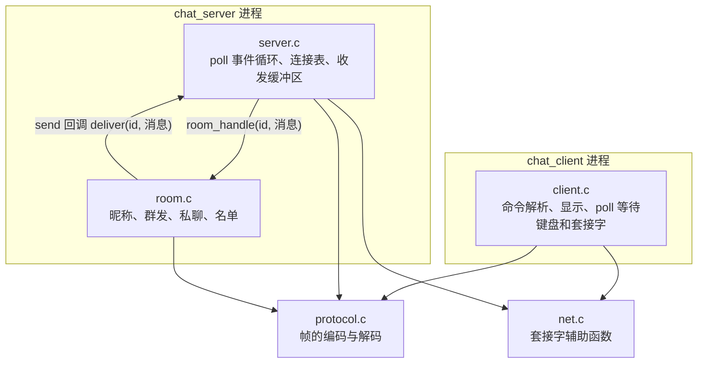

# 3.1 Mdr Chat Room 项目概述

开三个终端。第一个运行服务器，第二个以 alice 的身份连上去，第三个用 bob。alice 敲下 `hi bob` 回车，bob 的终端立刻多出一行 `<alice> hi bob`，alice 自己的终端也出现同样一行；bob 用 `/msg alice 你好，私聊一下` 回一句，只有 alice 看得到；alice 用 `/list` 查到 `alice bob`，bob 用 `/nick robert` 改名，两边同时收到通知。这中间只有两个 C 程序和一个 TCP 连接，没有服务端脚本，也没有数据库。

Mdr Chat Room 正是一个遵循极简主义设计的网络聊天室：由单线程事件驱动的服务器 `chat_server` 与命令行客户端 `chat_client` 组成，双方通过一套基于长度前缀的自定义二进制协议进行通信。服务器仅借助单个 `poll()` 系统调用并发照看所有连接，支持昵称登记、全员群发、单播私聊、在线成员列表查询以及在线改名。核心产品代码约 1300 行（含注释），测试代码约 600 行，其体量与复杂度非常适合在一周内深入研读并实践。

本案例分为三个递进篇章展开：本节首先从工程全貌切入，梳理其功能边界、本地构建与运行方式、模块分层边界以及核心数据结构的不变式约定；[3.2 协议、消息与执行路径](/教程/正文/项目案例/Mdr_Chat_Room/3_2_协议_消息与执行路径) 进一步深入二进制通信细节，逐字节拆解帧格式并追踪一条消息穿透网络与业务层的完整生命周期；[3.3 测试与扩展任务](/教程/正文/项目案例/Mdr_Chat_Room/3_3_测试与扩展任务) 则剖析其三层测试体系的设计思路，并给出一组逐步进阶的代码修改任务。项目的完整实现收录于 `code/项目/Mdr_Chat_Room/` 目录中。

在技术脉络上，本项目综合运用了前序章节介绍的多项核心技术：包括基于非阻塞套接字的文件描述符 I/O（[文件描述符与非缓冲 I/O](/教程/正文/系统编程/2_文件描述符与非缓冲IO)）、TCP 面向字节流的切包与拼包特性（[传输控制协议](/教程/正文/系统编程/9_网络基础/9_2_TCP)）、套接字初始化与网络寻址（[套接字编程](/教程/正文/系统编程/10_套接字编程)），以及利用 I/O 多路复用搭建单线程事件循环（[非阻塞 I/O 与 I/O 多路复用](/教程/正文/系统编程/11_非阻塞IO与IO多路复用)、[事件循环](/教程/正文/系统编程/12_事件循环)）。在系统异常与信号处理方面，涉及对 `SIGPIPE` 的忽略与 `SIGTERM` 的平稳退出响应；在架构解耦上，`room.c` 通过函数指针与不透明上下文 `void *` 将业务逻辑与底层网络 I/O 彻底分离，体现了经典的 C 语言面向对象抽象风格。构建与测试体系则以 CMake、GNU make 与 CTest 为载体。

## 1. 功能与范围

支持的功能只有五项：用 NICK 登记昵称、SAY 群发、WHISPER 私聊、LIST 查询在线名单、登记之后再次 NICK 改名。昵称是不超过 16 字节的 ASCII 字母、数字、下划线或连字符，全局唯一；正文最长 1024 字节，UTF-8 编码的中文原样通过。

项目刻意不做的事情同样明确：不加密、不保存历史、不用多线程、不管连接超时、不用 `epoll`、不做优雅关闭。这些是有意划出的范围，不是遗漏；连接超时、`epoll` 和优雅关闭在下一章的 [4.1 Mdr Server 项目概述](/教程/正文/项目案例/Mdr_Server/4_1_项目概述) 里出现。

| 项目 | 取值 |
|:---|:---|
| 产品代码 | 1322 行（`include/`、`src/`，含注释） |
| 测试代码 | 621 行（`tests/`） |
| 最大连接数 | 32（`ROOM_CAPACITY`） |
| 单帧上限 | 1044 字节（3 字节帧头 + 1041 字节帧体） |
| 依赖 | 标准 C 库；服务器与客户端另需 POSIX 套接字与 `poll()` |

## 2. 构建、运行与测试

### 2.1 CMake

在 Linux 上，三条命令完成构建与测试：

::: terminal title="bash - Mdr_Chat_Room"

```text
$ cmake -S . -B build
$ cmake --build build -j2
$ ctest --test-dir build --output-on-failure
    Start 1: protocol
1/3 Test #1: protocol .........................   Passed    0.00 sec
    Start 2: room
2/3 Test #2: room .............................   Passed    0.00 sec
    Start 3: integration
3/3 Test #3: integration ......................   Passed    1.14 sec

100% tests passed, 0 tests failed out of 3

Total Test time (real) =   1.15 sec
```

:::

三个测试套件分别对应架构的三个层次：`protocol` 针对协议编解码逻辑执行单元测试；`room` 验证聊天室的业务规则（通过存根回调函数替代底层的网络调用）；`integration` 则实际拉起真实的服务器和客户端进程，通过本地 TCP 端口完成端到端收发。集成测试由于需要等待进程间通信与状态同步，耗时通常在秒级；而两组单元测试则可在数毫秒内迅速完成。

`CMakeLists.txt` 给 GCC 和 Clang 打开 `-Wall -Wextra -Wpedantic -Werror`，任何警告都会让构建失败。想同时检查内存错误，加一个选项重新配置到另一个目录：

::: terminal title="bash - Mdr_Chat_Room（ASan/UBSan）"

```text
$ cmake -S . -B build-asan -DCHAT_SANITIZE=ON
$ cmake --build build-asan -j2
$ ctest --test-dir build-asan --output-on-failure
    Start 1: protocol
1/3 Test #1: protocol .........................   Passed    0.02 sec
    Start 2: room
2/3 Test #2: room .............................   Passed    0.02 sec
    Start 3: integration
3/3 Test #3: integration ......................   Passed    2.18 sec

100% tests passed, 0 tests failed out of 3

Total Test time (real) =   2.22 sec
```

:::

`sanitizer` 选项除了 `-fsanitize=address,undefined`，还带了 `-fno-sanitize-recover=all`。UBSan 默认只打印一行报告、程序照常运行，测试照样判为通过；加上这个选项，未定义行为一发生程序就终止，ctest 才会报失败。

### 2.2 Makefile

没有 CMake 时用同目录的 `Makefile`（需要 GNU make）：

::: terminal title="bash - Mdr_Chat_Room（make）"

```text
$ make -j2
$ make unit
build/test_protocol
test_protocol: 130 checks, 0 failed
build/test_room
test_room: 28 checks, 0 failed
$ make test
build/test_protocol
test_protocol: 130 checks, 0 failed
build/test_room
test_room: 28 checks, 0 failed
bash tests/integration.sh build
== register
== broadcast
== private message
== list and rename
== split and coalesced frames
== malformed frame
== piped input
== privacy
== quit
== shutdown
integration: all checks passed
```

编译过程打印的 `cc …` 行已省略。

:::

`make` 编译全部产物到 `build/`，`make unit` 只跑两个单元测试，`make test` 加上集成测试，`make clean && make SANITIZE=1 test` 在 sanitizer 下把三层全部跑一遍。`-MMD -MP` 让编译器顺便写出 `.d` 依赖文件，改了头文件也会重新编译受影响的源文件。

### 2.3 运行

服务器默认监听 `127.0.0.1:20000`，客户端把昵称作为唯一的必需参数。`-v` 让服务器把每次读到的原始字节和收发的每条消息打印到标准错误：

::: terminal title="bash - 三个终端"

```text
$ ./build/chat_server -v          # 终端 1
$ ./build/chat_client alice       # 终端 2
$ ./build/chat_client bob         # 终端 3
```

:::

两个程序都接受 `-h 主机` 和 `-p 端口`。客户端支持的命令：

| 输入 | 作用 |
|:---|:---|
| 普通的一行文字 | 发给所有人 |
| `/nick 新昵称` | 改昵称 |
| `/msg 昵称 内容` | 私聊 |
| `/list` | 查看在线名单 |
| `/help` | 显示命令列表 |
| `/quit` | 立即退出 |
| Ctrl-D | 不再发送，收完服务器的回复后退出 |

不以斜杠开头、又不是空行的一律当群发内容。`/help` 打印的说明（略去连接提示和收到的消息）：

::: terminal title="bash - chat_client dave"

```text
commands:
  /nick NAME       change your nickname
  /msg NAME TEXT   send a private message
  /list            show who is online
  /quit            leave the chat
any other line is sent to everyone
```

:::

### 2.4 一次真实会话

alice 先进入，bob 随后进入。alice 说一句话，bob 用中文私聊 alice，alice 查看名单，bob 改名为 robert，最后 alice 用 `/quit` 退出、bob 按 Ctrl-D。alice 的终端：

::: terminal title="bash - chat_client alice"

```text
$ ./build/chat_client alice
connected to 127.0.0.1:20000, type /help for commands
* welcome to Mdr Chat Room, alice (1 online)
* bob joined
<alice> hi bob
[private] <bob> 你好，私聊一下
* online: alice bob
* bob is now known as robert
```

:::

bob 的终端：

::: terminal title="bash - chat_client bob"

```text
$ ./build/chat_client bob
connected to 127.0.0.1:20000, type /help for commands
* welcome to Mdr Chat Room, bob (2 online)
<alice> hi bob
* bob is now known as robert
* alice left
connection closed by server
```

:::

两边的差别值得留意。alice 看到 `<alice> hi bob` 这一行，是因为服务器把群发发给了所有已登记成员，发言者自己也在其中；客户端程序本身不做回显，终端回显的只是她敲进去的那行原文。bob 的终端里没有私聊内容，因为那条 PRIVATE 只发给了 alice。bob 改名后，两边收到的通知文本一模一样，说明这行文字由服务器生成，客户端只负责加前缀显示。

### 2.5 不用终端也能用

客户端的标准输入不必是终端。输入结束时它只关闭发送方向，仍然继续接收，直到服务器关闭连接：

::: terminal title="bash - printf | chat_client"

```text
$ printf 'hello from a pipe\n/list\n' | ./build/chat_client bob 2>&1
connected to 127.0.0.1:20000, type /help for commands
* welcome to Mdr Chat Room, bob (2 online)
<bob> hello from a pipe
* online: alice bob
connection closed by server
```

:::

管道里的最后一行不带换行符也会被发出，`printf '/list' | ./build/chat_client carol` 同样能拿到名单。这个行为是修过的一个缺陷：早先的版本在输入结束时直接丢掉缓冲区里的半行。为什么半关闭之后还能收到回复，见 3.2 的客户端一节。

::: tip Windows 上用 Ninja 生成器

在 Windows 上只能构建 `chat_core` 库和两个单元测试，`server.c`、`client.c`、`net.c` 需要 POSIX 的 `poll.h`、`sys/socket.h`、`netdb.h`。构建时用 `cmake -S . -B build -G Ninja`。`MinGW Makefiles` 生成器配合 `mingw32-make` 处理不了 `code/项目/` 这样的中文路径，构建时报 `No rule to make target`，指向 `src/protocol.c`；把目录复制到纯英文路径下也能通过。用 Ninja 时 ctest 只跑 protocol 和 room 两项，两项都通过，集成测试不登记。

:::

## 3. 目录与模块

```text
Mdr_Chat_Room/
├── CMakeLists.txt        CMake 构建与 CTest 测试登记
├── Makefile              没有 CMake 时的简易构建（GNU make）
├── include/
│   ├── protocol.h        线路格式：帧的布局、消息类型、编解码接口
│   ├── room.h            聊天室规则的接口，以及给网络层的发送回调类型
│   └── net.h             套接字辅助函数
├── src/
│   ├── protocol.c        帧的编码、解码与接收缓冲区（只用 ISO C）
│   ├── room.c            昵称登记、群发、私聊、在线名单（只用 ISO C）
│   ├── net.c             getaddrinfo、监听、连接、非阻塞、完整发送（POSIX）
│   ├── server.c          poll 事件循环、连接表、收发缓冲区、延迟关闭（POSIX）
│   └── client.c          命令解析、同时等待键盘和服务器、显示消息（POSIX）
└── tests/
    ├── check.h           极简的断言宏
    ├── test_protocol.c   协议的单元测试
    ├── test_room.c       聊天室规则的测试，用假的网络层记录发出的消息
    └── integration.sh    集成测试：真实的服务器、客户端进程和原始字节
```

模块之间的调用方向：



编译依赖只朝一个方向：上面的层包含下面的头文件，下面的层不知道上面的层存在。图中唯一反向的箭头是运行时的发送回调，它走的是函数指针，不在头文件的依赖里。

### 3.1 三层划分

协议层是 `protocol.h` 和 `protocol.c`，只做字节和消息之间的转换。它定义帧的布局、消息类型编号，提供 `proto_encode`、`proto_decode` 和按帧切分字节流的 `frame_buffer_next`。它不知道谁在发、发给谁，也不碰任何系统调用，用到的头文件只有 `<stdbool.h>`、`<stddef.h>`、`<stdio.h>` 和 `<string.h>`。

业务层是 `room.h` 和 `room.c`，只管聊天规则：谁能改成什么昵称、群发该发给谁、私聊对象不存在时回什么错误、在线名单按什么顺序排。它用一个成员编号认识每个连接，不碰套接字，只依赖协议层的消息类型。

网络层是 `server.c`、`client.c` 和 `net.c`，只管连接：接受、读、写、关闭。`server.c` 维护连接表、在 `poll` 上等事件、把收到的整帧交给 `room_handle`；`client.c` 同时等键盘和套接字；`net.c` 收拢 `getaddrinfo`、`bind`、`connect` 这些固定步骤，返回普通的文件描述符，调用方照常对它使用 `recv`、`send`、`poll` 和 `close`。

这个划分直接决定了两件事。一是 `protocol.c` 和 `room.c` 能在 Windows 上编译和测试：它们只包含 `protocol.h`、`room.h`、`<stdbool.h>`、`<stddef.h>`、`<assert.h>`、`<stdio.h>`、`<string.h>`，全是 ISO C 头文件；`server.c` 一开头就包含 `<poll.h>` 和 `<sys/socket.h>`，`client.c` 同样，`net.c` 还要 `<netdb.h>`，并用 `fcntl` 把套接字设为非阻塞；MinGW 没有 `<poll.h>`、`<sys/socket.h>` 和 `<netdb.h>`，`<fcntl.h>` 虽然存在，却不声明 `fcntl` 和 `F_GETFL`。二是聊天规则可以脱离网络单独测试：`tests/test_room.c` 换一个发送函数就能检查每一条规则，不用起服务器。

### 3.2 room 怎样把消息交给网络层

业务层和网络层之间只有一个联系点：`room.h` 里的一行类型定义。

```c
typedef void room_send_fn(void *ctx, int member_id, const message *msg);
```

聊天室对象保存一个函数指针和一块上下文指针，在 `room_init` 时由网络层提供：

```c
typedef struct {
    room_member members[ROOM_CAPACITY];
    room_send_fn *send; /* 由网络层提供 */
    void *ctx;          /* 原样传回给 send */
} chat_room;
```

`room.c` 里所有要发消息的地方都调用 `room->send(room->ctx, id, &msg)`，`room.c` 自己不知道 `ctx` 指向什么。服务器传进来的是 `deliver` 和整个 `chat_server` 的地址，测试传进来的是把消息记进数组的 `record` 和记录本。这与 `qsort` 接受比较函数、`bsearch` 接受比较函数的思路相同：算法只调用回调，具体行为由调用者决定。

另一种写法是把群发逻辑直接写进 `server.c`：`read_client` 解析出一个 SAY 之后，自己遍历连接表，给每个已登记的连接编码并发送。左栏是这种写法的样子（项目里没有这段代码，它是为了对比而写的），右栏是 `room.c` 里实际存在的那段。

::: compare left-title="在 read_client 里直接群发" right-title="room_handle 加发送回调"

```c
/* server.c：聊天规则和发送混在一起 */
static void handle_say_in_server(chat_server *srv, int from,
                                 const char *text) {
    for (int id = 0; id < ROOM_CAPACITY; id++) {
        if (!srv->room.members[id].registered) {
            continue;
        }
        message msg;
        message_set(&msg, MSG_CHAT, srv->room.members[from].nick, text);
        deliver(srv, id, &msg);
    }
}
```

---

```c
/* 发给除 except 以外的所有已登记成员（except 为 -1 表示不排除任何人）。
 * 未登记的连接还不算进入聊天室，收不到群发。 */
static void send_all(chat_room *room, int except, msg_type type,
                     const char *name, const char *text) {
    message msg;
    message_set(&msg, type, name, text);
    for (int id = 0; id < ROOM_CAPACITY; id++) {
        if (id != except && room->members[id].registered) {
            room->send(room->ctx, id, &msg);
        }
    }
}
```

:::

右栏的写法多一层间接，换来两个好处。第一，测试 `test_room.c` 不需要套接字，也不需要在 Windows 上编不了 `server.c` 的问题面前停下：它把 `record` 传进去，`room_handle` 处理完一条消息，记录本就按顺序多了几条待发消息，断言直接检查收件人、类型、昵称和正文。左栏的写法要测同一条规则，必须造出 32 个连接、调用 `deliver`、再截获 `send`，或者干脆只做集成测试。第二，`room.c` 里没有任何平台相关的头文件，同一份源码在两个平台上编译的是同一份规则。

<Quiz
  type="single"
  :options="[
    { label: '它只包含 ISO C 头文件，不需要 poll() 和套接字接口', value: 'A' },
    { label: '它用函数指针代替了套接字调用', value: 'B' },
    { label: '它在编译时定义了 _POSIX_C_SOURCE', value: 'C' },
    { label: '它把平台相关的代码放进了 net.c', value: 'D' }
  ]"
  answer="A"
>

<template #question>

`room.c` 能在 MinGW 下编译，原因是什么？

</template>

正确答案是 **A**。`room.c` 只包含 `room.h`、`<assert.h>`、`<stdio.h>`、`<string.h>`，不调用任何 POSIX 接口。`client.c` 和 `server.c` 都包含 `<poll.h>` 和 `<sys/socket.h>`，`net.c` 还要 `<netdb.h>`，这三个头文件 MinGW 都没有；`net.c` 调用的 `fcntl` 也不在 MinGW 的 `<fcntl.h>` 里。

</Quiz>

<Quiz
  type="single"
  :options="[
    { label: 'room.c 直接调用 send() 把字节写进套接字', value: 'A' },
    { label: 'room_handle 调用的 send 是 chat_room 里保存的函数指针', value: 'B' },
    { label: 'room.c 把消息写进全局数组，server.c 轮询这个数组', value: 'C' },
    { label: 'room.c 通过 return 值把消息返回给 server.c', value: 'D' }
  ]"
  answer="B"
>

<template #question>

`room.c` 通过什么方式把处理结果交给网络层？

</template>

正确答案是 **B**。`chat_room` 里存着 `room_send_fn *send` 和 `void *ctx`，由 `room_init` 时的调用者填写，`room.c` 对两者都只当作不透明的值使用。这使得同一份规则能在测试里把消息记进数组，在服务器里编码后写进连接。

</Quiz>

## 4. 关键数据结构

协议层提供两组类型：一条解码后的消息，一个接收缓冲区。

```c
typedef struct {
    msg_type type;
    char name[PROTO_NICK_MAX + 1];
    char text[PROTO_TEXT_MAX + 1];
} message;

typedef struct {
    unsigned char data[PROTO_FRAME_MAX];
    size_t len;
} frame_buffer;
```

`message` 的两个字段都以 `'\0'` 结尾，用不到的字段是空串。`frame_buffer` 的容量正好是一帧的上限：每次读完都会取走所有完整的帧，剩下的只能是不完整的半帧，而半帧所属的整帧不会超过上限，所以下一次 `recv` 总有空间。为什么这个论证成立，留给 3.2。

业务层的两个结构体：

```c
typedef void room_send_fn(void *ctx, int member_id, const message *msg);

typedef struct {
    bool registered;
    char nick[PROTO_NICK_MAX + 1];
} room_member;

typedef struct {
    room_member members[ROOM_CAPACITY];
    room_send_fn *send; /* 由网络层提供 */
    void *ctx;          /* 原样传回给 send */
} chat_room;
```

网络层的连接表和服务器对象：

```c
typedef struct {
    int fd;                         /* -1 表示槽位空闲，此时其余成员没有意义 */
    bool closing;                   /* 已决定断开，下一轮循环开头再真正关闭 */
    frame_buffer in;                /* 收到了、还没凑成整帧的字节 */
    unsigned char out[OUTBUF_SIZE]; /* 已经编码、内核还没收下的字节 */
    size_t out_len;
} connection;

typedef struct {
    int listen_fd;
    bool verbose;
    connection conns[ROOM_CAPACITY]; /* 下标同时就是聊天室里的成员编号 */
    chat_room room;
} chat_server;
```

这几组类型之间有四条约定，整个程序都靠它们成立：

::: concept chat-room-invariants title="连接表与聊天室的四条约定"

1. `conns[i]` 与 `room.members[i]` 是同一个连接，编号 `i` 是两层之间唯一的联系。
2. `fd == -1` 表示槽位空闲；空闲槽位的其余成员没有意义。
3. `out_len > 0` 时才向 `poll` 要 `POLLOUT`；发送缓冲区满了，说明对方长期不读，直接断开它。
4. 发现连接该关闭时只把 `closing` 置为真，下一轮循环开头由 `close_marked` 统一关闭。

:::

第一条把两张表绑在一起。找空槽位就是找第一个 `fd < 0` 的下标，这个下标同时就是消息里用的成员编号，所以 `deliver(ctx, id, msg)` 直接用 `&srv->conns[id]`，不需要查表。第二条让“槽位是否被占用”只有一个判断依据。第三条关系到 CPU：套接字几乎总是可写的，无条件下关注 `POLLOUT`，`poll` 会立即返回，主循环原地空转。第四条处理的是重入：`deliver` 可能在群发循环的途中发现某个连接坏了，如果当场 `close` 并调用 `room_leave`，`room_leave` 又会群发离开通知，而此刻正遍历成员表，表会被修改。

<Quiz
  type="single"
  :options="[
    { label: 'deliver 发现发送缓冲区满的那一刻', value: 'A' },
    { label: '下一轮主循环开头，由 close_marked 统一关闭', value: 'B' },
    { label: 'poll 下一次返回之后、处理任何事件之前，由 poll 自己关闭', value: 'C' },
    { label: '进程退出时统一关闭', value: 'D' }
  ]"
  answer="B"
>

<template #question>

一个连接的 `closing` 被置为真之后，它的文件描述符什么时候真正 `close`？

</template>

正确答案是 **B**。置 `closing` 的地方（`read_client`、`conn_flush`、`deliver`、`reject_frame`）都只做标记。`run` 的循环体第一句就是 `close_marked`，它扫描连接表，对每个 `fd >= 0 && closing` 的槽位调用 `close`、把 `fd` 置为 -1，再调用 `room_leave` 通知其他人。这样处理事件的途中连接表不会变化。

</Quiz>

`chat_server` 里有 32 个 16 KiB 的发送缓冲区，加起来约 0.5 MiB，所以 `main` 把它定义成 `static` 对象而不是自动对象。在一个小程序里用 `sizeof` 打印各类型的大小，在 x86-64 Linux 上得到：

::: terminal title="bash - sizes"

```text
message      1048
frame_buffer 1056
connection   17456
chat_room    592
chat_server  559192 (0.53 MiB)
```

:::

`connection` 是 17456 字节，几乎全是那个 16384 字节的发送缓冲区；乘 32 再加其余成员，得到 559192。把它放在栈上，默认 8 MiB 的栈能撑住，但栈只有 256 KiB 时一启动就段错误。这是 50316 要做的实验。

::: generate chat-room-invariants-walkthrough kind=explanation concepts=chat-room-invariants

面向刚学完系统编程、第一次读多连接服务器的读者，逐条解释这四条约定各自的由来：为什么成员编号要等于槽位下标（新增和删除连接时不需要重新编号，也不需要查找表），为什么用 fd 的符号而不是单独一个布尔值表示空闲（close 之后把 fd 置 -1，只维护一个状态，不会出现“已关闭但标记为忙”的矛盾），为什么不能一直关注 POLLOUT（水平触发下可写几乎恒成立，主循环会空转），以及为什么关闭要延迟到一轮循环的开头（群发循环里关闭自己会重入修改成员表）。每条给出“如果不这样做会出什么问题”的具体后果，但不要展开 3.2 的代码走读。

:::

## 5. 读懂服务器日志

`-v` 打开后，服务器把每个事件按发生顺序打印到标准错误。下面是 2.4 那次会话的完整日志：

::: details 完整的 chat_server -v 日志

```text
listening on 127.0.0.1:20000
[#0] connected from 127.0.0.1:56856
[#0] read 9 byte(s): 01 00 06 05 61 6c 69 63 65
[#0] recv NICK name="alice" text=""
[#0] send WELCOME name="alice" text="welcome to Mdr Chat Room, alice (1 online)"
[#1] connected from 127.0.0.1:41748
[#1] read 7 byte(s): 01 00 04 03 62 6f 62
[#1] recv NICK name="bob" text=""
[#1] send WELCOME name="bob" text="welcome to Mdr Chat Room, bob (2 online)"
[#0] send NOTICE name="" text="bob joined"
[#0] read 10 byte(s): 02 00 07 00 68 69 20 62 6f 62
[#0] recv SAY name="" text="hi bob"
[#0] send CHAT name="alice" text="hi bob"
[#1] send CHAT name="alice" text="hi bob"
[#1] read 30 byte(s): 03 00 1b 05 61 6c 69 63 65 e4 bd a0 e5 a5 bd ef bc 8c e7 a7 81 e8 81 8a e4 b8 80 e4 b8 8b
[#1] recv WHISPER name="alice" text="你好，私聊一下"
[#0] send PRIVATE name="bob" text="你好，私聊一下"
[#0] read 4 byte(s): 04 00 01 00
[#0] recv LIST name="" text=""
[#0] send USERS name="" text="alice bob"
[#1] read 10 byte(s): 01 00 07 06 72 6f 62 65 72 74
[#1] recv NICK name="robert" text=""
[#0] send NOTICE name="" text="bob is now known as robert"
[#1] send NOTICE name="" text="bob is now known as robert"
[#0] disconnected
[#1] send NOTICE name="" text="alice left"
[#1] disconnected
server stopped
```

:::

除了开头一行 `listening on` 和结尾一行 `server stopped`，日志的每一行都带 `[#编号]` 前缀，分三种。`connected from`、`disconnected` 由连接的生命周期产生；`read N byte(s):` 是 `recv` 拿到的原始字节，十六进制、空格分隔，超过 32 字节时截断并加省略号；`recv`、`send` 各一条对应解码后或编码前的一条消息，打印类型名、昵称和正文。

读的时候抓住三个对应关系。第一，`[#0]` 就是槽位下标，也就是聊天室里的成员编号。alice 占 0 号、bob 占 1 号，所以后面所有 `room_handle(0, …)` 都能在日志里对上人。第二，一条 `read` 可能解出零帧、一帧或几帧：alice 的第一帧是 9 字节，解出 NICK；bob 那次 7 字节，解出 NICK；而如果两帧挤在一次 `read` 里，后面会跟两条 `recv`。第三，群发时每个已登记成员各有一行 `send CHAT`，发言者自己也有，所以 alice 看到自己那句话靠的是服务器发回来的这一份。

一行 `recv SAY` 之后有几行 `send CHAT`？已登记的成员每人一行，发言者也在其中。三个客户端 alice、bob、carol 在线时，alice 说一句 `hello everyone`，日志尾部是：

::: terminal title="bash - chat_server -v（三个客户端）"

```text
[#0] read 18 byte(s): 02 00 0f 00 68 65 6c 6c 6f 20 65 76 65 72 79 6f 6e 65
[#0] recv SAY name="" text="hello everyone"
[#0] send CHAT name="alice" text="hello everyone"
[#1] send CHAT name="alice" text="hello everyone"
[#2] send CHAT name="alice" text="hello everyone"
```

:::

第三个原始连接 `[#3]` 已经连上但没发 NICK，日志里只有它的 `connected from`，没有 `send CHAT`。未登记的连接还不算进入聊天室，群发不经过它。

<Quiz
  type="single"
  :options="[
    { label: 'N + 1 行，未登记的连接也收一份', value: 'A' },
    { label: 'N 行，每个已登记成员一行，含发言者自己', value: 'B' },
    { label: 'N - 1 行，发言者自己不收', value: 'C' },
    { label: '1 行，其余由客户端各自转发', value: 'D' }
  ]"
  answer="B"
>

<template #question>

服务器上有 N 个已登记用户在线（其中一个就是发言者），一条 SAY 产生几行 `send CHAT` 日志？

</template>

正确答案是 **B**。`send_all` 遍历全部槽位，对每个 `registered` 为真的成员调用一次 `send`，发言者也在其中，所以是 N 行。未登记的连接不计入。

</Quiz>

细节留在 3.2：帧头的三个字节怎么读、解码的检查顺序为什么是这样、`EAGAIN` 之后由哪段代码把剩下的数据发出去。

## 6. 阅读顺序

源码按依赖从下往上读，七天是一个合适的节奏。每个文件带着问题读，比从头看到尾有效；每读一节都开着 `-v` 运行一遍对照。

第 1 天，`protocol.h`、`protocol.c`、`tests/test_protocol.c`。带的问题是：帧头三个字节各是什么，为什么 `body_len` 用大端序；`proto_decode` 为什么在帧体收齐之前就检查类型和长度；`frame_buffer` 只有一帧大，凭什么够用。把 `test_encode_layout` 里那几组期望字节和 `protocol.h` 开头的格式说明逐字节对齐。

第 2 天，`room.h`、`room.c`、`tests/test_room.c`。带的问题是：`room_handle` 里为什么 NICK 要单独处理、不受“先登记”的限制；改名时新旧昵称各在什么时候写入；在线名单为什么按槽位顺序而不是按加入时间排。对着测试读，看每条规则是怎么用 `count_sent` 断言的。

第 3～4 天，`server.c`，按 `main` → `run` → `accept_client` → `read_client` → `deliver` 与 `conn_flush` → `close_marked` 的顺序。带的问题是：每一轮循环开头为什么先 `close_marked`；`poll` 的超时为什么设 1 秒；`read_client` 里那个 `assert(in->len < sizeof in->data)` 在什么条件下才可能不成立；`deliver` 为什么只做标记而不当场关闭。

第 5 天，`net.c` 和 `client.c`。带的问题是：`net_listen` 为什么要设 `SO_REUSEADDR`；客户端为什么用 `read` 而不是 `fgets` 读标准输入；输入结束之后为什么把 `fds[0].fd` 设成负数而不是直接退出。

第 6 天，`tests/integration.sh`。带的问题是：脚本怎样等一个客户端打印出某一行，为什么不用固定时长的 `sleep`；启动客户端时为什么要关掉 3～6 号文件描述符。脚本里的 `/dev/tcp` 段落可以直接照做，用来验证自己对帧格式的理解。

第 7 天，从 3.3 的扩展任务里挑一个动手做。改代码之前先把三层测试跑一遍，改完再跑一遍。

## 7. 习题

### 7.1 巩固

<Exercise id="50311" :d="2" :w="2">

按 2.1、2.2 的两种方式各构建一次并跑完全部测试，确认三层都通过。然后打开 `include/room.h`，把 `ROOM_CAPACITY` 改成 64，重新编译，记录报错原文，说明这条静态断言保护的是哪条协议约束（提示：看 `USERS` 消息的 `text` 字段），再把值改回去。

</Exercise>

<Exercise id="50312" :d="2" :w="2">

启动服务器（加 `-v`）和三个客户端，让 alice、bob、carol 都登记，再用 `nc` 或 bash 的 `/dev/tcp` 开第四个连接但不发 NICK。让 alice 发一句群发，在日志里标出这条 SAY 引起的全部行，包括 `read`、`recv` 和每一条 `send`。写出 N 个已登记用户在线时一条 SAY 产生几行 `send` 日志，并说明未登记的连接是否计入。

</Exercise>

<Exercise id="50313" :d="3" :w="2">

列出 `src/` 下每个 `.c` 文件包含的全部头文件，标出其中哪些属于 POSIX（不属于 ISO C）。据此说明为什么 `protocol.c`、`room.c` 能在 Windows 上编译而 `server.c` 不能。然后在 Windows 上用 CMake + Ninja 构建并运行单元测试，给出 ctest 的完整输出；再试一次 MinGW Makefiles 生成器，记录它在中文路径下的报错。

</Exercise>

<Exercise id="50314" :d="3" :w="3">

在 `read_client` 与 `deliver` 里各临时加几行 `fprintf(stderr, …)`，打印进入时的函数名和 `id`，构建后开两个客户端走一遍登记和群发，用输出确认实际调用顺序；对照源码画出从 `main` 到 `room_handle`、再经 `send_all`、`deliver`、`conn_flush` 回到网络层的完整调用链，为每个函数标注所在文件和所属层次（协议、业务、网络），指出哪一次调用跨越了层的分界。做完删掉临时的打印，重新构建确认输出恢复原样。

</Exercise>

### 7.2 编程

<Exercise id="50315" :d="3" :w="3">

只修改 `src/client.c`，让每条收到的消息前面带上本地时间，格式为 `[HH:MM:SS] `，例如 `[08:44:02] <bob> hello`。用 `time`、`localtime` 和 `strftime`，不要改动服务器和协议。改完后两个客户端互发几条消息，给出实际输出。说明为什么这个改动不需要服务器和协议配合，以及时间显示在发送端和接收端各有什么不同。

</Exercise>

<Exercise id="50316" :d="4" :w="3">

写一个小程序（或临时加一段代码），用 `sizeof` 打印 `message`、`frame_buffer`、`connection`、`chat_room`、`chat_server` 的大小，与“约 0.5 MiB”对照，并算出 32 个发送缓冲区占总大小的比例。再把 `main` 里的 `static chat_server srv;` 改成自动对象 `chat_server srv;`，在 `ulimit -s 256` 的 shell 里启动服务器，记录结果并解释；最后恢复 `static`。

</Exercise>

<Exercise id="50317" :d="4" :w="3">

给客户端加两个命令：`/who` 作为 `/list` 的别名，`/clear` 输出 ESC `[2J` ESC `[H` 清屏。`/clear` 只在本地生效，不向服务器发任何字节。实现后用 `-v` 的服务器日志证明 `/clear` 没有产生帧，并用 `cat -v` 显示客户端输出中的转义序列。说明 `/clear` 为什么不受协议“字段不许含控制字符”这条规则的限制。

</Exercise>

### 7.3 综合与挑战

<Exercise id="50318" :d="5" :w="4">

先把项目复制到临时目录，把 `room.c` 改成 kilo 那样：定义一个文件作用域的 `static chat_room room;`，去掉各函数的 `chat_room *` 参数，让 `send_all` 等直接读写这个全局对象，改完跑 `make test` 确认三层仍然通过。然后与 [kilo](/教程/正文/项目案例/kilo/2_1_源码阅读_kilo) 对比：kilo 把所有状态放在全局对象 `E` 里，本项目把 `chat_server *srv` 逐层传下去，业务层再通过 `void *ctx` 拿回它。各列两条好处和两条代价，用刚才的改动说明测试 `room.c` 时哪种写法更方便、为什么。做完把项目恢复原样。

</Exercise>

<Exercise id="50319" :d="5" :w="4">

读 `room.c` 的 `handle_nick` 与 `room_leave`，整理“昵称登记与改名”的完整规则表：昵称合法性、与他人冲突、改成自己现在的名字，以及未登记和已登记两种情况下分别给谁发什么消息。然后逐条对照 `tests/test_room.c`，找出没有被任何测试覆盖的规则（至少两处），各补一条测试，要求故意把对应代码改错时新测试会失败。

</Exercise>

## 8. 参考资料

1. 本项目源码与说明：仓库 `code/项目/Mdr_Chat_Room/`，其中 `README.md` 含协议表、架构图、执行路径与已知限制。
2. Brian Hall, ***Beej's Guide to Network Programming***，第 7.2 节 `poll()`、第 7.6 节 Son of Data Encapsulation：<https://beej.us/guide/bgnet/html/split/slightly-advanced-techniques.html>。长度前缀分帧与“一次 `recv` 不等于一条消息”的讲法参考于此。
3. POSIX.1-2024 `poll()`：<https://pubs.opengroup.org/onlinepubs/9799919799/functions/poll.html>。`POLLIN`、`POLLOUT`、`revents` 与 `EINTR` 的规定以此为准。
4. Michael Kerrisk, ***The Linux Programming Interface*** (ISBN 978-1-59327-220-3)，第 56～61 章套接字、第 63 章其他 I/O 模型。
5. W. Richard Stevens, Bill Fenner, Andrew M. Rudoff, ***UNIX Network Programming, Volume 1, 3rd ed.*** (ISBN 978-0-13-141155-5)，第 6 章 I/O 复用、第 16 章非阻塞 I/O。
6. RFC 2812, ***Internet Relay Chat: Client Protocol***：<https://www.rfc-editor.org/rfc/rfc2812>。文本行协议的聊天系统，用来对照本项目的长度前缀格式。
7. CMake, ***ctest(1)***：<https://cmake.org/cmake/help/latest/manual/ctest.1.html>。`--test-dir`、`--output-on-failure` 的语义与测试汇总行的格式。
