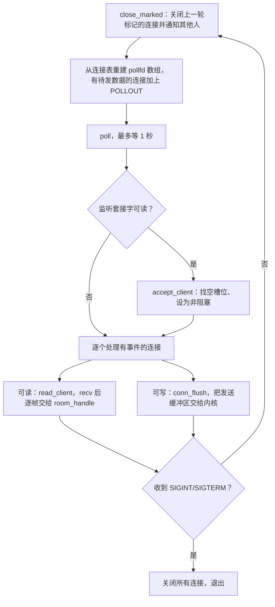
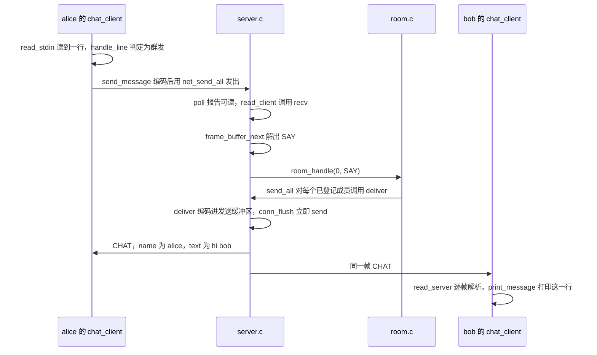
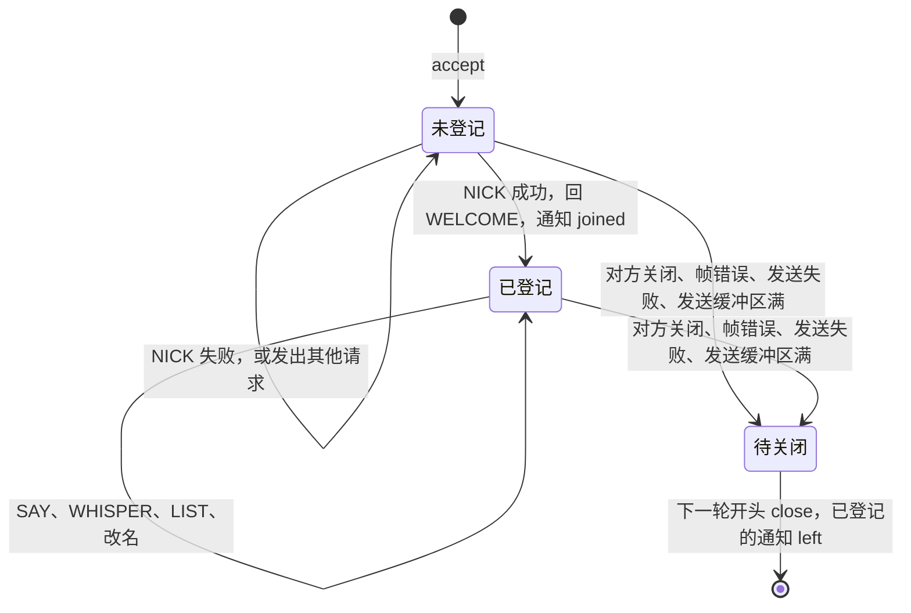

# 3.2 Mdr Chat Room：协议、消息与执行路径

客户端把一个字符串交给 `send`，服务器收到的不一定还是那个字符串。下面几段日志都是 `chat_server -v` 打印到标准错误的。前两段来自同一个会话，第三段来自另一个实验。

第一段里，`dave` 这个昵称是一个字节一个字节到达的，服务器读了八次，每次只有一个字节：

::: terminal title="bash - chat_server -v（节选）"

```text
[#0] read 1 byte(s): 01
[#0] read 1 byte(s): 00
[#0] read 1 byte(s): 05
[#0] read 1 byte(s): 04
[#0] read 1 byte(s): 64
[#0] read 1 byte(s): 61
[#0] read 1 byte(s): 76
[#0] read 1 byte(s): 65
[#0] recv NICK name="dave" text=""
```

:::

第二段里，客户端连着写出两条 SAY，服务器却只用一次 `recv` 就拿到了两帧：

::: terminal title="bash - chat_server -v（节选）"

```text
[#0] read 13 byte(s): 02 00 03 00 68 69 02 00 04 00 79 6f 21
[#0] recv SAY name="" text="hi"
[#0] send CHAT name="dave" text="hi"
[#0] recv SAY name="" text="yo!"
[#0] send CHAT name="dave" text="yo!"
```

:::

反方向的读取同样没有对应关系。在另一个实验里，一个客户端在登记之前发了一帧 SAY，紧接着在同一个连接上发了 NICK `eve` 和 LIST；服务器回了三帧，被 `cat` 一次全部读出，`od` 打出来是一段 89 字节的十六进制：

::: terminal title="bash - 一次读出三帧"

```text
 86 00 1a 00 72 65 67 69 73 74 65 72 20 61 20 6e
 69 63 6b 6e 61 6d 65 20 66 69 72 73 74 81 00 2c
 03 65 76 65 77 65 6c 63 6f 6d 65 20 74 6f 20 4d
 64 72 20 43 68 61 74 20 52 6f 6f 6d 2c 20 65 76
 65 20 28 32 20 6f 6e 6c 69 6e 65 29 84 00 0a 00
 61 6c 69 63 65 20 65 76 65
```

:::

面对这些长短不一、可能断续也可能粘连的原始字节流，系统需要解决两个核心问题：其一，接收端如何从连续无界的字节流中准确切分出独立的消息帧；其二，被正确反序列化出的消息在程序内部经过了怎样的调用链，才最终从 alice 的键盘端输入投递到 bob 的屏幕终端。理清这一连串状态流转后，便能从容对照十六进制输出还原帧结构，依据协议表为系统拓展新的消息指令，并能精准指认任意一帧在源码中被编码、路由分发与网络写入的具体位置。

## 1. 为什么要分帧

TCP 是字节流，它保证字节按顺序到达，但不记录发送方调用了几次 `send`：一次 `send` 的字节可以分成好几个报文段，接收方要调用好几次 `recv` 才凑得齐；反过来，几次 `send` 的内容也可能被一次 `recv` 全部取走，粘在一起。这在[传输控制协议（TCP）](/教程/正文/系统编程/9_网络基础/9_2_TCP)里叫做粘包和分包。网络编程教材处理这个问题通常只有两种办法：

1. **分隔符**：每条消息以某个字节或字节序列结尾，接收方一直读到分隔符为止。IRC 用的是 CR-LF，RFC 2812 规定一条消息连同结尾的 CR-LF 不超过 512 个字符。文本协议几乎都这么做。
2. **长度前缀**：每条消息的开头写明后面还有多少字节，接收方先读长度，再读到够数为止。二进制协议通常这么做。

Mdr Chat Room 选了长度前缀。理由在解析的一侧：帧头是定长的三个字节，到齐之后马上就知道这一帧有多长，声称超长的帧不必等帧体到齐就能拒绝；分隔符协议要一直读到分隔符才能判断长度，一个不停发字节却始终不发分隔符的对端可以让接收方一直缓冲下去。长度前缀的代价是发送方必须先算出长度、再按固定顺序写字段，这一点在 2.1 节会看到。

编码之后的一条消息称为帧（frame），下面的内容都围绕帧展开。

## 2. 帧格式

一帧分帧头（header）和帧体（body）两部分。帧头三个字节，帧体以 `name_len` 开头，后面依次是昵称和正文：

<BitField
  mode="frame"
  unit="byte"
  title="Mdr Chat Room 的一帧"
  :fields="[
    { name: 'type', bytes: 1, group: '帧头', desc: '消息类型，取值见第 3 节的表' },
    { name: 'body_len', bytes: 2, group: '帧头', desc: '帧体长度，大端序，1～1041' },
    { name: 'name_len', bytes: 1, group: '帧体', desc: 'name 的字节数，0～16' },
    { name: 'name', bytes: 16, variable: true, size: '0～16 字节', group: '帧体', desc: '昵称，不带结尾的 0' },
    { name: 'text', bytes: 1024, variable: true, size: '0～1024 字节', group: '帧体', desc: '正文，不带结尾的 0' }
  ]"
/>

各字段的取值范围：

| 字段 | 长度 | 允许的值 |
|:---|:---|:---|
| `type` | 1 字节 | 第 3 节类型表里的十个值之一 |
| `body_len` | 2 字节，大端序 | 1～1041 |
| `name_len` | 1 字节（帧体的第一个字节） | 0～16 |
| `name` | `name_len` 字节 | ASCII 字母、数字、`_`、`-` |
| `text` | `body_len - 1 - name_len` 字节 | 0～1024 字节 |

`body_len` 的下限是 1，因为帧体至少要放下 `name_len` 这一个字节；上限是 $1 + 16 + 1024 = 1041$。加上三个字节的帧头，一帧最长 1044 字节。`name` 和 `text` 在线上都不带结尾的 `'\0'`，长度完全由前面的计数字段决定；解码进 `message` 结构时才补上 `'\0'`，方便后面的 `printf` 和 `strcmp` 使用。

::: concept chat-proto-frame-layout title="帧的长度关系"

一帧的总长等于 `3 + body_len`，其中 `body_len = 1 + name_len + text_len`。因此 `text_len = body_len - 1 - name_len`，解码时不需要任何额外的分隔符或结束标记。

:::

`code/项目/Mdr_Chat_Room/demos/bytes_demo.c` 直接调用项目自己的 `proto_encode`，把几种典型消息编码后打印出来（编译方法见该目录的 `Makefile`）：

::: terminal title="bash - ./bytes_demo"

```text
NICK alice               (  9 字节): 01 00 06 05 61 6c 69 63 65
SAY "hi bob"             ( 10 字节): 02 00 07 00 68 69 20 62 6f 62
WHISPER bob "hi"         (  9 字节): 03 00 06 03 62 6f 62 68 69
USERS "alice bob"        ( 13 字节): 84 00 0a 00 61 6c 69 63 65 20 62 6f ...
SAY 300 个 x            (304 字节): 02 01 2d 00 78 78 78 78 78 78 78 78 ...
```

:::

拿第二行对照格式表：`02` 是 SAY，`00 07` 是帧体 7 个字节，`00` 是 `name_len` 为 0（群发没有昵称字段），剩下七个字节 `68 69 20 62 6f 62` 是 `hi bob`。第四行是服务器发出的 USERS，类型 `0x84` 最高位为 1，正文 `alice bob` 占 9 个字节，帧体是 $1 + 9 = 10$ 个字节。

### 2.1 大端序与逐字节写出

最省事的编码方式是把帧头定义成一个结构体，然后 `send(fd, &header, sizeof header, 0)`。这条路走不通，原因有两个。`code/项目/Mdr_Chat_Room/demos/struct_write.c` 把这件事做出来看：

::: terminal title="bash - ./struct_write"

```text
sizeof(struct frame_header) = 4
02 aa 03 00
```

:::

结构体只有 `uint8_t type` 和 `uint16_t body_len` 两个成员，加起来三个字节，`sizeof` 却是 4：`uint16_t` 要求两字节对齐，编译器在 `type` 后面插入了一个填充字节。这个字节的值是程序初始化时留下的 `0xAA`，一整个结构体发出去，接收方会把它当成 `body_len` 的高字节，帧就错位了。就算没有填充，`body_len = 3` 在 x86 的小端机器上写成 `03 00`，到了大端机器上读出来是 768。

正确的写法是一字节一字节地写，`src/protocol.c` 里的 `proto_encode` 就是这样：

```c
size_t proto_encode(const message *msg, unsigned char *out, size_t cap) {
    size_t name_len = strlen(msg->name);
    size_t text_len = strlen(msg->text);
    size_t body_len = 1 + name_len + text_len;
    if (name_len > PROTO_NICK_MAX || text_len > PROTO_TEXT_MAX ||
        PROTO_HEADER_SIZE + body_len > cap) {
        return 0;
    }

    out[0] = (unsigned char)msg->type;
    /* 多字节整数逐字节写出、高位在前。结果与本机的字节序无关，
     * 也不会像直接写出结构体那样把编译器插入的填充字节带上线路。 */
    out[1] = (unsigned char)(body_len >> 8);
    out[2] = (unsigned char)(body_len & 0xFF);

    unsigned char *body = out + PROTO_HEADER_SIZE;
    body[0] = (unsigned char)name_len;
    memcpy(body + 1, msg->name, name_len);
    memcpy(body + 1 + name_len, msg->text, text_len);
    return PROTO_HEADER_SIZE + body_len;
}
```

::: compare left-title="把结构体整个写出去" right-title="逐字节写出"

```c
struct frame_header {
    uint8_t type;
    uint16_t body_len;
};
/* sizeof 为 4，线上是 02 aa 03 00 */
write(fd, &h, sizeof h);
```

---

```c
out[0] = (unsigned char)msg->type;
out[1] = (unsigned char)(body_len >> 8);
out[2] = (unsigned char)(body_len & 0xFF);
write(fd, out, PROTO_HEADER_SIZE + body_len);
```

:::

大端序（big-endian）在网络协议里又叫网络字节序。C 语言没有规定多字节整数的字节顺序，同一段代码在 x86 和 ARM 上写出来的字节可能相反；按高位、低位分别写，结果就和机器无关了。`body_len` 超过 255 的时候这一点才看得出来：`bytes_demo` 最后一行正文 300 个 `x`，帧头是 `02 01 2d`，`0x012D` 正是 301（$1 + 0 + 300$），高字节 `01` 在前。

### 2.2 字段里不许控制字符

`text` 最终会打印到别人的终端上。如果里面混进了 ESC（`0x1B`），接收方的终端会把它当成控制序列的开头：`ESC [ 2 J` 清屏，`ESC ] 0 ; 标题 BEL` 改窗口标题；混进了换行，一条普通消息就能在别人的屏幕上伪造出一行以 `*` 开头的系统通知。所以协议规定 `name` 和 `text` 里不得出现 `0x00`～`0x1F` 和 `0x7F`，解码时逐个字节检查。`field_is_clean` 是 `src/protocol.c` 里的静态函数：

```c
static bool field_is_clean(const unsigned char *bytes, size_t len) {
    for (size_t i = 0; i < len; i++) {
        if (bytes[i] < 0x20 || bytes[i] == 0x7F) {
            return false;
        }
    }
    return true;
}
```

真实的拒绝输出如下。用 `/dev/tcp` 直接写一帧 SAY，正文是 `x`、换行、`y`，也就是 `78 0a 79`，`body_len` 为 4。服务器先回了 WELCOME（节选从这之后开始），接着回一帧 ERROR，然后关闭连接：

::: terminal title="bash - 正文里带换行"

```text
[#0] read 6 byte(s): 02 00 04 00 78 0a
[#0] read 1 byte(s): 79
[#0] protocol error: malformed field
[#0] send ERROR name="" text="malformed field"
[#0] disconnected
```

:::

换成 `ESC [ 2 J !`，结果相同，日志这一行是 `[#0] read 9 byte(s): 02 00 06 00 1b 5b 32 4a 21`，同样以 `protocol error: malformed field` 和一帧 ERROR 收场。

这个过滤只看单个字节，管不住用多个字节拼出来的控制序列。比如 U+009B 在 UTF-8 里是 `C2 9B`，两个字节都大于 `0x20`，能原样通过。复核这个项目时记录过一个现象：xterm、VTE 一类的终端会把 `C2 9B` 当作 CSI 解释，不过这一点没有在真实终端上验证。本项目只做到这一步，本章 3.3 节把它留成了一道习题，那里要求把过滤扩到 C1 控制字符。

UTF-8 编码的中文不在禁止之列，因为每个字节都大于 `0x7F`。一次真实的私聊，`bob` 发出 `/msg alice 你好，私聊一下`，日志里这一帧是 30 个字节：

::: terminal title="bash - 中文私聊帧"

```text
[#1] read 30 byte(s): 03 00 1b 05 61 6c 69 63 65 e4 bd a0 e5 a5 bd ef bc 8c e7 a7 81 e8 81 8a e4 b8 80 e4 b8 8b
[#1] recv WHISPER name="alice" text="你好，私聊一下"
```

:::

`03` 是 WHISPER，`00 1b` 是帧体 27 字节，`05` 是昵称 5 个字节，`61 6c 69 63 65` 是 `alice`，剩下的 21 个字节是 7 个汉字（每个 3 字节）。解码器不关心中间是哪种语言，它只数字节。

<Quiz
  type="single"
  :options="[
    { label: '03 00 06 03 62 6f 62 68 69', value: 'A' },
    { label: '03 03 62 6f 62 00 06 68 69', value: 'B' },
    { label: '03 00 05 03 62 6f 62 68 69', value: 'C' },
    { label: '03 00 06 00 62 6f 62 68 69', value: 'D' }
  ]"
  answer="A"
>

<template #question>

WHISPER 发给 `bob`、正文为 `hi` 的一帧，编码后是哪个字节序列？

</template>

正确答案是 **A**。正文从 `name_len` 之后开始，帧体是 `name_len`（1 字节）+ `bob`（3 字节）+ `hi`（2 字节），共 6 个字节，所以 `body_len = 0x0006`，大端写成 `00 06`。C 错在 `body_len` 只有 5；D 错在把 `name_len` 当成了 0，那样 `bob` 会被解码成正文的一部分。

</Quiz>

## 3. 消息类型

项目一共定义了十个消息类型，客户端的请求值都小于 `0x80`，服务器发出的值最高位为 1。请求和它引起的消息只差最高位，看类型值就能知道方向：

| 值 | 名称 | 方向 | `name` | `text` |
|:---|:---|:---|:---|:---|
| 0x01 | NICK | 客户端 → 服务器 | 想用的昵称 | — |
| 0x02 | SAY | 客户端 → 服务器 | — | 群发的内容 |
| 0x03 | WHISPER | 客户端 → 服务器 | 接收者 | 私聊的内容 |
| 0x04 | LIST | 客户端 → 服务器 | — | — |
| 0x81 | WELCOME | 服务器 → 客户端 | 登记成功的昵称 | 欢迎词 |
| 0x82 | CHAT | 服务器 → 客户端 | 发言者 | 内容 |
| 0x83 | PRIVATE | 服务器 → 客户端 | 发送者 | 内容 |
| 0x84 | USERS | 服务器 → 客户端 | — | 以空格分隔的在线昵称 |
| 0x85 | NOTICE | 服务器 → 客户端 | — | 系统通知 |
| 0x86 | ERROR | 服务器 → 客户端 | — | 出错原因 |

`proto_decode` 只检查类型在不在表里，方向位交给聊天室层判断；收到不该由对方发出的类型（比如客户端发来 CHAT），聊天室层当作请求错误回一帧 ERROR。这样帧格式的检查都在协议层，语义的检查都在业务层，两层的职责不混。

连接建立之后，只有 NICK 能在登记之前发。`room_handle` 把这条规则写成了一次判断：

```c
void room_handle(chat_room *room, int id, const message *msg) {
    assert(id >= 0 && id < ROOM_CAPACITY);
    if (msg->type == MSG_NICK) {
        handle_nick(room, id, msg->name);
        return;
    }
    /* 群发、私聊都要标明“是谁说的”，所以登记昵称之前只能发 NICK */
    if (!room->members[id].registered) {
        send_one(room, id, MSG_ERROR, NULL, "register a nickname first");
        return;
    }
    switch (msg->type) {
    case MSG_SAY:
        send_all(room, -1, MSG_CHAT, room->members[id].nick, msg->text);
        break;
    case MSG_WHISPER:
        handle_whisper(room, id, msg);
        break;
    case MSG_LIST:
        handle_list(room, id);
        break;
    default:
        /* 帧格式正确，但这是服务器才会发出的类型 */
        send_one(room, id, MSG_ERROR, NULL, "unexpected message type");
        break;
    }
}
```

### 3.1 两类错误

服务器对错误的处理分两类，区别在错误出在帧上还是请求上。

帧错误指类型未知、`body_len` 超出范围、`name_len` 与帧体不符，或字段里有控制字符。这时整个字节流已经不可信，服务器回一帧 ERROR 后断开这个连接。

::: concept chat-proto-frame-error title="解析出错就不能再接着读"

长度前缀的格式依赖每一帧开头的三个字节。一旦其中某一帧的类型、长度或字段不合法，接收方就无法确定这条消息本来有多长，也就找不到下一帧从哪里开始。剩下的字节再按帧去解析，得到的只能是错位的数据，所以只能断开连接。

:::

请求错误指昵称不合法或已被占用、私聊对象不存在、未登记就发言。帧本身完全正确，服务器回一帧 ERROR，连接保持，客户端可以接着发。

用 `/dev/tcp` 直接写三个字节 `02 ff ff`，`body_len` 是 65535，超过 1041 的上限。服务器回一帧 ERROR 就断开：

::: terminal title="bash - 超长的 body_len"

```text
[#0] read 3 byte(s): 02 ff ff
[#0] protocol error: bad frame length
[#0] send ERROR name="" text="bad frame length"
[#0] disconnected
```

:::

换一个连接，先发一帧没登记就想群发的 SAY，再发 NICK 和 LIST，情况就不同：ERROR 之后连接照常可用，后面的请求都被处理了：

::: terminal title="bash - 请求错误之后连接仍然可用"

```text
[#0] read 6 byte(s): 02 00 03 00 68 69
[#0] recv SAY name="" text="hi"
[#0] send ERROR name="" text="register a nickname first"
[#0] read 11 byte(s): 01 00 04 03 65 76 65 04 00 01 00
[#0] recv NICK name="eve" text=""
[#0] send WELCOME name="eve" text="welcome to Mdr Chat Room, eve (1 online)"
[#0] recv LIST name="" text=""
[#0] send USERS name="" text="eve"
```

:::

回到开头那段 89 字节的 `od` 输出，按帧拆开就是三种回复：

| 起始偏移 | 类型 | `body_len` | `name` | `text` | 帧长 |
|:---|:---|:---|:---|:---|:---|
| 0 | 0x86 ERROR | 26 | 空 | `register a nickname first` | 29 |
| 29 | 0x81 WELCOME | 44 | `eve` | `welcome to Mdr Chat Room, eve (2 online)` | 47 |
| 76 | 0x84 USERS | 10 | 空 | `alice eve` | 13 |

$29 + 47 + 13 = 89$，正好是 `od` 打出的字节数。第一帧的 `body_len` 是 26：1 个 `name_len` 加 25 个字符的 `register a nickname first`，没有昵称。第三帧是 USERS，正文 `alice eve` 说明 `eve` 登记成功之后，名单里是这两个人。

## 4. 编码与解码

`proto_encode` 在 2.1 节已经看过。它做三件事：算出长度，检查长度和字段上限，把类型、长度、`name_len`、昵称、正文依次写进调用方给的缓冲区。放不下就返回 0，调用方据此决定是丢弃还是断开。返回值是帧长，发送方马上要用这个长度去调 `send`。

解码的方向相反，难点在检查的顺序。下面 `proto_decode` 的代码注释直接说明了原因：

```c
proto_status proto_decode(const unsigned char *data, size_t len, message *msg,
                          size_t *frame_len) {
    if (len < PROTO_HEADER_SIZE) {
        return PROTO_INCOMPLETE;
    }
    /* 帧头一到就检查。帧头不对说明对方没有按协议发送，
     * 不必等它把帧体发完（它声称的帧体可能永远不会来）。 */
    if (!type_is_known(data[0])) {
        return PROTO_BAD_TYPE;
    }
    size_t body_len = ((size_t)data[1] << 8) | data[2];
    if (body_len < 1 || body_len > PROTO_BODY_MAX) {
        return PROTO_BAD_LENGTH;
    }
    if (len < PROTO_HEADER_SIZE + body_len) {
        return PROTO_INCOMPLETE;
    }

    const unsigned char *body = data + PROTO_HEADER_SIZE;
    size_t name_len = body[0];
    if (name_len > PROTO_NICK_MAX || 1 + name_len > body_len) {
        return PROTO_BAD_FIELD;
    }
    const unsigned char *name = body + 1;
    const unsigned char *text = name + name_len;
    size_t text_len = body_len - 1 - name_len;
    if (text_len > PROTO_TEXT_MAX || !field_is_clean(name, name_len) ||
        !field_is_clean(text, text_len)) {
        return PROTO_BAD_FIELD;
    }

    msg->type = (msg_type)data[0];
    memcpy(msg->name, name, name_len);
    msg->name[name_len] = '\0';
    memcpy(msg->text, text, text_len);
    msg->text[text_len] = '\0';
    *frame_len = PROTO_HEADER_SIZE + body_len;
    return PROTO_OK;
}
```

检查分成两批。帧头一到就查类型和 `body_len` 的范围，这一步只需要三个字节：不查的话，一个只发了 `02 ff ff` 的连接会让服务器一直等 65535 个字节，而这三个字节已经说明对方在乱发。帧体收齐之后才查 `name_len` 和两个字段的内容，因为它们都在帧体里，没到齐就无从查起。

四个返回值各有含义。`PROTO_INCOMPLETE` 表示字节还不够，调用方继续读；另外三个都是坏帧，差别只在日志里写哪一句话。`frame_len` 只在 `PROTO_OK` 时写入，失败时调用方手里的值没有意义。

`frame_buffer_next` 把“取一帧”和“删掉这一帧”合成一次调用：

```c
proto_status frame_buffer_next(frame_buffer *buf, message *msg) {
    size_t frame_len;
    proto_status status = proto_decode(buf->data, buf->len, msg, &frame_len);
    if (status == PROTO_OK) {
        /* 把后面的字节挪到开头。缓冲区只有一帧大，搬动的开销可以忽略，
         * 换来的是“数据总从 data[0] 开始”这个简单的约定。 */
        memmove(buf->data, buf->data + frame_len, buf->len - frame_len);
        buf->len -= frame_len;
    }
    return status;
}
```

这里必须用 `memmove`，因为源和目的区间重叠。缓冲区最多 1044 字节，多搬几次无足轻重；换来的是缓冲区里永远没有“读指针”这种状态，代码少一个出错的地方。测试 `test_every_prefix_is_incomplete` 把一帧的每一个真前缀都送进解码器，全部得到 `PROTO_INCOMPLETE`；`test_byte_by_byte` 则让两帧的字节一个一个到达，每一帧都恰好在它的最后一个字节到达时被取出。

### 4.1 接收缓冲区为什么一帧就够

接收端的缓冲区 `frame_buffer` 里，`data` 只有 `PROTO_FRAME_MAX`（1044）字节：

```c
typedef struct {
    unsigned char data[PROTO_FRAME_MAX];
    size_t len;
} frame_buffer;
```

看起来这不够：一次 `recv` 可能读进好几帧，也可能读进一帧半。原因在于每次读完都立刻取走所有完整的帧。

::: concept chat-proto-buffer-capacity title="接收缓冲区取一帧上限就够"

1. 每次 `recv` 返回后，`read_client` 循环调用 `frame_buffer_next`，直到返回 `PROTO_INCOMPLETE` 为止。因此缓冲区里剩下的字节一定是一个不完整的帧，也就是某一帧的真前缀。
2. 该帧的完整长度不超过 `PROTO_FRAME_MAX`（解码器拒绝任何 `body_len` 超过 `PROTO_BODY_MAX` 的帧，所以存在的帧都不超过这个上限）。
3. 它的真前缀比整帧短，所以剩余字节一定少于 `PROTO_FRAME_MAX`，下一次 `recv` 总有空间可写。

这要求解码器允许的最大帧长与缓冲区大小由同一个常量推出来，两者不能各写各的。

:::

`read_client` 用一个 `assert` 把这条推理写进了代码：

```c
static void read_client(chat_server *srv, int id) {
    connection *c = &srv->conns[id];
    frame_buffer *in = &c->in;
    /* 缓冲区满时其中必有一整帧，上一次调用已经把它取走，所以这里总有空间。
     * 若 recv 的长度参数为 0，它会返回 0，被误当成对方关闭了连接。 */
    assert(in->len < sizeof in->data);

    ssize_t n = recv(c->fd, in->data + in->len, sizeof in->data - in->len, 0);
```

注释的后半句可以单独验证：`recv` 的长度参数为 0 时确实返回 0，和“对端关闭”的返回值一样。`code/项目/Mdr_Chat_Room/demos/recv_zero.c` 用一对本地套接字试了一次：

::: terminal title="bash - ./recv_zero"

```text
recv(fd, buf, 0, 0) = 0
recv(fd, buf, sizeof buf, 0) = 1, 读到的字节是 x
```

:::

`assert` 在普通构建里保证这一步不会发生：缓冲区真满了，程序当场终止，不会拿一个为 0 的长度去调 `recv`。定义 `NDEBUG` 编译时 `assert` 被去掉，同样的错误就变成静默地断开一个本来好好的连接。缓冲区大小固定成常量，也是为了让这个长度永远大于 0。

Beej's Guide 的 7.6 节给了另一种做法：准备一个能装两个包的工作缓冲区，因为一次 `recv` 可能读到一整个包再加上下一个包的开头。本项目的做法不一样，读完立刻把整帧取走，缓冲区里永远不会同时存在两个完整的帧。两种做法都对，本项目的做法省一半内存，代价是每取一帧要搬一次后面的字节；在线聊天每帧只有几百字节，这点搬动没有影响。

<Quiz
  type="single"
  :options="[
    { label: '因为它只缓存一帧的正文，昵称放在另一个缓冲区里', value: 'A' },
    { label: '因为每次读完都会取走全部完整的帧，剩下的只是某一帧的前缀，而那一帧不超过上限', value: 'B' },
    { label: '因为 recv 每次最多返回一帧的字节数，内核会替应用切分', value: 'C' },
    { label: '因为缓冲区满了以后会自动扩容', value: 'D' }
  ]"
  answer="B"
>

<template #question>

接收缓冲区的大小取一帧的上限就够了，理由是什么？

</template>

正确答案是 **B**。C 是常见的误解：`recv` 只是把内核接收队列里的字节尽量多地复制出来，切分完全是应用层的事。缓冲区满了以后既不扩容，也不另外保存昵称。

</Quiz>

## 5. 服务器的一轮循环

服务器的主循环在 `run` 里，每一轮做四件事：关掉上一轮标记的连接，重建 `pollfd` 数组，调用 `poll`，处理就绪的描述符。

```c
static int run(chat_server *srv) {
    struct pollfd fds[1 + ROOM_CAPACITY];
    int ids[1 + ROOM_CAPACITY]; /* fds[k] 属于哪个连接；fds[0] 是监听套接字 */

    while (!stop_requested) {
        close_marked(srv);

        /* 每轮都从连接表重建 fds。最多 33 项，重建的开销可以忽略，
         * 换来的是不必在连接增减时同步维护两张表。 */
        nfds_t count = 0;
        fds[count] = (struct pollfd){.fd = srv->listen_fd, .events = POLLIN};
        ids[count++] = -1;
        for (int id = 0; id < ROOM_CAPACITY; id++) {
            const connection *c = &srv->conns[id];
            if (c->fd < 0) {
                continue;
            }
            /* 只在有数据待发时关注 POLLOUT。套接字几乎总是可写的，
             * 一直关注它，poll 就会立即返回，主循环原地空转。 */
            short events = POLLIN;
            if (c->out_len > 0) {
                events |= POLLOUT;
            }
            fds[count] = (struct pollfd){.fd = c->fd, .events = events};
            ids[count++] = id;
        }

        /* 超时设为 1 秒：信号若恰好在检查 stop_requested 之后、进入 poll
         * 之前到达，poll 不会被它打断；有了超时，最多晚 1 秒退出。 */
        if (poll(fds, count, 1000) < 0) {
            if (errno == EINTR) {
                continue;
            }
            perror("poll");
            return -1;
        }

        if (fds[0].revents & POLLIN) {
            accept_client(srv);
        }
        for (nfds_t k = 1; k < count; k++) {
            connection *c = &srv->conns[ids[k]];
            short revents = fds[k].revents;
            if (revents == 0 || c->closing) {
                continue;
            }
            /* 对方关闭或出错时 poll 报告 POLLHUP/POLLERR，
             * 交给 recv，由它的返回值说明是哪种情况。 */
            if (revents & (POLLIN | POLLHUP | POLLERR)) {
                read_client(srv, ids[k]);
            }
            if ((revents & POLLOUT) && !c->closing) {
                conn_flush(c);
            }
        }
    }
    return 0;
}
```

一轮的顺序画成流程图是这样：



`fds` 和 `ids` 是两个平行数组：`fds[k]` 是第 k 个描述符，`ids[k]` 是它对应的连接编号（监听套接字是 -1）。连接表里空闲的槽位被跳过，所以数组里的第 k 项和第 k 号连接没有关系，靠 `ids` 找回编号。

### 5.1 每轮重建 pollfd 的取舍

`poll` 要求调用方把关心的事件放在数组里传进去。另一种写法是维护一张常驻的 `pollfd` 表，连接增加时追加、断开时删除，再记下每项和哪个连接对应。那样每次增删都要改两处状态，删除时还要移动数组或者留空洞。

这里每轮都从 `conns` 重新生成一遍。由于最多只有 33 项，一次循环写 33 个小结构体的开销与 `poll` 在内核层遍历文件描述符相比几乎可以忽略。在工程权衡上，用微量的局部重复计算换取两张表免于状态不同步的复杂度，是一种非常务实的设计取舍。只有当连接数上升至数百乃至数千量级时，这一权衡才会发生反转，届时也往往会自然迁移至 `epoll` 架构。

### 5.2 只在有待发数据时关注 POLLOUT

套接字的发送缓冲区几乎总是空的，所以 `POLLOUT` 几乎总是就绪。把它常挂在 `events` 里，`poll` 每次都会立刻返回，`while` 循环退化成忙等，CPU 全花在空转上。[非阻塞 I/O 与 I/O 多路复用](/教程/正文/系统编程/11_非阻塞IO与IO多路复用)里用两个计数器演示过这个差别：一直关注 `POLLOUT` 的版本一秒内调用了两百八十多万次 `poll`，按需关注的版本只调用了一次。

本项目的规则只有一条：`out_len > 0` 时才加上 `POLLOUT`。发送缓冲区空的时候没有东西要发，`poll` 就老老实实睡着，等 `POLLIN`。

### 5.3 1 秒超时与信号

`poll` 被信号处理函数打断时返回 -1，`errno` 是 `EINTR`，而且不会自动重启。signal(7) 把 `poll` 明确列在“被信号处理函数打断后从不重启”的接口里，不管有没有设 `SA_RESTART`。服务器正是利用这一点：`SIGTERM` 的处理函数只把 `stop_requested` 置 1，正在阻塞的 `poll` 立刻以 `EINTR` 返回，主循环的条件不再成立，退出。

但有一个窗口：信号如果恰好在 `while (!stop_requested)` 检查之后、`poll` 进入阻塞之前到达，`poll` 看不到它，会一直睡到下一个事件。第三个参数 `1000` 就是给这个窗口兜底的：最多一秒，`poll` 超时返回，下一轮的条件检查看到标志，退出。实际退出很少等满一秒。在一个没有连接的空闲服务器上按 PID 发 `SIGTERM` 再计时，从发信号到进程结束是 3 毫秒，因为信号几乎总是正好落在 `poll` 阻塞期间，`EINTR` 立刻把主循环叫醒。

更好的做法是用自管道（self-pipe）：把信号处理函数改成向一个管道写一个字节，管道的读端加进 `poll`，就能去掉超时。README 的扩展任务里列了这一条，3.3 节会用到。

### 5.4 监听套接字也设为非阻塞

`accept` 返回的新套接字在 Linux 上不继承 `O_NONBLOCK`，所以 `accept_client` 对每个新连接单独调用 `net_set_nonblocking`。监听套接字本身也设成了非阻塞，依据 accept(2) 的 NOTES：`poll` 报告可读之后，连接可能已经被对方撤出队列，此时阻塞的 `accept` 会一直等下一个连接，把整个服务器停住。设成非阻塞之后，这种情况返回 `EAGAIN`，`accept_client` 忽略它，回到主循环。

```c
static void accept_client(chat_server *srv) {
    int fd = accept(srv->listen_fd, NULL, NULL);
    if (fd < 0) {
        /* ECONNABORTED：对方在我们 accept 之前就断开了，不影响服务器 */
        if (errno != EAGAIN && errno != EWOULDBLOCK && errno != EINTR &&
            errno != ECONNABORTED) {
            perror("accept");
        }
        return;
    }
```

连接上的“异常”事件在这里一并处理。`poll` 在 `revents` 里报告 `POLLERR` 和 `POLLHUP`，即使程序没有在 `events` 里请求它们；POSIX 规定 `POLLHUP` 与 `POLLOUT` 互斥，所以挂断的连接不会同时被当成可写。`run` 把 `POLLHUP`、`POLLERR` 和 `POLLIN` 一起交给 `read_client`，由 `recv` 的返回值区分是对方关闭（0）、出错（-1）还是有数据可读。这样判断连接的生死只有一处代码，`poll` 只负责通知“这里有事情发生”。

## 6. 一条群发消息的执行路径

alice 在终端里敲下 `hi bob` 并回车，到 bob 的屏幕上出现 `<alice> hi bob`，中间经过下面这些函数：



下面逐个看服务器侧的三个环节。

`read_client` 负责把字节变成消息。它先 `recv`，把新字节接在缓冲区末尾，然后循环取帧，每取出一帧就调用一次 `room_handle`：

```c
    if (srv->verbose) {
        trace_bytes(id, in->data + in->len, (size_t)n);
    }
    in->len += (size_t)n;

    /* 一次 recv 拿到的可能是半帧、一帧或好几帧：
     * 取出所有完整的帧，剩下的半帧留在缓冲区里等下一次。 */
    for (;;) {
        message msg;
        proto_status status = frame_buffer_next(in, &msg);
        if (status == PROTO_INCOMPLETE) {
            break;
        }
        if (status != PROTO_OK) {
            reject_frame(srv, id, status);
            break;
        }
        if (srv->verbose) {
            trace_message(id, "recv", &msg);
        }
        room_handle(&srv->room, id, &msg);
        if (c->closing) {
            break; /* 处理途中发现连接已坏（例如发给它自己的回复发不出去） */
        }
    }
```

一次 `recv` 里有几帧就处理几帧，处理途中有人被标记关闭（比如发消息的人自己的回复发不出去），就停止处理剩下的帧。

`room_handle` 到 `send_all` 是业务层的扇出（fan-out）。SAY 走 `send_all(room, -1, MSG_CHAT, nick, text)`，`except` 为 -1 表示不排除任何人：

```c
static void send_all(chat_room *room, int except, msg_type type,
                     const char *name, const char *text) {
    message msg;
    message_set(&msg, type, name, text);
    for (int id = 0; id < ROOM_CAPACITY; id++) {
        if (id != except && room->members[id].registered) {
            room->send(room->ctx, id, &msg);
        }
    }
}
```

三十二个槽位都扫一遍，只给已登记的成员发。`room->send` 是网络层在 `room_init` 时注册的回调，实际指向 `deliver`。业务层不知道套接字的存在，测试里把回调换成一个往数组里记消息的函数，聊天规则就能脱离网络测试。

`deliver` 把消息编码进连接的发送缓冲区，然后立即试着发：

```c
static void deliver(void *ctx, int id, const message *msg) {
    chat_server *srv = ctx;
    connection *c = &srv->conns[id];
    if (c->fd < 0 || c->closing) {
        return;
    }
    size_t n =
        proto_encode(msg, c->out + c->out_len, sizeof c->out - c->out_len);
    if (n == 0) {
        fprintf(stderr, "[#%d] output buffer full, dropping client\n", id);
        /* 这里只做标记：此刻可能正在聊天室群发的循环里，立即关闭会调用
         * room_leave，在遍历成员表的途中修改它。 */
        c->closing = true;
        return;
    }
    c->out_len += n;
    if (srv->verbose) {
        trace_message(id, "send", msg);
    }
    conn_flush(c);
}
```

`conn_flush` 在套接字可写时把缓冲区里的字节尽量交给内核；发不完的部分留在里面，主循环看到 `out_len > 0` 就会在下一轮关注 `POLLOUT`。非阻塞的 `send` 在内核发送缓冲区满时返回 -1，`errno` 是 `EAGAIN`，`conn_flush` 遇到它就跳出循环，剩下的字节等下一轮：

```c
static void conn_flush(connection *c) {
    size_t sent = 0;
    while (sent < c->out_len) {
        ssize_t n = send(c->fd, c->out + sent, c->out_len - sent, 0);
        if (n < 0) {
            if (errno == EINTR) {
                continue;
            }
            if (errno != EAGAIN && errno != EWOULDBLOCK) {
                c->closing = true; /* 对方已经断开（EPIPE、ECONNRESET 等） */
            }
            break;
        }
        sent += (size_t)n;
    }
    memmove(c->out, c->out + sent, c->out_len - sent);
    c->out_len -= sent;
}
```

发送缓冲区 16 KiB。`out_len` 加上新编码的 `n` 超过容量，`proto_encode` 的 `cap` 检查就会失败，返回 0，`deliver` 把连接标记为待关闭。单线程服务器不能停下来等一个慢客户端，也不能无限制地替它攒数据，所以慢到连 16 KiB 都排不出去的对端会被直接断开。

在 `-v` 日志里，这条路径留下的痕迹很整齐。alice 和 bob 都在线时，alice 说一句 `hi bob`：

::: terminal title="bash - 群发的日志"

```text
[#0] read 10 byte(s): 02 00 07 00 68 69 20 62 6f 62
[#0] recv SAY name="" text="hi bob"
[#0] send CHAT name="alice" text="hi bob"
[#1] send CHAT name="alice" text="hi bob"
```

:::

一行 `read`、一行 `recv`，然后每个已登记成员各一行 `send`。第三行和第四行是两次独立的 `deliver` 调用，连接编号分别是 0 和 1。日志里看不到 `send` 究竟写进了内核多少字节，那由 `conn_flush` 决定，不打印。

::: details 完整的一次会话日志

alice 先进入，bob 随后进入；alice 说了 `hi bob`，bob 用中文私聊 alice，alice 查看名单，bob 改名为 robert，最后两人先后离开。

```text
listening on 127.0.0.1:24680
[#0] connected from 127.0.0.1:45612
[#0] read 9 byte(s): 01 00 06 05 61 6c 69 63 65
[#0] recv NICK name="alice" text=""
[#0] send WELCOME name="alice" text="welcome to Mdr Chat Room, alice (1 online)"
[#1] connected from 127.0.0.1:45624
[#1] read 7 byte(s): 01 00 04 03 62 6f 62
[#1] recv NICK name="bob" text=""
[#1] send WELCOME name="bob" text="welcome to Mdr Chat Room, bob (2 online)"
[#0] send NOTICE name="" text="bob joined"
[#0] read 10 byte(s): 02 00 07 00 68 69 20 62 6f 62
[#0] recv SAY name="" text="hi bob"
[#0] send CHAT name="alice" text="hi bob"
[#1] send CHAT name="alice" text="hi bob"
[#1] read 30 byte(s): 03 00 1b 05 61 6c 69 63 65 e4 bd a0 e5 a5 bd ef bc 8c e7 a7 81 e8 81 8a e4 b8 80 e4 b8 8b
[#1] recv WHISPER name="alice" text="你好，私聊一下"
[#0] send PRIVATE name="bob" text="你好，私聊一下"
[#0] read 4 byte(s): 04 00 01 00
[#0] recv LIST name="" text=""
[#0] send USERS name="" text="alice bob"
[#1] read 10 byte(s): 01 00 07 06 72 6f 62 65 72 74
[#1] recv NICK name="robert" text=""
[#0] send NOTICE name="" text="bob is now known as robert"
[#1] send NOTICE name="" text="bob is now known as robert"
[#1] disconnected
[#0] send NOTICE name="" text="robert left"
[#0] disconnected
server stopped
```

:::

### 6.1 为什么延迟关闭

`deliver` 发现发送缓冲区满时，只把 `c->closing` 置为真。关闭套接字的动作发生在下一轮循环开头的 `close_marked`：

```c
static void close_marked(chat_server *srv) {
    bool closed_any = true;
    while (closed_any) {
        closed_any = false;
        for (int id = 0; id < ROOM_CAPACITY; id++) {
            connection *c = &srv->conns[id];
            if (c->fd < 0 || !c->closing) {
                continue;
            }
            close(c->fd);
            c->fd = -1;
            fprintf(stderr, "[#%d] disconnected\n", id);
            /* 群发离开通知时，别的连接可能因为发送缓冲区溢出而被标记，
             * 所以外层循环要再扫一遍，直到没有新的标记。 */
            room_leave(&srv->room, id);
            closed_any = true;
        }
    }
}
```

如果 `deliver` 自己关闭连接，调用链是 `read_client → room_handle → send_all → deliver`。`send_all` 正在遍历成员表，`deliver` 里调用 `room_leave` 会把这个成员的 `registered` 清掉，再进入一次 `send_all` 发离开通知。外层的群发还没走完，成员表已经在遍历途中被改了，退出通知插到了半路。`deliver` 里那段注释说的就是这件事：立即关闭会调用 `room_leave`，在遍历成员表的途中修改它。

延迟关闭把关闭和通知从处理事件的过程里拿出来，放到每轮开头单独做。这样在处理 `poll` 结果的整个过程中，成员表只读不写。`close_marked` 外层那个 `while (closed_any)` 处理另一种连锁：关闭一个连接时发出的离开通知，可能又把别的慢连接灌满、被标记，于是要再扫一遍，直到没有新的标记为止。

下面的日志对比能看出差别。两个不读数据的慢客户端 `slow1`、`slow2` 先后被标记，之后 `eve` 发出足够多的消息把它们的发送缓冲区灌满。左边是把关闭写进 `deliver` 的版本，右边是项目里的版本，两边都只保留与慢客户端有关的行：

::: compare vertical left-title="在 deliver 里立即关闭" right-title="只标记，下一轮 close_marked 统一关闭"

```text
[#0] output buffer full, dropping client
[#1] send NOTICE name="" text="slow1 left"
[#2] send NOTICE name="" text="slow1 left"
[#1] output buffer full, dropping client
[#2] send NOTICE name="" text="slow2 left"
[#2] disconnected
```

---

```text
[#0] output buffer full, dropping client
[#1] output buffer full, dropping client
[#0] disconnected
[#2] send NOTICE name="" text="slow1 left"
[#1] disconnected
[#2] send NOTICE name="" text="slow2 left"
[#2] disconnected
```

:::

左边两行 `output buffer full` 之间夹着两行 `slow1 left`，那是 #0 的发送缓冲区在群发途中满了之后，`deliver` 立刻关掉它、又立刻调用 `room_leave`，把离开通知发给 #1 和 #2 的结果。等内层返回，外层的群发才继续把同一条 CHAT 发给 #1，于是 #1 也满了。右边两行 `output buffer full` 紧挨着，中间没有任何通知，说明那条群发在遍历成员的过程中只是把两个慢连接标记了一下，没有关闭、也没有再进入一次 `send_all`；等到下一轮开头，才依次关闭并通知。

两种写法在这段日志里都没有崩。区别在于左版本依赖 `send_all` 的循环在成员表被改动之后仍然安全：内层 `room_leave` 清掉一个成员的登记状态时，外层循环正走到哪一格、那个成员是不是还要再收一次消息，都取决于当时的顺序。项目选右边，代价只是关闭晚一轮发生，那些排不出去的字节本来也要丢掉。

## 7. 客户端：同时等待键盘和服务器

客户端只有两个描述符要等：标准输入和套接字。`poll` 一次关注两个，哪个可读就处理哪个：

```c
    struct pollfd fds[2] = {
        {.fd = STDIN_FILENO, .events = POLLIN},
        {.fd = cl.fd, .events = POLLIN},
    };
    for (;;) {
        if (poll(fds, 2, -1) < 0) {
            if (errno == EINTR) {
                continue;
            }
            perror("poll");
            break;
        }
        if (fds[1].revents != 0 && !read_server(&cl)) {
            break;
        }
        if (fds[0].revents != 0) {
            input_result r = read_stdin(&cl);
            if (r == INPUT_QUIT) {
                break;
            }
            if (r == INPUT_EOF) {
                /* 输入结束（Ctrl-D 或管道关闭）：半关闭连接，告诉服务器
                 * “我不会再发了”，但继续接收，直到服务器关闭连接。这样
                 * printf '/list\n' | chat_client alice 也能看到回复。
                 * 把 fd 设为负数，poll 就不再关注这一项。 */
                shutdown(cl.fd, SHUT_WR);
                fds[0].fd = -1;
            }
        }
    }
```

先处理套接字、后处理键盘，顺序看起来反了，其实是故意的：服务器可能在客户端等待输入的时候断开，先读套接字能尽早发现，不至于让用户敲完一行才发现连接已经没了。

### 7.1 用 read 不用 fgets

`<stdio.h>` 的 `fgets` 是读行的自然选择，但它和 `poll` 放在一起会出问题。`fgets` 调用 `read` 时一次可能读进好几行，存在 `FILE` 对象自己的缓冲区里；`poll` 只看内核的接收队列，看不到 `stdio` 缓冲区里剩下的行，于是那些行要等到下一次有新数据到达、`poll` 再次返回时才被处理。

`code/项目/Mdr_Chat_Room/demos/fgets_poll.c` 就是这样一个错误示范：`poll` 等到标准输入可读，然后用 `fgets` 读一行并打印经过的秒数。输入用一段脚本生成，前三行立刻写进管道，两秒后再写第四行：

::: terminal title="bash - 用 fgets 读标准输入"

```text
0.0s got: first
2.0s got: second
2.0s got: third
2.0s got: fourth
```

:::

`second` 和 `third` 在 0 秒时就已经在管道里，却一直等到 2.0 秒 `fourth` 到达才被打印。`fgets` 的第一次 `read` 把三行一起读进了 `stdio` 缓冲区，`poll` 之后再也没有被唤醒，缓冲区里的两行就一直躺着。

客户端的 `read_stdin` 直接对标准输入调用 `read`，自己按换行切分：

```c
static input_result read_stdin(chat_client *cl) {
    /* 新读到的字节接在上次剩下的半行后面，最多填到缓冲区末尾 */
    char *tail = cl->line + cl->line_len;
    char *limit = cl->line + sizeof cl->line;
    ssize_t n = read(STDIN_FILENO, tail, (size_t)(limit - tail));
    if (n == 0) {
        /* 输入结束。最后一行可能没有换行符（例如 printf '/list' | ...），
         * 也要照常处理；line_len 总小于缓冲区大小，放得下结尾的 '\0'。 */
        if (cl->line_len > 0 && !cl->skipping) {
            cl->line[cl->line_len] = '\0';
            cl->line_len = 0;
            if (handle_line(cl->fd, cl->line) == INPUT_QUIT) {
                return INPUT_QUIT;
            }
        }
        return INPUT_EOF;
    }
    if (n < 0) {
        if (errno == EINTR) {
            return INPUT_OK;
        }
        perror("read");
        return INPUT_EOF;
    }
    cl->line_len += (size_t)n;

    /* 和 TCP 一样，一次 read 得到的不一定正好是一行：
     * 处理所有完整的行，最后的半行留到下一次。 */
    char *start = cl->line;
    char *end = cl->line + cl->line_len;
    char *newline;
    while ((newline = memchr(start, '\n', (size_t)(end - start))) != NULL) {
        *newline = '\0';
        input_result r = cl->skipping ? INPUT_OK : handle_line(cl->fd, start);
        cl->skipping = false;
        start = newline + 1;
        if (r != INPUT_OK) {
            return r;
        }
    }
    size_t rest = (size_t)(end - start);
    if (rest == sizeof cl->line) {
        if (!cl->skipping) {
            fprintf(stderr, "input line too long, ignored\n");
        }
        cl->skipping = true;
        rest = 0;
    }
    memmove(cl->line, start, rest);
    cl->line_len = rest;
    return INPUT_OK;
}
```

### 7.2 按行切分与分帧是同一个问题

`read_stdin` 对键盘做的事，和 `read_client` 对套接字做的事完全同构：一次 `read` 得到的不一定是整数行，可能是半行、一行或好几行，所以要有一个缓冲区记住半行，循环处理完整的行，最后把剩下的半行 `memmove` 到开头。TCP 上讲过的拆包与粘包，换到键盘输入就变成了“一次按键可能只送到半个字符、一次粘贴可能带上好几行”。[switch 与状态机](/教程/正文/语法和标准库/12_函数接口进阶/12_4_switch与状态机)里逐字节推进解析器的写法与此同理：每读进一段字节，就把它接到上次剩下的后面，能处理多少处理多少。

`handle_line` 顺手做了两件收尾的事。协议不允许控制字符，所以它先把一行里的控制字符都换成空格，免得用户粘贴的 Tab 让整条消息被服务器拒收；超过 1024 字节的行整行丢弃并打印一条提示，`skipping` 标志负责把这一行剩下的部分也扔掉，直到下一个换行。

### 7.3 输入结束时半关闭

标准输入读到文件结束（终端里按 Ctrl-D，或者管道关闭）之后，客户端调用 `shutdown(cl.fd, SHUT_WR)`：只关闭发送方向，告诉服务器“我不会再发数据了”，接收方向照常打开。服务器读到 EOF 后把这个连接标记为待关闭，在下一轮开头关闭它；此前收到的那一批请求都已经处理完，回复大部分已经交给内核，客户端能读到它们，最后读到 `connection closed by server` 退出。

```c
                shutdown(cl.fd, SHUT_WR);
                fds[0].fd = -1;
```

`fds[0].fd` 设成 -1 之后，`poll` 会忽略这一项：POSIX 规定 `fd` 为负值时 `events` 被忽略、返回时 `revents` 为 0。这样从“不再有键盘输入”到“服务器关闭连接”之间，客户端只剩一个描述符要等，不会空转。不设 -1 的话，标准输入是管道时，管道读到结尾之后 `poll` 仍会一直报告这一项就绪，`read_stdin` 每次返回 `INPUT_EOF`，循环就在两个立刻返回的调用之间转圈。这个半关闭还有一个实际用处：标准输入是管道时，输入结束后仍然能收到服务器的回复。

::: terminal title="bash - 从管道输入"

```text
connected to 127.0.0.1:24680, type /help for commands
* welcome to Mdr Chat Room, bob (2 online)
<bob> hello from a pipe
* online: alice bob
connection closed by server
```

:::

`printf 'hello from a pipe\n/list\n' | ./chat_client -p 24680 bob` 的输入在管道关闭时就结束了，客户端先半关闭，服务器处理完 SAY 和 LIST，回完 WELCOME、CHAT、USERS，再发现读方向结束，关闭连接。`/quit` 走的是另一条路：`main` 直接 `break`，然后 `close(cl.fd)`，不等服务器回话。

### 7.4 两个程序都忽略 SIGPIPE

向一个已经关闭的连接调用 `send`，内核会向进程发 `SIGPIPE`，默认动作是终止进程。send(2) 说得清楚：本地这一端已经关闭时 `send` 返回 `EPIPE`，并且除非设置了 `MSG_NOSIGNAL`，进程还会收到 `SIGPIPE`。于是一个客户端的断开可以让整个服务器进程消失。

`code/项目/Mdr_Chat_Room/demos/sigpipe.c` 在不忽略信号的程序里向已经关闭的套接字写一个字节：

::: terminal title="bash - 不忽略 SIGPIPE"

```text
exit status: 141
```

:::

进程被信号杀掉了，退出状态 141 就是 128 + 13（`SIGPIPE`）。`printf` 那行根本没执行到。所以服务器和客户端都在 `main` 开头执行 `signal(SIGPIPE, SIG_IGN)`，让 `send` 改为返回 -1、`errno` 为 `EPIPE`，由 `conn_flush` 或 `send_message` 按普通的发送错误处理，只影响那一个连接。

## 8. 连接的生命周期

把一个连接在服务器上的状态画出来，只有四个：



进入“待关闭”的原因有五个，都在 `server.c` 里：

| 原因 | 位置 | 触发条件 |
|:---|:---|:---|
| 对方关闭或半关闭 | `read_client` | `recv` 返回 0 |
| 读出错 | `read_client` | `recv` 返回 -1 且不是 `EAGAIN`、`EINTR` |
| 帧错误 | `reject_frame` | `proto_decode` 返回三个坏帧状态之一 |
| 发送出错 | `conn_flush` | `send` 返回 -1 且不是 `EAGAIN`、`EWOULDBLOCK` |
| 发送缓冲区满 | `deliver` | `proto_encode` 放不下，返回 0 |

“待关闭”只是 `connection` 结构里 `closing` 字段为真。关闭套接字、把 `fd` 置 -1、调用 `room_leave` 发离开通知，都要等到下一轮循环开头的 `close_marked`。离开通知只发给已登记的成员：没登记过的连接别人本来就不知道，`room_leave` 检查 `registered`，为假就直接返回。

服务器退出时走的是另一条路：`run` 返回后，`main` 用 `close` 关掉所有还开着的连接和监听套接字，不再逐个发离开通知。这些都是服务器自己要退出了，通知谁也没有意义。

<Quiz
  type="multi"
  :options="[
    { label: '对方半关闭了发送方向，recv 返回 0', value: 'A' },
    { label: '解码时 body_len 超过 1041', value: 'B' },
    { label: '同一连接上昵称已被别人占用', value: 'C' },
    { label: '发送缓冲区 16 KiB 已满，deliver 编码不下', value: 'D' }
  ]"
  :answer="['A', 'B', 'D']"
>

<template #question>

下列哪些情况会让一个连接进入“待关闭”状态？

</template>

正确答案是 **A、B、D**。C 是请求错误：昵称被占用只回一帧 ERROR，连接保持，用户可以换一个名字重试，这也是集成测试里 carol 改了名还能继续说话的原因。

</Quiz>

## 9. 习题

### 9.1 巩固

<Exercise id="50321" :d="2" :w="1">

手工写出两条消息的完整字节，不许运行程序：

1. WHISPER，接收者 `bob`，正文 `hi`。
2. USERS，正文 `alice bob`。

然后在 `tests/test_protocol.c` 的 `test_encode_layout` 里照着已有的三条 `CHECK` 加两组，用 `proto_encode` 验证你手算的结果。`make unit` 跑完，`test_protocol` 的检查数应当比原来的 130 多出你新增的条数。

</Exercise>

<Exercise id="50322" :d="3" :w="2">

本节开头给出了 89 字节的 `od` 输出，3.1 小节末尾有一张拆解表。先别看那张表，自己按帧拆开，写出每一帧的起始偏移、类型名、`body_len`、`name_len`、`name` 和 `text`，核对三帧长度之和等于 89，再拿自己的结果和表对照。

再用 `/dev/tcp` 复现一次：先启动 `chat_server -v`，用 `chat_client` 登录一个 alice，然后

```text
exec 4<>/dev/tcp/127.0.0.1/端口
printf '\x02\x00\x03\x00hi' >&4
printf '\x01\x00\x04\x03eve\x04\x00\x01\x00' >&4
timeout 1 cat <&4 | od -An -tx1
```

你的 `od` 输出应当和正文的一致，`od` 每行多少字节由它的默认宽度决定，不必相同。

</Exercise>

<Exercise id="50323" :d="3" :w="2">

假设把 `body_len` 改成只占 1 个字节：

1. 此时 `text` 的上限最多是多少字节？写出计算过程。
2. 如果反过来改成占 4 个字节，`PROTO_BODY_MAX`、`PROTO_FRAME_MAX`、`PROTO_HEADER_SIZE` 和接收缓冲区的大小各要改哪些？`proto_encode`、`proto_decode` 里对应的移位和掩码怎么写？
3. 结合接收缓冲区只需一帧大的论证，说明对本项目来说，2 字节是不是合适的选择。改大之后每个连接多占多少内存？

</Exercise>

### 9.2 编程

<Exercise id="50324" :d="4" :w="2">

`proto_decode` 在帧体收齐之前就检查类型和 `body_len`。写一个反面版本 `proto_decode_late`：先等 `len >= PROTO_HEADER_SIZE + body_len` 再检查类型和长度。把它和原版分别放进一个小服务器里（可以借用 `read_client` 的结构），对同一个连接只发三个字节 `02 ff ff`，观察两边的行为差别。

再设想一个“先收齐再检查”、并且按 `body_len` 动态分配接收缓冲区的服务器：客户端只发三个字节的帧头就停住，服务器为这个连接分配了多大的缓冲区？如果同时开 20 个这样的连接呢？给出数字和你的结论。

</Exercise>

<Exercise id="50325" :d="4" :w="2">

把 `code/项目/Mdr_Chat_Room` 复制到临时目录，在副本里把 `proto_decode` 的 `body_len > PROTO_BODY_MAX` 检查删掉（只保留 `body_len < 1`），重新编译。用一个 `/dev/tcp` 连接先发 `02 ff ff`，再发 1041 个 `x`，然后关闭写端，观察服务器进程的退出状态和日志。

1. 解释 `read_client` 里那句 `assert` 为什么会被触发，触发时 `in->len` 和 `sizeof in->data` 各是多少。
2. 如果没有 `assert`（例如用 `-DNDEBUG` 编译），下一次 `recv` 的长度参数是多少？参照 `recv_zero` 的结果，说明会发生什么。
3. 说明为什么“缓冲区大小与解码上限必须由同一个常量推出来”。

做完把临时目录删掉，不要改动仓库里的项目。

</Exercise>

<Exercise id="50326" :d="4" :w="3">

三个已登记的用户 alice、bob、carol 在线，alice 发了一条 SAY。

1. 在服务器上，这一条消息至少引起几次 `recv`、几次 `send`？如果 alice 是在同一轮里发出两条 SAY（一次写入，两帧粘在一起），几个数字各是多少？
2. 三个目标里哪一个的 `send` 可能得到 `EAGAIN`？得到之后，剩下的字节在哪里、由哪段代码在什么条件下发出？
3. 用 `slow_sink` 和 `flood_sender`（在 `code/项目/Mdr_Chat_Room/demos/`）复现一次 `output buffer full, dropping client`，把服务器日志里相关的几行贴出来，并说明从缓冲区满到真正关闭之间隔了哪些步骤。

</Exercise>

### 9.3 综合与挑战

<Exercise id="50327" :d="5" :w="3">

在项目的副本里把 `deliver` 的“缓冲区满”分支改成立即 `close` 加 `room_leave`，然后用两个 `slow_sink` 加一个 `flood_sender` 复现。

1. 写出一次会出错的调用序列（从 `read_client` 开始，经过 `room_handle`、`send_all`、`deliver`，直到 `room_leave` 又进入 `send_all`），指出成员表在哪个时刻被修改。
2. 贴出你的版本与项目原版在同一场景下的日志对比，说明 `close_marked` 外层那个 `while (closed_any)` 循环在什么时候起到作用。
3. 如果把 `close_marked` 里“关闭后立刻 `room_leave`”改成“先把所有标记的连接关完，再统一发通知”，行为有什么不同？哪种更容易保证正确？

</Exercise>

<Exercise id="50328" :d="5" :w="3">

把 `src/client.c` 的 `read_stdin` 改成用 `fgets` 读一行（保留 `poll` 的结构），在副本上编译。

1. 用 `{ printf 'a\nb\n'; sleep 2; printf 'c\n'; } | ./chat_client -p 端口 nick` 复现消息被卡住的现象。在服务器 `-v` 日志里记录每一行实际到达的时刻，和客户端打印 `connected` 的时刻对比。
2. 解释 `poll`、`fgets` 和 `stdio` 缓冲区的分工，为什么第二行 `b` 要等到第三行才发出。
3. 改成 `setvbuf(stdin, NULL, _IONBF, 0)` 能不能解决？如果改成 `_IOLBF` 呢？实际试一次，用结果回答。参考[流状态与其他文件操作](/教程/正文/语法和标准库/13_输入输出/13_5_流状态与其他文件操作)里关于缓冲方式的说明。

</Exercise>

<Exercise id="50329" :d="6" :w="4">

为协议设计一个版本握手：连接建立后，客户端必须先发 HELLO，携带 1 字节版本号；服务器不支持这个版本时回一帧 ERROR 并断开，支持时回一帧 HELLO_ACK，之后才允许 NICK。

1. 给出新的类型表和每种消息的字段约定（现有 NICK、SAY、WHISPER、LIST 的类型值要不要改？）。
2. 讨论版本号放在帧头里还是放在消息里各有什么后果：旧客户端连上新服务器会看到什么？新客户端连上旧服务器又会怎样？
3. 写出需要改动的函数清单（`protocol.h`、`protocol.c`、`room.c`、`server.c`、`client.c`），并说明哪一处最容易漏。
4. 用 `/dev/tcp` 写一个最小的测试脚本，覆盖“版本正确”和“版本不支持”两条路径，贴出真实输出。

</Exercise>

## 10. 参考资料

- Brian Hall, *Beej's Guide to Network Programming*，7.4 节 Handling Partial `send()`s、7.6 节 Son of Data Encapsulation：<https://beej.us/guide/bgnet/html/split/slightly-advanced-techniques.html>
- POSIX.1-2024，`poll()`：<https://pubs.opengroup.org/onlinepubs/9799919799/functions/poll.html>
- Linux man-pages，`signal(7)`：<https://man7.org/linux/man-pages/man7/signal.7.html>
- Linux man-pages，`accept(2)`：<https://man7.org/linux/man-pages/man2/accept.2.html>
- Linux man-pages，`shutdown(2)`：<https://man7.org/linux/man-pages/man2/shutdown.2.html>；`send(2)`：<https://man7.org/linux/man-pages/man2/send.2.html>
- RFC 2812, *Internet Relay Chat: Client Protocol*，2.3 节：<https://www.rfc-editor.org/rfc/rfc2812>
- cppreference，`setvbuf`：<https://en.cppreference.com/w/c/io/setvbuf>；`fgets`：<https://en.cppreference.com/w/c/io/fgets>
- Michael Kerrisk, *The Linux Programming Interface*（ISBN 978-1-59327-220-3），第 61 章、第 63 章
- W. Richard Stevens 等, *UNIX Network Programming, Volume 1, Third Edition*（ISBN 978-0-13-141155-5），第 6 章、16.6 节
- GNU Bash Reference Manual，Redirections（`/dev/tcp`）：<https://www.gnu.org/software/bash/manual/html_node/Redirections.html>
- `code/项目/Mdr_Chat_Room/README.md` 第 5、7、8 节，以及 `src/` 下的源代码
